## How to use this book

This textbook is the SpaceCDF course volume. It accompanies the
40-hour Concurrent Design Facility programme and is organised in four
parts:

1. **Per-session course chapters** — one chapter per course session
   (Sessions 1.1 – 5.4). Each contains learning objectives,
   course chapters, exercises, expected reading, and supporting
   figures.
2. **Per-role background briefings** — a single chapter giving
   every CDF position the decisions, formulas, charts, pitfalls,
   and references they need from Day 1.
3. **Position appendix** — short-form per-position cards kept for
   quick reference at a console.
4. **Verification appendix** — a first-principles derivation and
   plot for every formula students use, with cross-method
   sanity checks. Suitable as the worked verification trail at PDR.

This textbook is paired with two companion volumes:

- the **SpaceCDF Course Workbook** — worksheets and exercises that
  students complete alongside the chapters in Part 1, plus the
  operational drills that exercise Part 2 (CubeSat Operations); and
- the **SpaceCDF Instructor Book** — simulator setup, anomaly
  scenarios, breakpoints, and instructor protocols, intended for
  the simulator operator and the instructor coach (not for
  trainees on console).

> **Expected reading before any session.** *NASA SEH* §1 – §3 —
> [https://www.nasa.gov/reference/systems-engineering-handbook/](https://www.nasa.gov/reference/systems-engineering-handbook/). NPR 7123.1D §3 —
> [https://nodis3.gsfc.nasa.gov/](https://nodis3.gsfc.nasa.gov/).
> *NASA CubeSat 101* —
> [https://www.nasa.gov/wp-content/uploads/2017/03/nasa_csli_cubesat_101_508.pdf](https://www.nasa.gov/wp-content/uploads/2017/03/nasa_csli_cubesat_101_508.pdf).

# Acknowledgement — Generative AI (AIG)

This textbook was produced with the assistance of generative AI as part
of the SpaceCDF Concurrent Design Facility workflow. The design-loop
convergence, agent rationales, embedded figures and document rendering
are generated by the SpaceCDF backend (Python · matplotlib · python-docx
· WeasyPrint) guided by ECSS, NASA SEH and SMAD references. Editorial
framing, worked examples, and pedagogical commentary remain owned by
the SpaceCDF teaching team. *Appendix D — How This Textbook Was
Generated* describes the pipeline in detail.

*Attribution follows the AIG (Assisted by Generative AI) framework —
Peters (2023), Logos IA-EN, CC BY-NC-SA 4.0 —
[https://mpeters.uqo.ca/en/logos-ia-en-peters-2023/*](https://mpeters.uqo.ca/en/logos-ia-en-peters-2023/*)

Any course deliverable that incorporates content from this textbook —
or from any document exported by SpaceCDF — must carry the AIG badge
and a short note describing how generative AI was used. Refusing to
use AI where it is permitted is fine; what is not acceptable is using
it without saying so.


# Agents, Positions, and the SpaceCDF Architecture

Two distinct concepts run through this textbook and they are sometimes
conflated in industry literature. Disentangling them is essential before
the first design loop.

A **position** is a *human role* assigned to a person sitting at a console
in the Concurrent Design Facility — for example *Power Engineer*, *AOCS
Lead*, or *Mission Analyst*. SpaceCDF defines fifteen positions, each
with scoped editing rights on a subset of the design parameters.

A **design agent** is a *computational solver* that runs in the
background and converges a particular subsystem or analysis. The current
release of SpaceCDF ships twenty agents grouped in two tiers:

Table 0.1 — SpaceCDF design agents grouped by parametric sizing (Tier 1) and cross-system analysis (Tier 2).

| Tier | Purpose | Agents |
|---|---|---|
| Tier 1 — Parametric sizing | Compute the design point of one subsystem from inputs supplied by the others | orbit · link · data · power · thermal · AOCS · propulsion · mass · structure |
| Tier 2 — Cross-system analysis | Score, check or audit the converged design | cost · risk · reliability · debris · radiation · sustainability · volume · systems · conflicts · community · TRL |

Each agent publishes three things to the design state when it runs:
its **parameters** (numbers with units, margin and confidence), its
**rationale** (a paragraph of textbook-grade reasoning), and a set of
**assumptions** that downstream agents and reviewers can interrogate.
Several agents also emit *structured intermediates* — the orbit agent
exposes a ΔV breakdown, the link agent exposes a full waterfall, the
thermal agent exposes hot- and cold-case node temperatures, the
reliability agent exposes a FMECA, and so on. Most exports surface these
intermediates as tables and figures alongside the bare numbers.

When a human position assignment changes a value, that parameter becomes
*sticky* in the design state and the agents do not overwrite it during
subsequent design loops. This is the formal handover between the human
operator and the computational solver, and it is the reason a CDF
session converges so quickly: the agents do the iterative arithmetic
while the positions do the engineering judgement.


# Design Reviews and the SpaceCDF Exports

A review gate is not merely a meeting. It is a *document set* whose
existence and contents are agreed in advance, whose generation is
traceable to a converged design state, and whose acceptance moves the
project from one ECSS phase to the next. SpaceCDF treats each review
gate as the natural anchor of an export bundle.

Table 0.2 — Review gates mapped to ECSS phases and the SpaceCDF export bundles produced at each.

| Review | ECSS phase | Exported bundle | Principal contents |
|---|---|---|---|
| MCR | Pre-Phase A | Mission Concept Report | Stakeholders, MoP/TPM, alternatives, ConOps draft |
| SRR | Phase A | SRR Design-Review Pack (Word + Excel + Markdown) | Mass / power / data / cost budgets with margin, orbit and architecture figures, compliance matrix, equipment list, TRL roll-up, risk matrix, cost P-curve, WBS bar |
| SDR | Phase A/B | System Design Review Pack | SRR contents plus block diagrams, derived requirements, preliminary trade studies |
| PDR | Phase B | PDR Design-Review Pack | SRR + SDR contents plus full trade-study record, verification matrix, interface control documents |
| CDR | Phase C | CDR Design-Review Pack | PDR contents plus test plan, AIT procedures, qualification status |

In addition to the design-review packs, SpaceCDF generates a family of
*data item descriptions* (DIDs) in editable Word format: the Mission
Requirements Document (MRD), Concept of Operations (ConOps), Verification
Plan (VP), Systems Engineering Management Plan (SEMP), Risk Management
Plan (RMP), Interface Requirements Document (IRD), Test Plan, and the
Bill of Materials.  Specialist reports cover the thermal analysis, the
end-of-life deorbit plan, the Remote Sensing Space Systems Act (RSSSA)
licence application, and the verification test programme.

# Part 1 — CubeSat Design {: .part-divider}

# Chapter 1.1 — Introduction to Space Mission Design

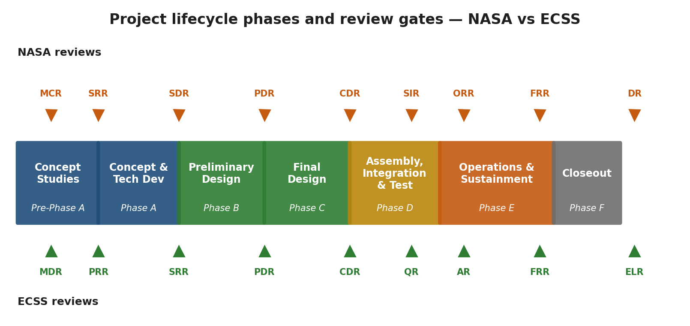

*Lifecycle phases and review gates.*


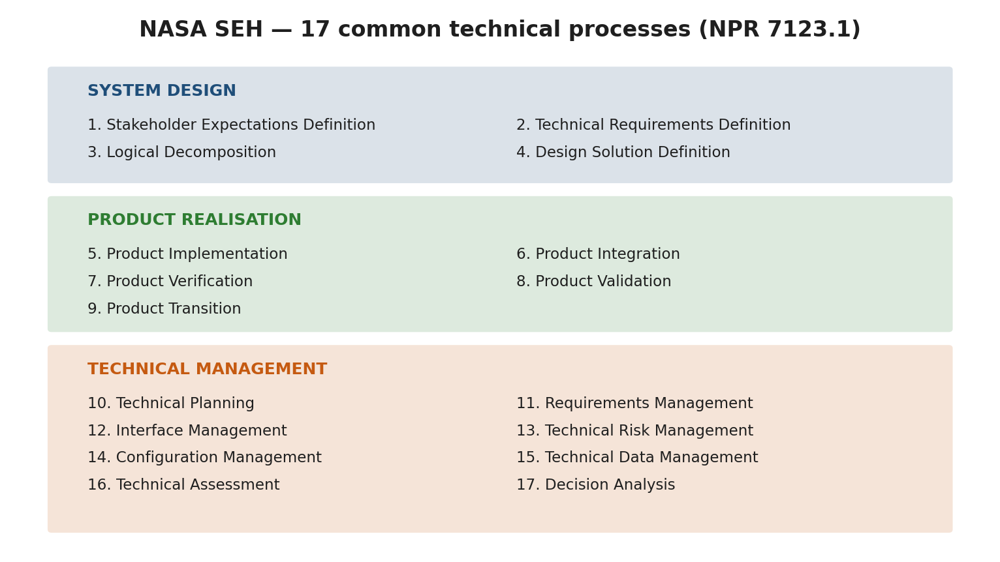

*NASA SEH 17 processes pyramid.*


> **Expected reading before this session.** NASA SEH §1 – §3 (≈ 60 min) — [https://www.nasa.gov/reference/systems-engineering-handbook/](https://www.nasa.gov/reference/systems-engineering-handbook/). NPR 7123.1D §3 (≈ 30 min).


**Prerequisites:** None (engineering background assumed)
**References:**
- [NASA, Systems Engineering Handbook Rev 2 (SP-2016-6105), 2016](https://www.nasa.gov/reference/systems-engineering-handbook/)
- [NASA, NPR 7123.1D -- Systems Engineering Processes and Requirements, 2020](https://nodis3.gsfc.nasa.gov/displayDir.cfm?Internal_ID=N_PR_7123_001D_)
- [ECSS, ECSS-M-ST-10C Rev.1 -- Space Project Management, 2009](https://ecss.nl/standard/ecss-m-st-10c-rev-1-space-project-management-6-march-2009/)
- [ESA, "20 Years of Concurrent Design at ESA", 2018](https://www.esa.int/Enabling_Support/Space_Engineering_Technology/CDF/What_is_the_CDF)

---

## Learning Objectives

By the end of this session, participants will be able to:
1. Describe the purpose and structure of a Concurrent Design Facility (CDF) and contrast it with sequential design
2. Explain the System-V model and its two sides (decomposition + integration)
3. List the 17 common technical processes defined in NPR 7123.1D and explain their recursive application
4. Map NASA lifecycle phases (Pre-A through F) to ECSS phases and identify key review gates
5. Identify the role of each CDF engineering position and their parameter ownership

---

## 1. What is a Concurrent Design Facility?
### 1.1 The Problem with Sequential Design

Consider the question: How is spacecraft design traditionally done?

Traditional spacecraft design follows a **sequential (waterfall) approach**: one discipline completes its work, documents it, and passes the design to the next discipline. This method dominated the space industry from the 1960s through the 1990s. Its limitations are well documented:

- **Interface mismatches** discovered late in integration, requiring costly redesign
- **Budget overruns** in mass, power, and cost not caught until formal reviews
- **Long iteration cycles** -- months between design reviews with limited inter-discipline feedback
- **Knowledge silos** -- critical design rationale locked in individual engineers' notes
- **Rework costs** -- the cost of correcting an error increases by roughly an order of magnitude per lifecycle phase (the "1-10-100 rule")

The aerospace industry's response was **concurrent engineering (CE)**, also called Integrated Product Development (IPD) or Integrated Concurrent Engineering (ICE). The core idea: bring all disciplines together to work simultaneously on a shared parametric model, resolving conflicts in real-time rather than discovering them in review.

> **Industry Practice:** Boeing's Phantom Works implemented concurrent engineering for the X-32 Joint Strike Fighter demonstrator in the late 1990s, reducing design iteration time from weeks to hours. JPL's Team X has been performing rapid mission assessments since 1995, completing Pre-Phase A studies in as little as one week. ESA's CDF, established in November 1998 at ESTEC (Noordwijk, Netherlands), became the most widely replicated model for space-specific concurrent design.

### 1.2 ESA's CDF -- The Reference Model

ESA's Concurrent Design Facility pioneered the approach for space missions and has been widely replicated at space agencies worldwide (DLR, CNES, JAXA, CSA, and over 60 universities).

Table 1.1.1 — Operating parameters of the ESA Concurrent Design Facility, from team size to track record.

| Parameter | Value |
|-----------|-------|
| Established | November 1998, ESTEC, Noordwijk, NL |
| Team size | 15--25 domain specialists per study |
| Session format | 3--4 hour focused design sessions, typically 2 per week |
| Study duration | 3--6 weeks for a complete Phase 0/A mission assessment |
| Tooling | Originally Excel-based IDM; now Open Concurrent Design Tool (OCDT) |
| Output | Complete mission feasibility assessment: mass, power, cost, risk, schedule |
| Track record | 200+ studies completed by 20th anniversary (2018) |
| Cost savings | Studies completed in ~1/5 the time and ~1/3 the cost of traditional approach |

[Source: ESA CDF official documentation; Bandecchi et al., "The ESA/ESTEC Concurrent Design Facility", ESA Bulletin No. 107, 2001]

### 1.3 Key Principles of Concurrent Design

**Shared parametric model.** All disciplines read from and write to a common data model. When the power engineer changes the solar array area, the structures engineer immediately sees the mass impact, and the thermal engineer sees the changed radiator view factor. This eliminates the "frozen interface document" problem.

**Scoped parameter ownership.** Each engineering position "owns" a defined set of parameters. Only the power engineer can modify EPS parameters; only the AOCS engineer can modify attitude control parameters. This prevents conflicting edits while maintaining concurrent access.

**Real-time conflict detection.** When parameter changes create conflicts (e.g., mass budget exceeded, link margin negative), the system flags them immediately. The systems engineer arbitrates.

**Design convergence through iteration.** A CDF study typically converges through 3--5 major iterations, with each session refining the design toward closure. The parametric model propagates changes automatically, so the team sees the system-level impact of every decision.

### 1.4 SpaceCDF -- A Web-Based CDF

SpaceCDF implements the CDF concept as a web-based tool accessible from any browser:

Table 1.1.2 — SpaceCDF web-based features that implement core Concurrent Design Facility capabilities.

| Feature | Implementation |
|---------|---------------|
| Shared model | Real-time synchronisation via WebSocket; all participants see live updates |
| Parameter ownership | 15 engineering positions with scoped editing rights |
| Design convergence | 20 background design agents (9 Tier 1 sizing, 11 Tier 2 analysis) that propagate parametric relationships |
| Conflict detection | Automated constraint engine with 187 inter-parameter connections |
| Document generation | ECSS-compliant exports (Word, PDF) with full traceability |
| Review gates | Automated gate criteria evaluation for MCR, SRR, SDR, PDR, CDR |

**Discussion point.** *What advantages does concurrent design offer over sequential? What risks does it introduce (e.g., groupthink, premature convergence)?*

---

## 2. The System-V Model
### 2.1 Origin and Purpose

The "Vee" (V) model is the foundational framework for systems engineering. It appears in NASA SEH Section 2.3 (Figure 2.3-1), in ECSS-E-ST-10C, and in ISO/IEC 15288. It is not a project schedule -- it is a **logical model** showing the relationship between decomposition (breaking the problem down) and integration (building and verifying the solution).

The V-model answers two fundamental questions:
1. **Left side (top-down):** How do we decompose the mission need into buildable components?
2. **Right side (bottom-up):** How do we verify that what we built satisfies the original need?

The key insight is **horizontal traceability**: every element on the left side has a corresponding verification or validation activity on the right side, connected at the same level of abstraction.

### 2.2 V-Model Diagram

<svg xmlns="http://www.w3.org/2000/svg" viewBox="0 0 800 500" style="max-width:800px; font-family: 'Segoe UI', Arial, sans-serif; background: #fafafa; border: 1px solid #ddd; border-radius: 8px;">
  <!-- Title -->
  <text x="400" y="30" text-anchor="middle" font-size="16" font-weight="bold" fill="#1a1a2e">System-V Model (after NASA SEH Figure 2.3-1)</text>

  <!-- Left side boxes (decomposition) -->
  <rect x="40" y="55" width="180" height="40" rx="6" fill="#1a237e" stroke="#0d1552" stroke-width="1.5"/>
  <text x="130" y="80" text-anchor="middle" font-size="11" fill="white" font-weight="bold">Mission Need / ConOps</text>

  <rect x="100" y="135" width="180" height="40" rx="6" fill="#283593" stroke="#1a237e" stroke-width="1.5"/>
  <text x="190" y="160" text-anchor="middle" font-size="11" fill="white" font-weight="bold">Stakeholder Requirements</text>

  <rect x="160" y="215" width="180" height="40" rx="6" fill="#3949ab" stroke="#283593" stroke-width="1.5"/>
  <text x="250" y="240" text-anchor="middle" font-size="11" fill="white" font-weight="bold">System Architecture</text>

  <rect x="220" y="295" width="180" height="40" rx="6" fill="#5c6bc0" stroke="#3949ab" stroke-width="1.5"/>
  <text x="310" y="320" text-anchor="middle" font-size="11" fill="white" font-weight="bold">Subsystem Design</text>

  <!-- Right side boxes (integration) -->
  <rect x="580" y="55" width="180" height="40" rx="6" fill="#1b5e20" stroke="#0d3311" stroke-width="1.5"/>
  <text x="670" y="80" text-anchor="middle" font-size="11" fill="white" font-weight="bold">Mission Validation</text>

  <rect x="520" y="135" width="180" height="40" rx="6" fill="#2e7d32" stroke="#1b5e20" stroke-width="1.5"/>
  <text x="610" y="160" text-anchor="middle" font-size="11" fill="white" font-weight="bold">System Verification</text>

  <rect x="460" y="215" width="180" height="40" rx="6" fill="#43a047" stroke="#2e7d32" stroke-width="1.5"/>
  <text x="550" y="240" text-anchor="middle" font-size="11" fill="white" font-weight="bold">Integration &amp; Test</text>

  <rect x="400" y="295" width="180" height="40" rx="6" fill="#66bb6a" stroke="#43a047" stroke-width="1.5"/>
  <text x="490" y="320" text-anchor="middle" font-size="11" fill="white" font-weight="bold">Subsystem Verification</text>

  <!-- Bottom of the V: a single merged box that is the apex where decomposition meets integration -->
  <rect x="265" y="375" width="270" height="40" rx="6" fill="#455a64" stroke="#263238" stroke-width="1.5"/>
  <text x="400" y="395" text-anchor="middle" font-size="11" fill="white" font-weight="bold">Detailed Design · Component Build · Unit Test</text>
  <text x="400" y="408" text-anchor="middle" font-size="9" fill="#cfd8dc" font-style="italic">(apex: decomposition meets integration)</text>

  <!-- Left-side arrows (decomposition) -->
  <line x1="130" y1="95" x2="190" y2="135" stroke="#1a237e" stroke-width="2" marker-end="url(#arrowBlue)"/>
  <line x1="190" y1="175" x2="250" y2="215" stroke="#283593" stroke-width="2" marker-end="url(#arrowBlue)"/>
  <line x1="250" y1="255" x2="310" y2="295" stroke="#3949ab" stroke-width="2" marker-end="url(#arrowBlue)"/>
  <line x1="310" y1="335" x2="340" y2="375" stroke="#5c6bc0" stroke-width="2" marker-end="url(#arrowBlue)"/>

  <!-- Right-side arrows (integration up from the apex) -->
  <line x1="460" y1="375" x2="490" y2="335" stroke="#43a047" stroke-width="2" marker-end="url(#arrowGreen)"/>
  <line x1="490" y1="295" x2="550" y2="255" stroke="#2e7d32" stroke-width="2" marker-end="url(#arrowGreen)"/>
  <line x1="550" y1="215" x2="610" y2="175" stroke="#1b5e20" stroke-width="2" marker-end="url(#arrowGreen)"/>
  <line x1="610" y1="135" x2="670" y2="95" stroke="#0d3311" stroke-width="2" marker-end="url(#arrowGreen)"/>

  <!-- Horizontal traceability arrows (dashed) -->
  <line x1="220" y1="75" x2="580" y2="75" stroke="#e65100" stroke-width="1.5" stroke-dasharray="5,3" marker-end="url(#arrowOrange)"/>
  <text x="400" y="68" text-anchor="middle" font-size="9" fill="#e65100" font-style="italic">validates against need</text>

  <line x1="280" y1="155" x2="520" y2="155" stroke="#e65100" stroke-width="1.5" stroke-dasharray="5,3" marker-end="url(#arrowOrange)"/>
  <text x="400" y="148" text-anchor="middle" font-size="9" fill="#e65100" font-style="italic">verifies requirements</text>

  <line x1="340" y1="235" x2="460" y2="235" stroke="#e65100" stroke-width="1.5" stroke-dasharray="5,3" marker-end="url(#arrowOrange)"/>
  <text x="400" y="228" text-anchor="middle" font-size="9" fill="#e65100" font-style="italic">integrates to architecture</text>

  <line x1="400" y1="315" x2="400" y2="315" stroke="#e65100" stroke-width="1.5" stroke-dasharray="5,3"/>

  <!-- Side labels -->
  <text x="50" y="460" font-size="12" fill="#1a237e" font-weight="bold">DECOMPOSITION</text>
  <text x="50" y="475" font-size="10" fill="#555">(top-down: WHAT to HOW)</text>

  <text x="580" y="460" font-size="12" fill="#1b5e20" font-weight="bold">INTEGRATION</text>
  <text x="580" y="475" font-size="10" fill="#555">(bottom-up: build to validate)</text>

  <!-- Arrow markers -->
  <defs>
    <marker id="arrowBlue" markerWidth="8" markerHeight="6" refX="8" refY="3" orient="auto">
      <path d="M0,0 L8,3 L0,6" fill="#283593"/>
    </marker>
    <marker id="arrowGreen" markerWidth="8" markerHeight="6" refX="8" refY="3" orient="auto">
      <path d="M0,0 L8,3 L0,6" fill="#2e7d32"/>
    </marker>
    <marker id="arrowOrange" markerWidth="8" markerHeight="6" refX="8" refY="3" orient="auto">
      <path d="M0,0 L8,3 L0,6" fill="#e65100"/>
    </marker>
  </defs>
</svg>

### 2.3 Left Side: Top-Down Decomposition

The left side of the V answers "how do we break the problem down into solvable pieces?"

Table 1.1.3 — Decomposition levels of the System-V model from mission need to component selection.

| Level | Activity | Key Question | Output |
|-------|----------|-------------|--------|
| 1. Mission Need | Define the problem and concept of operations | What problem are we solving? For whom? | ConOps, problem statement, MoEs |
| 2. Stakeholder Requirements | Capture needs of all stakeholders | What must the system achieve? (WHAT, not HOW) | Stakeholder requirements baseline |
| 3. System Architecture | Define segments, elements, interfaces | How is the system structured? | System architecture, ICDs |
| 4. Subsystem Design | Design each subsystem to meet allocated requirements | How does each subsystem work? | Subsystem specifications |
| 5. Component Selection | Choose or design lowest-level components | Which hardware/software fulfils each need? | Component specifications, BoM |

### 2.4 Right Side: Bottom-Up Integration

The right side answers "how do we verify that what we built satisfies the original need?"

Table 1.1.4 — Integration levels of the System-V model with corresponding verification methods.

| Level | Activity | Key Question | Verification Method |
|-------|----------|-------------|-------------------|
| 5. Component Verification | Test each component against its spec | Does each part work? | Inspection, test |
| 4. Subsystem Verification | Integrate and test each subsystem | Do subsystems meet allocated requirements? | Test, analysis |
| 3. Integration & Test | Assemble the system and test interfaces | Do the subsystems work together? | Test, demonstration |
| 2. System Verification | Verify system against requirements | Does the system meet all requirements? | Test, analysis, inspection, demonstration |
| 1. Mission Validation | Validate against the original need | Does it solve the original problem? | Operations, user acceptance |

### 2.5 Horizontal Traceability

The orange dashed arrows in the diagram represent **horizontal traceability** -- the principle that every element on the left must have a corresponding verification/validation activity on the right:

- Each **requirement** (left) has a **verification method** (right): analysis, test, inspection or review of design, plus the demonstration that NASA practice adds (ATIR(D))
- Each **design decision** (left) has a **test or analysis** (right) to confirm it works
- This traceability is captured in the **Requirements Verification Matrix (RVM)**

> **Key Equation:** The traceability completeness metric is:
>
> $T_c = \frac{N_{verified}}{N_{total\_requirements}} \times 100\%$
>
> A target of $T_c = 100\%$ is required at CDR. At PDR, $T_c \geq 90\%$ is typical.

### 2.6 Iteration and the SE Engine

The V is not a single pass. Real design iterates -- requirements change as design constraints are discovered, and design parameters feed back to refine requirements. This iterative loop is captured in the concept of the **"SE Engine"** (NASA SEH Section 2.1): the 17 common technical processes applied recursively at every level of the system hierarchy.

[Source: [NASA SEH](https://www.nasa.gov/reference/systems-engineering-handbook/) Section 2.3, Figure 2.3-1; INCOSE Systems Engineering Handbook, 4th Edition, Section 3.2]

**Exercise.** *Sketch the V-model from memory and label each level. Add the horizontal traceability arrows and name one verification method for each level.*

---

## 3. The 17 Common Technical Processes
### 3.1 Overview

NASA's NPR 7123.1D defines 17 processes that apply recursively at every level of the system hierarchy. They are grouped into three categories, collectively called the **"SE Engine"**. These processes are not sequential -- they execute concurrently and iteratively, which is precisely what a CDF facilitates.

[Source: [NPR 7123.1D](https://nodis3.gsfc.nasa.gov/displayDir.cfm?t=NPR&c=7123&s=1D) Chapter 3; [NASA SEH](https://www.nasa.gov/reference/systems-engineering-handbook/) Section 2.1, Figure 2.1-1]

### 3.2 System Design Processes (1--4)

These processes decompose the problem into a solution. They correspond to the left side of the V-model.

Table 1.1.5 — NPR 7123.1D System Design processes for decomposing problem into solution.

| # | Process | Key Activity | Key Output | NASA SEH Reference |
|---|---------|-------------|------------|-------------------|
| 1 | **Stakeholder Expectations Definition** | Elicit needs, define ConOps, establish MoEs | Stakeholder requirements baseline | Section 4.1 |
| 2 | **Technical Requirements Definition** | Write "shall" statements, define MoPs and TPMs | Technical requirements baseline | Section 4.2 |
| 3 | **Logical Decomposition** | Functional analysis, behavioural modelling, derived requirements | Functional architecture | Section 4.3 |
| 4 | **Design Solution Definition** | Trade studies, select among alternatives, produce baseline design | Design solution baseline | Section 4.4 |

### 3.3 Product Realisation Processes (5--9)

These processes build, verify, and deliver the solution. They correspond to the right side of the V-model.

Table 1.1.6 — NPR 7123.1D Product Realisation processes for building, verifying, and delivering the solution.

| # | Process | Key Activity | Key Output | NASA SEH Reference |
|---|---------|-------------|------------|-------------------|
| 5 | **Product Implementation** | Make, buy, code, or reuse lowest-level products | Hardware/software products | Section 5.1 |
| 6 | **Product Integration** | Assemble per integration plan, verify interfaces | Integrated system | Section 5.2 |
| 7 | **Product Verification** | Confirm product meets technical requirements (ATIR(D)) | Verification evidence | Section 5.3 |
| 8 | **Product Validation** | Confirm product meets stakeholder expectations | Validation evidence | Section 5.4 |
| 9 | **Product Transition** | Deliver, deploy, hand over to operations | Operational system | Section 5.5 |

### 3.4 Technical Management Processes (10--17)

These processes manage the engineering work and apply throughout the lifecycle.

Table 1.1.7 — NPR 7123.1D Technical Management processes governing engineering work across the lifecycle.

| # | Process | Key Activity | Governing Document |
|---|---------|-------------|-------------------|
| 10 | **Technical Planning** | SEMP, subsidiary plans, WBS | NPR 7123.1D Section 3.10 |
| 11 | **Requirements Management** | Baselining, traceability, change control | NPR 7123.1D Section 3.11 |
| 12 | **Interface Management** | ICDs, IRDs, internal + external interfaces | NPR 7123.1D Section 3.12 |
| 13 | **Technical Risk Management** | Identification, assessment, mitigation per NPR 8000.4 | NPR 8000.4B |
| 14 | **Configuration Management** | Baselines, CM plan, CCBs | NPR 7120.5F Chapter 4 |
| 15 | **Technical Data Management** | Data rights, retention, dissemination | NPR 7123.1D Section 3.15 |
| 16 | **Technical Assessment** | TPMs, reviews, EVM, health checks | NPR 7123.1D Section 3.16 |
| 17 | **Decision Analysis** | Structured alternative selection (trade studies) | NASA SEH Section 6.8 |

### 3.5 Recursion Across the System Hierarchy

A critical property of the 17 processes is that they apply **recursively** at every level of the system hierarchy:

<!-- SVG DIAGRAM: SE Engine Recursion -->
<!-- Description: A nested hierarchy showing Mission Level -> System Level -> Subsystem Level -> Component Level, each containing the same "17 processes" cycle -->
<!-- Elements: Four concentric rounded rectangles labelled with the hierarchy levels; a circular arrow in the centre labelled "17 SE Processes (recursive)" -->

```
Mission Level:     17 processes applied (mission-level requirements, ConOps, validation)
  System Level:    17 processes applied (system requirements, architecture, verification)
    Subsystem Level: 17 processes applied (subsystem requirements, design, testing)
      Component Level: 17 processes applied (component specs, procurement, acceptance)
```

At each level, the same processes execute but with different scope, detail, and duration. In a CDF environment, multiple levels are often worked concurrently -- the systems engineer manages the mission and system levels while subsystem engineers work their respective domains.

> **Industry Practice:** On the James Webb Space Telescope (JWST), requirements management (Process 11) was applied at five levels of the system hierarchy simultaneously: Observatory, Optical Telescope Element, Integrated Science Instrument Module, individual instruments (NIRSpec, MIRI, NIRCam, FGS), and components (detectors, mechanisms). Each level had its own requirements baseline, traceability matrix, and verification plan. The total requirements count exceeded 10,000.

**Exercise.** *Map each of the 17 processes to a feature in SpaceCDF. Which processes does the tool support directly? Which require human judgment? Complete Part A of Worksheet 1.1.*

---

## 4. Lifecycle Phases and Review Gates
### 4.1 NASA Lifecycle Phases

NASA defines seven lifecycle phases for space flight projects, governed by NPR 7120.5F. Each phase has specific objectives, activities, and exit criteria evaluated at formal review gates called Key Decision Points (KDPs).

[Source: [NPR 7120.5F](https://nodis3.gsfc.nasa.gov/displayDir.cfm?t=NPR&c=7120&s=5F) Chapter 2; [NASA SEH](https://www.nasa.gov/reference/systems-engineering-handbook/) Chapter 3]

### 4.2 Lifecycle Phase Diagram

<svg xmlns="http://www.w3.org/2000/svg" viewBox="0 0 850 280" style="max-width:850px; font-family: 'Segoe UI', Arial, sans-serif; background: #fafafa; border: 1px solid #ddd; border-radius: 8px;">
  <!-- Title -->
  <text x="425" y="25" text-anchor="middle" font-size="15" font-weight="bold" fill="#1a1a2e">NASA Space Flight Project Lifecycle (NPR 7120.5F)</text>

  <!-- Phase boxes -->
  <rect x="20" y="50" width="100" height="50" rx="5" fill="#e8eaf6" stroke="#3949ab" stroke-width="2"/>
  <text x="70" y="72" text-anchor="middle" font-size="10" font-weight="bold" fill="#1a237e">Pre-Phase A</text>
  <text x="70" y="88" text-anchor="middle" font-size="9" fill="#333">Concept</text>
  <text x="70" y="98" text-anchor="middle" font-size="9" fill="#333">Studies</text>

  <rect x="135" y="50" width="100" height="50" rx="5" fill="#c5cae9" stroke="#3949ab" stroke-width="2"/>
  <text x="185" y="72" text-anchor="middle" font-size="10" font-weight="bold" fill="#1a237e">Phase A</text>
  <text x="185" y="88" text-anchor="middle" font-size="9" fill="#333">Concept &amp; Tech</text>
  <text x="185" y="98" text-anchor="middle" font-size="9" fill="#333">Development</text>

  <rect x="250" y="50" width="100" height="50" rx="5" fill="#9fa8da" stroke="#283593" stroke-width="2"/>
  <text x="300" y="72" text-anchor="middle" font-size="10" font-weight="bold" fill="#1a237e">Phase B</text>
  <text x="300" y="88" text-anchor="middle" font-size="9" fill="white">Preliminary</text>
  <text x="300" y="98" text-anchor="middle" font-size="9" fill="white">Design</text>

  <rect x="365" y="50" width="100" height="50" rx="5" fill="#7986cb" stroke="#283593" stroke-width="2"/>
  <text x="415" y="72" text-anchor="middle" font-size="10" font-weight="bold" fill="white">Phase C</text>
  <text x="415" y="88" text-anchor="middle" font-size="9" fill="white">Final Design</text>
  <text x="415" y="98" text-anchor="middle" font-size="9" fill="white">&amp; Fabrication</text>

  <rect x="480" y="50" width="100" height="50" rx="5" fill="#5c6bc0" stroke="#1a237e" stroke-width="2"/>
  <text x="530" y="72" text-anchor="middle" font-size="10" font-weight="bold" fill="white">Phase D</text>
  <text x="530" y="88" text-anchor="middle" font-size="9" fill="white">AIT &amp;</text>
  <text x="530" y="98" text-anchor="middle" font-size="9" fill="white">Launch</text>

  <rect x="595" y="50" width="100" height="50" rx="5" fill="#3949ab" stroke="#1a237e" stroke-width="2"/>
  <text x="645" y="72" text-anchor="middle" font-size="10" font-weight="bold" fill="white">Phase E</text>
  <text x="645" y="88" text-anchor="middle" font-size="9" fill="white">Operations &amp;</text>
  <text x="645" y="98" text-anchor="middle" font-size="9" fill="white">Sustainment</text>

  <rect x="710" y="50" width="100" height="50" rx="5" fill="#1a237e" stroke="#0d1552" stroke-width="2"/>
  <text x="760" y="72" text-anchor="middle" font-size="10" font-weight="bold" fill="white">Phase F</text>
  <text x="760" y="88" text-anchor="middle" font-size="9" fill="white">Closeout /</text>
  <text x="760" y="98" text-anchor="middle" font-size="9" fill="white">Disposal</text>

  <!-- Arrows between phases -->
  <line x1="120" y1="75" x2="135" y2="75" stroke="#333" stroke-width="2" marker-end="url(#arrowDark)"/>
  <line x1="235" y1="75" x2="250" y2="75" stroke="#333" stroke-width="2" marker-end="url(#arrowDark)"/>
  <line x1="350" y1="75" x2="365" y2="75" stroke="#333" stroke-width="2" marker-end="url(#arrowDark)"/>
  <line x1="465" y1="75" x2="480" y2="75" stroke="#333" stroke-width="2" marker-end="url(#arrowDark)"/>
  <line x1="580" y1="75" x2="595" y2="75" stroke="#333" stroke-width="2" marker-end="url(#arrowDark)"/>
  <line x1="695" y1="75" x2="710" y2="75" stroke="#333" stroke-width="2" marker-end="url(#arrowDark)"/>

  <!-- Review gates (diamonds) -->
  <polygon points="127,130 137,120 147,130 137,140" fill="#e65100" stroke="#bf360c" stroke-width="1.5"/>
  <text x="137" y="158" text-anchor="middle" font-size="9" font-weight="bold" fill="#e65100">MCR</text>
  <text x="137" y="170" text-anchor="middle" font-size="8" fill="#666">KDP-A</text>
  <line x1="137" y1="100" x2="137" y2="120" stroke="#e65100" stroke-width="1" stroke-dasharray="3,2"/>

  <polygon points="242,130 252,120 262,130 252,140" fill="#e65100" stroke="#bf360c" stroke-width="1.5"/>
  <text x="252" y="158" text-anchor="middle" font-size="9" font-weight="bold" fill="#e65100">SRR/SDR</text>
  <text x="252" y="170" text-anchor="middle" font-size="8" fill="#666">KDP-B</text>
  <line x1="252" y1="100" x2="252" y2="120" stroke="#e65100" stroke-width="1" stroke-dasharray="3,2"/>

  <polygon points="357,130 367,120 377,130 367,140" fill="#e65100" stroke="#bf360c" stroke-width="1.5"/>
  <text x="367" y="158" text-anchor="middle" font-size="9" font-weight="bold" fill="#e65100">PDR</text>
  <text x="367" y="170" text-anchor="middle" font-size="8" fill="#666">KDP-C</text>
  <line x1="367" y1="100" x2="367" y2="120" stroke="#e65100" stroke-width="1" stroke-dasharray="3,2"/>

  <polygon points="472,130 482,120 492,130 482,140" fill="#e65100" stroke="#bf360c" stroke-width="1.5"/>
  <text x="482" y="158" text-anchor="middle" font-size="9" font-weight="bold" fill="#e65100">CDR</text>
  <text x="482" y="170" text-anchor="middle" font-size="8" fill="#666">KDP-D</text>
  <line x1="482" y1="100" x2="482" y2="120" stroke="#e65100" stroke-width="1" stroke-dasharray="3,2"/>

  <polygon points="545,130 555,120 565,130 555,140" fill="#e65100" stroke="#bf360c" stroke-width="1.5"/>
  <text x="555" y="158" text-anchor="middle" font-size="9" font-weight="bold" fill="#e65100">TRR/FRR</text>
  <text x="555" y="170" text-anchor="middle" font-size="8" fill="#666">KDP-E</text>
  <line x1="555" y1="100" x2="555" y2="120" stroke="#e65100" stroke-width="1" stroke-dasharray="3,2"/>

  <polygon points="700,130 710,120 720,130 710,140" fill="#e65100" stroke="#bf360c" stroke-width="1.5"/>
  <text x="710" y="158" text-anchor="middle" font-size="9" font-weight="bold" fill="#e65100">PLAR/DR</text>
  <text x="710" y="170" text-anchor="middle" font-size="8" fill="#666">KDP-F</text>
  <line x1="710" y1="100" x2="710" y2="120" stroke="#e65100" stroke-width="1" stroke-dasharray="3,2"/>

  <!-- Legend -->
  <rect x="25" y="200" width="15" height="15" rx="2" fill="#9fa8da" stroke="#283593" stroke-width="1"/>
  <text x="47" y="213" font-size="10" fill="#333">Lifecycle Phase</text>
  <polygon points="180,200 190,195 200,200 190,210" fill="#e65100" stroke="#bf360c" stroke-width="1"/>
  <text x="207" y="208" font-size="10" fill="#333">Review Gate / KDP</text>

  <!-- SpaceCDF scope bracket -->
  <line x1="20" y1="240" x2="470" y2="240" stroke="#2196f3" stroke-width="2"/>
  <line x1="20" y1="235" x2="20" y2="245" stroke="#2196f3" stroke-width="2"/>
  <line x1="470" y1="235" x2="470" y2="245" stroke="#2196f3" stroke-width="2"/>
  <text x="245" y="260" text-anchor="middle" font-size="11" font-weight="bold" fill="#2196f3">SpaceCDF Scope (Pre-A through C)</text>

  <defs>
    <marker id="arrowDark" markerWidth="8" markerHeight="6" refX="8" refY="3" orient="auto">
      <path d="M0,0 L8,3 L0,6" fill="#333"/>
    </marker>
  </defs>
</svg>

### 4.3 Phase Details

Table 1.1.8 — NASA lifecycle phases Pre-A through F with primary activities, exit reviews, and outputs.

| Phase | Name | Primary Activity | Exit Review | Key Outputs |
|-------|------|-----------------|-------------|-------------|
| **Pre-A** | Concept Studies | Identify need, explore feasibility, develop ConOps | MCR | Mission concept, preliminary ConOps, feasibility assessment |
| **A** | Concept & Technology Development | Develop requirements, mature technology to TRL 4+ | SRR/SDR | Requirements baseline, technology development plan |
| **B** | Preliminary Design & Tech Completion | Preliminary design, close preliminary budgets, TRL 6+ | PDR | Preliminary design, budget allocations, test plans |
| **C** | Final Design & Fabrication | Detailed design, build hardware, TRL 8 | CDR | Detailed drawings, as-built documentation, flight hardware |
| **D** | Assembly, Integration & Test, Launch | System AIT, environmental testing, launch | TRR, ORR, FRR | Tested flight system, launch readiness |
| **E** | Operations & Sustainment | Operate the mission, produce data products | PLAR | Science data, operational lessons |
| **F** | Closeout | Decommission, passivate, dispose, lessons learned | DR | Disposal confirmation, final report |

**Key Decision Points (KDPs):** These are go/no-go authority decisions between phases, lettered A through F. They are distinct from technical reviews -- KDPs are management decisions informed by technical review outcomes. For projects exceeding $250M (USD), KDP-C requires a Joint Confidence Level (JCL) analysis per NPR 7120.5F.

### 4.4 ECSS Lifecycle Phases

ECSS defines a similar but not identical lifecycle. The phase letters conveniently align, but the entry/exit criteria and review content differ.

[Source: ECSS-M-ST-10C Rev.1, Section 5.3]

Table 1.1.9 — ECSS lifecycle phases aligned with NASA equivalents and notable scope differences.

| ECSS Phase | Name | NASA Equivalent | Key Difference |
|-----------|------|----------------|----------------|
| 0 | Mission Analysis / Needs Identification | Pre-A | ECSS Phase 0 includes formal mission analysis |
| A | Feasibility | A | ECSS-A focuses on demonstrating feasibility |
| B | Preliminary Definition (B1/B2) | B | ECSS splits into B1 (system) and B2 (detailed) |
| C | Detailed Definition | C | Similar scope |
| D | Qualification & Production | D | ECSS-D emphasises qualification models |
| E | Utilisation | E | Similar scope |
| F | Disposal | F | ECSS-F explicitly addresses passivation |

### 4.5 Review Gates -- What Each Checks

Table 1.1.10 — Purpose, key question, and required evidence for each major design review gate.

| Review | Full Name | Key Question | Required Evidence |
|--------|-----------|-------------|-------------------|
| **MCR** | Mission Concept Review | Is the mission need justified? Is space the right answer? | Problem statement, stakeholder analysis, alternatives analysis, ConOps draft |
| **SRR** | System Requirements Review | Are requirements complete, consistent, traceable, and verifiable? | Requirements baseline, traceability matrix, risk register, preliminary ConOps |
| **SDR** | System Design Review | Does the system architecture satisfy requirements? | System architecture, functional decomposition, interface definitions |
| **PDR** | Preliminary Design Review | Does the preliminary design meet all requirements? | Design description, budget status (mass/power/cost), risk mitigation plans |
| **CDR** | Critical Design Review | Is the design complete and ready for fabrication? | Detailed drawings, analysis results, test plans, all budgets closed with positive margins |
| **TRR** | Test Readiness Review | Is the system ready for formal testing? | Test procedures, facility readiness, acceptance criteria |
| **FRR** | Flight Readiness Review | Is everything ready for launch? | All tests passed, waivers documented, launch procedures verified |

> **Industry Practice:** RADARSAT-2 (MDA/CSA, launched 2007) went through all NASA-equivalent review gates over a 6-year development. The CDR alone involved over 400 review items and 50 reviewers across 3 weeks. The mission exceeded its 7-year design life, operating for over 15 years -- a testament to thorough verification at each gate.

**Exercise.** *In SpaceCDF, go to the Gate Review tab and examine the MCR exit criteria. Which criteria are auto-evaluated by the tool? Which require manual review by an engineer?*

---

## 5. CDF Engineering Positions
### 5.1 Position Overview

In a CDF study, each engineering position owns a set of parameters and is responsible for their domain's design decisions. SpaceCDF supports 15 positions:

Table 1.1.11 — The fifteen SpaceCDF engineering positions with their owned parameters and interfaces.

| Position | Responsibility | Key Owned Parameters | Primary Interfaces |
|----------|---------------|---------------------|-------------------|
| **Systems Engineer** | Overall architecture, budgets, margins, conflict resolution | Mass margin, power margin, system-level budgets | All positions |
| **Mission Analyst** | Orbit design, coverage analysis, ground station access | Altitude, inclination, RAAN, eclipse fraction, contact time | Comms, Payload, Ground |
| **Payload Lead** | Instrument performance, data generation rates | GSD, spectral bands, data rate, FOV, SNR | Mission Analyst, Power, AOCS, Comms |
| **Power Engineer** | Solar arrays, batteries, EPS architecture, duty cycling | SA area, battery capacity, bus voltage, DoD | All (power is a universal constraint) |
| **AOCS Engineer** | Attitude sensors, actuators, pointing modes | Pointing accuracy, slew rate, wheel momentum, sensor suite | Payload, Structures, Propulsion |
| **Thermal Engineer** | Temperature control, radiators, heaters, coatings | Max/min temps, radiator area, heater power, thermal margin | Structures, Power, Payload |
| **Comms Engineer** | Link budget, transponder, antenna, spectrum licensing | Link margin, data rate, frequency band, EIRP, G/T | Mission Analyst, Payload, Ground |
| **Propulsion Engineer** | Delta-V budget, thruster selection, propellant mass | Isp, propellant mass, total impulse, thrust vector | Mission Analyst, AOCS, Structures |
| **Structures Engineer** | Primary structure, mechanisms, launch loads | Structure mass, natural frequency, margin of safety | All (mass is a universal constraint) |
| **Cost Engineer** | WBS, cost estimating relationships, schedule | Total cost, per-subsystem cost, launch cost, risk-adjusted cost | Systems Engineer, all subsystems |
| **Compliance Engineer** | Standards, frequency licensing, export control | Standard applicability, ITAR/EAR status, filing status | All |
| **User Representative** | End-user needs, data product requirements | Data format, latency, accessibility, coverage | Payload, Comms, Ground |
| **Mission Operations** | Ground ops concept, staffing, automation | Contact schedule, automation level, anomaly procedures | Comms, Ground, Systems |
| **Ground Segment** | Ground stations, data processing pipeline | Station network, processing latency, archive capacity | Comms, Mission Ops, User Rep |
| **Software Engineer** | Flight software, FDIR, TC/TM interfaces | FSW architecture, command dictionary, FDIR rules | OBC, AOCS, Comms, Payload |

### 5.2 Interface Conflicts

The most productive CDF sessions are those where **interface conflicts** are identified and resolved. Common conflict patterns:

Table 1.1.12 — Common CDF interface conflicts with positions involved and resolution strategies.

| Conflict | Positions Involved | Resolution Approach |
|----------|--------------------|-------------------|
| Mass budget exceeded | Systems, Structures, all subsystems | Re-allocate margins, descope payload, select lighter components |
| Power budget exceeded | Systems, Power, Payload, Comms | Adjust duty cycles, increase SA area, reduce payload power |
| Pointing requirement vs actuator capability | Payload, AOCS, Structures | Relax pointing requirement, add fine steering mirror, improve isolation |
| Downlink capacity vs data generation | Comms, Payload, Ground | Add ground stations, increase TX power, reduce data rate, add compression |
| Volume constraint vs thermal rejection | Structures, Thermal, Payload | Redesign radiator location, add deployable radiator, reduce heat dissipation |

**Discussion point.** *Which positions would interact most frequently in your mission? Where do you expect the most difficult trade-offs?*

---

## 6. Session Summary

Table 1.1.13 — Session summary of key takeaways for CDF, V-model, processes, phases, gates, and positions.

| Topic | Key Takeaway |
|-------|-------------|
| CDF | Concurrent multi-discipline design resolves conflicts in real-time; SpaceCDF implements this as a web-based tool |
| System-V | Left side decomposes (need to components); right side integrates (build to validate); horizontal traceability links them |
| 17 Processes | Recursive at every system level; grouped as Design (1--4), Realisation (5--9), Management (10--17) |
| Lifecycle Phases | Pre-A through F with KDP gates; ECSS phases approximately align; SpaceCDF covers Pre-A through C |
| Review Gates | Each gate answers a specific question with required evidence; auto-evaluated where possible in SpaceCDF |
| Positions | Each owns a parameter domain; conflicts arise at interfaces; the systems engineer arbitrates |

---

### 1U Worked Example: UniSat-1

Throughout this course, we use a second running example alongside the 3U EO CubeSat: **UniSat-1**, a 1U CubeSat technology demonstrator designed by a university team. This is the simplest realistic spacecraft design.

**Mission:** Demonstrate a novel MEMS-based magnetometer for space weather monitoring from LEO.

**Why 1U?** The 1U form factor (100 x 100 x 113.5 mm, up to 2.00 kg) is the smallest standard CubeSat and the entry point for many university and educational missions. It forces extreme design discipline -- every gram, every milliwatt, and every cubic centimetre matters.

Table 1.1.14 — UniSat-1 baseline parameters for a 1U CubeSat MEMS magnetometer demonstrator.

| Parameter | Value |
|-----------|-------|
| Form factor | 1U (100 x 100 x 113.5 mm) |
| Mass limit | 2.00 kg (CDS Rev 14) |
| Target mass | 1.0 kg |
| Orbit | 400 km circular, 51.6 deg (ISS rideshare) |
| Design lifetime | 6 months |
| Payload | MEMS magnetometer (50 g, 0.2 W, < 1 kbps) |
| Comms | UHF 437 MHz, 9600 bps |
| Power | ~2 W orbit average (body-mounted solar cells) |
| AOCS | Passive magnetic (permanent magnet + hysteresis rods) |
| Propulsion | None (natural deorbit in ~1 year) |
| Estimated cost | 50--200 kEUR |
| Development time | 6--12 months |

UniSat-1 illustrates that a meaningful space mission can be accomplished with just five subsystems (EPS, OBC, Comms, Structure, Payload), no active attitude control, no propulsion, and no thermal hardware beyond surface coatings. As the course progresses, each session will show how the same design processes apply to UniSat-1, but with radically simpler solutions at every step.

**Discussion point.** *How does the CDF process differ when the team has only 5 subsystems instead of 8--9? Which engineering positions are still needed, and which can be combined?*

---

## 7. Tool Exercise
1. Open SpaceCDF and navigate through the workflow steps (Step 1 Mission Need · Step 2 Concept · Step 3 Requirements · Step 4 Design)
2. On the Design Dashboard, identify which KPI cards correspond to which engineering positions
3. Go to the Positions tab and review the key questions for your assigned position
4. Go to the Gate Review tab and examine the MCR exit criteria

**Complete Worksheet 1.1:** Map the 17 processes to SpaceCDF features and identify lifecycle phases for given activities.

---

## References

1. [NASA, Systems Engineering Handbook (SP-2016-6105 Rev 2), 2016](https://www.nasa.gov/reference/systems-engineering-handbook/)
2. [NASA, NPR 7123.1D -- Systems Engineering Processes and Requirements, 2020](https://nodis3.gsfc.nasa.gov/displayDir.cfm?Internal_ID=N_PR_7123_001D_)
3. [NASA, NPR 7120.5F -- NASA Space Flight Program and Project Management Requirements, 2021](https://nodis3.gsfc.nasa.gov/displayDir.cfm?Internal_ID=N_PR_7120_005F_)
4. [ECSS, ECSS-M-ST-10C Rev.1 -- Space Project Management, 2009](https://ecss.nl/standard/ecss-m-st-10c-rev-1-space-project-management-6-march-2009/)
5. [INCOSE, Systems Engineering Handbook, 4th Edition, 2015](https://www.incose.org/products-and-publications/se-handbook)
6. [Bandecchi, M. et al., "The ESA/ESTEC Concurrent Design Facility", ESA Bulletin No. 107, 2001](https://www.esa.int/esapub/bulletin/bullet107/bul107_2.pdf)
7. [Wertz, J.R. et al., Space Mission Engineering: The New SMAD, Microcosm Press, 2011](https://www.microcosminc.com/)

# Chapter 1.2 — The Canadian Space Ecosystem & Regulatory Environment

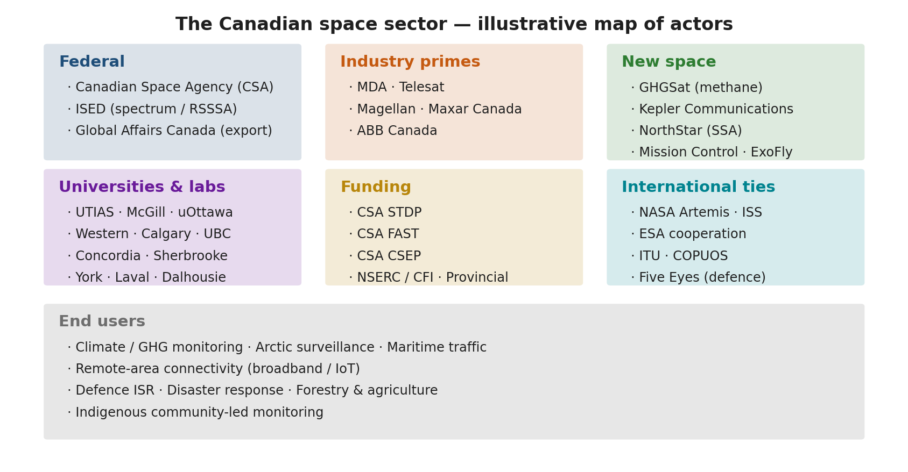

*Representative stakeholder map for Canadian missions.*


> **Expected reading before this session.** NASA SEH §4.1 (≈ 30 min).


**Prerequisites:** Chapter 1.1
**References:**
- [Government of Canada, Canadian Space Agency Act (S.C. 1990, c. 13)](https://laws-lois.justice.gc.ca/eng/acts/c-11.2/)
- [Government of Canada, Remote Sensing Space Systems Act (RSSSA, S.C. 2005, c. 45)](https://laws-lois.justice.gc.ca/eng/acts/r-5.4/)
- [Government of Canada, Radiocommunication Act (R.S.C., 1985, c. R-2)](https://laws-lois.justice.gc.ca/eng/acts/r-2/)
- [ISED Canada, Spectrum Management and Telecommunications](https://www.ic.gc.ca/eic/site/smt-gst.nsf/eng/home)
- [Government of Canada, Export and Import Permits Act (EIPA)](https://laws-lois.justice.gc.ca/eng/acts/e-19/)
- [NASA, Systems Engineering Handbook (SP-2016-6105 Rev 2), 2016](https://www.nasa.gov/reference/systems-engineering-handbook/)
- [ITU, Radio Regulations, Edition 2020](https://www.itu.int/pub/R-REG-RR)

---

## Learning Objectives

By the end of this session, participants will be able to:
1. Describe the Canadian Space Agency's mandate and organisational structure
2. Map the Canadian space industry ecosystem -- prime contractors, SMEs, universities, and funding programs
3. Identify the regulatory bodies that govern space activities in Canada (CSA, ISED, GAC, DND)
4. Explain the RSSSA licensing process for remote sensing satellites
5. Describe the spectrum licensing process through ISED and ITU coordination
6. Identify Canadian export control obligations under EIPA, ITAR, and EAR

---

## Part 1: The Canadian Space Ecosystem
---

### 1. The Canadian Space Agency
#### 1.1 Mandate and History

The Canadian Space Agency (CSA) was established by the *Canadian Space Agency Act* (S.C. 1990, c. 13) with the mandate to "promote the peaceful use and development of space, to advance the knowledge of space through science and to ensure that space science and technology provide social and economic benefits for Canadians."

Table 1.2.1 — Major Canadian space milestones from Alouette 1 to the 2026 pause of the Lunar Gateway and the repurposing of Canadarm3.

| Milestone | Year | Significance |
|-----------|------|-------------|
| Alouette 1 | 1962 | Canada becomes the 3rd nation to build and design a satellite |
| Hermes (CTS) | 1976 | World's first high-power direct broadcast satellite (CSA/NASA) |
| Canadarm | 1981 | Robotic arm for Space Shuttle; established Canada's space robotics dominance |
| CSA established | 1990 | Canadian Space Agency Act creates the agency |
| RADARSAT-1 | 1995 | First Canadian Earth observation satellite; C-band SAR |
| Canadarm2 | 2001 | ISS robotic arm; continues robotics legacy |
| RADARSAT-2 | 2007 | Commercial SAR satellite (MDA); RSSSA applies |
| RADARSAT Constellation Mission (RCM) | 2019 | Three C-band SAR satellites; maritime surveillance, disaster management |
| Canadarm3 | 2019– | Begun for the Lunar Gateway; as of late 2026 the CSA is repurposing Canadarm3 technologies for lunar-surface operations under Artemis (announced August 2026) |
| Lunar Gateway participation | 2019–2026 | Canada committed as partner; in March 2026 NASA paused Gateway "in its current form" (widely reported as a cancellation) in favour of a lunar surface base |

[Source: CSA, "Canada's Space Milestones", www.asc-csa.gc.ca]

#### 1.2 CSA Organisational Focus Areas

The CSA is headquartered in Saint-Hubert, Quebec, and organises its activities around three strategic priorities:

Table 1.2.2 — CSA's three strategic priorities with associated activities and flagship programs.

| Priority | Activities | Key Programs |
|----------|-----------|-------------|
| **Space Exploration** | ISS operations, Artemis lunar exploration (Canadarm3 technologies repurposed for lunar-surface operations), astronaut programme | Lunar Exploration Accelerator Program (LEAP) |
| **Space Utilisation** | Earth observation, satellite communications, GNSS augmentation | RADARSAT, SmartEarth, eHealth |
| **Space Science & Technology** | Astronomy, planetary science, technology development | CASTOR, JWST/NIRISS, space health |

#### 1.3 Canadian Space Strategy (2019)

The *Exploration, Imagination, Innovation: A New Space Strategy for Canada* (2019) committed $2.05B over 24 years and established five priorities:
1. Ensure astronaut health and well-being in deep space
2. Develop and use advanced AI and robotics in space
3. Connect rural and remote Canadians through next-generation satellite communications
4. Use space data and technology to manage natural resources sustainably
5. Position the Canadian space sector for the future

> **Industry Practice:** The $150M Lunar Exploration Accelerator Program (LEAP) specifically targets Canadian SMEs and universities to develop technologies for lunar surface science, health, AI, and robotics. This "pull-through" model -- where a strategic government investment creates opportunities for industry -- is a hallmark of the Canadian space ecosystem.

---

### 2. Canadian Space Industry Map
#### 2.1 Industry Structure

The Canadian space industry generated approximately $2.7B in revenue (2022) and employs ~12,000 people. It is structured in tiers:

Table 1.2.3 — Four-tier structure of the Canadian space industry with key players and revenue share.

| Tier | Role | Key Players | Revenue Share |
|------|------|-------------|--------------|
| **Tier 1: Primes** | System integration, large platforms, constellation operations | MDA Space, Telesat, SFL (U of T) | ~60% |
| **Tier 2: Subsystem/Component** | Subsystem design, specialised components, ground systems | Honeywell Canada, ABB, Magellan Aerospace, NGC Aerospace | ~25% |
| **Tier 3: SMEs & Startups** | Niche technologies, applications, data analytics | GHGSat, NorthStar, Kepler Communications, Wyvern | ~10% |
| **Tier 4: Academia** | R&D, training, technology incubation | U of T (SFL), York U, UBC, U of Calgary, Western | ~5% |

#### 2.2 Key Canadian Space Capabilities

Canada has world-leading capabilities in several domains:

Table 1.2.4 — Canadian world-leading space capabilities, principal companies, and notable missions.

| Capability | Key Player(s) | Notable Missions | Global Standing |
|-----------|--------------|-----------------|----------------|
| **Space robotics** | MDA Space | Canadarm, Canadarm2, Dextre, Canadarm3 | World leader |
| **SAR Earth observation** | MDA Space, CSA | RADARSAT-1/2/RCM | Top 3 globally |
| **Satellite communications** | Telesat | Anik fleet, Telesat Lightspeed (LEO constellation) | Pioneer in GEO DBS |
| **Small satellite systems** | SFL (U of T) | MOST, NEOSSat, GHGSat-D, BRITE | Top university lab globally |
| **GHG monitoring** | GHGSat | GHGSat constellation (methane) | World's only commercial GHG monitoring constellation |
| **Optical instruments** | ABB, Honeywell | JWST/FGS-NIRISS, OSIRIS-REx laser altimeter | Tier 1 instrument builder |
| **Star trackers/AOCS** | NGC Aerospace/Honeywell | Numerous missions | Widely used sensors |

#### 2.3 Funding Programs

Canadian space activities are funded through several mechanisms:

Table 1.2.5 — Canadian federal funding programs available for space activities and their typical values.

| Program | Administered By | Scope | Typical Value |
|---------|----------------|-------|--------------|
| **Space Technology Development Program (STDP)** | CSA | TRL advancement for flight heritage | $100K--$3M per project |
| **Class Grants and Contributions** | CSA | Space science, awareness, STEM | Variable |
| **LEAP** | CSA | Lunar technology development | Up to $3M per project |
| **IRAP** | NRC | SME innovation support | $50K--$1M |
| **SIF** | ISED | Strategic innovation projects | $10M--$100M+ |
| **DRDC contracts** | DND | Dual-use technology | Classified--$10M |
| **NSERC / CFI** | Federal | Academic research infrastructure | $50K--$5M |

> **Industry Practice:** GHGSat (Montreal) progressed from a CSA-funded technology demonstrator (GHGSat-D "Claire", launched 2016) to a commercial constellation of 12+ satellites monitoring methane emissions from individual industrial facilities. This trajectory -- government seed funding enabling commercial scale-up -- is the canonical Canadian space industry growth model.

**Discussion point.** *For your mission concept, which industry tier would you engage? What CSA funding programs might apply? What capabilities would need to be sourced internationally?*

---

### 3. Comparison with Other National Models
Understanding Canada's space ecosystem requires comparing it with partner agencies:

Table 1.2.6 — Comparison of CSA, NASA, ESA, and JAXA on budget, staff, launch capability, and industry model.

| Parameter | Canada (CSA) | USA (NASA) | Europe (ESA) | Japan (JAXA) |
|-----------|-------------|-----------|-------------|-------------|
| Annual budget (approx.) | ~$300M CAD | ~$25B USD | ~$7.5B EUR | ~$1.5B USD |
| Staff | ~670 | ~18,000 | ~2,300 | ~1,500 |
| Launch capability | None (uses partners) | SLS, commercial (SpaceX, ULA) | Ariane 6, Vega-C | H3, Epsilon |
| Key strength | Robotics, SAR, instruments | Full spectrum | Science, EO, navigation | Rockets, science, ISS (Kibo) |
| Industry model | Government seed + commercial scale | Government prime + commercial | Juste retour (geographic return) | Government-led + commercial |

Canada's lack of indigenous launch capability means all Canadian satellites launch on foreign vehicles, which has implications for export control (Section 5 below).

---

### 4. Canadian Space in the International Context
#### 4.1 International Partnerships

Canada participates in space through multilateral and bilateral agreements:

Table 1.2.7 — Canada's international space partnerships and the contributions and benefits of each.

| Partnership | Canadian Contribution | Canadian Benefit |
|------------|----------------------|-----------------|
| **ISS** | Canadarm2, Dextre, SPDM | Astronaut access, research time, technology demonstrations |
| **Artemis** (Lunar Gateway until its March 2026 pause) | Canadarm3, repurposed for lunar-surface operations (2026) | Astronaut flights, lunar science access |
| **Copernicus (ESA)** | Data access agreement | Free access to Sentinel data for Canadian users |
| **COSPAS-SARSAT** | Canadian ground stations, MEOSAR payloads | Search and rescue capability for Canadian territory |
| **Five Eyes** | Intelligence sharing, dual-use technology | Access to allied space intelligence capabilities |

#### 4.2 The Canadian Niche Strategy

Canada has historically pursued a "niche excellence" strategy: rather than attempting full-spectrum space capability, Canada develops world-class expertise in specific domains (robotics, SAR, instruments) and trades access to these capabilities for partnership in larger programs.

> **Key Equation:** The "partnership leverage ratio" -- informal but useful -- describes how Canada trades capability for access:
>
> $L = \frac{V_{access}}{C_{contribution}}$
>
> Where $V_{access}$ is the value of program access obtained and $C_{contribution}$ is the cost of Canada's contribution. For the ISS, Canada's Canadarm2/Dextre contribution (~$2B CAD over 30 years) provides access to a $150B+ program, yielding $L \approx 75$. This is the highest leverage ratio of any ISS partner.

---

## Part 2: Regulatory Environment
---

> **Expected reading before this part.** [ITU Radio Regulations](https://www.itu.int/pub/R-REG-RR) (Edition of 2024), Article 21 — Terrestrial and space services sharing frequency bands above 1 GHz; ISED CPC-2-6-02 — Procedure for the Submission of Applications for Spectrum Licences for Space Stations (Issue 7, April 2026); Remote Sensing Space Systems Act (RSSSA) — [https://laws-lois.justice.gc.ca/eng/acts/R-5.4/](https://laws-lois.justice.gc.ca/eng/acts/R-5.4/).

### 5. Regulatory Framework Overview
Space activities in Canada are governed by multiple federal bodies. There is no single "Space Act" -- instead, regulation is distributed across several statutes:

<!-- SVG DIAGRAM: Canadian Space Regulatory Framework -->
<!-- Description: A hierarchical diagram showing the regulatory bodies and their statutes -->
<!-- Elements: Central "Space Activity" node connected to CSA (CSA Act), ISED (Radiocommunication Act, Telecommunications Act), GAC (EIPA, ITAR), DND (dual-use), Transport Canada (launch -- future), and international bodies (ITU, COPUOS, MTCR) -->

Table 1.2.8 — Canadian federal regulatory bodies, governing statutes, and their mission-design relevance.

| Regulatory Body | Statute | What It Regulates | Relevance to Mission Design |
|----------------|---------|-------------------|---------------------------|
| **CSA** | Canadian Space Agency Act | Space program coordination, policy | Mission approval, funding |
| **ISED** | Radiocommunication Act | Radio spectrum allocation, licensing | Frequency licensing for all RF transmissions |
| **ISED** | Remote Sensing Space Systems Act (RSSSA) | Operation of remote sensing satellites | Licensing for any satellite that images Earth |
| **GAC** | Export and Import Permits Act (EIPA) | Export control of strategic goods | Export permits for satellite technology |
| **GAC** | Controlled Goods Program | Access to controlled (ITAR/CG) goods | Personnel security clearances |
| **DND/DRDC** | National Defence Act | Dual-use technology, military space | Classification, security requirements |
| **Transport Canada** | (No current statute) | Launch operations (future) | Canada has no domestic launch regulation yet |

---

### 6. Remote Sensing Space Systems Act (RSSSA)
#### 6.1 Purpose and Scope

The RSSSA (S.C. 2005, c. 45) regulates the operation of remote sensing satellites from Canada. It was enacted primarily in response to the commercialisation of RADARSAT-2 (the first Canadian commercial EO satellite) and addresses national security and foreign policy concerns related to Earth imagery.

[Source: Government of Canada, RSSSA, [https://laws-lois.justice.gc.ca/eng/acts/r-5.4/](https://laws-lois.justice.gc.ca/eng/acts/r-5.4/)]

#### 6.2 Who Needs a Licence?

An RSSSA licence is required for any person or entity that:
- **Operates** a remote sensing space system from Canada, or
- **Controls** the collection or distribution of remote sensing data from a Canadian system

This applies regardless of where the satellite is manufactured or launched. If it is operated from Canadian soil, RSSSA applies.

#### 6.3 Licence Categories and Conditions

Table 1.2.9 — The two RSSSA licence categories and typical conditions imposed on each.

| Licence Type | Scope | Typical Conditions |
|-------------|-------|-------------------|
| **System Operating Licence** | Operate a remote sensing satellite system | Data handling plan, priority access for Canadian government, shutter control provisions |
| **Interoperability Arrangements** | Share data with foreign entities | Approval for each foreign government or commercial partner |

Key conditions typically imposed:

Table 1.2.10 — Typical RSSSA licence conditions covering priority access, shutter control, and data handling.

| Condition | Description | Rationale |
|-----------|-------------|-----------|
| **Priority access** | Government of Canada can request priority imaging of any area | National security |
| **Shutter control** | Government can restrict imaging of specified areas | National security, diplomatic relations |
| **Data disposition** | Approved plan for data storage, distribution, and destruction | Prevent unauthorised access |
| **System disposal** | Plan for end-of-life decommissioning | Space debris mitigation |
| **Raw data protection** | Restrictions on distribution of unprocessed data | Prevent circumvention of controls |

#### 6.4 Implications for CubeSat and University Missions

Even small CubeSat missions with cameras must comply with RSSSA if they produce images of Earth. Key considerations:

Table 1.2.11 — Mission-design parameters that trigger RSSSA applicability for CubeSat missions.

| Parameter | Threshold | Implication |
|-----------|-----------|------------|
| GSD | No formal threshold in the Act | All resolutions require licensing |
| Orbit type | Any orbit imaging Earth | LEO, MEO, GEO all in scope |
| Data distribution | Any distribution of imagery | Must have approved data handling plan |
| Foreign participation | Any foreign access to data | Requires interoperability arrangement |

> **Industry Practice:** MDA's RADARSAT-2 operates under an RSSSA licence that includes shutter control provisions. During the 2010 Haiti earthquake response, the Government of Canada exercised priority access to direct RADARSAT-2 to image the disaster zone within hours. This demonstrates both the operational utility and the regulatory mechanism of RSSSA.

**Discussion point.** *Does your mission concept involve any remote sensing of Earth? If so, what RSSSA conditions might apply?*

---

### 7. Spectrum Management and Licensing
#### 7.1 Why Spectrum Licensing Matters

Every satellite that transmits or receives radio signals requires spectrum authorisation. This is not optional -- unauthorised RF transmission is illegal in all ITU member states and can result in harmful interference to other systems.

The process involves two levels:
1. **National:** ISED (Innovation, Science and Economic Development Canada) issues the radio licence
2. **International:** ITU (International Telecommunication Union) coordinates the frequency filing to prevent interference with other national administrations

#### 7.2 The ITU Framework

The International Telecommunication Union allocates spectrum globally through the Radio Regulations (RR), updated at World Radiocommunication Conferences (WRC) every 3--4 years.

Table 1.2.12 — Core ITU spectrum-management concepts and their relevance to satellite missions.

| ITU Concept | Description | Relevance |
|-------------|-------------|-----------|
| **Frequency allocation** | Spectrum divided among radio services (Fixed Satellite, Mobile, Earth Exploration Satellite, etc.) | Determines which bands are available for your mission type |
| **ITU Regions** | Region 1 (Europe/Africa), Region 2 (Americas), Region 3 (Asia/Pacific) | Canada is in Region 2; allocations may differ by region |
| **Coordination** | Bilateral/multilateral agreements to avoid interference | Required before a new satellite system can operate |
| **Notification** | Formal filing with the ITU Radiocommunication Bureau (BR) | Records the satellite system in the Master International Frequency Register (MIFR) |

#### 7.3 Common Satellite Frequency Bands

Table 1.2.13 — Common satellite frequency bands with typical uses and key technical characteristics.

| Band | Frequency Range | Typical Use | Key Characteristics |
|------|----------------|-------------|-------------------|
| **UHF** | 400--450 MHz | CubeSat TT&C, AIS, ADS-B | Simple antennas, low data rate (1--9.6 kbps), crowded |
| **S-band** | 2.0--2.3 GHz | TT&C (uplink + downlink) | Standard for housekeeping; moderate antenna gain required |
| **X-band** | 8.025--8.4 GHz | EO payload data downlink | Higher data rates (10--150 Mbps); requires tracking antenna on ground |
| **Ka-band** | 26.5--40 GHz | High-throughput data downlink, inter-satellite links | Very high data rates (100+ Mbps); rain attenuation significant |
| **L-band** | 1.5--1.6 GHz | GNSS, mobile satellite service | Navigation, SAR beacons |
| **C-band** | 3.7--4.2 / 5.9--6.4 GHz | Legacy GEO comms (DBS), SAR (RADARSAT) | Being repurposed for 5G in some countries |

#### 7.4 The Licensing Process (Canada)

The ISED spectrum licensing process for a satellite system follows these steps:

Table 1.2.14 — Sequential steps and durations of the ISED spectrum-licensing process for a satellite system.

| Step | Activity | Duration | Documents |
|------|----------|----------|-----------|
| 1 | Pre-application consultation with ISED | 2--4 weeks | Preliminary technical description |
| 2 | Formal application submission | -- | ISED application form, technical annex |
| 3 | ISED technical review | 3--6 months | Interference analysis, coordination requirements |
| 4 | ITU filing (Advance Publication Information -- API) | -- | ITU API filing (submitted by ISED on Canada's behalf) |
| 5 | ITU coordination with affected administrations | 2--7 years | Coordination agreements |
| 6 | ITU notification and recording in MIFR | -- | MIFR entry |
| 7 | ISED licence issuance | -- | Radio licence |

> **Key Equation:** The link budget equation governs whether a given frequency allocation provides sufficient performance. The received signal power is:
>
> $P_r = P_t + G_t + G_r - L_{fs} - L_{atm} - L_{misc}$
>
> Where all values are in dB:
> - $P_t$ = transmit power (dBW)
> - $G_t$ = transmit antenna gain (dBi)
> - $G_r$ = receive antenna gain (dBi)
> - $L_{fs} = 20\log_{10}(4\pi d / \lambda)$ = free-space path loss (dB)
> - $L_{atm}$ = atmospheric loss (dB)
> - $L_{misc}$ = miscellaneous losses (pointing, polarisation, etc.)
>
> The link margin is then:
>
> $M = P_r - P_{r,min} = (E_b/N_0)_{received} - (E_b/N_0)_{required}$
>
> A positive margin of at least 3 dB is typically required; 6 dB for critical links.

#### 7.5 CubeSat-Specific Considerations

Many CubeSat operators use amateur radio frequencies (VHF/UHF) during development but must transition to commercial bands for operational missions, especially if there is any commercial data distribution.

Table 1.2.15 — CubeSat spectrum-licensing approaches comparing amateur, UHF, S-band, and X-band paths.

| Approach | Licensing Path | Limitations |
|----------|---------------|-------------|
| **Amateur radio (VHF/UHF)** | IARU coordination; national amateur licence | No commercial use; data must be freely available; limited power/bandwidth |
| **Commercial UHF** | ISED commercial licence; ITU coordination | Low data rate; crowded band; longer licensing timeline |
| **S-band TT&C** | ISED licence; SFCG coordination | Standard path; moderate timeline (6--12 months) |
| **X-band payload** | ISED licence; ITU coordination | Higher data rate; requires tracking ground station |

> **Industry Practice:** Kepler Communications (Toronto) initially operated its first pathfinder satellites on Ku-band for store-and-forward IoT data relay. Obtaining Ku-band spectrum rights required coordination with incumbent GEO operators, a process that took over 2 years. The lesson: begin spectrum licensing as early as Phase A.

---

### 8. Export Control
#### 8.1 The Export Control Landscape

Satellite technology is controlled goods in most countries due to dual-use (civil/military) applications. Canadian space companies and universities must navigate three overlapping regimes:

Table 1.2.16 — Three overlapping export-control regimes (EIPA, ITAR, EAR) and their key control lists.

| Regime | Administered By | Scope | Key List |
|--------|----------------|-------|----------|
| **EIPA** (Canada) | Global Affairs Canada (GAC) | Canadian-origin goods and technology | Export Control List (ECL), Groups 1--7 |
| **ITAR** (USA) | US State Department (DDTC) | US-origin defence articles and services | US Munitions List (USML), Category XV (spacecraft) |
| **EAR** (USA) | US Commerce Department (BIS) | US-origin dual-use goods and technology | Commerce Control List (CCL), ECCN 9Axx |

#### 8.2 Canadian Export Controls (EIPA)

The Export and Import Permits Act requires an export permit for goods on Canada's Export Control List (ECL). Space-relevant ECL groups:

Table 1.2.17 — Space-relevant groups within Canada's Export Control List with example controlled items.

| ECL Group | Description | Examples |
|-----------|-------------|---------|
| Group 1 | Dual-use goods (Wassenaar Arrangement) | Radiation-hardened electronics, space-qualified components |
| Group 2 | Munitions (defence goods) | Military satellite systems, encrypted comms |
| Group 4 | Nuclear-related (NSG) | RTGs, nuclear propulsion components |
| Group 6 | Missile technology (MTCR) | Complete rocket systems, guidance systems, propulsion |
| Group 7 | Chemical/biological weapons | Not typically space-relevant |

#### 8.3 US Export Controls (ITAR and EAR)

Any mission using US-origin components (which includes nearly all commercial space electronics) must comply with US export controls:

**ITAR (International Traffic in Arms Regulations):**
- USML Category XV covers spacecraft and related articles
- Requires a Technical Assistance Agreement (TAA) or Manufacturing License Agreement (MLA)
- Applies to US-origin defence articles regardless of where they are located
- Violation penalties: up to $1M per violation and 20 years imprisonment

**EAR (Export Administration Regulations):**
- Controls dual-use items (commercial space components, software, technology)
- Uses Export Control Classification Numbers (ECCNs)
- Requires a licence for export to most countries (except Canada for many items under bilateral agreements)
- The US-Canada Defence Production Sharing Agreement provides some exemptions

#### 8.4 Practical Implications for Mission Design

Table 1.2.18 — Mission-design decisions and the export-control obligations each one triggers.

| Design Decision | Export Control Implication |
|----------------|--------------------------|
| Using US-origin reaction wheels | EAR licence may be required; ITAR if military-grade |
| Collaborating with a non-Five Eyes university | TAA required for ITAR-controlled technical data |
| Launching on a non-US rocket | ITAR Technical Assistance Agreement (TAA) for US components on foreign launcher |
| Open-sourcing satellite software | Must verify no controlled algorithms (e.g., encryption above EAR thresholds) |
| Hosting a foreign payload | May require export permit under EIPA and/or ITAR approval |
| Publishing detailed design in a paper | Technical data review required if ITAR-controlled components discussed |

> **Industry Practice:** MDA's export of RADARSAT-2 ground segment technology to international partners required extensive EIPA permitting and ITAR compliance review (since US-origin components were embedded in the system). The process took 18+ months and required dedicated compliance staff. Even university CubeSat projects using US-origin COTS components must track their ECCN classifications.

**Discussion point.** *Does your mission concept involve any US-origin components? Any international partners? What export control obligations might apply?*

---

## Session Summary

Table 1.2.19 — Session summary of Canadian space ecosystem and regulatory takeaways.

| Topic | Key Takeaway |
|-------|-------------|
| CSA mandate | Promote peaceful use of space; niche excellence strategy (robotics, SAR, instruments) |
| Industry structure | 4-tier ecosystem; government seed funding enables commercial scale-up |
| RSSSA | Any remote sensing satellite operated from Canada requires a licence; includes shutter control |
| Spectrum licensing | Two-level process (ISED national + ITU international); start in Phase A; 2+ year timeline |
| Export control | Three overlapping regimes (EIPA, ITAR, EAR); nearly all missions encounter US controls |
| Key lesson | Regulatory compliance is not optional -- it shapes design decisions from the earliest phases |

---

## References

1. [Government of Canada, Canadian Space Agency Act (S.C. 1990, c. 13)](https://laws-lois.justice.gc.ca/eng/acts/c-11.2/)
2. [Government of Canada, Remote Sensing Space Systems Act (S.C. 2005, c. 45)](https://laws-lois.justice.gc.ca/eng/acts/r-5.4/)
3. [Government of Canada, Radiocommunication Act (R.S.C., 1985, c. R-2)](https://laws-lois.justice.gc.ca/eng/acts/r-2/)
4. [Government of Canada, Export and Import Permits Act (R.S.C., 1985, c. E-19)](https://laws-lois.justice.gc.ca/eng/acts/e-19/)
5. [ISED, Spectrum Management and Telecommunications](https://www.ic.gc.ca/eic/site/smt-gst.nsf/eng/home)
6. [ITU, Radio Regulations, Edition 2020](https://www.itu.int/pub/R-REG-RR)
7. [CSA, Exploration, Imagination, Innovation: A New Space Strategy for Canada, 2019](https://www.asc-csa.gc.ca/eng/publications/space-strategy-for-canada.asp)
8. [CSA, State of the Canadian Space Sector Report, 2022](https://www.asc-csa.gc.ca/eng/publications/state.asp)
9. [US Department of State, ITAR (22 CFR 120-130)](https://www.ecfr.gov/current/title-22/chapter-I/subchapter-M)
10. [US Department of Commerce, EAR (15 CFR 730-774)](https://www.ecfr.gov/current/title-15/subtitle-B/chapter-VII/subchapter-C)

# Chapter 1.3 — International Standards for Space Systems


*Orbital lifetime vs altitude with FCC/IADC limits.*


> **Expected reading before this session.** NASA SEH §6.5 — Decision Analysis (≈ 30 min).


**Prerequisites:** Sessions 1.1--1.2
**References:**
- [ECSS, ECSS System -- Description, Implementation and General Requirements (ECSS-S-ST-00C), 2020](https://ecss.nl/standard/ecss-s-st-00c-space-standardization-policy-and-organisation/)
- [NASA, Systems Engineering Handbook (SP-2016-6105 Rev 2), 2016](https://www.nasa.gov/reference/systems-engineering-handbook/)
- [CDS, Interface Definition Document for Launch Vehicle Adapters, Rev 14, 2022](https://www.spacex.com/rideshare/)
- [IADC, Space Debris Mitigation Guidelines (IADC-02-01 Rev 3), 2021](https://www.iadc-home.org/documents_public/)
- [ISO, ISO 24113:2023 -- Space Debris Mitigation Requirements, 2023](https://www.iso.org/standard/82450.html)
- [UNOOSA, COPUOS Guidelines for the Long-term Sustainability of Outer Space Activities, 2019](https://www.unoosa.org/oosa/en/ourwork/topics/long-term-sustainability-of-outer-space-activities.html)
- [ESA, Space Debris Mitigation Compliance Verification Guidelines (ESSB-HB-U-002), 2023](https://technology.esa.int/upload/media/47ypgb5qwq.pdf)

---

## Learning Objectives

By the end of this session, participants will be able to:
1. Describe the ECSS standard framework and its hierarchical structure (Management, Engineering, Product Assurance, Sustainability)
2. Compare ECSS and NASA standards and identify equivalences
3. Explain the CDS Rev 14 interface standard and its role in launch vehicle integration
4. Apply space debris mitigation guidelines (IADC, ISO 24113, FCC 5-year rule) to mission design
5. Describe the role of COPUOS and the Outer Space Treaty framework
6. Use SpaceCDF's compliance tracking features

---

## Part 1: The ECSS Framework
---

### 1. Why Standards Matter in Space Engineering
#### 1.1 The Cost of Non-Compliance

Space missions operate in an environment where failures are catastrophic, repair is impossible, and the consequences of interference or debris affect all space users. Standards exist to:

1. **Ensure mission safety and reliability** -- by codifying lessons learned from decades of space operations
2. **Enable interoperability** -- by defining common interfaces, data formats, and protocols
3. **Reduce cost** -- by providing proven design approaches rather than re-inventing solutions
4. **Satisfy regulatory requirements** -- by demonstrating compliance with national and international obligations
5. **Facilitate technology transfer** -- by establishing a common engineering language

> **Industry Practice:** The loss of the Mars Climate Orbiter (1999) is the canonical example of what happens without rigorous interface standards. Lockheed Martin's ground software produced thruster force data in pound-force seconds, while NASA's navigation software expected Newton-seconds. The spacecraft entered the Martian atmosphere at 57 km altitude instead of the planned 226 km and was destroyed. Total loss: $327.6M. This failure directly led to NASA's strengthening of Process 12 (Interface Management) in NPR 7123.1D. The lesson: standards and interface control are not bureaucratic overhead -- they are mission-critical.

#### 1.2 The Major Standard Frameworks

Three major standard frameworks govern space activities globally:

Table 1.3.1 — Comparison of ECSS, NASA, and ISO standard frameworks by scope and document count.

| Framework | Scope | Typical Adopter | Document Count |
|-----------|-------|----------------|---------------|
| **ECSS** (European Cooperation for Space Standardization) | Full lifecycle, all disciplines | ESA, European industry, CSA (partial) | 144 standards + 56 handbooks |
| **NASA Technical Standards** | NASA programs and projects | NASA centres, US contractors | NPR/NPD/NASA-STD series |
| **ISO TC 20/SC 14** | Space systems and operations | International (reference standard) | ~40 standards |

These frameworks are not mutually exclusive. Many missions (including Canadian ones) adopt a tailored combination: ECSS for systems engineering and product assurance, NASA standards for specific technical domains, and ISO for debris mitigation.

---

### 2. ECSS Standard Hierarchy
#### 2.1 Structure

The ECSS system organises standards into four branches, each with three levels:

<!-- SVG DIAGRAM: ECSS Standard Hierarchy -->

<svg xmlns="http://www.w3.org/2000/svg" viewBox="0 0 800 450" style="max-width:800px; font-family: 'Segoe UI', Arial, sans-serif; background: #fafafa; border: 1px solid #ddd; border-radius: 8px;">
  <!-- Title -->
  <text x="400" y="28" text-anchor="middle" font-size="15" font-weight="bold" fill="#1a1a2e">ECSS Standard Hierarchy</text>

  <!-- Top level: ECSS-S (System) -->
  <rect x="300" y="45" width="200" height="40" rx="6" fill="#37474f" stroke="#263238" stroke-width="2"/>
  <text x="400" y="70" text-anchor="middle" font-size="12" fill="white" font-weight="bold">ECSS-S: System Level</text>

  <!-- Branch boxes -->
  <rect x="30" y="130" width="160" height="40" rx="6" fill="#1565c0" stroke="#0d47a1" stroke-width="2"/>
  <text x="110" y="155" text-anchor="middle" font-size="11" fill="white" font-weight="bold">M: Management</text>

  <rect x="220" y="130" width="160" height="40" rx="6" fill="#2e7d32" stroke="#1b5e20" stroke-width="2"/>
  <text x="300" y="155" text-anchor="middle" font-size="11" fill="white" font-weight="bold">E: Engineering</text>

  <rect x="410" y="130" width="160" height="40" rx="6" fill="#e65100" stroke="#bf360c" stroke-width="2"/>
  <text x="490" y="155" text-anchor="middle" font-size="11" fill="white" font-weight="bold">Q: Product Assurance</text>

  <rect x="600" y="130" width="160" height="40" rx="6" fill="#6a1b9a" stroke="#4a148c" stroke-width="2"/>
  <text x="680" y="155" text-anchor="middle" font-size="11" fill="white" font-weight="bold">U: Sustainability</text>

  <!-- Connecting lines from S to branches -->
  <line x1="350" y1="85" x2="110" y2="130" stroke="#555" stroke-width="1.5"/>
  <line x1="380" y1="85" x2="300" y2="130" stroke="#555" stroke-width="1.5"/>
  <line x1="420" y1="85" x2="490" y2="130" stroke="#555" stroke-width="1.5"/>
  <line x1="450" y1="85" x2="680" y2="130" stroke="#555" stroke-width="1.5"/>

  <!-- Level descriptions for M branch -->
  <rect x="10" y="195" width="180" height="30" rx="4" fill="#e3f2fd" stroke="#1565c0" stroke-width="1"/>
  <text x="100" y="215" text-anchor="middle" font-size="9" fill="#0d47a1">ST: Standard (SHALL)</text>

  <rect x="10" y="235" width="180" height="30" rx="4" fill="#e3f2fd" stroke="#1565c0" stroke-width="1"/>
  <text x="100" y="255" text-anchor="middle" font-size="9" fill="#0d47a1">HB: Handbook (guidance)</text>

  <rect x="10" y="275" width="180" height="30" rx="4" fill="#e3f2fd" stroke="#1565c0" stroke-width="1"/>
  <text x="100" y="295" text-anchor="middle" font-size="9" fill="#0d47a1">TM: Technical Memo</text>

  <!-- Key M standards -->
  <text x="20" y="325" font-size="9" fill="#333" font-weight="bold">Key M standards:</text>
  <text x="20" y="340" font-size="8" fill="#555">ECSS-M-ST-10C: Project Management</text>
  <text x="20" y="353" font-size="8" fill="#555">ECSS-M-ST-40C: Configuration Mgmt</text>
  <text x="20" y="366" font-size="8" fill="#555">ECSS-M-ST-80C: Risk Management</text>

  <!-- Level descriptions for E branch -->
  <rect x="205" y="195" width="190" height="30" rx="4" fill="#e8f5e9" stroke="#2e7d32" stroke-width="1"/>
  <text x="300" y="215" text-anchor="middle" font-size="9" fill="#1b5e20">ST: Standard (SHALL)</text>

  <rect x="205" y="235" width="190" height="30" rx="4" fill="#e8f5e9" stroke="#2e7d32" stroke-width="1"/>
  <text x="300" y="255" text-anchor="middle" font-size="9" fill="#1b5e20">HB: Handbook (guidance)</text>

  <!-- Key E standards -->
  <text x="210" y="290" font-size="9" fill="#333" font-weight="bold">Key E standards:</text>
  <text x="210" y="305" font-size="8" fill="#555">ECSS-E-ST-10C: SE General</text>
  <text x="210" y="318" font-size="8" fill="#555">ECSS-E-ST-20C: Electrical &amp; Electronic</text>
  <text x="210" y="331" font-size="8" fill="#555">ECSS-E-ST-31C: Thermal Control</text>
  <text x="210" y="344" font-size="8" fill="#555">ECSS-E-ST-32C: Structures</text>
  <text x="210" y="357" font-size="8" fill="#555">ECSS-E-ST-33-01C: Mechanisms</text>
  <text x="210" y="370" font-size="8" fill="#555">ECSS-E-ST-35C: Propulsion</text>
  <text x="210" y="383" font-size="8" fill="#555">ECSS-E-ST-40C: Software</text>
  <text x="210" y="396" font-size="8" fill="#555">ECSS-E-ST-50C: Communications</text>
  <text x="210" y="409" font-size="8" fill="#555">ECSS-E-ST-60C: Control</text>
  <text x="210" y="422" font-size="8" fill="#555">ECSS-E-ST-70C: Ground Systems</text>

  <!-- Key Q standards -->
  <text x="415" y="195" font-size="9" fill="#333" font-weight="bold">Key Q standards:</text>
  <text x="415" y="210" font-size="8" fill="#555">ECSS-Q-ST-10C: PA Management</text>
  <text x="415" y="223" font-size="8" fill="#555">ECSS-Q-ST-20C: QA</text>
  <text x="415" y="236" font-size="8" fill="#555">ECSS-Q-ST-30C: Dependability</text>
  <text x="415" y="249" font-size="8" fill="#555">ECSS-Q-ST-40C: Safety</text>
  <text x="415" y="262" font-size="8" fill="#555">ECSS-Q-ST-60C: EEE Components</text>
  <text x="415" y="275" font-size="8" fill="#555">ECSS-Q-ST-70C: Materials &amp; Processes</text>

  <!-- Key U standards -->
  <text x="605" y="195" font-size="9" fill="#333" font-weight="bold">Key U standards:</text>
  <text x="605" y="210" font-size="8" fill="#555">ECSS-U-AS-10C: Adoption Notice</text>
  <text x="605" y="223" font-size="8" fill="#555">for ISO 24113 (debris mitigation)</text>
  <text x="605" y="248" font-size="8" fill="#555">ECSS-U-AS-10C Rev.2:</text>
  <text x="605" y="261" font-size="8" fill="#555">Space sustainability requirements</text>

  <!-- Legend -->
  <rect x="500" y="380" width="280" height="55" rx="4" fill="#fff9c4" stroke="#f9a825" stroke-width="1"/>
  <text x="510" y="397" font-size="9" fill="#333" font-weight="bold">Naming convention:</text>
  <text x="510" y="412" font-size="8" fill="#555">ECSS-[Branch]-[Type]-[Number][Level]</text>
  <text x="510" y="425" font-size="8" fill="#555">Example: ECSS-E-ST-10C = Engineering-Standard-10-Level C</text>
</svg>

#### 2.2 The Four Branches

Table 1.3.2 — The four ECSS branches (M, E, Q, U) with scope and an example standard for each.

| Branch | Code | Scope | Example Standard |
|--------|------|-------|-----------------|
| **Management** | M | Project management, planning, reviews, configuration management, risk management | ECSS-M-ST-10C Rev.1 (Space Project Management) |
| **Engineering** | E | Technical disciplines: systems, structures, thermal, EPS, comms, AOCS, software, ground | ECSS-E-ST-10C (Systems Engineering General Requirements) |
| **Product Assurance** | Q | Quality, reliability, safety, EEE components, materials, contamination | ECSS-Q-ST-10C (Product Assurance Management) |
| **Sustainability** | U | Space debris mitigation, end-of-life disposal, space environment protection | ECSS-U-AS-10C Rev.2 (adoption of ISO 24113) |

#### 2.3 Document Types

Table 1.3.3 — ECSS document types (Standard, Handbook, Technical Memorandum) and their obligation level.

| Type | Code | Meaning | Obligation |
|------|------|---------|-----------|
| **Standard** | ST | Contains "shall" requirements -- mandatory when invoked | Must comply or formally request a waiver |
| **Handbook** | HB | Contains guidance, best practices, worked examples | Advisory -- not mandatory but strongly recommended |
| **Technical Memorandum** | TM | Contains background information, state of the art | Informative only |

#### 2.4 Tailoring

A critical concept in ECSS (and all standard frameworks) is **tailoring** -- the process of selecting which standards and which requirements within those standards apply to a given project.

ECSS-S-ST-00C defines three tailoring levels:

Table 1.3.4 — ECSS tailoring levels with descriptions and typical mission classes of application.

| Tailoring Level | Description | Typical Application |
|----------------|-------------|-------------------|
| **Full application** | All requirements of the invoked standard apply | Large ESA missions (Sentinel, JUICE) |
| **Partial application** | Selected clauses apply; others are waived with rationale | Medium missions, CSA projects |
| **Not applicable** | Standard is not invoked for this project | CubeSat missions, technology demonstrators |

The tailoring rationale is documented in the **Product Assurance and Safety Plan (PASP)** and the **Systems Engineering Management Plan (SEMP)**.

> **Key Equation:** The cost of standards compliance scales non-linearly with mission class. A rough relationship observed in ESA studies:
>
> $C_{compliance} \approx k \cdot M_{SC}^{0.7} \cdot N_{standards}^{0.3}$
>
> Where $M_{SC}$ is the spacecraft dry mass (kg), $N_{standards}$ is the number of invoked standards, and $k$ is a constant dependent on the organisation's maturity. For a 10 kg CubeSat invoking 5 standards, compliance costs are roughly 5--10% of mission cost. For a 1000 kg satellite invoking 40 standards, compliance costs can reach 15--20%.

---

### 3. Key ECSS Engineering Standards
#### 3.1 Systems Engineering (ECSS-E-ST-10C)

This is the master engineering standard, equivalent to NASA's NPR 7123.1D. It defines:
- System engineering processes and activities
- Requirements engineering (writing, verification, traceability)
- Functional analysis and decomposition
- Interface management
- Configuration management (technical aspects)

Table 1.3.5 — Mapping ECSS-E-ST-10C systems engineering concepts to their NASA equivalents.

| ECSS-E-ST-10C Concept | NASA Equivalent | Key Difference |
|----------------------|----------------|----------------|
| System requirements specification | Technical requirements baseline | ECSS requires a formal Requirements Specification Document (RSD) |
| Functional analysis | Logical decomposition (Process 3) | Similar scope |
| Verification matrix | Requirements verification matrix | ECSS uses a formal DRD (Document Requirements Definition) |
| Design justification file | Design solution baseline | ECSS requires a DJF that traces every design decision |

#### 3.2 Key Subsystem Standards

Table 1.3.6 — Key ECSS engineering subsystem standards with NASA equivalents across disciplines.

| Standard | Discipline | Key Requirements | NASA Equivalent |
|----------|-----------|-----------------|----------------|
| ECSS-E-ST-20C | Electrical & Electronic | EPS design, grounding, EMC, harness | NASA-STD-4003A (EEE), NASA-HDBK-4001 |
| ECSS-E-ST-31C | Thermal Control | Thermal design, analysis, testing | GSFC-STD-7000A (GEVS), thermal sections |
| ECSS-E-ST-32C | Structures | Structural design, factors of safety, testing | NASA-STD-5001B, GEVS (GSFC-STD-7000A) |
| ECSS-E-ST-33-01C | Mechanisms | Mechanism design, testing, lubrication | NASA-STD-5017 |
| ECSS-E-ST-35C | Propulsion | Propulsion system design, testing | -- |
| ECSS-E-ST-40C | Software | SW development, verification, FDIR | NASA-STD-8739.8 |
| ECSS-E-ST-50C | Communications | Comms system design, link budget, protocols | CCSDS standards |
| ECSS-E-ST-60C | Control | AOCS design, pointing, navigation | -- |
| ECSS-E-ST-70C | Ground Systems | Ground segment design, operations | CCSDS standards |

#### 3.3 Structural Design Requirements (Example)

To illustrate the depth of ECSS standards, consider the structural design requirements from ECSS-E-ST-32C:

Table 1.3.7 — Selected structural design requirements from ECSS-E-ST-32C with values and rationale.

| Requirement | Value | Rationale |
|-------------|-------|-----------|
| Factor of Safety (FoS) -- Yield | $\geq 1.25$ | Prevent permanent deformation under limit loads |
| Factor of Safety -- Ultimate | $\geq 1.5$ | Prevent structural failure under ultimate loads |
| Qualification loads | $1.25 \times$ limit loads | Demonstrate margin beyond expected environment |
| First natural frequency (axial) | $> 25$ Hz typical (launcher-dependent) | Avoid coupling with launcher modes |
| First natural frequency (lateral) | $> 10$ Hz typical (launcher-dependent) | Avoid coupling with launcher modes |

> **Key Equation:** The margin of safety (MoS) is defined as:
>
> $MoS = \frac{\sigma_{allowable}}{FoS \times \sigma_{applied}} - 1$
>
> A positive MoS ($MoS > 0$) indicates the structure meets the requirement. A MoS of 0.0 means the structure exactly meets the requirement with no margin to spare.
>
> Example: If the allowable stress is 280 MPa, the applied stress is 150 MPa, and the FoS is 1.5:
>
> $MoS = \frac{280}{1.5 \times 150} - 1 = \frac{280}{225} - 1 = 0.244$

---

### 4. NASA Standards Comparison
#### 4.1 NASA Technical Standards Architecture

NASA's standards are organised differently from ECSS. Key document types:

Table 1.3.8 — NASA technical-standard document types (NPD, NPR, STD, HDBK, SP) and their obligation.

| Type | Code | Example | Obligation |
|------|------|---------|-----------|
| **NASA Policy Directive** | NPD | NPD 8700.1 (Safety and Mission Assurance) | Mandatory for all NASA programs |
| **NASA Procedural Requirement** | NPR | NPR 7123.1D (SE Processes) | Mandatory; defines processes and requirements |
| **NASA Technical Standard** | NASA-STD | NASA-STD-5001B (Structural Design) | Mandatory when invoked |
| **NASA Handbook** | NASA-HDBK | NASA-HDBK-4001 (EEE Parts) | Advisory guidance |
| **Special Publication** | SP | SP-2016-6105 (SEH) | Reference text |

#### 4.2 Cross-Reference Table

Table 1.3.9 — Cross-reference of ECSS, NASA, and ISO standards across major engineering domains.

| Domain | ECSS Standard | NASA Standard | ISO Standard |
|--------|--------------|--------------|-------------|
| Systems Engineering | ECSS-E-ST-10C | NPR 7123.1D, SP-2016-6105 | ISO 15288 |
| Project Management | ECSS-M-ST-10C | NPR 7120.5F | ISO 21500 |
| Configuration Management | ECSS-M-ST-40C | NPR 7120.5F Ch. 4 | ISO 10007 |
| Risk Management | ECSS-M-ST-80C | NPR 8000.4B | ISO 31000 |
| Structural Design | ECSS-E-ST-32C | NASA-STD-5001B | -- |
| Debris Mitigation | ECSS-U-AS-10C | NASA-STD-8719.14A | ISO 24113 |
| Cleanliness | ECSS-Q-ST-70-01C | NASA-SN-C-0005 | ISO 14644 |
| Software | ECSS-E-ST-40C | NASA-STD-8739.8 | ISO 12207 |

---

## Part 2: Launch Interfaces, Debris Mitigation & International Law
---

> **Expected reading before this part.** Cal Poly, *CubeSat Design Specification (1U – 12U)*, Rev. 14.1 (CP-CDS-R14.1, February 2022), §4 — CubeSat dispenser interface and §5 — dispenser options; Wertz & Larson, *Space Mission Analysis and Design*, 3rd ed., Ch. 18 — Launch systems.

### 5. CDS Rev 14 -- Launch Vehicle Interface Standard
#### 5.1 What is the CDS?

The **Cubesat Design Specification (CDS)**, maintained by the California Polytechnic State University (Cal Poly) and updated by the CubeSat community, defines the mechanical, electrical, and operational interfaces between CubeSats and their deployment systems (P-PODs, ISIPOD, etc.).

[Source: CDS Rev 14, 2022, available via Cal Poly CubeSat Program]

#### 5.2 Key CDS Requirements

Table 1.3.10 — Key CDS Rev 14 mechanical, electrical, and operational requirements for CubeSat compliance.

| Parameter | CDS Rev 14 Requirement | Rationale |
|-----------|----------------------|-----------|
| **Unit dimensions** | $100 \times 100 \times 113.5$ mm per U | Standard deployer rail spacing |
| **Mass per U** | $\leq 2.0$ kg (more only by deployer waiver; check the ICD) | Deployer spring mechanism limits |
| **Rail material** | Hard-anodised aluminium (7075 or 6061-T6) | Deployer contact surface compatibility |
| **Centre of gravity** | Within 2 cm of geometric centre | Deployment dynamics, tumble rate control |
| **Deployables** | Must be constrained during launch; no protrusion beyond CubeSat envelope | Protect adjacent payloads in deployer |
| **Separation springs** | Prohibited on CubeSat (deployer provides) | Standardised deployment mechanism |
| **RF silence** | No RF transmission until 30 minutes after deployment | Avoid interference with launch vehicle |
| **Deployment switches** | Minimum 1 per deployable; 2 for redundancy | Prevent premature deployment |
| **Battery charge state** | Fully charged (recommended); charging from deployer not available | No power interface with deployer |
| **Propulsion** | If present: must be inhibited by 3 independent inhibits; no toxic propellants | Safety of primary payload and deployer |

#### 5.3 Form Factors

Table 1.3.11 — CubeSat form factors from 1U to 16U with dimensions, mass limits, and applications.

| Form Factor | Dimensions (mm) | Mass Limit | Typical Applications |
|------------|-----------------|------------|---------------------|
| 1U | 100 x 100 x 113.5 | 2.0 kg | Technology demonstrators, IoT nodes |
| 1.5U | 100 x 100 x 170.2 | 3.0 kg | Enhanced technology demonstrators |
| 2U | 100 x 100 x 227.0 | 4.0 kg | Simple instruments, store-and-forward |
| 3U | 100 x 100 x 340.5 | 6.0 kg | Standard EO/science missions |
| 6U | 100 x 226.3 x 366.0 | 12.0 kg | Advanced EO, communications |
| 12U | 226.3 x 226.3 x 340.5 | 24.0 kg | High-performance missions |
| 16U | 226.3 x 226.3 x 454.0 | 32.0 kg | Near-microsatellite capability |

#### 5.4 Rideshare Launch Interfaces

For non-CubeSat smallsats (microsatellites 10--200 kg), the interface standard depends on the launch provider:

Table 1.3.12 — Rideshare launch-vehicle interface standards across SpaceX, Rocket Lab, Arianespace, and ISRO.

| Launch Provider | Interface Standard | Adapter Type | Key Document |
|----------------|-------------------|-------------|-------------|
| SpaceX (Rideshare) | ESPA-class | 15" or 24" ESPA port | SpaceX Rideshare User's Guide |
| Rocket Lab (Electron) | Custom separation system | Rocket Lab-provided | Electron Payload User's Guide |
| Arianespace (Vega-C) | ASAP-S | Multi-payload adapter | Vega-C User Manual |
| ISRO (PSLV) | Custom adapter | ISRO-provided | PSLV User Manual |

> **Industry Practice:** Planet Labs' SuperDove constellation (150+ satellites) uses a standardised 3U-plus form factor that is CDS-compliant but extends the standard with a custom deployer arrangement for batch deployment. Each SuperDove satellite (mass ~5.8 kg) carries a multispectral imager with 8 bands and ~3m GSD. The standardisation of the bus design enabled a manufacturing rate of 2+ satellites per week -- only possible because the CDS provides a stable interface baseline.

---

### 6. Space Debris Mitigation
#### 6.1 The Debris Problem

As of 2025, there are approximately:
- **36,500+** tracked objects larger than 10 cm in Earth orbit
- **1,000,000+** estimated objects 1--10 cm (untracked, lethal to spacecraft)
- **130,000,000+** estimated objects 1 mm -- 1 cm (can damage components)

The debris population is growing due to collisions (the Kessler Syndrome), anti-satellite tests (e.g., Chinese ASAT 2007: 3,500+ tracked fragments), and the rapid growth of mega-constellations.

[Source: ESA Space Debris Office, Annual Report 2024; NASA ODPO Orbital Debris Quarterly News]

#### 6.2 Debris Mitigation Guidelines Hierarchy

Table 1.3.13 — Hierarchy of debris-mitigation documents from voluntary IADC guidelines to binding regulations.

| Level | Document | Scope | Status |
|-------|----------|-------|--------|
| **International voluntary** | IADC Space Debris Mitigation Guidelines (Rev 3, 2021) | Global best practice | Advisory; adopted by COPUOS |
| **International standard** | ISO 24113:2023 | Requirements for debris mitigation | Standard; invoked by many agencies |
| **European standard** | ECSS-U-AS-10C Rev.2 | ECSS adoption notice for ISO 24113 | Mandatory for ESA missions |
| **US regulation** | FCC 47 CFR 25.114(d)(14) | Post-mission disposal for US-licensed satellites | Legally binding for FCC licensees |
| **NASA standard** | NASA-STD-8719.14A | NASA process for limiting orbital debris | Mandatory for NASA missions |
| **ESA requirement** | ESA/ADMIN/IPOL(2023)2 | Clean Space requirements | Mandatory for ESA missions (2023+) |

#### 6.3 Key Debris Mitigation Requirements

Table 1.3.14 — Key quantitative debris-mitigation requirements covering disposal, passivation, and casualty risk.

| Requirement | Source | Value | Notes |
|-------------|--------|-------|-------|
| **Post-mission disposal** | IADC, ISO 24113 | $\leq 25$ years | Voluntary guideline; being tightened |
| **Post-mission disposal** | FCC (2024+) | $\leq 5$ years | Legally binding for FCC-licensed sats |
| **Probability of successful disposal** | ISO 24113 | $\geq 0.9$ | Must demonstrate reliability of deorbit mechanism |
| **Casualty risk on re-entry** | NASA-STD-8719.14A | $\leq 1:10{,}000$ per event | Drives material selection and design-for-demise |
| **Collision avoidance probability** | IADC | $< 10^{-4}$ per year (cumulative) | Drives orbit selection and manoeuvre capability |
| **Passivation** | ISO 24113, ECSS-U-AS-10C | All stored energy sources depleted at EOL | Batteries, pressure vessels, wheels, RF |

#### 6.4 Post-Mission Disposal Options

Table 1.3.15 — Post-mission disposal options with applicable orbits, mechanisms, and re-entry timescales.

| Method | Applicable Orbit | Mechanism | Time to Re-entry |
|--------|-----------------|-----------|------------------|
| **Atmospheric drag (natural)** | LEO < 600 km | Natural orbital decay | Months to years |
| **Atmospheric drag (augmented)** | LEO < 700 km | Drag sail, drag tether | Weeks to years |
| **Propulsive deorbit** | LEO | Thrusters lower perigee to ~200 km | Days |
| **Graveyard orbit** | GEO | Raise orbit ~300 km above GEO | Indefinite (not re-entry) |
| **Heliocentric disposal** | Beyond GEO | Escape Earth orbit | N/A |

> **Key Equation:** The orbital lifetime of a satellite in LEO due to atmospheric drag is approximately:
>
> $\tau \approx \frac{C_D \cdot A \cdot \rho \cdot a^2}{2m} \cdot \text{(complex integral)}$
>
> A simpler rule-of-thumb for circular orbits:
>
> $\tau_{years} \approx \frac{h - 200}{30} \cdot \frac{m / A}{50}$
>
> Where $h$ is altitude in km, $m$ is mass in kg, and $A$ is the cross-sectional area in m$^2$. This is very approximate; actual lifetime depends on solar activity (which modulates atmospheric density at high altitudes), drag coefficient, and orbit eccentricity. Use NASA's DAS (Debris Assessment Software) or ESA's DRAMA tool for accurate predictions.
>
> More precisely, the ballistic coefficient is:
>
> $B = \frac{m}{C_D \cdot A}$
>
> Lower $B$ (lighter, larger area) means faster re-entry. A 3U CubeSat ($m \approx 4$ kg, $A \approx 0.03$ m$^2$, $C_D \approx 2.2$) at 400 km has $B \approx 61$ kg/m$^2$ and will re-enter within ~1--3 years depending on solar cycle.

#### 6.5 Practical Implications for Mission Design

Table 1.3.16 — Mission-design decisions and their associated debris-mitigation impacts.

| Design Decision | Debris Mitigation Impact |
|----------------|--------------------------|
| Orbit altitude selection | Altitudes > 600 km require active deorbit; > 700 km strongly discouraged for non-manoeuvrable spacecraft |
| Propulsion system | Required for altitudes > 500--600 km to meet 25-year (or 5-year FCC) rule |
| Passivation design | Must design battery disconnect, pressure relief, wheel spin-down circuits |
| Material selection | Aluminium structures preferred for design-for-demise; titanium and carbon fibre survive re-entry |
| Collision avoidance | Manoeuvre capability or conjunction assessment service (e.g., 18th SDS, ESA SSA) needed |

> **Industry Practice:** OneWeb (648 satellites at 1200 km) carries propulsion on every satellite specifically for end-of-life deorbit, since natural decay from 1200 km would take centuries. Each satellite carries sufficient propellant for multiple collision avoidance manoeuvres plus a complete deorbit burn to lower perigee below 300 km. The deorbit operation takes approximately 3 months per satellite.

---

### 7. International Space Law and COPUOS
#### 7.1 The UN Space Treaties

The legal framework for space activities is established by five UN treaties negotiated under the Committee on the Peaceful Uses of Outer Space (COPUOS):

Table 1.3.17 — The five UN space treaties with year, key provisions, and ratification counts.

| Treaty | Year | Key Provisions | Ratification |
|--------|------|----------------|-------------|
| **Outer Space Treaty (OST)** | 1967 | Space is free for exploration; no national appropriation; states responsible for national activities; liability for damage | 114 parties (incl. Canada) |
| **Rescue Agreement** | 1968 | Return astronauts and space objects | 99 parties |
| **Liability Convention** | 1972 | Launching state liable for damage on Earth (absolute) and in space (fault-based) | 98 parties |
| **Registration Convention** | 1976 | States must register space objects with UN | 72 parties |
| **Moon Agreement** | 1979 | Moon and celestial bodies are "common heritage of mankind" | 18 parties (NOT US, Russia, China) |

#### 7.2 Key Legal Principles for Mission Design

Table 1.3.18 — Key legal principles from the UN space treaties and their mission-design implications.

| Principle | Source | Implication |
|-----------|--------|------------|
| **State responsibility** | OST Art. VI | The Government of Canada is internationally responsible for all Canadian space activities, including private/university missions |
| **Authorisation and supervision** | OST Art. VI | Canada must authorise and continuously supervise all non-governmental space activities (this is why RSSSA exists) |
| **Liability** | Liability Convention | Canada (as launching state) is liable for damage caused by Canadian satellites; absolute liability on Earth, fault-based in space |
| **Registration** | Registration Convention | Canada must register all space objects with the UN; CSA maintains the Canadian registry |
| **Non-contamination** | OST Art. IX | Must avoid harmful contamination of space and celestial bodies (planetary protection) |
| **Due regard** | OST Art. IX | Must conduct activities with "due regard" for other states' interests (debris mitigation) |

#### 7.3 COPUOS Long-Term Sustainability Guidelines (2019)

In 2019, COPUOS adopted 21 guidelines for the long-term sustainability of outer space activities. These are voluntary but politically significant:

Table 1.3.19 — The four COPUOS Long-Term Sustainability guideline categories with counts and key points.

| Guideline Category | Count | Key Points |
|--------------------|----|------------|
| Policy and regulatory | 7 | Adopt national regulatory frameworks, register space objects, share SSA data |
| Safety of operations | 4 | Conjunction assessment, collision avoidance, re-entry risk assessment |
| International cooperation | 4 | Share debris mitigation best practices, coordinate spectrum use |
| Scientific and technical | 6 | Improve debris models, develop removal technology, research space weather effects |

[Source: A/74/20, Report of COPUOS, 2019, Annex II]

---

### 8. SpaceCDF Compliance Features
SpaceCDF tracks compliance through the **Compliance Engineer** position:

Table 1.3.20 — SpaceCDF compliance-tracking features and their level of automation.

| Feature | What It Tracks | Automation Level |
|---------|---------------|-----------------|
| **Standard applicability matrix** | Which ECSS/NASA/ISO standards apply to this mission | Semi-automated (suggests based on mission type) |
| **Debris mitigation compliance** | Post-mission lifetime, passivation plan, casualty risk | Automated (calculates from orbit and mass) |
| **RSSSA checklist** | Licence requirements for Canadian remote sensing missions | Manual (checklist with guidance) |
| **Spectrum filing status** | ISED/ITU filing progress | Manual (status tracking) |
| **Export control classification** | ECCN/USML classification of key components | Manual (per-component) |
| **CDS compliance** | Mechanical/electrical interface compliance with CDS Rev 14 | Semi-automated (checks mass, dimensions, CG) |

**Exercise.** *In SpaceCDF, navigate to the Compliance panel. Review the debris mitigation compliance status for your mission. What orbit altitude would be needed to comply with the FCC 5-year rule without propulsion? Use the tool's orbital lifetime calculator.*

---

## Session Summary

Table 1.3.21 — Session summary of ECSS, NASA, CDS, debris mitigation, and international space law.

| Topic | Key Takeaway |
|-------|-------------|
| ECSS framework | Four branches (M, E, Q, U); three document types (ST, HB, TM); tailoring is essential |
| NASA standards | Organised as NPD/NPR/NASA-STD/NASA-HDBK; broadly equivalent to ECSS |
| CDS Rev 14 | Defines CubeSat mechanical/electrical/operational interfaces; compliance is required for rideshare launch |
| Debris mitigation | IADC 25-year rule; FCC 5-year rule (2024+); passivation required; drives orbit and propulsion design |
| International law | OST establishes state responsibility; Canada liable for all Canadian space activities |
| COPUOS | 21 sustainability guidelines (2019); voluntary but increasingly influential |
| Compliance in SpaceCDF | Tracked through the Compliance Engineer position; automated where possible |

---

## References

1. [ECSS, ECSS-S-ST-00C -- Space Standardization, 2020](https://ecss.nl/standard/ecss-s-st-00c-space-standardization-policy-and-organisation/)
2. [ECSS, ECSS-E-ST-10C -- System Engineering General Requirements, 2009](https://ecss.nl/standard/ecss-e-st-10c-system-engineering-general-requirements/)
3. [ECSS, ECSS-E-ST-32C Rev.1 -- Structural General Requirements, 2008](https://ecss.nl/standard/ecss-e-st-32c-rev-1-structural-general-requirements/)
4. [ECSS, ECSS-U-AS-10C Rev.2 -- Adoption Notice of ISO 24113, 2023](https://ecss.nl/standard/ecss-u-as-10c-rev-2/)
5. [ISO, ISO 24113:2023 -- Space Systems: Space Debris Mitigation Requirements, 2023](https://www.iso.org/standard/82450.html)
6. [IADC, IADC-02-01 Rev 3 -- Space Debris Mitigation Guidelines, 2021](https://www.iadc-home.org/documents_public/)
7. [Cal Poly, CubeSat Design Specification (CDS) Rev 14, 2022](https://www.cubesat.org/cubesatinfo)
8. [NASA, Systems Engineering Handbook (SP-2016-6105 Rev 2), 2016](https://www.nasa.gov/reference/systems-engineering-handbook/)
9. [NASA, NASA-STD-8719.14A -- Process for Limiting Orbital Debris, 2019](https://standards.nasa.gov/standard/oce/nasa-std-871914)
10. [UNOOSA, A/74/20 -- Report of COPUOS, 2019](https://www.unoosa.org/oosa/en/ourwork/copuos/2019/index.html)
11. [UNOOSA, Outer Space Treaty, 1967](https://www.unoosa.org/oosa/en/ourwork/spacelaw/treaties/outerspacetreaty.html)
12. [FCC, 47 CFR 25.114 -- Satellite Applications](https://www.ecfr.gov/current/title-47/chapter-I/subchapter-B/part-25)

# Chapter 1.4 — Mission Needs, Stakeholder Analysis & Trade Studies

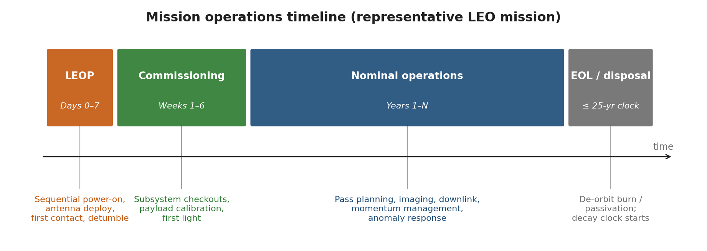

*Mission operations timeline (LEOP through disposal).*


> **Expected reading before this session.** NASA SEH Appendix S — ConOps (≈ 45 min).


**Prerequisites:** Sessions 1.1--1.3
**References:**
- [NASA, Systems Engineering Handbook (SP-2016-6105 Rev 2), 2016 -- Sections 4.1, 4.4, 6.8](https://www.nasa.gov/reference/systems-engineering-handbook/)
- [NASA, NPR 7123.1D -- Sections 3.2.1 (Process 1), 3.2.4 (Process 4), 3.5.8 (Process 17)](https://nodis3.gsfc.nasa.gov/displayDir.cfm?Internal_ID=N_PR_7123_001D_)
- [ECSS, ECSS-E-ST-10C -- Section 5.1 (Requirements Engineering)](https://ecss.nl/standard/ecss-e-st-10c-system-engineering-general-requirements/)
- [ECSS, ECSS-M-ST-10C Rev.1 -- Section 5.3 (Review Process)](https://ecss.nl/standard/ecss-m-st-10c-rev-1-space-project-management-6-march-2009/)
- [Wertz, J.R. et al., Space Mission Engineering: The New SMAD, Microcosm Press, 2011 -- Chapters 1--3](https://www.microcosminc.com/)
- [NASA SEH Appendix C -- How to Write a Good Requirement](https://www.nasa.gov/reference/systems-engineering-handbook/)
- [NASA SEH Appendix S -- ConOps Outline](https://www.nasa.gov/reference/systems-engineering-handbook/)

---

## Learning Objectives

By the end of this session, participants will be able to:
1. Write a clear problem statement that defines the mission need without prescribing a solution
2. Identify and categorise mission stakeholders using a structured analysis matrix
3. Define mission objectives with measurable success criteria and trace them through the MoE/MoP/TPM hierarchy
4. Structure and execute a trade study using weighted scoring methods (Decision Analysis -- Process 17)
5. Evaluate space vs non-space alternatives objectively and document the decision rationale
6. Design a Concept of Operations (ConOps) including mission phases, operational modes, and data flow
7. Use SpaceCDF Steps 1--2 and the Trade Studies tab to capture and evaluate mission concepts

---

## Part 1: Mission Need & Stakeholder Analysis
---

### 1. The Problem Statement
#### 1.1 Why Start with the Problem?

NASA SEH Section 4.1.1 states: *"Clearly define the problem before solving it."*

The single most common failure mode in mission design is not technical -- it is **solving the wrong problem**. Teams jump to solutions ("we need a 6U CubeSat at 500 km") before articulating the actual need ("agricultural monitoring in sub-Saharan Africa requires 10 m resolution multispectral imagery every 5 days"). This premature commitment to a solution:

- Closes off potentially superior alternatives (commercial data purchase, aerial surveys, ground sensors)
- Introduces unnecessary constraints that drive up cost and risk
- Makes it impossible to evaluate mission success (success against what?)
- Violates the fundamental SE principle of **WHAT before HOW**

[Source: [NASA SEH](https://www.nasa.gov/reference/systems-engineering-handbook/) Section 4.1; NASA SEH Appendix C -- "How to Write a Good Requirement"]

#### 1.2 Structure of a Good Problem Statement

A rigorous problem statement answers four questions:

Table 1.4.1 — Four-question structure for a rigorous problem statement with worked agricultural-monitoring examples.

| Question | Content | Example |
|----------|---------|---------|
| **What is the problem?** | The capability gap -- what is missing or inadequate | "Lack of timely, affordable multispectral imagery at sufficient resolution and revisit" |
| **Who is affected?** | Stakeholders and end users who suffer from the gap | "Agricultural monitoring agencies in sub-Saharan Africa" |
| **What is the impact?** | Consequence of not solving it -- quantified if possible | "Delayed or inaccurate crop assessments affecting food aid allocation for 300M people" |
| **What constraints exist?** | Budget, schedule, political, regulatory, or technical limitations | "Budget: <$10M total mission cost; timeline: 3 years to first data" |

#### 1.3 Good vs Bad Problem Statements

**Example -- GOOD:**
> "Agricultural monitoring agencies in sub-Saharan Africa lack timely, affordable access to multispectral imagery at sufficient resolution ($\leq 10$ m) and revisit rate ($\leq 5$ days) to support crop yield prediction and food security planning. Current Sentinel-2 data provides 10 m resolution but only 5-day revisit at the equator, and cloud cover reduces usable observations to approximately 60%. The consequence is delayed or inaccurate crop assessments affecting food aid allocation for 300 million people. Budget constraint: total mission cost less than $10M; first data delivery within 3 years."

**Example -- BAD:**
> "We need a 6U CubeSat with a multispectral imager at 500 km SSO."

The bad example prescribes a solution (6U CubeSat, SSO), specifies a design parameter (500 km), and says nothing about the actual problem. It is a **solution statement**, not a problem statement.

#### 1.4 The WHAT vs HOW Principle

At the mission need level, everything should describe **WHAT** is needed, not **HOW** to achieve it:

Table 1.4.2 — Contrasting WHAT-level needs against premature HOW-level design prescriptions.

| WHAT (correct at this stage) | HOW (premature at this stage) |
|------------------------------|-------------------------------|
| "10 m resolution imagery" | "Use a 15 cm aperture telescope" |
| "Daily revisit at equator" | "Deploy a Walker delta constellation of 12 satellites" |
| "Data within 6 hours of acquisition" | "Use X-band downlink at 150 Mbps to 3 ground stations" |
| "Total cost under $10M" | "Use COTS components exclusively" |
| "5-year operational lifetime" | "Select radiation-hardened components" |

The HOW column is not wrong -- these are all reasonable design decisions. But they belong in later phases (Phase A/B), not in the problem statement. Fixing the HOW prematurely eliminates design freedom and may lead to suboptimal solutions.

**Discussion point.** *Why is it harmful to specify HOW at this stage? What design options does it close off?*

---

### 2. Stakeholder Identification & Analysis
#### 2.1 Who is a Stakeholder?

NASA SEH Section 4.1.2 defines stakeholders as "all parties who have a legitimate interest in the system throughout its lifecycle." This is broader than just the end user -- it includes everyone who affects or is affected by the mission.

#### 2.2 Stakeholder Categories for Space Missions

Table 1.4.3 — Stakeholder categories for space missions with typical needs and constraints for each.

| Category | Examples | Typical Needs | Typical Constraints |
|----------|---------|---------------|-------------------|
| **End Users** | Scientists, farmers, shipping companies, emergency responders | Data quality, resolution, latency, format, accessibility | Data rights, training, infrastructure |
| **Operators** | Mission control centre, ground station operators | Operability, automation level, staffing, training | Budget for operations, personnel availability |
| **Sponsors / Funders** | Space agency (CSA), university, commercial investor, DND | Return on investment, schedule adherence, risk profile | Budget cap, political timelines, reporting requirements |
| **Regulatory** | ISED, ITU, FCC, export control (GAC) | Compliance with spectrum, debris, RSSSA, export regulations | Licensing timelines, filing requirements |
| **Launch Provider** | SpaceX, Rocket Lab, ISRO, Arianespace | CDS compliance, mass/volume limits, schedule, payment | Interface requirements, launch window, manifesting |
| **Ground Segment** | KSAT, SSC, SatNOGS, own stations | Frequency compatibility, data volume, contact time | Station availability, geographic coverage |
| **Data Consumers** | Archives (e.g., EODMS), APIs, partner agencies | Data format (NetCDF, GeoTIFF), metadata standards, timeliness | Format standards, distribution agreements |
| **General Public** | Taxpayers (for government-funded missions) | Value for money, transparency, societal benefit | Political expectations, public engagement |
| **Orbital Environment** | Other satellite operators, debris community | Debris mitigation, spectrum cleanliness, collision avoidance | IADC guidelines, ISO 24113, FCC 5-year rule |

#### 2.3 Stakeholder Analysis Matrix

For each stakeholder, capture five attributes:

Table 1.4.4 — Five attributes captured per stakeholder in the analysis matrix with scoring scales.

| Attribute | Description | Scale |
|-----------|-------------|-------|
| **Name / Role** | Who are they? | Text |
| **Needs** | What do they require from the mission? | Text (specific, measurable where possible) |
| **Constraints** | What limitations do they impose? | Text (mandatory vs desirable) |
| **Priority** | How critical is satisfying this stakeholder? | Primary (must satisfy) / Secondary (should satisfy) / Tertiary (nice to have) |
| **Influence** | How much power do they have over the mission? | High / Medium / Low |

> **Industry Practice:** For the RADARSAT Constellation Mission (RCM), the stakeholder analysis identified over 20 distinct stakeholder groups, including DND (maritime surveillance), Environment Canada (sea ice monitoring), Agriculture and Agri-Food Canada (crop monitoring), Natural Resources Canada (forestry), Public Safety Canada (disaster response), and international partners. Each stakeholder had different priority imaging modes, coverage requirements, and data latency needs. The systems engineering challenge was to design a 3-satellite constellation that satisfied all these needs within a single system architecture -- a classic example of multi-stakeholder optimisation.

**Exercise.** *Complete Part A of Worksheet 1.4 -- identify at least 4 stakeholders for your team's mission and fill in the analysis matrix.*

---

### 3. Mission Objectives and the MoE/MoP/TPM Hierarchy
#### 3.1 From Need to Objectives

Objectives translate the problem statement into specific, testable goals. Each objective must have:

Table 1.4.5 — Required attributes for each mission objective with example entries.

| Attribute | Description | Example |
|-----------|-------------|---------|
| **Text** | Clear statement of what the mission will achieve | "Provide 10 m GSD multispectral imagery over the target region" |
| **Priority** | Primary (mission fails without) or secondary (desirable) | Primary |
| **Measurable criterion** | How you know the objective is met -- a number with a unit | "GSD $\leq$ 10 m at nadir, 4+ spectral bands, revisit $\leq$ 5 days" |
| **Type** | Category of objective | Observation, communication, navigation, science, technology demonstration |

#### 3.2 Writing Good Objectives

Table 1.4.6 — Examples of well-formed mission objectives explaining why each meets the criteria.

| Good Objective | Why It Is Good |
|---------------|---------------|
| "Provide 10 m GSD multispectral imagery with 4+ bands for the target region (30S--30N), with $\leq$ 5-day revisit and $\leq$ 24 h data latency" | Specific (10 m, 4 bands, geographic scope), measurable (all criteria have numbers + units), relevant to agriculture, achievable with CubeSat technology |
| "Achieve 99.5% AIS ship detection probability in the North Atlantic within 30 minutes of ship transmission" | Specific (AIS, North Atlantic), measurable (99.5%, 30 min), relevant to maritime safety |

Table 1.4.7 — Examples of poorly written objectives with diagnoses of their flaws.

| Bad Objective | Why It Is Bad |
|--------------|-------------|
| "Take pictures from space" | Not specific, not measurable, no criterion for success |
| "Build a 3U CubeSat" | This is a solution, not an objective -- it says nothing about what the mission should accomplish |
| "Demonstrate new technology" | What technology? What does "demonstrate" mean? How do you know it succeeded? |

#### 3.3 The MoE / MoP / TPM Hierarchy

These three measures form a chain from operational need to tracked design parameter:

[Source: [NASA SEH](https://www.nasa.gov/reference/systems-engineering-handbook/) Section 4.1.4, Section 4.2.4, Section 6.7.3]

Table 1.4.8 — MoE, MoP and TPM measures distinguished by scope, owner and evaluation phase.

| Measure | What It Measures | Who Sets It | Example | When Evaluated |
|---------|-----------------|-------------|---------|---------------|
| **MoE** (Measure of Effectiveness) | How well the system satisfies the operational need | Users / stakeholders | "% of crop assessments delivered within 5 days of acquisition" | Phase E (operations) |
| **MoP** (Measure of Performance) | Technical performance of the system | Systems engineer | "GSD $\leq$ 10 m at nadir" | Phase C/D (verification) |
| **TPM** (Technical Performance Measure) | Design parameter tracked over time | Design team | "Current best estimate of imager mass vs allocation (1.5 kg target)" | All phases (continuous) |

The hierarchy flows downward:

```
Stakeholder Need
  -> MoE (operational effectiveness)
    -> Mission Objective
      -> MoP (technical performance)
        -> Technical Requirement ("shall" statement)
          -> TPM (tracked design parameter)
```

> **Key Equation:** Measures of Effectiveness often involve probability and time, connecting to system-level performance:
>
> $MoE = P_{detection} \times P_{data\_delivery} \times f(T_{latency})$
>
> For an Earth observation mission:
>
> $MoE_{coverage} = \frac{A_{imaged\_per\_revisit}}{A_{total\_target}} \times (1 - P_{cloud})$
>
> Where $A_{imaged\_per\_revisit}$ depends on swath width and orbit ground track spacing, $A_{total\_target}$ is the target area, and $P_{cloud}$ is the cloud cover probability.

**Exercise.** *For one of your objectives, trace the full hierarchy from stakeholder need through MoE, MoP, and TPM. Complete Part B of Worksheet 1.4.*

---

### 4. From Need to Design: The Flow
Show how the mission need flows through to design decisions without the need itself prescribing the design:

<!-- SVG DIAGRAM: Need to Design Flow -->

<svg xmlns="http://www.w3.org/2000/svg" viewBox="0 0 700 520" style="max-width:700px; font-family: 'Segoe UI', Arial, sans-serif; background: #fafafa; border: 1px solid #ddd; border-radius: 8px;">
  <text x="350" y="25" text-anchor="middle" font-size="14" font-weight="bold" fill="#1a1a2e">From Mission Need to Design Decision</text>

  <!-- Level 1: Problem -->
  <rect x="50" y="45" width="600" height="45" rx="6" fill="#e8eaf6" stroke="#3949ab" stroke-width="2"/>
  <text x="70" y="63" font-size="10" font-weight="bold" fill="#1a237e">PROBLEM</text>
  <text x="70" y="78" font-size="9" fill="#333">"Need 10m imagery, 5-day revisit, &lt;$10M" -- describes WHAT is needed</text>

  <!-- Arrow -->
  <line x1="350" y1="90" x2="350" y2="110" stroke="#555" stroke-width="2" marker-end="url(#arrowDown)"/>
  <text x="370" y="105" font-size="8" fill="#888" font-style="italic">objectives derived</text>

  <!-- Level 2: Objective -->
  <rect x="50" y="115" width="600" height="45" rx="6" fill="#c5cae9" stroke="#3949ab" stroke-width="2"/>
  <text x="70" y="133" font-size="10" font-weight="bold" fill="#1a237e">OBJECTIVE</text>
  <text x="70" y="148" font-size="9" fill="#333">"Provide 10m GSD multispectral imagery with &lt;=5 day revisit" -- measurable goal</text>

  <!-- Arrow -->
  <line x1="350" y1="160" x2="350" y2="180" stroke="#555" stroke-width="2" marker-end="url(#arrowDown)"/>
  <text x="370" y="175" font-size="8" fill="#888" font-style="italic">mission trade (Process 17)</text>

  <!-- Level 3: Trade Decision -->
  <rect x="50" y="185" width="600" height="45" rx="6" fill="#fff9c4" stroke="#f9a825" stroke-width="2"/>
  <text x="70" y="203" font-size="10" font-weight="bold" fill="#e65100">TRADE DECISION</text>
  <text x="70" y="218" font-size="9" fill="#333">"Dedicated CubeSat -- existing services don't meet revisit+resolution together" -- justified choice</text>

  <!-- Arrow -->
  <line x1="350" y1="230" x2="350" y2="250" stroke="#555" stroke-width="2" marker-end="url(#arrowDown)"/>
  <text x="370" y="245" font-size="8" fill="#888" font-style="italic">requirements derived</text>

  <!-- Level 4: Requirement -->
  <rect x="50" y="255" width="600" height="45" rx="6" fill="#e8f5e9" stroke="#2e7d32" stroke-width="2"/>
  <text x="70" y="273" font-size="10" font-weight="bold" fill="#1b5e20">REQUIREMENT</text>
  <text x="70" y="288" font-size="9" fill="#333">"The system shall achieve GSD &lt;= 10m at nadir" -- verifiable "shall" statement</text>

  <!-- Arrow -->
  <line x1="350" y1="300" x2="350" y2="320" stroke="#555" stroke-width="2" marker-end="url(#arrowDown)"/>
  <text x="370" y="315" font-size="8" fill="#888" font-style="italic">design analysis</text>

  <!-- Level 5: Design Choice -->
  <rect x="50" y="325" width="600" height="45" rx="6" fill="#e3f2fd" stroke="#1565c0" stroke-width="2"/>
  <text x="70" y="343" font-size="10" font-weight="bold" fill="#0d47a1">DESIGN CHOICE</text>
  <text x="70" y="358" font-size="9" fill="#333">"SSO 500 km gives 10m GSD with 15cm aperture" -- now we specify HOW</text>

  <!-- Arrow -->
  <line x1="350" y1="370" x2="350" y2="390" stroke="#555" stroke-width="2" marker-end="url(#arrowDown)"/>
  <text x="370" y="385" font-size="8" fill="#888" font-style="italic">equipment selection</text>

  <!-- Level 6: Equipment -->
  <rect x="50" y="395" width="600" height="45" rx="6" fill="#fce4ec" stroke="#c62828" stroke-width="2"/>
  <text x="70" y="413" font-size="10" font-weight="bold" fill="#b71c1c">EQUIPMENT</text>
  <text x="70" y="428" font-size="9" fill="#333">"Selected: XYZ Telescope, 15cm aperture, 1.5 kg, 8W" -- component-level HOW</text>

  <!-- Side annotation -->
  <rect x="50" y="460" width="200" height="40" rx="4" fill="#e0e0e0" stroke="#9e9e9e" stroke-width="1"/>
  <text x="150" y="477" text-anchor="middle" font-size="9" fill="#333" font-weight="bold">Each level: team decides.</text>
  <text x="150" y="490" text-anchor="middle" font-size="8" fill="#666">SpaceCDF supports, does not dictate.</text>

  <defs>
    <marker id="arrowDown" markerWidth="8" markerHeight="6" refX="4" refY="6" orient="auto">
      <path d="M0,0 L4,6 L8,0" fill="#555"/>
    </marker>
  </defs>
</svg>

At each level in this hierarchy, the design team makes decisions informed by analysis and trade studies. The tool supports this process with parametric calculations and automated constraint checking, but the team retains decision authority.

---

## Part 2: Trade Study Methodology
---

### 5. Decision Analysis Framework
#### 5.1 Process 17: Decision Analysis

NASA SEH Process 17 (Decision Analysis) provides the framework for structured alternative evaluation. Every major design decision should follow this process to ensure decisions are auditable, traceable, and defensible.

[Source: [NASA SEH](https://www.nasa.gov/reference/systems-engineering-handbook/) Section 6.8, Process 17: Decision Analysis]

#### 5.2 The Five Elements of a Rigorous Trade Study

Table 1.4.9 — Five elements of a rigorous trade study with common pitfalls to avoid.

| Element | Description | Pitfall to Avoid |
|---------|-------------|-----------------|
| **1. Decision statement** | What are we deciding? Framed as a question. | Too broad ("What should we build?") or too narrow ("Which reaction wheel?") for the current phase |
| **2. Alternatives** | What are the options? Minimum 3, including "do nothing" | Straw-man alternatives designed to lose; failure to include obvious options |
| **3. Criteria** | What matters? Performance, cost, schedule, risk, compliance | Missing a critical criterion; criteria that overlap (double-counting) |
| **4. Weightings** | How important is each criterion? Normalised to sum to 1.0 | All criteria weighted equally (means nothing matters more than anything else); weights set after seeing scores |
| **5. Scoring** | How well does each alternative perform? | Inconsistent scoring scale; anchoring bias; group conformity |

#### 5.3 Weighting Methods

Table 1.4.10 — Comparison of pairwise, swing, direct and AHP weighting methods and their limitations.

| Method | Procedure | Best When | Limitations |
|--------|-----------|-----------|------------|
| **Pairwise comparison** | Compare criteria two at a time; count wins. Weight = wins / total comparisons | Small number of criteria ($< 8$) | Circular preferences possible; does not capture magnitude |
| **Swing weighting** | For each criterion, assess the value of moving from worst to best case. Normalise. | Criteria have different units and scales | Requires clear understanding of worst/best cases |
| **Direct assignment** | Team discusses and agrees on weights | Quick preliminary assessment | Subjective; dominated by vocal team members |
| **AHP (Analytic Hierarchy Process)** | Pairwise comparison on a 1--9 ratio scale; compute eigenvector | Complex decisions with many stakeholders | Mathematically complex; consistency check needed |

> **Key Equation (Pairwise Comparison):** For $n$ criteria, there are $\frac{n(n-1)}{2}$ pairwise comparisons. The raw weight of criterion $i$ is:
>
> $w_i^{raw} = \sum_{j \neq i} p_{ij}$
>
> Where $p_{ij} = 1$ if criterion $i$ is preferred over $j$, 0.5 for a tie, and 0 if $j$ is preferred. The normalised weight is:
>
> $w_i = \frac{w_i^{raw}}{\sum_{k=1}^{n} w_k^{raw}}$

#### 5.4 Scoring Methods

Table 1.4.11 — Quantitative, qualitative and threshold scoring methods with usage guidance.

| Type | Description | Example | When to Use |
|------|-------------|---------|-------------|
| **Quantitative** | Numeric value normalised to 0--1 | Mass: 5 kg scores 0.8, 10 kg scores 0.4 | When hard numbers exist |
| **Qualitative** | Verbal rating mapped to number | "Excellent" = 1.0, "Good" = 0.75, "Fair" = 0.5, "Poor" = 0.25 | When only expert judgment is available |
| **Threshold (go/no-go)** | Pass/fail gate applied before scoring | "TRL $\geq 6$ required" -- below threshold is eliminated | Non-negotiable requirements |

#### 5.5 Weighted Score Calculation

For each alternative $a$ across $n$ criteria:

> **Key Equation:**
>
> $S(a) = \sum_{c=1}^{n} w_c \cdot s(a,c)$
>
> Where $w_c$ is the normalised weight of criterion $c$ and $s(a,c)$ is the normalised score (0--1) of alternative $a$ on criterion $c$.
>
> For "higher is better" criteria:
>
> $s(a,c) = \frac{v(a,c) - v_{min}(c)}{v_{max}(c) - v_{min}(c)}$
>
> For "lower is better" criteria:
>
> $s(a,c) = 1 - \frac{v(a,c) - v_{min}(c)}{v_{max}(c) - v_{min}(c)}$

#### 5.6 Sensitivity Analysis

A trade study result is only meaningful if it is **robust** -- i.e., the ranking does not change with small perturbations in weights or scores. Sensitivity analysis tests this:

Table 1.4.12 — Weight, score and threshold sensitivity-analysis methods with what each reveals.

| Method | Procedure | What It Reveals |
|--------|-----------|----------------|
| **Weight perturbation** | Vary each weight by $\pm 20\%$, re-normalise, re-score | Which criteria are "swing" criteria that could flip the outcome |
| **Score perturbation** | Vary each score by $\pm 1$ level, re-calculate | Which scores are the most uncertain and impactful |
| **Threshold analysis** | For each criterion, find the weight at which the 2nd-place alternative overtakes the 1st | How much the weights would need to change to reverse the decision |

> **Industry Practice:** For the Iridium NEXT constellation (66 operational + 6 on-orbit spares), the initial trade study for the constellation architecture compared Walker Delta, Walker Star, and hybrid configurations across 12 criteria including global coverage, revisit time, inter-satellite link geometry, launch cost, and orbital debris risk. Sensitivity analysis revealed that the ranking was robust for all weight perturbations up to $\pm 30\%$, giving high confidence in the selected Walker Star configuration at 780 km altitude.

**Exercise.** *Practice the pairwise comparison method by weighting 4 criteria for a lunch restaurant choice: taste, cost, healthiness, speed. Then score 3 options. This builds the skill on a low-stakes example before applying it to mission design.*

---

### 6. Space vs Non-Space Alternatives
#### 6.1 The Most Important Trade Study

Before committing to building a satellite, teams must honestly evaluate whether existing solutions meet the need. This is the most important trade study in the mission lifecycle because it determines whether the entire project should proceed.

#### 6.2 Alternative Categories

Table 1.4.13 — Seven alternative data-source categories compared on strengths and weaknesses.

| Category | Examples | Strengths | Weaknesses |
|----------|---------|-----------|-----------|
| **Existing free data** | Copernicus Sentinel-2, Landsat 8/9 | Zero acquisition cost, proven quality, long archive | Fixed resolution/revisit, no tasking control |
| **Commercial data purchase** | Planet (SuperDove), Maxar (WorldView), ICEYE (SAR) | High resolution, fast tasking, no development risk | Ongoing cost, data rights limitations, vendor dependency |
| **Aerial (drones/aircraft)** | Survey drones, P-3 Orion, Twin Otter | Very high resolution ($< 1$ m), flexible scheduling | Limited area coverage, weather dependent, regulatory constraints |
| **Ground sensors** | IoT networks, weather stations, tide gauges | Continuous monitoring, low per-unit cost | Point measurements only, no spatial coverage |
| **Dedicated satellite** | New CubeSat, SmallSat, or microsatellite | Full control, custom instrument, IP ownership | High cost ($2--50M), development risk, 2--5 year schedule |
| **Constellation** | Multiple dedicated satellites | Global coverage, short revisit ($< 1$ day) | Much higher cost, operational complexity |
| **Hosted payload** | Payload on another operator's bus | Lower cost, shared bus risk | Compromised orbit, limited control, schedule dependency |

#### 6.3 Decision Criteria: When is Space Justified?

**Space is likely NOT the right answer when:**
- Existing free data (Sentinel-2, Landsat) meets resolution and revisit needs
- Coverage requirement is local (drones or aircraft are cheaper and higher resolution)
- Data rate is very low (ground sensors with cellular/satellite IoT backhaul suffice)
- Budget does not support minimum viable satellite cost (~$2M for a basic 3U CubeSat)
- Technology readiness is too low for the available schedule

**Space is likely justified when:**
- Global or wide-area coverage is needed simultaneously
- Persistent monitoring is required (24/7 or very frequent revisit $< 5$ days)
- User needs data ownership and control over acquisition scheduling
- No existing service provides the required measurement type (e.g., specific wavelength, polarisation)
- Regulatory or sovereignty requirements demand national control over the sensor

#### 6.4 Constellation Sizing

For missions requiring short revisit, the number of satellites drives cost:

> **Key Equation:** For a Walker Delta constellation at altitude $h$ with half-swath angle $\eta$, the number of orbital planes $P$ and satellites per plane $S$ needed for revisit time $T_{rev}$ is approximately:
>
> $P \times S \geq \frac{2\pi R_E}{v_{ground} \times T_{rev} \times \tan(\eta)}$
>
> Where $v_{ground} \approx 7.1$ km/s (ground track velocity at 500 km) and $\eta$ is related to the instrument swath width $W$ by $\eta = W / (2 R_E)$ for small angles.
>
> More practically, constellation cost scales sub-linearly due to learning curves:
>
> $C_{total} = C_1 \times \sum_{i=1}^{N} i^{\log_2(L)}$
>
> Where $C_1$ is the first unit cost, $N$ is the number of satellites, and $L$ is the learning curve factor (typically 0.90--0.95 for small batches, 0.85 for large batches like Planet's SuperDove).

---

### 7. Documenting the Trade Decision
Every trade study must produce an **auditable decision record**. NASA SEH Process 17 requires documentation of:

Table 1.4.14 — Eight elements required in an auditable Process 17 trade-decision record.

| Element | Content | Purpose |
|---------|---------|---------|
| **Decision statement** | What was decided | Clarity |
| **Alternatives considered** | All options evaluated, including rejected ones | Completeness |
| **Criteria and weights** | What mattered and how much | Transparency |
| **Scoring rationale** | Why each alternative received its score | Auditability |
| **Result and recommendation** | The selected alternative and its total score | Decision record |
| **Sensitivity analysis** | Robustness of the result | Confidence |
| **Risks of selected option** | What could go wrong with the chosen approach | Risk awareness |
| **Responsible person and date** | Who decided and when | Accountability |

> **Industry Practice:** The Canadian Hydrographic Service evaluated commercial SAR data (ICEYE, Capella) versus a dedicated satellite for Arctic maritime surveillance. The trade study documented 8 alternatives across 11 criteria, with weights set by a stakeholder panel including DND, Transport Canada, and CCG. The decision to use RCM data supplemented by commercial SAR tasking -- rather than building a new satellite -- saved an estimated $100M while meeting 90% of the maritime domain awareness requirements.

---

## Part 3: Concept of Operations
---

### 8. Mission Architecture
#### 8.1 Three Segments of a Space Mission

Every space mission comprises three segments that must be designed together:

Table 1.4.15 — Three space-mission segments listing components and key design drivers.

| Segment | Components | Key Design Drivers |
|---------|-----------|-------------------|
| **Space Segment** | Platform (bus): EPS, AOCS, OBC, thermal, structure, propulsion. Payload: instrument(s). Communications: TT&C + payload data link. | Mass, power, volume, orbit, lifetime |
| **Ground Segment** | Ground Operations: commanding, telemetry, orbit determination. Payload Data Centre: data reception, processing (L0-L1-L2-L3), archive. | Contact time, data volume, processing capacity |
| **User Segment** | Data products and services. APIs, portals, archives. Training and documentation. | Latency, format, accessibility, user capacity |

#### 8.2 Data Interfaces Between Segments

Table 1.4.16 — Data interfaces between space, ground and user segments with bands and content.

| Interface | Direction | Band/Protocol | Content |
|-----------|-----------|--------------|---------|
| TM/TC | Space <-> Ground Ops | S-band (typical) | Housekeeping telemetry, telecommands |
| Payload data | Space -> Data Centre | X-band or Ka-band | Science/imagery data (high volume) |
| Orbit/TLE | Ground Ops -> Data Centre | Network | Geolocation metadata for data products |
| Data products | Data Centre -> Users | Internet/API | Processed imagery (L2/L3), analytics |

#### 8.3 Interactive Architecture Diagram

SpaceCDF provides a **drag-and-drop architecture diagram editor** in the ConOps tab:

Table 1.4.17 — SpaceCDF architecture-diagram symbol legend mapping icons to segment types.

| Symbol | Type | Represents |
|--------|------|-----------|
| Satellite (blue) | `satellite` | Space segment (spacecraft + payload) |
| Ground Station (green) | `groundStation` | Ground receiving station with antenna |
| Processing (cyan) | `processing` | Data processing, MCC, archive |
| User (amber) | `user` | End user / data consumer |
| Sensor (orange) | `sensor` | Ground sensor, IoT device, in-situ instrument |
| GNSS/External (purple) | `gnss` | External system (GNSS, relay sat, other constellation) |

**Exercise.** *In the ConOps tab, build your mission architecture diagram. Add all segments, label all connections with data type and frequency band.*

---

### 9. Mission Phases and Operational Modes
#### 9.1 Operational Mission Phases

Table 1.4.18 — Typical CubeSat mission phases with duration, activities and key risks.

| Phase | Duration (typical CubeSat) | Activities | Key Risks |
|-------|--------------------------|------------|-----------|
| **LEOP** | 1--3 days | Deployment, antenna deploy, first contact, initial health check | Deployment failure, tumbling, no contact |
| **Commissioning** | 2--4 weeks | Subsystem checkout, calibration, first light, orbit determination | Anomalies, calibration issues |
| **Nominal Ops** | Months to years | Routine acquisition, downlink, orbit maintenance | Component degradation, anomalies |
| **Extended Ops** | Beyond design life | Continued operations with degraded performance | Solar array degradation, propellant depletion |
| **Disposal** | Days to months | Passivation, deorbit manoeuvre or natural decay | Failure of deorbit system |

#### 9.2 Operational Modes and Power Budgets

Each mode defines which subsystems are active, the pointing configuration, power demand, and data flow:

Table 1.4.19 — Operational modes for a 3U CubeSat listing active subsystems, pointing, power and data flow.

| Mode | Subsystems Active | Pointing | Power (3U typical) | Data Flow |
|------|-------------------|----------|-------------------|-----------|
| **Safe** | EPS, OBC, TTC (beacon), AOCS (coarse) | Sun-pointing | ~1--2 W | Beacon only |
| **Idle** | EPS, OBC, AOCS (standby), TTC (beacon) | Inertial hold | ~2 W | Health TM periodic |
| **Science/Imaging** | + Payload, AOCS (fine pointing) | Nadir or target | ~6 W | Instrument -> OBC storage |
| **Downlink** | + TTC (full TX power) | Ground station track | ~8 W | OBC -> TX -> GS |
| **Eclipse** | EPS (battery), OBC, TCS (heaters), AOCS | Inertial hold | ~3 W (battery) | None |
| **Orbit Maintenance** | + Propulsion | Thrust direction | ~7 W | Manoeuvre TM |

#### 9.3 Duty Cycling and Power Analysis

CubeSats have limited power generation (7--25 W for a 3U with deployable panels). Not all modes can run simultaneously. The orbit timeline determines what can happen when:

**Typical 95-minute orbit at 500 km SSO:**
- 60 min sunlight, 35 min eclipse
- ~10 min imaging per orbit (~10% duty cycle)
- ~8 min downlink per pass (1--2 passes/day over a single ground station)
- ~42 min idle
- 35 min eclipse (battery-powered)

> **Key Equations -- Power Budget:**
>
> Orbit-average power:
>
> $P_{avg} = \sum_{i} P_{mode,i} \times DC_i$
>
> Where $DC_i$ is the duty cycle (fraction of orbit) for each mode.
>
> Solar array sizing:
>
> $P_{SA} = P_{sunlight} + \frac{P_{eclipse} \times t_{eclipse}}{t_{sunlight} \times \eta_{charge}}$
>
> Where $\eta_{charge} \approx 0.9$ (battery charge efficiency).
>
> Battery sizing:
>
> $E_{battery} = \frac{P_{eclipse} \times t_{eclipse}}{DoD \times \eta_{discharge}}$
>
> Where $DoD$ is the maximum depth of discharge (typically 0.2--0.3 for long life, up to 0.5 for short missions) and $\eta_{discharge} \approx 0.95$.

[Source: Wertz et al.; ECSS-E-ST-20C power budget methodology]

---

### 10. Data Flow Pipeline
#### 10.1 End-to-End Data Flow

```
Instrument -> Onboard Storage -> Downlink -> Ground Reception
  -> Processing (L0 -> L1 -> L2) -> Archive -> User Delivery
```

Table 1.4.20 — End-to-end data-flow stages with their key parameter and sizing driver.

| Stage | Key Parameter | Sized By |
|-------|--------------|---------|
| Data generation | GB/day | Payload data rate $\times$ imaging duty cycle |
| Onboard storage | GB | Must hold $\geq 1$ day of data ($2\times$ for margin) |
| Downlink per pass | GB/pass | Link data rate $\times$ contact time per pass |
| Processing | hours | Algorithm complexity, compute infrastructure |
| User delivery | hours | Archive API, network bandwidth |

#### 10.2 Data Budget Balance

> **Key Equation:** For the system to be sustainable, daily downlink capacity must equal or exceed daily data generation:
>
> $C_{downlink} = R_{data} \times N_{passes} \times t_{contact} \times \eta_{protocol} \geq G_{daily}$
>
> Where:
> - $R_{data}$ = data link rate (Mbps)
> - $N_{passes}$ = number of ground station passes per day
> - $t_{contact}$ = average contact time per pass (seconds)
> - $\eta_{protocol}$ = protocol overhead factor (~0.8 for CCSDS framing)
> - $G_{daily}$ = daily data generation (Mb)
>
> If $C_{downlink} < G_{daily}$, data accumulates on board and storage eventually fills. Solutions:
> - Increase $R_{data}$ (higher TX power, higher frequency band, better antenna)
> - Increase $N_{passes}$ (more ground stations, polar ground station for SSO)
> - Increase $t_{contact}$ (higher altitude increases contact time but worsens resolution)
> - Decrease $G_{daily}$ (lower duty cycle, on-board compression, selective downlink)

**SpaceCDF exercise:** *Check the Data Budget on the Dashboard. Does your design balance? If not, which parameter would you change first?*

---

### 11. ConOps Tool Exercise
1. Navigate to the **ConOps** tab in SpaceCDF
2. Review and edit the **mission architecture diagram** -- add all segments and connections
3. Edit the **mission phases**: adjust durations for your mission type
4. Review the **operational modes**: are the right modes defined? Adjust power values.
5. Check the **data flow pipeline**: does downlink capacity balance data generation?

**Complete Worksheet 1.4, Parts E and F:** Document your ConOps outline and calculate the orbit-average power budget.

---

### 1U Worked Example: UniSat-1

**Trade Study: Why 1U instead of 2U or 3U for UniSat-1?**

The UniSat-1 team must justify the choice of a 1U form factor for their MEMS magnetometer technology demonstration. This is a classic Process 17 (Decision Analysis) exercise.

**Decision statement:** "What CubeSat form factor best supports a MEMS magnetometer technology demonstration within the university's budget and schedule constraints?"

**Alternatives:**

Table 1.4.21 — UniSat-1 form-factor alternatives compared on mass, volume, cost and development time.

| Alternative | Mass Limit | Internal Volume | Typical Cost | Dev Time |
|-------------|-----------|-----------------|-------------|----------|
| 1U | 2.00 kg | ~1000 cm^3 | 50--200 kEUR | 6--12 months |
| 2U | 4.00 kg | ~2000 cm^3 | 100--400 kEUR | 12--18 months |
| 3U | 6.0 kg | ~3000 cm^3 | 200--800 kEUR | 18--24 months |

**Criteria and scoring:**

Table 1.4.22 — Weighted trade-study scoring of 1U, 2U and 3U for the UniSat-1 magnetometer demonstrator.

| Criterion | Weight | 1U | 2U | 3U | Rationale |
|-----------|--------|-----|-----|-----|-----------|
| Cost | 0.35 | 1.0 | 0.5 | 0.2 | University budget is 150 kEUR total |
| Schedule | 0.25 | 1.0 | 0.6 | 0.3 | Must launch within 12 months |
| Payload fits | 0.20 | 0.8 | 1.0 | 1.0 | MEMS sensor is 50 g, 0.2 W -- fits easily in 1U |
| Design simplicity | 0.10 | 1.0 | 0.7 | 0.5 | Smaller team, fewer subsystems |
| Data return | 0.10 | 0.5 | 0.7 | 1.0 | More volume allows better comms, but 9600 bps is sufficient for < 1 kbps payload |
| **Weighted Total** | | **0.91** | **0.67** | **0.50** | |

**Result:** 1U wins decisively. The MEMS magnetometer payload (50 g, 0.2 W, < 1 kbps) has no need for the extra volume, mass, or power that 2U/3U would provide. The additional cost and schedule of a larger bus are unjustified.

**Sensitivity check:** Even if cost weight drops from 0.35 to 0.15 (and schedule from 0.25 to 0.15, redistributing to data return), 1U still wins (0.76 vs 0.72 vs 0.73 for 1U, 2U and 3U). The winner is robust, but the runner-up is not: 3U overtakes 2U once data return dominates.

**Key lesson:** Do not over-design the bus for a simple payload. The 1U form factor imposes healthy constraints that force the team to focus on the mission objective rather than adding unnecessary capability.

---

## Session Summary

Table 1.4.23 — Session summary: key takeaways for mission needs, stakeholder analysis and trade studies.

| Topic | Key Takeaway |
|-------|-------------|
| Problem statement | Defines WHAT is needed, not HOW to solve it; answers what, who, impact, constraints |
| Stakeholder analysis | Identify all parties with legitimate interest; capture needs, constraints, priority, influence |
| Objectives | Must be specific, measurable, and traceable to stakeholder needs via MoE/MoP/TPM chain |
| Trade study structure | 5 elements: decision, alternatives, criteria, weights, scores; must include sensitivity analysis |
| Space vs non-space | Existing services may already meet the need -- evaluate honestly before committing to build |
| Decision documentation | Every trade decision must have auditable rationale per Process 17 |
| ConOps | Three segments (space, ground, user); operational modes drive power budget via duty cycling |
| Data pipeline | Daily downlink capacity must equal or exceed daily data generation |

---

## References

1. [NASA, Systems Engineering Handbook (SP-2016-6105 Rev 2), 2016](https://www.nasa.gov/reference/systems-engineering-handbook/)
2. [NASA, NPR 7123.1D -- Systems Engineering Processes and Requirements, 2020](https://nodis3.gsfc.nasa.gov/displayDir.cfm?Internal_ID=N_PR_7123_001D_)
3. [ECSS, ECSS-E-ST-10C -- System Engineering General Requirements, 2009](https://ecss.nl/standard/ecss-e-st-10c-system-engineering-general-requirements/)
4. [Wertz, J.R. et al., Space Mission Engineering: The New SMAD, Microcosm Press, 2011](https://www.microcosminc.com/)
5. [NASA SEH Appendix C -- How to Write a Good Requirement](https://www.nasa.gov/reference/systems-engineering-handbook/)
6. [NASA SEH Appendix S -- ConOps Outline](https://www.nasa.gov/reference/systems-engineering-handbook/)
7. [Saaty, T.L., "The Analytic Hierarchy Process", McGraw-Hill, 1980](https://doi.org/10.1016/0377-2217(90)90057-I)

# Chapter 2.1 — The System-V and Requirements Engineering

> **Expected reading before this session.** NASA SEH Appendix C — How to Write a Good Requirement (≈ 30 min); ECSS-E-ST-10C §5.5.


**Prerequisites:** Week 1 complete (mission need, stakeholder analysis, ConOps defined)
**SpaceCDF Tab:** Requirements

---

## References

- [NASA, *Systems Engineering Handbook* (NASA/SP-2016-6105 Rev 2), 2016, Ch. 4.2 & Appendix C](https://www.nasa.gov/reference/systems-engineering-handbook/)
- [ECSS, *ECSS-E-ST-10-06C: Technical Requirements Specification*, 2009, Sec. 5](https://ecss.nl/standard/ecss-e-st-10-06c-technical-requirements-specification/)
- [ECSS, *ECSS-E-ST-10C Rev.1: Space Engineering -- System Engineering General Requirements*, 2017, Sec. 5.2](https://ecss.nl/standard/ecss-e-st-10c-rev-1-system-engineering-general-requirements/)
- [Wertz, Everett & Puschell, *Space Mission Engineering: The New SMAD*, 2011, Ch. 3--4](https://www.microcosminc.com/)
- [INCOSE, *Systems Engineering Handbook*, 5th ed., 2023, Ch. 2.3.5](https://www.incose.org/products-and-publications/se-handbook)

---

## Learning Objectives

By the end of this session, participants will be able to:

1. Explain the System-V lifecycle model and how requirements flow down the left side while verification flows up the right side
2. Write requirements that satisfy the SMART criteria and express WHAT, not HOW
3. Classify requirements by type: functional, performance, interface, constraint, and environmental
4. Construct a three-level requirement hierarchy (mission, system, subsystem) with bidirectional traceability
5. Assign verification methods (ATIR(D)) to requirements and justify each choice
6. Use SpaceCDF's Requirements tab to generate, validate, and manage requirements

---

## 1. The System-V Model — Requirements Perspective

The **System-V** (or "Vee model") was introduced in Chapter 1.1 §2 as
the canonical systems-engineering lifecycle (see the System-V figure in Chapter 1.1). This
section revisits the V from a *requirements-engineering perspective*:
each level on the left branch decomposes the *requirements* one level
finer, and each level on the right branch contains the *verification
or validation activity* that closes the requirement at that level.

*[Source: [NASA SEH](https://www.nasa.gov/reference/systems-engineering-handbook/) Fig. 3-1; ECSS-E-ST-10C Rev.1 Fig. 5-1; INCOSE SEH 5th ed. Fig. 2.7]*

**Key insight:** the V is not a timeline — it is a *correspondence map*.
The left branch asks "what must be done?" at increasing levels of
detail; the right branch asks "did we do it?" at corresponding levels.
Each horizontal row is a matched pair (requirement ↔ verification).

### Phase Mapping to the V

Table 2.1.1 — Mapping of V-model levels to decomposition activities, verification activities and NASA project phases.

| V-Level | Left Branch (Decomposition) | Right Branch (Verification) | NASA Phase |
|---------|---------------------------|---------------------------|------------|
| Top | Stakeholder needs & objectives | Operational validation (does the mission deliver value?) | Pre-A / E |
| Mission | Mission-level requirements | Mission-level V&V (commissioning, in-orbit checkout) | A / E |
| System | System-level requirements | System integration & test (end-to-end) | B / D |
| Subsystem | Subsystem requirements | Subsystem qualification & acceptance test | C / D |
| Bottom | Implementation (detailed design, build) | Component acceptance | C-D |

### Real Mission Example: Planet SuperDove

Planet's SuperDove constellation (2020--present) illustrates the V-model in commercial practice:

Table 2.1.2 — Planet SuperDove example showing requirements paired with verification at each V level.

| Level | Requirement (Left) | Verification (Right) |
|-------|-------------------|---------------------|
| Stakeholder | "Daily global coverage at <5 m for agricultural analytics" | In-orbit validation: coverage maps, user feedback |
| Mission | "Revisit <= 1 day at +-60deg latitude" | Constellation coverage simulation confirmed |
| System | "GSD <= 3.7 m at 475 km SSO" | End-to-end imaging test from orbit |
| Subsystem | "Telescope aperture >= 90 mm, 8 spectral bands" | Instrument calibration on ground + in-orbit |

*[Source: Planet Labs, "Planet Imagery Product Specifications," 2023]*

---

## 2. What is a Requirement?
*[Source: [NASA SEH](https://www.nasa.gov/reference/systems-engineering-handbook/) Sec. 4.2; ECSS-E-ST-10-06C Sec. 5.2]*

A requirement is a **formal, verifiable statement of what the system must do or how well it must perform**. It is expressed as a "shall" statement with a measurable threshold.

### The Shall Convention

Requirements use contractually precise language:

Table 2.1.3 — Shall, should and will keywords and their contractual force in requirement statements.

| Keyword | Meaning | Contractual Force |
|---------|---------|-------------------|
| **"Shall"** | Mandatory requirement -- must be met | Binding |
| **"Should"** | Goal or guideline -- desired but not mandatory | Advisory |
| **"Will"** | Statement of fact or intent -- not a requirement | Informational |

**Example:**
> "The system **shall** achieve a ground sample distance of 10 m or better at nadir from the operational orbit."

This is testable: GSD can be computed from optical geometry and verified from calibration imagery.

### Requirement Types

Table 2.1.4 — Five requirement types (functional, performance, interface, constraint, environmental) with examples.

| Type | Definition | Example |
|------|-----------|---------|
| **Functional** | What the system must *do* (a capability) | "The system shall acquire multispectral imagery of the target area" |
| **Performance** | How *well* it must do it (quantified) | "The system shall achieve GSD <= 10 m at nadir" |
| **Interface** | Boundary agreements between elements | "The EPS shall provide 5.0 V +/- 0.25 V regulated bus to all subsystems" |
| **Constraint** | Non-negotiable external limits | "The system total mass shall not exceed 6.0 kg" |
| **Environmental** | Survival conditions | "The system shall survive launch loads of 9 g axial and 4 g lateral" |

*[Source: [NASA SEH](https://www.nasa.gov/reference/systems-engineering-handbook/) Appendix C, Table C-1; ECSS-E-ST-10-06C Sec. 5.2.2]*

### Requirements vs. Design Choices

Table 2.1.5 — Side-by-side examples separating WHAT requirements from HOW design choices.

| Requirement (WHAT) | Design Choice (HOW) |
|--------------------|---------------------|
| "The system shall achieve GSD <= 10 m" | "Use a 150 mm aperture telescope" |
| "The system shall survive launch loads" | "Use aluminium 7075-T6 structure" |
| "The system shall provide >= 3 dB link margin" | "Use S-band with 2 W transmitter" |
| "The system shall deorbit within 5 years of EOL" | "Include cold gas propulsion system" |
| "The system shall operate for >= 3 years" | "Use rad-tolerant components" |

**Key principle:** Requirements constrain the solution space without specifying the solution. This preserves design freedom for trade studies.

---

## 3. The SMART Framework
While NASA Appendix C provides a detailed quality checklist, the SMART acronym serves as a rapid quality screen:

Table 2.1.6 — SMART criteria with test questions to screen requirement quality.

| Letter | Meaning | Test Question |
|--------|---------|---------------|
| **S** | Specific | Does it address exactly one concern? Is it unambiguous? |
| **M** | Measurable | Does it have a numeric threshold with units? Can it be verified? |
| **A** | Achievable | Is it technically feasible with current or near-term technology? |
| **R** | Relevant | Does it trace to a stakeholder need or higher-level objective? |
| **T** | Traceable | Can you identify its parent (where it came from) and its children (how it will be verified)? |

### NASA SEH Appendix C: Full Quality Checklist

*[Source: [NASA SEH](https://www.nasa.gov/reference/systems-engineering-handbook/) Appendix C -- "How to Write a Good Requirement"]*

The full NASA checklist adds criteria beyond SMART:

1. **Single requirement per statement** -- no compound "and" requirements
2. **Positive form** -- state what the system SHALL DO, not what it shall NOT do
3. **Active voice** -- "The system shall..." not "It is required that..."
4. **No implementation** -- avoid naming specific hardware, software, or methods
5. **Verifiable** -- must be provable by analysis, test, inspection, or demonstration
6. **No TBDs** -- every threshold must have a value (even if it changes later)
7. **Consistent** -- no contradictions with other requirements in the set
8. **Bounded** -- tolerance or range specified where appropriate

### Common Anti-Patterns

Table 2.1.7 — Common requirement anti-patterns with diagnoses and improved rewrites.

| Anti-Pattern | Problem | Better Version |
|-------------|---------|----------------|
| "The spacecraft shall operate at 500 km altitude" | Prescribes orbit (design choice) | "The system shall provide global coverage with revisit <= 5 days at +/-60 deg latitude" |
| "The spacecraft shall use triple-junction GaAs solar cells" | Prescribes technology | "The EPS shall generate >= 15 W EOL with <= 0.5 m^2 array area" |
| "The system shall use AX.25 protocol" | Prescribes implementation | "The TTC system shall provide reliable command reception with BER <= $10^{-6}$" |
| "The spacecraft shall be a 3U CubeSat" | Prescribes form factor | "The system shall have total mass <= 6 kg and fit within a standard 3U deployer envelope" |

**Exception:** Interface requirements ARE specific because they define contractual boundaries:
> "The EPS shall provide 28 V +/- 2 V regulated bus voltage to all subsystems."

This is acceptable because bus voltage is a negotiated interface agreement, not a unilateral design choice.

---

## 4. Requirement Hierarchy and Traceability
Requirements exist at multiple levels, each decomposed from the level above. Every requirement must trace bidirectionally.

### Hierarchy Structure

```
Stakeholder Need: "Timely agricultural monitoring for food security"
  |
  v derives
Mission Requirement (MR):
  MR-001: "The system shall provide multispectral imagery with
           GSD <= 10 m and revisit <= 5 days over target region"
  |
  v decomposes into
System Requirements (SR):
  SR-PL-001:   "The payload shall achieve GSD <= 10 m at nadir
                from the operational orbit"
  SR-AOCS-001: "The AOCS shall provide pointing accuracy <= 0.1 deg
                (3-sigma) during imaging"
  SR-LINK-001: "The comms system shall downlink >= 5 GB/day"
  |
  v derives
Subsystem Requirements (SSR):
  SSR-PL-001a:   "The telescope aperture shall be >= 80 mm"
  SSR-AOCS-001a: "The star tracker shall provide <= 5 arcsec
                  attitude knowledge (3-sigma)"
  SSR-LINK-001a: "The X-band transmitter shall provide >= 2 W RF power"
```

### Level Definitions

Table 2.1.8 — Definitions of mission, system, subsystem and component requirement levels and who verifies each.

| Level | Scope | Written By | Verified By |
|-------|-------|-----------|-------------|
| **Mission** | What the mission achieves (MoE-derived) | Systems engineer + stakeholders | Operational validation |
| **System** | What the system must do (MoP-derived) | Systems engineer | System-level integration & test |
| **Subsystem** | What each subsystem must provide | Subsystem engineers | Subsystem qualification & acceptance |
| **Component** | What each component must meet | Component engineers | Component acceptance testing |

### Traceability Rules

Every requirement must trace in three directions:

1. **Upward:** to its parent requirement or objective (WHY does this exist?)
2. **Downward:** to child requirements or design parameters (HOW is it decomposed?)
3. **Horizontally:** to a verification method (HOW will it be confirmed?)

This three-axis traceability is captured in the **Requirements Traceability Matrix (RTM)**.

*[Source: [NASA SEH](https://www.nasa.gov/reference/systems-engineering-handbook/) Sec. 6.2 (Process 11: Requirements Management); ECSS-E-ST-10C Sec. 5.2]*

### Splitting Compound Requirements

A compound requirement that addresses multiple concerns must be split for independent verification:

Table 2.1.9 — Compound requirements rewritten as independently verifiable split statements.

| Compound (Poor) | Split (Correct) |
|-----------------|-----------------|
| "The system shall provide 10 m GSD with 5-day revisit and 24 h latency" | MR-001: "GSD <= 10 m" **+** MR-002: "Revisit <= 5 days" **+** MR-003: "Latency <= 24 h" |
| "The EPS shall provide positive power margin in all modes including eclipse" | SR-PWR-001: "Positive margin in sunlit modes" **+** SR-PWR-002: "Positive margin in eclipse" **+** SR-PWR-003: "Battery DOD <= 30% in worst-case eclipse" |

**Rationale:** Each split requirement can be verified independently. If GSD passes but revisit fails, the team knows exactly what to fix without ambiguity.

---

## 5. Verification Methods -- ATIR(D)
*[Source: ECSS-E-ST-10-02C Rev.1 §5.2.2; [NASA SEH](https://www.nasa.gov/reference/systems-engineering-handbook/) Sec. 5.3]*

Every requirement must have an assigned verification method. ECSS-E-ST-10-02C Rev.1 §5.2.2.1 defines four methods -- test, analysis, review of design and inspection -- and counts demonstration as part of test; NASA practice lists demonstration as a separate fifth method. This book abbreviates the set as ATIR(D), with the D in parentheses for that reason:

Table 2.1.10 — Analysis, Test, Inspection, Review-of-design and Demonstration verification methods with usage guidance.

| Method | Code | What It Proves | When Used |
|--------|------|---------------|-----------|
| **Analysis** | A | Requirement satisfied by mathematical model, simulation, or similarity | Phase B--C; when testing is impractical or cost-prohibitive |
| **Test** | T | Requirement satisfied by physical measurement | Phase C--D; when proof requires hardware in a controlled environment |
| **Inspection** | I | Requirement confirmed by visual or physical examination | Physical characteristics (dimensions, labels, markings, mass) |
| **Review of design** | R | Requirement confirmed by examination of drawings, schematics or documentation | Design features that can be established from the records (e.g., use of approved parts, redundancy present) |
| **Demonstration** | D | Requirement confirmed by operational exercise | Functional requirements proven by executing procedures |

### Verification Method Selection Guide

Table 2.1.11 — Recommended verification method by requirement type with rationale.

| Requirement Type | Typical Method | Rationale |
|-----------------|---------------|-----------|
| Mass <= X kg | **I** (weigh it) | Direct physical measurement |
| Pointing <= Y deg | **A** (simulation) + **T** (TVAC/HITL) | Analysis first, confirmed by test |
| Link margin >= 3 dB | **A** (link budget analysis) | Full test requires satellite in orbit |
| Survival at launch loads | **T** (vibration test) | Must physically prove structural integrity |
| Data latency <= 24 h | **D** (end-to-end ops exercise) | Pipeline is procedural -- demonstrate it works |
| Operating temperature range | **T** (thermal vacuum test) | Thermal environment must be simulated |
| Software FDIR logic | **D** (fault injection test) | Demonstrate correct autonomous response |

### Verification by Project Phase

Table 2.1.12 — Verification activities mapped to NASA project phases B through E.

| Phase | Verification Activities |
|-------|------------------------|
| **B** | Analysis verification (models, simulations, budgets, trade studies) |
| **C** | Design verification (detailed analysis, breadboard testing, qualification) |
| **D** | Acceptance testing (flight hardware), system integration, environmental test |
| **E** | In-orbit validation (commissioning, calibration, operational checkout) |

---

## 6. Worked Example: 3U Earth Observation CubeSat
> **Worked Example -- Deriving Requirements for a 3U EO CubeSat**
>
> **Stakeholder need:** "Monitor crop health across the Canadian prairies with weekly updates."
>
> **Step 1 -- Mission requirement:**
> MR-001: "The system shall provide NDVI-capable imagery with GSD <= 10 m and revisit <= 7 days over 49--54 deg N, 100--115 deg W."
>
> **Step 2 -- System requirements (decomposed):**
> - SR-PL-001: "The payload shall acquire imagery in at least RED (630--690 nm) and NIR (760--900 nm) bands."
> - SR-AOCS-001: "The AOCS shall provide pointing accuracy <= 0.5 deg (3-sigma) during imaging."
> - SR-LINK-001: "The comms system shall downlink >= 2 GB per day to a Canadian ground station."
> - SR-PWR-001: "The EPS shall provide positive power margin in all operational modes."
>
> **Step 3 -- Subsystem requirements (derived):**
> - SSR-PL-001a: "The telescope aperture shall be >= 80 mm." [Derived from GSD + altitude]
> - SSR-AOCS-001a: "The star tracker shall provide <= 30 arcsec attitude knowledge." [Derived from pointing budget]
> - SSR-LINK-001a: "The X-band transmitter shall provide >= 2 W RF output power." [Derived from link budget]
>
> **Step 4 -- Verification assignment:**
>
> Table 2.1.13 — Verification method, phase and rationale for sample 3U EO CubeSat requirements.
>
> | Requirement | Method | Phase | Rationale |
> |-------------|--------|-------|-----------|
> | MR-001 (GSD + revisit) | A + D | B + E | Analysis during design; demonstrated from orbit |
> | SR-PL-001 (spectral bands) | T | D | Spectral calibration in lab |
> | SR-AOCS-001 (pointing) | A + T | B + D | Simulation then hardware-in-loop test |
> | SR-LINK-001 (downlink) | A | B | Link budget analysis |
> | SSR-PL-001a (aperture) | I | D | Physical measurement |

### 1U Worked Example: UniSat-1

> **Worked Example -- Deriving Requirements for a 1U Technology Demonstrator**
>
> **Stakeholder need:** "Demonstrate the feasibility of a MEMS-based magnetometer for space weather monitoring in LEO."
>
> **Step 1 -- Mission requirements:**
>
> | ID | Requirement | Type | Rationale |
> |----|------------|------|-----------|
> | MR-001 | "The system shall measure the local magnetic field vector with resolution <= 10 nT at 1 Hz sampling rate for a minimum of 6 months." | Performance | Minimum science return for technology validation |
> | MR-002 | "The system total mass shall not exceed 2.00 kg." | Constraint | CDS Rev 14, 1U mass limit |
> | MR-003 | "The system shall downlink at least 1 MB of magnetometer data per day." | Performance | Sufficient for statistical analysis of sensor performance |
> | MR-004 | "The system shall operate for a minimum of 6 months in LEO." | Performance | Minimum mission duration for seasonal variation coverage |
>
> **Step 2 -- System requirements (decomposed):**
> - SR-PWR-001: "The EPS shall provide orbit-average power >= 2 W to all subsystems."
> - SR-PWR-002: "The battery shall provide >= 10 Wh capacity."
> - SR-LINK-001: "The comms system shall provide a downlink data rate >= 9600 bps."
> - SR-LINK-002: "The comms system shall achieve link margin >= 3 dB at 10 deg minimum elevation."
> - SR-OBC-001: "The OBC shall consume <= 0.5 W average power."
> - SR-STR-001: "The structure shall comply with CDS Rev 14, 1U envelope (100 x 100 x 113.5 mm)."
>
> **Step 3 -- Subsystem requirements (derived):**
> - SSR-PWR-001a: "Body-mounted solar cells shall generate >= 2 W orbit-average power accounting for eclipse and geometry." [Derived from power budget]
> - SSR-LINK-001a: "The UHF transmitter shall provide >= 0.5 W RF output at 437 MHz." [Derived from link budget]
>
> **Step 4 -- Verification assignment:**
>
> | Requirement | Method | Phase | Rationale |
> |-------------|--------|-------|-----------|
> | MR-001 (magnetometer performance) | T + D | D + E | Ground calibration then in-orbit demonstration |
> | MR-002 (mass <= 2.00 kg) | I | D | Weigh the flight unit |
> | SR-PWR-001 (orbit-avg power) | A | B | Power budget analysis |
> | SR-LINK-001 (9600 bps downlink) | A + D | B + E | Link budget analysis; demonstrated from orbit |
> | SR-STR-001 (CDS compliance) | I | D | Physical measurement against CDS template |
>
> **Key difference from 3U:** The 1U requirement set is much smaller (~15--20 requirements vs ~40--60 for a 3U EO mission). There are no pointing requirements, no imaging requirements, and no propulsion requirements. This makes the verification campaign significantly simpler and cheaper.

---

## 7. SpaceCDF Exercise
### Instructions

1. Navigate to the **Requirements** tab in SpaceCDF
2. Click **"Generate from Objectives"** -- the AI agent generates SMART requirements from your mission objectives and ConOps
3. For each generated requirement:
   - Review the SMART validation badges (green = pass, amber = warning, red = fail)
   - Check: does it say WHAT not HOW? Is it a single concern?
   - **Accept**, **Edit**, or **Reject** each one
4. Use the **Level filter** (Mission / System / Subsystem) to view by hierarchy level
5. Use the **Type filter** (Functional / Performance / Interface / Constraint) to classify
6. Navigate to the **V&V Matrix** sub-panel to assign verification methods (A/T/I/D) to each accepted requirement

### Exercise Tasks

1. Generate requirements for your team's mission
2. Identify at least one requirement that specifies HOW (implementation) -- rewrite it as WHAT
3. Split any compound requirements into individual testable statements
4. Classify 5 requirements by type (functional, performance, interface, constraint, environmental)
5. For 5 key requirements, assign verification method (A/T/I/D) and target phase (B/C/D/E)
6. Complete Worksheet 2.1

---

## Key Equations Reference

> **There are no equations in requirements engineering per se**, but the following relationship governs traceability completeness:
>
> $$\text{Coverage} = \frac{N_{\text{verified requirements}}}{N_{\text{total requirements}}} \times 100\%$$
>
> Target: 100% coverage -- every requirement must have at least one assigned verification method and one parent traceability link.

---

## Session Summary

Table 2.1.14 — Session summary: key takeaways for the System-V and requirements engineering.

| Topic | Key Takeaway |
|-------|-------------|
| System-V model | Left branch decomposes requirements; right branch integrates and verifies at matching levels |
| Shall statements | Formal, verifiable, single-concern statements |
| WHAT not HOW | Requirements preserve design freedom; design choices come later in trade studies |
| SMART | Specific, Measurable, Achievable, Relevant, Traceable |
| Requirement types | Functional, performance, interface, constraint, environmental |
| Hierarchy | Mission -> System -> Subsystem with bidirectional traceability (up, down, horizontal) |
| Splitting | One concern per requirement for independent verification |
| ATIR(D) | Analysis, Test, Inspection, Review of design (+ Demonstration) -- assigned per requirement per phase |

# Chapter 2.2 — Functional Decomposition and Allocation

> **Expected reading before this session.** NASA SEH §4.3 (≈ 30 min); ECSS-E-ST-10C §5.6.


**Prerequisites:** Chapter 2.1 (requirements defined and validated)
**SpaceCDF Tab:** Functions

---

## References

- [NASA, *Systems Engineering Handbook* (NASA/SP-2016-6105 Rev 2), 2016, Sec. 4.3 (Process 3: Logical Decomposition)](https://www.nasa.gov/reference/systems-engineering-handbook/)
- [ECSS, *ECSS-E-ST-10C Rev.1: System Engineering General Requirements*, 2017, Sec. 5.3](https://ecss.nl/standard/ecss-e-st-10c-rev-1-system-engineering-general-requirements/)
- [INCOSE, *Systems Engineering Handbook*, 5th ed., 2023, Ch. 2.3.5.3](https://www.incose.org/products-and-publications/se-handbook)
- [Wertz, Everett & Puschell, *Space Mission Engineering: The New SMAD*, 2011, Ch. 2](https://www.microcosminc.com/)
- [Blanchard & Fabrycky, *Systems Engineering and Analysis*, 5th ed., 2010, Ch. 3](https://www.pearson.com/en-us/subject-catalog/p/systems-engineering-and-analysis/P200000003502)

---

## Learning Objectives

By the end of this session, participants will be able to:

1. Explain the purpose of functional decomposition in bridging requirements to design
2. Decompose mission objectives into a hierarchical function tree (3+ levels)
3. Categorise functions by type (observe, communicate, navigate, point, power, protect, store, process, support)
4. Allocate functions to subsystem domains, including multi-allocation for shared responsibilities
5. Derive requirements from functional analysis
6. Identify and resolve coverage gaps (leaf functions without linked requirements)
7. Use SpaceCDF's function tree editor to build and validate a function architecture

---

## 1. What is Functional Decomposition?
*[Source: [NASA SEH](https://www.nasa.gov/reference/systems-engineering-handbook/) Sec. 4.3 -- Process 3: Logical Decomposition]*

Functional decomposition answers: **"What must the system DO to satisfy the requirements?"**

It creates a bridge between requirements (WHAT the system must achieve) and physical design (HOW it will be built). Functions describe *actions* the system must perform, without specifying the physical hardware or software that will perform them.

### The Decomposition Flow

<svg viewBox="0 0 800 360" xmlns="http://www.w3.org/2000/svg" style="max-width:700px; font-family: sans-serif; font-size: 12px;">
  <!-- Boxes -->
  <rect x="250" y="10" width="300" height="40" rx="6" fill="#dbeafe" stroke="#2563eb" stroke-width="2"/>
  <text x="400" y="35" text-anchor="middle" fill="#1e40af" font-weight="bold">Objectives & Requirements</text>
  <!-- Arrow -->
  <line x1="400" y1="50" x2="400" y2="80" stroke="#64748b" stroke-width="2" marker-end="url(#arrowhead)"/>
  <rect x="250" y="80" width="300" height="40" rx="6" fill="#fef3c7" stroke="#d97706" stroke-width="2"/>
  <text x="400" y="105" text-anchor="middle" fill="#92400e" font-weight="bold">Functional Analysis (WHAT)</text>
  <line x1="400" y1="120" x2="400" y2="150" stroke="#64748b" stroke-width="2" marker-end="url(#arrowhead)"/>
  <rect x="250" y="150" width="300" height="40" rx="6" fill="#dcfce7" stroke="#16a34a" stroke-width="2"/>
  <text x="400" y="175" text-anchor="middle" fill="#166534" font-weight="bold">Physical Architecture (HOW)</text>
  <!-- Side annotations -->
  <text x="570" y="70" fill="#64748b" font-size="11">Bridges the gap</text>
  <!-- Function tree below -->
  <rect x="100" y="230" width="180" height="30" rx="4" fill="#fef3c7" stroke="#d97706"/>
  <text x="190" y="250" text-anchor="middle" fill="#92400e" font-size="11">F-001: Acquire Imagery</text>
  <!-- Children -->
  <line x1="190" y1="260" x2="100" y2="290" stroke="#d97706"/>
  <line x1="190" y1="260" x2="280" y2="290" stroke="#d97706"/>
  <line x1="190" y1="260" x2="460" y2="290" stroke="#d97706"/>
  <rect x="20" y="290" width="160" height="26" rx="4" fill="#fff7ed" stroke="#d97706"/>
  <text x="100" y="308" text-anchor="middle" fill="#92400e" font-size="10">F-002: Point at target</text>
  <rect x="200" y="290" width="160" height="26" rx="4" fill="#fff7ed" stroke="#d97706"/>
  <text x="280" y="308" text-anchor="middle" fill="#92400e" font-size="10">F-003: Capture image data</text>
  <rect x="380" y="290" width="160" height="26" rx="4" fill="#fff7ed" stroke="#d97706"/>
  <text x="460" y="308" text-anchor="middle" fill="#92400e" font-size="10">F-004: Store data onboard</text>
  <!-- Universal functions -->
  <rect x="580" y="230" width="180" height="30" rx="4" fill="#e0e7ff" stroke="#4f46e5"/>
  <text x="670" y="250" text-anchor="middle" fill="#3730a3" font-size="11">Universal Functions</text>
  <text x="670" y="280" text-anchor="middle" fill="#3730a3" font-size="10">F-010: Generate power</text>
  <text x="670" y="296" text-anchor="middle" fill="#3730a3" font-size="10">F-020: Maintain thermal env</text>
  <text x="670" y="312" text-anchor="middle" fill="#3730a3" font-size="10">F-030: Survive launch</text>
  <text x="670" y="328" text-anchor="middle" fill="#3730a3" font-size="10">F-040: TTC with ground</text>
  <text x="670" y="344" text-anchor="middle" fill="#3730a3" font-size="10">F-050: Dispose at EOL</text>
  <defs><marker id="arrowhead" markerWidth="10" markerHeight="7" refX="10" refY="3.5" orient="auto"><polygon points="0 0, 10 3.5, 0 7" fill="#64748b"/></marker></defs>
</svg>

### Function Types

Every spacecraft function falls into one of these categories:

Table 2.2.1 — Nine spacecraft function types with characteristic verb and example actions.

| Type | Verb | Description | Example |
|------|------|-------------|---------|
| **Observe** | Sense/measure | Acquire data from the environment | Capture multispectral imagery, receive AIS signals |
| **Communicate** | Transfer | Move information between elements | Downlink science data, uplink telecommands |
| **Navigate** | Determine/control position | Know or change the orbit | Perform orbit maintenance manoeuvre |
| **Point** | Orient | Control spacecraft attitude | Nadir pointing during imaging, target tracking |
| **Power** | Generate/store/distribute | Provide electrical energy | Solar power generation, battery charge management |
| **Protect** | Maintain environment | Keep components within limits | Thermal control, radiation shielding |
| **Store** | Record | Buffer data for later use | Onboard solid-state data recording |
| **Process** | Transform | Convert data between forms | On-board image compression, L0 framing |
| **Support** | Provide structure | Mechanical integrity | Survive launch loads, deploy mechanisms |

### Universal Functions

Regardless of mission type, **every spacecraft** must perform these five functions:

1. **Generate electrical power** (solar, RTG, battery)
2. **Maintain thermal environment** (passive/active thermal control)
3. **Survive the launch environment** (structural loads, vibration, shock)
4. **Communicate with ground for TTC** (telemetry, tracking, command)
5. **Dispose of the spacecraft at end of life** (deorbit, graveyard, passivation)

SpaceCDF auto-generates these universal functions for every mission.

---

## 2. Mission-Type-Specific Function Trees
Different mission types produce fundamentally different primary function trees. The universal functions remain the same; it is the mission-specific branch that differentiates.

### Earth Observation (Optical/SAR)

```
F-001: Acquire imagery of target area
  +-- F-002: Point instrument at target
  +-- F-003: Capture image data (expose detector / SAR pulse)
  +-- F-004: Store acquired data onboard
  +-- F-005: Downlink data to ground station
```

**Real example -- Planet SuperDove:** F-001 decomposes into 8-band pushbroom acquisition, on-board radiometric correction, lossless compression, and X-band downlink. Each sub-function traces to specific SuperDove requirements (3.7 m GSD, 8 spectral bands, 200 Mbps downlink).

### Communications Relay (Store-and-Forward or Bent-Pipe)

```
F-001: Relay communications between users
  +-- F-002: Receive uplink signal from user terminal
  +-- F-003: Process and route data (store-and-forward or bent-pipe)
  +-- F-004: Transmit downlink signal to destination terminal or gateway
```

**Real example -- Astrocast (IoT):** F-001 decomposes into L-band receive (from IoT devices), on-board message deduplication and store-and-forward, and UHF/S-band downlink to gateway stations. Each message is <= 160 bytes.

*[Source: Astrocast, "Astrocast Network Overview," astrocast.com]*

### AIS/IoT Receiver (Passive)

```
F-001: Receive and process signals of interest
  +-- F-002: Receive AIS/IoT signals (passive -- no uplink transmission)
  +-- F-003: Decode and validate messages
  +-- F-004: Store processed data onboard
  +-- F-005: Downlink to ground for distribution
```

### Ground Segment Functions

Missions that include ground-side processing need ground-domain functions:

```
F-G01: Receive satellite data at ground station
F-G02: Process data pipeline (L0 -> L1 -> L2 products)
F-G03: Archive and distribute data products to users
F-G04: Operate mission control centre (planning, commanding, monitoring)
```

SpaceCDF supports allocation to ground domains: `ground_station`, `ground_processing`, `ground_sensor`.

---

## 3. Allocation to Subsystems
Each function must be **allocated** to one or more responsible subsystem domains. This allocation defines system boundaries and, critically, identifies **interfaces** wherever a function is shared.

### Allocation Rules

Table 2.2.2 — Typical subsystem allocation for common functions and whether multi-allocation applies.

| Function | Typical Allocation | Multi-allocation? |
|----------|-------------------|-------------------|
| Acquire imagery | Payload | No (single owner) |
| Point at target | AOCS | No |
| Store data | OBC/Data Handling | No |
| Downlink data | Comms + AOCS | **Yes** -- comms for RF chain, AOCS for antenna pointing |
| Generate power | EPS | No |
| Maintain thermal | Thermal | No |
| Relay communications | Payload + Comms | **Yes** -- boundary depends on architecture |
| Survive launch | Structure | No |
| Dispose at EOL | Propulsion (or Ops) | No (or multi if drag-sail) |

### Multi-Allocation and Interface Identification

When a function is allocated to more than one subsystem, it creates an **interface** that must be explicitly managed.

**Example -- "Downlink data to ground station":**

Table 2.2.3 — Multi-allocation of the downlink function across Comms, AOCS and Data Handling with resulting interfaces.

| Responsible Subsystem | Contribution | Interface Created |
|-----------------------|-------------|-------------------|
| Comms (Link) | Transponder, antenna, modulation, RF chain | Comms <-> AOCS (antenna pointing) |
| AOCS | Antenna pointing towards ground station during pass | Comms <-> Data Handling (packet routing) |
| Data Handling | Data packaging, prioritisation, CCSDS framing | Data Handling <-> AOCS (pass scheduling) |

SpaceCDF supports multi-allocation by entering comma-separated domains.

**Discussion point.** *For each multi-allocated function in your design, where should the system boundary be drawn? Who "owns" the function, and who is a "contributor"?*

### Derived Requirements from Functions

Each allocated function generates **derived requirements** -- requirements not explicitly stated by stakeholders but necessary for the function to work:

Table 2.2.4 — Derived requirements generated by representative functions with derivation logic.

| Function | Derived Requirement | Derivation Logic |
|----------|-------------------|------------------|
| "Point instrument at target" | "AOCS shall provide <= 0.1 deg pointing accuracy during imaging" | From GSD requirement + optical geometry |
| "Store data onboard" | "OBDH shall provide >= 32 GB solid-state storage" | From data rate x orbit period x missed-pass margin |
| "Downlink within daily contact window" | "TX shall provide >= 50 Mbps effective data rate" | From daily data volume / total contact time |
| "Generate power in all modes" | "SA shall produce >= 15 W EOL" | From worst-case sunlit power demand + recharge |

*[Source: [NASA SEH](https://www.nasa.gov/reference/systems-engineering-handbook/) Sec. 4.3.3 -- derived requirements from functional allocation]*

---

## 4. Performance Criteria and Coverage Analysis
Each leaf function (a function with no sub-functions) must have **performance criteria** -- quantitative thresholds that define "how well" the function must be performed:

Table 2.2.5 — Quantitative performance criteria assigned to representative leaf functions.

| Function | Performance Criteria |
|----------|---------------------|
| Acquire imagery | GSD <= 10 m; SNR >= 100:1; >= 4 spectral bands |
| Point at target | Accuracy <= 0.1 deg; stability <= 0.01 deg/s; slew rate >= 1 deg/s |
| Downlink data | Link margin >= 3 dB; daily throughput >= 5 GB |
| Generate power | Positive margin in all modes; battery DOD <= 30% |
| Maintain thermal env | All components within operating range with >= 5 degC margin |

Performance criteria form the quantitative basis for subsystem-level requirements.

### Coverage Analysis

**Every leaf function** must trace to at least one requirement. If it does not, there is a **coverage gap** -- the function is defined but has no verification path.

SpaceCDF shows coverage status with badges:

- **Green badge:** Function has linked requirements (covered)
- **Amber badge:** "No requirements" -- coverage gap detected
- **Red badge:** Function conflicts with existing requirements

### Real Mission Example: CAPSTONE Coverage Gap

NASA's CAPSTONE mission (2022, Advanced Space) experienced a coverage gap during development: the "maintain attitude during trajectory correction manoeuvre" function initially had no formal pointing requirement during burns. This gap was identified during functional review and led to the derivation of SSR-AOCS-007: "The AOCS shall maintain pointing accuracy <= 2 deg during all propulsive manoeuvres."

*[Source: Advanced Space, "CAPSTONE Mission Overview," 2022]*

---

## 5. SpaceCDF Function Tree Exercise
### Instructions

1. Navigate to the **Functions** tab in SpaceCDF
2. The tool auto-generates functions based on your selected mission type
3. **Review the generated tree:** Are the functions appropriate for YOUR mission?
   - For comms missions: should show relay/receive/transmit (not multispectral imagery)
   - For EO missions: should show acquire/point/store/downlink
   - For technology demos: should show demonstrate/characterise/report
4. **Edit functions:**
   - Click **edit** to change name, domain allocation, or performance criteria
   - Click **+sub** to add sub-functions (decompose further)
   - Click **x** to remove inappropriate functions
5. **Add ground segment functions** if your mission includes ground processing
6. **Check multi-allocation:** For any function allocated to multiple domains, verify the interface is captured
7. **Coverage check:** Are there any leaf functions (amber badge) without linked requirements? Derive requirements for them.

### Exercise Tasks

1. Build a function tree with at least 3 levels of decomposition
2. For each leaf function, write one derived requirement with a measurable threshold
3. Create a function-to-requirement traceability table (minimum 8 entries)
4. Identify at least one multi-allocated function and define the interface boundary
5. Complete Worksheet 2.2

---

## Worked Example: 3U EO CubeSat Function Tree

> **Function Tree for Agricultural Monitoring CubeSat**
>
> ```
> F-001: Acquire multispectral imagery
>   +-- F-002: Point telescope at target area (AOCS)
>   +-- F-003: Expose detector and capture image frames (Payload)
>   +-- F-004: Compress and store image data (OBC)
>   +-- F-005: Downlink stored data to ground station (Comms + AOCS)
>
> F-010: Generate electrical power (EPS)
>   +-- F-011: Convert solar energy to electrical (SA)
>   +-- F-012: Store energy for eclipse (Battery)
>   +-- F-013: Regulate and distribute power (EPS board)
>
> F-020: Maintain thermal environment (Thermal)
>   +-- F-021: Reject waste heat from electronics (Radiator)
>   +-- F-022: Maintain battery temperature during eclipse (Heater)
>
> F-030: Survive launch environment (Structure)
> F-040: Communicate with ground for TTC (Comms)
> F-050: Dispose at end of life (Propulsion/Ops)
> ```
>
> **Derived requirements from F-002 (Point telescope at target):**
> - SSR-AOCS-001: "The AOCS shall achieve <= 0.5 deg pointing accuracy during imaging mode"
> - SSR-AOCS-002: "The AOCS shall achieve pointing stability <= 0.01 deg/s during imaging"
>
> **Multi-allocation for F-005 (Downlink data):**
> - Comms subsystem: owns RF chain (transponder, antenna, modulation)
> - AOCS subsystem: provides antenna pointing towards ground station
> - Interface: AOCS must receive pass-schedule triggers from OBC to initiate slew to ground station pointing

---

## Session Summary

Table 2.2.6 — Chapter 2.2 session summary of topics and key takeaways.

| Topic | Key Takeaway |
|-------|-------------|
| Functional decomposition | Bridges requirements (WHAT) to design (HOW) by identifying system actions |
| Function types | Observe, Communicate, Navigate, Point, Power, Protect, Store, Process, Support |
| Universal functions | Power, thermal, launch survival, TTC, disposal -- every spacecraft needs all five |
| Mission-specific trees | EO: acquire/point/store/downlink; Comms: receive/route/transmit; AIS: receive/decode/store |
| Allocation | Each function assigned to subsystem domain(s); multi-allocation creates interfaces |
| Derived requirements | Functions generate new requirements not stated by stakeholders |
| Coverage analysis | Every leaf function must trace to at least one requirement -- no gaps allowed |

# Chapter 2.3 — Orbit Selection and Mission Architecture

> **Expected reading before this session.** Vallado §2 — Keplerian orbital elements (≈ 45 min); ECSS-U-AS-10C Rev.2 — Space Debris Mitigation Requirements (skim).


**Prerequisites:** Sessions 2.1--2.2 (requirements and functions defined)
**SpaceCDF Tabs:** Mission Architecture, Orbit Trade Advisor

---

## References

- [Vallado, *Fundamentals of Astrodynamics and Applications*, 4th ed., 2013, Ch. 2--6](https://www.amazon.com/Fundamentals-Astrodynamics-Applications-Technology-Library/dp/1881883183)
- [Wertz, Everett & Puschell, *Space Mission Engineering: The New SMAD*, 2011, Ch. 5--7](https://www.microcosminc.com/)
- [Curtis, *Orbital Mechanics for Engineering Students*, 4th ed., 2020, Ch. 2--4](https://www.elsevier.com/books/orbital-mechanics-for-engineering-students/curtis/978-0-08-102133-0)
- [NASA, *Systems Engineering Handbook*, 2016, Sec. 4.4 (Process 4: Design Solution Definition)](https://www.nasa.gov/reference/systems-engineering-handbook/)
- [ECSS, *ECSS-U-AS-10C Rev.2: Space Debris Mitigation Requirements*, 2023](https://ecss.nl/standard/ecss-u-as-10c-rev-2-space-debris-mitigation-requirements/)
- [IADC, *Space Debris Mitigation Guidelines*, IADC-02-01 Rev 3, 2021](https://www.iadc-home.org/documents_public/)
- [FCC, *Report and Order FCC 22-74: Space Innovation*, 2022](https://www.fcc.gov/document/fcc-adopts-new-5-year-rule-deorbiting-satellites)

---

## Learning Objectives

By the end of this session, participants will be able to:

1. Define and compute the six Keplerian orbital elements
2. Calculate orbital period, velocity, and eclipse fraction for circular orbits
3. Compute the Sun-synchronous inclination using J2 precession
4. Evaluate orbit trade-offs across altitude, coverage, lifetime, radiation, and debris compliance
5. Apply the Hohmann transfer $\Delta V$ equations for orbit raising and deorbit
6. Use SpaceCDF's orbit trade advisor with mission-appropriate scoring weights

---

## 1. Keplerian Orbital Elements
Six parameters (the *classical orbital elements*) fully describe the size, shape, and orientation of an orbit, plus the satellite's position on it.

*[Source: Vallado, Ch. 2; Curtis, Ch. 2]*


*Figure 2.3.1 — The six Keplerian orbital elements (a, e, i, Ω, ω, ν) shown on a single Earth-centred orbit, with each element labelled in place next to the geometric feature it describes.*

Table 2.3.1 — Six Keplerian orbital elements with symbols, physical meaning, and typical CubeSat ranges.

| Element | Symbol | Physical Meaning | Typical Range |
|---------|--------|-----------------|---------------|
| Semi-major axis | $a$ | Size of the orbit | 6571--42164 km (LEO to GEO) |
| Eccentricity | $e$ | Shape (0 = circle, 0 < e < 1 = ellipse) | 0--0.001 for LEO circular |
| Inclination | $i$ | Tilt of orbit plane from equatorial plane | 0--180 deg |
| RAAN | $\Omega$ | Orientation of ascending node in equatorial plane | 0--360 deg |
| Argument of perigee | $\omega$ | Orientation of perigee within orbit plane | 0--360 deg |
| True anomaly | $\nu$ | Satellite position along the orbit | 0--360 deg |

For **circular LEO** missions (the most common CubeSat orbit type), the key design parameters reduce to three: **altitude** ($h$), **inclination** ($i$), and **LTAN** (local time of ascending node, for Sun-synchronous orbits).


### Key Equations

> **Key Equations -- Orbital Mechanics Fundamentals**
>
> **Orbital period** (circular orbit):
> $$T = 2\pi \sqrt{\frac{a^3}{\mu}}$$
> where $a = R_E + h$ is the semi-major axis (m), $\mu = 3.986 \times 10^{14}$ m$^3$/s$^2$ is Earth's gravitational parameter, and $R_E = 6371$ km.
>
> **Orbital velocity** (circular):
> $$v = \sqrt{\frac{\mu}{a}}$$
>
> **Eclipse fraction** (maximum, circular orbit, cylindrical shadow):
> $$f_{\text{eclipse}} = \frac{1}{\pi} \arccos\left(\frac{\sqrt{a^2 - R_E^2}}{a}\right)$$
>
> **Sun-synchronous inclination** (J2-driven RAAN precession = 360 deg/year):
> $$\cos(i) = -\frac{2 \dot{\Omega}_{\text{req}} \, a^{7/2}}{3 R_E^2 \, J_2 \, \sqrt{\mu}}$$
> where $J_2 = 1.0826 \times 10^{-3}$, $\dot{\Omega}_{\text{req}} = \frac{2\pi}{365.25 \times 86400}$ rad/s.

---

## 2. Worked Examples: Orbital Computations
> **Worked Example -- 500 km Circular LEO**
>
> **Given:** $h = 500$ km, circular orbit.
>
> **Step 1 -- Semi-major axis:**
> $a = 6371 + 500 = 6871$ km $= 6.871 \times 10^6$ m
>
> **Step 2 -- Orbital period:**
> $T = 2\pi \sqrt{\frac{(6.871 \times 10^6)^3}{3.986 \times 10^{14}}} = 2\pi \sqrt{8.137 \times 10^{5}} = 2\pi \times 902.1 = $ **5668 s $\approx$ 94.5 min**
>
> **Step 3 -- Orbital velocity:**
> $v = \sqrt{\frac{3.986 \times 10^{14}}{6.871 \times 10^6}} = \sqrt{5.802 \times 10^7} =$ **7617 m/s** $\approx$ 7.62 km/s
>
> **Step 4 -- Eclipse fraction (maximum):**
> $f = \frac{1}{\pi} \arccos\left(\frac{\sqrt{6871^2 - 6371^2}}{6871}\right) = \frac{1}{\pi} \arccos\left(\frac{2573}{6871}\right) = \frac{1}{\pi} \arccos(0.3745) = \frac{1}{\pi} \times 68.0\degree = $ **0.378** (37.8%)
>
> **Step 5 -- Eclipse and sunlight duration:**
> $t_{\text{eclipse}} = 94.5 \times 0.378 =$ **35.7 min**; $\quad t_{\text{sun}} = 94.5 - 35.7 =$ **58.8 min**
>
> **Step 6 -- Sun-synchronous inclination:**
> $\cos(i) = -\frac{2 \times 1.991 \times 10^{-7} \times (6.871 \times 10^6)^{3.5}}{3 \times (6.371 \times 10^6)^2 \times 1.0826 \times 10^{-3} \times \sqrt{3.986 \times 10^{14}}}$
>
> Numerator: $2 \cdot 1.991 \times 10^{-7} \cdot (6.871 \times 10^6)^{3.5} \approx 3.386 \times 10^{17}$;
> Denominator: $3 \cdot (6.371 \times 10^6)^2 \cdot 1.0826 \times 10^{-3} \cdot \sqrt{3.986 \times 10^{14}} \approx 2.632 \times 10^{18}$
>
> $\cos(i) \approx -3.386/26.32 = -0.1286 \Rightarrow i \approx$ **97.4 deg**

---

## 3. Orbit Selection Trade-Offs
The orbit is the single most impactful early design decision. It cascades to every subsystem.

Table 2.3.2 — Lower-altitude versus higher-altitude LEO trade across GSD, lifetime, drag, and link.

| Parameter | Lower Altitude (300--400 km) | Higher Altitude (600--800 km) |
|-----------|------------------------------|-------------------------------|
| **GSD** | Better (shorter range to target) | Worse (longer range) |
| **Orbital lifetime** | Short (1--5 years, natural decay) | Long (25--100+ years) |
| **Debris compliance** | Easy (FCC 5-year rule met naturally) | May require active deorbit propulsion |
| **Radiation (TID)** | Lower (2--5 krad/yr) | Higher (10--20 krad/yr above 700 km) |
| **Launch cost** | Lower $\Delta V$ to orbit | Slightly higher |
| **Link budget** | Better (shorter slant range) | Worse (longer path loss) |
| **Coverage/swath** | Narrower per pass | Wider per pass |
| **Atmospheric drag** | Significant (limits lifetime) | Negligible above ~700 km |
| **Eclipse fraction** | ~35--38% | ~33--35% |

### Orbit Types and Applications

Table 2.3.3 — Orbit type catalogue mapping altitude and inclination to mission applications and flight examples.

| Orbit | Altitude | Inclination | Best For | Real Example |
|-------|----------|-------------|----------|-------------|
| **LEO (non-SSO)** | 300--600 km | Any | Technology demos, ISS deployment | Many CubeSats |
| **SSO** | 400--800 km | 97--99 deg | EO (consistent solar illumination) | Planet SuperDove (475 km) |
| **ISS orbit** | ~410 km | 51.6 deg | ISS-deployed CubeSats | NanoRacks deployments |
| **MEO** | 2000--20200 km | Various | Navigation | GPS (20200 km) |
| **GEO** | 35786 km | 0 deg | Comms, weather | Anik F2 (Telesat) |
| **HEO (Molniya)** | 500--40000 km | 63.4 deg | High-latitude coverage | Meridian (Russia) |
| **Lunar NRHO** | 1500--70000 km | Lunar | Cislunar operations | CAPSTONE (NASA/Advanced Space) |

### Debris Compliance Rules

Table 2.3.4 — Post-mission disposal rules from IADC, FCC, ECSS, and ISED authorities.

| Rule | Requirement | Applies To |
|------|------------|-----------|
| **IADC guideline** (2021) | Post-mission disposal within 25 years | International (voluntary but expected) |
| **FCC rule** (2024+) | Post-mission disposal within **5 years** | All FCC-licensed LEO satellites |
| **ECSS-U-AS-10C Rev.2** | Compliance with IADC + ESA Zero Debris Charter | ESA missions |
| **ISED (Canada)** | Currently 25-year rule; tightening under review | Canadian-licensed satellites |

**Critical altitude boundaries for FCC 5-year compliance:**

Table 2.3.5 — Altitude bands mapped to natural lifetime and FCC five-year deorbit compliance options.

| Altitude | Natural Lifetime | FCC Compliant? | Action Needed |
|----------|-----------------|---------------|---------------|
| < 450 km | < 5 years | Yes | None (natural decay) |
| 450--550 km | 5--20 years | Marginal | Drag augmentation may suffice |
| 550--650 km | 20--50 years | **No** | Active deorbit (propulsion or drag sail) |
| > 700 km | > 100 years | **No** | Propulsion mandatory; ESA Zero Debris zone |

*[Source: IADC-02-01 Rev 3, Sec. 5.3.2; FCC 22-74; ECSS-U-AS-10C Rev.2]*

### Perturbation Effects

Table 2.3.6 — Orbit perturbations ranked by cause, effect, and resulting design impact.

| Perturbation | Cause | Effect on Orbit | Design Impact |
|-------------|-------|----------------|---------------|
| **$J_2$ (Earth oblateness)** | Equatorial bulge | RAAN precession, argument of perigee drift | Enables Sun-synchronous; frozen orbits at $\omega = 90\degree$ |
| **Atmospheric drag** | Residual atmosphere | Semi-major axis decay, eventual re-entry | Limits lifetime below ~600 km; drives propulsion need |
| **Solar radiation pressure** | Photon momentum | Eccentricity oscillations, orbit perturbation | Significant for large A/m ratio (drag sails, large SA) |
| **Third-body (Moon/Sun)** | Gravitational pull | Long-period oscillations in $e$, $i$ | Significant for GEO and HEO; negligible for LEO |
| **Magnetic field** | Lorentz force on charged S/C | Very small drag-like effect | Negligible for most missions |

---

## 4. Ground Coverage and Revisit
> **Key Equations -- Ground Coverage**
>
> **Swath width** (nadir-pointing sensor with half-cone angle $\theta$):
> $$W_{\text{swath}} = 2h \tan(\theta)$$
>
> **Ground track spacing** (for a single satellite in LEO):
> The Earth rotates ~22.9 deg per orbit (for $T \approx 95$ min). At the equator, this corresponds to:
> $$\Delta_{\text{lon}} = \frac{360\degree}{T_{\text{sidereal}}} \times T_{\text{orbit}} \approx 22.9\degree \approx 2550 \text{ km (at equator)}$$
>
> **Revisit time** (approximate, single satellite):
> $$t_{\text{revisit}} \approx \frac{\Delta_{\text{lon}}}{W_{\text{swath}}} \times T_{\text{orbit}}$$
>
> **Constellation revisit** (N identical satellites in same plane):
> $$t_{\text{revisit,constellation}} \approx \frac{t_{\text{revisit,single}}}{N}$$

**Example -- SuperDove constellation:**
Planet operates ~200 SuperDove satellites. With a ~24 km swath at 475 km and multiple orbital planes, the constellation achieves daily global revisit -- a dramatic improvement over a single satellite's ~7-day revisit.

### Ground Station Contact Geometry

**Contact time per pass** depends on the minimum elevation angle $\epsilon_{\min}$ (typically 5--10 deg):

$$t_{\text{contact}} \approx \frac{T}{\pi} \arccos\left(\frac{\cos(\rho)}{\cos(\epsilon_{\min})}\right) - \text{geometric correction}$$

**Simplified rule of thumb** for LEO at 500 km, $\epsilon_{\min} = 10\degree$:
- Maximum pass duration: ~10 min (overhead pass)
- Average pass duration: ~6--7 min
- Passes per day (mid-latitude station): ~4--6

### Constellation Design

A single LEO satellite sees any given point on Earth only briefly and infrequently; sustained coverage or short revisit requires a **constellation** — multiple satellites whose orbits are chosen so their coverage footprints overlap in space and time. The dominant design pattern is the **Walker constellation**, specified by the notation $i\colon t/p/f$, where $i$ is the common inclination, $t$ the total number of satellites, $p$ the number of equally-spaced orbital planes, and $f$ the inter-plane phasing factor (which staggers the satellites between adjacent planes so the gaps in one plane are covered by the next). Choosing $i$, altitude, $p$, and $t$ trades coverage against cost: more planes improve cross-track coverage and resilience to a single launch failure but multiply launch and station-keeping cost; higher altitude widens each footprint (fewer satellites for global coverage) at the price of higher launch energy, longer slant ranges, and slower deorbit. Constellations also demand a **phasing and station-keeping budget**: differential drag, $J_2$ precession, and injection errors must be managed so the satellites hold their relative geometry over the mission life.

### Constellation Coverage and Revisit

For a constellation the single-satellite revisit equations above are divided, to first order, by the number of satellites contributing coverage at the target latitude (see the constellation-revisit relation in §4). The useful figures of merit are **percentage coverage** (fraction of the target region in view of at least one satellite at any instant), **mean and maximum revisit time** (average and worst-case gap between successive views of a point), and **n-fold coverage** (how many satellites see a point simultaneously — important for navigation and for multi-look or stereo imaging). Coverage is strongly latitude-dependent: a Walker constellation at inclination $i$ gives best coverage near latitude $i$ and leaves a polar gap above it, which is why true global coverage often mixes inclined planes with one or more near-polar planes. The SuperDove example above (≈200 satellites across multiple planes, daily global revisit) illustrates the headline trade: revisit shortens roughly in proportion to satellite count, but so does cost and constellation-management complexity.

### Downlinks and Data Return

Coverage of the *target* is only half the problem; the data must also reach the ground. Each satellite can only downlink when it is in view of a **ground station**, so a constellation's effective data-return capacity is set by the combination of per-satellite downlink rate, the number and geographic spread of ground stations, and the resulting contact minutes per orbit. Common strategies are a **distributed ground-station network** (e.g. commercial ground-station-as-a-service providers, or high-latitude stations such as Svalbard/Inuvik that see many consecutive polar passes), **store-and-forward** operation (the payload buffers data on board and dumps it over a station), and on-board **data reduction** (compression, on-board processing, or tasking to capture only what is needed). The downlink contact budget — total available contact time per day versus data generated per day — is a first-order sizing check for any constellation and is exactly the kind of budget closure SpaceCDF performs.

### Inter-Satellite Links and Space-to-Space Backhaul

When a satellite cannot reach a ground station quickly enough — or when low-latency delivery is required — data can be relayed **satellite-to-satellite** over an **inter-satellite link (ISL)** rather than waiting for a ground pass. Two architectures dominate. **Cross-links within a LEO constellation** (typically optical, increasingly RF for smaller satellites) let a satellite hand its data to a neighbour that is over a ground station, so the constellation behaves as a mesh and any node can reach the ground within seconds (the approach used by large broadband constellations). **Relay through a higher-orbit asset** uses a GEO data-relay satellite (e.g. NASA's TDRS or ESA's EDRS "SpaceDataHighway") that is permanently visible to both the LEO satellite and a fixed ground terminal, providing near-continuous backhaul without a dense LEO ground network. ISLs add mass, power, and pointing-accuracy demands (optical cross-links need arc-second-class pointing between fast-moving platforms) and a new layer of network and timing complexity, so they are justified mainly where latency, continuous contact, or independence from a global ground network is worth the cost.

---

## 5. Hohmann Transfer and Deorbit
> **Key Equations -- Hohmann Transfer**
>
> The minimum-energy transfer between two circular orbits of radii $r_1$ and $r_2$:
>
> $$\Delta V_1 = \sqrt{\frac{\mu}{r_1}} \left(\sqrt{\frac{2r_2}{r_1 + r_2}} - 1\right)$$
>
> $$\Delta V_2 = \sqrt{\frac{\mu}{r_2}} \left(1 - \sqrt{\frac{2r_1}{r_1 + r_2}}\right)$$
>
> $$\Delta V_{\text{total}} = |\Delta V_1| + |\Delta V_2|$$

> **Worked Example -- Deorbit from 600 km to 200 km (re-entry perigee)**
>
> $r_1 = 6971$ km, $r_2 = 6571$ km
>
> $\Delta V_1 = \sqrt{\frac{3.986 \times 10^5}{6971}} \left(\sqrt{\frac{2 \times 6571}{6971 + 6571}} - 1\right)$
> $= 7.561 \times (\sqrt{0.9705} - 1) = 7.561 \times (-0.01498) = -0.1133$ km/s
>
> $\Delta V_{\text{total}} \approx$ **113 m/s** (only the first burn needed to lower perigee)

This deorbit $\Delta V$ is a critical input to the propulsion sizing in Chapter 3.2.

---

## 6. Radiation Environment
*[Source: ECSS-E-ST-10-04C Rev.1]*

### Total Ionising Dose (TID) by Orbit

Table 2.3.7 — Annual total ionising dose by orbit regime with electronics class guidance.

| Orbit | TID (krad/year behind 2mm Al) | Electronics Class |
|-------|-------------------------------|-------------------|
| ISS (410 km, 51.6 deg) | 2--5 | Commercial COTS OK |
| SSO 500 km | 5--10 | Commercial / rad-tolerant |
| SSO 800 km | 10--20 | Rad-tolerant recommended |
| MEO 2000 km | 50--100 | Rad-hard required |
| GEO 35786 km | 10--20 | Rad-hard required |

**Rule of thumb:** Below 600 km in LEO, commercial COTS electronics can survive 3-year missions with modest shielding (2--3 mm Al equivalent). Above 600 km, radiation becomes a significant design driver and component cost escalates.

### South Atlantic Anomaly (SAA)

At 200--600 km altitude over South America, trapped protons from the inner Van Allen belt dip to lower altitudes. The SAA causes:
- Single-event upsets (SEU) in memory
- Single-event latch-ups (SEL) in CMOS
- Increased background noise in optical detectors

Mitigation: error-correcting memory (EDAC), watchdog timers, latch-up protection circuits.

---

### 1U Worked Example: UniSat-1

**Orbit Selection: ISS Orbit (400 km, 51.6 deg) for Rideshare**

UniSat-1 selects the ISS orbit not by optimisation but by **access**: deployment from the ISS via NanoRacks or a similar deployer is the cheapest and most accessible launch opportunity for a university 1U CubeSat.

> **Worked Example -- Orbital Parameters at 400 km, 51.6 deg**
>
> **Step 1 -- Semi-major axis:**
> $a = 6371 + 400 = 6771$ km $= 6.771 \times 10^6$ m
>
> **Step 2 -- Orbital period:**
> $T = 2\pi \sqrt{\frac{(6.771 \times 10^6)^3}{3.986 \times 10^{14}}} = 2\pi \times 882.4 = 5545$ s $\approx$ **92.4 min**
>
> **Step 3 -- Orbital velocity:**
> $v = \sqrt{\frac{3.986 \times 10^{14}}{6.771 \times 10^6}} =$ **7672 m/s** $\approx$ 7.67 km/s
>
> **Step 4 -- Eclipse fraction (maximum):**
> $f = \frac{1}{\pi} \arccos\left(\frac{\sqrt{6771^2 - 6371^2}}{6771}\right) = \frac{1}{\pi} \arccos(0.3386) = \frac{1}{\pi} \times 70.2\degree \approx$ **0.390** (39.0%)
>
> **Step 5 -- Eclipse and sunlight duration:**
> $t_{\text{eclipse}} = 92.4 \times 0.390 \approx$ **36 min**; $\quad t_{\text{sun}} = 92.4 - 36 =$ **56 min**

**Why this orbit works for UniSat-1:**

Table 2.3.8 — UniSat-1 mission-fit assessment for the 400 km, 51.6 degree ISS orbit.

| Factor | 400 km / 51.6 deg | Impact on UniSat-1 |
|--------|-------------------|-------------------|
| Launch cost | Lowest (ISS resupply rideshare) | Fits university budget |
| Orbital lifetime | ~1 year (natural decay) | Exceeds 6-month mission; compliant with FCC 5-year rule without propulsion |
| Radiation | Low (~2--3 krad/yr behind 2 mm Al) | COTS electronics safe for 6-month mission |
| Inclination | 51.6 deg | Adequate latitude coverage for space weather science |
| Eclipse | ~36 min (~39% of orbit) | Manageable with 10 Wh battery |
| Ground contacts | Mid-latitude stations: ~4--6 passes/day | Sufficient for 9600 bps UHF downlink |

**What this orbit does NOT provide:**
- Sun-synchronous lighting (not needed -- magnetometer is not an optical instrument)
- Polar coverage (acceptable -- 51.6 deg covers the majority of magnetic field variation)
- Long lifetime (acceptable -- 6-month design life is well within ~1-year natural lifetime)

**No propulsion trade:** At 400 km, atmospheric drag causes natural re-entry within approximately 1 year (depending on solar activity and ballistic coefficient). UniSat-1 therefore needs no propulsion system for either orbit maintenance or debris compliance. This eliminates an entire subsystem -- a major simplification for a 1U mission.

---

## 7. SpaceCDF Orbit Trade Exercise
### Instructions

1. Navigate to the **Mission Architecture** tab in SpaceCDF
2. Open the **Orbit Trade Advisor** panel
3. Enter your mission parameters:
   - GSD target (optical missions) or "N/A" for non-optical
   - Revisit target (days)
   - Mission lifetime (years)
   - Latitude band of interest
   - Cost ceiling (MEUR)
   - Aperture diameter (if known from optical sizing)
4. Click **"Compute Orbit Trade"**
5. Review the scored candidates:
   - Which orbit scores highest overall?
   - Is it debris-compliant (FCC 5-year rule)?
   - What is the natural orbital lifetime?
6. Click **"Use"** on your preferred orbit to populate the design parameters
7. Verify orbit fields updated in the dashboard (look for "Set from advisor" badge)

### Discussion Points

- Does the best-scoring orbit match your engineering intuition?
- What happens when you change scoring weights (prioritise GSD over cost, or vice versa)?
- For non-optical missions (comms, AIS), does the orbit scoring still make physical sense?
- If your selected orbit is above 600 km, what deorbit strategy will you use?
- Complete Worksheet 2.3

---

## Session Summary

Table 2.3.9 — Session summary: key takeaways for orbit selection and mission architecture.

| Topic | Key Takeaway |
|-------|-------------|
| Keplerian elements | Six parameters define the orbit; for LEO: altitude + inclination + LTAN |
| Key formulae | $T = 2\pi\sqrt{a^3/\mu}$; $v = \sqrt{\mu/a}$; eclipse fraction from geometry |
| Sun-synchronous | Requires specific inclination (~97 deg at 500 km) using $J_2$ precession |
| Perturbations | $J_2$ enables SSO; drag limits lifetime; SRP affects high-A/m satellites |
| Trade-offs | Lower altitude = better GSD and link but shorter lifetime and more drag |
| Debris rules | FCC 5-year, IADC 25-year; above ~550 km requires active deorbit |
| Hohmann transfer | $\Delta V_{\text{deorbit}} \approx 100$ m/s from 600 km; critical propulsion input |
| Radiation | Below 600 km: COTS OK; above: rad-tolerant/hard needed; SAA causes SEU |
| Cascade | Orbit choice affects every subsystem -- highest-leverage design decision |

# Chapter 2.4 — Mission Architecture -- Segments, Interfaces, and Budgets

> **Expected reading before this session.** NASA SEH §4.4 (≈ 30 min).


**Prerequisites:** Sessions 2.1--2.3 (requirements, functions, orbit selected)
**SpaceCDF Tabs:** Mission Architecture, System Architecture, Interfaces, Dashboard

---

## References

- [NASA, *Systems Engineering Handbook*, 2016, Sec. 4.4 (Process 4) & Sec. 6.3 (Process 12: Interface Management)](https://www.nasa.gov/reference/systems-engineering-handbook/)
- [ECSS, *ECSS-E-ST-10-24C: Interface Management*, 2015](https://ecss.nl/standard/ecss-e-st-10-24c-interface-management/)
- [ECSS, *ECSS-E-HB-10-02A: Verification Guidelines*, 2010, Sec. 5.2 (Mass Margins)](https://ecss.nl/hbstms/ecss-e-hb-10-02a-verification-guidelines/)
- [Wertz, Everett & Puschell, *Space Mission Engineering: The New SMAD*, 2011, Ch. 10--11](https://www.microcosminc.com/)
- [ECSS, *ECSS-E-ST-20C: Electrical and Electronic*, 2021 (Power Budgets)](https://ecss.nl/standard/ecss-e-st-20c-electrical-and-electronic/)

---

## Learning Objectives

By the end of this session, participants will be able to:

1. Decompose a space mission into its constituent segments (space, ground, launch, user)
2. Construct a system architecture block diagram with subsystem boundaries
3. Identify and classify all subsystem-to-subsystem interfaces using an N-squared matrix
4. Write formal interface requirements for critical subsystem pairs
5. Construct a mass budget with ECSS margin policy and a mode-based power budget
6. Interpret SpaceCDF's dashboard KPIs and budget displays

---

## 1. Mission Segment Decomposition
*[Source: [NASA SEH](https://www.nasa.gov/reference/systems-engineering-handbook/) Sec. 4.4; ECSS-E-ST-10C Sec. 5.4]*

Every space mission decomposes into segments, each with distinct functions and interfaces:

<svg viewBox="0 0 800 300" xmlns="http://www.w3.org/2000/svg" style="max-width:700px; font-family: sans-serif; font-size: 12px;">
  <!-- Space Segment -->
  <rect x="50" y="20" width="200" height="110" rx="8" fill="#dbeafe" stroke="#2563eb" stroke-width="2"/>
  <text x="150" y="45" text-anchor="middle" fill="#1e40af" font-weight="bold" font-size="14">Space Segment</text>
  <text x="150" y="65" text-anchor="middle" fill="#1e40af" font-size="10">Spacecraft bus</text>
  <text x="150" y="80" text-anchor="middle" fill="#1e40af" font-size="10">Payload instrument(s)</text>
  <text x="150" y="95" text-anchor="middle" fill="#1e40af" font-size="10">Subsystems (EPS, AOCS, TTC...)</text>
  <text x="150" y="110" text-anchor="middle" fill="#1e40af" font-size="10">Flight software</text>
  <!-- Ground Segment -->
  <rect x="300" y="170" width="200" height="110" rx="8" fill="#dcfce7" stroke="#16a34a" stroke-width="2"/>
  <text x="400" y="195" text-anchor="middle" fill="#166534" font-weight="bold" font-size="14">Ground Segment</text>
  <text x="400" y="215" text-anchor="middle" fill="#166534" font-size="10">Ground station(s)</text>
  <text x="400" y="230" text-anchor="middle" fill="#166534" font-size="10">Mission control centre</text>
  <text x="400" y="245" text-anchor="middle" fill="#166534" font-size="10">Data processing pipeline</text>
  <text x="400" y="260" text-anchor="middle" fill="#166534" font-size="10">Operations team</text>
  <!-- Launch Segment -->
  <rect x="550" y="20" width="200" height="80" rx="8" fill="#fef3c7" stroke="#d97706" stroke-width="2"/>
  <text x="650" y="45" text-anchor="middle" fill="#92400e" font-weight="bold" font-size="14">Launch Segment</text>
  <text x="650" y="65" text-anchor="middle" fill="#92400e" font-size="10">Launch vehicle</text>
  <text x="650" y="80" text-anchor="middle" fill="#92400e" font-size="10">Deployer (e.g., ISIPOD)</text>
  <!-- User Segment -->
  <rect x="550" y="170" width="200" height="80" rx="8" fill="#fce7f3" stroke="#db2777" stroke-width="2"/>
  <text x="650" y="195" text-anchor="middle" fill="#9d174d" font-weight="bold" font-size="14">User Segment</text>
  <text x="650" y="215" text-anchor="middle" fill="#9d174d" font-size="10">End users</text>
  <text x="650" y="235" text-anchor="middle" fill="#9d174d" font-size="10">Data products / applications</text>
  <!-- RF link between space and ground -->
  <line x1="250" y1="100" x2="300" y2="200" stroke="#64748b" stroke-width="2" stroke-dasharray="6,3"/>
  <text x="260" y="155" fill="#64748b" font-size="10" transform="rotate(-35, 260, 155)">RF Link (TTC + Data)</text>
  <!-- Launch to space -->
  <line x1="550" y1="60" x2="250" y2="60" stroke="#d97706" stroke-width="2"/>
  <text x="400" y="52" text-anchor="middle" fill="#d97706" font-size="10">Deploy</text>
  <!-- Ground to user -->
  <line x1="500" y1="230" x2="550" y2="210" stroke="#64748b" stroke-width="1.5"/>
  <text x="530" y="215" fill="#64748b" font-size="10">Data</text>
</svg>

Table 2.4.1 — Mission segment decomposition listing elements and inter-segment interfaces.

| Segment | Elements | Key Interfaces |
|---------|----------|---------------|
| **Space** | Spacecraft bus, payload, flight software | To ground (RF), to launch (mechanical/electrical) |
| **Ground** | Ground station, MCC, data processing | To space (RF), to user (network) |
| **Launch** | Launch vehicle, deployer, adapter | To space (mechanical, electrical inhibits) |
| **User** | End users, applications, data consumers | To ground (data products) |

---

## 2. System Architecture Block Diagram
The system block diagram shows the internal architecture of the space segment -- all subsystems and their data/power/mechanical connections.

<svg viewBox="0 0 800 500" xmlns="http://www.w3.org/2000/svg" style="max-width:750px; font-family: sans-serif; font-size: 11px;">
  <!-- Central bus -->
  <rect x="300" y="200" width="200" height="60" rx="6" fill="#fef3c7" stroke="#d97706" stroke-width="2"/>
  <text x="400" y="225" text-anchor="middle" fill="#92400e" font-weight="bold">OBC / Data Handling</text>
  <text x="400" y="245" text-anchor="middle" fill="#92400e" font-size="10">I2C / SPI / CAN bus</text>
  <!-- EPS -->
  <rect x="50" y="30" width="160" height="55" rx="6" fill="#dbeafe" stroke="#2563eb" stroke-width="2"/>
  <text x="130" y="52" text-anchor="middle" fill="#1e40af" font-weight="bold">EPS</text>
  <text x="130" y="70" text-anchor="middle" fill="#1e40af" font-size="10">SA + Battery + Regulator</text>
  <!-- Power bus lines -->
  <line x1="130" y1="85" x2="130" y2="160" stroke="#dc2626" stroke-width="2"/>
  <line x1="50" y1="160" x2="750" y2="160" stroke="#dc2626" stroke-width="2"/>
  <text x="400" y="153" text-anchor="middle" fill="#dc2626" font-size="10" font-weight="bold">Power Bus (3.3V / 5V / Battery)</text>
  <!-- AOCS -->
  <rect x="50" y="310" width="160" height="55" rx="6" fill="#dcfce7" stroke="#16a34a" stroke-width="2"/>
  <text x="130" y="332" text-anchor="middle" fill="#166534" font-weight="bold">AOCS</text>
  <text x="130" y="350" text-anchor="middle" fill="#166534" font-size="10">RW + MTQ + ST + SS</text>
  <line x1="210" y1="335" x2="300" y2="230" stroke="#64748b" stroke-width="1.5"/>
  <!-- Comms -->
  <rect x="590" y="310" width="160" height="55" rx="6" fill="#e0e7ff" stroke="#4f46e5" stroke-width="2"/>
  <text x="670" y="332" text-anchor="middle" fill="#3730a3" font-weight="bold">Comms (TTC)</text>
  <text x="670" y="350" text-anchor="middle" fill="#3730a3" font-size="10">TX + RX + Antenna</text>
  <line x1="590" y1="335" x2="500" y2="230" stroke="#64748b" stroke-width="1.5"/>
  <!-- Payload -->
  <rect x="590" y="30" width="160" height="55" rx="6" fill="#fce7f3" stroke="#db2777" stroke-width="2"/>
  <text x="670" y="52" text-anchor="middle" fill="#9d174d" font-weight="bold">Payload</text>
  <text x="670" y="70" text-anchor="middle" fill="#9d174d" font-size="10">Telescope / Sensor</text>
  <line x1="590" y1="60" x2="500" y2="220" stroke="#64748b" stroke-width="1.5"/>
  <!-- Thermal -->
  <rect x="300" y="400" width="200" height="45" rx="6" fill="#fef9c3" stroke="#ca8a04" stroke-width="2"/>
  <text x="400" y="420" text-anchor="middle" fill="#854d0e" font-weight="bold">Thermal</text>
  <text x="400" y="437" text-anchor="middle" fill="#854d0e" font-size="10">Heaters + MLI + Radiators</text>
  <line x1="400" y1="400" x2="400" y2="260" stroke="#64748b" stroke-width="1" stroke-dasharray="4,3"/>
  <!-- Structure (background) -->
  <rect x="30" y="10" width="740" height="470" rx="10" fill="none" stroke="#94a3b8" stroke-width="1.5" stroke-dasharray="8,4"/>
  <text x="400" y="490" text-anchor="middle" fill="#94a3b8" font-size="12">Structure (primary + secondary)</text>
  <!-- Power taps -->
  <line x1="130" y1="160" x2="130" y2="310" stroke="#dc2626" stroke-width="1" stroke-dasharray="3,2"/>
  <line x1="670" y1="160" x2="670" y2="310" stroke="#dc2626" stroke-width="1" stroke-dasharray="3,2"/>
  <line x1="670" y1="85" x2="670" y2="160" stroke="#dc2626" stroke-width="1" stroke-dasharray="3,2"/>
  <line x1="400" y1="160" x2="400" y2="200" stroke="#dc2626" stroke-width="1" stroke-dasharray="3,2"/>
</svg>

### Subsystem Roles (CubeSat Reference)

Table 2.4.2 — CubeSat subsystem reference with abbreviations, primary functions, and typical mass fractions.

| Subsystem | Abbreviation | Primary Function | Typical Mass Fraction |
|-----------|-------------|-----------------|----------------------|
| **Payload** | PL | Mission-specific sensing or communication | 25--40% |
| **Electrical Power System** | EPS | Generate, store, distribute electrical power | 15--25% |
| **Attitude & Orbit Control** | AOCS | Determine and control attitude; orbit knowledge | 8--15% |
| **Communications (TTC)** | LINK / TTC | Telemetry downlink, telecommand uplink, data downlink | 5--10% |
| **On-Board Computer** | OBC / C&DH | Command execution, data handling, flight software | 2--5% |
| **Thermal Control** | TCS | Maintain all components within temperature limits | 1--5% |
| **Structure** | STR | Mechanical support, launch load path, CDS compliance | 15--25% |
| **Propulsion** | PROP | Orbit manoeuvres, deorbit (if required) | 0--15% |
| **Harness** | HAR | Electrical interconnections | 3--7% |

---

## 3. The N-Squared Interface Matrix
*[Source: [NASA SEH](https://www.nasa.gov/reference/systems-engineering-handbook/) Sec. 6.3 -- Process 12: Interface Management; ECSS-E-ST-10-24C]*

Interface problems are the leading cause of integration failures. NASA SEH states: "Most system failures can be traced back to interface problems."

### N-Squared Matrix Structure

The N$^2$ matrix is a standard systems engineering tool for mapping all subsystem interactions:

- **Diagonal cells:** Subsystems (EPS, AOCS, Comms, Thermal, Structure, Propulsion, OBC, Payload)
- **Off-diagonal cells:** Interface between the row subsystem and the column subsystem
- **Upper triangle:** Outputs from row to column (data, power, commands)
- **Lower triangle:** Outputs from column to row

For 8 subsystems: $8 \times 7 / 2 = 28$ potential interface pairs. A typical CubeSat has 18--22 active interfaces.


*N² matrix example.*

### Interface Types

Table 2.4.3 — Six interface type categories with symbols and representative CubeSat examples.

| Type | Symbol | Description | Example |
|------|--------|-------------|---------|
| **Mechanical** | M | Physical attachment, loads, alignment tolerances | Payload mounting to structure face |
| **Electrical** | E | Power connections, bus voltage, switched lines | EPS 5V bus to all subsystems |
| **Thermal** | T | Heat transfer paths, thermal coupling, conduction | Transponder waste heat to radiator panel |
| **Data** | D | Digital bus (I$^2$C, SPI, UART, CAN, RS-422) | OBC commands to AOCS controller |
| **RF** | R | Electromagnetic coupling or intentional RF paths | TX emissions coupling into payload receiver |
| **Optical** | O | Light paths, field-of-view clearance, stray light | Star tracker FOV clearance from solar array |

### Common CubeSat Interface Concerns

Table 2.4.4 — Common CubeSat interface pairs with interface types and dominant design concerns.

| Interface Pair | Types | Key Concern |
|----------------|-------|-------------|
| EPS <-> AOCS | E | Bus voltage compatibility; reaction wheel peak power draw |
| EPS <-> Comms | E | TX peak power demand (~6--10 W); switched line allocation |
| EPS <-> Thermal | E, T | SA thermal coupling; radiator vs SA area competition on external faces |
| EPS <-> Payload | E | Peak power switching; duty cycle coordination |
| Structure <-> AOCS | M | Reaction wheel and star tracker mounting alignment; vibration isolation |
| Structure <-> Payload | M, O | Payload alignment stability; optical FOV clearance |
| OBC <-> AOCS | D | Attitude data for payload pointing; mode transition commands |
| OBC <-> Comms | D | Telemetry packet routing; telecommand distribution |
| OBC <-> Payload | D | Science data acquisition trigger; instrument commanding |
| Comms <-> Payload | R | **EMC:** TX conducted/radiated emissions vs payload receiver sensitivity |
| Comms <-> AOCS | R, O | Antenna pattern vs star tracker FOV; antenna pointing coordination |
| Thermal <-> Payload | T | Detector cooling requirement; operating temperature limits |
| AOCS <-> Payload | M | Reaction wheel micro-vibration vs payload pointing stability (jitter) |

### Conflict Detection and Resolution

Interface conflicts arise when two subsystems have incompatible requirements at their shared boundary.

**Severity Classification:**

Table 2.4.5 — Interface conflict severity classification with examples and required engineering actions.

| Severity | Description | Example | Required Action |
|----------|-------------|---------|----------------|
| **Critical** | Design cannot close without resolution | EMC: TX radiation prevents payload operation | Must resolve before PDR |
| **Major** | Significant impact on design margin | Radiator area competes with SA area | Mitigation plan required by PDR |
| **Minor** | Manageable with minor adjustment | Star tracker FOV partially blocked by antenna stow | Accommodation analysis |

**Resolution Options:**

1. **Relocate:** Move a component to avoid the conflict (e.g., star tracker to different face)
2. **Shield/Isolate:** Add EMC shielding, vibration isolators, thermal insulation
3. **Time-Division:** Schedule conflicting activities to avoid simultaneity (e.g., no TX during imaging)
4. **Accept Risk:** Document residual risk and margin impact in the risk register

### Writing Interface Requirements

For each significant interface, write formal requirements:

**Example -- EPS <-> All Subsystems:**
```
IR-PWR-001: "The EPS shall provide regulated bus voltages of
             3.3 V +/- 0.1 V and 5.0 V +/- 0.25 V to all subsystems."
IR-PWR-002: "Each subsystem shall not exceed its allocated power
             draw without EPS coordination."
```

**Example -- Comms <-> Payload (EMC):**
```
IR-EMC-001: "TX conducted emissions shall be below -60 dBm in the
             payload receiver band (1.5-1.6 GHz) during imaging mode."
IR-EMC-002: "TX and payload acquisition shall not operate simultaneously
             unless IR-EMC-001 is verified by test."
```

---

## 4. Engineering Budgets: Mass and Power
*[Source: ECSS-E-HB-10-02A Sec. 5.2]*

Engineering budgets are the quantitative backbone of the design. They answer: **"Will this design close?"**

### Mass Budget

> **Key Equations -- Mass Budget**
>
> **Mass margin:**
> $$\text{Margin}_{\%} = \frac{M_{\text{allocation}} - M_{\text{MEV}}}{M_{\text{allocation}}} \times 100\%$$
>
> where MEV = Maximum Expected Value = CBE + maturity margins.
>
> **Status thresholds:** Green: > 20% | Amber: 10--20% | Red: < 10% | Exceeded: < 0%

Table 2.4.6 — Mass budget terminology defining CBE, MEV, equipment margin, and system margin.

| Term | Definition |
|------|-----------|
| **CBE** (Current Best Estimate) | Best estimate of actual mass based on current knowledge |
| **MEV** (Maximum Expected Value) | CBE + equipment maturity margin = worst-case expected mass |
| **Equipment maturity margin** | Applied per component based on design maturity (TRL) |
| **System margin** | Applied at system level as management reserve |

### ECSS Margin Policy by Phase

*[Source: ECSS-E-HB-10-02A Sec. 5.2]*

Table 2.4.7 — ECSS equipment and system mass margin allocations by project phase.

| Phase | Equipment Margin | System Margin | Compound |
|-------|-----------------|---------------|----------|
| **0/A** (concept) | 20% | 20% | ~44% |
| **B1** (preliminary) | 10% | 20% | ~32% |
| **B2** (detailed) | 5% | 15% | ~21% |
| **C/D** (build/test) | 3% | 10% | ~13% |
| **E** (as-built) | 0% | 5% | ~5% |

> **Worked Example -- 3U CubeSat Mass Budget (Phase A)**
>
> Table 2.4.8 — Worked Phase A mass budget for a 3U CubeSat against a 6 kg launcher allocation.
>
> | Subsystem | CBE (kg) | Equip. Margin (20%) | MEV (kg) |
> |-----------|---------|---------------------|---------|
> | Payload | 1.50 | 0.30 | 1.80 |
> | EPS | 0.75 | 0.15 | 0.90 |
> | AOCS | 0.55 | 0.11 | 0.66 |
> | Comms (TTC) | 0.25 | 0.05 | 0.30 |
> | OBC | 0.08 | 0.02 | 0.10 |
> | Thermal | 0.05 | 0.01 | 0.06 |
> | Structure | 0.35 | 0.07 | 0.42 |
> | Harness | 0.15 | 0.03 | 0.18 |
> | **Dry Total** | **3.68** | | **4.42** |
> | System Margin (20%) | | | **0.88** |
> | **Dry MEV** | | | **5.30** |
> | Propellant | | | 0.00 |
> | **Wet Mass** | | | **5.30** |
> | **Launcher Allocation** | | | **6.00** (3U limit) |
> | **Mass Margin** | | | **0.70 kg (11.7%)** -- Amber |

### Mode-Based Power Budget

The power budget is computed **per operational mode** because not all subsystems draw power simultaneously:

Table 2.4.9 — Per-subsystem power demand across safe, idle, imaging, downlink, and eclipse modes.

| Subsystem | Safe (W) | Idle (W) | Imaging (W) | Downlink (W) | Eclipse (W) |
|-----------|---------|---------|-------------|-------------|-------------|
| OBC | 1.0 | 1.0 | 1.0 | 1.0 | 1.0 |
| AOCS | 0.5 | 1.0 | 3.0 | 2.0 | 0.5 |
| Payload | 0 | 0 | 5.0 | 0 | 0 |
| Comms (TX) | 0.5 | 0.5 | 0.5 | 6.0 | 0 |
| Thermal | 0.5 | 0.5 | 0.5 | 0.5 | 2.0 |
| **Total** | **2.5** | **3.0** | **10.0** | **9.5** | **3.5** |

### Orbit-Average Power

> **Key Equations -- Orbit-Average Power**
>
> $$P_{\text{avg}} = \sum_{\text{modes}} \left(P_{\text{mode}} \times \text{duty}_{\text{mode}}\right)$$
>
> **Example for 95-min orbit (60 min sunlight, 35 min eclipse):**
>
> Table 2.4.10 — Orbit-average power calculation combining mode power with duty cycle fractions.
>
> | Mode | Power (W) | Duty (%) | Contribution (W) |
> |------|----------|----------|-------------------|
> | Idle | 3.0 | 45% | 1.35 |
> | Imaging | 10.0 | 10% | 1.00 |
> | Downlink | 9.5 | 8% | 0.76 |
> | Eclipse | 3.5 | 37% | 1.30 |
> | **Total** | | **100%** | **4.41 W** |

### Other Budget Types (Preview)

These budgets are developed in detail in the following chapters:

Table 2.4.11 — Preview of link, pointing, delta-V, and data budgets with governing equations.

| Budget | Key Equation | Session |
|--------|-------------|---------|
| **Link** | $\text{Margin} = \text{EIRP} - \text{FSPL} + G/T - k - 10\log_{10}(R_b) - E_b/N_0$ | 3.3 |
| **Pointing** | $\theta_{\text{total}} = \sqrt{\sum \theta_i^2}$ (RSS) | 3.2 |
| **$\Delta V$** | $\Delta V = I_{sp} \cdot g_0 \cdot \ln(m_0/m_f)$ (Tsiolkovsky) | 3.2 |
| **Data** | $\text{Daily Downlink} \geq \text{Daily Generation}$ | 3.3 |

---

### 1U Worked Example: UniSat-1

**Simplified Architecture: Only 5 Subsystems**

UniSat-1 demonstrates that a 1U CubeSat can be built with a radically simplified architecture compared to a 3U EO mission. Several subsystems are eliminated entirely:

Table 2.4.12 — Comparison of 3U EO and 1U UniSat-1 subsystems showing eliminations and rationale.

| Subsystem | 3U EO CubeSat | UniSat-1 (1U) | Rationale for Elimination |
|-----------|--------------|---------------|--------------------------|
| **EPS** | Required | **Required** | Always needed |
| **OBC** | Required | **Required** | Always needed (minimal: MSP430 or ARM Cortex-M class) |
| **Comms** | S-band + X-band | **UHF only** | 9600 bps is sufficient for < 1 kbps payload data |
| **Structure** | Required | **Required** | Always needed (ISIS 1U or Pumpkin Rev C) |
| **Payload** | Telescope (complex) | **MEMS magnetometer** (simple: 50 g, 0.2 W) | Defines the mission |
| **AOCS** | Star tracker + RWs + MTQs | **Eliminated** | Passive magnetic only (permanent magnet + hysteresis rods, treated as structure, not a subsystem) |
| **Thermal** | MLI + heaters | **Eliminated** | Passive coatings only; 400 km LEO thermal environment is benign for 6-month mission |
| **Propulsion** | May be needed | **Eliminated** | 400 km orbit decays naturally in ~1 year; no orbit maintenance needed |
| **Harness** | Significant | **Minimal** | Only 3--4 board-to-board connections via PC/104 stack |

**N-squared matrix -- drastically reduced:**

For UniSat-1, the interface matrix shrinks from 28 potential pairs (8 subsystems) to just 10 pairs (5 subsystems). The active interfaces are:

Table 2.4.13 — Reduced UniSat-1 interface set with five subsystems and ten active pairs.

| Interface Pair | Types | Key Concern |
|----------------|-------|-------------|
| EPS <-> OBC | E, D | Power regulation, housekeeping telemetry |
| EPS <-> Comms | E | TX peak power (~0.5 W -- small relative to budget) |
| EPS <-> Payload | E | Payload switching (0.2 W -- trivial) |
| OBC <-> Comms | D | TM/TC packet routing |
| OBC <-> Payload | D | Magnetometer data acquisition (I2C or SPI) |
| Structure <-> All | M | Mounting, CDS rail compliance |

**Mass budget (Phase A):**

| Subsystem | CBE (g) | Equip. Margin (20%) | MEV (g) |
|-----------|---------|---------------------|---------|
| Payload (MEMS magnetometer) | 50 | 10 | 60 |
| EPS (board + battery + body-mounted cells) | 250 | 50 | 300 |
| OBC (MSP430/Cortex-M board) | 30 | 6 | 36 |
| Comms (UHF transceiver + antenna) | 80 | 16 | 96 |
| Structure (1U frame) | 200 | 40 | 240 |
| Passive magnetic AOCS (magnet + rods) | 30 | 6 | 36 |
| Harness | 50 | 10 | 60 |
| **Dry Total** | **690** | | **828** |
| System Margin (20%) | | | **166** |
| **Dry MEV** | | | **994** |
| **CDS Allocation** | | | **1330** |
| **Mass Margin** | | | **336 g (25.3%)** -- Green |

**Power budget (all modes use the same simple duty cycle):**

| Mode | Power (W) | Duty (%) | Contribution (W) |
|------|----------|----------|-------------------|
| Idle (OBC + beacon) | 0.7 | 50% | 0.35 |
| Science (+ magnetometer) | 0.9 | 10% | 0.09 |
| Downlink (+ UHF TX) | 1.2 | 5% | 0.06 |
| Eclipse (OBC only) | 0.5 | 35% | 0.18 |
| **Orbit Average** | | **100%** | **0.68 W** |

With ~2 W available from body-mounted cells, the power margin is substantial (~1.3 W, or 66%). This is one of the luxuries of a simple payload on a 1U bus.

**Key architectural insight:** The UniSat-1 architecture is so simple that a small team (3--5 people) can design, build, test, and operate it. This makes it ideal for a university or educational programme. The CDF process still applies -- but the sessions are shorter and the trade space is narrower.

### Budget Types and Where They Live

This session deliberately treats **mass** and **power** in detail because they are the two *system-level* budgets: every subsystem contributes to them, they close (or fail to close) at the spacecraft level, and they are owned by the systems engineer. A handful of other budgets sit at the same system level — **cost**, **ΔV (propellant)**, **schedule**, and, on more demanding missions, **mass-properties/CG** and **volume/accommodation** — because they too are integrated across the whole vehicle and gate the feasibility of the architecture.

The budgets the reviewer often asks about — **link budget**, **data (downlink) budget**, **pointing budget**, **thermal budget**, **momentum/desaturation budget** — are *subsystem-level* budgets. Each is owned by one discipline and is the natural subject of that discipline's chapter rather than the architecture session: the link and data budgets belong to Communications (Chapter 3.3), the pointing budget to AOCS (Chapter 3.2), the thermal budget to Thermal (Chapter 3.1), and so on. They are no less important — a mission can be killed by a link budget as surely as by a mass budget — but they are computed *within* a subsystem against an allocation handed down from the system level.

The distinction that matters in practice is **roll-up versus allocation**. System-level budgets *roll up*: subsystems report their mass, power, and cost, and the systems engineer sums them, applies margin, and checks against the launch and bus limits. Subsystem-level budgets are *allocated down*: the system level sets a pointing requirement, a downlink-volume requirement, or a thermal limit, and the responsible engineer must close their budget within that allocation, escalating to a system-level trade only if they cannot. A useful rule of thumb: if a number is meaningful only after summing across the whole spacecraft, it is a system-level budget and belongs here; if it is computed and closed inside one subsystem against a handed-down allocation, it is a lower-level budget and belongs in that subsystem's chapter. Volume is the common edge case — it is tracked at the system level (does everything fit inside the CDS envelope?) but closed largely through subsystem-level packaging.

---

## 5. SpaceCDF Exercise
### Instructions

1. **System Architecture tab:** Review or edit the subsystem block diagram for your mission
2. **Interfaces tab:** Review the N$^2$ matrix
   - Click on 3 interface cells to examine types and concerns
   - For any red-bordered cell (conflict), use the "Resolve Conflict" workflow
   - Write interface requirements for your most critical pair
3. **Dashboard:** Examine all KPI cards:
   - Mass margin: green/amber/red?
   - Power margin per mode
   - Link margin (if computed)
   - Cost vs ceiling
4. **Budget Breakdown:** Open per-subsystem mass and power charts
5. Complete Worksheet 2.4

### Discussion Questions

- Which budget is tightest (closest to zero or negative margin)?
- What single design change would most improve the tightest budget?
- How does the ECSS margin policy affect your design freedom at Phase A vs Phase C?
- Which interface pair is most likely to cause integration problems?

---

## Session Summary

Table 2.4.14 — Session summary: key takeaways for mission segments, interfaces and budgets.

| Topic | Key Takeaway |
|-------|-------------|
| Mission segments | Space, Ground, Launch, User -- each with defined interfaces |
| System architecture | Block diagram shows subsystems, data buses, power distribution |
| N$^2$ matrix | Maps all 28 potential interface pairs; 6 types (M, E, T, D, R, O) |
| Interface conflicts | Severity classification (critical/major/minor); 4 resolution options |
| Interface requirements | Formal boundary agreements; must be verifiable |
| Mass budget | CBE + equipment margin + system margin = MEV; compare to allocation |
| Power budget | Mode-based; duty cycling gives orbit-average; SA must cover peak + recharge |
| ECSS margins | Decrease with maturity: ~44% at Phase A to ~13% at Phase C/D |
| Budget closure | Negative margin = design does not close; reduce demand or increase allocation |

# Chapter 3.1 — Power System and Thermal Control Design

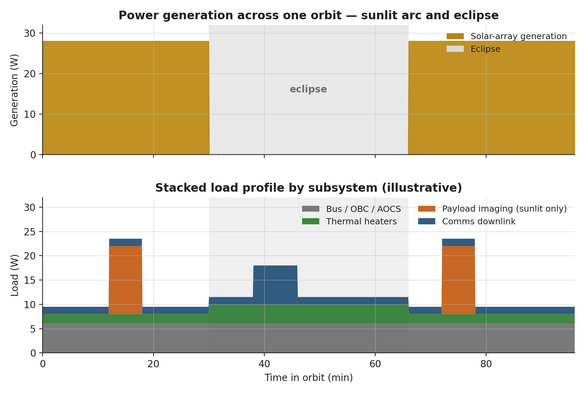

*Power generation and stacked load profile.*


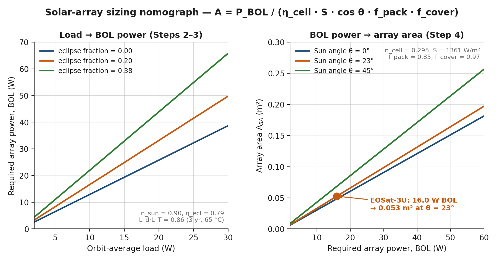

*Solar-array sizing nomograph.*


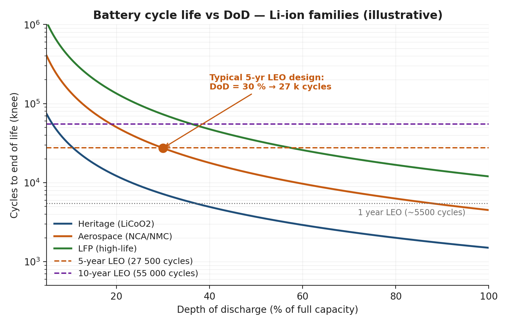

*Battery cycle life vs DoD.*


> **Expected reading before this session.** ECSS-E-ST-20C §5 — power (≈ 60 min); ECSS-E-ST-31C §5 — thermal; Patel, *Spacecraft Power Systems*, Ch. 4; Gilmore, *Spacecraft Thermal Control Handbook*, Ch. 1.


**Prerequisites:** Sessions 2.1--2.4 (requirements, functions, orbit, architecture defined)
**SpaceCDF Tabs:** Dashboard (Power KPI), Engineering Budgets, Timing Budget, Parametric

---

## References

- [Wertz, Everett & Puschell, *Space Mission Engineering: The New SMAD*, 2011, Ch. 11.4 (EPS), Ch. 11.5 (Thermal)](https://www.microcosminc.com/)
- [ECSS, *ECSS-E-ST-20C: Electrical and Electronic*, 2021](https://ecss.nl/standard/ecss-e-st-20c-electrical-and-electronic/)
- [ECSS, *ECSS-E-ST-31C: Thermal Control*, 2020](https://ecss.nl/standard/ecss-e-st-31c-thermal-control/)
- [Patel, *Spacecraft Power Systems*, 2005, Ch. 3--8](https://www.taylorfrancis.com/books/mono/10.1201/9781420038217/spacecraft-power-systems-mukund-patel)
- [Gilmore, *Spacecraft Thermal Control Handbook, Vol. 1*, 2002](https://arc.aiaa.org/doi/book/10.2514/4.104503)
- [GomSpace, *P31u EPS Datasheet*, 2023](https://www.gomspace.com)
- [MMA Design, *HaWK Solar Array Datasheet*, 2023](https://mmadesignllc.com)
- [Spectrolab, *30% Triple-Junction Solar Cell Datasheet*, 2020](https://www.spectrolab.com)
- [Ratnakumar et al., *Lithium-Ion Batteries for Space*, NASA JPL, 2003](https://trs.jpl.nasa.gov)
- [Gilmore, *Spacecraft Thermal Control Handbook, Vol. 2: Cryogenics*, 2003](https://arc.aiaa.org/doi/book/10.2514/4.104515)

---

## Learning Objectives

By the end of this session, participants will be able to:

1. Size a solar array from mission power demand, eclipse profile, and degradation
2. Size a battery from eclipse energy demand, depth-of-discharge, and cycle-life requirements
3. Compute orbit-average power using duty cycle analysis
4. Explain EPS architecture (DET vs PPT, MPPT, bus regulation) and articulate the physics of each
5. Perform first-order thermal balance analysis (hot case and cold case) with full radiative derivation
6. Select thermal control methods and apply ECSS thermal margins
7. Explain MLI construction, heat pipe operation, and heater sizing
8. Verify power and thermal budgets in SpaceCDF

---

## 1. Electrical Power System Architecture
The EPS is the "utility company" of the spacecraft. It must continuously supply regulated power to all subsystems through every operational mode, including eclipse. Unlike terrestrial power systems, spacecraft EPS cannot draw from a grid -- the solar array, battery, and power conditioning electronics must form a fully self-contained, autonomous energy system with zero maintenance for the mission lifetime.

### EPS Block Diagram


*CubeSat EPS architecture: solar array → BCR → battery and regulated bus, with PCDU providing both switched (fused) loads to non-essential subsystems and unswitched loads to always-on essentials.*

### Solar Cell Physics

A photovoltaic cell converts photon energy into electrical energy via the photovoltaic effect. When a photon with energy $E = h\nu \geq E_g$ (where $E_g$ is the semiconductor bandgap) strikes the cell, it promotes an electron from the valence band to the conduction band, creating an electron-hole pair. The built-in electric field at the p-n junction sweeps carriers to opposite terminals, producing a voltage ($V_{oc}$) and current ($I_{sc}$).

**Single-junction vs multi-junction cells:**

A single-junction cell (e.g., silicon, $E_g = 1.12$ eV) can only absorb photons with $E \geq E_g$. Photons with $E < E_g$ pass through unabsorbed; photons with $E \gg E_g$ lose excess energy as heat (thermalisation loss). The theoretical maximum efficiency for a single-junction cell under AM0 (space) illumination is approximately 31% (Shockley-Queisser limit).

Multi-junction (MJ) cells stack two or three p-n junctions of different semiconductor materials, each tuned to absorb a different portion of the solar spectrum:

Table 3.1.1 — Comparison of single, dual, and triple-junction solar cell technologies for space.

| Cell Technology | Structure | Bandgaps (eV) | AM0 Efficiency | Temp Coefficient | Flight Heritage |
|----------------|-----------|---------------|----------------|------------------|-----------------|
| **Monocrystalline Si** | Single junction | 1.12 | 16--18% | $-0.45$%/degC | Extensive (ISS, many LEO) |
| **GaAs single-junction** | Single junction | 1.42 | 22--24% | $-0.21$%/degC | Moderate |
| **InGaP/GaAs dual-junction** | 2-junction | 1.86 / 1.42 | 26--28% | $-0.20$%/degC | Moderate |
| **InGaP/GaAs/Ge triple-junction** | 3-junction (lattice-matched) | 1.86 / 1.42 / 0.67 | 28--30% | $-0.19$%/degC | Extensive (>90% of modern S/C) |
| **InGaP/GaAs/InGaAs IMM** | 3-junction (inverted metamorphic) | 1.86 / 1.42 / 1.0 | 32--33% | $-0.18$%/degC | Growing (SolAero ZTJ, Spectrolab XTJ Prime) |

*[Source: Spectrolab XTJ Prime datasheet; SolAero ZTJ datasheet; Green et al., "Solar Cell Efficiency Tables," Progress in Photovoltaics, v.62, 2024]*

**Why triple-junction GaAs dominates space:** The AM0 solar spectrum (above the atmosphere) is richer in UV and blue photons than the AM1.5 terrestrial spectrum. Triple-junction cells capture this energy across three bandgaps. The top cell (InGaP, $E_g = 1.86$ eV) absorbs blue/UV, the middle cell (GaAs, $E_g = 1.42$ eV) absorbs visible, and the bottom cell (Ge, $E_g = 0.67$ eV) absorbs near-IR. Each junction contributes voltage in series, while current is limited by the lowest-current junction (current matching constraint).

**Temperature effects:** In orbit, solar cells operate at 40--80 degC depending on mounting and orbit. Cell efficiency decreases with temperature due to increased intrinsic carrier concentration (which reduces $V_{oc}$). The temperature coefficient for triple-junction GaAs is approximately $-0.19$%/degC relative -- meaning a cell rated at 29.5% at 28 degC drops to approximately 28.5% at 80 degC. This must be included in power budget calculations:

$$\eta_{\text{cell}}(T) = \eta_{\text{ref}} \times [1 + \beta (T - T_{\text{ref}})]$$

where $\beta \approx -0.0019$ /degC for triple-junction GaAs and $T_{\text{ref}} = 28$ degC (standard test conditions).

**Degradation mechanisms:** Solar cells degrade in orbit due to:
- **Radiation damage:** Energetic protons and electrons (trapped in the Van Allen belts and from solar particle events) displace atoms in the crystal lattice, creating recombination centres that reduce minority carrier lifetime and thus current. Degradation is characterised as equivalent 1 MeV electron fluence. Typical rates: 2--3%/year in LEO, 5--8%/year in MEO (through proton belt), 1--2%/year in GEO.
- **UV darkening:** Ultraviolet radiation darkens cover glass adhesive over time, reducing transmission.
- **Micrometeoroid erosion:** Gradual pitting of cover glass reduces optical transmission.
- **Electrostatic discharge (ESD):** In GEO or polar orbits, differential charging can cause arcing between cells, permanently damaging interconnects.

Cover glass (typically ceria-doped borosilicate, 100--150 um thick) mitigates radiation and UV effects. The combined degradation factor is:

$$L_d = (1 - \delta)^n$$

where $\delta = 0.025$ (2.5%/year for triple-junction GaAs in LEO with standard cover glass) and $n$ = mission lifetime in years.

### Body-Mounted vs Deployable Solar Arrays

**Body-mounted cells** are bonded directly to the spacecraft's external panels. They are the simplest and most reliable option (no deployment mechanism, no hinges, no drive motors) but are severely area-limited.

Table 3.1.2 — Trade between body-mounted, fixed deployable, and tracking solar arrays.

| Mounting | Advantages | Disadvantages | Typical Power |
|----------|-----------|---------------|--------------|
| **Body-mounted** | No mechanism risk, no power for tracking, low mass, low cost | Limited area (satellite surface only), poor illumination geometry for nadir-pointing S/C, high cell temperature | 1U: ~2 W, 3U: ~7 W, 6U: ~12 W |
| **Fixed deployable** | 2--4x more area, better sun angle, lower cell temp (radiative cooling from back side) | Deployment mechanism (single point of failure), aerodynamic drag increase, structural dynamics | 3U: ~15--25 W, 6U: ~30--48 W |
| **Tracking deployable** | Optimal sun incidence ($\cos\theta \approx 1$), maximum power | SADM (Solar Array Drive Mechanism) adds mass/cost/complexity, continuous power for motor | Large S/C: 100+ W |

**Real mission examples:**
- **Planet SuperDove (3U+):** Body-mounted + two fixed deployable wings. ~25 W BOL. The deployables are spring-hinged panels that fold against the 3U body during launch and deploy after ejection from the P-POD.
- **Asteria (6U, JPL):** Dual deployable arrays, 48 W BOL. Used MMA Design HaWK panels with triple-junction GaAs cells.
- **ISS CubeSats (various 1U):** Body-mounted only, 2--3 W. Adequate for simple sensor missions with low duty cycles.

### Architecture Types

Table 3.1.3 — EPS bus architecture comparison across DET, MPPT, unregulated, and regulated topologies.

| Architecture | How It Works (Physics) | Efficiency | Complexity | Typical Use |
|-------------|----------------------|-----------|-----------|------------|
| **DET** (Direct Energy Transfer) | SA connects directly to bus; a shunt regulator diverts excess current to a resistor bank (dissipated as heat) when SA output exceeds load. No series regulator between SA and bus. Voltage varies with illumination. | 80--85% (shunt losses) | Low | Heritage GEO spacecraft, some CubeSats |
| **PPT / MPPT** (Peak Power Tracking) | A DC-DC converter (typically boost or buck-boost) between SA and bus continuously adjusts its input impedance to operate the SA at its maximum power point (MPP). Uses perturb-and-observe or incremental conductance algorithm. Extracts 10--15% more power than DET, especially at off-nominal temperatures and end-of-life. | 90--95% | Medium | Most modern CubeSats |
| **Unregulated bus** | Battery connects directly to the power bus through protection FETs only. Bus voltage equals battery voltage (varies from 3.0 V at empty to 4.2 V at full per cell, or 6.0--8.4 V for 2S configuration). Subsystems must tolerate voltage variation. | Highest (no regulator losses) | Lowest | Very simple CubeSats, 1U missions |
| **Regulated bus** | DC-DC converters create fixed voltage rails (3.3 V, 5 V, 12 V) from battery/SA input. Subsystems see constant voltage regardless of battery state. Adds ~5--10% losses in regulators but greatly simplifies subsystem design. | Good (85--90% overall) | Medium | Most CubeSat COTS EPS (GomSpace P31u, Endurosat, AAC Clyde) |

**MPPT physics:** A solar cell's I-V curve has a distinct "knee" where the maximum power ($P = I \times V$) is extracted. At open-circuit ($I = 0$), voltage is maximum but power is zero. At short-circuit ($V = 0$), current is maximum but power is zero. The MPP sits at approximately 75--80% of $V_{oc}$ and 90--95% of $I_{sc}$. Temperature shifts the I-V curve (higher T moves $V_{oc}$ left), so the MPP moves. An MPPT controller dynamically tracks this point, typically updating every 0.1--1 s. Common CubeSat MPPT converters achieve 95--97% tracking efficiency.

**Battery charge regulation:** The EPS must prevent overcharging (which causes lithium plating, gas generation, and thermal runaway in Li-ion cells) and overdischarging (which causes copper dissolution from the negative current collector, permanently damaging the cell). Modern CubeSat EPS boards implement:
- **CC-CV charging:** Constant-current charging until cell voltage reaches 4.2 V, then constant-voltage taper until current drops below C/20
- **Under-voltage lockout:** Bus disconnect when cell voltage falls below 3.0 V (or 2.8 V for emergency)
- **Cell balancing:** For multi-cell series configurations (2S or higher), passive or active balancing circuits ensure cells remain within 50 mV of each other
- **Temperature cutoffs:** Charging inhibited below 0 degC and above 45 degC (Li-ion charging below 0 degC causes lithium plating)

**CubeSat standard:** Most commercial EPS boards (GomSpace P31u, Endurosat, AAC Clyde) use MPPT + regulated bus with 3.3 V and 5 V rails, plus an unregulated battery rail (6.0--8.4 V for 2S Li-ion).

---


## 2. Solar Array Sizing
> **Key Equations -- Solar Array Sizing (Full Derivation)**
>
> **Step 1: Orbit-average power demand:**
> $$P_{\text{avg}} = \sum_{\text{modes}} P_{\text{mode}} \times f_{\text{duty,mode}}$$
>
> This is computed from the ConOps mode table. For each mode (imaging, downlink, eclipse/safe, idle), multiply the mode power by the fraction of orbit spent in that mode.
>
> **Step 2: SA end-of-life power requirement:**
>
> During sunlight, the SA must simultaneously: (a) power all sunlit loads and (b) recharge the battery for the upcoming eclipse. The recharge power accounts for battery charge/discharge efficiency:
>
> $$P_{\text{SA,EOL}} = P_{\text{peak,sunlight}} + \frac{P_{\text{eclipse}} \times t_{\text{eclipse}}}{t_{\text{sunlight}} \times \eta_{\text{path,eclipse}}}$$
>
> where $\eta_{\text{path,eclipse}} = \eta_{\text{charge}} \times \eta_{\text{discharge}} \times \eta_{\text{regulator}}$.
>
> For a typical CubeSat EPS: $\eta_{\text{charge}} \approx 0.92$ (Li-ion coulombic efficiency $\times$ charge regulator), $\eta_{\text{discharge}} \approx 0.95$ (battery internal resistance losses), $\eta_{\text{regulator}} \approx 0.90$ (DC-DC converter). Combined: $\eta_{\text{path,eclipse}} \approx 0.79$.
>
> A simpler approximation uses $\eta_{\text{charge}} \approx 0.90$ as a lumped path efficiency, which is common in textbooks but slightly optimistic.
>
> **Step 3: Account for degradation and temperature:**
> $$P_{\text{SA,BOL}} = \frac{P_{\text{SA,EOL}}}{L_d \times L_T}$$
>
> where:
> - $L_d = (1 - \delta)^n$ is the radiation degradation factor ($\delta = 0.025$/yr for TJ GaAs in LEO)
> - $L_T = 1 + \beta(T_{\text{cell}} - T_{\text{ref}})$ is the temperature derating factor ($\beta = -0.0019$/degC, $T_{\text{ref}} = 28$ degC, $T_{\text{cell}}$ typically 60--80 degC in LEO)
>
> For a cell operating at 65 degC: $L_T = 1 + (-0.0019)(65 - 28) = 1 - 0.070 = 0.930$ (7% power loss from temperature).
>
> **Step 4: Compute SA area:**
> $$A_{\text{SA}} = \frac{P_{\text{SA,BOL}}}{\eta_{\text{cell}} \times S \times \cos(\theta) \times f_{\text{pack}} \times f_{\text{cover}}}$$
> where:
> - $\eta_{\text{cell}} = 0.295$ (triple-junction GaAs efficiency at AM0, 28 degC -- STC rating)
> - $S = 1361$ W/m$^2$ (solar constant at 1 AU, per [Kopp & Lean 2011](https://doi.org/10.1029/2010GL045777))
> - $\theta$ = sun incidence angle (0 deg for ideal tracking; for body-mounted, use orbit-averaged $\cos\theta$)
> - $f_{\text{pack}} = 0.85$--$0.90$ (cell packing factor -- fraction of panel area covered by cells; gaps exist for cell interconnects, edge clearance, and harness routing)
> - $f_{\text{cover}} = 0.97$ (cover glass transmission loss, typically 2--4%)
>
> **Step 5: SA mass:**
> $$m_{\text{SA}} = A_{\text{SA}} \times \sigma_{\text{SA}} + m_{\text{mechanism}}$$
> where $\sigma_{\text{SA}}$ = areal density of the panel:
> - Body-mounted (cells on Al substrate): $\sigma \approx 2.0$--$2.5$ kg/m$^2$
> - Rigid deployable (cells on Al honeycomb/CFRP panel): $\sigma \approx 1.5$--$2.0$ kg/m$^2$
> - Flexible deployable (roll-out or fold-out): $\sigma \approx 0.8$--$1.2$ kg/m$^2$
> - $m_{\text{mechanism}}$ = hinge, spring, hold-down mechanism: typically 0.1--0.3 kg per panel for CubeSats

> **Worked Example -- 3U EO CubeSat (SuperDove-class) Solar Array**
>
> **Given:** $P_{\text{peak,sunlight}} = 10.0$ W (imaging mode), $P_{\text{eclipse}} = 3.5$ W, $t_{\text{eclipse}} = 35$ min, $t_{\text{sunlight}} = 60$ min, mission lifetime = 3 years, cell temperature = 65 degC, single deployable panel with fixed sun angle $\theta = 23$ deg (average over orbit for SSO with body-fixed panel).
>
> **Step 2:** Recharge power (using detailed path efficiency):
> $\eta_{\text{path}} = 0.92 \times 0.95 \times 0.90 = 0.786$
>
> $P_{\text{recharge}} = \frac{3.5 \times 35}{60 \times 0.786} = \frac{122.5}{47.2} = 2.60$ W
>
> $P_{\text{SA,EOL}} = 10.0 + 2.60 = 12.60$ W
>
> **Step 3:** BOL accounting for 3-year degradation + temperature:
> $L_d = (1 - 0.025)^3 = 0.9269$
>
> $L_T = 1 + (-0.0019)(65 - 28) = 0.930$
>
> $P_{\text{SA,BOL}} = \frac{12.60}{0.9269 \times 0.930} = \frac{12.60}{0.862} = 14.62$ W
>
> **Step 4:** SA area:
> $A_{\text{SA}} = \frac{14.62}{0.295 \times 1361 \times \cos(23\degree) \times 0.85 \times 0.97}$
>
> $= \frac{14.62}{0.295 \times 1361 \times 0.921 \times 0.85 \times 0.97}$
>
> $= \frac{14.62}{305.0} = 0.0479$ m$^2$
>
> This is approximately 22 cm x 22 cm -- achievable with a single deployable panel on a 3U CubeSat (the MMA HaWK panel provides up to 0.06 m$^2$ per wing).
>
> **Step 5:** SA mass (deployable, rigid):
> $m_{\text{SA}} = 0.0479 \times 1.8 + 0.15 = 0.086 + 0.15 = 0.24$ kg (panel + mechanism)
>
> **Comparison to Planet SuperDove:** The actual SuperDove uses body-mounted cells plus two deployable wings, achieving ~25 W BOL. Our calculation (14.6 W BOL from one panel) is consistent -- SuperDove's higher power supports continuous imaging plus S-band downlink simultaneously.

### CubeSat SA Power Reference

Table 3.1.4 — CubeSat solar array power reference by form factor and deployment configuration.

| Configuration | 1U | 3U | 6U | 12U |
|--------------|-----|-----|-----|------|
| Body-mounted only | ~2 W | ~7 W | ~12 W | ~20 W |
| Single deployable | ~4 W | ~15 W | ~30 W | ~55 W |
| Dual deployable | -- | ~25 W | ~48 W | ~100 W |
| Quad deployable | -- | -- | ~80 W | ~180 W |

*[Source: GomSpace, ISIS, MMA Design vendor datasheets; ASTERIA 6U confirmed 48 W BOL; Dove/SuperDove confirmed ~25 W]*

---

## 3. Battery Sizing
### Li-ion Cell Chemistry and Physics

All modern spacecraft batteries use lithium-ion (Li-ion) chemistry. During discharge, lithium ions migrate from the graphite anode (negative electrode) through an organic electrolyte and polymer separator to the lithium metal oxide cathode (positive electrode), while electrons flow through the external circuit doing work. During charging, the process reverses.

**Common cathode chemistries used in space:**

Table 3.1.5 — Li-ion cathode chemistries compared for voltage, energy density, and cycle life.

| Chemistry | Cathode | Nominal Voltage | Energy Density | Cycle Life (30% DOD) | Thermal Stability | Space Heritage |
|-----------|---------|----------------|---------------|----------------------|-------------------|----------------|
| **LCO** (LiCoO$_2$) | Cobalt oxide | 3.7 V | 150--200 Wh/kg | ~10,000 | Moderate | ISS, many CubeSats (18650 cells) |
| **NMC** (LiNiMnCoO$_2$) | Nickel-manganese-cobalt | 3.7 V | 170--250 Wh/kg | ~5,000 | Moderate | Growing heritage |
| **LFP** (LiFePO$_4$) | Iron phosphate | 3.2 V | 90--120 Wh/kg | ~50,000 | Excellent | Niche (when cycle life is paramount) |
| **NCA** (LiNiCoAlO$_2$) | Nickel-cobalt-aluminium | 3.6 V | 200--260 Wh/kg | ~3,000 | Lower | Limited space heritage |

*[Source: Ratnakumar et al., NASA JPL; Saft VES-16 space cell datasheet; Samsung SDI 18650 specifications]*

**Cell form factors:**

- **18650 cylindrical:** 18 mm diameter, 65 mm long. The workhorse of CubeSat missions. Common cells: Samsung 25R (2500 mAh, 20A continuous), Panasonic NCR18650B (3350 mAh, moderate rate), Sony VTC6 (3000 mAh, high rate). Energy: 9--12 Wh per cell.
- **Pouch cells:** Custom dimensions, higher energy density (~250 Wh/kg) but require external structural support. Used in some 6U+ missions and all large spacecraft. GomSpace NanoPower BPX uses pouch cells.
- **Prismatic cells:** Rigid case, intermediate between cylindrical and pouch. Used in some mission-specific designs.

**Cell configuration:**

Cells are arranged in series (S) to increase voltage and parallel (P) to increase capacity:
- **1S (single cell):** 3.0--4.2 V bus. Used for very simple 1U CubeSats.
- **2S (two in series):** 6.0--8.4 V bus. Standard for most CubeSats (matches GomSpace P31u default).
- **2S2P (two series, two parallel):** 6.0--8.4 V bus, double capacity. Used for higher-energy missions (e.g., GomSpace BP4 pack: 4 cells, 2S2P, ~38 Wh).

**Protection circuits:** Every flight battery pack includes:
- **Cell voltage monitoring:** Per-cell voltage measurement to detect over/under-voltage
- **Over-current protection:** Current-sense resistors + MOSFET switches to disconnect at overcurrent (prevents short-circuit thermal runaway)
- **Temperature monitoring:** Thermistors on each cell; inhibit charging below 0 degC and above 45 degC
- **Heater circuit:** Kapton heater on battery pack, thermostatically controlled, to maintain cells above minimum charging temperature during eclipse

**Capacity fade model:** Li-ion cells lose capacity over time due to solid electrolyte interphase (SEI) growth on the anode. A simplified calendar + cycling fade model:

$$C(t, N) = C_0 \times (1 - \alpha \sqrt{t}) \times (1 - \beta \cdot N \cdot DOD^{\gamma})$$

where $C_0$ = initial capacity, $t$ = time (years), $N$ = number of cycles, $\alpha \approx 0.02$ (calendar fade), $\beta \approx 3 \times 10^{-6}$, $\gamma \approx 2.1$ (cycling fade). For LEO at 30% DOD, this gives approximately 5--8% capacity loss per year -- consistent with flight data from ISS battery replacements and CubeSat fleet telemetry.

> **Key Equations -- Battery Sizing**
>
> **Required battery energy:**
> $$E_{\text{bat}} = \frac{P_{\text{eclipse}} \times t_{\text{eclipse}}}{DOD \times \eta_{\text{discharge}}}$$
> where:
> - $DOD$ = maximum depth of discharge
> - $\eta_{\text{discharge}} = 0.95$ (discharge efficiency, accounting for internal resistance $I^2R$ losses)
> - $t_{\text{eclipse}}$ in hours
>
> **Battery mass:**
> $$m_{\text{bat}} = \frac{E_{\text{bat}}}{e_{\text{specific}}}$$
> where $e_{\text{specific}} = 150$--$200$ Wh/kg for packaged Li-ion 18650 cells (cell-level energy density is higher, but packaging adds ~30% mass).
>
> **Cycle life vs DOD relationship** (Li-ion 18650, LCO chemistry):
>
> | DOD | Typical Cycle Life | Suitable Mission Duration | Eclipses over the mission duration (15/day) |
> |-----|-------------------|--------------------------|-------------------------------|
> | 80% | ~500 cycles | < 1 month | 450 |
> | 50% | ~2,000 cycles | < 4 months | 1,800 |
> | 30% | ~10,000 cycles | 1--2 years | 5,475 |
> | 20% | ~30,000 cycles | 3--5 years | 10,950 |
> | 10% | ~100,000 cycles | > 7 years | 38,325 |
>
> **Design rule of thumb:** For a multi-year LEO mission, start with 20--30% DOD. For a short technology demonstration (< 6 months), 40--50% DOD is acceptable and significantly reduces battery size/mass/cost.

> **Worked Example -- Battery for 3U EO CubeSat (SuperDove-class)**
>
> **Given:** $P_{\text{eclipse}} = 3.5$ W, $t_{\text{eclipse}} = 35$ min $= 0.583$ h, $DOD = 0.25$ (conservative for 3-year mission), $\eta = 0.95$.
>
> **Step 1 -- Required battery energy:**
> $E_{\text{bat}} = \frac{3.5 \times 0.583}{0.25 \times 0.95} = \frac{2.04}{0.2375} = 8.59$ Wh
>
> **Step 2 -- Apply ECSS margin (20% at Phase A/B):**
> $E_{\text{bat,spec}} \geq 8.59 \times 1.20 = 10.3$ Wh. Specify **minimum 10 Wh**, ideally **20 Wh** for operational flexibility.
>
> **Step 3 -- Verify cycle life:**
> 3-year mission at 15 orbits/day = 16,425 eclipses. At 25% DOD, Li-ion 18650 cells provide ~20,000 cycles. **Margin = 22%. Pass.**
>
> Including capacity fade: after 3 years, ~15--20% capacity loss from calendar + cycling aging. Effective DOD increases to $0.25 / 0.82 = 0.30$ -- still within the 10,000-cycle regime. **Acceptable with monitoring.**
>
> **Step 4 -- Battery mass:**
> $m_{\text{bat}} = \frac{20}{170} = 0.118$ kg (using 170 Wh/kg for packaged 18650 cells)
>
> **Step 5 -- Battery volume:**
> Two 18650 cells in 2S1P: $2 \times \pi \times (9\text{mm})^2 \times 65\text{mm} \approx 33$ mL, fitting easily within a 3U stack.
>
> **Comparison to Planet SuperDove:** SuperDove carries approximately 20 Wh in a 2S2P configuration (4 cells), consistent with our sizing. The actual operating DOD is estimated at 10--15% per eclipse, giving substantial cycle-life margin for the multi-year constellation replenishment cadence.

**Failure modes to watch for:**
- **Thermal runaway:** If a cell is overcharged, mechanically damaged, or experiences an internal short, the exothermic decomposition of the cathode material can lead to thermal runaway (self-heating > heat dissipation), potentially reaching 600+ degC. Mitigation: cell-level fuses, per-cell voltage monitoring, thermal cutoffs.
- **Lithium plating:** Charging below 0 degC causes metallic lithium to deposit on the anode surface rather than intercalating into graphite. This is irreversible, reduces capacity, and can cause internal shorts. Mitigation: battery heater + thermostat + software lockout.
- **Capacity imbalance:** In series configurations, the weakest cell limits the pack. If cells age at different rates, the weakest cell hits under-voltage lockout while others still have capacity. Mitigation: cell balancing circuits, matched cell lots.

---

## 4. Thermal Control System

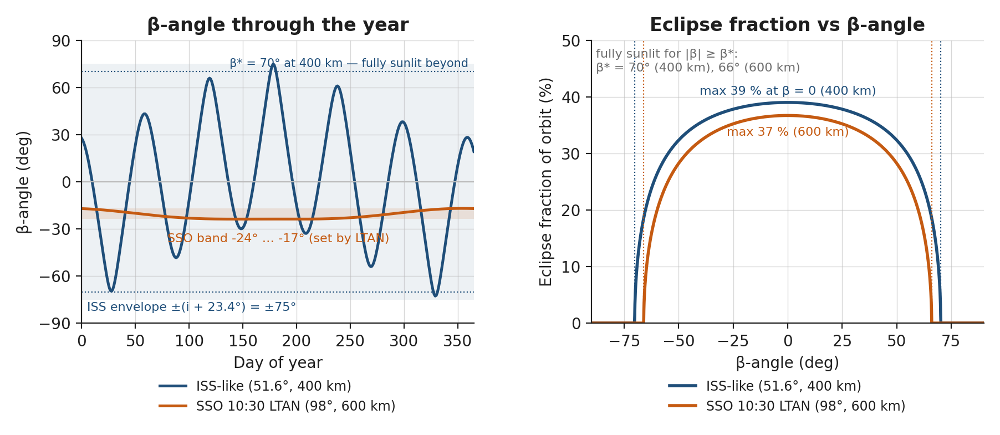

*β-angle envelope and eclipse fraction analytics.*


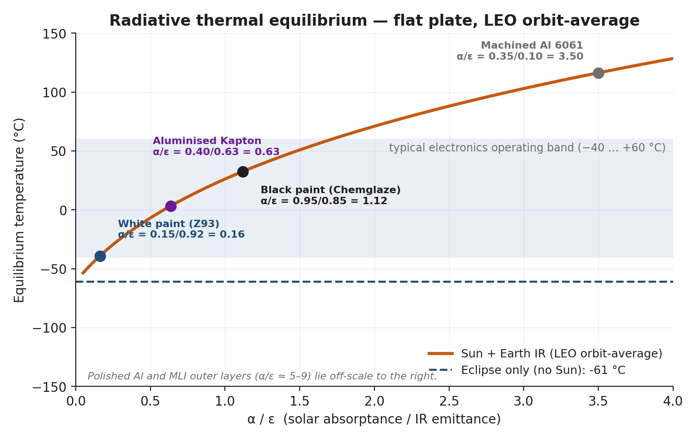

*Radiative thermal equilibrium vs α/ε.*

*[Source: ECSS-E-ST-31C; Gilmore, Ch. 1--4]*

### The Physics of Spacecraft Thermal Control

Spacecraft thermal control is fundamentally different from terrestrial thermal engineering because **there is no convection in vacuum**. The only heat transfer mechanisms are:

1. **Conduction:** Heat flow through solid material, governed by Fourier's law: $\dot{Q} = -kA \frac{dT}{dx}$. Critical within the spacecraft structure and between components and mounting surfaces.
2. **Radiation:** Heat transfer via electromagnetic radiation, governed by the Stefan-Boltzmann law: $\dot{Q} = \varepsilon \sigma A T^4$. This is the **only** mechanism for rejecting heat to the environment.

There is no convective cooling. A component that overheats cannot be cooled by a fan. All waste heat must be conducted to a radiating surface and then radiated to space. This is the central constraint of spacecraft thermal design.

### Thermal Environment in LEO

A spacecraft in LEO experiences four thermal inputs and one thermal sink:

Table 3.1.6 — LEO thermal environment sources with fluxes, directions, and variability.

| Source | Flux | Direction | Variability |
|--------|------|-----------|-------------|
| **Direct solar** | $S = 1361 \pm 1$ W/m$^2$ (at 1 AU) | Sun-facing surfaces only | Seasonal ($\pm 3.3$% due to Earth's orbital eccentricity: $S_{\text{perihelion}} = 1414$ W/m$^2$ in January, $S_{\text{aphelion}} = 1322$ W/m$^2$ in July) |
| **Earth albedo** | $\alpha_E \times S \approx 0.30 \times 1361 \approx 408$ W/m$^2$ | Earth-facing surfaces (nadir) | Varies with cloud cover, surface type (0.06 for ocean to 0.80 for fresh snow); orbit-average range 0.25--0.35 |
| **Earth infrared** | $q_{\text{IR}} \approx 240$ W/m$^2$ (orbit average) | Earth-facing surfaces (nadir) | Range 200--270 W/m$^2$ depending on latitude, season, cloud cover |
| **Internal dissipation** | $Q_{\text{int}} = P_{\text{dissipated}}$ | From electronics waste heat | Varies with operational mode; nearly all electrical power eventually becomes heat |
| **Deep space** (sink) | $T_{\text{space}} \approx 2.7$ K (CMB) | Zenith-facing radiator surfaces | Effectively 0 K for engineering purposes |

### View Factors

The fraction of a surface's radiative "view" that sees each thermal source is critical for accurate thermal modelling. For a nadir-pointing spacecraft in LEO:

$$F_{\text{Earth}} = \frac{1}{1 + (h/R_E)^2 + 2(h/R_E)}$$

where $h$ = altitude (km) and $R_E = 6371$ km. For a 500 km orbit: $F_{\text{Earth}} = 1 / (1 + (500/6371)^2 + 2 \times 500/6371) = 1 / 1.163 = 0.860$. The nadir face sees 86% Earth and 14% deep space. The zenith face sees 100% deep space (assuming no S/C self-shadowing). Side faces see a mix.

At higher altitudes, $F_{\text{Earth}}$ decreases: at 800 km it is 0.79, at 35,786 km (GEO) it is only 0.023 -- which is why GEO thermal design is dominated by solar flux and internal dissipation, not Earth IR/albedo.

### Thermal Balance Equation -- Full Derivation

> **Key Equations -- Thermal Equilibrium**
>
> At steady state, the absorbed heat equals the radiated heat:
>
> $$Q_{\text{in}} = Q_{\text{out}}$$
>
> **Absorbed heat (expanded):**
>
> $$Q_{\text{in}} = \alpha_s \cdot A_{\text{sun}} \cdot S + \alpha_s \cdot A_{\text{alb}} \cdot F_{\text{alb}} \cdot \alpha_E \cdot S + \varepsilon \cdot A_{\text{IR}} \cdot F_{\text{IR}} \cdot q_{\text{IR}} + Q_{\text{int}}$$
>
> The four terms are, in order: direct solar, Earth albedo, Earth IR, and internal dissipation.
>
> **Radiated heat:**
>
> $$Q_{\text{out}} = \varepsilon \cdot \sigma \cdot A_{\text{rad}} \cdot T^4$$
>
> where:
> - $\alpha_s$ = solar absorptance of surface coating (dimensionless, 0--1)
> - $\varepsilon$ = infrared emittance of surface coating (dimensionless, 0--1)
> - $\sigma = 5.670 \times 10^{-8}$ W/m$^2$/K$^4$ (Stefan-Boltzmann constant)
> - $A_{\text{sun}}$, $A_{\text{alb}}$, $A_{\text{IR}}$, $A_{\text{rad}}$ = projected areas for each flux (m$^2$)
> - $F_{\text{alb}}$, $F_{\text{IR}}$ = view factors to Earth for albedo and IR surfaces
> - $T$ = equilibrium temperature (K)
>
> **Note on $\alpha_s$ vs $\varepsilon$:** Solar absorptance ($\alpha_s$) is measured over the solar spectrum (0.2--2.5 um, peak at 0.5 um visible). Infrared emittance ($\varepsilon$) is measured over the thermal IR spectrum (3--50 um, peak at ~10 um for room-temperature objects). These are **different spectral ranges**, so $\alpha_s \neq \varepsilon$ for most real surfaces. This decoupling is the basis of all passive thermal control: by choosing the $\alpha_s / \varepsilon$ ratio, the designer controls the equilibrium temperature.
>
> **Solving for equilibrium temperature:**
> $$T = \left(\frac{Q_{\text{absorbed}} + Q_{\text{internal}}}{\varepsilon \sigma A_{\text{rad}}}\right)^{1/4}$$
>
> This equation is valid only for a single isothermal node (lumped-parameter model). For multi-node thermal models (which are needed for any real spacecraft), the heat balance is solved simultaneously for all nodes using numerical methods (Thermal Desktop, ESATAN, or similar thermal analysis software).

### Hot Case and Cold Case

Table 3.1.7 — Hot case versus cold case conditions and the components they stress.

| Case | Conditions | Design Concern |
|------|-----------|----------------|
| **Hot case** | Maximum solar exposure ($S = 1414$ W/m$^2$, perihelion), all subsystems active (max $Q_{\text{int}}$), worst sun angle (max $A_{\text{sun}}$), EOL coatings ($\alpha_s$ at maximum -- increased by UV darkening), max albedo (0.35) | Components exceed maximum operating temperature |
| **Cold case** | Eclipse (no solar), minimum power dissipation (safe mode, min $Q_{\text{int}}$), BOL coatings ($\alpha_s$ at minimum -- fresh white paint), minimum Earth IR (200 W/m$^2$), deep space view | Components fall below minimum operating temperature |

**Design philosophy:** The thermal engineer designs to keep all components within their qualified temperature range under both worst-case hot and worst-case cold conditions, with ECSS-mandated margins applied.

### Surface Coatings -- The Passive Thermal Toolbox

Table 3.1.8 — Spacecraft surface coatings with absorptance, emissivity, and use cases.

| Coating | $\alpha_s$ (BOL) | $\alpha_s$ (EOL, 5 yr LEO) | $\varepsilon$ | $\alpha_s / \varepsilon$ (BOL) | Use Case |
|---------|-----------|---------------------------|--------------|------------------------|----------|
| White paint (AZ-93, S13G-LO) | 0.14--0.20 | 0.25--0.35 | 0.89--0.92 | 0.16--0.22 | Radiator surfaces (stay cool; low solar absorption, high IR emission) |
| Black paint (Aeroglaze Z306) | 0.95 | 0.95 | 0.89 | 1.07 | Internal surfaces (maximise radiative exchange between components) |
| Gold tape (2 mil Kapton + VDA) | 0.22--0.25 | 0.25--0.30 | 0.03--0.05 | 5.0--7.5 | MLI outer layer, thermal isolation |
| Bare aluminium (polished) | 0.10--0.15 | 0.15--0.20 | 0.03--0.05 | 2.5--4.0 | Reflective surfaces, low emissivity |
| Alodine (chromate conversion on Al) | 0.35--0.40 | 0.40--0.50 | 0.12--0.16 | 2.5--3.0 | Moderate thermal control, structural surfaces |
| Anodised aluminium (clear or black) | 0.30--0.50 | 0.35--0.55 | 0.75--0.86 | 0.4--0.65 | CubeSat external structure (standard finish per CDS) |
| MLI blanket (effective) | 0.05--0.15 | 0.10--0.20 | 0.02--0.05 | ~3 | Thermal isolation of sensitive components |
| Solar cells (with cover glass) | 0.75--0.92 | 0.78--0.92 | 0.80--0.85 | ~1.0 | SA surfaces (high absorption is unavoidable; cells get hot) |
| OSR (Optical Solar Reflector) | 0.05--0.08 | 0.08--0.12 | 0.78--0.80 | 0.06--0.10 | High-performance radiators (large S/C, GEO) |

**Key design insight:** A surface with low $\alpha_s / \varepsilon$ (e.g., white paint: 0.2) stays cool because it reflects most solar energy but efficiently radiates thermal IR. A surface with high $\alpha_s / \varepsilon$ (e.g., gold tape: 6.0) stays warm because it absorbs solar energy but barely radiates. This is why white paint is used on radiators and gold/MLI is used for insulation.

**Coating degradation:** UV radiation darkens most white paints over time, increasing $\alpha_s$ while leaving $\varepsilon$ nearly unchanged. This means $\alpha_s / \varepsilon$ increases, and the surface gets hotter at EOL. Note carefully which end of life is conservative for which case: BOL white paint has the *lowest* $\alpha_s$, so the **cold case** must be evaluated with BOL coatings and the **hot case** with EOL coatings, once $\alpha_s$ has increased. This is a common source of confusion -- BOL coatings give a colder cold case, EOL coatings give a hotter hot case, and both must be checked.

### MLI (Multi-Layer Insulation) -- Construction and Physics

MLI blankets are the most common thermal insulation on spacecraft. They work by minimising both radiation and conduction heat transfer through multiple reflective layers separated by low-conductance spacers.

**Construction (typical MLI blanket):**
1. **Outer cover:** 1 mil (25 um) aluminised Kapton (VDA -- Vapour Deposited Aluminium on one side). Provides mechanical protection and low solar absorptance.
2. **Inner reflective layers:** 10--20 layers of 0.25 mil (6 um) double-aluminised Mylar (DAM). Each layer reflects IR radiation, and the vacuum gaps between layers have zero convection.
3. **Spacer material:** Dacron or Nomex netting between each DAM layer, preventing conductive contact between adjacent reflective sheets.
4. **Inner cover:** 1 mil aluminised Kapton, protecting the inner layers.

**Effective emissivity:** An ideal MLI blanket with $N$ reflective layers has an effective emissivity of:

$$\varepsilon_{\text{eff}} = \frac{1}{2/\varepsilon_{\text{inner}} + (N-1)(2/\varepsilon_{\text{layer}} - 1)}$$

For 20 layers of DAM ($\varepsilon_{\text{layer}} = 0.03$): $\varepsilon_{\text{eff}} \approx 0.002$. In practice, real MLI achieves $\varepsilon_{\text{eff}} = 0.01$--$0.03$ due to seams, penetrations (harness, mounting), and edge effects. The ratio of actual to theoretical performance is typically 2--5x worse.

**CubeSat MLI challenges:** CubeSats have limited surface area and many penetrations (connectors, antennas, sensors, solar cells), making it difficult to achieve good MLI performance. Most CubeSats in LEO do not use MLI -- they rely on the moderate thermal environment (Earth IR provides a "warm floor") and surface coatings. MLI becomes essential for deep-space CubeSats (e.g., MarCO, CAPSTONE) or missions with sensitive payloads (IR detectors, laser systems).

### Heater Sizing

When passive thermal control cannot prevent a component from falling below its minimum temperature (typically during eclipse or safe mode), electrical heaters are required.

> **Key Equations -- Heater Sizing**
>
> **Required heater power** (to maintain minimum temperature during worst cold case):
>
> $$P_{\text{heater}} = \varepsilon \sigma A_{\text{rad}} T_{\text{min}}^4 - Q_{\text{environment,cold}} - Q_{\text{internal,cold}}$$
>
> where $T_{\text{min}}$ is the minimum allowable temperature of the component (converted to Kelvin).
>
> **Heater types for CubeSats:**
> - **Kapton foil heaters:** Etched-foil resistance elements laminated between Kapton sheets. Flexible, thin (0.2--0.5 mm), lightweight (2--10 g each). Typical power: 0.5--5 W per heater. Bond directly to component surface with pressure-sensitive adhesive.
> - **Cartridge heaters:** Cylindrical, inserted into drilled holes. Higher power density but heavier and less common on CubeSats.
>
> **Thermostat control:** Simple bimetallic thermostats (e.g., Honeywell Klixon) switch heaters on/off at set temperatures (e.g., on at -5 degC, off at +5 degC). Mass: ~2 g each. For higher reliability, software-controlled heaters using temperature sensor feedback and EPS switches are preferred on modern CubeSats -- but this requires OBC to be running, which may not be the case in safe mode.

### Heat Pipes and Thermal Straps

**Heat pipes** are passive two-phase heat transfer devices that transport large amounts of thermal energy with very small temperature differences. They are widely used on larger spacecraft and are beginning to appear on 6U+ CubeSats.

**How a heat pipe works:**
1. Working fluid (ammonia, methanol, or water) evaporates at the hot end (evaporator), absorbing latent heat
2. Vapour travels through the hollow pipe core to the cold end (condenser)
3. At the condenser, vapour releases latent heat and condenses back to liquid
4. Liquid returns to the evaporator via capillary action in a wick structure (sintered metal, axial grooves, or screen mesh)
5. The process is continuous, passive (no moving parts, no power), and can transport 10--100 W across 20--50 cm with < 5 degC temperature difference

**Thermal conductance of a heat pipe:** Effective thermal conductivity is 10,000--100,000 W/m/K (compared to copper at 400 W/m/K and aluminium at 237 W/m/K). A 6 mm diameter ammonia heat pipe can transport ~30 W over 30 cm with < 3 degC gradient.

**Thermal straps** are flexible conductive links (braided copper, graphite fibre, or pyrolytic graphite sheet) used to conduct heat between components that cannot be rigidly connected (e.g., across a hinge or between a vibration-isolated payload and the spacecraft bus). Typical conductance: 0.5--5 W/K.

Table 3.1.9 — Heat transport methods compared by conductance, mass, and CubeSat applicability.

| Heat Transport Method | Conductance | Mass | Power | Orientation Sensitivity | CubeSat Use |
|----------------------|-------------|------|-------|------------------------|------------|
| Aluminium conduction | ~0.5--2 W/K per path | Part of structure | 0 W | None | Always (inherent) |
| Copper thermal strap | 1--5 W/K | 10--50 g | 0 W | None | Occasional (6U+) |
| Heat pipe (ammonia) | 5--50 W/K | 20--100 g | 0 W | Gravity-dependent (must test in relevant orientation) | Rare (6U+, some 3U) |
| Pumped fluid loop | 50--500 W/K | 500+ g | 5--20 W | None | Large S/C only |

### Thermal Control Methods Summary

Table 3.1.10 — Passive and active thermal control methods with mass impact and design parameters.

| Method | Type | Mass Impact | Typical Use | Key Design Parameter |
|--------|------|-------------|------------|---------------------|
| **Surface coatings** | Passive | Negligible | Always -- select $\alpha_s/\varepsilon$ ratio per face | $\alpha_s/\varepsilon$ ratio |
| **MLI blankets** | Passive | 0.5--2.0 kg/m$^2$ | Insulate sensitive components from environment | Number of layers, $\varepsilon_{\text{eff}}$ |
| **Radiators** | Passive | Part of structure | Reject internal waste heat to deep space | Radiator area, $\varepsilon$, view to space |
| **Heaters** | Active | 0.005--0.02 kg each | Maintain minimum temp during eclipse/safe mode | Power, thermostat set point |
| **Heat pipes** | Passive | 0.02--0.10 kg each | Transport heat from source to radiator | Working fluid, $Q_{\text{max}}$, orientation |
| **Thermal straps** | Passive | 0.01--0.05 kg each | Flexible conductive link across joints/hinges | Conductance (W/K) |
| **Louvers** | Active | 0.1--0.5 kg | Variable-conductance radiators (rare on CubeSats) | Open/close temperature range |

### ECSS Thermal Margins

*[Source: this book's teaching convention; the standards are discussed below the table]*

Table 3.1.11 — Thermal margins for qualification, acceptance, and operating temperature limits (this book's convention).

| Phase | Hot Margin (above predicted max) | Cold Margin (below predicted min) |
|-------|----------------------------------|-----------------------------------|
| **Qualification** | Predicted + 15 degC | Predicted - 15 degC |
| **Acceptance** | Predicted + 10 degC | Predicted - 10 degC |
| **Operating** | Predicted + 5 degC | Predicted - 5 degC |

These margins ensure that thermal model uncertainties (typically $\pm 5$--$10$ degC for simplified models, $\pm 2$--$5$ degC for detailed correlated models) do not cause in-orbit temperature exceedances.

**How this relates to the standards.** ECSS-E-ST-31C does not tabulate these values. Its Figure 3-1 defines the chain from the predicted temperature, through the uncertainty, to the acceptance and qualification temperatures; it leaves the margins to the system authority and notes that uncertainties below 10 K are not normally applied before a thermal-balance test. ECSS-E-ST-10-03C (Tables 5-2 and 5-4) adds an acceptance margin of 5 degC and a qualification margin of 5 degC on top of that range, and GSFC-STD-7000B §2.6 tests a proto-flight unit at the maximum and minimum predicted temperatures $\pm 10$ degC for at least 4 cycles. The proto-flight thermal-vacuum level of Chapter 4.2 (predicted $\pm 10$ degC) follows those standards.

> **Worked Example -- 3U CubeSat Full Thermal Analysis**
>
> **Hot case (sunlit, all systems active, perihelion, EOL coatings):**
>
> Simplified single-node model. 3U CubeSat, nadir-pointing.
>
> - Sun-facing area ($+Z$, zenith-facing 3U panel): $A_{\text{sun}} = 0.034$ m$^2$
> - SA surfaces (sun-facing): $\alpha_s = 0.85$, $\varepsilon = 0.82$ (solar cell properties)
> - Nadir face ($-Z$): $A_{\text{nadir}} = 0.034$ m$^2$, anodised Al ($\alpha_s = 0.45$ EOL, $\varepsilon = 0.82$)
> - Side faces (4x): $A_{\text{side}} = 4 \times 0.01$ m$^2$ = $0.04$ m$^2$, anodised Al
> - Internal dissipation (imaging mode): $Q_{\text{int}} = 10.0$ W
>
> $Q_{\text{solar}} = 0.85 \times 0.034 \times 1414 = 40.9$ W (ouch -- but much of this is captured by the SA and converted to electricity, so the net thermal input from solar cells is $Q_{\text{solar,thermal}} = \alpha_s \times A \times S \times (1 - \eta_{\text{cell}}) = 0.85 \times 0.034 \times 1414 \times 0.705 = 28.8$ W)
>
> $Q_{\text{albedo}} = 0.45 \times 0.034 \times 0.35 \times 1414 = 7.6$ W
>
> $Q_{\text{Earth IR}} = 0.82 \times 0.034 \times 270 = 7.5$ W (nadir face, hot case Earth IR)
>
> $Q_{\text{int}} = 10.0$ W (essentially the whole electrical load ultimately becomes heat inside the spacecraft -- only the few tenths of a watt radiated away as RF leaves by any other route)
>
> Total $Q_{\text{in}} \approx 28.8 + 7.6 + 7.5 + 10.0 = 53.9$ W
>
> Total radiating area (all 6 faces, minus SA area which is a net absorber): $A_{\text{rad}} \approx 0.066$ m$^2$ (accounting for partial Earth blockage on nadir face)
>
> Average emissivity: $\varepsilon_{\text{avg}} \approx 0.82$
>
> $T_{\text{hot}} = \left(\frac{53.9}{0.82 \times 5.67 \times 10^{-8} \times 0.066}\right)^{0.25} = \left(\frac{53.9}{3.07 \times 10^{-9}}\right)^{0.25}$
>
> $= (1.756 \times 10^{10})^{0.25} = 364$ K $= +91$ degC
>
> **This exceeds most component limits!** However, this simplified calculation overestimates temperature because it treats the satellite as a single isothermal node and includes solar cell thermal absorption on the zenith face. In practice:
> - The zenith face (solar cells) runs hotter than the bus
> - Internal components are conductively coupled to all faces, including the cold nadir face
> - A multi-node model typically predicts peak internal temperatures of +40 to +55 degC for this scenario
>
> **Thermal engineer's response:** If the single-node calculation exceeds 60 degC, a detailed multi-node thermal model is required. The simplified calculation is a screening tool, not a design tool.
>
> **Cold case (eclipse, safe mode, aphelion, BOL coatings):**
>
> - No solar flux, no albedo
> - Earth IR only: $Q_{\text{Earth IR}} = 0.82 \times 0.034 \times 200 = 5.58$ W (cold case: 200 W/m$^2$)
> - Internal dissipation (safe mode): $Q_{\text{int}} = 1.5$ W (OBC + heater)
> - Total $Q_{\text{in}} = 5.58 + 1.5 = 7.08$ W
>
> $T_{\text{cold}} = \left(\frac{7.08}{0.82 \times 5.67 \times 10^{-8} \times 0.070}\right)^{0.25}$
>
> $= \left(\frac{7.08}{3.26 \times 10^{-9}}\right)^{0.25} = (2.172 \times 10^{9})^{0.25} = 216$ K $= -57$ degC
>
> **This is too cold** for Li-ion batteries (min -20 degC operating, min 0 degC charging) and most COTS electronics (min -40 degC).
>
> **Action:** Add battery heater. To maintain battery at $T_{\text{min}} = -10$ degC = 263 K:
>
> Need additional heat input: $Q_{\text{heater}} = \varepsilon \sigma A_{\text{rad}} T_{\text{min}}^4 - Q_{\text{other}}$
>
> $= 0.82 \times 5.67 \times 10^{-8} \times 0.070 \times 263^4 - 7.08 = 3.26 \times 10^{-9} \times 4.78 \times 10^{9} - 7.08 = 15.6 - 7.08 = 8.5$ W
>
> **Problem:** 8.5 W heater in eclipse exceeds the battery capacity. **Resolution:** This is an isothermal whole-spacecraft calculation. In reality, the battery is inside the bus, partially insulated by the structure and surrounding boards. A targeted heater of 0.5--1.0 W directly on the battery pack, with some MLI wrapping, is typically sufficient to keep the battery above -10 degC in a 35-minute eclipse. The structure's thermal mass (aluminium at $c_p = 900$ J/kg/K) provides significant thermal inertia -- the 5 kg 3U itself, losing about 7 W net, cools by only about 3.3 degC in a 35-minute eclipse (estimate below).
>
> **Transient check:**
> $\Delta T = \frac{Q_{\text{net}} \times t}{m \times c_p} = \frac{(7.08 - 0) \times 35 \times 60}{5.0 \times 900} = \frac{14,868}{4500} = 3.3$ degC per 35-min eclipse
>
> Wait -- in eclipse $Q_{\text{out}} > Q_{\text{in}}$: net cooling rate = $\varepsilon \sigma A_{\text{rad}} T^4 - Q_{\text{in,eclipse}}$. At $T = 293$ K (20 degC):
>
> $Q_{\text{out}} = 0.82 \times 5.67 \times 10^{-8} \times 0.070 \times 293^4 = 3.26 \times 10^{-9} \times 7.37 \times 10^{9} = 24.0$ W
>
> $Q_{\text{net cooling}} = 24.0 - 7.08 = 16.9$ W
>
> $\Delta T = \frac{16.9 \times 2100}{5.0 \times 900} = \frac{35,490}{4500} = 7.9$ degC drop in 35 minutes
>
> So from +20 degC, the satellite cools to about +12 degC after one eclipse -- well within limits. **No heater needed for the bus; battery heater only if battery is thermally isolated from bus.**
>
> **ECSS margin check -- Payload CCD:**
> Predicted maximum temperature of payload CCD = 42 degC.
> - Operating limit = 50 degC. Margin = 50 - 42 = 8 degC > 5 degC. **Pass.**
> - Qualification test: must test at 42 + 15 = 57 degC. If qualification limit is 60 degC: **Pass.**
>
> Predicted minimum temperature of battery = -8 degC during worst eclipse.
> - Operating limit = -10 degC. Margin = -8 - (-10) = 2 degC < 5 degC. **Fail -- inadequate margin.**
> - **Action:** Add heater (0.5 W survival heater with thermostat set to -5 degC), or add MLI around battery pack.

---

### 1U Worked Example: UniSat-1

**Power Sizing: Body-Mounted Only**

UniSat-1 uses body-mounted solar cells on all five sun-exposed faces (the sixth face mounts the deployment switch interface). With no deployable panels, the power system is simpler, lighter, and cheaper -- but severely power-limited.

> **Worked Example -- UniSat-1 Solar Array Sizing**
>
> **Given:** Body-mounted cells on 5 faces of a 1U (100 x 100 mm each). ISS orbit: 400 km, 51.6 deg inclination, 92.4 min period, 56 min sunlight, 36 min eclipse. $P_{\text{eclipse}} = 0.5$ W (OBC only), $P_{\text{peak,sunlight}} = 1.2$ W (science + downlink overlap avoided by scheduling). Mission lifetime = 6 months. Cell temperature = 55 degC (body-mounted cells run cooler on 1U due to better thermal coupling to bus mass).
>
> **Step 1 -- Effective illuminated area:**
> At any given time in LEO with passive magnetic attitude (slow tumble ~1 deg/s), on average only ~1.5 faces are well-illuminated. Effective average area:
> $A_{\text{eff}} \approx 1.5 \times (0.10 \times 0.10) = 0.015$ m$^2$
>
> **Step 2 -- SA BOL power (with temperature derating):**
> $L_T = 1 + (-0.0019)(55 - 28) = 0.949$
>
> $P_{\text{SA,BOL}} = \eta_{\text{cell}} \times L_T \times S \times A_{\text{eff}} \times f_{\text{pack}} = 0.295 \times 0.949 \times 1361 \times 0.015 \times 0.80 = 4.57$ W (illuminated peak)
>
> **Step 3 -- Orbit-average power available:**
> $P_{\text{avg,avail}} = P_{\text{SA,BOL}} \times \frac{t_{\text{sun}}}{T} \times \eta_{\text{EPS}} = 4.57 \times \frac{56}{92.4} \times 0.85 = 2.35$ W
>
> After 6-month degradation ($(1 - 0.025)^{0.5} = 0.987$):
> $P_{\text{avg,EOL}} = 2.35 \times 0.987 = 2.32$ W
>
> **Step 4 -- Power demand (orbit-average):**
> From Chapter 2.4: $P_{\text{avg,demand}} = 0.68$ W.
>
> **Power margin:** $2.32 - 0.68 = 1.64$ W (**71% margin**). Even with conservative geometry assumptions, the power budget closes comfortably.
>
> **Note on body-mounted vs tumbling:** The key uncertainty in 1U body-mounted power is the attitude. With passive magnetic stabilisation, the satellite aligns roughly with Earth's magnetic field, providing more predictable illumination than a random tumble. However, the effective area varies significantly around the orbit as the B-field direction changes with latitude. The 1.5-face average is conservative. A Monte Carlo simulation of illumination geometry over many orbits typically yields a more optimistic 1.7--1.9 effective face average.

> **Worked Example -- UniSat-1 Battery Sizing**
>
> **Given:** $P_{\text{eclipse}} = 0.5$ W, $t_{\text{eclipse}} = 36$ min $= 0.60$ h, $DOD = 0.50$ (acceptable for 6-month mission: ~2,740 cycles), $\eta = 0.95$.
>
> $E_{\text{bat}} = \frac{0.5 \times 0.60}{0.50 \times 0.95} = \frac{0.30}{0.475} = 0.63$ Wh
>
> With margin: specify minimum **10 Wh** (standard GomSpace NanoPower P31u battery pack -- this is the smallest available COTS battery with flight heritage).
>
> **Cycle count check:** 6 months at 15 orbits/day = 2,740 eclipses. At 50% DOD, Li-ion cells comfortably survive > 2,000 cycles. **Pass.**
>
> **Actual operating DOD:** With 10 Wh battery and 0.63 Wh per eclipse demand, actual DOD = 0.63 / 10 = **6.3%** per eclipse. At this DOD, cycle life exceeds 100,000 cycles. **Battery degradation is negligible** over the 6-month mission.
>
> **Key insight:** The 10 Wh battery is massively oversized for the actual eclipse demand. This is common in 1U missions -- the minimum COTS battery available provides far more capacity than needed. The excess capacity provides excellent margin and enables recovery from anomalies (multiple missed sunlit periods).

**Thermal: Passive Only**

UniSat-1 uses no heaters, no MLI, and no active thermal control. This is justified by three factors:

1. **Low altitude (400 km):** Strong Earth IR flux (~240 W/m$^2$) provides a warm floor, preventing extreme cold cases
2. **Short mission (6 months):** No long-term coating degradation to worry about
3. **Tolerant components:** COTS electronics typically operate from -20 degC to +60 degC; the 400 km LEO thermal environment stays within -10 degC to +45 degC for a 1U with standard aluminium/anodised surfaces

> **Quick Thermal Check -- UniSat-1 Cold Case (Transient)**
>
> Worst eclipse, all subsystems off except OBC (0.5 W internal dissipation):
> - Earth IR absorbed: $\varepsilon \times A_{\text{nadir}} \times q_{\text{IR}} = 0.85 \times 0.01 \times 240 = 2.04$ W
> - Internal dissipation: 0.5 W
> - Total heat in: 2.54 W
>
> Steady-state temperature (if eclipse were infinite):
> $T_{\text{steady}} = (2.54 / (0.85 \times 5.67 \times 10^{-8} \times 0.045))^{0.25} = 185$ K $= -88$ degC
>
> **This looks alarming** -- but the eclipse is only 36 minutes, and the thermal mass prevents the satellite from reaching steady state.
>
> **Transient analysis:** Starting at $T_0 = +15$ degC (288 K) at eclipse entry:
>
> Net cooling rate at 288 K: $Q_{\text{rad,out}} = 0.85 \times 5.67 \times 10^{-8} \times 0.045 \times 288^4 = 2.17 \times 10^{-9} \times 6.88 \times 10^{9} = 14.9$ W
>
> Net cooling: $14.9 - 2.54 = 12.4$ W
>
> Temperature drop: $\Delta T = \frac{Q_{\text{net}} \times t}{m \times c_p} = \frac{12.4 \times 36 \times 60}{1.0 \times 900} = \frac{26,784}{900} = 30$ degC
>
> But this is a linear approximation -- as the satellite cools, the radiation rate drops as $T^4$, so the actual cooling slows. A more accurate estimate gives $\Delta T \approx 20$--$25$ degC, resulting in a minimum temperature of about $-5$ to $-10$ degC.
>
> **Conclusion:** The 1U at 400 km reaches approximately -5 to -10 degC during worst-case eclipse, starting from a warm sunlit entry. This is within COTS operating limits (-20 degC to +60 degC for most components) and within battery operating range (-20 degC to +60 degC for discharge). **No heaters needed.** The ISS orbit's comparable eclipse (36 min vs 35 min for SSO) and the strong Earth IR flux at 400 km make passive thermal control viable for a 1U mission.

---

### 6U Reference Design: EOSAT-1 Power and Thermal, As Flown

The 1U and 3U examples above are sizing exercises. EOSAT-1 -- the 6U EO
spacecraft used as the reference mission throughout this book -- is a
*completed* design, so its numbers can be read back rather than estimated. Every figure below comes from the flight
configuration (`configs/eosat1/subsystems/eps.yaml`, `tcs.yaml`) and the
sizing derivation that produced it, and each hardware value is tied to a named
flight part rather than to a margin target. The temperature coefficient ($\beta = -0.0020$/degC) and degradation rate (2.75 %/yr) below are therefore the flight values, not the generic $-0.0019$/degC and 2.5 %/yr used in the sizing exercises above.

**Step 1 -- the plane-of-array constant.** Rather than carry $\eta_{\text{cell}}$,
$f_{\text{pack}}$ and $f_{\text{cover}}$ as separate factors at the end of the
sizing chain, the design collapses the whole loss stack into a single delivered
flux $K$ in W/m$^2$ of cell area:

$$K = S \times \eta_{\text{cell}} \times f_{\text{inh}} \times [1 + \beta(T - T_{\text{ref}})] \times \eta_{\text{MPPT}} \times \eta_{\text{harness}}$$

$$K_{\text{BOL}} = 1361 \times 0.295 \times 0.85 \times [1 - 0.0020 (65 - 28)] \times 0.97 \times 0.95$$

$$= 401.5 \times 0.85 \times 0.926 \times 0.97 \times 0.95 = 291.2 \text{ W/m}^2$$

Applying three years of triple-junction GaAs degradation at 2.75 %/yr:

$$K_{\text{EOL}} = 291.2 \times (1 - 0.0275)^3 = 291.2 \times 0.9198 = \mathbf{267.9} \text{ W/m}^2$$

That number is the design's single most useful sanity check. Endurosat publish
19.2 W in LEO from one 0.0715 m$^2$ panel of their 6U deployable array, which is
$19.2 / 0.0715 = 268$ W/m$^2$ delivered. The loss stack and a flight vendor's
datasheet agree to within 0.1 W/m$^2$ -- so if a CubeSat power budget disagrees
with the hardware, the error is almost always in the *area*, not in the physics.

**Step 2 -- cell area.** EOSAT-1 carries body-mounted cells plus two
single-axis-driven deployable wings:

| Surface | Cell area (m$^2$) | Note |
|---------|------------------:|------|
| $+X$ / $-X$ (366 x 226 faces) | 0.060 each | 73 % packing |
| $+Y$ / $-Y$ (366 x 100 faces) | 0.030 each | 82 % packing |
| $+Z$ (226 x 100 face) | 0.018 | 80 % packing |
| $-Z$ | 0.000 | imager aperture + radiator -- no cells |
| **Body total** | **0.198** | |
| $+Y$ wing / $-Y$ wing | 0.120 each | Endurosat 6U deployable, 2 x (209 x 342 mm) at ~84 % packing |
| **Deployed total** | **0.438** | |

Wing rating at $\beta = 0$, BOL: $2 \times 0.120 \times 291.2 = 69.9$ W -- against
the MMA eHaWK 6U+ published rating of "starts at 72 W". Peak whole-spacecraft
generation is 88.6 W. Over the year $\beta$ stays between $-20.8$ and $-31.2$ deg, and
because the solar-array drive tracks the Sun about one axis only, generation
follows $\cos\beta$. Orbit-average generation at EOL is therefore **45.1 W** at the
worst-generation beta ($-31.2$ deg, the largest $|\beta|$ and the shortest
eclipse) and 47.0 W at the longest-eclipse beta ($-20.8$ deg); at BOL the same two
figures are 49.1 W and 51.2 W.

**Step 3 -- the load sheet.** The PCDU has **nine** power lines, indices 0--8.
Two are non-switchable; **every switchable line boots OFF** and must be
commanded on:

| Idx | Line | Rated draw | Switchable? |
|----:|------|-----------|-------------|
| 0 | `obc` | 6.0 W (3 W OBC + 3 W PDU/EPS housekeeping) | No -- always on |
| 1 | `ttc_rx` | 1.5 W (1.2 W S-band idle/Rx + ~0.3 W UHF beacon Rx) | No -- always on |
| 2 | `ttc_tx` | 5.0 W at the LOW tier, 11.0 W at the HIGH tier | Yes, default OFF |
| 3 | `payload` | 5.5 W imaging, 2.4 W idle | Yes, default OFF |
| 4 | `fpa_cooler` | 15.0 W | Yes, default OFF |
| 5 | `htr_bat` | 8.0 W (billed at actual thermostat duty) | Yes, default OFF |
| 6 | `htr_obc` | 4.0 W (billed at actual thermostat duty) | Yes, default OFF |
| 7 | `aocs_wheels` | 12.0 W line rating; the suite publishes 4 W COARSE / 9 W NOMINAL / 15 W FINE | Yes, default OFF |
| 8 | `prop` | 2 W armed/firing + 12 W catalyst-bed heater | Yes, default OFF; last in the load-shed order |

Note the ordering that a real datasheet enforces and a guessed budget does not:
**imaging costs more than idling** (5.5 W vs 2.4 W, both from the Simera Sense
TriScape100 datasheet), and the transmitter is a 5--11 W DC part with 0.5--2 W of
RF output, not a "20 W transmitter" -- no CubeSat radio draws that.

**Step 4 -- does the budget close?** The acceptance criterion is that
orbit-average generation must exceed orbit-average load with all nominal
systems on *including* AOCS, judged at nadir pointing rather than sun pointing:

| Profile | Gen (W) | Load (W) | Margin (W) | Ratio |
|---------|--------:|---------:|-----------:|------:|
| quiescent | 45.1 | 19.7 | +25.4 | 2.29 |
| **nominal** (payload STANDBY, cooler off) | **45.1** | **22.7** | **+22.4** | **1.98** |
| nominal imaging | 45.1 | 26.4 | +18.7 | 1.71 |
| manoeuvre | 45.1 | 25.8 | +19.4 | 1.75 |
| worst (abuse case) | 45.1 | 46.6 | $-1.4$ | 0.97 |

The table is at 3-year EOL and the worst-generation beta ($-31.2$ deg), from
`tools/power_budget.py` re-run on 2026-11-03 with the thermal network and the
FPA cooler off in STANDBY (it now runs only to prepare for and during imaging).
At the longest-eclipse beta ($-20.8$ deg) generation is 47.0 W and the nominal
profile closes at 2.05x.

The "worst" row is deliberately negative: it holds FINE pointing for a whole
orbit, runs the cooler continuously, images through eclipse and dumps at the
HIGH tier on every pass. A 6U that sustained all of that at once would need an
array nobody can build. The correct engineering answer is to **duty-cycle the
imaging chain** -- three ~90 s captures per orbit with roughly 20 min of cooler
around each -- which is what the "nominal imaging" row models. That is the
lesson the exercise exists to teach.

Cross-check the margin against flight hardware: the NanoAvionics M6P 6U bus
publishes 12.5--17.5 W of payload power available while sun-tracking, and the
EOSAT-1 margin with imaging duty-cycled in, +18.7 W, sits just above the top of
that range (the +22.4 W nominal figure leaves the cooler off). A 6U
design showing +40 W of payload headroom is not well designed; it is
mis-specified.

> **Worked Example -- EOSAT-1 Eclipse Energy and Battery Sizing**
>
> **Given:** 513 km SSO (mean altitude), 97.39 deg inclination, LTAN 10:00, 15.24 rev/day so $T = 86400/15.24 = 5669$ s
> $= 1.575$ h. Battery: GomSpace NanoPower BPX class, 8S-1P, **100 Wh**, 3.5 Ah,
> 28.8 V nominal on the bus model (33.6 V at 100 % SoC, 24.0 V at 0 %, the
> datasheet values), charge efficiency 0.94, CV taper from 90 % SoC.
>
> **Step 1 -- eclipse duration** (bounding case, $\beta = 0$. A 10:00 LTAN orbit never reaches it: EOSAT-1's $\beta$ stays between $-20.8$ and $-31.2$ deg, and the simulator gives 33.2--35.2 min of eclipse on every orbit, so the 35.6 min below is conservative by about 0.4 min):
> $$f_{\text{ecl}} = \frac{1}{\pi}\arccos\!\left(\frac{\sqrt{h(2R_E + h)}}{(R_E + h)\cos\beta}\right) = \frac{1}{\pi}\arccos\!\left(\frac{\sqrt{513 \times 13255}}{6884}\right)$$
>
> $= \frac{1}{\pi}\arccos(2607.6 / 6884) = \frac{1}{\pi}\arccos(0.3788) = \frac{67.74\degree}{180\degree} = 0.376$
>
> Eclipse $= 0.376 \times 5669 = 2133$ s $= 35.6$ min; sunlight $= 3536$ s $= 58.9$ min.
>
> **Step 2 -- eclipse load.** Payload, cooler and TX are off; OBC 6.0 + `ttc_rx` 1.5
> + `aocs_wheels` 12.0 = 19.5 W, plus the battery heater at roughly 50 % thermostat
> duty ($8.0 \times 0.5 = 4.0$ W) = **23.5 W**.
>
> **Step 3 -- eclipse energy and DoD:**
> $E_{\text{ecl}} = 23.5 \times (2133/3600) = 23.5 \times 0.5925 = 13.9$ Wh
>
> $DOD = 13.9 / 100 = \mathbf{13.9\%}$ per eclipse.
>
> **Step 4 -- recharge check.** Energy that must go back into the pack:
> $13.9 / 0.94 = 14.8$ Wh, over 0.982 h of sunlight $= 15.1$ W of dedicated charge power.
>
> Generation is collected only in sunlight, so the sunlit-average generation,
> taking the worst-generation 45.1 W together with the bounding eclipse, is
> $45.1 \times 1.575 / 0.982 = 72.3$ W. The sunlit load is
> $(22.7 \times 1.575 - 13.9)/0.982 = (35.8 - 13.9)/0.982 = 22.3$ W (22.7 W is
> the nominal orbit-average load, payload in STANDBY with the cooler off), leaving
> $72.3 - 22.3 = 50.0$ W of charge power against the 15.1 W required.
> **Recharge margin 3.3x. Closes.**
>
> **Step 5 -- cycle life.** A 3-year mission at 15.24 orbits/day is
> $3 \times 365 \times 15.24 = 16{,}688$ eclipses. At 13.9 % DoD, Li-ion cells are
> in the $> 30{,}000$-cycle regime. **Pass with a factor of ~2 on cycles.**
>
> **Step 6 -- why 100 Wh and not 30 Wh.** The eclipse demand alone would be met
> by a 30 Wh pack at 46 % DoD. The 100 Wh pack is sized by the *contingency*
> case -- survive a lost sunlit period, ride out a failed deployment, and keep
> the bus above the load-shed voltage while FDIR works -- not by the nominal
> eclipse. Protection levels follow, all from one table (`simulation.yaml`
> `eps.bus_protection`): the undervoltage flag and the in-model load shed fire
> at 28.4 V (about 46 % SoC on the $24.0 + 9.6 \times SoC$ battery curve) and
> strip `payload`, `fpa_cooler`, `ttc_tx`, `aocs_wheels`, `prop` in that order,
> with a 0.5 V restore hysteresis; FDIR EPS safe mode is at 27.7 V (about
> 39 %), and the FDIR SoC ladder at 30 / 20 / 10 %.

**Thermal: what is actually active.** EOSAT-1 is passive apart from three
heater circuits and one cooler:

| Circuit | Power | Control | Telemetry |
|---------|------:|---------|-----------|
| Battery heater | 8.0 W | Thermostat ON +5 degC / OFF +10 degC | `tcs.htr_battery` 0x040A |
| OBC heater | 4.0 W | Thermostat ON $-10$ degC / OFF $-5$ degC (survival heater: idle in nominal operations) | `tcs.htr_obc` 0x040B |
| Thruster catalyst-bed heater | 12.0 W | MANUAL by default; AUTO holds 190/230 degC | `tcs.htr_thruster` 0x041B |
| FPA cooler | 15.0 W | Setpoint-commanded, $-20$ to $0$ degC | `tcs.cooler_fpa` 0x040C |

The battery node has $C = 800$ J/K and $\tau = 2667$ s, so
$UA = C/\tau = 800/2667 = 0.30$ W/K and the 8 W heater buys
$8.0 / 0.30 = 26.7$ K of authority -- enough that the thermostat genuinely
cycles rather than sitting permanently on or permanently off. The catalyst bed
is $C = 50$ J/K, $\tau = 1200$ s, $UA = 0.042$ W/K, so 12 W reaches the 180 degC
propulsion arming interlock in about 18 min, so the ~20 min preheat costs $12 \text{ W} \times 20 \text{ min} = 4.0$ Wh of
preheat energy per burn.

> **Worked Example -- The FPA Cooler Is a Cryocooler, Not a Peltier Stack**
>
> The focal-plane cooler is a **miniature Stirling-class machine**, and getting
> that classification right is the whole point of the example.
>
> **Given:** FPA node $C = 100$ J/K, $\tau = 120$ s, so $UA = 100/120 = 0.833$ W/K.
> Internal sink $+12$ degC (285.15 K). Cooler input $P = 15.0$ W. Setpoint $-15$ degC.
>
> **Step 1 -- what lift is demanded?** $-15$ degC from a $+12$ degC sink is a 27 K
> lift, and the node leaks $UA \times \Delta T = 0.833 \times 27 = 22.5$ W back in.
> The machine must therefore pump 22.5 W using 15 W of input: $COP = 1.50$.
>
> **Step 2 -- can a thermoelectric do that?** Goldsmid's optimum-current result
> for a single stage is
> $$COP_{\max} = \frac{T_c}{\Delta T}\cdot\frac{g - T_h/T_c}{g + 1}, \qquad g = \sqrt{1 + Z\bar{T}}$$
> With Bi$_2$Te$_3$ at $ZT \approx 0.73$ this gives $COP_{\max} = 0.88$ at a 27 K lift --
> **less than the 1.50 required.** A Peltier stack cannot hold this focal plane.
> The word "Peltier" was the error, not the mission.
>
> **Step 3 -- what class of machine can?** The Carnot limit at this lift is
> $COP_{\text{Carnot}} = T_c/\Delta T = 258.15/27 = 9.56$, so $COP = 1.50$ is
> $1.50/9.56 = 15.7\%$ of Carnot. Miniature Stirling and free-piston space
> coolers -- the machines that actually fly on small-satellite EO detectors --
> reach 10--25 % of Carnot at near-ambient lifts. The model is that machine, at
> **23 % of Carnot**.
>
> **Step 4 -- solve for the achievable floor.** Authority *degrades with lift*,
> which is exactly what a flat "40 K max lift" model failed to capture. Balance
> the heat pumped against the heat leaking in, with $\Delta T$ unknown:
> $$UA \cdot \Delta T + Q_{\text{load}} = f_{\text{Carnot}} \cdot P \cdot \frac{T_h - \Delta T}{\Delta T}$$
>
> Idle ($Q_{\text{load}} = 0$), sink 285.15 K, $f_{\text{Carnot}} \times P = 0.23 \times 15 = 3.45$:
>
> $0.833\,\Delta T^2 + 3.45\,\Delta T - 3.45 \times 285.15 = 0$
>
> $\Delta T = \dfrac{-3.45 + \sqrt{3.45^2 + 4 \times 0.833 \times 983.8}}{2 \times 0.833} = \dfrac{-3.45 + 57.36}{1.666} = 32.4$ K
>
> **Floor $= 12 - 32.4 = -20.4$ degC.** The $-15$ degC setpoint holds with **5.4 K of
> margin**; the $-20$ degC end of the command envelope only just holds.
>
> **Step 5 -- imaging costs margin.** Add the 2.0 W detector/ROIC dissipation:
>
> $0.833\,\Delta T^2 + 5.45\,\Delta T - 983.8 = 0 \Rightarrow \Delta T = 31.2$ K, floor $= -19.2$ degC.
>
> So $-20$ degC holds at idle and **fails while imaging** -- a 1 K difference that
> only exists because the cooler is modelled as a real machine.
>
> **Step 6 -- a warm bus eats the margin entirely.** At a $+20$ degC sink:
> $\Delta T = 32.8$ K, floor $= -12.8$ degC. The nominal $-15$ degC setpoint is now
> **out of reach**, and the cooler will run continuously without ever reaching
> its target.
>
> **Design consequence:** the margin is finite, spendable and *visible*. It is
> published live as `tcs.fpa_cooler_floor_c` (0x0424, the achievable floor) and
> `tcs.fpa_cooler_margin_k` (0x0425, setpoint minus floor -- $\leq 0$ means the
> setpoint is unreachable), mirrored by the payload at 0x064A / 0x064B. The
> setpoint itself is commanded as a uint16 in **centi-kelvin**, so $-15$ degC is
> $258.15$ K $= 25815$ cK $= $ `0x64D7`.

The FPA envelope that everything else derives from: commandable setpoint range
$-20$ to $0$ degC (default $-15$), measured control performance 0.5 K at 3-sigma,
uncooled equilibrium $+12.5$ degC, imaging-readiness limit $-3$ degC (a *science*
limit, not a health limit), health warning band $[-22, +14]$ degC and alarm band
$[-25.5, +17.5]$ degC.

---

## 5. Real Mission Examples
### Planet SuperDove EPS

Table 3.1.12 — Planet SuperDove EPS and thermal parameters with design rationale.

| Parameter | Value | Design Rationale |
|-----------|-------|-----------------|
| Form factor | 3U+, ~5 kg | Flock constellation; P-POD compatible |
| SA configuration | Body-mounted + two deployable wings | ~25 W BOL needed for continuous imaging + S-band downlink |
| SA cells | Triple-junction GaAs (Spectrolab or SolAero) | Standard space-grade, 29.5% AM0 |
| Battery | Li-ion, ~20 Wh (2S2P 18650) | Supports ~3.5 W eclipse load for 35 min at < 20% DOD |
| Bus voltage | Unregulated 6.0--8.4 V (2S) + regulated 3.3 V, 5 V | Standard CubeSat EPS architecture |
| Peak demand | ~18 W (imaging mode) | Multi-spectral imager + star tracker + reaction wheels + OBC |
| Orbit | 475 km SSO, ~94 min period | Optimal for EO: sun-synchronous for consistent lighting |
| Eclipse | ~35 min max, ~3 W demand | OBC + AOCS only during eclipse; no imaging or downlink |
| Thermal | Body-mounted radiator panels + battery heater | Passive thermal control; battery heater for eclipse charging margin |

*[Source: Planet Labs conference presentations; Salas et al., "SuperDove Constellation," SSC 2021]*

### CAPSTONE Thermal Design

NASA's CAPSTONE (12U, 25 kg) operates in a near-rectilinear halo orbit (NRHO) around the Moon with extreme thermal cycling:

- Perilune: strong Earth/Moon IR + solar
- Apolune: deep space cold, long shadow periods (up to 12+ hours)
- Thermal control: MLI wrapping (10-layer DAM blankets), heaters on propulsion lines (to prevent propellant freezing), passive radiator panels with white paint (AZ-93)
- Battery heaters: 5 W total, thermostatically controlled, critical for survival during long eclipses
- Operating temperature range: -20 degC to +50 degC for electronics; propulsion lines maintained above +5 degC

*[Source: Advanced Space, "CAPSTONE Design Overview," SmallSat Conference 2022]*

---

## 6. SpaceCDF Exercise
### Instructions

1. **Run the design** in SpaceCDF if not already converged
2. **Dashboard** -- review power KPIs:
   - Is power margin positive in **all** modes (sunlight, eclipse, safe)?
   - What is the orbit-average power demand?
   - What SA configuration was selected (body/deployable)?
3. **Timing Budget** card -- review mode durations:
   - Does the duty cycle match your ConOps modes?
   - Is eclipse time consistent with your orbit calculation from Chapter 2.3?
4. **Engineering Budgets** -- review the power waterfall:
   - Which subsystem is the largest power consumer in each mode?
   - Where could power be reduced if the budget is tight?
5. **Parametric** tab -- review thermal predictions:
   - Hot case temperature prediction
   - Cold case temperature prediction
   - Any exceedances?

### Worksheet 3.1 Tasks

1. Size the solar array for your mission (show all 5 calculation steps, including temperature derating)
2. Size the battery (show calculation with DOD justification and cycle-life verification)
3. Compute orbit-average power using duty cycle table
4. Identify hot case and cold case conditions for your orbit
5. Check thermal margins against ECSS requirements
6. Identify the dominant thermal concern for your mission (hot case or cold case) and propose a mitigation

---

## Session Summary

Table 3.1.13 — Session summary: key takeaways for power and thermal control design.

| Topic | Key Takeaway |
|-------|-------------|
| Solar cell physics | Triple-junction GaAs (InGaP/GaAs/Ge) achieves 28--30% AM0; multi-junction stacking captures broader solar spectrum |
| Temperature effects | Cells lose ~0.19%/degC (relative); operating at 65 degC costs ~7% power vs STC |
| Degradation | Radiation damage: $(1-\delta)^n$, $\delta \approx 2.5$%/yr LEO; cover glass mitigates proton/electron damage |
| EPS architecture | MPPT + regulated bus is CubeSat standard; MPPT extracts 10--15% more power than DET |
| SA sizing | $P_{\text{SA}} = P_{\text{peak}} + P_{\text{recharge}}$; derate for degradation $(1-\delta)^n$ and temperature $L_T$ |
| SA area | $A = P_{\text{BOL}} / (\eta \cdot S \cdot \cos\theta \cdot f_{\text{pack}} \cdot f_{\text{cover}})$ |
| Battery chemistry | Li-ion (LCO/NMC): 150--200 Wh/kg packaged; 3.0--4.2 V per cell; CC-CV charging |
| Battery sizing | $E = P_{\text{ecl}} \cdot t_{\text{ecl}} / (DOD \cdot \eta)$; DOD 20--30% for multi-year LEO |
| Battery failure modes | Thermal runaway (overcharge), lithium plating (cold charge), capacity imbalance (series cells) |
| SA power reference | Body-mounted: 2--12 W; single deploy: 4--30 W; dual deploy: 25--48 W |
| Thermal physics | No convection in vacuum; radiation ($\varepsilon \sigma T^4$) is only mechanism for heat rejection |
| Thermal balance | $Q_{\text{in}} = Q_{\text{out}}$; solve for $T = (Q/\varepsilon\sigma A)^{1/4}$ (single-node); multi-node for real design |
| $\alpha_s / \varepsilon$ ratio | Low ratio = cold surface (radiator); high ratio = warm surface (insulation) |
| MLI construction | VDA Kapton outer + 10--20 DAM layers + Dacron spacers; $\varepsilon_{\text{eff}} = 0.01$--$0.03$ |
| Heater sizing | $P_{\text{heater}} = \varepsilon\sigma A T_{\text{min}}^4 - Q_{\text{env}} - Q_{\text{int}}$; Kapton foil heaters, thermostat control |
| Thermal margins | ECSS: +/-5 degC operating, +/-10 degC acceptance, +/-15 degC qualification |
| Transient effects | Thermal mass ($mc_p$) prevents reaching steady state during short eclipses; 1U at 400 km cools ~20--25 degC in 36 min eclipse |
| Plane-of-array constant | Collapse the loss stack into one number: $K = 291.2$ W/m$^2$ BOL, **267.9 W/m$^2$ at 3-yr EOL** for TJ GaAs; cross-checks a vendor datasheet to 0.1 W/m$^2$ |
| 6U reality check | 0.438 m$^2$ of cells $\to$ 88.6 W peak, 45.1 W orbit-average EOL at the worst beta against a 22.7 W nominal load (+22.4 W, 1.98x); +40 W of payload headroom on a 6U means the budget is wrong |
| Power lines | Nine lines, indices 0--8 (`obc`, `ttc_rx`, `ttc_tx`, `payload`, `fpa_cooler`, `htr_bat`, `htr_obc`, `aocs_wheels`, `prop`); only the first two are non-switchable and **every switchable line boots OFF** |
| FPA cooling | A 27 K lift at $COP = 1.5$ is beyond any single-stage Peltier ($COP_{\max} = 0.88$); it needs a **miniature Stirling-class cryocooler** at ~23 % of Carnot, whose authority *falls* as the lift grows |

# Chapter 3.2 — Attitude & Orbit Control (AOCS) and Propulsion

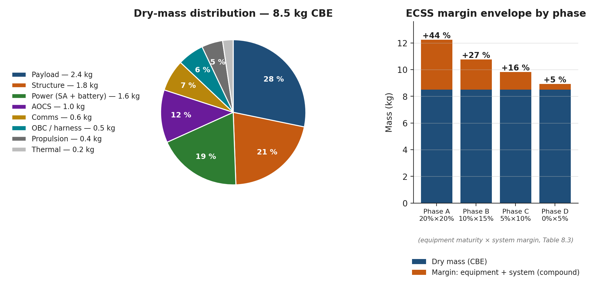

*Mass distribution and ECSS margin policy.*


> **Expected reading before this session.** ECSS-E-ST-60-30C — AOCS (≈ 60 min); Wertz, *Spacecraft Attitude Determination and Control*, Ch. 1 – 2.


**Prerequisites:** Sessions 2.1--2.4 and 3.1 (requirements, orbit, power defined)
**SpaceCDF Tabs:** Dashboard (AOCS KPI), Pointing Budget, Architecture (AOCS)

---

## References

- [Wertz, Everett & Puschell, *Space Mission Engineering: The New SMAD*, 2011, Ch. 11.1 (ADCS)](https://www.microcosminc.com/)
- [Sidi, *Spacecraft Dynamics and Control*, 1997, Ch. 4--9](https://www.cambridge.org/core/books/spacecraft-dynamics-and-control/82B47C7B6E2AA53BFAADAF26C2A79F14)
- [Markley & Crassidis, *Fundamentals of Spacecraft Attitude Determination and Control*, 2014](https://link.springer.com/book/10.1007/978-1-4939-0802-8)
- [ECSS, *ECSS-E-ST-60-10C: Control Performance*, 2008](https://ecss.nl/standard/ecss-e-st-60-10c-control-performance/)
- [ECSS, *ECSS-E-ST-60-20C Rev.2: Star sensor terminology and performance specification*, 2019](https://ecss.nl/standard/ecss-e-st-60-20c-rev-2-star-sensor-terminology-and-performance-specification-15-may-2019/)
- [Wertz, *Space Mission Analysis and Design*, 3rd ed., 1999, Ch. 11 (ADCS)](https://www.springer.com)
- [Hughes, *Spacecraft Attitude Dynamics*, 1986](https://www.wiley.com)
- [Blue Canyon Technologies, *XACT ADCS Datasheet*, 2023](https://www.bluecanyontech.com)
- [CubeSpace, *ADCS Product Catalogue*, 2023](https://www.cubespace.co.za)

---

## Learning Objectives

By the end of this session, participants will be able to:

1. Explain the distinction between attitude determination and attitude control and the physics of each sensor/actuator type
2. Select AOCS hardware architecture based on pointing requirements
3. Compute a pointing error budget using root-sum-square (RSS) combination
4. Calculate disturbance torques from gravity gradient, aerodynamic drag, solar radiation pressure, and residual magnetic dipole
5. Size actuators (reaction wheels, magnetorquers) for the computed disturbance environment with worked equations
6. Explain the physics of momentum storage, saturation, and desaturation
7. Compare CMGs vs reaction wheels and articulate when each is appropriate
8. Verify AOCS design against requirements using SpaceCDF's pointing budget tool

---

## 1. AOCS Fundamentals
The AOCS performs two distinct functions:

Table 3.2.1 — Functional split between attitude determination and control with associated sensor and actuator hardware.

| Function | Purpose | Hardware |
|----------|---------|---------|
| **Attitude Determination** (AD) | Know the spacecraft's orientation relative to a reference frame | Sensors: star tracker, sun sensors, magnetometer, gyroscope, Earth sensor, GPS receiver |
| **Attitude Control** (AC) | Change or maintain the spacecraft's orientation | Actuators: reaction wheels, magnetorquers, thrusters, control moment gyros |

**The attitude state:** A spacecraft's attitude is its orientation in 3D space relative to a reference frame (typically J2000 Earth-centred inertial, or the local-vertical/local-horizontal frame for nadir-pointing missions). The attitude is described by a rotation (e.g., quaternion, direction cosine matrix, or Euler angles) plus angular velocity $\vec{\omega}$. Euler's equation of rotational motion governs the dynamics:

$$\mathbf{I} \dot{\vec{\omega}} + \vec{\omega} \times (\mathbf{I} \vec{\omega}) = \vec{T}_{\text{external}} + \vec{T}_{\text{control}}$$

where $\mathbf{I}$ is the spacecraft inertia tensor, $\vec{T}_{\text{external}}$ is the sum of disturbance torques, and $\vec{T}_{\text{control}}$ is the actuator torque. The $\vec{\omega} \times (\mathbf{I} \vec{\omega})$ term is the gyroscopic coupling -- it means that rotating about one axis can induce motion about other axes if the inertia tensor is not spherically symmetric.

### Attitude Sensors -- How They Work

#### Star Trackers

A star tracker is the most accurate attitude sensor available, providing absolute attitude knowledge to arcsecond-level accuracy.

**How it works:**
1. A CMOS or CCD detector (typically 1024x1024 to 2048x2048 pixels) images a patch of sky through a wide-angle lens (typically 15--25 deg FOV)
2. The onboard processor detects bright point sources (stars) in the image, computing their centroid positions to sub-pixel accuracy using Gaussian fitting
3. The processor matches the observed pattern of star positions against an onboard star catalogue (typically Hipparcos or Tycho-2, containing 3,000--10,000 stars, stored in a k-d tree or hash table for fast lookup)
4. The "lost in space" algorithm identifies the star pattern without any prior attitude knowledge (first acquisition), typically taking 1--5 seconds
5. Once identified, the processor computes a quaternion rotation from the catalogue (inertial) frame to the camera (body) frame
6. In tracking mode, the processor tracks known stars frame-to-frame, providing updates at 1--10 Hz with 3--10 arcsec accuracy (1-sigma, per axis)

**Key specifications:**

Table 3.2.2 — Star tracker performance specifications compared between CubeSat and large-spacecraft classes.

| Parameter | Typical CubeSat Star Tracker | Large S/C Star Tracker |
|-----------|------------------------------|----------------------|
| Accuracy (1-sigma, boresight) | 5--15 arcsec | 0.5--3 arcsec |
| Accuracy (1-sigma, roll) | 30--100 arcsec | 5--20 arcsec |
| FOV | 10--15 deg circular | 15--25 deg circular |
| Update rate | 2--5 Hz | 5--20 Hz |
| Sensitivity | Stars to magnitude 6--7 | Stars to magnitude 8--10 |
| Mass | 50--350 g | 1--5 kg |
| Power | 0.5--2 W | 5--15 W |
| Products | Blue Canyon NST (350g), Sinclair SS-411 (90g), CubeSpace CubeStar (50g) | Sodern Hydra, Leonardo AA-STR |

*[Source: Blue Canyon NST datasheet; CubeSpace CubeStar datasheet; ECSS-E-ST-60-20C]*

**Exclusion zones:** Star trackers cannot operate when bright objects are in or near the FOV:
- **Sun:** Exclusion angle typically 25--45 deg (direct sunlight saturates the detector and can cause permanent damage to some sensor types)
- **Earth (illuminated limb):** Exclusion angle typically 25--35 deg (Earth's brightness overwhelms star signals)
- **Moon:** Exclusion angle typically 10--15 deg
- **Stray light:** Internal reflections from nearby spacecraft structure can create false stars

**Implication for mission design:** A nadir-pointing spacecraft in LEO always has the Earth within ~65 deg of one hemisphere. The star tracker must be mounted on a face that never points toward Earth (typically the zenith or anti-velocity face). If the Sun is near the orbital plane (beta angle near 0), the star tracker may be periodically blinded. Two star trackers mounted on different faces provide redundancy and eliminate single-axis exclusion zone gaps.

**Why star trackers are the most accurate:** Other sensors measure vectors to specific objects (Sun, Earth, magnetic field) -- each provides only 2 of the 3 attitude degrees of freedom (direction but not roll around that vector). A star tracker measures multiple star directions simultaneously, providing a full 3-axis attitude fix from a single measurement. The accuracy is limited by optical diffraction, centroiding noise, and catalogue accuracy -- all of which are extremely well characterised.

#### Sun Sensors

Sun sensors determine the direction to the Sun, providing 2-axis attitude information (the Sun vector in the body frame). They are simple, reliable, radiation-tolerant, and low-power.

**Coarse sun sensors (photodiode-based):**
A coarse sun sensor consists of one or more photodiodes behind a mask or window. The photocurrent is proportional to the cosine of the incidence angle:

$$I = I_0 \cos(\theta)$$

A set of 6 coarse sun sensors (one per face of the spacecraft) determines the Sun direction to 2--5 deg accuracy by comparing the photocurrents from each face. The face with the highest current is sun-facing; the ratio between adjacent faces gives the angle.

**Fine sun sensors (linear array or quadrant detector):**
A fine sun sensor uses a slit mask above a linear photodiode array (similar to a miniature sundial). Sunlight passes through the slit and illuminates a specific position on the array, which is proportional to the incidence angle. Fine sun sensors achieve 0.1--1.0 deg accuracy.

Table 3.2.3 — Coarse, fine, and digital sun-sensor accuracy, mass, power, and example products.

| Type | Accuracy | FOV | Mass | Power | Products |
|------|----------|-----|------|-------|----------|
| Coarse (photodiode) | 2--5 deg | ~hemisphere | 1--5 g | < 1 mW | NewSpace NCSS-SA05, Solar MEMS nanoSSOC-A60 |
| Fine (analog, slit+array) | 0.1--0.5 deg | 60--120 deg | 5--30 g | 10--50 mW | NewSpace NFSS-411, Solar MEMS nanoSSOC-D60 |
| Digital (APS detector + slit) | 0.01--0.05 deg | 60--120 deg | 30--50 g | 50--200 mW | TNO micro digital sun sensor |

*[Source: NewSpace Systems NFSS-411 datasheet; Solar MEMS nanoSSOC datasheets]*

**Why every spacecraft needs sun sensors:** Sun sensors are the only sensor guaranteed to work in any attitude, at any rate, in any environment (LEO, GEO, deep space). They are the primary sensor for safe mode: when the spacecraft tumbles, the OBC reboots, or the star tracker is blinded, the sun sensors can determine the Sun direction and enable the spacecraft to orient its solar arrays for power generation. Without sun sensors, a spacecraft that enters safe mode may not recover power.

#### Magnetometers

A magnetometer measures the local geomagnetic field vector $\vec{B}$ in the body frame. By comparing the measured $\vec{B}$ to a model of Earth's magnetic field (IGRF -- International Geomagnetic Reference Field) at the known orbit position, the spacecraft attitude can be determined.

**How it works:**
- **Fluxgate magnetometer:** A ferromagnetic core is periodically driven into saturation by an excitation coil. The presence of an external magnetic field creates an asymmetry in the saturation waveform, which is detected by a sense coil. Three orthogonal fluxgate elements provide the 3-axis field vector. Resolution: 1--10 nT. Accuracy: $\pm$200--500 nT (limited by spacecraft residual magnetic dipole contamination).
- **Magnetoresistive (AMR/GMR):** Thin-film magnetic sensors. Smaller and cheaper than fluxgates but noisier and less stable. Common in COTS CubeSat magnetometers.

**Attitude determination from magnetometers:**
- A single magnetometer measurement provides the magnetic field direction in the body frame (2 DOF, analogous to a sun sensor providing the Sun direction)
- Comparing with the IGRF model gives attitude, but accuracy is limited by:
  - IGRF model uncertainty (~100 nT in LEO)
  - Spacecraft residual magnetic dipole contamination (can be 1000+ nT close to electronics)
  - Only 2 DOF per measurement (no roll determination around the field vector)
- Magnetometer-only attitude determination: ~5--10 deg accuracy
- Magnetometer + sun sensor (combined): ~1--3 deg accuracy (the two independent vectors provide a full 3-axis solution via TRIAD or q-method)

**Residual dipole contamination:** Every electronic circuit creates a magnetic field. Current loops, permanent magnets in motors/speakers, magnetised structural components, and battery cells all contribute to the spacecraft's residual magnetic dipole. This contaminates the magnetometer reading. Mitigation: mount the magnetometer on a deployable boom (10--30 cm from the bus), use magnetically clean design practices (twisted pairs, balanced current loops), and perform a residual dipole calibration in orbit by comparing magnetometer readings during eclipse (no solar array current) vs sunlit.

Table 3.2.4 — Typical CubeSat magnetometer range, resolution, accuracy, mass, and example products.

| Parameter | Typical CubeSat Magnetometer |
|-----------|------------------------------|
| Range | $\pm$60,000 nT (sufficient for LEO: B ~20,000--50,000 nT) |
| Resolution | 10--100 nT |
| Accuracy (after calibration) | 200--1000 nT |
| Mass | 5--30 g |
| Power | 10--50 mW |
| Products | NewSpace NMAG, PNI RM3100, Honeywell HMC5883L |

#### Gyroscopes (Rate Sensors)

Gyroscopes measure angular velocity $\vec{\omega}$ rather than absolute attitude. They provide high-bandwidth rate information for control loops and bridge the gap between star tracker updates.

**Types used on CubeSats:**
- **MEMS gyroscope:** Vibrating structure (tuning fork or ring) whose Coriolis force is proportional to rotation rate. Small, cheap (< 50 EUR per axis), low power. Bias drift: 1--10 deg/hr. Products: InvenSense MPU-6050, Analog Devices ADIS16265.
- **MEMS IMU (6-axis):** Combined 3-axis accelerometer + 3-axis gyroscope. Mass: 5--15 g. Very common in CubeSats. Products: Sensonor STIM300 (high-end), InvenSense ICM-20948 (COTS).
- **Fibre optic gyroscope (FOG):** Much better stability (bias drift 0.01--1 deg/hr) but larger, heavier (200+ g), and more expensive. Used on high-end CubeSats and small satellites.

**Why gyroscopes drift:** MEMS gyroscopes have a non-zero bias (a constant offset in the measured rate even when stationary) that changes with temperature and time. Integrating angular rate to get attitude ($\theta = \int \omega \, dt$) accumulates this bias error linearly. A 1 deg/hr bias drift means the attitude estimate drifts 1 deg per hour. Star trackers provide absolute attitude corrections that reset this drift -- the combination of star tracker (low rate, absolute) + gyroscope (high rate, relative) via a Kalman filter is the standard approach for high-performance attitude determination.

#### GPS Receivers for Orbit Determination

GPS receivers determine the spacecraft's **position and velocity** (orbit determination), not attitude (though multi-antenna GPS can provide coarse attitude).

**How it works in LEO:**
- GPS satellites orbit at ~20,200 km altitude; LEO spacecraft orbit below them at 300--800 km
- GPS signals travel downward through the ionosphere to the LEO receiver
- The receiver must use a specialised correlator that handles Doppler shifts up to $\pm$40 kHz (LEO relative velocity ~7.5 km/s vs GPS satellite velocity ~3.9 km/s)
- Typical accuracy: 5--20 m position, 0.1--0.5 m/s velocity (single frequency, C/A code)
- Dual-frequency GPS with carrier phase: sub-meter position accuracy

**Why GPS matters for AOCS:** Accurate orbit knowledge is needed for:
- Nadir pointing (must know where "down" is, which requires knowing position)
- Ground target tracking (must know position to compute pointing angles)
- IGRF evaluation (magnetometer attitude determination needs position input)
- Orbit manoeuvre planning

Table 3.2.5 — Typical CubeSat GPS receiver position, velocity, time accuracy and mass-power figures.

| Parameter | Typical CubeSat GPS Receiver |
|-----------|------------------------------|
| Position accuracy | 5--20 m (C/A code) |
| Velocity accuracy | 0.1--0.5 m/s |
| Time accuracy | 100 ns |
| Altitude limit | Typically 600 km (must verify ITAR/COCOM limits removed) |
| Mass | 15--30 g |
| Power | 0.5--1.0 W |
| Products | SkyFox Labs piNAV-NG, NovAtel OEM719, Hemisphere V200 |

*[Source: SkyFox Labs piNAV datasheet; NovAtel OEM7 specifications]*

### AOCS Architecture Selection by Pointing Requirement

Table 3.2.6 — AOCS architecture selection mapped to pointing requirement, sensors, actuators, mass, power, and cost.

| Pointing Requirement | Architecture | Sensors | Actuators | Mass | Power | Cost |
|---------------------|-------------|---------|-----------|------|-------|------|
| > 5 deg | Passive magnetic | None (or 1 magnetometer) | Permanent magnet + hysteresis rods | ~0.05 kg | 0 W | ~2 kEUR |
| 2--5 deg | B-dot detumble + magnetic pointing | 3-axis magnetometer + coarse sun sensors | 3-axis magnetorquers | ~0.10 kg | 0.2 W | ~8 kEUR |
| 0.1--2 deg | Active 3-axis (RW + sensors) | Fine sun sensors + magnetometer + (optional gyro) | 3--4 RW + 3 MTQ for desaturation | ~0.50 kg | 2--4 W | ~35 kEUR |
| < 0.1 deg | Fine pointing (RW + star tracker) | Star tracker + fine sun sensors + magnetometer + gyro | 4 RW + 3 MTQ | ~0.80 kg | 3--5 W | ~55 kEUR |
| < 0.01 deg | Very fine pointing | Dual star trackers + MEMS gyro + fine sun sensors + magnetometer | 4 RW + 3 MTQ | ~1.20 kg | 4--6 W | ~80 kEUR |

**Real mission examples:**

Table 3.2.7 — Real CubeSat missions with their pointing requirements and AOCS architectures.

| Mission | Form Factor | Pointing Req | Architecture | AOCS Mass | Key Sensor |
|---------|------------|-------------|-------------|-----------|------------|
| **Astrocast** (3U, IoT) | 3U | ~5 deg | MTQ + sun sensors + magnetometer | 0.1 kg | Sun sensors |
| **Planet SuperDove** (3U+, EO) | 3U+ | ~0.1 deg | 4 RW + ST + 3 MTQ + 6 sun sensors | 0.8 kg | Blue Canyon NST star tracker |
| **CAPSTONE** (12U, cislunar nav) | 12U | ~0.05 deg | 4 RW + ST + sun sensors + IMU | ~1.0 kg | Star tracker + IMU |
| **ASTERIA** (6U, exoplanet) | 6U | ~0.003 deg (10 arcsec) | 4 RW + ST + fine guidance sensor | ~1.2 kg | Custom fine guidance camera |

*[Source: Pong et al., "ASTERIA: Achieving 10-arcsecond Pointing on a 6U CubeSat," SSC 2018]*

---

## 2. Disturbance Torques
In LEO, four external torques disturb the spacecraft attitude. The AOCS must counteract them continuously. Understanding the source and magnitude of each disturbance is essential for sizing actuators.

### Gravity Gradient Torque

**Physics:** A spacecraft in orbit experiences a non-uniform gravitational field -- the side closer to Earth is pulled more strongly than the far side. For an elongated body, this differential pull creates a torque that tends to align the long axis with the local vertical (nadir direction). This is the principle behind gravity gradient stabilisation.

> **Key Equations -- Gravity Gradient Torque**
>
> $$T_{gg} = \frac{3\mu}{2a^3} |I_z - I_x| \sin(2\theta)$$
>
> where:
> - $\mu = 3.986 \times 10^{14}$ m$^3$/s$^2$ (Earth's gravitational parameter)
> - $a = R_E + h$ (semi-major axis in metres)
> - $I_z$, $I_x$ are principal moments of inertia about the maximum and minimum axes (kg m$^2$)
> - $\theta$ = angle between the long axis and the local vertical
> - Worst case occurs at $\theta = 45$ deg, where $\sin(2\theta) = 1$
>
> For a body with $I_z \approx I_x$ (a cube), $T_{gg} \approx 0$ -- this is why 1U CubeSats experience minimal gravity gradient torque.

### Aerodynamic Torque

**Physics:** At LEO altitudes (200--600 km), residual atmospheric molecules collide with the spacecraft surface. The force acts through the centre of pressure (cp), which generally does not coincide with the centre of mass (cm). The offset creates a torque.

> **Key Equations -- Aerodynamic Torque**
>
> $$T_{\text{aero}} = \frac{1}{2} \rho v^2 C_D A_{\text{ref}} \, d_{cp-cm}$$
>
> where:
> - $\rho$ = atmospheric density (kg/m$^3$) -- varies by orders of magnitude with altitude, solar activity (F10.7), and local time:
>   - 300 km: $\rho \approx 2 \times 10^{-11}$ (solar min) to $3 \times 10^{-10}$ (solar max)
>   - 400 km: $\rho \approx 4 \times 10^{-12}$ to $1 \times 10^{-11}$
>   - 500 km: $\rho \approx 6 \times 10^{-13}$ to $5 \times 10^{-12}$
>   - 600 km: $\rho \approx 1 \times 10^{-13}$ to $8 \times 10^{-13}$
> - $v$ = orbital velocity (~7.6 km/s at 500 km)
> - $C_D \approx 2.0$--$2.3$ (molecular flow drag coefficient; 2.2 is standard for flat plates in free molecular flow)
> - $A_{\text{ref}}$ = cross-sectional area perpendicular to velocity (m$^2$)
> - $d_{cp-cm}$ = offset between centre of pressure and centre of mass (m); typically 0.5--5 cm for CubeSats depending on deployable configuration

### Solar Radiation Pressure Torque

**Physics:** Sunlight carries momentum. When photons strike a surface, they transfer momentum ($p = E/c$ for absorption, $p = 2E/c$ for specular reflection). The resulting force acts through the centre of solar pressure, which may not coincide with the cm.

> **Key Equations -- SRP Torque**
>
> $$T_{\text{SRP}} = \frac{S}{c} A_s (1 + q) \, d_{sp-cm}$$
>
> where:
> - $S = 1361$ W/m$^2$ (solar constant at 1 AU)
> - $c = 3 \times 10^8$ m/s (speed of light)
> - $S/c = 4.54 \times 10^{-6}$ N/m$^2$ (solar radiation pressure at 1 AU)
> - $A_s$ = illuminated area (m$^2$)
> - $q$ = surface reflectance (0 for perfect absorber, 1 for perfect specular reflector)
> - $d_{sp-cm}$ = offset between solar pressure centre and centre of mass (m)
>
> **Note:** SRP torque is tiny in LEO compared to aero and magnetic torques. It becomes the dominant disturbance in GEO and deep space (where there is no atmosphere and the magnetic field is weak).

### Residual Magnetic Dipole Torque

**Physics:** A spacecraft with a net magnetic dipole moment $\vec{M}$ (from current loops in wiring, permanent magnets in reaction wheel motors, magnetised ferromagnetic components) interacts with Earth's magnetic field $\vec{B}$ to produce a torque:

> **Key Equations -- Magnetic Dipole Torque**
>
> $$\vec{T}_{\text{mag}} = \vec{M} \times \vec{B}$$
>
> Magnitude: $T_{\text{mag}} = M \cdot B \cdot \sin(\alpha)$
>
> where:
> - $M$ = spacecraft residual magnetic dipole moment (A m$^2$)
> - $B$ = local geomagnetic field strength (T):
>   - LEO (400--600 km): $B \approx 2$--$5 \times 10^{-5}$ T (varies with latitude; strongest near poles, weakest near equator)
>   - GEO (35,786 km): $B \approx 1 \times 10^{-7}$ T
> - $\alpha$ = angle between $\vec{M}$ and $\vec{B}$
>
> **Typical CubeSat residual dipole moments:**
>
> | Source | Dipole Moment (A m$^2$) | Notes |
> |--------|-------------------------|-------|
> | Reaction wheel motor | 0.005--0.02 per wheel | Permanent magnets in brushless motor |
> | Solar array wiring | 0.001--0.01 | Current loops from SA to EPS |
> | Battery cells | 0.001--0.005 | Nickel in cell casing |
> | Unshielded cables | 0.005--0.05 | Depends on routing and length |
> | **Total (typical 3U)** | **0.01--0.10** | Varies significantly with design |
>
> **Why magnetic torque dominates for CubeSats:** COTS electronics are not designed for magnetic cleanliness. Short wiring runs create small but unbalanced current loops. Reaction wheel motors contain permanent magnets. The result is a residual dipole of 0.01--0.1 A m$^2$, which in a 30 uT field produces $3 \times 10^{-7}$ to $3 \times 10^{-6}$ N m -- often larger than gravity gradient or SRP torques.

> **Worked Example -- Disturbance Torques for 3U CubeSat at 500 km (SuperDove-class)**
>
> **Spacecraft properties:** 3U (100 x 100 x 340 mm), mass = 5 kg, $I_z = 0.035$ kg m$^2$ (long axis), $I_x = 0.007$ kg m$^2$ (short axis), $A_{\text{ref}} = 0.034$ m$^2$ (3U face), $d_{cp-cm} = 0.02$ m (deployable panels offset cm from geometric centre).
>
> **Gravity gradient** (worst case, $\theta = 45$ deg):
> $T_{gg} = \frac{3 \times 3.986 \times 10^{14}}{2 \times (6871 \times 10^{3})^3} \times |0.035 - 0.007| \times 1$
> $= \frac{1.196 \times 10^{15}}{6.494 \times 10^{20}} \times 0.028 = 1.84 \times 10^{-6} \times 0.028 = 5.2 \times 10^{-8}$ N m
>
> **Aerodynamic** (at 500 km, solar minimum, $\rho \approx 6 \times 10^{-13}$ kg/m$^3$):
> $F_{\text{aero}} = 0.5 \times 6 \times 10^{-13} \times 7617^2 \times 2.2 \times 0.034 = 1.30 \times 10^{-6}$ N
>
> $T_{\text{aero}} = F_{\text{aero}} \times d_{cp-cm} = 1.30 \times 10^{-6} \times 0.02 = 2.6 \times 10^{-8}$ N m
>
> Note: at solar maximum ($\rho \approx 5 \times 10^{-12}$), this increases by ~8x to $2.1 \times 10^{-7}$ N m.
>
> **Solar radiation pressure:**
> $F_{\text{SRP}} = \frac{1361}{3 \times 10^8} \times 0.034 \times 1.5 = 2.31 \times 10^{-7}$ N
>
> $T_{\text{SRP}} = F_{\text{SRP}} \times d_{sp-cm} = 2.31 \times 10^{-7} \times 0.02 = 4.6 \times 10^{-9}$ N m
>
> **Residual magnetic dipole** ($M = 0.05$ A m$^2$, $B = 3 \times 10^{-5}$ T):
> $T_{\text{mag}} = 0.05 \times 3 \times 10^{-5} = 1.5 \times 10^{-6}$ N m
>
> **Summary:**
>
> | Source | Torque (N m) | Rank | Notes |
> |--------|-------------|------|-------|
> | Gravity gradient | $5.2 \times 10^{-8}$ | 3rd | Small because 3U is not very elongated |
> | Aerodynamic (solar min) | $2.6 \times 10^{-8}$ | 4th | Increases 8x at solar max |
> | Solar radiation pressure | $4.6 \times 10^{-9}$ | 5th | Negligible at LEO distances |
> | Residual magnetic dipole | $1.5 \times 10^{-6}$ | **1st** | **Dominates by >10x** |
> | **Total (worst-case sum)** | $\approx 1.6 \times 10^{-6}$ | | Conservative estimate |
> | **Total (RSS)** | $\approx 1.5 \times 10^{-6}$ | | More realistic (uncorrelated sources) |
>
> **Key finding:** The residual magnetic dipole dominates for CubeSats due to COTS electronics and short wiring runs. **Magnetic cleanliness matters.** Reducing the residual dipole from 0.05 to 0.01 A m$^2$ (achievable with careful wire routing, twisted pairs, and degaussing) would reduce the total disturbance by 5x.


*Figure 3.2.1 — Order-of-magnitude comparison of the four disturbance torques on a 3U CubeSat at 500 km SSO (data from the worked example above, sourced from Chapter 3.2 §2). The residual-magnetic-dipole torque dominates by an order of magnitude, justifying why "magnetic cleanliness" is the AOCS designer's first design-cleanup target.*

---

## 3. Attitude Actuators -- Physics and Sizing
### Reaction Wheels -- Physics of Angular Momentum Storage

**How reaction wheels work:**

A reaction wheel is a flywheel (typically a brass or steel ring, 20--200 g for CubeSats) spun by a brushless DC motor. By Newton's third law, changing the wheel's angular momentum produces an equal and opposite torque on the spacecraft:

$$\vec{H}_{\text{total}} = \vec{H}_{\text{spacecraft}} + \vec{H}_{\text{wheels}} = \text{constant}$$

If the wheel speeds up ($\Delta H_{\text{wheel}} > 0$), the spacecraft receives an equal and opposite angular momentum change ($\Delta H_{\text{SC}} = -\Delta H_{\text{wheel}}$), causing it to rotate. The control torque is:

$$T_{\text{control}} = \frac{dH_{\text{wheel}}}{dt} = I_{\text{wheel}} \cdot \dot{\omega}_{\text{wheel}}$$

where $I_{\text{wheel}}$ is the wheel's moment of inertia and $\dot{\omega}_{\text{wheel}}$ is the wheel's angular acceleration.

**Momentum storage:** The maximum angular momentum a wheel can store is:

$$H_{\text{max}} = I_{\text{wheel}} \times \omega_{\text{max}}$$

For a Blue Canyon RW210: $I_{\text{wheel}} \approx 1.5 \times 10^{-5}$ kg m$^2$, $\omega_{\text{max}} \approx 6000$ RPM $= 628$ rad/s, giving $H_{\text{max}} = 0.0094$ N m s $\approx 10$ mN m s.

**Saturation:** As disturbance torques act on the spacecraft, the reaction wheels absorb angular momentum. Over time, the wheel speed increases until it reaches $\omega_{\text{max}}$ (saturation). At saturation, the wheel can no longer absorb momentum in that direction, and control authority is lost. The time to saturation from zero speed is:

$$t_{\text{sat}} = \frac{H_{\text{max}}}{T_{\text{disturbance}}} = \frac{10 \times 10^{-3}}{1.5 \times 10^{-6}} = 6667 \text{ s} \approx 111 \text{ minutes}$$

This is approximately 1.2 orbits -- so the wheels would saturate after about one orbit without desaturation. This is why magnetorquers are essential companions to reaction wheels.

**The zero-crossing problem:** When a reaction wheel passes through zero speed (reversing direction), the static friction in the bearings creates a "dead zone" where the wheel cannot produce smooth, continuous torque. This causes a brief loss of control authority and increased jitter. Mitigations:
- **Bias momentum:** Operate all wheels with a positive bias speed (e.g., 500 RPM), so they never cross zero during normal operations
- **4-wheel pyramid configuration:** The skewed geometry means individual wheels reverse less frequently
- **Lubrication:** Space-rated bearings use solid or vapour-deposited lubricants (MoS$_2$, Braycote) that minimise static friction

**Jitter:** Reaction wheel imbalance (mass asymmetry in the flywheel) creates vibrations at the spin frequency and its harmonics. For imaging missions, this jitter degrades image quality. Jitter amplitude depends on wheel speed, imbalance mass, and the spacecraft's structural transfer function. Typical CubeSat reaction wheel jitter: 5--20 arcsec at the payload, depending on isolation.

### Reaction Wheel Configurations

Table 3.2.8 — Comparison of three-orthogonal, three-plus-skew, and four-wheel pyramid reaction-wheel configurations.

| Configuration | Description | Pros | Cons | Use |
|--------------|------------|------|------|-----|
| **3 orthogonal** | One wheel per body axis (X, Y, Z) | Minimum mass, simple control | No redundancy; single wheel failure = loss of 1-axis control | Low-cost missions with short lifetime |
| **3 + 1 skew** | 3 orthogonal + 1 on a skew axis (e.g., [1,1,1] direction) | Single-fault tolerant; the skew wheel + remaining 2 provide 3-axis control | Slightly more complex control law distribution | **Standard for CubeSats** |
| **4-wheel pyramid** | 4 wheels tilted ~20--30 deg from body axes, symmetrically arranged | Optimal torque/momentum distribution; single-fault tolerant; reduced zero-crossings | More complex mounting, heavier | High-performance missions, agile S/C |

The **distribution matrix** maps wheel torques to body-frame torques:

$$\vec{T}_{\text{body}} = \mathbf{D} \cdot \vec{T}_{\text{wheels}}$$

For a 4-wheel pyramid with cant angle $\beta$:

<div style="text-align:center;margin:10pt 0;">
<span style="font-style:italic;font-weight:bold;font-size:12pt;">D</span> = 
<table style="display:inline-table;width:auto;border-collapse:collapse;border-left:2.5pt solid #2d2d2c;border-right:2.5pt solid #2d2d2c;vertical-align:middle;margin:0;">
<tr><td style="border:none;background:transparent;padding:2pt 12pt;text-align:center;">cos β</td><td style="border:none;background:transparent;padding:2pt 12pt;text-align:center;">0</td><td style="border:none;background:transparent;padding:2pt 12pt;text-align:center;">−cos β</td><td style="border:none;background:transparent;padding:2pt 12pt;text-align:center;">0</td></tr><tr><td style="border:none;background:transparent;padding:2pt 12pt;text-align:center;">0</td><td style="border:none;background:transparent;padding:2pt 12pt;text-align:center;">cos β</td><td style="border:none;background:transparent;padding:2pt 12pt;text-align:center;">0</td><td style="border:none;background:transparent;padding:2pt 12pt;text-align:center;">−cos β</td></tr><tr><td style="border:none;background:transparent;padding:2pt 12pt;text-align:center;">sin β</td><td style="border:none;background:transparent;padding:2pt 12pt;text-align:center;">sin β</td><td style="border:none;background:transparent;padding:2pt 12pt;text-align:center;">sin β</td><td style="border:none;background:transparent;padding:2pt 12pt;text-align:center;">sin β</td></tr>
</table>
</div>

> **Key Equations -- Reaction Wheel Sizing**
>
> **Torque requirement** (to counteract disturbances + provide slewing capability):
> $$T_{\text{RW,min}} \geq k \times T_{\text{disturbance,total}}$$
> where $k \geq 2$ is the control margin factor (typically 2--5 to provide adequate control bandwidth and slewing performance).
>
> **Momentum storage requirement** (accumulation between desaturation cycles):
> $$H_{\text{required}} = T_{\text{disturbance}} \times \frac{t_{\text{desat}}}{2}$$
> where $t_{\text{desat}}$ is the time between magnetorquer desaturation events (typically one half-orbit to one orbit). The factor of 1/2 accounts for the average (sinusoidal disturbance torques average to half their peak over a quarter orbit).
>
> **Slew rate** (for agile/imaging missions):
> $$\dot{\theta}_{\text{max}} = \frac{H_{\text{RW,max}}}{I_{\text{axis}}}$$
>
> For a 3U CubeSat with RW210 ($H = 10$ mN m s) and $I_{\text{axis}} = 0.035$ kg m$^2$:
> $\dot{\theta}_{\text{max}} = 0.010 / 0.035 = 0.286$ rad/s $= 16.4$ deg/s -- more than adequate for target-to-target slewing.
>
> **Slew time for a given angle** (acceleration-limited, trapezoidal profile):
> $$t_{\text{slew}} = 2\sqrt{\frac{\theta_{\text{slew}} \cdot I_{\text{axis}}}{T_{\text{RW}}}}$$
>
> For a 90 deg (1.57 rad) slew with RW210 ($T = 1.0$ mN m) and $I = 0.035$:
> $t_{\text{slew}} = 2\sqrt{\frac{1.57 \times 0.035}{0.001}} = 2\sqrt{54.95} = 14.8$ s

> **Worked Example -- Reaction Wheel Sizing for 3U CubeSat (SuperDove-class)**
>
> **Given:** $T_{\text{disturbance}} = 1.5 \times 10^{-6}$ N m (from Section 2), desaturation interval = 1 orbit (5670 s), pointing requirement = 0.1 deg, slew requirement = 90 deg in < 60 s.
>
> **Torque requirement:**
> $T_{\text{RW,min}} = 3 \times 1.5 \times 10^{-6} = 4.5 \times 10^{-6}$ N m $= 0.0045$ mN m
>
> This is a very low torque requirement. The minimum available CubeSat wheel (RW-0.01 at 0.23 mN m) exceeds this by 50x. The sizing driver is actually the slew rate and momentum storage, not the disturbance rejection torque.
>
> **Momentum storage:**
> $H_{\text{required}} = 1.5 \times 10^{-6} \times \frac{5670}{2} = 4.25 \times 10^{-3}$ N m s $= 4.25$ mN m s
>
> **Slew time check with candidate wheels:**
>
> | Product | Torque (mN m) | Momentum (mN m s) | Mass (g) | 90 deg Slew (s) | Momentum Margin | Manufacturer |
> |---------|--------------|-------------------|----------|----------------|-----------------|-------------|
> | RW-0.01 | 0.23 | 1.0 | 30 | 30.9 s | -3.25 mN m s (FAIL) | Hyperion |
> | RW210 | 1.0 | 10 | 55 | 14.8 s | +5.75 mN m s (135%) | Blue Canyon |
> | RW3-1.0 | 1.0 | 15 | 50 | 14.8 s | +10.75 mN m s (253%) | CubeSpace |
> | RW400 | 4.0 | 40 | 120 | 7.4 s | +35.75 mN m s (841%) | Blue Canyon |
>
> The RW-0.01 fails the momentum storage requirement (would saturate in < 1 orbit). The RW210 (10 mN m s) provides 135% margin and 14.8 s slew time. **Selected: RW210 (or CubeSpace RW3-1.0).**
>
> **Configuration:** 4 wheels (3+1 skew) for single-fault tolerance. Total AOCS actuator mass: 4 x 55 g = 220 g.

### Magnetorquers -- Physics of Magnetic Torque Generation

**How magnetorquers work:**

A magnetorquer (MTQ) is simply a coil of wire (or a ferromagnetic rod wrapped with wire). When current flows through the coil, it creates a magnetic dipole moment:

$$\vec{m} = N \cdot I \cdot A \cdot \hat{n}$$

where $N$ = number of turns, $I$ = current (A), $A$ = coil cross-sectional area (m$^2$), and $\hat{n}$ is the coil normal direction.

This magnetic dipole interacts with Earth's geomagnetic field $\vec{B}$ to produce a torque:

$$\vec{T}_{\text{MTQ}} = \vec{m} \times \vec{B}$$

The torque is **perpendicular** to both the dipole moment and the magnetic field. This has a critical implication: **a magnetorquer cannot produce torque parallel to the local magnetic field vector.** At any instant, only 2 of 3 axes can be torqued. Over a full orbit, as the field direction rotates, all 3 axes become accessible -- but not simultaneously.

**Magnetorquer types for CubeSats:**

Table 3.2.9 — Magnetorquer technology comparison across dipole moment, mass, power, and form factor.

| Type | Dipole Moment | Mass | Power | Form Factor | Products |
|------|--------------|------|-------|-------------|----------|
| **Air-core coil** (PCB trace) | 0.01--0.05 A m$^2$ | 1--5 g | 0.1--0.3 W | Flat PCB, integrates into solar panel substrate | ZARM Technik MTC-1, custom |
| **Air-core rod** (wound wire) | 0.05--0.50 A m$^2$ | 10--30 g | 0.2--0.5 W | Cylindrical, 60--100 mm long | CubeSpace CubeMAG, NewSpace NTQS |
| **Ferromagnetic core rod** | 0.2--5.0 A m$^2$ | 20--100 g | 0.3--1.0 W | Cylindrical with mu-metal core, 60--100 mm long | ZARM Technik MTQ-1, ISIS iMTQ |

The ferromagnetic core concentrates the magnetic flux, providing 5--20x more dipole moment per unit current than an air-core coil of the same size. However, ferromagnetic cores can retain residual magnetism after power-off, contributing to the spacecraft's residual magnetic dipole.

**Why magnetorquers cannot point (only detumble and desaturate):**

The torque $\vec{T} = \vec{m} \times \vec{B}$ is always perpendicular to $\vec{B}$. This means:
1. You cannot generate torque about the $\vec{B}$ direction at any given instant
2. The achievable torque direction changes continuously as the spacecraft orbits (because $\vec{B}$ rotates)
3. Pointing control requires torque in any direction at any time -- magnetorquers cannot provide this

Magnetorquers are excellent for:
- **Detumbling:** The B-dot controller ($\vec{m} = -k \dot{\vec{B}}$) brakes spacecraft rotation by opposing the change in the measured B-field. Works regardless of attitude, needs no attitude knowledge, and needs no sensor but the magnetometer. **It is also slow, and this surprises people.** The available torque is $m \times B$ with $m$ capped by the coil (1.6 A m$^2$ per axis on our 6U reference) and $B \approx 3 \times 10^{-5}$ T, so the braking torque is of order $5 \times 10^{-5}$ N m -- and only the component perpendicular to $\vec{B}$ does any work. Detumbling a 6U from a 14 deg/s post-separation tumble takes on the order of **3.5 x 10$^3$ s**, dropping below a 0.5 deg/s exit guard at about 1170 s. Any claim that a B-dot detumble completes in a couple of minutes should be treated as a red flag.
- **Desaturation:** Systematically dumping momentum from reaction wheels by applying the correct dipole moment: $\vec{m} = -k (\vec{H}_{\text{wheel}} \times \hat{B})$
- **Coarse pointing** (2--10 deg): Possible over time using model-predictive control that plans the dipole commands over a full orbit, exploiting the field rotation. But accuracy is limited.

> **Key Equations -- Magnetorquer Sizing**
>
> **Desaturation torque:**
> $$T_{\text{MTQ}} = m_{\text{dipole}} \times B \times \sin(\alpha)$$
>
> Average torque over an orbit (accounting for varying $\alpha$): $T_{\text{MTQ,avg}} \approx 0.7 \times m_{\text{dipole}} \times B_{\text{avg}}$
>
> **Desaturation time** (to dump one wheel from full momentum):
> $$t_{\text{dump}} = \frac{H_{\text{wheel}}}{T_{\text{MTQ,avg}}}$$
>
> **Design requirement:** $t_{\text{dump}} < t_{\text{shadow}}$ (must complete desaturation during the portion of the orbit where the field geometry is favourable).

> **Worked Example -- Magnetorquer Sizing for 3U CubeSat**
>
> **Given:** RW210 momentum = 10 mN m s, $B_{\text{avg}} = 3 \times 10^{-5}$ T.
>
> **Option 1: CubeMAG rod** ($m = 0.2$ A m$^2$):
> $T_{\text{MTQ,avg}} = 0.7 \times 0.2 \times 3 \times 10^{-5} = 4.2 \times 10^{-6}$ N m
>
> $t_{\text{dump}} = \frac{10 \times 10^{-3}}{4.2 \times 10^{-6}} = 2381$ s $\approx 40$ min
>
> This is approximately 42% of one orbit period. **Acceptable** -- desaturation can be scheduled once per orbit during the non-imaging portion.
>
> **Disturbance rejection check:** The MTQ average torque ($4.2 \times 10^{-6}$ N m) is 2.8x the total disturbance torque ($1.5 \times 10^{-6}$ N m). The MTQ can dump momentum faster than it accumulates. **Pass.**
>
> **Configuration:** 3 MTQ rods, one per body axis (X, Y, Z). This ensures torque can be generated about any two axes at any given time. Total MTQ mass: 3 x 30 g = 90 g.

### Control Moment Gyroscopes (CMGs) vs Reaction Wheels

**CMGs** are an alternative momentum exchange device used on large, agile spacecraft. A CMG consists of a spinning flywheel mounted on a gimbal. Instead of changing the wheel speed (as in a reaction wheel), the CMG changes the direction of the angular momentum vector by rotating the gimbal. This produces a gyroscopic output torque:

$$T_{\text{CMG}} = H_{\text{wheel}} \times \dot{\delta}$$

where $H_{\text{wheel}}$ is the constant wheel momentum and $\dot{\delta}$ is the gimbal rate.

**The torque amplification effect:** For a CMG wheel spinning at high speed ($H = 1$--$100$ N m s), even a moderate gimbal rate ($\dot{\delta} = 1$ rad/s) produces a large output torque ($T = 1$--$100$ N m). This is orders of magnitude more than a reaction wheel of similar mass. CMGs are "torque machines"; reaction wheels are "momentum machines."

Table 3.2.10 — Reaction wheel versus single-gimbal control moment gyroscope on torque, complexity, and use cases.

| Parameter | Reaction Wheel | CMG (Single Gimbal) |
|-----------|---------------|---------------------|
| Output torque | $T = I_w \dot{\omega}_w$ (low, 0.001--10 N m) | $T = H_w \dot{\delta}$ (high, 0.1--1000+ N m) |
| Control complexity | Simple (speed command) | Complex (gimbal singularity avoidance) |
| Mass efficiency | Lower torque/kg | Higher torque/kg (10--100x) |
| Failure mode | Bearing wear, motor failure | Gimbal lock (singularity), bearing wear |
| Typical use | CubeSats, small satellites, non-agile | Large agile satellites, ISS, Earth observation with rapid retargeting |
| CubeSat status | Standard (many COTS products) | Emerging (Honeybee Robotics microCMG, some research prototypes) |

**When to use CMGs:**
- Spacecraft requiring rapid slewing (> 3 deg/s for large spacecraft)
- Large moments of inertia where reaction wheel torque is insufficient
- Missions requiring frequent retargeting (e.g., video from orbit, rapid revisit EO)

**When to use reaction wheels:**
- CubeSats and small satellites (adequate torque, simpler control, more COTS options)
- Missions with modest agility requirements (< 10 deg/s slew for CubeSats)
- Cost-constrained missions (CMGs are significantly more expensive)

The ISS uses four 4600 kg CMGs, each storing 3500 N m s of momentum, to maintain attitude without propellant. The Pleiades Neo Earth observation satellite uses CMGs for rapid retargeting between imaging strips.

---

## 4. Pointing Error Budget
*[Source: ECSS-E-ST-60-10C]*

The pointing error budget combines all independent error sources using root-sum-square (RSS) to determine the total pointing uncertainty. This is a statistical combination assuming errors are uncorrelated and normally distributed.

**ECSS pointing performance taxonomy:**

Table 3.2.11 — ECSS pointing performance taxonomy defining absolute, relative, and mean performance errors.

| Term | Definition | Measured Over |
|------|-----------|---------------|
| **APE** (Absolute Performance Error) | Total error between actual pointing and commanded pointing | Single measurement |
| **RPE** (Relative Performance Error) | Variation in pointing over a short time (jitter/stability) | Measurement window (e.g., integration time) |
| **MPE** (Mean Performance Error) | Systematic bias in pointing | Long-term average |

For most CubeSat missions, APE is the primary requirement. RPE matters for long-exposure imaging (e.g., ASTERIA's 10-arcsec stability over 20-minute exposures).

> **Key Equations -- Pointing Error Budget (RSS)**
>
> $$\theta_{\text{APE}} = \sqrt{\theta_{\text{sensor}}^2 + \theta_{\text{actuator}}^2 + \theta_{\text{alignment}}^2 + \theta_{\text{thermal}}^2 + \theta_{\text{jitter}}^2 + \theta_{\text{orbit}}^2 + \theta_{\text{timing}}^2}$$
>
> The result must satisfy:
> $$\theta_{\text{APE}} \leq \theta_{\text{requirement}}$$

### Error Source Definitions and Physics

Table 3.2.12 — Pointing error sources with their physics and typical star-tracker and sun-sensor magnitudes.

| Source | Description | Physics | Typical Values (Star Tracker) | Typical Values (Sun Sensor) |
|--------|------------|---------|------------------------------|----------------------------|
| **Sensor accuracy** | Intrinsic measurement noise of attitude sensor | Photon noise, centroiding error, optical distortion | 3--15 arcsec (0.001--0.004 deg) | 0.5--2 deg |
| **Actuator resolution** | Minimum controllable torque step; control loop dead band | Motor cogging torque, driver quantisation, control bandwidth | 2--5 arcsec (0.001 deg) | N/A (MTQ: 1--5 deg) |
| **Alignment knowledge** | Misalignment between sensor boresight and payload boresight; measured during I&T | Mechanical tolerances, shimming, bonding accuracy, measurement uncertainty | 30--60 arcsec (0.01--0.02 deg) | 0.5 deg |
| **Thermal distortion** | Structural deformation with temperature changes; orbital thermal cycling | CTE mismatch between materials, temperature gradients across structure | 10--30 arcsec (0.003--0.01 deg) | 0.1 deg |
| **Jitter** | High-frequency vibration from reaction wheels, mechanisms | Wheel imbalance forces at spin frequency and harmonics, structural resonances | 5--20 arcsec (0.001--0.006 deg) | N/A |
| **Orbit knowledge** | Uncertainty in satellite position (affects nadir pointing vector computation) | GPS accuracy, propagation error between GPS fixes | 1--5 arcsec (< 0.001 deg) | 0.05 deg |
| **Timing** | Time-stamping error between sensor read and actuator command | Clock synchronisation, interrupt latency, bus communication delay | 1--3 arcsec (< 0.001 deg) | 0.01 deg |

> **Worked Example -- Pointing Budget for 3U EO CubeSat (Star Tracker + RW)**
>
> | Error Source | Value (deg) | Value (arcsec) | Value$^2$ (deg$^2$) | Notes |
> |-------------|------------|----------------|---------------------|-------|
> | Star tracker accuracy | 0.003 | 10.8 | $9.0 \times 10^{-6}$ | Blue Canyon NST, 1-sigma boresight |
> | Reaction wheel resolution | 0.001 | 3.6 | $1.0 \times 10^{-6}$ | Motor cogging + control dead band |
> | Alignment knowledge | 0.020 | 72 | $4.0 \times 10^{-4}$ | **Dominant** -- shimmed to 1 arcmin |
> | Thermal distortion | 0.010 | 36 | $1.0 \times 10^{-4}$ | Al structure, 40 degC orbital range |
> | RW jitter | 0.005 | 18 | $2.5 \times 10^{-5}$ | At 3000 RPM, no isolation mount |
> | Orbit knowledge (GPS) | 0.001 | 3.6 | $1.0 \times 10^{-6}$ | GPS fix every 10 s |
> | Timing error | 0.001 | 3.6 | $1.0 \times 10^{-6}$ | < 1 ms timestamp sync |
> | **RSS Total** | $\sqrt{5.37 \times 10^{-4}}$ = **0.023 deg** | **83 arcsec** | | |
>
> **Requirement:** 0.1 deg (3-sigma) -- this is typical for a 5 m GSD imager at 500 km (where 0.1 deg corresponds to ~870 m pointing error on ground, or ~175 pixels for a 5 m GSD sensor).
>
> **Margin:** 0.1 - 0.023 = 0.077 deg (77% margin) -- **comfortable**.
>
> **Key insight:** Alignment knowledge (0.020 deg = 72 arcsec) dominates the budget at 74% of the RSS. Improving the star tracker accuracy from 10.8 to 3 arcsec would change the RSS total from 83.4 to 82.8 arcsec -- negligible improvement. **Budget-driven design** means investing effort in the dominant term: better alignment calibration (e.g., on-orbit calibration using ground targets) would have far more impact than upgrading any sensor.
>
> To achieve < 0.01 deg (36 arcsec) pointing, the alignment must be improved to < 0.005 deg (18 arcsec), which requires precision optical alignment during I&T and/or on-orbit alignment calibration.

---

## 5. Momentum Management and Desaturation
Disturbance torques cause angular momentum to accumulate in reaction wheels over time. Without management, wheels saturate and lose control authority. Understanding this cycle is essential for AOCS design.

**The momentum lifecycle:**

1. **Accumulation:** External disturbance torques (gravity gradient, aero, SRP, magnetic) act on the spacecraft body. The control loop commands the reaction wheels to counteract these torques, absorbing the angular momentum. Wheel speed increases (or decreases) at a rate of $\dot{H} = T_{\text{disturbance}}$.

2. **Monitoring:** The OBC monitors wheel speeds. When any wheel exceeds a threshold (typically 80% of maximum), a desaturation manoeuvre is triggered.

3. **Desaturation:** The OBC activates the magnetorquers to generate a torque that opposes the stored wheel momentum. The algorithm computes the optimal dipole command:

$$\vec{m}_{\text{cmd}} = -k_d (\vec{H}_{\text{wheel}} \times \hat{B})$$

where $k_d$ is the desaturation gain and $\hat{B}$ is the unit magnetic field vector. This produces a torque $\vec{T} = \vec{m} \times \vec{B}$ that is in the direction to reduce $\vec{H}_{\text{wheel}}$.

4. **Completion:** Wheel speeds return to near-zero (or bias speed). The cycle repeats.

**Desaturation constraints:**
- MTQs can only generate torque **perpendicular** to the local magnetic field vector. They cannot dump momentum parallel to $\vec{B}$.
- Near the magnetic equator, $\vec{B}$ is nearly horizontal (north-pointing, i.e. roughly along-track in a polar orbit). MTQs can effectively dump momentum about the pitch and yaw axes but not roll.
- Near the magnetic poles, $\vec{B}$ is nearly vertical. MTQs can dump pitch and roll but not yaw.
- Over a full orbit, the field direction rotates sufficiently to dump all three axes. But at any instant, one axis is poorly controllable.
- A multi-pass desaturation strategy (spreading the dump over a full orbit) is more efficient than a single-point dump.

**Typical desaturation frequency for CubeSats:**
- At 500 km with 1.5 uN m total disturbance and 10 mN m s wheels: one desaturation per orbit (every ~95 minutes)
- Duration: **20--50 minutes** per cycle. This is the number students most often get wrong: the worked sizing above gives $t_{\text{dump}} = H/T_{\text{MTQ,avg}} \approx 2400$ s for a single wheel at a favourable field geometry, and a real dump is slower still because the field angle $\alpha$ swings through poor geometry and more than one wheel has to come down. A dump that "takes ten minutes" is a dump that has not finished. Flight software therefore carries a **timeout** on the manoeuvre, holds an **imaging inhibit** for its duration, and returns to the *pre-desaturation* mode on completion rather than dropping to a default
- Power: 0.5--1.5 W during desaturation (3 MTQ rods active)
- During desaturation, pointing accuracy degrades slightly (the MTQ torques perturb the attitude). Imaging should be inhibited during desaturation.

### Wheel Configurations -- 3+1 Redundancy

The standard 4-wheel configuration provides full 3-axis control with one spare:
- **3 wheels** in the body X, Y, Z axes provide minimum control
- **4th wheel** on a skew axis (typically [1,1,1] normalised, or cant angle 20--30 deg from each axis) provides redundancy and enhanced torque distribution
- If one wheel fails, the remaining three (including the skew wheel) maintain 3-axis control with reduced but adequate authority

**4-wheel torque envelope:** With 4 wheels in a pyramid configuration, the maximum torque in any body direction is:

$$T_{\text{max,body}} = \sqrt{2} \cdot T_{\text{wheel}} \approx 1.41 \times T_{\text{wheel}}$$

for the optimal distribution. This is better than the 3-orthogonal configuration where $T_{\text{max,body}} = T_{\text{wheel}}$ along any axis.

**Worked through on the 6U reference.** EOSAT-1 flies a **four-wheel pyramid**
(Sinclair RW-0.03 class: 0.030 N m s each, 5500 rpm maximum) plus three
magnetorquers saturating at 1.6 A m$^2$ per axis. On the determination side it
carries **two star trackers** (ST1/ST2, selectable) and **three single-axis
gyroscopes -- one per axis, with no redundant unit** -- feeding a six-state
multiplicative extended Kalman filter (attitude error plus gyro bias). Gyro bias
is calibrated **on board**, not uploaded from the ground.

The design consequence of the pyramid is worth stating explicitly, because it is
the reason to pay for the fourth wheel: fine pointing is retained on **three**
wheels. A single wheel failure degrades performance -- the mode reports itself as
degraded -- but does not cost the mission its imaging capability. Only when
fewer than three wheels are available does fine pointing become unachievable.
Measured fine-pointing error on this design is 0.019--0.021 deg, comfortably
inside a 0.1 deg requirement.

---

### 1U Worked Example: UniSat-1

**Passive Magnetic Attitude Stabilisation**

UniSat-1 does not have an active AOCS. Instead, it uses **passive magnetic stabilisation** -- the simplest and cheapest attitude control method, requiring zero power and minimal mass.

**How it works -- physics:**

1. **Permanent magnet:** A small bar magnet (typically AlNiCo or NdFeB, ~10--20 g, dipole moment $M_p = 0.1$--$1.0$ A m$^2$) is embedded along one body axis (say, the Z-axis). In Earth's magnetic field $\vec{B}$, the magnet experiences a restoring torque:

$$\vec{T}_{\text{restoring}} = \vec{M}_p \times \vec{B}$$

This torque acts to align the magnet axis with the local field direction, analogous to a compass needle aligning with magnetic north. The restoring torque is maximum when the magnet is perpendicular to the field ($\alpha = 90$ deg) and zero when aligned ($\alpha = 0$).

For $M_p = 0.5$ A m$^2$ and $B = 3 \times 10^{-5}$ T: $T_{\text{max}} = 0.5 \times 3 \times 10^{-5} = 1.5 \times 10^{-5}$ N m. This is ~10x larger than any environmental disturbance torque, ensuring stable alignment.

2. **Hysteresis rods:** Two or more strips of magnetically soft material (e.g., Permalloy, HyMu-80, ~5--10 g each, dimensions ~60 x 1 x 1 mm) are mounted perpendicular to the permanent magnet. As the satellite oscillates around the field-aligned equilibrium, the external field component along the hysteresis rod alternates, driving the rod material around its B-H hysteresis loop. The area enclosed by the hysteresis loop represents energy dissipated per cycle as heat in the rod material. This extracts kinetic energy from the satellite's oscillation, damping it over time.

The energy dissipated per oscillation cycle is:

$$E_{\text{dissipated}} = V_{\text{rod}} \times \oint H \, dB$$

where $V_{\text{rod}}$ is the rod volume and $\oint H \, dB$ is the area of the hysteresis loop. For HyMu-80 material, typical energy density is ~100 J/m$^3$ per cycle.

**Damping time constant:** From initial tumble (~10 deg/s after deployment) to settled oscillation (~1--5 deg amplitude), the damping process typically takes hours to days, depending on the hysteresis rod material, volume, and the initial tumble rate.

**Performance:**

Table 3.2.13 — Passive magnetic stabilisation versus active reaction-wheel-plus-star-tracker AOCS.

| Parameter | Passive Magnetic | Active (RW + ST) |
|-----------|-----------------|------------------|
| Pointing accuracy | ~10--15 deg (to local B-field) | < 0.1 deg (to inertial frame) |
| Settling time | Hours to days after deployment | Minutes after mode transition |
| Residual tumble rate | ~1--5 deg/s (damped from initial ~10 deg/s) | < 0.01 deg/s |
| Power | 0 W | 3--5 W |
| Mass | ~30--50 g | 500--800 g |
| Cost | ~2 kEUR | ~55 kEUR |
| Failure modes | Demagnetisation (radiation, temperature) | Motor failure, bearing wear, software bugs |

**Why this works for UniSat-1:**

The MEMS magnetometer payload does not require accurate pointing. In fact, it benefits from being in a slowly rotating/tumbling state because this provides magnetic field measurements across multiple directions, improving the scientific data quality. The magnetometer can measure the field vector regardless of spacecraft orientation.

**No pointing budget needed:** Since there is no payload pointing requirement, there is no need for a pointing error budget. This eliminates the star tracker, reaction wheels, magnetorquers (as actuators), sun sensors, and gyroscopes -- removing the most expensive and power-hungry subsystem from the design.

> **Disturbance environment for 1U at 400 km:**
>
> | Source | Torque (N m) | Calculation | Notes |
> |--------|-------------|-------------|-------|
> | Gravity gradient | ~$1 \times 10^{-8}$ | $\frac{3\mu}{2a^3} \Delta I$; $\Delta I \approx 0.001$ kg m$^2$ for 1U | Small because nearly cubic shape ($I_z \approx I_x$) |
> | Aerodynamic | ~$3 \times 10^{-8}$ | $\frac{1}{2}\rho v^2 C_D A d$; $\rho(400\text{km}) \approx 5 \times 10^{-12}$ | Higher $\rho$ at 400 km than 500 km |
> | Solar radiation pressure | ~$1 \times 10^{-9}$ | $\frac{S}{c} A (1+q) d$; $A = 0.01$ m$^2$ | Small area |
> | Permanent magnet (restoring) | ~$1 \times 10^{-5}$ | $M_p \times B \times \sin(\alpha)$ | **Dominant** -- this IS the control torque |
>
> The permanent magnet restoring torque (~$10^{-5}$ N m) is three orders of magnitude larger than all disturbances combined. This ensures the satellite remains approximately field-aligned.

**Limitation:** Passive magnetic stabilisation provides alignment to the *local* magnetic field, which rotates as the satellite orbits. The satellite does not point at nadir, the Sun, or any fixed direction. For missions requiring Earth-pointing or Sun-tracking, active AOCS is mandatory. For UniSat-1's magnetometer mission, this is not a limitation -- it is a feature.

---

## 6. Propulsion System Design
### When Propulsion is Required

Table 3.2.14 — Mission scenarios requiring propulsion with typical delta-V and execution timeline.

| Need | Typical $\Delta V$ | Example Scenario | Timeline |
|------|-------------------|------------------|----------|
| **Orbit maintenance** (drag compensation) | 5--15 m/s per year | LEO below 400 km in solar maximum | Continuous low-thrust |
| **Deorbit** (active disposal) | 50--150 m/s | Active disposal from > 600 km (FCC 5-year rule) | End of mission |
| **Collision avoidance** | 1--5 m/s per event | Conjunction avoidance, 2--5 events per year for LEO | On-demand, within hours |
| **Constellation phasing** | 10--50 m/s | Spreading satellites into operational orbit slots | Weeks to months |
| **Orbit raising** | 50--200 m/s | Transfer from deployment orbit to operational orbit | Weeks to months |
| **Station-keeping** | 1--10 m/s per year | Maintain orbit altitude and phase | Periodic |

### When NO Propulsion is Needed *for Disposal*

Note the scope of this list carefully. It says nothing about whether a
spacecraft should carry propulsion at all -- it says when propulsion is not
needed **for end-of-life disposal**:

- **Orbit < 500 km:** Natural atmospheric decay provides FCC 5-year deorbit compliance (depends on ballistic coefficient and solar activity)
- **Low-cost technology demonstration:** Limited lifetime acceptable, no orbit maintenance needed
- **Constellation using differential drag for phasing** (e.g., Planet SuperDove adjusts its cross-section area to create differential drag, enabling free phasing manoeuvres)
- **Budget-constrained missions** where propulsion cost/risk/mass exceeds benefit

A spacecraft that satisfies every line above may still need propulsion for
*debris avoidance* and *orbit maintenance*, which are operational needs and not
disposal needs. Our 6U reference spacecraft is the instructive borderline case:
at 513 km it sits just above the first line, so it needs propulsion for those
operational needs *and* for a modest end-of-life disposal burn. It is worked
through at the end of this section.

### The Tsiolkovsky Rocket Equation -- Physics

The rocket equation is the fundamental relationship governing all propulsive manoeuvres. It derives from conservation of momentum: the momentum of the exhaust equals the momentum change of the spacecraft.

> **Key Equations -- Tsiolkovsky Rocket Equation**
>
> Starting from $F = \dot{m} v_e$ (thrust = mass flow rate x exhaust velocity) and integrating:
>
> $$\Delta V = v_e \ln\left(\frac{m_0}{m_f}\right) = I_{sp} \cdot g_0 \cdot \ln\left(\frac{m_0}{m_f}\right)$$
>
> Rearranged for propellant mass:
> $$m_{\text{propellant}} = m_{\text{dry}} \times \left(e^{\Delta V / (I_{sp} \cdot g_0)} - 1\right)$$
>
> where:
> - $v_e = I_{sp} \times g_0$ = effective exhaust velocity (m/s)
> - $I_{sp}$ = specific impulse (s) -- the "fuel efficiency" of the thruster. Physically: how many seconds a thruster can produce 1 N of thrust from 1 kg of propellant under standard gravity. Higher $I_{sp}$ = less propellant needed.
> - $g_0 = 9.80665$ m/s$^2$ -- standard gravitational acceleration (conversion factor)
> - $m_0$ = initial (wet) mass (kg) = $m_f + m_{\text{propellant}}$
> - $m_f$ = final (dry) mass (kg) = spacecraft mass after all propellant is consumed
>
> **The tyranny of the rocket equation:** The propellant mass grows exponentially with $\Delta V / v_e$. For $\Delta V = v_e$ (one exhaust velocity worth of $\Delta V$), 63% of the initial mass must be propellant. For $\Delta V = 2 v_e$, 86% must be propellant. This is why high-$I_{sp}$ systems are so valuable for large $\Delta V$ missions -- they move the $v_e$ in the denominator, dramatically reducing the mass ratio.

### CubeSat Propulsion Technologies -- Physics and Comparison

#### Cold Gas Propulsion

**Physics:** Compressed gas (N$_2$, xenon, R-236fa refrigerant, or other) is stored in a tank at 1--30 MPa. When a valve opens, gas expands through a nozzle, converting thermal/pressure energy to kinetic energy. No combustion, no heating, no chemical reaction.

**Thrust:** $F = \dot{m} v_e + (p_e - p_a) A_e$. For a small converging nozzle, $v_e \approx \sqrt{2 c_p T_0}$ where $T_0$ is the tank temperature. For N$_2$ at 300 K: $v_e \approx 500$--$750$ m/s, giving $I_{sp} \approx 50$--$75$ s.

**Advantages:** Simplest system (no ignition, no power except valve solenoid), fast response (ms-level valve opening), high reliability, no plume contamination concerns.

**Disadvantages:** Low $I_{sp}$ (large propellant mass for given $\Delta V$), bulky high-pressure tank, limited total impulse.

**Products:** VACCO MiPS (R-236fa, $I_{sp} = 40$ s, 4 thrusters, 0.3 kg dry), VACCO ArgoMoon (Xe cold gas), Bradford ECAPS cold gas.

**Missions using cold gas:** MarCO (6U, JPL -- used R-236fa cold gas for trajectory correction and attitude control en route to Mars), many ISS-deployed CubeSats for collision avoidance.

#### Resistojet / Warm Gas

**Physics:** Similar to cold gas, but the propellant is electrically heated before expansion through the nozzle. Heating increases the gas temperature $T_0$, which increases the exhaust velocity ($v_e \propto \sqrt{T_0}$). Common propellants: butane (C$_4$H$_{10}$), water (H$_2$O), ammonia (NH$_3$).

**Butane propulsion:** Butane is stored as a liquid at its saturation pressure (~2 atm at 20 degC). When heated to 200--400 degC and expanded through a nozzle, it achieves $I_{sp} \approx 80$--$100$ s. The liquid storage is much denser than compressed gas, allowing more propellant in a smaller tank.

**Advantages:** Higher $I_{sp}$ than cold gas (~2x), dense liquid storage, moderate complexity.

**Disadvantages:** Requires electrical power for heating (5--15 W during firing), lower thrust than cold gas, potential for nozzle clogging if propellant decomposes.

**Products:** Busek BGT-X5 (butane, $I_{sp} = 80$ s), NanoAvionics EPSS (butane, $I_{sp} = 85$ s), Pale Blue water resistojet ($I_{sp} = 70$--$80$ s).

#### Green Monopropellant

**Physics:** A liquid propellant is injected into a catalyst bed where it decomposes exothermically, producing hot gases that expand through a nozzle. "Green" propellants are alternatives to hydrazine (N$_2$H$_4$) that are less toxic and easier to handle.

Table 3.2.15 — Green and legacy monopropellants compared on specific impulse, density, toxicity, TRL, and heritage.

| Propellant | Chemical | $I_{sp}$ (s) | Density (kg/m$^3$) | Toxicity | TRL | Heritage |
|-----------|----------|-------------|-------------------|---------|-----|---------|
| **Hydrazine** (N$_2$H$_4$) | Monopropellant, Shell 405 catalyst | 220--230 | 1010 | **Extremely toxic** (carcinogen) | 9 | 50+ years, thousands of missions |
| **AF-M315E (ASCENT)** | HAN-based ionic liquid | 235--250 | 1460 | Low toxicity | 8 | GPIM demo (2019, NASA) |
| **LMP-103S** | ADN-based ionic liquid | 225--235 | 1240 | Low toxicity | 8 | PRISMA demo (2010, SSC), SkySat |
| **HTP (H$_2$O$_2$ 90%)** | Hydrogen peroxide + silver catalyst | 150--165 | 1400 | Moderate (oxidiser) | 7 | Various small satellites |

*[Source: Masse et al., "GPIM AF-M315E Propulsion System," AIAA 2019; Anflo et al., "Flight Demonstration of LMP-103S," AIAA 2011]*

**Advantages:** High thrust (0.1--1 N for CubeSat systems), good $I_{sp}$ (220+ s), proven technology (heritage from hydrazine systems).

**Disadvantages:** Requires catalyst preheating (2--10 W, 10--30 min warmup), higher system mass (tank + catalyst bed + valves + feed system), propellant handling safety requirements (even "green" propellants require PPE), higher cost ($100K+ for flight units).

**Products:** Aerojet MPS-130 (AF-M315E, 1 N thrust, $I_{sp} = 235$ s, 3 kg system mass), Bradford HPGP (LMP-103S, 1 N, $I_{sp} = 230$ s).

#### Electric Propulsion -- Electrospray (FEEP)

**Physics:** Field Emission Electric Propulsion (FEEP) uses a strong electric field (~$10^9$ V/m) at the tip of a needle or along the edge of a slit to ionise and extract metal atoms (typically indium or gallium) or ionic liquid droplets. The ions are accelerated by an electric field to high velocities (10--50 km/s), producing very high $I_{sp}$.

**How it works (indium FEEP):**
1. Solid indium is heated to just above its melting point (157 degC) to form a liquid reservoir
2. Capillary action draws liquid indium to an array of sharp emitter tips
3. A high voltage (1--10 kV) between the emitter tips and an extractor grid creates an intense electric field at the tip apex
4. The field ionises individual indium atoms via field evaporation
5. The ions are accelerated through the extractor grid, creating a beam of In$^+$ ions at 20--40 km/s
6. A neutraliser (typically a carbon nanotube or thermionic emitter) emits electrons to neutralise the beam and prevent spacecraft charging

**Performance:** $I_{sp} = 500$--$5000$ s (adjustable by varying acceleration voltage), thrust = 0.01--1 mN, power = 20--60 W.

**Advantages:** Extremely high $I_{sp}$ (minimal propellant consumption), no pressurised tanks, compact solid propellant storage, precise thrust control (useful for formation flying).

**Disadvantages:** Very low thrust (months-long burn times for significant $\Delta V$), requires significant power (20--60 W for ~0.5 mN thrust), plume contamination from metal ions (indium deposition on surfaces), limited heritage.

**Products:** Enpulsion NANO R3 (indium FEEP, 0.35 mN, $I_{sp} = 1000$--$5000$ s, 0.9 kg dry mass, < 40 W), Accion TILE (ionic liquid electrospray, 0.1 mN, $I_{sp} = 1500$ s).

**Missions using FEEP/electrospray:** LISA Pathfinder (ESA, precision formation flying, used colloid thrusters), SSTL NovaSAR-1 (Enpulsion NANO for orbit maintenance).

#### Electric Propulsion -- Hall Effect Thruster

**Physics:** A Hall effect thruster uses crossed electric and magnetic fields to ionise a neutral propellant gas (xenon, krypton, or iodine) and accelerate the resulting ions to high velocity.

**How it works:**
1. Neutral propellant gas (Xe or I$_2$) is injected into an annular discharge channel
2. A radial magnetic field (from permanent magnets or electromagnets) traps electrons in a Hall current loop, preventing them from reaching the anode
3. The trapped electrons collide with neutral gas atoms, ionising them
4. The ions, being much heavier, are not significantly deflected by the magnetic field and are accelerated axially by the electric field (100--500 V) between anode and cathode
5. An external cathode (hollow cathode or RF cathode) provides electrons for beam neutralisation and to sustain the discharge

**Performance:** $I_{sp} = 800$--$3000$ s, thrust = 1--50 mN for CubeSat-scale systems, power = 50--300 W.

**Advantages:** Higher thrust than FEEP (N range for larger systems), excellent $I_{sp}$, well-proven technology (GEO station-keeping heritage: Aerojet PPS-1350, Busek BHT-200).

**Disadvantages:** Requires significant power (> 50 W for CubeSat-scale), heavy cathode assembly, xenon storage requires high-pressure tanks (100--300 bar), channel erosion limits lifetime.

**Products:** Exotrail ExoMG-nano (40 mN, $I_{sp} = 800$ s, 1.5 kg, 60 W), Busek BHT-200 (13 mN, $I_{sp} = 1370$ s, 1.0 kg, 200 W), Enpulsion MICRO (Hall thruster, iodine propellant, 1 mN, $I_{sp} = 1000$ s).

**Iodine propulsion:** Iodine (I$_2$) is emerging as an alternative to xenon for Hall thrusters and gridded ion engines. Iodine is solid at room temperature (stored without a pressure vessel), has a density of 4940 kg/m$^3$ (vs xenon at ~1600 kg/m$^3$ at 100 bar), and has similar atomic mass (127 vs 131). The Busek BIT-3 (iodine Hall thruster) and ThrustMe NPT30-I2 have demonstrated iodine propulsion in orbit.

#### No Propulsion -- Passive Deorbit Strategies

For missions below ~500 km where propulsion is not needed for operations, passive deorbit can satisfy the FCC 5-year or IADC 25-year guidelines:

Table 3.2.16 — Passive deorbit methods spanning natural drag, drag sails, and electrodynamic tethers.

| Method | Mechanism | Mass | Volume | Effectiveness | TRL |
|--------|-----------|------|--------|--------------|-----|
| **Atmospheric drag (natural)** | Below 500 km, atmospheric drag naturally decays the orbit | 0 | 0 | Depends on ballistic coefficient and solar cycle | 9 |
| **Drag sail** | Deployable membrane increases cross-section area by 10--100x | 0.1--0.5 kg | 0.25--1U | Very effective above 600 km | 7--8 |
| **Electrodynamic tether** | Electrodynamic tether interacts with geomagnetic field to decelerate | 0.2--0.5 kg | 0.5U | Moderate effectiveness; depends on orbital inclination | 6--7 |

*[Source: Cranfield Icarus drag sail, 0.1 kg; NanoSail-D2, NASA; InflateSail, SSC]*

### Propulsion System Comparison Table

Table 3.2.17 — CubeSat propulsion technology trade across Isp, thrust, propellant mass, dry mass, power, and cost.

| Parameter | Cold Gas (N$_2$) | Warm Gas (Butane) | Green Monoprop (AF-M315E) | Electrospray (FEEP) | Hall Effect (Xe) |
|-----------|-----------------|------------------|--------------------------|--------------------|--------------------|
| $I_{sp}$ (s) | 40--75 | 80--100 | 230--250 | 500--5000 | 800--3000 |
| Thrust | 10--100 mN | 5--50 mN | 0.1--1 N | 0.01--1 mN | 1--50 mN |
| Propellant mass (100 m/s, 5 kg S/C) | 0.93 kg | 0.60 kg | 0.22 kg | 0.043 kg | 0.034 kg |
| ($I_{sp}$ assumed for that row) | 60 s | 90 s | 235 s | 1200 s | 1500 s |
| System dry mass | 0.3 kg | 0.5 kg | 3.0 kg | 0.9 kg | 1.5 kg |
| **Total system mass** | **1.23 kg** | **1.10 kg** | **3.22 kg** | **0.94 kg** | **1.53 kg** |
| Burn time (100 m/s) | Minutes | Minutes | Seconds | **Months** | Days--weeks |
| Power during firing | < 1 W (valve) | 5--15 W | 2--10 W (preheat) | 20--60 W | 50--300 W |
| Complexity | Low | Low-medium | High | Medium | High |
| Cost | ~15 kEUR | ~30 kEUR | ~120 kEUR | ~50 kEUR | ~80 kEUR |
| TRL | 9 | 7--8 | 7--8 | 7--8 | 6--8 (CubeSat) |

> **Worked Example -- Propellant Mass Comparison for 100 m/s Deorbit**
>
> **Scenario:** 3U CubeSat, $m_{\text{dry}} = 5.0$ kg, deorbit from 600 km ($\Delta V = 113$ m/s).
>
> **Cold gas** ($I_{sp} = 60$ s, $v_e = 589$ m/s):
> $m_{\text{prop}} = 5.0 \times (e^{113/589} - 1) = 5.0 \times (e^{0.192} - 1) = 5.0 \times 0.212 =$ **1.06 kg**
>
> Total system: 1.06 + 0.3 = 1.36 kg = **23% of 6 kg CubeSat mass limit**
>
> **Green monopropellant** ($I_{sp} = 235$ s, $v_e = 2305$ m/s):
> $m_{\text{prop}} = 5.0 \times (e^{113/2305} - 1) = 5.0 \times (e^{0.0490} - 1) = 5.0 \times 0.0502 =$ **0.251 kg**
>
> Total system: 0.251 + 3.0 = 3.25 kg = **54% of mass limit** (system is heavy even though propellant is light)
>
> **Electrospray (FEEP)** ($I_{sp} = 1200$ s, $v_e = 11,772$ m/s):
> $m_{\text{prop}} = 5.0 \times (e^{113/11772} - 1) = 5.0 \times (e^{0.00960} - 1) = 5.0 \times 0.00965 =$ **0.048 kg**
>
> Total system: 0.048 + 0.9 = 0.95 kg = **16% of mass limit** (lightest total, but takes months to execute)
>
> **Trade-off summary:** The electrospray system is the lightest overall because the high $I_{sp}$ minimises propellant mass, and the dry mass is moderate. Cold gas uses the most propellant but has the lowest dry mass. Green monopropellant is dominated by its heavy feed system. **The optimal choice depends on the mission timeline:** if deorbit must happen quickly (days), cold gas or monoprop; if months are acceptable, electric propulsion wins on mass.


*Figure 3.2.2 — Propellant mass ratio ($m_p/m_d$) vs required $\Delta V$ from the Tsiolkovsky rocket equation $\Delta V = I_{sp} g_0 \ln(m_0/m_f)$, plotted for five common CubeSat propulsion technologies. The 113 m/s guide is the deorbit ΔV from 600 km circular to a 200 km perigee (worked example above). At low ΔV the propellant mass differences across technologies are modest; above ~500 m/s the "tyranny of the rocket equation" begins to bite and high-$I_{sp}$ electric propulsion becomes the only feasible choice.*

### 6U Reference Design: EOSAT-1 Propulsion, As Flown

EOSAT-1 carries a **1U green-monopropellant blowdown module**, and it is worth
being precise about what it is for, because the wrong answer is the intuitive
one.

**Natural decay is not enough.** From 513 km at a ballistic coefficient of
77.9 kg/m$^2$, natural decay takes **5.0 yr** at mean solar activity and
**14.2 yr** at solar minimum, so on its own it fails the 5-year disposal rule.
EOSAT-1 therefore ends its mission with a retrograde **perigee-lowering burn of
34.3 m/s**, taking the perigee from 513 km to **390 km**, flown as six burns of
5.72 m/s. From the resulting 513 x 390 km orbit, re-entry takes **1.5 yr** at mean
activity and **4.2 yr** at solar minimum -- inside the rule at both. (Method: the
project's drag integration with the CIRA-72 exponential atmosphere, solar
minimum modelled as 0.35 times that table.) The burn size is a single
tangential impulse at the 513 km point, which becomes the apogee:

$$\Delta V = \sqrt{\frac{\mu}{r_1}} - \sqrt{\mu\left(\frac{2}{r_1} - \frac{2}{r_1 + r_p}\right)} = 7605.4 - 7571.1 = 34.3 \text{ m/s}$$

with $r_1 = R_E + 513$ km and $r_p = R_E + 390$ km. After the burns the spacecraft
is passivated: the remaining propellant is depleted, the propulsion inhibit is
latched, the wheels are stopped, and the charge regulator and the transmitters
are switched off (simulator card NOM-014, End-of-Life Disposal).

> **Model uncertainty -- why margins and model choice matter.** The 4.2-year
> figure is only as good as the atmosphere behind it. Re-run the same 390 km
> perigee with NRLMSIS 2.1 and hold solar minimum for years, and re-entry takes
> **7.2 years** -- outside the rule. A perigee of **360 km**, i.e. **42.8 m/s**,
> would meet 5 years even under the sustained-F10.7 = 70 bound, but it does not
> close: it does not fit in the 66.9 m/s tank on top of the active-phase budget. Neither model is "the"
> answer: a scaled exponential table and a full empirical model held at a
> sustained minimum bracket the real future atmosphere, and the gap between
> them (4.2 against 7.2 years) is larger than the rule leaves to spare. That is
> why a disposal plan states its atmospheric model and solar-activity
> assumption, carries margin on the $\Delta V$ and on the reserve, and is
> re-planned against the observed solar cycle before the burn.

**It is also a debris-avoidance and orbit-maintenance system.** Those are ongoing
operational needs that drag does not satisfy, and no amount of natural decay
substitutes for a collision-avoidance manoeuvre executed inside a few hours of
a conjunction warning.

| Parameter | Value |
|-----------|-------|
| Propellant | LMP-103S / ADN-class green monopropellant, 0.400 kg |
| Tank | 560 cm$^3$, isothermal blowdown 22.0 $\to$ 9.33 bar (2.36:1) |
| Thrust | 0.33 N at BOL falling to 0.14 N at depletion |
| $I_{sp}$ | 220 s at BOL falling to 196 s (208 s mean) |
| **Total $\Delta V$** | **66.9 m/s** |
| Dry mass (module) | 1.15 kg of a 12.0 kg dry spacecraft; 12.40 kg wet at BOL |
| Preheat | 12 W catalyst-bed heater for ~20 min (4.0 Wh) before arming is permitted |
| Thruster axis | $+X$ body, mounted on the $-X$ face |

**Check the $\Delta V$ with Tsiolkovsky.** Using the mean $I_{sp} = 208$ s,
$v_e = 208 \times 9.80665 = 2040$ m/s, $m_0 = 12.40$ kg, $m_f = 12.00$ kg:

$$\Delta V = 2040 \times \ln(12.40/12.00) = 2040 \times \ln(1.03333) = 2040 \times 0.032790 = 66.9 \text{ m/s}$$

**And check that it is enough.** Over a two-year active phase plus disposal:
drag make-up 15.1 (at 513 km and design solar activity) + semi-major-axis and
LTAN biasing 3.0 + six collision-avoidance events at 0.1 m/s each = 0.6 +
commissioning and calibration 1.0 + eccentricity control 1.5 + **end-of-life
disposal 34.3** = 55.5 m/s, plus a 5 % Phase-C margin (2.8) and a 10 %
operations and dispersion reserve (5.8) = **64.1 m/s required against 66.9 m/s
available, +4.4 %** (+2.6 % against the 65.8 m/s obtained by integrating the
blowdown $I_{sp}$ curve). That is a real, closing propulsion budget, and a thin
one: the disposal burn is its largest line, so at least 38 m/s is held in
reserve for it from mid-mission and is not available for drag make-up.

**The AOCS coupling is deliberate, not an oversight.** The single thruster
fires along $+X$, which in the nominal nadir attitude is prograde. A *retrograde*
burn therefore requires a deliberate 180 deg yaw first, and the arming interlocks
enforce the attitude: the manoeuvre is only permitted in NOMINAL, FINE_POINT or
INERTIAL with attitude error under 2 deg, catalyst bed above 180 degC, and tank
pressure between 6 and 24 bar. The 5 mm thrust-offset produces a 1.65 mN m
disturbance torque at BOL, which the wheels must absorb throughout the burn.

**A burn moves the mission, not just the spacecraft.** The delivered $\Delta V$ is
applied to the orbit as a single impulse at the burn mid-point and the element
set is then **re-fitted**, so ground-track timings, pass windows and eclipse
entries all shift. The scaling to remember:

$$\Delta a = \frac{2 a^2 v}{\mu}\,\Delta V \quad \Rightarrow \quad 1 \text{ m/s} \rightarrow \Delta a = +1.800 \text{ km}$$

and the resulting period change walks the ground track: at $+24$ h after the
burn, a 1 m/s prograde impulse has shifted pass timings by **$-33.5$ s**. Pass
plans built before the burn are stale after it, which is an operations lesson as
much as an astrodynamics one.

**What the model deliberately does not do:** thrust-vector control, propulsive
disposal, plane changes or direct inclination/LTAN control, orbit raising,
phasing or rendezvous, closed-loop autonomous orbit control, real conjunction
screening, and slosh or CG migration. Those are taught, not simulated -- and
knowing which is which is part of reading any simulation honestly.

---

## 7. SpaceCDF Exercise
### Instructions

1. **Architecture tab (AOCS):** Select the AOCS architecture appropriate for your pointing requirement
   - Review the derived requirements that appear
   - Check that the selected hardware fits within your power and mass budgets
2. **Pointing Budget** card on the Dashboard:
   - Review the RSS error tree
   - Identify the largest contributor
   - Verify the total is within your pointing requirement
3. **Dashboard AOCS KPI:**
   - Pointing accuracy achieved
   - Margin to requirement
   - AOCS power demand by mode
4. **Equipment Browser (if time permits):**
   - Browse reaction wheels: compare mass, torque, momentum, cost
   - Browse star trackers: compare accuracy, mass, FOV, exclusion zones
   - Note that star tracker exclusion zones constrain mounting face options

### Worksheet 3.2 Tasks

1. Select AOCS architecture and justify based on pointing requirement
2. Calculate all 4 disturbance torques for your orbit and spacecraft configuration
3. Size the reaction wheel (torque, momentum storage, and slew time)
4. Size the magnetorquer for desaturation (verify dump time < 1 orbit)
5. Complete the pointing error budget table (RSS of all 7 sources)
6. Verify margin to pointing requirement and identify the dominant error source

---

## Session Summary

Table 3.2.18 — Session summary: key takeaways for AOCS and propulsion design.

| Topic | Key Takeaway |
|-------|-------------|
| AD vs AC | Determination = know orientation (sensors); Control = change orientation (actuators) |
| Star trackers | Pattern-match stars against catalogue; 3--15 arcsec accuracy; exclusion zones (Sun 25--45 deg, Earth 25--35 deg); most accurate sensor |
| Sun sensors | Coarse (photodiode, 2--5 deg) or fine (slit+array, 0.1 deg); essential for safe mode; every S/C needs them |
| Magnetometers | Measure $\vec{B}$ field; compare with IGRF model; 5--10 deg accuracy alone; residual dipole contamination is key error source |
| GPS receivers | Orbit determination (position/velocity), not attitude; 5--20 m accuracy in LEO; needed for nadir pointing computation |
| Gyroscopes | Measure angular rate $\vec{\omega}$; MEMS drift 1--10 deg/hr; combined with star tracker via Kalman filter for high-bandwidth estimation |
| Architecture selection | Driven by pointing requirement: passive magnetic for > 5 deg; MTQ for 2--5 deg; RW+ST for < 0.1 deg |
| Disturbance torques | Gravity gradient, aero, SRP, magnetic dipole; **magnetic dipole dominates for CubeSats** |
| Reaction wheel physics | $H = I_w \omega_w$; $T = dH/dt$; saturation occurs when $\omega \rightarrow \omega_{\text{max}}$; zero-crossing jitter |
| RW sizing | Torque $\geq 2\times$ disturbance; momentum $\geq$ half-orbit accumulation; check slew time |
| Magnetorquer physics | $\vec{T} = \vec{m} \times \vec{B}$; torque always perpendicular to $\vec{B}$; cannot point, only detumble/desaturate |
| MTQ sizing | Desaturation torque must exceed disturbance accumulation rate; dump time < 1 orbit |
| CMGs vs RWs | CMGs: torque amplification ($T = H \dot{\delta}$), for large/agile S/C; RWs: simpler, cheaper, standard for CubeSats |
| Pointing budget | RSS of 7 independent sources; alignment knowledge typically dominates; improve the dominant term |
| Budget-driven design | Investing in the smallest error source has negligible impact on total; focus on the dominant term |
| Redundancy | 4-wheel (3+1 skew or pyramid) provides single-fault tolerance; distribution matrix maps wheels to body torques; fine pointing survives on **three** wheels, degraded but capable |
| Detumble timescale | B-dot is slow: ~3.5 x 10$^3$ s for a 6U from 14 deg/s, below a 0.5 deg/s guard at ~1170 s; a "two-minute detumble" is a modelling error |
| 6U reference AOCS | Four-wheel pyramid (0.030 N m s, 5500 rpm), 3 MTQ at 1.6 A m$^2$, two star trackers, three single-axis gyros with no redundant unit, 6-state MEKF, on-board gyro bias calibration |
| Momentum management | MTQs dump momentum against Earth's $\vec{B}$-field; ~once per orbit; **20--50 min**, with a timeout and an imaging inhibit; returns to the pre-desat mode |
| Tsiolkovsky equation | $m_{\text{prop}} = m_{\text{dry}} \times (e^{\Delta V/(I_{sp} g_0)} - 1)$; exponential growth with $\Delta V / v_e$ |
| Cold gas | $I_{sp}$ 40--75 s; simple, fast, reliable; heavy propellant penalty for $\Delta V > 30$ m/s |
| Green monoprop | $I_{sp}$ 230--250 s; high thrust (0.1--1 N); heavy feed system; AF-M315E and LMP-103S flight-proven |
| Electrospray (FEEP) | $I_{sp}$ 500--5000 s; minimal propellant; months-long burns; 20--60 W power; indium or ionic liquid |
| Hall thruster | $I_{sp}$ 800--3000 s; moderate thrust (1--50 mN); 50--300 W; iodine emerging as Xe alternative |
| Propulsion trades | High-$I_{sp}$: less propellant, more dry mass, long burns; Low-$I_{sp}$: more propellant, lighter system, fast burns |
| When to skip propulsion | Disposal only: below 500 km (natural deorbit); tech demo; differential drag constellation. Debris avoidance and orbit maintenance are separate needs -- EOSAT-1 at 513 km flies a 1U green monoprop, 66.9 m/s, for those *and* for a 34.3 m/s end-of-life perigee-lowering burn (64.1 m/s needed in all) |
| Disposal from 513 km | Natural decay 5.0 yr (mean) / 14.2 yr (solar minimum) fails the 5-year rule; a 34.3 m/s burn to a 390 km perigee gives 1.5 / 4.2 yr; NRLMSIS 2.1 at a sustained minimum gives 7.2 yr, so the model and the margin matter |

# Chapter 3.3 — Communications and Link Budget Design


> **Expected reading before this session.** CCSDS 401.0 / PUS §1 (≈ 30 min); Pratt et al., *Satellite Communications*, Ch. 4; ITU Radio Regulations (skim).


**Prerequisites:** Sessions 2.1--3.2 (requirements, orbit, power, AOCS defined)
**SpaceCDF Tabs:** Link Budget, Spectrum Selector, Equipment Browser (Comms)

---

## References

- [Wertz, Everett & Puschell, *Space Mission Engineering: The New SMAD*, 2011, Ch. 13 (Communications)](https://www.microcosminc.com/)
- [ECSS, *ECSS-E-ST-50-05C: Radio Frequency and Modulation*, 2011](https://ecss.nl/standard/ecss-e-st-50-05c-radio-frequency-and-modulation/)
- [CCSDS, *131.0-B-4: TM Synchronization and Channel Coding*, 2023](https://public.ccsds.org/Pubs/131x0b4.pdf)
- [ITU, *Radio Regulations*, 2020 (Articles 5 and 22)](https://www.itu.int/en/publications/ITU-R/pages/default.aspx)
- [Maral & Bousquet, *Satellite Communications Systems*, 6th ed., 2020, Ch. 5](https://www.wiley.com/en-us/Satellite+Communications+Systems)
- [Roddy, *Satellite Communications*, 4th ed., 2006, Ch. 4--6](https://www.mhprofessional.com)
- [Haykin, *Communication Systems*, 5th ed., 2009](https://www.wiley.com)
- [Sklar, *Digital Communications: Fundamentals and Applications*, 2nd ed., 2001](https://www.pearson.com)
- [IARU, *Amateur Satellite Frequency Coordination*, 2023](https://www.iaru.org/satellite/)

---

## Learning Objectives

By the end of this session, participants will be able to:

1. Construct a complete link budget from first principles (in decibels)
2. Compute free space path loss for any frequency and slant range
3. Select an appropriate frequency band based on data rate, licensing, and equipment availability
4. Explain the physics of each antenna type and compute antenna gain and beamwidth
5. Choose modulation and coding scheme based on required $E_b/N_0$ and spectral efficiency
6. Explain the physical basis for coding gain and why FEC is essential for space links
7. Size an antenna (gain, beamwidth, mass) for the selected frequency
8. Determine data throughput and verify the data budget closes
9. Identify ground station options and compute contact geometry
10. Use SpaceCDF's link budget tool and spectrum selector

---

## 1. The Link Budget Concept
The link budget is the accounting statement for the communication link. Every gain and every loss from transmitter to receiver is tallied in **decibels (dB)** to determine whether the link "closes" -- meaning the received signal is strong enough to decode with acceptable error rate.

The fundamental question: **does the received signal have enough energy per bit, relative to the noise, to achieve the required bit error rate?** This is quantified by $E_b/N_0$ -- the ratio of energy per information bit to noise spectral density.

### Link Budget Flow

<svg viewBox="0 0 800 200" xmlns="http://www.w3.org/2000/svg" style="max-width:750px; font-family: sans-serif; font-size: 11px;">
  <!-- TX -->
  <rect x="20" y="60" width="100" height="80" rx="6" fill="#dbeafe" stroke="#2563eb" stroke-width="2"/>
  <text x="70" y="85" text-anchor="middle" fill="#1e40af" font-weight="bold">Transmitter</text>
  <text x="70" y="100" text-anchor="middle" fill="#1e40af" font-size="9">P_TX (dBW)</text>
  <text x="70" y="115" text-anchor="middle" fill="#1e40af" font-size="9">G_TX (dBi)</text>
  <text x="70" y="130" text-anchor="middle" fill="#1e40af" font-size="9">L_TX (dB)</text>
  <!-- EIRP label -->
  <rect x="145" y="80" width="70" height="30" rx="4" fill="#fef3c7" stroke="#d97706"/>
  <text x="180" y="100" text-anchor="middle" fill="#92400e" font-weight="bold" font-size="10">EIRP</text>
  <line x1="120" y1="100" x2="145" y2="95" stroke="#64748b" stroke-width="1.5" marker-end="url(#a3)"/>
  <!-- Path -->
  <rect x="240" y="60" width="120" height="80" rx="6" fill="#fee2e2" stroke="#dc2626" stroke-width="2"/>
  <text x="300" y="85" text-anchor="middle" fill="#991b1b" font-weight="bold">Channel Losses</text>
  <text x="300" y="100" text-anchor="middle" fill="#991b1b" font-size="9">FSPL (dB)</text>
  <text x="300" y="115" text-anchor="middle" fill="#991b1b" font-size="9">Atmospheric (dB)</text>
  <text x="300" y="130" text-anchor="middle" fill="#991b1b" font-size="9">Pointing loss (dB)</text>
  <line x1="215" y1="100" x2="240" y2="100" stroke="#64748b" stroke-width="1.5" marker-end="url(#a3)"/>
  <!-- RX -->
  <rect x="390" y="60" width="110" height="80" rx="6" fill="#dcfce7" stroke="#16a34a" stroke-width="2"/>
  <text x="445" y="85" text-anchor="middle" fill="#166534" font-weight="bold">Receiver</text>
  <text x="445" y="100" text-anchor="middle" fill="#166534" font-size="9">G_RX (dBi)</text>
  <text x="445" y="115" text-anchor="middle" fill="#166534" font-size="9">T_sys (K)</text>
  <text x="445" y="130" text-anchor="middle" fill="#166534" font-size="9">G/T (dB/K)</text>
  <line x1="360" y1="100" x2="390" y2="100" stroke="#64748b" stroke-width="1.5" marker-end="url(#a3)"/>
  <!-- Result -->
  <rect x="530" y="60" width="120" height="80" rx="6" fill="#e0e7ff" stroke="#4f46e5" stroke-width="2"/>
  <text x="590" y="85" text-anchor="middle" fill="#3730a3" font-weight="bold">Demodulator</text>
  <text x="590" y="100" text-anchor="middle" fill="#3730a3" font-size="9">Eb/N0 avail (dB)</text>
  <text x="590" y="115" text-anchor="middle" fill="#3730a3" font-size="9">Eb/N0 req (dB)</text>
  <text x="590" y="130" text-anchor="middle" fill="#3730a3" font-size="9">Impl. loss (dB)</text>
  <line x1="500" y1="100" x2="530" y2="100" stroke="#64748b" stroke-width="1.5" marker-end="url(#a3)"/>
  <!-- Margin -->
  <rect x="680" y="70" width="90" height="55" rx="6" fill="#d1fae5" stroke="#059669" stroke-width="3"/>
  <text x="725" y="93" text-anchor="middle" fill="#065f46" font-weight="bold" font-size="13">MARGIN</text>
  <text x="725" y="112" text-anchor="middle" fill="#065f46" font-size="11">>= 3 dB</text>
  <line x1="650" y1="100" x2="680" y2="97" stroke="#64748b" stroke-width="1.5" marker-end="url(#a3)"/>
  <defs><marker id="a3" markerWidth="8" markerHeight="6" refX="8" refY="3" orient="auto"><polygon points="0 0, 8 3, 0 6" fill="#64748b"/></marker></defs>
</svg>

### Decibel Refresher

All link budget terms are in decibels to convert multiplication/division into addition/subtraction:

Table 3.3.1 — Decibel conversions between watts, milliwatts, and ratios with worked examples.

| Conversion | Formula | Example |
|-----------|---------|---------|
| Watts to dBW | $P_{\text{dBW}} = 10 \log_{10}(P_W)$ | 2 W = +3.0 dBW |
| Milliwatts to dBm | $P_{\text{dBm}} = 10 \log_{10}(P_{mW})$ | 1 W = +30 dBm |
| dBW to Watts | $P_W = 10^{P_{\text{dBW}}/10}$ | -3 dBW = 0.5 W |
| Ratio to dB | $G_{\text{dB}} = 10 \log_{10}(G)$ | Gain of 100 = 20 dB |
| dBW vs dBm | dBm = dBW + 30 | 0 dBW = 30 dBm |

**Common power values:**

Table 3.3.2 — Common transmitter power values expressed in watts, dBW, and dBm.

| Power | dBW | dBm |
|-------|-----|-----|
| 0.1 W | -10.0 | +20.0 |
| 0.5 W | -3.0 | +27.0 |
| 1 W | 0.0 | +30.0 |
| 2 W | +3.0 | +33.0 |
| 5 W | +7.0 | +37.0 |
| 10 W | +10.0 | +40.0 |

---

## 2. Complete Link Budget Equation
> **Key Equations -- Link Budget (dB form)**
>
> **EIRP** (Effective Isotropic Radiated Power):
> $$\text{EIRP} = P_{TX} + G_{TX} - L_{TX} \quad \text{(dBW)}$$
>
> EIRP represents the power that an isotropic antenna would need to radiate to produce the same signal strength in the direction of maximum antenna gain. It combines the transmitter power, antenna gain (directivity), and cable/filter losses.
>
> **Free Space Path Loss:**
> $$\text{FSPL} = 20\log_{10}\left(\frac{4\pi d}{\lambda}\right) = 20\log_{10}\left(\frac{4\pi d f}{c}\right) \quad \text{(dB)}$$
> where $d$ = slant range (m), $f$ = frequency (Hz), $c = 3 \times 10^8$ m/s.
>
> **Physical interpretation:** FSPL is not "energy absorption" -- no energy is lost. It is the geometric spreading of radiated power over a sphere of radius $d$. An isotropic antenna radiates equally in all directions, so the power per unit area at distance $d$ is $P/(4\pi d^2)$. The $\lambda^2$ dependence arises because a receive antenna's effective aperture scales as $A_{\text{eff}} = G\lambda^2/(4\pi)$ -- at higher frequencies the receive antenna "captures" less of the available flux (unless the antenna is physically larger).
>
> **Receiver figure of merit:**
> $$G/T = G_{RX} - 10\log_{10}(T_{sys}) \quad \text{(dB/K)}$$
>
> $G/T$ is the single most important parameter of any receive station. It combines the antenna gain (signal capture) with the system noise temperature (noise floor). A high $G/T$ means good sensitivity.
>
> **System noise temperature** $T_{sys}$ includes:
> - Antenna noise temperature $T_A$ (depends on what the antenna "sees": sky ~10--50 K at zenith, ~150--300 K looking at Earth/ground)
> - Feed/cable losses: $T_{\text{feed}} = T_{\text{physical}} (L-1)$ where $L$ = loss factor
> - LNA noise temperature: $T_{\text{LNA}} = T_0 (F-1)$ where $F$ = noise figure, $T_0 = 290$ K
> - Subsequent stages (reduced by LNA gain)
>
> Rule of thumb: $T_{sys} \approx 100$--$200$ K for a professional ground station with cryogenic or low-noise LNA; $T_{sys} \approx 400$--$800$ K for an amateur station with COTS LNA.
>
> **Carrier-to-noise density ratio:**
> $$C/N_0 = \text{EIRP} - \text{FSPL} - L_{\text{atm}} - L_{\text{point}} - L_{\text{pol}} + G/T - k \quad \text{(dBHz)}$$
> where $k = -228.6$ dBW/K/Hz (Boltzmann constant: $k = 1.381 \times 10^{-23}$ J/K).
>
> **Energy per bit to noise density:**
> $$E_b/N_0 = C/N_0 - 10\log_{10}(R_b) \quad \text{(dB)}$$
> where $R_b$ = data rate (bps). This is the fundamental quality metric: each bit needs a certain amount of energy ($E_b$) relative to the noise floor ($N_0$) to be correctly demodulated.
>
> **Link margin:**
> $$\text{Margin} = E_b/N_{0,\text{available}} - E_b/N_{0,\text{required}} - L_{\text{implementation}} \quad \text{(dB)}$$
>
> **Requirement:** Margin $\geq$ 3 dB for Phase B+ (per ECSS-E-ST-50-05C). This 3 dB margin covers:
> - Transmitter power variation (aging, temperature)
> - Antenna gain uncertainties
> - Atmospheric scintillation
> - Pointing error variations
> - Ground station performance variation

### Complete Link Budget Table

Table 3.3.3 — Eighteen-line decibel link-budget structure from transmit power through EIRP, path loss, and final margin.

| Line | Parameter | Formula / Typical Value | Unit | Physical Meaning |
|------|-----------|------------------------|------|-----------------|
| 1 | TX Power | $P_{TX}$ (e.g., 2 W = +3.0) | dBW | RF power from amplifier output |
| 2 | TX Antenna Gain | $G_{TX}$ (e.g., +6.0 for patch) | dBi | Directivity relative to isotropic |
| 3 | TX Line Losses | $L_{TX}$ (cables, filters: -1.5) | dB | Ohmic loss in RF cables and connectors |
| 4 | **EIRP** | $= P_{TX} + G_{TX} - L_{TX}$ | dBW | Effective radiated power |
| 5 | Free Space Path Loss | $\text{FSPL} = 20\log_{10}(4\pi d f/c)$ | dB | Geometric spreading + aperture effect |
| 6 | Atmospheric Loss | $L_{\text{atm}}$ (-0.3 to -3.0) | dB | Molecular absorption (O$_2$, H$_2$O) |
| 7 | Pointing Loss | $L_{\text{point}}$ (-0.5 to -3.0) | dB | Signal reduction from antenna mispointing |
| 8 | Polarisation Loss | $L_{\text{pol}}$ (-0.1 to -3.0) | dB | Mismatch between TX and RX polarisation |
| 9 | RX Antenna Gain | $G_{RX}$ (e.g., +35 for 3 m dish) | dBi | Ground antenna directivity |
| 10 | System Noise Temp | $T_{sys}$ (e.g., 150 K = 21.8 dBK) | dBK | Total noise temperature of receive chain |
| 11 | **G/T** | $= G_{RX} - 10\log_{10}(T_{sys})$ | dB/K | Receiver figure of merit |
| 12 | Boltzmann Constant | $k = -228.6$ | dBW/K/Hz | Thermal noise power spectral density |
| 13 | **C/N$_0$** | $= \text{EIRP} - \text{FSPL} + G/T - k - L_{\text{losses}}$ | dBHz | Signal-to-noise density ratio |
| 14 | Data Rate | $10\log_{10}(R_b)$ | dBbps | Information throughput |
| 15 | **$E_b/N_0$ available** | $= C/N_0 - 10\log_{10}(R_b)$ | dB | Available energy per bit |
| 16 | $E_b/N_0$ required | From modulation/coding selection | dB | Minimum needed for target BER |
| 17 | Implementation Loss | Typically 1.5--2.5 dB | dB | Real vs ideal demodulator performance |
| 18 | **LINK MARGIN** | $= E_b/N_{0,\text{avail}} - E_b/N_{0,\text{req}} - L_{\text{impl}}$ | dB | Must be $\geq$ 3 dB |

---

## 3. Antenna Types -- Physics and Selection

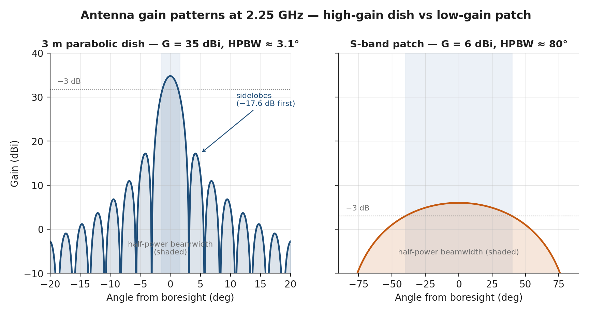

*Antenna patterns: high-gain dish vs patch.*

The antenna converts guided RF energy (in cables/waveguides) into radiated electromagnetic waves (and vice versa for receive). The key performance parameters are:

- **Gain** ($G$): How much more signal the antenna concentrates in its beam direction compared to an isotropic radiator. Higher gain = narrower beam = more signal but requires more precise pointing.
- **Beamwidth** ($\theta_{3\text{dB}}$): The angular width of the main beam between the -3 dB (half-power) points.
- **Polarisation:** Linear (vertical/horizontal), circular (RHCP/LHCP), or elliptical.

**Fundamental trade-off:** $G \propto 1/\theta_{3\text{dB}}^2$. A higher-gain antenna has a narrower beam and requires more precise pointing. For a spacecraft without accurate pointing, a low-gain omnidirectional antenna is mandatory. For a spacecraft with 0.1 deg pointing, a high-gain directional antenna is feasible.

### Antenna Types for Spacecraft

Table 3.3.4 — Spacecraft antenna types compared on gain, beamwidth, pointing tolerance, mass, and underlying physics.

| Antenna Type | Gain (dBi) | Beamwidth | Pointing Needed? | Mass (CubeSat) | Physics |
|-------------|-----------|-----------|-------------------|----------------|---------|
| **Monopole/Dipole** | 0--2 | ~omnidirectional (toroidal pattern) | No | 5--20 g (deployable wire) | Current distribution on a wire radiates; $\lambda/4$ monopole on ground plane or $\lambda/2$ dipole | 
| **Turnstile** | 0--3 | Hemispherical | No | 10--30 g | Two crossed dipoles fed 90 deg apart; produces circular polarisation |
| **Patch (microstrip)** | 5--8 | 60--90 deg | Loose (~10 deg) | 10--50 g | Resonant conducting patch on dielectric substrate over ground plane; $\lambda/2$ patch at resonance |
| **Patch array (2x2, 4x4)** | 10--18 | 15--40 deg | Moderate (~5 deg) | 50--200 g | Multiple patch elements with corporate feed network; gain = $G_{\text{element}} + 10\log_{10}(N)$ |
| **Horn** | 15--25 | 10--25 deg | Yes (~2 deg) | 100--500 g | Flared waveguide; smooth aperture illumination gives low side lobes |
| **Parabolic reflector** | 25--45 | 1--5 deg | Yes (< 1 deg) | 500 g -- 5 kg | Feed at focal point illuminates parabolic dish; $G = \eta_a (\pi D/\lambda)^2$ |
| **Phased array** | 15--35 | Electronically steered, 1--30 deg | Electronic (no mechanical) | 200 g -- 2 kg | Array of elements with individual phase shifters; beam steered by adjusting relative phases; no moving parts |

**Monopole/dipole physics:** A quarter-wave monopole ($L = \lambda/4$) is the simplest antenna. At 437 MHz (UHF), $\lambda = 0.686$ m, so a monopole is 17.2 cm long -- easily deployable from a CubeSat using a spring-loaded tape measure or nitinol wire. The radiation pattern is omnidirectional in the azimuthal plane (perpendicular to the wire) and null along the wire axis. Gain is approximately 0--2 dBi depending on the ground plane size.

**Patch antenna physics:** A microstrip patch antenna consists of a conducting patch (typically rectangular, $L \approx \lambda/2$ at the desired frequency) printed on a dielectric substrate (e.g., Rogers RT/duroid, $\varepsilon_r = 2.2$--$10.2$, thickness 1--3 mm) above a ground plane. The patch resonates at the frequency where its length equals $\lambda_{eff}/2$ (where $\lambda_{eff} = \lambda_0/\sqrt{\varepsilon_r}$). At S-band (2.25 GHz), a patch is approximately 40 x 40 mm -- small enough to mount on a CubeSat face. Gain is typically 5--8 dBi with a hemispherical pattern. Circular polarisation is achieved by feeding two orthogonal modes 90 deg apart (dual-feed or corner-truncated patch).

**Parabolic reflector physics:** A parabolic dish focuses incoming plane waves to its focal point (for receive) or collimates spherical waves from a feed at the focus into a parallel beam (for transmit). The gain depends on the dish diameter $D$ and the wavelength $\lambda$:

> **Key Equations -- Antenna**
>
> **Gain of a parabolic antenna:**
> $$G = \eta_a \left(\frac{\pi D}{\lambda}\right)^2$$
>
> In dBi: $G_{\text{dBi}} = 10\log_{10}\left[\eta_a \left(\frac{\pi D}{\lambda}\right)^2\right]$
>
> where $\eta_a \approx 0.55$--$0.65$ (aperture efficiency, accounting for illumination taper, spillover, blockage, and surface errors), $D$ = antenna diameter (m), $\lambda = c/f$.
>
> **Half-power beamwidth (HPBW):**
> $$\theta_{3\text{dB}} \approx \frac{70\lambda}{D} \quad \text{(degrees)}$$
>
> **Patch antenna gain** (single element): typically 5--8 dBi, beamwidth ~60--90 deg
>
> **Patch array gain** ($N$ elements): $G_{\text{array}} = G_{\text{element}} + 10\log_{10}(N)$
>
> **Pointing loss** (when antenna is mispointed by angle $\Delta\theta$):
> $$L_{\text{point}} \approx -12 \left(\frac{\Delta\theta}{\theta_{3\text{dB}}}\right)^2 \quad \text{(dB)}$$
>
> This shows that a narrower beam (smaller $\theta_{3\text{dB}}$) is more sensitive to pointing errors.

**Worked example -- antenna gain at different bands for a 30 cm dish:**

| Band | Frequency | $\lambda$ (mm) | $D/\lambda$ | Gain (dBi) | HPBW (deg) | Pointing req |
|------|-----------|----------------|-------------|-----------|-----------|-------------|
| S-band | 2.25 GHz | 133 | 2.25 | 14.4 | 31 | ~5 deg |
| X-band | 8.4 GHz | 35.7 | 8.40 | 25.8 | 8.3 | ~1 deg |
| Ka-band | 26 GHz | 11.5 | 26.0 | 35.7 | 2.7 | ~0.3 deg |

*(All three rows use the same aperture efficiency $\eta_a = 0.55$ and
$\theta_{3\text{dB}} = 70\lambda/D$; e.g. S-band $G = 0.55(\pi \times 2.25)^2 = 27.5 = 14.4$ dBi.)*

This table illustrates the fundamental link between frequency, antenna size, gain, and pointing requirement. At Ka-band, even a small dish provides high gain -- but the beamwidth is so narrow that sub-degree pointing accuracy is essential. This is why Ka-band CubeSat links require star tracker + reaction wheel AOCS.

**Phased array physics:** A phased array consists of multiple antenna elements (patch, dipole, or slot) arranged in a grid. Each element has an individual phase shifter (and sometimes amplitude control). By adjusting the relative phase between elements, the beam can be electronically steered without moving the antenna. The beam direction $\theta_s$ for element spacing $d$ and phase increment $\Delta\phi$:

$$\sin(\theta_s) = \frac{\Delta\phi \cdot \lambda}{2\pi d}$$

Advantages: no moving parts, fast beam steering (microseconds), multiple simultaneous beams possible. Disadvantages: complex, expensive, high power consumption for active arrays, scan loss at wide angles ($\cos\theta_s$ factor). Phased arrays are used on Starlink satellites (Ka-band), Iridium NEXT (L-band), and are emerging for CubeSats in Ka-band.

---

## 4. Free Space Path Loss by Band
FSPL increases with both frequency and distance. At a fixed slant range, higher-frequency bands lose more signal -- but this is offset by the ability to use smaller, higher-gain antennas at higher frequencies.

> **Key Equations -- FSPL (expanded form)**
>
> $$\text{FSPL (dB)} = 20\log_{10}(4\pi) + 20\log_{10}(d) + 20\log_{10}(f) - 20\log_{10}(c)$$
> $$= 21.98 + 20\log_{10}(d_m) + 20\log_{10}(f_{Hz}) - 169.54$$
>
> **Practical form (with km and GHz):**
> $$\text{FSPL (dB)} = 92.45 + 20\log_{10}(d_{km}) + 20\log_{10}(f_{GHz})$$

### Slant Range Geometry

The slant range $d$ from a LEO spacecraft to a ground station depends on the orbit altitude $h$ and the elevation angle $\varepsilon$ above the horizon:

$$d = R_E \left[\sqrt{\left(\frac{R_E + h}{R_E}\right)^2 - \cos^2(\varepsilon)} - \sin(\varepsilon)\right]$$

For typical LEO orbits:

Table 3.3.5 — Slant range from LEO altitudes versus ground-station elevation angle.

| Altitude | Elevation 90 deg (nadir) | Elevation 30 deg | Elevation 10 deg | Elevation 5 deg |
|----------|------------------------|-------------------|-------------------|-------------------|
| 400 km | 400 km | 739 km | 1439 km | 1804 km |
| 500 km | 500 km | 909 km | 1695 km | 2077 km |
| 600 km | 600 km | 1075 km | 1932 km | 2328 km |
| 800 km | 800 km | 1395 km | 2366 km | 2783 km |

*(Every entry is the equation above evaluated with $R_E = 6371$ km -- e.g. at
500 km and 10 deg: $6371[\sqrt{1.07848^2 - \cos^2 10\degree} - \sin 10\degree] = 6371 \times 0.26597 = 1695$ km.
The low-elevation slant range is roughly **3.4x** the nadir range at 500 km, not
2.6x; under-estimating it is one of the most common link-budget errors.)*

**Design rule:** Always compute the link budget at the **minimum elevation angle** (worst case), typically 5--10 deg. Below 5 deg, atmospheric losses increase sharply, ground clutter enters the antenna sidelobes, and the link is generally unusable.

### FSPL by Band and Geometry

Table 3.3.6 — Free-space path loss by band at nadir and at 10 deg elevation slant range.

| Band | Centre Frequency | FSPL at 500 km (nadir) | FSPL at 1695 km (10 deg elev) | Difference |
|------|-----------------|----------------------|-------------------------------|------------|
| **VHF** | 146 MHz | 129.7 dB | 140.3 dB | 10.6 dB |
| **UHF** | 437 MHz | 139.2 dB | 149.8 dB | 10.6 dB |
| **S-band** | 2250 MHz | 153.5 dB | 164.1 dB | 10.6 dB |
| **X-band** | 8200 MHz | 164.7 dB | 175.3 dB | 10.6 dB |
| **Ka-band** | 26 GHz | 174.7 dB | 185.3 dB | 10.6 dB |

*(Values verified against [ITU-R P.525](https://www.itu.int/rec/R-REC-P.525/): $\text{FSPL} = 32.45 + 20\log_{10}(d_{km}) + 20\log_{10}(f_{MHz})$.)*


*Figure 3.3.1 — FSPL across the five operationally-relevant RF bands as a function of slant range, computed exactly from $20\log_{10}(4\pi d/\lambda)$ and verified against ITU-R P.525. The two vertical guides mark the 500 km nadir slant range and a 1300 km mid-pass slant range (which for a 500 km orbit corresponds to about 17° elevation; the worst-case slant at 10° elevation is 1695 km). Use this chart to read off path loss for any pass geometry without recomputing.*

**The elevation angle penalty:** Going from nadir to 10 deg elevation increases FSPL by ~10.6 dB (distance increases by 3.39x; FSPL scales as $20\log_{10}(3.39) = 10.6$ dB). This is a large loss -- more than a factor of eleven in received power -- and is why contact time at high elevations is much more valuable than contact time at low elevations.

---

## 5. Frequency Band Selection and Licensing
*[Source: [ITU Radio Regulations](https://www.itu.int/pub/R-REG-RR), Articles 5 and 22; ISED RSS-SAT; FCC Part 25; IARU Satellite Frequency Coordination]*

Band selection is a **design constraint** that affects data rate, antenna size, atmospheric losses, equipment availability, licensing cost, and data policy. The choice of band is one of the earliest and most consequential decisions in mission design.

### Band Comparison Table

Table 3.3.7 — RF band comparison spanning allocation, bandwidth, data rate, rain fade, licensing, and equipment.

| Band | Frequency Range | Allocation | Max BW | Practical Data Rate | Atmospheric Loss (10 deg) | Rain Fade | Licensing | Equipment Availability |
|------|----------------|-----------|--------|--------------------|--------------------------|-----------|-----------|-----------------------|
| **VHF** | 144--146 MHz | Amateur | 15 kHz | < 9.6 kbps | 0.1 dB | None | IARU coord (free, 3--6 mo) | Many COTS, low cost |
| **UHF** | 435--438 MHz | Amateur | 20 kHz | < 19.2 kbps | 0.2 dB | Negligible | IARU coord (free, 3--6 mo) | Many COTS, low cost |
| **S-band** | 2200--2290 MHz | Space research/EES | 5 MHz | 0.1--10 Mbps | 0.5 dB | < 0.5 dB | ISED/FCC ($30--45K, 6--12 mo) | Many COTS |
| **X-band** | 8025--8400 MHz | EES | 375 MHz | 10--400 Mbps | 1.0 dB | 1--3 dB | ISED/FCC + ITU ($50--80K, 12+ mo) | Growing COTS |
| **Ka-band** | 25.5--27.0 GHz | EES/FSS | 1.5 GHz | 100--2000+ Mbps | 2--5 dB | 3--15 dB (location-dependent) | Complex ITU ($100K+, 18+ mo) | Emerging COTS |

*EES = Earth Exploration Satellite; FSS = Fixed Satellite Service*

**Atmospheric attenuation physics:** The atmosphere absorbs and scatters RF energy. Molecular oxygen has a strong absorption line at 60 GHz (used for inter-satellite links where atmospheric penetration is not needed). Water vapour absorbs at 22.2 GHz (near Ka-band). At S-band and below, atmospheric losses are minimal (< 1 dB). At Ka-band, losses of 2--5 dB are typical at 10 deg elevation, and rain fade can add 3--15 dB in tropical regions.

**Rain fade:** Raindrops scatter and absorb RF energy. The effect scales approximately as $f^2$ -- negligible below 4 GHz, significant above 10 GHz, and severe above 20 GHz. Rain fade is characterised by the rain rate (mm/hr) and the path length through rain. In tropical regions, rain rates of 50+ mm/hr can cause 10+ dB additional loss at Ka-band. Mitigation: adaptive data rate (reduce rate during rain), site diversity (multiple ground stations), power control (increase TX power during fade). For Ka-band links, a rain fade margin of 5--10 dB is typically included.

**Amateur band regulations (IARU):**
- Non-commercial, educational, and experimental use only
- Open data policy: all transmissions must be unencrypted and the protocol must be published
- No commercial data or imagery downlink
- Coordination through IARU (International Amateur Radio Union): free but takes 3--6 months
- Very popular for university CubeSats (low cost, no license fees, large amateur community provides free ground station support via SatNOGS network)

**Commercial band licensing:**
- Requires national filing (FCC in US, ISED in Canada, Ofcom in UK, CNES/ANFR in France) + ITU coordination for frequencies above 1 GHz
- Costs: $30--45K for S-band (typical), $50--80K for X-band, $100K+ for Ka-band
- Timeline: 6--12 months for S-band, 12--18 months for X-band, 18+ months for Ka-band
- Commercial data can be encrypted and proprietary
- Bandwidth allocation may be limited by the national authority


*Band-selection decision tree for a CubeSat downlink, mapping data-rate requirement to UHF / S-band / X-band / Ka-band with licensing, antenna size, and EIRP considerations.*


---

## 6. Modulation and Coding -- Physics and Selection
*[Source: CCSDS 131.0-B-4; Sklar, Ch. 7--8; Haykin, Ch. 10; DVB-S2 standard]*

### Modulation -- How Information Becomes RF

Modulation encodes digital data onto an RF carrier by varying the carrier's amplitude, frequency, or phase.

**Phase Shift Keying (PSK):** The most common modulation family for space communications. The carrier phase is shifted by discrete amounts to represent different bit patterns:

- **BPSK (Binary PSK):** 2 phase states (0 deg and 180 deg). Each symbol carries 1 bit. Spectral efficiency: 1 bps/Hz. Most robust to noise.
- **QPSK (Quadrature PSK):** 4 phase states (0, 90, 180, 270 deg). Each symbol carries 2 bits. Spectral efficiency: 2 bps/Hz. Requires the same $E_b/N_0$ as BPSK but doubles the data rate for the same bandwidth. **The standard choice for most space links.**
- **8PSK:** 8 phase states, 3 bits/symbol, spectral efficiency 3 bps/Hz. Requires ~3.5 dB more $E_b/N_0$ than QPSK for the same BER.
- **16APSK:** 16 states (amplitude + phase), 4 bits/symbol, spectral efficiency 4 bps/Hz. Requires ~7 dB more $E_b/N_0$ than QPSK.

**Frequency Shift Keying (FSK):** The carrier frequency is shifted between discrete values. Less spectrally efficient than PSK but more tolerant of amplifier nonlinearity. Variants:
- **FSK:** Simple frequency switching. 
- **GFSK (Gaussian FSK):** Gaussian filter smooths frequency transitions, reducing spectral spreading. Used by many CubeSat UHF radios (AX.25 protocol at 9600 bps).
- **MSK (Minimum Shift Keying):** A special case of FSK with minimum frequency deviation that still allows coherent detection. Constant envelope (important for nonlinear amplifiers). Spectral efficiency ~1 bps/Hz.

**Why QPSK is preferred over BPSK for space links:** QPSK transmits 2 bits per symbol while requiring the same energy per bit as BPSK. This means QPSK achieves twice the data rate for the same bandwidth and the same $E_b/N_0$ performance. The only additional complexity is that the receiver must resolve 4 phase states instead of 2, which is trivial for modern digital receivers.

### Forward Error Correction (FEC) -- Coding Gain

FEC adds redundant bits to the data stream before transmission. The receiver uses these redundant bits to detect and correct bit errors without retransmission. The improvement in $E_b/N_0$ requirement (compared to uncoded) is called the **coding gain**.

**Why coding is essential for space links:** Space links operate at very low received signal power (femtowatts to picowatts). Without coding, the required $E_b/N_0$ for BER $10^{-6}$ is 10.5 dB. With LDPC coding, this drops to 2.0 dB -- a coding gain of 8.5 dB. This is equivalent to either: increasing the TX power by 7x, or increasing the antenna diameter by 2.7x, or reducing the data rate by 7x. Coding achieves the same benefit at the cost of only a few watts of digital processing power.

**Code types used in space communications:**

Table 3.3.8 — Forward-error-correction code types showing rate, coding gain, decoding complexity, and standards.

| Code Type | Code Rate | Coding Gain at BER $10^{-6}$ | Decoding Complexity | Standard | Use |
|-----------|-----------|-------------------------------|---------------------|----------|-----|
| **Convolutional** (K=7) | 1/2 | ~5.5 dB | Low (Viterbi decoder, hardware) | CCSDS | Legacy telecommand, AX.25 |
| **Convolutional + RS** (concatenated) | ~0.44 | ~7.5 dB | Medium | CCSDS | Standard CCSDS telemetry (many heritage missions) |
| **Turbo code** | 1/2 to 1/6 | ~8--10 dB | High (iterative decoder) | CCSDS | Deep space links (Mars, Jupiter) |
| **LDPC** (Low-Density Parity Check) | 1/2 | ~8.5 dB | Medium-High (iterative BP decoder) | CCSDS, DVB-S2 | Modern space downlinks, **recommended for CubeSats** |
| **LDPC** | 3/4 | ~6.5 dB | Medium-High | CCSDS, DVB-S2 | Balanced performance and throughput |
| **LDPC** | 7/8 | ~5.0 dB | Medium-High | DVB-S2 | Maximum throughput, strong signal |

*[Source: CCSDS 131.0-B-4; DVB-S2 ETSI EN 302 307]*

**Code rate $r$:** The ratio of information bits to total transmitted bits. A rate-1/2 code transmits 1 information bit for every 2 transmitted bits (50% overhead). This means the channel data rate must be $R_{\text{channel}} = R_{\text{info}} / r$ -- a rate-1/2 code requires twice the channel bandwidth for a given information rate.

### Complete Modulation + Coding Table

Table 3.3.9 — Modulation-and-coding combinations with required Eb/N0, spectral efficiency, and typical use.

| Modulation + Coding | $E_b/N_0$ Required (BER $10^{-6}$) | Spectral Efficiency (bps/Hz) | Typical Use | Implementation |
|--------------------|------------------------------------|-------------------------------|------------|----------------|
| GMSK uncoded | 10.5 dB | ~1.0 | AX.25 amateur, legacy | Simple radio IC |
| BPSK uncoded | 10.5 dB | 1.0 | Legacy telecommand | Simple |
| QPSK uncoded | 10.5 dB | 2.0 | Simple telemetry | Moderate |
| QPSK + conv (r=1/2, K=7) | 5.0 dB | 1.0 | Standard CCSDS TM | Hardware Viterbi |
| QPSK + conv + RS (concat) | 3.0 dB | 0.88 | Heritage CCSDS | Hardware |
| QPSK + LDPC (r=1/2) | 2.0 dB | 1.0 | High-efficiency downlink | FPGA-based |
| QPSK + LDPC (r=3/4) | 4.0 dB | 1.5 | **Balanced -- recommended** | FPGA-based |
| QPSK + LDPC (r=7/8) | 5.5 dB | 1.75 | Bandwidth-limited | FPGA-based |
| 8PSK + LDPC (r=3/4) | 6.5 dB | 2.25 | High-rate downlink | FPGA-based |
| 16APSK + LDPC (r=3/4) | 8.5 dB | 3.0 | Maximum throughput | FPGA-based |

**Design guidance for CubeSats:** 
- **UHF amateur:** GMSK or AFSK (AX.25 protocol) at 1.2--9.6 kbps channel rate. Add convolutional coding if link margin is tight.
- **S-band:** QPSK + LDPC (r=1/2 or r=3/4). This is the sweet spot: 6.5--8.5 dB coding gain with manageable complexity. Most COTS S-band CubeSat transmitters (Endurosat, NanoAvionics, AAC Clyde) support DVB-S2 or CCSDS LDPC natively.
- **X-band / Ka-band:** 8PSK or 16APSK + LDPC for maximum spectral efficiency when bandwidth is limited.

---

## 7. Ground Stations
The ground station is half of the communication link. Its performance ($G/T$) directly determines the achievable data rate. Upgrading the ground station is often the cheapest way to improve link performance (compared to upgrading the spacecraft transmitter or antenna).

### Ground Station Types

Table 3.3.10 — Ground-station types compared on antenna size, G/T, cost, and access model.

| Type | Antenna | G/T (S-band) | Cost | Availability | Examples |
|------|---------|-------------|------|-------------|---------|
| **Amateur (SatNOGS)** | 10--15 dBi Yagi | -15 to -10 dB/K | Free (volunteer-operated) | Global network, 200+ stations | SatNOGS network |
| **University** | 2--3 m dish | +10 to +15 dB/K | $50--200K (build) | Limited availability | Many universities have S-band stations |
| **Commercial (small)** | 3--5 m dish | +15 to +25 dB/K | $500/pass or $5--20K/month | KSAT Lite, AWS Ground Station | KSAT, Amazon, Leaf Space |
| **Commercial (large)** | 5--13 m dish | +25 to +35 dB/K | $1000/pass or $20--50K/month | SSC, KSAT, ATLAS | SSC (Esrange), KSAT (Svalbard), ATLAS (Fairbanks) |
| **Deep Space Network** | 34--70 m dish | +45 to +60 dB/K | NASA-funded only | DSN (3 sites globally) | Goldstone, Canberra, Madrid |

*[Source: KSAT Lite pricing 2024; AWS Ground Station pricing; SSC SmallSat ground segment]*

**Contact geometry and pass duration:**

A LEO satellite is in view of a ground station for a limited time per orbit. The pass duration depends on the orbit altitude and the maximum elevation angle:

$$t_{\text{pass}} \approx \frac{2}{n} \arccos\left(\frac{\cos(\varepsilon_{\text{max}})}{\cos(\varepsilon_{\text{min}})}\right)$$

For a simplified estimate:

Table 3.3.11 — LEO pass duration and daily contact count versus orbit altitude at 10 deg minimum elevation.

| Altitude | Min Elevation | Max Pass Duration | Typical Usable Duration | Passes/Day (mid-latitude) |
|----------|--------------|-------------------|------------------------|--------------------------|
| 400 km | 10 deg | ~7 min | ~5 min | 3--4 |
| 500 km | 10 deg | ~8 min | ~6 min | 4--5 |
| 600 km | 10 deg | ~9 min | ~7 min | 4--5 |
| 800 km | 10 deg | ~11 min | ~9 min | 5--6 |

The "usable duration" is shorter than the total pass because the link only closes above the minimum elevation angle, and the first/last 30--60 seconds are used for signal acquisition and link setup.

**Ground station selection criteria:**
- **Location:** Polar stations (Svalbard at 78 degN, McMurdo at 78 degS) see every orbit of a polar/SSO satellite, providing 12+ contacts per day. Mid-latitude stations see only 3--5 passes. Equatorial stations see even fewer passes of polar satellites.
- **G/T:** Determines the achievable data rate. A 3 dB improvement in G/T allows doubling the data rate.
- **Licensing:** Must be compatible with the spacecraft frequency allocation
- **Cost:** Ranges from free (SatNOGS, university) to $1000+/pass (commercial)
- **Reliability:** SLA (service-level agreement) for commercial stations; university stations may have limited operator availability

**EIRP (ground station transmit, for uplink):** For telecommand uplink, the ground station transmits to the spacecraft. Ground station EIRP is typically 40--60 dBW for commercial stations, sufficient for robust command links even with low-gain spacecraft receive antennas.

---

## 8. Worked Examples: Complete Link Budgets

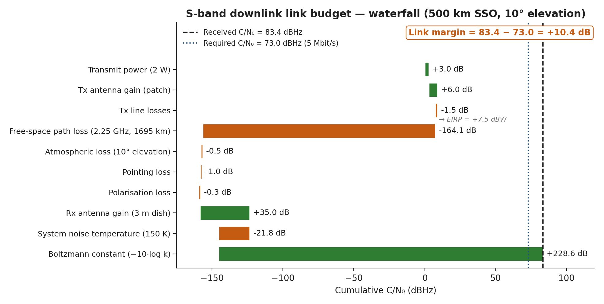

*S-band downlink link-budget waterfall.*


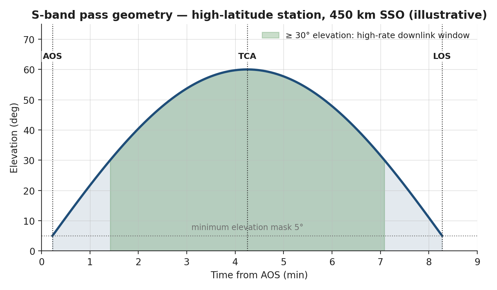

*Iqaluit S-band pass geometry.*

### 3U EO CubeSat -- S-band Downlink

> **Worked Example -- S-band Downlink for 3U EO CubeSat (SuperDove-class)**
>
> **Scenario:** 500 km SSO, S-band (2250 MHz), 1 Mbps downlink, 10 deg minimum elevation (slant range 1695 km, from the geometry table above), 3 m ground station dish ($T_{sys} = 150$ K, $G_{RX} = 35$ dBi at S-band).
>
> | Line | Parameter | Value | Unit | Calculation/Source |
> |------|-----------|-------|------|--------------------|
> | 1 | TX Power (2 W) | +3.0 | dBW | COTS S-band TX (Endurosat) |
> | 2 | TX Antenna Gain (patch) | +6.0 | dBi | Single-element S-band patch |
> | 3 | TX Line Losses | -1.5 | dB | 15 cm cable + connector |
> | 4 | **EIRP** | **+7.5** | dBW | $3.0 + 6.0 - 1.5$ |
> | 5 | FSPL (2250 MHz, 1695 km) | -164.1 | dB | $92.45 + 20\log_{10}(1695) + 20\log_{10}(2.25) = 92.45 + 64.58 + 7.04$ |
> | 6 | Atmospheric Loss | -0.5 | dB | S-band, 10 deg elevation |
> | 7 | Pointing Loss | -1.0 | dB | 5 deg mispoint, 80 deg beamwidth patch |
> | 8 | Polarisation Loss (RHCP-RHCP) | -0.3 | dB | Minor axial ratio mismatch |
> | 9 | RX Antenna Gain (3 m dish) | +34.8 | dBi | $10\log_{10}(0.6 \times (\pi \times 3.0 / 0.133)^2)$ |
> | 10 | System Noise Temp (150 K) | 21.8 | dBK | Professional LNA + sky temp |
> | 11 | **G/T** | **+13.0** | dB/K | $34.8 - 21.8$ |
> | 12 | Boltzmann Constant | +228.6 | dBW/K/Hz | $-k$ in link equation |
> | 13 | **C/N$_0$** | **+83.2** | dBHz | $7.5 - 164.1 - 0.5 - 1.0 - 0.3 + 13.0 + 228.6$ |
> | 14 | Data Rate (1 Mbps) | 60.0 | dBbps | $10\log_{10}(10^6)$ |
> | 15 | **$E_b/N_0$ available** | **+23.2** | dB | $83.2 - 60.0$ |
> | 16 | $E_b/N_0$ required (QPSK + LDPC r=3/4) | 4.0 | dB | From modulation/coding table |
> | 17 | Implementation Loss | 2.0 | dB | Real demodulator vs ideal |
> | 18 | **LINK MARGIN** | **+17.2** | dB | $23.2 - 4.0 - 2.0$ |
>
> **Result:** Link closes with **17.2 dB margin** (requirement: >= 3 dB). **Pass with very large headroom.**
>
> **Design insight:** A 17.2 dB margin at 1 Mbps is *much* more than required for a Phase B+ design. Real S-band CubeSat links typically run with 3--8 dB margin to leave room for adaptive data-rate increases and to handle worst-case ground-station performance. The team can comfortably increase the data rate:
>
> Maximum data rate at 3 dB margin:
> $E_b/N_0 \text{ available at max rate} = 4.0 + 2.0 + 3.0 = 9.0$ dB
>
> $C/N_0 = 83.2$ dBHz, so $R_{b,\text{max}} = 10^{(83.2 - 9.0)/10} = 10^{7.42} \approx$ **26 Mbps** at 3 dB margin.
>
> However, the 5 MHz spectral allocation in the S-band space-research segment limits a practical QPSK link to about $\eta_s \cdot B = 1.5 \cdot 5 = 7.5$ Mbps using LDPC r=3/4 (spectral efficiency $\sim 1.5$ bit/s/Hz including overhead and roll-off). So in practice, the *spectrum* and not the *link energy* is the constraint, and the team should design for around **5--6 Mbps** with comfortable margin.

### 1U Worked Example: UniSat-1

**UHF Link Budget: 437 MHz at 9600 bps**

UniSat-1 uses the UHF amateur band at 437 MHz with a ground station equipped with a 10 dBi Yagi antenna. This is the lowest-cost and simplest communication architecture available to CubeSat missions.

> **Worked Example -- UHF Downlink Link Budget for UniSat-1**
>
> **Scenario:** 400 km orbit, UHF (437 MHz), 9600 bps downlink (GMSK), 10 deg minimum elevation angle, amateur ground station with 10 dBi Yagi antenna, $T_{sys} = 600$ K (COTS LNA, coax cable losses, sky noise near horizon).
>
> **Slant range at 10 deg elevation:**
> From 400 km altitude, the worst-case slant range at 10 deg elevation is 1439 km (geometry table, Section 4).
>
> | Line | Parameter | Value | Unit | Notes |
> |------|-----------|-------|------|-------|
> | 1 | TX Power (0.5 W) | -3.0 | dBW | Standard CubeSat UHF radio |
> | 2 | TX Antenna Gain (monopole) | 0.0 | dBi | Quarter-wave monopole, ~omnidirectional |
> | 3 | TX Line Losses | -0.5 | dB | Short cable to antenna |
> | 4 | **EIRP** | **-3.5** | dBW | Low EIRP is the fundamental UHF challenge |
> | 5 | FSPL (437 MHz, 1439 km) | -148.4 | dB | $32.45 + 20\log_{10}(1439) + 20\log_{10}(437) = 32.45 + 63.16 + 52.81$ |
> | 6 | Atmospheric Loss | -0.3 | dB | UHF atmospheric loss is minimal |
> | 7 | Pointing Loss (omni antenna) | -0.5 | dB | Omni pattern -- negligible |
> | 8 | Polarisation Loss (linear-linear) | -3.0 | dB | **Major loss** -- Faraday rotation in ionosphere rotates polarisation randomly |
> | 9 | RX Antenna Gain (10 dBi Yagi) | +10.0 | dBi | 5-element Yagi, manually tracked |
> | 10 | System Noise Temp (600 K) | 27.8 | dBK | Amateur station: warm LNA + cable loss |
> | 11 | **G/T** | **-17.8** | dB/K | Low G/T is the ground station limitation |
> | 12 | Boltzmann Constant | +228.6 | dBW/K/Hz | |
> | 13 | **C/N$_0$** | **+55.1** | dBHz | $-3.5 - 148.4 - 0.3 - 0.5 - 3.0 - 17.8 + 228.6$ |
> | 14 | Data Rate (9600 bps) | 39.8 | dBbps | |
> | 15 | **$E_b/N_0$ available** | **+15.3** | dB | $55.1 - 39.8$ |
> | 16 | $E_b/N_0$ required (GMSK uncoded, BER $10^{-5}$) | 9.6 | dB | Per Sklar Ch.4 (≈ Q(sqrt(2·Eb/N0)) bound) |
> | 17 | Implementation Loss | -2.0 | dB | |
>
> **Margin = 15.3 - 9.6 - 2.0 = +3.7 dB. The link closes uncoded, but with only 0.7 dB to spare against the 3 dB Phase B+ requirement.**
>
> **But beware:** the 3 dB Faraday-rotation polarisation loss is the *mean* loss; instantaneous fades in the ionosphere can be 10--20 dB deeper when the rotation aligns the satellite's linear polarisation exactly orthogonal to the ground antenna's. So although the *nominal* link closes, the **fade margin is the design driver**, and the team should still apply two of the three remedies below:
>
> **Remedy 1: Add FEC.** Convolutional coding (r=1/2, K=7):
> - $E_b/N_0$ required drops to **5.0 dB** (4.6 dB coding gain)
> - Channel rate remains 9600 bps, but useful throughput is 4800 bps (half is redundancy)
> - **Margin** = 15.3 - 5.0 - 2.0 = **+8.3 dB** -- close to, but not quite, headroom against a ~10 dB Faraday fade.
>
> **Remedy 2: Upgrade ground antenna to cross-Yagi (13 dBi) with circular polarisation:**
> - RX gain: +13.0 dBi (was +10.0) -> +3.0 dB improvement
> - Polarisation loss: -0.5 dB (was -3.0 dB, now RHCP-to-RHCP) -> +2.5 dB improvement
> - Net improvement: +5.5 dB
> - New C/N$_0$: 60.6 dBHz, $E_b/N_0$ available: 20.8 dB
> - **Margin** = 20.8 - 5.0 - 2.0 = **+13.8 dB** (with FEC) -- adequate headroom for the deepest expected Faraday fades.
>
> **Remedy 3: Adaptive data rate.** Drop to 1200 bps during the worst part of the polar pass. Trades throughput for reliability.
>
> 

*Figure 3.3.2 — Theoretical bit-error-rate curves vs $E_b/N_0$ for BPSK/QPSK ($P_b = \frac{1}{2}\,\mathrm{erfc}(\sqrt{E_b/N_0})$), 8-PSK, non-coherent FSK, and BPSK with concatenated Reed-Solomon + convolutional coding (5 dB coding gain). The annotation marks the $E_b/N_0 = 9.6$ dB point at which uncoded BPSK reaches $10^{-5}$ BER — the standard reference quoted in most space-comms textbooks (e.g. Sklar Ch. 4). Use this chart to read off the required $E_b/N_0$ for any target BER and modulation, and to quantify the coding gain.*

**Polarisation loss physics:** At UHF (437 MHz), the ionosphere causes Faraday rotation of linearly polarised signals. The rotation angle depends on the total electron content (TEC) along the path and varies with time of day, solar activity, and signal path. If the satellite transmits linear polarisation and the ground station receives with linear polarisation, the polarisation planes may be orthogonal at times, causing up to complete signal loss (theoretically infinite loss, practically 20+ dB fades). Using circular polarisation on at least one end (preferably both) eliminates Faraday rotation loss, reducing it to ~0.3--0.5 dB axial ratio mismatch. **This is why circular polarisation is mandatory for reliable UHF satellite links.**
>
> **Final link budget summary (recommended: FEC + cross-Yagi, against deep fades):**
>
> | Parameter | Value |
> |-----------|-------|
> | TX power | 0.5 W |
> | TX antenna | Monopole (0 dBi) |
> | Frequency | 437 MHz |
> | Channel rate | 9600 bps |
> | Useful throughput | 4800 bps (with r=1/2 FEC) |
> | Ground antenna | 13 dBi cross-Yagi, RHCP |
> | Nominal link margin | **+13.8 dB** |
> | Margin against worst-case 10 dB Faraday fade | **+3.8 dB** |

**Data throughput for UniSat-1:** At 4800 bps useful throughput, a 7-minute pass delivers:
$V_{\text{pass}} = 4800 \times 420 \times 0.85 = 1.71$ Mbit $= 214$ kB per pass.

The 0.85 factor accounts for protocol overhead (packet headers, acknowledgements, retransmissions, link setup time).

With 4 passes/day: $V_{\text{daily}} = 856$ kB/day $\approx$ **0.86 MB/day**. The magnetometer generates $< 1$ kbps $\times$ 600 s/orbit $\times$ 15 orbits $= 9$ Mbit/day $= 1.13$ MB/day. This is **marginal** -- the team may need to prioritise data or add a second ground station. Using the SatNOGS network (200+ volunteer stations worldwide) could provide 10+ additional contacts per day at no cost.

**Key lesson from UniSat-1 link budget:** At UHF, the lower FSPL at 437 MHz ($20\log_{10}(2250/437) = 14.2$ dB less than S-band) almost exactly compensates for the low TX power (0.5 W vs 2 W = 6 dB), low antenna gain (0 dBi vs 6 dBi = 6 dB), and warmer system noise temperature of amateur stations (600 K vs 150 K = 6 dB). The result is a *nominal* link that closes, but the **fade margin against ionospheric Faraday rotation and rain/atmospheric scintillation is the real design driver**. FEC coding and circular polarisation are not strictly required to make the nominal link close — they are required to absorb the 10--20 dB fades that occur stochastically during a polar pass. Treat them as fade-margin investments, not as the only way to make the numbers work.

### 6U Reference Design: EOSAT-1 RF, As Flown

EOSAT-1 is the case where the link budget stops being the constraint, and that
is itself the lesson.

**Two transmitters, not one.** This is the single most important structural fact
about the RF design, and it is easy to miss because both chains carry
"telemetry":

| | S-band prime chain | UHF beacon transmitter |
|---|---|---|
| Band | 2025 MHz up / 2200 MHz down | 437.5 MHz down only |
| Antenna | Body-fixed patch, 3.0 dBi | Deployable tape-spring dipole, 0 dBi |
| RF power | 1.0 / 2.0 / 5.0 W selectable (2.0 W nominal) | 1.0 W |
| Rate | 1 / 16 / 128 kbps ladder | 1 kbps, fixed |
| Carries | Everything: real-time HK, playback, image dumps, command verification | HK SID 11 and nothing else |
| Ground asset | 7--13 m polar dish, G/T +18.5 to +22.0 dB/K | University crossed Yagi, G/T $-8.0$ dB/K |
| Polarisation loss | 0.3 dB (pointed circular pair) | 3.0 dB (linear dipole vs circular, possibly tumbling) |

**The teaching point is what happens when the S-band PA is disabled.** All
S-band telemetry stops -- real-time HK, playback, dumps, verification, the lot.
**The beacon keeps transmitting.** It shares none of the prime chain's single
points of failure: not the S-band PA, not the switchable `ttc_tx` power line,
not the deployable patch, not the transponder, not the uplink lock chain. It is
billed to the *non-switchable* receive line precisely so that no operator can
de-energise the lifeline with a power-line command. That is why a real
spacecraft carries a second box, and it is why "the spacecraft has gone quiet"
and "the spacecraft is dead" are different diagnoses.

Do not confuse the beacon *transmitter* with the S-band ladder's lowest rung,
which is confusingly also called BEACON and also runs at 1 kbps. They are
different radios on different bands, gated independently.

**The rate ladder and what a rung costs.** Three rungs, and the steps are
exactly the $-10\log_{10}(R_b)$ term of the link budget:

| Rung | Rate | Modulation | Coding | Coding gain | Step from previous |
|------|-----:|------------|--------|------------:|-------------------|
| BEACON | 1 kbps | BPSK | conv(7,1/2) + RS(255,223) | 7.5 dB | -- |
| LOW (routine ops) | 16 kbps | BPSK | conv(7,1/2) + RS(255,223) | 7.5 dB | $-10\log_{10}(16) = -12.04$ dB |
| HIGH (dumps only) | 128 kbps | QPSK | RS(255,223) only | 6.0 dB | $-10\log_{10}(8) = -9.03$ dB, plus 1.5 dB of lost coding gain $= -10.53$ dB |

LOW is not an arbitrary choice: the shipped housekeeping generates 1378.5 bps of
PUS packets, which is 1588 bps of channel after RS and frame overhead. A 1 kbps
"low rate" is *below the generation rate* -- the real-time backlog could never
drain. 16 kbps clears real-time HK at 9.7 % duty and still plays back 0.85
orbits of stored HK inside one pass.

**Five ground stations, and every rung closes everywhere.** The teaching
baseline is the full five-station network. At 513 km the geometry is:

| Elevation | Slant range | FSPL at 2200 MHz |
|-----------|------------:|-----------------:|
| 5 deg | 2111.7 km | 165.79 dB |
| 10 deg | 1726.8 km | 164.04 dB |
| 30 deg | 931.3 km | 158.68 dB |
| 90 deg | 513.0 km | 153.50 dB |

Link margin at 5 deg elevation -- the worst geometry any station ever sees:

| Station | G/T (dB/K) | BEACON | LOW | HIGH |
|---------|-----------:|-------:|----:|-----:|
| Inuvik | 22.0 | 59.0 | 47.0 | 36.5 |
| Svalbard | 21.5 | 58.5 | 46.5 | 36.0 |
| Iqaluit | 20.0 | 57.0 | 45.0 | 34.5 |
| O'Higgins | 20.0 | 57.0 | 45.0 | 34.5 |
| Troll | 18.5 | 55.5 | 43.5 | **33.0** |

Work one cell to see where those come from -- Iqaluit, LOW tier, 5 deg:
EIRP $= 10.0$ dBW (at the nominal 2 W PA) $+ 3.0$ dBi patch $= 13.0$ dBW;
atmospheric loss $0.25 \times \mathrm{cosec}(5\degree) = 2.87$ dB;
polarisation 0.3 dB; G/T de-rated $-1.5$ dB below 10 deg, so $20.0 - 1.5 = 18.5$ dB/K.

$$C/N_0 = 13.0 - 165.79 - 2.87 - 0.3 + 18.5 + 228.6 = 91.1 \text{ dBHz}$$
$$E_b/N_0 = 91.1 - 10\log_{10}(16000) = 91.1 - 42.0 = 49.1 \text{ dB}$$
$$\text{Margin} = 49.1 - (9.6 - 7.5) - 2.0 = \mathbf{45.0} \text{ dB}$$

**Read that table again.** The worst case in the entire matrix -- the top rate,
the weakest station, the lowest elevation -- still has **33.0 dB** of margin. At
513 km into a professional polar dish, a 2 W S-band link is not power-limited by
anything. If you have been taught that a data rate is chosen by finding where the
margin runs out, this is the more common real-world situation and it teaches a
harder lesson: **the rate is chosen by policy, bandwidth, PA power, thermal cost
and pass planning, not by a power cliff.** Any worked example that shows this
spacecraft on a marginal link has an error in it.

That is also why the HIGH tier is gated on spacecraft mode and on elevation
$\geq 10$ deg rather than on a margin threshold. Modelling a fake cliff would have
been easier to explain and less honest.

**Elevation is worth more than rate ladders suggest.** Going from 5 deg to 10 deg
buys about 4.7 dB (1.75 dB of path loss, 1.43 dB of atmosphere, 1.5 dB of the G/T
de-rate coming off). Going to zenith buys 16.4 dB. An operator waits for a better
pass, not for a better rate.

*One honest caveat on the absolute numbers:* 10.0 dBW of EIRP at 2 W of RF
implies about 7 dB of feed-and-antenna gain ahead of the 3.0 dBi patch, which no
6U actually has. The defensible absolute figure is 3.0 dBW conducted plus
3.0 dBi $=$ 6.0 dBW, i.e. every margin in the table is roughly 7 dB optimistic.
It is quoted as-configured here because the number is shared with the RF
link model and moving it is a coordinated two-file change; every rung still
closes with 26+ dB either way, so nothing above depends on it. Flagging a known
optimism in your own budget is normal engineering practice, not an admission of
failure.

**The beacon budget, side by side.** UHF wins $20\log_{10}(2200/437.5) = 14.0$ dB
of path loss and 0.3 dB of atmosphere, and gives back 28.0 dB of G/T (a 9 m dish
at $+20.0$ dB/K against a crossed Yagi at $-8.0$ dB/K), 3.0 dB of spacecraft
antenna gain and 2.7 dB of extra polarisation loss. The 12.0 dB gained by
dropping from 16 to 1 kbps roughly cancels the 10.0 dB lost between the
configured 10.0 dBW S-band transmit level and the beacon's 1 W (0 dBW), and
both links use the same conv + RS coding. Net: the beacon closes on
1 W at 1 kbps with about **26 dB**, against about 45 dB for the S-band LOW rung
at 16 kbps. Same physics, different everything else -- and the beacon still gets
home when the prime chain does not.

---

## 9. Data Budget
The data budget determines whether the communication system can deliver all mission data to the ground. Even if the link budget closes, the mission fails if the total data volume exceeds the downlink capacity.

> **Key Equations -- Data Budget**
>
> **Daily data generation:**
> $$V_{\text{gen}} = R_{\text{payload}} \times t_{\text{imaging}} \times N_{\text{orbits}} \times f_{\text{compression}}$$
>
> **Daily downlink capacity:**
> $$V_{\text{DL}} = R_{\text{downlink}} \times t_{\text{contact}} \times N_{\text{passes}} \times \eta_{\text{protocol}}$$
>
> where $\eta_{\text{protocol}} = 0.80$--$0.90$ accounts for packet overhead, retransmissions, link setup time, and handshaking.
>
> **Data budget closure:**
> $$V_{\text{DL}} \geq V_{\text{gen}} \quad \text{(data budget closes)}$$
>
> **Backlog clearance time:** If $V_{\text{DL}} < V_{\text{gen}}$ per day, data accumulates in onboard storage. The backlog clearance time is:
> $$t_{\text{clear}} = \frac{V_{\text{stored}}}{V_{\text{DL}} - V_{\text{gen}}}$$
> If $V_{\text{DL}} < V_{\text{gen}}$, the backlog grows forever -- the mission cannot sustain its data generation rate.

> **Worked Example -- Data Budget for 3U EO CubeSat**
>
> **Generation:** 240 Mbps raw imaging data x 5 min/orbit x 15 orbits/day x 0.25 (4:1 JPEG2000 compression)
> = 240 x 300 x 15 x 0.25 = 270,000 Mbit/day = **33.75 GB/day**
>
> Wait -- that's extremely high. Let's be more realistic about imaging time. Not every orbit has a target. Assume 4 imaging passes per day, 5 minutes each:
>
> $V_{\text{gen}} = 240 \times 10^6 \times 300 \times 4 \times 0.25 = 72,000$ Mbit $= 9.0$ GB/day
>
> Still high. Planet SuperDove images approximately 1--2 minutes per orbit over priority targets, compresses heavily (10:1+), and downlinks selectively.
>
> **Revised:** 240 Mbps x 1 min/pass x 4 passes/day x 0.10 (10:1 compression) = 240 x 60 x 4 x 0.10 = 5,760 Mbit = **720 MB/day**
>
> **Downlink (S-band at 5 Mbps):** 5 Mbps x 6 min/pass x 5 passes/day x 0.85 protocol efficiency.
>
> Per pass: $5 \times 10^6 \times 360 \times 0.85 = 1.53 \times 10^9$ bit $= 1530$ Mbit $= 191$ MB
>
> $V_{\text{DL}} = 1530 \times 5 = 7{,}650$ Mbit $= 956$ MB/day
>
> **Result:** 956 MB/day > 720 MB/day. **Data budget closes** with 33% margin.
>
> **Sensitivity:** If imaging duty cycle doubles (2 min/pass), generation rises to 1440 MB/day > 956 MB/day. Options: (a) X-band for higher data rate, (b) additional ground stations, (c) more aggressive compression, (d) onboard data prioritisation/selection.

> **Worked Example -- What One EOSAT-1 Image Costs in Pass Time**
>
> The courseware image product is 4 MB. At the HIGH tier:
>
> $$t_{\text{dump}} = \frac{4 \times 1{,}048{,}576 \times 8}{128{,}000} = \frac{33{,}554{,}432}{128{,}000} = \mathbf{262 \text{ s}}$$
>
> The average pass across the five-station network is 450 s, so **one image
> occupies 58 % of an average pass**. Two images do not fit in one pass. This is
> the number that makes pass planning the binding constraint rather than the link
> budget: the margin table above says the link will carry anything you ask of it,
> and the clock says you cannot ask for very much per pass.
>
> At the LOW tier the same image would take $262 \times 8 = 2097$ s -- roughly
> five passes -- which is why the HIGH tier exists and why it is gated rather
> than default.

---

## 10. SpaceCDF Exercise
### Instructions

1. **Spectrum Selector** (Dashboard): Select your license type and frequency band
2. **Link Budget** tab:
   - Enter TX power, antenna type, frequency, ground station parameters
   - Review the computed link margin
   - Verify it meets >= 3 dB requirement
3. **Compare** to your hand calculation from the worked example
4. **Equipment Browser:** Select a transponder and antenna that match your band choice
   - Note RF compatibility warnings (band mismatch between transponder and antenna)
5. Complete Worksheet 3.3

### Discussion Questions

- What is the most impactful parameter in your link budget? (Usually FSPL or G/T)
- How does doubling the data rate affect link margin? (Reduces by 3 dB -- because $10\log_{10}(2) = 3$ dB)
- Could you use a lower-power transmitter and still close the link? What is the minimum TX power?
- Does your data budget close? If not, what is the cheapest fix? (Usually: more ground station passes, or lower imaging duty cycle)
- What is the effect of Faraday rotation on your UHF link? (If applicable)

---

## Session Summary

Table 3.3.12 — Session summary: key takeaways for communications and link budget design.

| Topic | Key Takeaway |
|-------|-------------|
| Link budget | $\text{Margin} = E_b/N_{0,\text{avail}} - E_b/N_{0,\text{req}} - L_{\text{impl}} \geq 3$ dB |
| EIRP | $\text{EIRP} = P_{TX} + G_{TX} - L_{TX}$ -- transmitter's effective power in beam direction |
| FSPL physics | Geometric spreading ($1/d^2$) + aperture scaling ($\lambda^2$); not energy absorption |
| FSPL formula | $92.45 + 20\log_{10}(d_{km}) + 20\log_{10}(f_{GHz})$; increases 6 dB per doubling of frequency or distance |
| G/T | Receiver figure of merit: antenna gain minus noise temperature; most important ground station parameter |
| Antenna types | Monopole (0 dBi, omni) to parabolic (25--45 dBi, narrow beam); gain vs pointing trade-off |
| Antenna gain | $G = \eta_a (\pi D/\lambda)^2$; patch ~6 dBi; 3 m dish: ~34 dBi at S-band, ~46 dBi at X-band |
| Pointing loss | $-12(\Delta\theta/\theta_{3\text{dB}})^2$ dB; narrower beam = more sensitive to pointing errors |
| Modulation | QPSK: 2 bits/symbol, same $E_b/N_0$ as BPSK but 2x spectral efficiency; **standard choice** |
| FEC coding | LDPC (r=3/4): $E_b/N_0 = 4.0$ dB, coding gain ~6.5 dB; **essential for space links** |
| Coding gain | 5--10 dB improvement for free (just digital processing); equivalent to 3--10x power increase |
| UHF challenges | Low EIRP, Faraday rotation (use circular polarisation), high ground station noise; FEC mandatory |
| Band selection | UHF for < 9.6 kbps (free, amateur); S-band for < 10 Mbps; X-band for < 400 Mbps; Ka-band for > 400 Mbps |
| Rain fade | Negligible below 4 GHz; 1--3 dB at X-band; 3--15 dB at Ka-band; add margin or adaptive rate |
| Ground stations | G/T: amateur -15 dB/K, university +12 dB/K, commercial +25 dB/K; polar stations see every orbit |
| Data budget | Daily downlink capacity must exceed daily data generation; compression ratio is a key lever |
| Licensing | Amateur (free, IARU, 3--6 mo); S-band ($30--45K, 6--12 mo); X-band ($50--80K, 12+ mo) |
| Slant range | At 500 km the 10 deg slant is **1695 km, 3.4x** the nadir range -- worth 10.6 dB of extra path loss, not 8 dB |
| Two transmitters | An S-band prime chain plus a separate UHF beacon share no single points of failure; disabling the S-band PA kills all S-band TM while the beacon keeps reporting |
| Rate ladder | 1 / 16 / 128 kbps; each rung costs exactly the $-10\log_{10}(R_b)$ term (12.0 dB then 10.5 dB including the coding change) |
| When margin is not the constraint | Every rung of EOSAT-1's ladder closes at every one of five stations with 33.0--75.4 dB; the rate is set by policy, bandwidth, PA power, thermal cost and pass planning, not by a power cliff |
| Pass planning | A 4 MB image at 128 kbps takes 262 s -- 58 % of an average 450 s pass; the clock binds long before the link does |

# Chapter 3.4 — Spacecraft Structure and On-Board Data Handling


> **Expected reading before this session.** Cal Poly CDS Rev 14 §3 — structures (≈ 30 min); ECSS-E-ST-32C §4; Sarafin, *Spacecraft Structures and Mechanisms*, Ch. 3 – 5; Sutton & Biblarz, *Rocket Propulsion Elements*, Ch. 1 — propulsion.


**Prerequisites:** Sessions 2.1--3.3 (all subsystem sizing complete)
**SpaceCDF Tabs:** Equipment Browser, Dashboard, Trade Studies, Budget Breakdown

---

## References

- [Cal Poly, *CubeSat Design Specification (CDS) Rev 14.1*, February 2022](https://www.cubesat.org/cubesatinfo)
- [Wertz, Everett & Puschell, *Space Mission Engineering: The New SMAD*, 2011, Ch. 11.3 (Structure), Ch. 17 (Propulsion)](https://www.microcosminc.com/)
- [ECSS, *ECSS-E-ST-32C Rev.1: Structural General Requirements*, 2008](https://ecss.nl/standard/ecss-e-st-32c-rev-1-structural-general-requirements/)
- [ECSS, *ECSS-E-ST-35C: Propulsion General Requirements*, 2008](https://ecss.nl/standard/ecss-e-st-35c-propulsion-general-requirements/)
- [Sarafin, *Spacecraft Structures and Mechanisms*, 1995](https://www.springer.com/gp/book/9780792334767)
- [Sutton & Biblarz, *Rocket Propulsion Elements*, 9th ed., 2017, Ch. 2--4](https://www.wiley.com/en-us/Rocket+Propulsion+Elements)
- [Enpulsion, *NANO R3 Thruster Datasheet*, 2023](https://www.enpulsion.com/nano)
- [VACCO, *MiPS Propulsion System Datasheet*, 2023](https://www.cubesat-propulsion.com)
- [Tyvak, *Structure Specifications*, 2023](https://www.tyvak.com)
- [ECSS, *ECSS-E-ST-10-03C: Testing*, 2012](https://ecss.nl/standard/ecss-e-st-10-03c-testing/)

---

## Learning Objectives

By the end of this session, participants will be able to:

1. Verify CubeSat Design Specification (CDS) compliance for 1U--12U form factors
2. Explain the structural load environment (quasi-static, vibration, shock) and its physical origins
3. Compute structural margin of safety for quasi-static launch loads
4. Estimate the fundamental frequency requirement and verify it against deployer specifications
5. Select OBC architecture based on processing, radiation, and interface requirements
6. Size onboard data storage from the data budget
7. Select flight hardware using SpaceCDF's equipment browser with budget tracking

---

## 1. CubeSat Structure and CDS Compliance
*[Source: Cal Poly CDS Rev 14.1, February 2022; ECSS-E-ST-32C]*

### CDS Dimensional Specifications

Table 3.4.1 — CubeSat Design Specification dimensions, maximum mass, and typical deployers for 1U through 12U.

| Form Factor | Dimensions (mm) | Max Mass (kg) | Internal Volume (cm$^3$) | Typical Deployer |
|------------|-----------------|---------------|------------------------|-----------------|
| 1U | 100 x 100 x 113.5 | 2.0 | ~1000 | ISIPOD, P-POD |
| 1.5U | 100 x 100 x 170.2 | 3.0 | ~1500 | ISIPOD |
| 2U | 100 x 100 x 227.0 | 4.0 | ~2000 | ISIPOD, P-POD |
| 3U | 100 x 100 x 340.5 | 6.0 | ~3000 | P-POD, ISIPOD, NanoRacks NRCSD |
| 6U | 100 x 226.3 x 340.5 | 12.0 | ~6000 | 6U deployer (Exolaunch, D-Orbit) |
| 12U | 226.3 x 226.3 x 340.5 | 24.0 | ~12000 | 12U deployer (Exolaunch) |

### Structural Materials

**CubeSat rail material: Aluminium 7075-T6**

This is the most commonly specified structural aluminium alloy for CubeSat rails. The CDS mandates hard-anodised aluminium for the rails (the four load-bearing edges that slide along the deployer guide channels).

Table 3.4.2 — Mechanical and thermal properties of Al 7075-T6, Al 6061-T6, Ti-6Al-4V, and quasi-isotropic CFRP.

| Property | Al 7075-T6 | Al 6061-T6 | Ti-6Al-4V | CFRP (quasi-isotropic) |
|----------|-----------|-----------|-----------|----------------------|
| Density (kg/m$^3$) | 2810 | 2700 | 4430 | 1600 |
| Yield strength $\sigma_y$ (MPa) | 503 | 276 | 880 | N/A (use ultimate) |
| Ultimate strength $\sigma_u$ (MPa) | 572 | 310 | 950 | 500--800 |
| Young's modulus $E$ (GPa) | 71.7 | 68.9 | 114 | 70--150 (direction-dependent) |
| CTE (ppm/degC) | 23.6 | 23.1 | 8.6 | 0--2 (tuneable) |
| Thermal conductivity (W/m/K) | 130 | 167 | 6.7 | 3--10 |

*[Source: MMPDS / ASM Handbook; Hexcel HexPly datasheets]*

**Why Al 7075-T6 for rails:**
- High strength-to-weight ratio (superior to 6061-T6)
- Hard anodisation provides a durable, low-friction surface finish for deployer guide channel contact (reduces galling, provides electrical insulation)
- Good machinability
- Extensive flight heritage (virtually every CubeSat ever launched)
- CTE-matched to Al deployer structure (prevents differential thermal expansion binding)

**Why NOT other materials for rails:**
- **Titanium:** Excellent strength but poor thermal conductivity (thermal hot spots), difficult to machine, risk of galling against aluminium deployer
- **CFRP:** Cannot be anodised; CTE mismatch with Al deployer causes binding at temperature extremes; poor electrical conductivity (grounding/bonding issues)
- **Stainless steel:** Too heavy; poor CTE match

**Anodisation physics:** Anodisation is an electrochemical process that grows a hard aluminium oxide ($\text{Al}_2\text{O}_3$) layer on the surface. Hard anodisation (Type III) produces a 25--75 um thick oxide layer with hardness of 60--70 HRC (harder than most steel). This layer provides: wear resistance against deployer contact, electrical insulation (prevents arcing between satellite and deployer), corrosion resistance, and controlled surface optical properties ($\alpha_s \approx 0.3$--$0.5$, $\varepsilon \approx 0.8$--$0.85$ for clear anodise; $\alpha_s \approx 0.9$, $\varepsilon \approx 0.85$ for black anodise).

### Key CDS Requirements

Table 3.4.3 — Key CDS requirements with physical rationale spanning rails, switches, RBF pin, CG, and frequency.

| Requirement | Specification | Physical Rationale |
|------------|---------------|-------------------|
| Rail material | Hard anodised aluminium (7075-T6 or 6061-T6) | Wear resistance, CTE match to deployer, electrical isolation |
| Rail cross-section | 8.5 x 8.5 mm minimum contact area | Adequate bearing area for launch loads; prevents rail yielding under quasi-static acceleration |
| Surface finish | All external surfaces anodised or non-outgassing coating | Prevent contamination of other payloads on launch vehicle (molecular outgassing deposits on optics) |
| Deployment switches | Minimum 1 on each accessible rail face (+X, -X) | Inhibit all spacecraft activity until fully deployed from deployer (prevents inadvertent deployment, RF emissions in fairing) |
| Remove Before Flight (RBF) pin | Required; physically disables all power systems | Final safety inhibit; removed at launch pad after integration; ensures zero RF emissions and zero deployment actuator current until intentional removal |
| Protrusions | None beyond rail envelope in stowed configuration | Ensures clean ejection from deployer; prevents snagging on guide rails or adjacent CubeSat |
| Centre of gravity | Within 2 cm of geometric centre (per deployer ICD) | Prevents wobble during deployment ejection; ensures all CubeSats eject with similar tip-off rates |
| Fundamental frequency | > 40 Hz first mode (typical deployer requirement) | Prevents dynamic coupling between satellite and launch vehicle structural modes (which cluster at 10--30 Hz) |

### PC/104 Stack Architecture

Most CubeSat avionics use the PC/104-compatible stack architecture, a heritage from the industrial embedded computing standard adapted for space:

**Physical specifications:**
- **Board size:** 96 x 90 mm (standard) or 90 x 96 mm
- **Connector:** 104-pin stack-through header (2 x 52 pins, 2.54 mm pitch) -- original PC/104 pinout carries power + I2C + SPI + UART + GPIO
- **Stack spacing:** Typically 10--15 mm between boards (constrained by component height and connector mating height)
- **Stack capacity:** 1U accommodates ~4 boards; 3U accommodates ~12 boards (340 mm / ~28 mm per board slot)

**What rides on the stack:**
- EPS board (battery management, MPPT, power distribution)
- OBC board (processor, memory, interfaces)
- Communications board (UHF radio, or S-band transponder)
- AOCS board (if integrated -- some vendors combine IMU + magnetorquer driver + RW interface on one PCB)
- Payload interface board (ADC, sensor interfaces)

**Mechanical concerns:**
- Solder joints are the weakest point; random vibration causes fatigue cracking at heavy component leads (especially tall electrolytic capacitors, large connectors, and crystal oscillators)
- Board-to-board connectors must be properly preloaded (too loose = intermittent contact; too tight = difficult assembly/disassembly during I&T)
- Standoffs and spacers must be correctly torqued; Loctite 222 (low-strength threadlocker) is standard

### Launch Load Environment

The launch environment subjects the satellite to loads from engine thrust, aerodynamic buffeting, stage separation, and pyrotechnic events. The satellite must survive all of these without structural failure or functional degradation.

Table 3.4.4 — Launch load environment categories with physical source, level, duration, and verification method.

| Load Type | Physical Source | Typical Level | Duration | Frequency Range | Verification Method |
|-----------|----------------|--------------|----------|----------------|---------------------|
| **Quasi-static acceleration** | Engine thrust + aeroloading | 6--12 g axial, 2--4 g lateral | Seconds to minutes | 0 (static equivalent) | Analysis + sine vibration test |
| **Sine vibration** | Low-frequency vehicle dynamics | 0.5--3 g (5--100 Hz) | Minutes | 5--100 Hz | Sine sweep test (3 axes) |
| **Random vibration** | Acoustic noise + turbulent boundary layer | 5--15 grms (20--2000 Hz) | 60--120 s per axis | 20--2000 Hz | Random vibration test (3 axes) |
| **Shock** | Pyrotechnic separation events (stage sep, fairing sep, deployer spring release) | 500--2000 g at separation (high frequency) | < 10 ms | 100--10,000 Hz | Shock response spectrum (SRS) test |
| **Acoustic** | Sound pressure from engine exhaust, aerodynamic noise | 120--140 dB (20--10,000 Hz) | Minutes | 20--10,000 Hz | Usually covered by random vib for CubeSats |

*[Source: ECSS-E-ST-10-03C; NASA GEVS (GSFC-STD-7000B); Falcon 9 Payload User's Guide; PSLV User's Guide]*

**Random vibration PSD profile (GEVS minimum workmanship level):**

Table 3.4.5 — Random-vibration acceleration-spectral-density profile: the GSFC-STD-7000B (GEVS) minimum workmanship level, Table 2.4-4.

| Frequency (Hz) | ASD Level (g$^2$/Hz) | Notes |
|----------------|---------------------|-------|
| 20 | 0.01 | Low-frequency start |
| 20--80 | +3 dB/oct | Ramp up |
| 80--500 | 0.04 | Flat plateau |
| 500--2000 | -3 dB/oct | Roll off |
| 2000 | 0.01 | End of profile |
| **Overall** | **6.8 grms** | Workmanship (acceptance) level; proto-flight is +3 dB, about 9.6 grms, for 1 min per axis |

The flat region at 0.04 g$^2$/Hz from 80--500 Hz is where most structural damage occurs, because this is where PCB resonances and solder joint fatigue are excited. The binding levels for a given flight are set by the deployer or launch-vehicle user's guide; use this profile only where it envelops them.

**What fails during vibration testing:**
1. **Solder joints:** Heavy components (connectors, tall capacitors, transformers) with long lever arms crack at their solder joints. Mitigation: use surface-mount components, stake tall components with adhesive (Loctite 4860 or similar), use conformal coating.
2. **Deployable mechanisms:** Antenna hinges, solar panel hold-down mechanisms, and deployment springs can fail if not properly constrained. Mitigation: adequate preload on hold-down mechanisms, shock testing of pyrotechnic release devices.
3. **Optical components:** Lenses and mirrors can shift or crack if not properly mounted with strain-relief. Mitigation: RTV potting, flexure mounts.
4. **Wire harness:** Chafing against structure edges. Mitigation: edge radii > 1 mm, harness tie-downs every 50 mm, protective sleeving.

### Structural Margin of Safety

> **Key Equations -- Structural Margin of Safety**
>
> $$\text{MoS} = \frac{\sigma_{\text{allowable}}}{\sigma_{\text{design}} \times \text{FoS}} - 1$$
>
> where:
> - $\sigma_{\text{allowable}}$ = material yield or ultimate strength (MPa)
> - $\sigma_{\text{design}}$ = computed stress under design loads (MPa)
> - FoS = factor of safety
>
> **Requirement:** MoS $\geq$ 0 for all load cases.
>
> **Factors of safety (ECSS-E-ST-32C):**
>
> Table 3.4.6 — ECSS factors of safety on yield and ultimate stress for metals, composites, joints, and mechanisms.
>
> | Material / Joint | Yield FoS | Ultimate FoS | Rationale |
> |-----------------|----------|-------------|-----------|
> | Metallic (Al 7075-T6) | 1.25 | 1.5 | Standard structural metals |
> | Composite (CFRP) | 1.5 | 2.0 | Higher variability in laminate properties |
> | Bonded joints | 1.5 | 2.0 | Bond strength is highly process-dependent |
> | Pressurised systems | 1.5 | 2.0 | Burst hazard to other payloads |
> | Mechanisms (single-use) | -- | 2.0 | Must work first time; no test opportunity |
>
> **Design loads:** The design load includes the quasi-static acceleration (from the launch vehicle user guide), multiplied by a dynamic amplification factor ($DAF \approx 1.25$--$1.5$) if the satellite's natural frequency is near any launch vehicle forcing frequency.

> **Worked Example -- Axial Load on 3U CubeSat Rail (SuperDove-class)**
>
> **Given:** 3U CubeSat, mass = 5 kg, axial launch load = 9 g (Falcon 9 typical), 4 rails (load shared equally), rail cross-section = 8.5 x 8.5 mm, material = Al 7075-T6 ($\sigma_y = 503$ MPa, $\sigma_u = 572$ MPa).
>
> **Step 1 -- Design load per rail:**
> $F = \frac{m \times n \times g_0}{4} = \frac{5 \times 9 \times 9.81}{4} = \frac{441.5}{4} = 110.4$ N
>
> **Step 2 -- Compressive stress:**
> $\sigma = \frac{F}{A_{\text{rail}}} = \frac{110.4}{8.5 \times 10^{-3} \times 8.5 \times 10^{-3}} = \frac{110.4}{7.225 \times 10^{-5}} = 1.53$ MPa
>
> **Step 3 -- Margin of safety (yield):**
> $\text{MoS}_y = \frac{503}{1.53 \times 1.25} - 1 = \frac{503}{1.91} - 1 = 262 \gg 0$ **Pass** (by a very large margin)
>
> **Step 4 -- Margin of safety (ultimate):**
> $\text{MoS}_u = \frac{572}{1.53 \times 1.5} - 1 = \frac{572}{2.30} - 1 = 248 \gg 0$ **Pass**
>
> **Key insight:** For CubeSats, quasi-static axial stress on the rails is never the critical load case. The rails are massively over-designed for direct compression. The critical structural design drivers are usually:
> 1. **Stiffness** (fundamental frequency > 40 Hz) -- driven by internal board/component mounting, not rail strength
> 2. **Random vibration fatigue** on PCB solder joints -- the real failure mode
> 3. **Deployment mechanism reliability** -- spring force, latch engagement, alignment tolerances
> 4. **CG location** -- difficult to achieve with asymmetric payloads or propulsion tanks

### Fundamental Frequency

> **Key Equations -- Fundamental Frequency (simplified beam model)**
>
> For a cantilevered beam (simplified CubeSat model, clamped at deployer interface):
> $$f_1 = \frac{1.875^2}{2\pi L^2} \sqrt{\frac{EI}{\rho A_{\text{cross}}}}$$
>
> where $E$ = Young's modulus (Pa), $I$ = second moment of area (m$^4$), $\rho$ = linear density (kg/m), $A_{\text{cross}}$ = cross-section area (m$^2$), $L$ = length (m).
>
> **Requirement:** $f_1 > 40$ Hz (from deployer ICD). Some deployers require $> 90$ Hz (e.g., NanoRacks NRCSD).
>
> **For a 3U CubeSat modelled as a cantilevered Al box beam:**
> - $L = 0.34$ m, $E = 72$ GPa, box wall thickness $t = 1.5$ mm
> - $I \approx \frac{b^4 - (b-2t)^4}{12} = \frac{0.10^4 - 0.097^4}{12} = \frac{1.0 \times 10^{-4} - 8.853 \times 10^{-5}}{12} \approx 9.56 \times 10^{-7}$ m$^4$
> - Linear mass: $\rho_L = m/L = 5/0.34 = 14.7$ kg/m
>
> $f_1 = \frac{1.875^2}{2\pi} \sqrt{\frac{EI}{\rho_L L^4}} = \frac{3.516}{6.283} \sqrt{\frac{72 \times 10^9 \times 9.56 \times 10^{-7}}{14.7 \times 0.34^4}} = 0.560 \sqrt{3.50 \times 10^{5}} \approx 331$ Hz
>
> **This easily exceeds 40 Hz.** The structure itself is very stiff. However, the actual first mode is usually determined by: (a) the heaviest internal component on its mounting bracket (e.g., a 350 g star tracker cantilevered on a bracket), or (b) a deployable mechanism in its stowed configuration (e.g., a folded solar panel constrained only by a hold-down pin). **These local modes, not the overall structural mode, are typically the design concern.**

### Launch-Vehicle Interface and Deployables

The CubeSat does not bolt directly to the launch vehicle; it rides inside a deployer (such as an ISIPOD, NRCSD, or Exolaunch EXOpod) whose rails, guide channels, and pusher spring define the mechanical interface, while the electrical interface is limited to the deployment (separation) switches and the remove-before-flight pin that keep the satellite electrically inhibited until it has cleared the rails. The applicable deployer ICD therefore governs the rail finish, the minimum number of inhibits (typically at least three independent inhibits on the RF transmitter and any propulsion or pyrotechnic function), and the stowed envelope, which no part of the satellite may violate before ejection. Deployable mechanisms -- solar arrays, antennas (UHF/VHF tape monopoles or dipoles), and gravity-gradient or magnetometer booms -- are held in their stowed position by a hold-down and release mechanism such as a burn-wire, frangibolt, or spring-loaded latch, which must survive the full launch load and shock environment without premature release. After ejection and a programmed inhibit timer, the release mechanism is actuated and the stored strain energy or a dedicated spring drives the appendage to its deployed configuration. Deployment is verified on the ground by repeated functional actuation (including hot/cold and post-vibration deployments to demonstrate margin) and confirmed in flight through deployment-status telemetry such as microswitches, continuity loops, or the characteristic change in attitude dynamics, since a partial or failed deployment can compromise power generation, communications, or attitude stability.

---

## 2. On-Board Data Handling
### OBC Architecture -- Processor Selection

The OBC is the spacecraft's brain, managing all data handling, commanding, telemetry generation, and FDIR (Fault Detection, Isolation, and Recovery). Processor selection involves a fundamental trade between radiation tolerance, processing power, power consumption, and cost.

#### Flight-Heritage Processors

Table 3.4.7 — Flight-heritage processors from MSP430 to RAD750 with clock, memory, radiation tolerance, and cost.

| Processor | Architecture | Clock (MHz) | RAM | Rad Tolerance | Power (W) | TRL (Space) | Cost | Typical Use |
|-----------|-------------|-------------|-----|---------------|-----------|------------|------|------------|
| **TI MSP430** | 16-bit RISC | 16--25 | 2--10 kB | Moderate (COTS, tested to 30 krad) | 0.005--0.01 | 9 | < 10 EUR | Ultra-low-power housekeeping, safe mode OBC |
| **ARM Cortex-M4** (STM32F4) | 32-bit ARM | 168 | 192 kB + ext | Low-moderate (COTS, 10--30 krad) | 0.05--0.20 | 8--9 | 10--20 EUR | **Standard CubeSat OBC**, TM/TC handling, ADCS control loop |
| **ARM Cortex-M7** (STM32H7) | 32-bit ARM | 400--480 | 1 MB + ext | Low-moderate (COTS, 10--20 krad) | 0.1--0.5 | 7--8 | 15--30 EUR | Higher-performance CubeSat OBC, onboard image processing |
| **ARM Cortex-A** (Linux-capable, e.g., NXP i.MX6) | 32/64-bit ARM | 500--1200 | 256 MB--1 GB DDR | Low (COTS, < 10 krad) | 1--3 | 6--7 | 20--50 EUR | Payload processing, AI/ML inference, Linux OS |
| **Xilinx Zynq** (SoC: ARM + FPGA) | ARM Cortex-A9 + Artix-7 FPGA | 667 + programmable | 512 MB + FPGA fabric | Moderate (Zynq-7000) to High (Kintex radhard) | 2--5 | 7--8 | 100--500 EUR | High-throughput data processing, SDR (software-defined radio), image compression |
| **LEON3/4** (rad-hard SPARC) | 32-bit SPARC | 50--250 | External | High (100--300 krad, SEL immune) | 1--3 | 9 | 10K--50K EUR | ESA heritage missions, GEO, deep space |
| **RAD750** (BAE Systems) | 32-bit PowerPC | 200 | 128 MB | Very high (1 Mrad, SEL immune) | 5--10 | 9 | 200K+ EUR | NASA flagship missions (MRO, Curiosity, JWST) |

*[Source: ST Microelectronics STM32 datasheets; Xilinx Zynq-7000 datasheet; Cobham Gaisler LEON3 datasheet]*

#### RTOS vs Bare-Metal vs Linux

Table 3.4.8 — Bare-metal, RTOS, and Linux flight-software approaches compared on determinism, footprint, and use case.

| Approach | OS | Pros | Cons | When to Use |
|----------|-----|------|------|------------|
| **Bare-metal** | None (custom event loop) | Minimum overhead, deterministic timing, smallest code size | Hard to maintain, no task isolation, no file system | Ultra-simple 1U missions (MSP430) |
| **RTOS** (FreeRTOS, ChibiOS, Zephyr) | Real-time OS | Deterministic scheduling, task isolation, mature ecosystem, small footprint (10--50 kB) | More complex than bare-metal; requires task priority design | **Standard for CubeSat C&DH**: ADCS loop, TM/TC, mode management |
| **Linux** (Yocto, Buildroot) | Full OS | Rich ecosystem (Python, networking, file system, device drivers), easy development | Non-deterministic (not suitable for hard real-time), large footprint (50+ MB), power-hungry processor | Payload data processing, AI/ML, onboard image analysis |

**Radiation effects on processors:**

The space radiation environment causes two categories of effects:

1. **Total Ionising Dose (TID):** Accumulated radiation damage from trapped protons/electrons and solar particles. Measured in rad(Si) or gray. Causes threshold voltage shifts in CMOS transistors, increasing leakage current and eventually causing functional failure.
   - LEO (500 km, 51.6 deg): ~1--5 krad/year behind 2 mm Al shielding
   - LEO polar/SSO (800 km): ~5--10 krad/year
   - MEO (through proton belt): ~50--100 krad/year
   - GEO: ~10--30 krad/year

2. **Single Event Effects (SEE):** A single energetic particle (proton or heavy ion) deposits enough charge in a transistor to flip a bit (SEU -- Single Event Upset), latch a transistor (SEL -- Single Event Latchup, potentially destructive), or burn out a power device (SEB -- Single Event Burnout).
   - **SEU rate in LEO:** ~1--10 bit flips per day per GB of SRAM (highly variable with orbit and shielding)
   - **SEL mitigation:** Current-limiting resistors on power lines, latchup detection circuits, watchdog resets
   - **SEU mitigation:** Error Detection and Correction (EDAC) on memory (Hamming codes, TMR -- Triple Modular Redundancy)

**CubeSat approach to radiation:** Most CubeSats in LEO (< 600 km, < 3-year mission) use COTS processors with EDAC on memory and a watchdog timer. Total dose over a 3-year LEO mission is typically 3--15 krad, which most COTS ARM Cortex-M processors survive (tested and characterised, even if not guaranteed). For longer missions, higher orbits, or critical applications, rad-tolerant or rad-hard processors are needed.

### Data Storage Sizing

> **Key Equations -- Data Storage**
>
> $$S_{\text{required}} = V_{\text{daily}} \times N_{\text{days}} \times f_{\text{safety}}$$
>
> where $V_{\text{daily}}$ = daily data generation, $N_{\text{days}}$ = days between full downlinks (typically 1--3 for LEO), $f_{\text{safety}} = 2$ (to handle missed passes, ground station outages, and safe mode periods).
>
> **Storage technologies:**
>
> Table 3.4.9 — Non-volatile storage technologies showing capacity, write speed, radiation tolerance, and CubeSat role.
>
> | Technology | Capacity | Write Speed | Radiation Tolerance | Power | CubeSat Use |
> |-----------|----------|------------|---------------------|-------|------------|
> | NOR flash | 4--256 MB | 1--5 MB/s | Moderate (10--50 krad) | Low | Code storage, boot ROM, critical parameters |
> | NAND flash (SLC) | 1--128 GB | 10--50 MB/s | Low-moderate (5--20 krad) | Low | **Primary data storage** |
> | NAND flash (MLC/TLC) | 32--512 GB | 50--200 MB/s | Low (< 10 krad) | Low | Maximum capacity (use EDAC and scrubbing) |
> | SD card (industrial) | 4--128 GB | 10--50 MB/s | Low (< 5 krad) | Very low | Budget missions (risk: wear levelling + radiation = data loss) |
> | MRAM | 1--64 MB | 10--50 MB/s | High (> 100 krad) | Very low | Critical parameters, non-volatile log |

> **Worked Example -- Storage for 3U EO CubeSat**
>
> **Given:** Daily generation = 720 MB (from Chapter 3.3 data budget), daily downlink = 480 MB, days to clear backlog = $720/480 = 1.5$ days.
>
> $S_{\text{required}} = 720 \times 3 \times 2 = 4320$ MB $\approx$ **4.3 GB**
>
> **Specify:** >= 8 GB NAND flash storage (next standard size). The GomSpace A3200 OBC includes 4 GB NAND flash; adding an 8 GB SD card or additional NAND chip provides adequate capacity.
>
> For a high-resolution imager generating 4.5 GB/day, storage requirement is: $4500 \times 3 \times 2 = 27$ GB. Specify >= 32 GB flash storage.

### Flight Software Functions

Table 3.4.10 — Flight-software functions with execution rate and criticality classification.

| Function | Description | Typical Execution Rate | Criticality |
|----------|------------|----------------------|-------------|
| **Mode management** | Transition between Safe, Idle, Imaging, Downlink, Eclipse modes based on state machine | Event-driven | **Critical** (incorrect transition = mission loss) |
| **ADCS control loop** | Read sensors (star tracker, gyro, magnetometer), compute attitude estimate (Kalman filter), command actuators (PID controller) | 1--10 Hz | **Critical** (loss of pointing = loss of mission) |
| **TM/TC handling** | Generate CCSDS telemetry packets, parse and execute telecommands | 1 Hz (TM), event-driven (TC) | **Critical** (loss of communication = loss of mission) |
| **Data handling** | Payload data acquisition, compression (JPEG2000, CCSDS 122.0), buffering, downlink queue management | On-demand | Important |
| **FDIR** | Fault Detection, Isolation, and Recovery: watchdog timer, over-current protection, sensor consistency checks, autonomous safe mode trigger | 1--10 Hz | **Critical** (must detect and recover from faults autonomously) |
| **Housekeeping** | Monitor temperatures, voltages, currents, wheel speeds; log to non-volatile memory | 0.1--1 Hz | Important |
| **Scheduling** | Time-tagged command execution: autonomous imaging over target, downlink preparation before ground pass, desat scheduling | 1 Hz | Important |
| **Thermal control** | Read temperature sensors, control heaters (on/off thermostat or PID) | 0.1 Hz | Moderate (for heater-equipped missions) |

---

## Session Summary

Table 3.4.11 — Session summary: key takeaways for spacecraft structure and on-board data handling.

| Topic | Key Takeaway |
|-------|-------------|
| CDS compliance | Standard dimensions, Al 7075-T6 anodised rails (8.5 mm), deployment switches, RBF pin, CG limits |
| Structural materials | Al 7075-T6: $\sigma_y = 503$ MPa, $E = 72$ GPa; anodisation for wear/insulation; CFRP not suitable for rails |
| Launch loads | 6--12 g axial QS, 6.8 grms random vib (20--2000 Hz; 9.6 grms proto-flight), 500--2000 g shock; PCB solder joints are the weak point |
| Structural MoS | $\text{MoS} = \sigma_{\text{allow}}/(\sigma_{\text{design}} \times \text{FoS}) - 1 \geq 0$; FoS 1.25 yield / 1.5 ultimate (metallic) |
| Frequency req | First mode > 40 Hz; CubeSat Al structures easily exceed this; local modes (PCBs, deployables) are the risk |
| OBC processors | MSP430 (0.01 W, safe mode), Cortex-M4 (0.2 W, standard CubeSat), Zynq (3 W, high-throughput), LEON3 (rad-hard, ESA) |
| RTOS vs Linux | FreeRTOS for real-time C&DH (standard); Linux for payload processing (data-intensive) |
| Radiation effects | TID: 1--10 krad/yr LEO; SEU: 1--10 bit flips/day/GB; mitigate with EDAC, watchdog, redundancy |
| Data storage | $S \geq 2\times$ daily generation; SLC NAND flash for primary storage; NOR flash for code/critical params |

# Chapter 4.1 — Equipment Selection & Bill of Materials

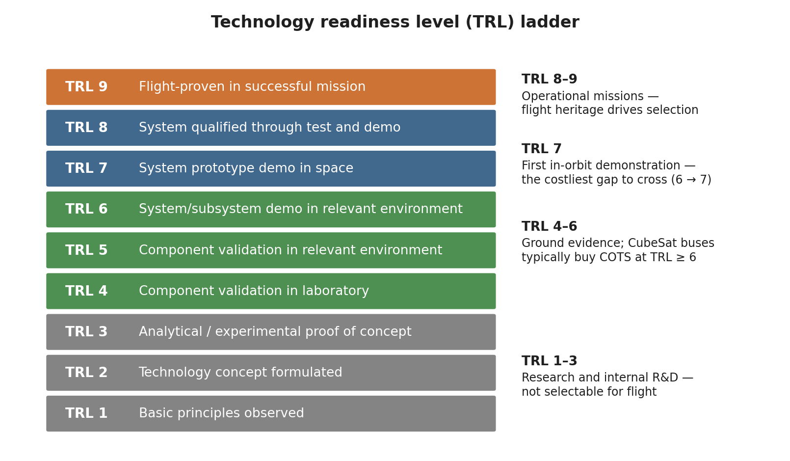

*Technology Readiness Level ladder.*


> **Expected reading before this session.** NASA TRL definitions (NPR 7123.1D Appendix E).


**Prerequisites:** Subsystems sized and components identified via parametric agents (preceding chapters).
**References:** ECSS-Q-ST-20C (Quality Assurance), ECSS-E-ST-10-24C (Interfaces), ITAR/EAR (22 CFR 120-130 / 15 CFR 730-774), CDS Rev 14.1, NASA SEH Rev 2 section 6.8

---

## Learning Objectives

By the end of this session, participants will be able to:
1. Apply a structured make/buy/reuse decision framework to component selection
2. Evaluate COTS components against requirements using TRL and heritage criteria
3. Construct a Bill of Materials (BOM) with full traceability to requirements
4. Identify export control constraints (ITAR, EAR, Canadian Controlled Goods) for selected equipment
5. Verify interface compatibility (RF, electrical, mechanical) during component selection
6. Track cumulative mass, power, and cost budgets as selections are made

---

## 1. The Make/Buy/Reuse Decision
Before selecting any hardware, the team must decide the procurement strategy for each subsystem. This is a fundamental systems engineering decision that affects cost, schedule, risk, and performance.

*[Source: [NASA SEH](https://www.nasa.gov/reference/systems-engineering-handbook/) Rev 2 section 6.8 "Decision Analysis"; ECSS-M-ST-10C Rev.1 section 5.4]*

### Decision Framework

```
For each subsystem or component:
  1. Does a COTS product exist that meets requirements?
     -> Yes: BUY (lowest risk, fastest schedule)
     -> No: Continue
  2. Does flight-proven hardware from a previous mission exist?
     -> Yes: REUSE (low risk, may need delta-qualification)
     -> No: Continue
  3. Can the requirement be met by modifying existing hardware?
     -> Yes: MODIFY (moderate risk, moderate schedule)
     -> No: MAKE (highest risk, longest schedule, most expensive)
```

### Make/Buy/Reuse Trade Matrix

Table 4.1.1 — Trade matrix comparing buy, reuse, modify, and make procurement strategies across cost, schedule, risk, performance, IP, and qualification.

| Factor | Buy (COTS) | Reuse (Heritage) | Modify | Make (Custom) |
|--------|-----------|-------------------|--------|---------------|
| **Cost (NRE)** | None | None-Low | Moderate | High |
| **Cost (Recurring)** | Vendor price | Reproduction cost | Vendor + delta | Full development |
| **Schedule** | 4-16 weeks lead | 8-24 weeks | 12-36 weeks | 12-48 months |
| **Risk** | Low (if TRL >= 7) | Low (flight-proven) | Medium | High |
| **Performance** | Fixed by vendor | Fixed by heritage | Tuneable | Fully customisable |
| **IP ownership** | Vendor retains | May be shared | Negotiated | Full ownership |
| **Qualification** | Vendor-provided data | Delta-qual only | Partial re-qual | Full qualification |

### Key Equations

> **Non-Recurring Engineering (NRE) Cost Estimate:**
>
> NRE = Labour_hours x Hourly_rate + Material_cost + Facility_cost + Testing_cost
>
> For COTS: NRE is near zero (vendor absorbs development cost).
> For custom: NRE can be 3-10x the unit recurring cost.

### Worked Example

*Problem:* A 6U CubeSat mission needs a fine sun sensor with 0.1 degree accuracy. Three options:

Table 4.1.2 — Three sun-sensor candidates with accuracy, mass, cost, TRL, and lead time for a worked make/buy decision.

| Option | Type | Accuracy | Mass | Cost | TRL | Lead Time |
|--------|------|----------|------|------|-----|-----------|
| Bradford SSOC-D60 | COTS | 0.1 deg | 35 g | EUR 15K | 9 | 8 weeks |
| In-house photodiode array | Custom | 0.05 deg | 20 g | EUR 8K + 400 hr NRE | 4 | 12 months |
| Modified heritage sensor | Reuse | 0.08 deg | 40 g | EUR 6K + 80 hr delta-qual | 7 | 16 weeks |

*Decision:* The COTS option (Bradford SSOC-D60) meets the requirement, has TRL 9, lowest schedule risk, and total cost of EUR 15K vs EUR 8K + ~EUR 40K NRE for custom. **Buy.**

---

## 2. Technology Readiness Level (TRL) Assessment
TRL is the standard metric for technology maturity. It was developed by NASA in the 1970s and is now used universally in space programmes.

*[Source: NASA [NPR 7123.1D](https://nodis3.gsfc.nasa.gov/displayDir.cfm?t=NPR&c=7123&s=1D) Appendix E; ECSS-E-HB-11A "Technology Readiness Level (TRL) Guidelines"]*
*[URL: [https://www.nasa.gov/directorates/somd/space-communications-navigation-program/technology-readiness-levels/](https://www.nasa.gov/directorates/somd/space-communications-navigation-program/technology-readiness-levels/)]*

### TRL Scale with Decision Criteria

Table 4.1.3 — Nine-level TRL scale defining evidence required and CubeSat selection guidance at each rung.

| TRL | Definition | Evidence Required | CubeSat Decision |
|-----|-----------|-------------------|-----------------|
| 1 | Basic principles observed | Published research | Do not select |
| 2 | Technology concept formulated | Analytical studies | Do not select |
| 3 | Experimental proof of concept | Lab measurements | Do not select |
| 4 | Component validated in lab | Breadboard tested | High risk -- avoid unless no alternative |
| 5 | Component validated in relevant environment | Engineering model tested | Acceptable for technology demonstrator missions |
| 6 | System/subsystem model demonstrated in relevant environment | Prototype in relevant environment | Acceptable with risk mitigation |
| 7 | System prototype demonstrated in operational environment | Prototype tested in space | Preferred minimum for CubeSats |
| 8 | Actual system completed and qualified | Flight-qualified hardware | Strong preference |
| 9 | Actual system flight-proven | Successful on-orbit operation | Lowest risk |

### TRL and Risk Relationship

> **Risk Reduction Factor (empirical):**
>
> Risk_factor = 10^(-(TRL - 1) / 3)
>
> Table 4.1.4 — Empirical risk reduction factor mapping TRL level to probability of failure or redesign.
>
> | TRL | Risk Factor | Interpretation |
> |-----|------------|----------------|
> | 3 | 0.22 | High probability of failure/redesign |
> | 5 | 0.046 | Moderate risk |
> | 7 | 0.010 | Low risk |
> | 9 | 0.002 | Very low risk |
>
> *This empirical relationship (a widely-cited empirical heuristic) illustrates why TRL >= 6 is the typical threshold for mission-critical components.*

### Real Mission Example: MarCO (Mars Cube One)

NASA's MarCO A and B (launched May 2018) were the first interplanetary CubeSats. They used:
- Iris transponder (JPL, TRL 6 at selection -- first deep-space CubeSat radio)
- COTS reaction wheels (Blue Canyon Technologies, TRL 9)
- Custom deployable reflectarray antenna (JPL, TRL 5 at selection)

The custom antenna was the highest-risk item. It required extensive development testing and was the last component to reach TRL 6 for CDR. This delayed the schedule by 4 months but ultimately succeeded.

*Lesson: If you must fly a low-TRL component, it will dominate your schedule and risk register.*

*[Source: "Mars Cube One (MarCO) -- Lessons Learned", A. Klesh et al., 33rd Annual Small Satellite Conference, 2019]*

---

## 3. Bill of Materials (BOM) Construction
The BOM is the definitive list of all hardware, software, and consumables required to build the satellite. It is the bridge between design and procurement.

### BOM Structure

A properly structured BOM follows the WBS hierarchy:

```
BOM Level 0: Spacecraft (S/C-001)
  BOM Level 1: Subsystem (e.g., EPS-000)
    BOM Level 2: Assembly (e.g., EPS-SA-000 Solar Array Assembly)
      BOM Level 3: Component (e.g., EPS-SA-001 Solar Cell String)
        BOM Level 4: Part (e.g., EPS-SA-001-01 Azur 3G30C cell)
```

### BOM Fields

Table 4.1.5 — Standard BOM field set with description and example value for each column.

| Field | Description | Example |
|-------|------------|---------|
| **Item ID** | Unique hierarchical identifier | EPS-BAT-001 |
| **Description** | Component name and model | GomSpace NanoPower P31u |
| **Manufacturer** | Vendor name | GomSpace A/S |
| **Part Number** | Manufacturer part number | P31U-9-30 |
| **Quantity** | Number required | 1 |
| **Unit Mass (g)** | Per-item mass | 94 |
| **Unit Power (W)** | Peak / average power draw | 0.5 / 0.2 |
| **Unit Cost (EUR)** | Procurement cost | 8,500 |
| **TRL** | Technology readiness level | 9 |
| **Heritage** | Previous mission(s) flown | GOMX-3, GOMX-4 |
| **Lead Time** | Procurement lead time | 12 weeks |
| **ECCN/USML** | Export classification | EAR99 |
| **Status** | Selected / Ordered / Received / Tested | Selected |

### SpaceCDF BOM Generation

In SpaceCDF, the BOM is built automatically from the Equipment Browser selections:
1. Each component selected in the Equipment Browser creates a BOM entry
2. Quantities are set using the quantity selector (e.g., x4 for reaction wheels)
3. The **Exports** tab generates a formatted BOM spreadsheet
4. The BOM includes both parametric estimates and actual COTS data for comparison

### Key Equations

> **BOM Mass Total:**
>
> $$M_{\text{BOM}} = \sum_{i} m_i \cdot q_i + M_{\text{harness}} + M_{\text{fasteners}} + M_{\text{margin}}$$
>
> Where:
> - $m_i$ = unit mass of component $i$
> - $q_i$ = quantity of component $i$
> - $M_{\text{harness}}$ = harness mass (typically 5–8 % of dry mass for CubeSats)
> - $M_{\text{fasteners}}$ = mechanical fasteners, standoffs, thermal hardware (~3–5 %)
> - $M_{\text{margin}}$ = system margin (typically 20 % at Phase A)

### Worked Example

*3U CubeSat BOM Summary:*

Table 4.1.6 — Subsystem-level BOM rollup giving mass, power, and cost totals against 3U allocations with margin.

| Subsystem | Components | Total Mass (g) | Total Power (W) | Total Cost (kEUR) |
|-----------|-----------|----------------|-----------------|-------------------|
| Structure | Rails, panels, fasteners | 350 | 0 | 8.0 |
| EPS | SA + battery + board | 420 | 0.5 | 18.0 |
| OBC | Flight computer + storage | 80 | 1.2 | 10.0 |
| AOCS | Star tracker + magnetorquers + RWs | 550 | 4.5 | 45.0 |
| TTC | S-band transceiver + patch antenna | 180 | 8.0 (TX) | 22.0 |
| Thermal | MLI + heaters | 60 | 2.0 (peak) | 3.0 |
| Payload | Multispectral imager | 800 | 12.0 | 65.0 |
| Harness | Cables, connectors | 180 | 0 | 2.5 |
| **Total** | | **2620** | **28.2 (peak)** | **173.5** |
| Allocation (3U) | | 6000 | 40.0 (SA EOL) | 250.0 |
| Margin | | 3380 (56%) | 11.8 (30%) | 76.5 (31%) |

---

### 1U Worked Example: UniSat-1

**Complete Bill of Materials**

UniSat-1's BOM is remarkably short -- only 8 line items plus harness. This simplicity is a major advantage for university teams with limited procurement experience.

> **UniSat-1 BOM (Phase B -- vendor quotes obtained):**
>
> Table 4.1.7 — Phase B UniSat-1 BOM with manufacturer, part number, quantity, mass, cost, TRL, ECCN, and lead time per item.
>
> | Item ID | Component | Manufacturer | Part Number | Qty | Unit Mass (g) | Unit Cost (kEUR) | TRL | ECCN | Lead (wks) |
> |---------|-----------|-------------|-------------|-----|---------------|-----------------|-----|------|-----------|
> | STR-001 | 1U CubeSat Structure | ISIS | ISIS-1U-STR | 1 | 200 | 4.0 | 9 | EAR99 | 8 |
> | EPS-001 | NanoPower P31us (EPS + 10Wh battery) | GomSpace | P31US-10 | 1 | 200 | 12.0 | 9 | EAR99 | 12 |
> | EPS-SA-001 | Body-mounted GaAs solar cells | AzurSpace | 3G30C | 5 | 10 | 1.5 | 9 | EAR99 | 10 |
> | OBC-001 | Custom flight computer (Cortex-M) | In-house | UNISAT-OBC-01 | 1 | 30 | 3.0 | 5 | EAR99 | -- |
> | COM-001 | UHF Transceiver | GomSpace | NanoCom AX100 | 1 | 55 | 8.0 | 8 | EAR99 | 12 |
> | COM-ANT-001 | UHF Deployable Antenna | Endurosat | UHF-ANT-S | 1 | 25 | 2.5 | 8 | EAR99 | 8 |
> | PL-001 | MEMS Magnetometer Board | In-house | UNISAT-MAG-01 | 1 | 50 | 5.0 | 4 | EAR99 | -- |
> | AOCS-001 | Passive magnetic kit (magnet + rods) | NewSpace | PMAG-1U | 1 | 30 | 1.0 | 9 | EAR99 | 6 |
> | HAR-001 | Internal harness | Custom | -- | 1 | 50 | 1.0 | N/A | EAR99 | -- |
> | | **TOTALS** | | | | **690 g** | **~44 kEUR** | | | |

**Cost summary (total mission, hardware + services):**

Table 4.1.8 — UniSat-1 mission cost summary by WBS element including hardware, software, I&T, ground, launch, and management.

| WBS Element | Cost (kEUR) | Notes |
|-------------|------------|-------|
| Hardware (BOM) | 44 | All COTS except OBC and payload |
| OBC software | 5 | Student labour (costed at stipend rate) |
| Payload calibration | 3 | University magnetometer lab |
| I&T | 8 | Assembly + vibration test (university facility) |
| Ground station | 5 | SatNOGS (free) + dedicated Yagi antenna purchase |
| Launch (ISS deploy) | 15 | NanoRacks 1U deployment fee |
| PM/SE/QA | 5 | Faculty supervision |
| **TOTAL** | **~85 kEUR** | |

**Comparison to 3U EO mission:**

Table 4.1.9 — Side-by-side comparison of UniSat-1 against a 3U EO CubeSat on line items, cost, schedule, and team size.

| Metric | UniSat-1 (1U) | 3U EO CubeSat |
|--------|--------------|---------------|
| BOM line items | 9 | ~15--20 |
| Hardware cost | ~44 kEUR | ~290 kEUR |
| Total mission cost | ~85 kEUR | ~490 kEUR |
| Development time | 6--12 months | 18--24 months |
| Team size | 3--5 people | 8--15 people |

**Export control:** All UniSat-1 components are classified EAR99 (no licence required). There are no ITAR-controlled items because the mission uses no star trackers, no radiation-hardened processors, and no propulsion with ITAR-restricted technology. This is a significant advantage for international university collaborations.

**Make/Buy/Reuse decisions:**

Table 4.1.10 — Per-component make/buy/reuse decision and rationale for the UniSat-1 subsystem set.

| Component | Decision | Rationale |
|-----------|----------|-----------|
| Structure | Buy (COTS) | ISIS 1U frame is flight-proven, TRL 9, low cost |
| EPS | Buy (COTS) | GomSpace P31us is the de facto standard, TRL 9 |
| OBC | Make (custom) | Minimal board using university lab; lower cost than COTS OBC for this simple application |
| Comms | Buy (COTS) | GomSpace AX100, TRL 8, well-documented |
| Payload | Make (custom) | Novel MEMS sensor -- this IS the technology demonstration |
| Passive AOCS | Buy (COTS) | Standard magnetic stabilisation kit |

---

## 4. Export Control and Procurement
Export control is one of the most commonly overlooked aspects of CubeSat missions, especially for international teams. Violations carry severe penalties (criminal prosecution, programme cancellation).

*[Source: ITAR -- 22 CFR Parts 120-130; EAR -- 15 CFR Parts 730-774; Canadian Controlled Goods Program -- Defence Production Act]*
*[URL: [https://www.pmddtc.state.gov/ddtc_public](https://www.pmddtc.state.gov/ddtc_public) (US ITAR); [https://www.bis.doc.gov](https://www.bis.doc.gov) (US EAR)]*

### Export Control Regimes

Table 4.1.11 — Major export control regimes with governing law, scope, and key CubeSat-relevant concerns.

| Regime | Governing Law | Applies To | Key Concern for CubeSats |
|--------|-------------|-----------|-------------------------|
| **ITAR** | US Arms Export Control Act | Defence articles (USML Categories IV, XI, XV) | Star trackers, rad-hard processors, some GPS receivers |
| **EAR** | Export Administration Act | Dual-use items (CCL) | Most COTS space components (ECCN 9A515) |
| **Canadian CGP** | Defence Production Act | Controlled goods in Canada | Handling US-origin ITAR items in Canadian facilities |
| **Wassenaar** | Wassenaar Arrangement | Multilateral export controls | Encryption, high-accuracy GNSS, imaging sensors |

### Component Classification Decision

```
Is the component on the US Munitions List (USML)?
  -> Yes: ITAR-controlled. Need DSP-5 license for export.
     Categories: IV (launch vehicles), XI (military electronics),
                 XV (spacecraft systems)
  -> No: Check Commerce Control List (CCL)
     Is it classified under ECCN 9A515 (spacecraft)?
       -> Yes: EAR-controlled. May need BIS license.
       -> No: Likely EAR99 (no license required for most destinations)
```

### Common ITAR-Controlled CubeSat Components

Table 4.1.12 — Commonly ITAR-controlled CubeSat component types with the reason for control and EAR99 alternatives.

| Component Type | Why Controlled | Alternative |
|---------------|---------------|------------|
| Radiation-hardened processors | Military-grade rad tolerance | COTS processors with software mitigation |
| High-accuracy star trackers (< 1 arcsec) | Missile guidance applicability | Lower-accuracy models (> 5 arcsec) |
| Certain GPS/GNSS receivers | Above COCOM limits (>60,000 ft, >1000 kt) | Space-rated receivers with COCOM compliance |
| Propulsion systems (some) | Missile technology | Cold-gas or water-based systems |
| Encryption modules | Signals intelligence | Open-source encryption (may still need EAR review) |

### Procurement Workflow

```
1. Requirements -> Derive component specification
2. Market survey -> Identify candidate COTS products
3. Export classification -> Request ECCN from vendor
4. Trade study -> Score and rank candidates
5. Request for Quote (RFQ) -> Obtain pricing and lead times
6. Purchase Order (PO) -> Commit to procurement
7. Incoming inspection -> Verify against PO and datasheet
8. Integration -> Install and functionally test
```

### Real Mission Example: Export Control Impact

The BRITE-Constellation (Austria/Canada/Poland) was a series of nanosatellites for stellar photometry. The Austrian BRITE satellites (UniBRITE and BRITE-Austria, built by UTIAS/SFL in Toronto) required careful export control management:
- US-origin ITAR components required Technical Assistance Agreements (TAAs)
- Controlled Goods registration required for the Canadian team
- Export permits needed for shipping between Canada, Austria, and the US launch site
- Total regulatory compliance effort: ~6 person-months and 12+ months lead time

*Lesson: Start export classification immediately when components are identified. A single ITAR component can add 6-12 months to the schedule.*

*[Source: Sarda, K. et al., "BRITE-Constellation Mission and Spacecraft", AIAA/USU Small Satellite Conference, 2014]*

---

## 5. Interface Compatibility Verification
As components are selected, every interface must be verified for compatibility. The three interface categories are RF, electrical, and mechanical.

### RF Chain Compatibility

The RF chain (transponder, cable, antenna) must be frequency-matched. This is the most common equipment incompatibility for CubeSat newcomers.

Table 4.1.13 — RF chain compatibility rules covering band, impedance, connector, and polarisation matching.

| Rule | Correct Example | Incorrect Example |
|------|----------------|-------------------|
| **Band match** | S-band transponder + S-band patch antenna | S-band transponder + X-band horn |
| **Impedance match** | 50 ohm transponder + 50 ohm cable + 50 ohm antenna | Mixed impedances cause reflections |
| **Connector match** | SMA on transponder + SMA-SMA cable + SMA on antenna | SMA to N-type needs adapter (loss) |
| **Polarisation** | RHCP antenna + RHCP ground station | RHCP to LHCP causes > 20 dB cross-pol loss |

> **Impedance Mismatch Loss:**
>
> $$\text{Return Loss (dB)} = -20\,\log_{10}|\Gamma|, \qquad \Gamma = \frac{Z_{\text{load}} - Z_{\text{source}}}{Z_{\text{load}} + Z_{\text{source}}}$$
>
> For a 50 Ω source into a 75 Ω load:
>
> $$\Gamma = \frac{75 - 50}{75 + 50} = 0.2,\quad \text{Return Loss} = -20\,\log_{10}(0.2) = 14~\text{dB},$$
>
> $$L_{\text{mismatch}} = -10\,\log_{10}(1 - |\Gamma|^2) = -10\,\log_{10}(1 - 0.04) = 0.18~\text{dB}.$$

SpaceCDF checks RF compatibility automatically: if you select a transponder in one band and an antenna in another, a warning dialog appears.

### Electrical Interface Verification

Table 4.1.14 — Electrical interface parameters with typical CubeSat values and the verification check required.

| Parameter | Typical CubeSat | What to Verify |
|-----------|----------------|----------------|
| Bus voltage | 3.3V, 5V, or unregulated (6-8.4V Li-ion) | Component input voltage range covers bus voltage |
| Peak current | Per switched line limit (typically 1-3A) | Component inrush current does not exceed limit |
| Data protocol | I2C, SPI, UART, CAN, RS-422 | All devices on same bus use compatible protocol |
| Connector | PC/104, Hirose, Harwin | Physical connector type matches or adapter planned |

### Mechanical Interface Verification

| Parameter | CDS 3U Requirement | Verification |
|-----------|--------------------|----|
| Dimensions | 100.0 +/- 0.1 mm x 100.0 +/- 0.1 mm x 340.5 +/- 0.5 mm | Caliper measurement |
| Rail profile | 8.5 x 8.5 mm +/- 0.1 mm | Profile gauge |
| Component stack height | <= 83 mm internal width per U | 3D model check |
| CG location | Within 2 cm of geometric centre | Mass properties measurement |

---

## 6. Equipment Selection Exercise
### Instructions

**Part A: Equipment Selection**

1. Open the **Equipment Browser** in SpaceCDF
2. For each **required** category (blue dot), select at least one component:
   - Start with EPS (batteries + solar panels + EPS board)
   - Then OBC, AOCS sensors/actuators, TTC, structure
   - Use quantity selectors (e.g., x4 for reaction wheels, x3 for magnetorquers)
3. Watch the **live budget bar** as you select -- keep mass under allocation
4. When selecting TTC: verify the spectrum band matches your earlier selection
5. After all selections, review the **Budget Breakdown** on the Dashboard

**Part B: BOM Review and Export Check**

1. Navigate to the **Exports** tab
2. Generate the **BOM** -- review all entries
3. For each component, check: Is the ECCN listed? Is it EAR99, ECCN 9A515, or ITAR?
4. Flag any components that may require export licences
5. Compute: BOM total mass vs parametric estimate vs launcher allocation


### Component Trade Study

For at least one subsystem, select 2--3 candidate components and run a formal tabular trade:

1. Navigate to the **Trade Studies** tab
2. Load or create a "Component Selection Trade" study
3. Define criteria: mass, power, cost, TRL, heritage, performance
4. Score each candidate (1--5 scale)
5. Apply weights and compute weighted scores
6. Document the winner and rationale

### Real Mission Example: Iridium NEXT Equipment Selection

Iridium NEXT (Thales Alenia Space, 2017--2019) serves as a large-scale example of rigorous equipment selection. For the phased-array antenna:

Table 4.1.15 — Iridium NEXT phased-array weighted trade study between Thales and Raytheon candidate antennas.

| Criterion | Weight | Candidate A (Thales) | Candidate B (Raytheon) |
|-----------|--------|---------------------|----------------------|
| Performance | 0.30 | 4.5 | 4.0 |
| Mass | 0.20 | 3.5 | 4.0 |
| Cost | 0.20 | 3.0 | 4.5 |
| TRL | 0.15 | 5.0 | 4.0 |
| Schedule | 0.15 | 4.0 | 3.5 |
| **Weighted** | | **4.00** | **4.025** |

The selection was ultimately Candidate A (Thales) due to contractual considerations beyond the numerical trade -- illustrating that trade studies inform but do not dictate decisions.

### Worksheet 4.1 Tasks

1. Complete the full BOM table (component, manufacturer, part number, mass, power, cost, TRL, ECCN)
2. Document the make/buy/reuse decision for each subsystem with rationale
3. Compute total BOM mass vs parametric estimate vs allocation -- state margin
4. Identify any export-controlled components and note the required licensing action
5. Describe one interface incompatibility found during selection and how it was resolved

---

## 7. SpaceCDF Budget Closure Check
### Instructions

After equipment selection, perform a final budget health check:

1. **Dashboard KPIs:** Record all margins
   - Mass margin (%) -- green/amber/red?
   - Power margin per mode (W)
   - Link margin (dB)
   - Cost vs ceiling (MEUR)
   - Pointing accuracy vs requirement (deg)
2. **Budget Comparison:** Compare parametric estimates to equipment-based totals
3. **Identify any negative margins** -- these must be resolved before proceeding to integration (Week 3)

### If a Budget Does Not Close

Table 4.1.16 — Common fixes when a mass, power, link, cost, or pointing budget fails to close.

| Budget | Common Fix | Impact | Typical Mass/Power/Cost Trade |
|--------|-----------|--------|------------------------------|
| **Mass** (negative) | Remove propulsion; select lighter components; reduce redundancy; move to larger form factor | Risk / performance trade | Removing propulsion saves 0.5--1.5 kg |
| **Power** (negative) | Add deployable SA; reduce payload duty cycle; select lower-power AOCS; schedule operations to avoid simultaneous loads | Cost / schedule trade | Deployable panel adds ~15 W but costs 0.3 kg + 25 kEUR |
| **Link** (negative) | Increase TX power; use higher-gain antenna; reduce data rate; upgrade coding; upgrade ground station | Mass / power trade | 3 dB gain from coding is "free"; 3 dB from bigger antenna costs mass |
| **Cost** (over ceiling) | Use COTS instead of rad-hard; remove propulsion; reduce ground segment; use SatNOGS instead of commercial ground | Risk / capability trade | COTS vs rad-hard saves 10--100x on processor cost |
| **Pointing** (insufficient) | Upgrade star tracker; improve alignment calibration; add vibration isolation for RW; reduce thermal gradients | Cost / complexity trade | Alignment improvement is usually cheapest |

---

### 1U Worked Example: UniSat-1

**CDS Compliance for 1U Form Factor**

The CubeSat Design Specification (CDS Rev 14) defines the 1U envelope:

| Parameter | 1U Specification | UniSat-1 Design | Compliance |
|-----------|-----------------|-----------------|------------|
| Dimensions | 100.0 x 100.0 x 113.5 mm | 100.0 x 100.0 x 113.5 mm (ISIS 1U frame) | **Pass** |
| Maximum mass | 2.0 kg (CDS Rev 14, ISIPOD) | 1.0 kg target (50% margin to 2 kg limit) | **Pass** |
| Rail material | Hard anodised Al 7075-T6 | Standard (part of ISIS frame, 7075-T6, Type III anodise) | **Pass** |
| Rail cross-section | 8.5 x 8.5 mm minimum | Standard (ISIS: 8.5 x 8.5 mm) | **Pass** |
| Deployment switches | Min 1 per accessible face | 2 switches (ISIS standard, on +X/-X rail faces) | **Pass** |
| RBF pin | Required | Included (ISIS standard, on -Z face) | **Pass** |
| CG offset | <= 2 cm from geometric centre | < 1 cm (symmetric PCB stack layout, battery centred) | **Pass** |
| Protrusions | None beyond rail envelope (stowed) | UHF monopole antenna stowed along rail (spring-loaded, within envelope) | **Pass** |
| Fundamental frequency | > 40 Hz first mode | ~600 Hz (1U Al structure is extremely stiff) | **Pass** |

**Note on CDS mass limit:** The CDS Rev 14 specifies 2.0 kg as the 1U deployer limit for the ISIPOD. However, many deployer providers (e.g., NanoRacks, Exolaunch) specify 1.33 kg for 1U. Always check the specific deployer ICD. UniSat-1 targets 1.0 kg, well within either limit.

**No propulsion:** At 400 km altitude, atmospheric drag provides natural deorbit. The ballistic coefficient for a 1U is:

$BC = \frac{m}{C_D \times A} = \frac{1.0}{2.2 \times 0.01} = 45.5$ kg/m$^2$

This gives an orbital lifetime of approximately 8--14 months depending on solar activity (F10.7 index). At solar maximum (F10.7 > 200), the denser atmosphere deorbits the satellite in ~6 months. At solar minimum (F10.7 ~ 70), lifetime extends to ~18 months. Both are within the FCC 5-year rule and IADC 25-year guideline without any propulsion system.

**OBC selection rationale:** UniSat-1 uses a custom board based on the TI MSP430 (safe mode / housekeeping) + STM32F4 Cortex-M4 (main OBC). The MSP430 runs bare-metal firmware handling the watchdog, power monitoring, and safe-mode recovery. The STM32F4 runs FreeRTOS handling TM/TC, magnetometer data acquisition, and scheduling. Dual-processor architecture provides redundancy: if the STM32F4 fails (SEU, latchup), the MSP430 can maintain safe-mode operations and respond to ground commands.

**Data storage:** With ~1.13 MB/day of magnetometer data and a 4800 bps useful downlink (9600 bps channel), onboard storage is not a bottleneck. A 4 MB NOR flash is more than adequate (stores ~3.5 days of data as buffer). No NAND flash, no SD card needed.

**Complete 1U Equipment List:**

> | # | Category | Component | Mass (g) | Power (W) | Cost (kEUR) | Qty | Interface |
> |---|----------|-----------|----------|----------|-------------|-----|-----------|
> | 1 | Structure | ISIS 1U CubeSat structure (Al 7075-T6) | 200 | -- | 4.0 | 1 | Mechanical |
> | 2 | EPS | GomSpace NanoPower P31us (EPS board + 2S Li-ion battery, 10 Wh) | 200 | 0.3 (quiescent) | 12.0 | 1 | I$^2$C |
> | 3 | Solar cells | Body-mounted triple-junction GaAs cells (5 faces) | 50 | -- (generates power) | 7.5 | 5 | Direct to EPS |
> | 4 | OBC | Custom MSP430 + STM32F4 board (with 4 MB NOR flash) | 30 | 0.3 | 3.0 | 1 | I$^2$C, SPI, UART |
> | 5 | Comms | UHF transceiver (NanoCom AX100, 0.5 W TX, 9600 bps) | 55 | 0.5 (TX) / 0.1 (RX) | 8.0 | 1 | SPI |
> | 6 | Antenna | UHF monopole (deployable, $\lambda/4 = 17$ cm nitinol) | 25 | -- | 2.5 | 1 | RF coax |
> | 7 | Payload | MEMS magnetometer (custom PCB, PNI RM3100 sensor) | 50 | 0.2 | 5.0 | 1 | SPI |
> | 8 | AOCS (passive) | Permanent magnet (AlNiCo, 0.5 A m$^2$) + 2 hysteresis rods (HyMu-80) | 30 | 0 | 1.0 | 1 | None (passive) |
> | 9 | Harness | Internal cables, connectors, PC/104 stack header | 50 | -- | 1.0 | 1 | Various |
> | | **TOTAL** | | **690** | **~1.3 (peak TX)** | **~44** | | |
>
> **Mass budget:**
>
> | Level | Mass (g) |
> |-------|----------|
> | CBE (Current Best Estimate) | 690 |
> | + 20% equipment margin | 828 |
> | + 20% system margin | 994 |
> | **MEV (Maximum Expected Value)** | **994** |
> | Deployer limit (ISIPOD) | 2000 |
> | **Margin to limit** | **1006 g (50%)** |
>
> **Power budget (worst case: TX mode in sunlight):**
>
> | Load | Power (W) |
> |------|----------|
> | OBC (STM32F4 + MSP430) | 0.3 |
> | EPS quiescent | 0.3 |
> | UHF TX | 0.5 |
> | Magnetometer | 0.2 |
> | **Total peak** | **1.3** |
> | SA available (orbit avg, EOL) | 2.3 |
> | **Margin** | **1.0 W (43%)** |
>
> **Key insight:** The entire UniSat-1 BOM is 6 COTS components plus 2 custom boards (OBC and magnetometer PCB). Total hardware cost is ~44 kEUR -- an order of magnitude less than a typical 3U mission. With labour, I&T, launch, and operations, the total mission cost is 80--150 kEUR. This demonstrates that a useful space mission can be built for less than the cost of a mid-range car.

---

## Worked Example: Complete 6U EO CubeSat Equipment List (EOSAT-1)

This is the flight equipment list of the reference spacecraft used throughout
the operations chapters: EOSAT-1, a 6U wide-field multispectral imager in a
513 km Sun-synchronous orbit (97.39 deg, LTAN 10:00). Every line is a real, current-production part
class rather than a parametric placeholder, which is what makes the totals
worth arguing about.

> | Category | Component | Mass (kg) | Power (W) | Cost (kEUR) | Qty | Interface |
> |----------|-----------|----------|----------|-------------|-----|-----------|
> | Structure | 6U frame, rails and internal brackets (Al 7075-T6, hard anodised) | 1.80 | -- | 8 | 1 | Mechanical |
> | Solar cells (body) | Body-mounted TJ GaAs, 0.198 m$^2$ over five faces (-Z carries the aperture and radiator) | 0.35 | -- | 6 | 1 set | Direct to EPS |
> | Solar wings | Endurosat-class 6U double-deployable, 0.120 m$^2$ of cells per wing, single-axis SADA | 1.07 | -- | 10 | 2 | Direct to EPS |
> | EPS Board | 6U EPS/PDU (MPPT, nine switchable/non-switchable lines, indices 0--8) | 0.25 | 3.0 (EPS housekeeping share of the 6 W obc line) | 8 | 1 | I$^2$C |
> | Battery | GomSpace NanoPower BPX, 8S-1P, 100 Wh, 3.5 Ah, 28.8 V nominal (24.0--33.6 V), Li-ion 18650 | 0.50 | -- | 5 | 1 | I$^2$C (telemetry) |
> | OBC | 6U flight computer, 20 GB payload store | 0.10 | 3.0 (OBDH share of the obc line) | 12 | 1 | I$^2$C, SPI, UART |
> | Reaction Wheel | Sinclair RW-0.03 class, 0.030 N m s at 5500 rpm, 2 mN m peak torque; pyramid, four-of-four | 0.185 | 0.3 (avg, per wheel) | 5 | 4 | SPI |
> | Magnetorquer | NewSpace NCTR-M016 class rod, 1.6 A m$^2$ dipole | 0.05 | 0.1 | 2 | 3 | I$^2$C |
> | Star Tracker | Blue Canyon NST class, 6 arcsec cross-boresight NEA (ST1 / ST2, cold-redundant) | 0.35 | 1.5 | 25 | 2 | SPI/UART |
> | Gyro | Single-axis tactical-grade rate channel (Epson M-G370 / Sensonor STIM class), one per body axis, **no spare unit** | 0.02 | 0.3 | 1.3 | 3 | SPI |
> | Sun Sensor | Coarse sun-sensor array (attitude acquisition and safe mode) | 0.06 | 0.01 | 4 | 1 set | Analog/I$^2$C |
> | Magnetometer | Three-axis magnetometer (MAG A / MAG B, redundant pair; B-dot detumble reference) | 0.03 | 0.05 | 1 | 2 | I$^2$C |
> | GNSS | GPS receiver + patch antenna (orbit determination, time reference) | 0.12 | 1.0 | 8 | 1 | UART |
> | Payload | Wide-field pushbroom (power, mass and envelope from the Simera Sense TriScape100; its 580 mm optics are not EOSAT-1's): 8192 px x 5.5 um, f = 84.5 mm, 29.856 deg full FOV -> 273 km swath, 33.4 m GSD at 513 km; 244 Hz line rate, 96 Mbps raw readout (sized at the earlier 450 km figure) | 1.45 | 5.5 (imaging) / 2.4 (idle) | 60 | 1 | LVDS/SPI |
> | FPA cooler | Miniature Stirling-class cryocooler on the focal-plane bracket (-15 C setpoint, ~23 % of Carnot) | 0.50 | 15.0 | 15 | 1 | Own EPS line (`fpa_cooler`) |
> | Transmitter | Endurosat-class S-band transceiver (prime chain): 2 W RF max, 5 W DC at the LOW tier, 11 W DC at the HIGH tier, 1.2 W idle Rx | 0.25 | 5.0 (LOW) / 11.0 (HIGH) | 15 | 1 | SPI |
> | Antenna | S-band patch (body-fixed, RHCP) | 0.06 | -- | 3 | 1 | RF coax |
> | Beacon | **Separate** UHF whip beacon transmitter (1 W RF; carries HK SID 11 only, and survives the S-band PA being off) | 0.16 | 1.0 | 6 | 1 | UART / RF coax |
> | Propulsion | 1U green monopropellant blowdown module (LMP-103S/ADN class), single thruster on -X, 0.33 -> 0.14 N, Isp 220 -> 196 s | 1.15 (dry) | 12.0 (catbed preheat) / 2.0 (armed) | 30 | 1 | UART + latch valves |
> | Thermal | MLI, heaters (battery 8 W, OBC 4 W), radiator, thermal straps | 0.40 | 12.0 (both heaters, thermostat-controlled) | 3 | 1 set | Analog |
> | Harness | Cables, connectors, fasteners, stack hardware | 1.00 | -- | 5 | 1 | Various |
> | **TOTAL (dry)** | | **12.00** | see note | **~290** | | |
> | Propellant | Green monoprop, 0.400 kg -> 66.9 m/s total $\Delta V$ | 0.40 | -- | -- | -- | -- |
> | **TOTAL (wet, BOL)** | | **12.40** | | | | |
>
> **Power note.** The column is per-unit demand, not a sum: EOSAT-1 never runs
> every line at once. The nine EPS lines (0 `obc`, 1 `ttc_rx`, 2 `ttc_tx`,
> 3 `payload`, 4 `fpa_cooler`, 5 `htr_bat`, 6 `htr_obc`, 7 `aocs_wheels`,
> 8 `prop`) are switched against the orbit-average budget: at end of life and
> worst beta the array delivers ~45 W orbit-average against a ~23 W nominal
> load (payload in STANDBY, cooler off), a margin of about +22 W. Add continuous
> imaging, a continuously running
> cooler and HIGH-tier dumps on every pass and the budget goes negative --
> which is why imaging is duty-cycled (three ~90 s captures per orbit with the
> cooler stabilised around them) rather than run continuously.
>
> **Array note.** Cell area is 0.198 m$^2$ body-mounted plus 2 x 0.120 m$^2$
> on the wings, 0.438 m$^2$ deployed. The plane-of-array constant after the
> full loss stack (cell efficiency, packing and cover glass, hot-array
> temperature coefficient, MPPT, harness) is 292 W/m$^2$ BOL and
> **267.9 W/m$^2$ at three-year EOL** -- which is exactly the 268 W/m$^2$ a
> published 6U deployable delivers in LEO. Peak whole-spacecraft generation is
> 88.6 W, not the 120 W-plus that an invented array area would suggest.
>
> **Mass budget:**
> - Dry CBE: 12.00 kg (including 1.15 kg of propulsion dry mass)
> - Propellant: 0.400 kg
> - **Wet mass at BOL: 12.40 kg**
> - CDS 6U reference limit: 12.0 kg -- EOSAT-1 sits *at* the top of the 6U
>   class, so the dispenser ICD governs: check the qualified mass of the
>   specific 6U dispenser before assuming the CDS baseline applies.
>
> **Teaching point.** This is a Phase C/D flight list, not a Phase A estimate,
> so the 20 % equipment and system margins used earlier in this chapter have
> already been consumed by real part masses. A design that still shows 40 % of
> mass margin at this stage has not yet been costed against real hardware.

---

## Cited References

| # | Reference | URL |
|---|-----------|-----|
| 1 | NASA Technology Readiness Levels | [https://www.nasa.gov/directorates/somd/space-communications-navigation-program/technology-readiness-levels/](https://www.nasa.gov/directorates/somd/space-communications-navigation-program/technology-readiness-levels/) |
| 2 | ECSS-Q-ST-20C Quality Assurance | [https://ecss.nl/standard/ecss-q-st-20c-rev-2-quality-assurance-1-march-2023/](https://ecss.nl/standard/ecss-q-st-20c-rev-2-quality-assurance-1-march-2023/) |
| 3 | US DDTC (ITAR) | [https://www.pmddtc.state.gov/](https://www.pmddtc.state.gov/) |
| 4 | US BIS (EAR) | [https://www.bis.doc.gov/](https://www.bis.doc.gov/) |
| 5 | CubeSat Design Specification Rev 14.1 | [https://www.cubesat.org/s/CDS-REV14_1-2022-02-09.pdf](https://www.cubesat.org/s/CDS-REV14_1-2022-02-09.pdf) |
| 6 | SMAD (Cost Modelling) | Wertz, Everett, Puschell (eds.), Space Mission Engineering, Microcosm 2011 |
| 7 | MarCO Lessons Learned (Klesh et al.) | SSC19-WKII-07, 33rd Small Sat Conference, 2019 |

---

## Session Summary

Table 4.1.17 — Session summary: key takeaways for equipment selection and the bill of materials.

| Topic | Key Takeaway |
|-------|-------------|
| Make/Buy/Reuse | Buy COTS first; Reuse heritage second; Make custom only when necessary |
| TRL | Minimum TRL 6 for mission-critical components; TRL 7+ preferred for CubeSats |
| BOM | Hierarchical list: Subsystem -> Assembly -> Component -> Part, with full traceability |
| Export control | Classify every component (EAR99 / ECCN / ITAR); start early -- delays programme |
| RF compatibility | Band, impedance, connector, polarisation must all match across RF chain |
| Electrical | Bus voltage, data protocol, connector type verified per component |
| Budget tracking | Live totals during selection; stop if allocation exceeded |

# Chapter 4.2 — Verification & Validation Matrix and Compliance

> **Expected reading before this session.** ECSS-E-ST-10-02C — Verification (≈ 60 min); NASA SEH §6.4.


**Prerequisites:** Chapter 4.1 (equipment selected, BOM constructed)
**References:** ECSS-E-ST-10-02C Rev.1 (Verification), ECSS-E-ST-10-03C (Testing), NASA SEH Rev 2 sections 5.3-5.4, MIL-STD-1540E, MIL-STD-461G

---

## Learning Objectives

By the end of this session, participants will be able to:
1. Distinguish between verification and validation using the ECSS/NASA definitions
2. Assign appropriate verification methods (ATIR(D)) to each requirement using a decision logic
3. Define environmental test levels derived from launch vehicle ICD specifications
4. Construct a compliance verification matrix mapping every requirement to its method, level, and phase
5. Identify when waivers are appropriate and document the waiver rationale

---

## 1. Verification vs Validation: Precise Definitions
*[Source: ECSS-E-ST-10-02C Rev.1 section 4; [NASA SEH](https://www.nasa.gov/reference/systems-engineering-handbook/) Rev 2 section 5.3 (Process 7: Product Verification) and section 5.4 (Process 8: Product Validation)]*

Table 4.2.1 — Verification versus validation contrasted by question, standard, performer, timing, methods, and output.

| | **Verification** | **Validation** |
|--|-----------------|----------------|
| **Question** | "Did we build the system right?" | "Did we build the right system?" |
| **Checks against** | Requirements (shall statements) | Stakeholder needs and operational expectations |
| **Standard** | ECSS-E-ST-10-02C | ECSS-E-ST-10-06C |
| **Performed by** | Engineering team | Users, operators, stakeholders |
| **When** | Throughout development (Phases B-D) | End of development + early operations (Phase D-E) |
| **Methods** | ATIR(D) (Analysis, Test, Inspection, Review of design, Demonstration) | Operational demonstration, user acceptance testing |
| **Output** | Verification Control Document (VCD) | Validation report |

### The Critical Distinction

A system can be **verified** (every requirement marked "pass") but still **fail validation** if the requirements were written incorrectly. This happens when:
- Requirements were derived from misunderstood stakeholder needs
- The operational environment differs from assumptions
- Edge cases were not captured in requirements

### Example

- **Requirement:** "The system shall achieve GSD <= 10 m from 500 km altitude"
- **Verification (Test):** Calibration target imagery at 500 km -> measured GSD = 9.2 m -> **verified**
- **Validation:** Users attempt crop assessment with 9.2 m imagery -> "We can see field boundaries but cannot distinguish crop types; we needed GSD <= 5 m" -> **not validated**

*The requirement was met, but the stakeholder need was not satisfied because the requirement was insufficiently stringent.*

---

## 2. ATIR(D) Verification Methods in Detail
ECSS-E-ST-10-02C Rev.1 §5.2.2.1 defines four verification methods: test (including demonstration), analysis (including similarity), review of design and inspection. NASA practice lists demonstration separately as a fifth method. This book uses the full set, abbreviated ATIR(D) as in Chapter 2.1; the order in which the methods are described below does not matter.

*[Source: ECSS-E-ST-10-02C Rev.1 §5.2.2; freely available from [https://ecss.nl](https://ecss.nl)]*

### Inspection (I)

**Definition:** Visual or physical examination of the product, without operation or stimulation, to verify conformance to requirements.

**When to use:**
- Physical characteristics (dimensions, mass, surface finish, labelling)
- Manufacturing workmanship (solder joints, cable routing, MLI installation)
- Markings, identification, and safety labels
- Mechanical fit (deployer rail compliance)

**Evidence produced:** Inspection report with photographs, measurements, pass/fail checklist.

**Examples for CubeSats:**
- Mass measurement on calibrated scale -> verifies "M_dry <= 4.0 kg"
- Caliper measurement of rail profile -> verifies CDS dimensional compliance
- Visual inspection of antenna stowage -> verifies no protrusions beyond deployer envelope
- Workmanship inspection of PCB solder joints -> verifies IPC-A-610 Class 3

### Analysis (A)

**Definition:** Mathematical models, simulations, statistical analysis, or heritage comparison demonstrate compliance with acceptable confidence.

**When to use:**
- Physical testing is impossible or impractical (orbital lifetime, radiation total ionising dose)
- Early in development (Phase B) before hardware exists
- To demonstrate margin (link budget, thermal model, structural FEA)
- Statistical parameters (reliability prediction, debris casualty risk)
- Requirements involving orbital mechanics or mission-level performance

**Evidence produced:** Analysis report with model description, assumptions, inputs, results, uncertainty assessment, and sensitivity analysis.

**Examples for CubeSats:**
- Orbital mechanics analysis -> verifies revisit time requirement
- Thermal model (finite difference/finite element) -> verifies temperature within limits
- Link budget calculation -> verifies margin >= 3 dB at worst case
- Structural FEA -> verifies positive Margin of Safety under launch loads

> **Margin of Safety (structural):**
>
> MoS = (Allowable_stress / (Factor_of_Safety x Applied_stress)) - 1
>
> MoS must be >= 0 for all load cases.
> Factor_of_Safety: 1.25 (yield), 1.5 (ultimate) per ECSS-E-ST-32-10C.

### Review of design (R)

**Definition:** Examination of design documentation -- drawings, schematics, software design, analyses already performed, process records -- to confirm that the design as documented satisfies the requirement. In ECSS-E-ST-10-02C this is a formal method in its own right, distinct from analysis: no new model is built; the evidence is the documented design.

**When to use:**
- Requirements on the existence or content of a document, process or plan ("a verification plan shall be produced")
- Design features that are evident from the drawings (number of deployment switches, presence of an RBF pin, connector pin-out)
- Requirements already covered by an approved heritage design

**Evidence produced:** Review-of-design record citing the documents examined, signed by the reviewer; typically closed at a design review.

**Examples for CubeSats:**
- Review of the stack schematic -> verifies "two independent deployment switches shall inhibit all power"
- Review of the software architecture document -> verifies "the watchdog shall be implemented in hardware, independent of the main processor"

### Demonstration (D)

**Definition:** The system is operated under controlled conditions to show that it performs as required, without requiring precise measurement of performance parameters. ECSS-E-ST-10-02C records a demonstration as a test; NASA lists it as a separate method.

**When to use:**
- Functional requirements ("the system shall deploy the antenna within 30 minutes of separation")
- Operational procedures ("the system shall respond to a mode change command within 5 seconds")
- Software functional requirements ("FDIR shall autonomously switch to safe mode on loss of attitude")

**Evidence produced:** Demonstration report with procedure, observations, photographs/video, pass/fail.

**Examples for CubeSats:**
- Antenna deployment test -> demonstrates deployment within time limit
- Safe mode entry test -> demonstrates autonomous FDIR response
- Ground station commanding test -> demonstrates full command chain

### Test (T)

**Definition:** Physical hardware subjected to controlled conditions; measured performance compared quantitatively to requirement thresholds.

**When to use:**
- Physical properties must be proven with quantitative measurement
- Environmental survivability must be demonstrated (vibration, thermal-vacuum, EMC)
- End-to-end functional chains must be proven under representative conditions
- Performance must be measured, not just observed

**Test types by purpose:**

Table 4.2.2 — Four test types (development, qualification, acceptance, proto-flight) with purpose, level, phase, and load conditions.

| Test Type | Purpose | Level | Phase | Loads/Conditions |
|-----------|---------|-------|-------|-----------------|
| **Development** | Explore design space, find problems early | Unit/BB | B | As needed |
| **Qualification** | Prove design withstands worst-case + margin | Unit/System | C | Qual levels (MPE + margin) |
| **Acceptance** | Prove flight hardware is defect-free | System | D | Acceptance levels (MPE) |
| **Proto-flight** | Combined qual + acceptance (single unit) | System | C/D | Qual levels, acceptance duration |

### Proto-Flight Approach

For CubeSats, the **proto-flight** approach is standard because building a separate qualification unit is prohibitively expensive. The flight unit is tested to **qualification levels** but for **acceptance duration**.

*[Source: ECSS-E-ST-10-03C §4.5.4; MIL-STD-1540E section 6.2.4]*

**Rationale:** Qualification duration is longer and more stressful -- this is acceptable for a dedicated qualification model that will not fly. For proto-flight, the shorter duration reduces fatigue life consumption while still screening for workmanship defects.

Table 4.2.3 — Vibration and TVAC parameters compared between qualification, acceptance, and proto-flight test campaigns.

| Parameter | Qualification | Acceptance | Proto-flight |
|-----------|-------------|-----------|-------------|
| Vibration level | MPE + 3 dB | MPE | MPE + 3 dB |
| Vibration duration | 2 min/axis | 1 min/axis | 1 min/axis |
| TVAC temperature range | Predicted +/- 15 C | Predicted +/- 10 C | Predicted +/- 10 C |
| TVAC cycles | 8 | 4 | 4 |
| Sine sweep rate | 2 oct/min | 4 oct/min | 4 oct/min |

The proto-flight levels follow the standards. GSFC-STD-7000B §2.6 tests a proto-flight unit at the maximum and minimum predicted temperatures +/- 10 C, with at least 4 cycles; ECSS-E-ST-10-03C reaches the same 10 C with its 5 C acceptance and 5 C qualification margins on the predicted range. ECSS-E-ST-10-03C sweeps sine at 2 oct/min for qualification (Table 5-2) and 4 oct/min for acceptance (Table 5-4), and proto-flight takes the acceptance duration, hence 4 oct/min. The qualification and acceptance temperature columns are those of Table 3.1.11 (Chapter 3.1).

---


*Environmental test sequence for spacecraft verification.*

## 3. Environmental Test Programme
*[Source: ECSS-E-ST-10-03C (Testing); Launch vehicle Payload User's Guides; MIL-STD-1540E]*

### Standard Environmental Test Sequence

The test sequence is designed so that each test stresses the hardware in a specific way, and functional tests between environmental tests detect any damage. The levels below are representative teaching values: the binding levels for a given flight are set by the deployer or launch-vehicle user's guide.

<!--
SVG Description: Environmental Test Sequence Flow Diagram

A vertical flowchart with boxes connected by downward arrows:
1. [Receive Flight Hardware] -> 
2. [Initial Functional Test (baseline)] ->
3. [Sine Vibration (3 axes)] ->
4. [Random Vibration (3 axes)] ->
5. [Post-Vibration Functional Test] ->
6. [Thermal Vacuum (4 cycles)] ->
7. [Post-TVAC Functional Test] ->
8. [EMC Test (if required)] ->
9. [Mass Properties Measurement] ->
10. [Deployer Fit Check] ->
11. [Final Functional Test] ->
12. [Pack and Ship to Launch Site]

Decision diamond after step 5: "Any anomaly?" 
  Yes -> "Investigate and resolve before proceeding"
  No -> Continue to step 6
-->


### Sine Vibration Test Levels

*[Source: representative CubeSat rideshare envelope; the deployer or launch-vehicle user's guide sets the binding levels]*

Sine vibration simulates the low-frequency launch vehicle structural modes (typically 5-100 Hz). These are quasi-static loads.

Table 4.2.4 — Sine vibration profile giving frequency range, acceleration level, sweep rate, and axes.

| Frequency Range (Hz) | Level | Notes |
|----------------------|-------|-------|
| 5 - 100 | 1.25 g (0-peak) | Acceleration-controlled over the whole band; no displacement band |
| Sweep rate | 4 octaves/minute (proto-flight) | 2 oct/min is the qualification rate |
| Axes | 3 (X, Y, Z) | Sequential, one axis at a time |

> **Why there is no displacement band -- the crossover frequency:**
>
> For a sinusoid, acceleration and displacement amplitude are related by $a = (2\pi f)^2 \cdot d$, so the frequency at which a given acceleration corresponds to a given displacement is
>
> $$f_c = \frac{1}{2\pi}\sqrt{\frac{a}{d}}.$$
>
> For $a = 1.25~g = 12.26$ m/s$^2$ and a typical shaker stroke limit $d = 12.5$ mm $= 0.0125$ m:
>
> $$f_c = \frac{1}{2\pi}\sqrt{\frac{12.26}{0.0125}} = \frac{31.3}{6.283} \approx 4.98~\text{Hz} \approx 5~\text{Hz}.$$
>
> *Below about 5 Hz, holding 1.25 g would need more than 12.5 mm of displacement, so a profile reaching lower frequencies needs a displacement-controlled band. This profile starts at 5 Hz, so it is acceleration-controlled throughout.*

### Random Vibration Test Levels

Random vibration simulates the broadband acoustic and mechanical environment during launch. Levels are specified as Power Spectral Density (PSD) in g^2/Hz.

*[Source: GSFC-STD-7000B (GEVS) Table 2.4-4, component minimum workmanship levels; Table 2.4-1 for the proto-flight level and duration]*

Table 4.2.5 — Random vibration PSD profile in g^2/Hz: the GEVS minimum workmanship level, with the proto-flight level.

| Frequency (Hz) | PSD Level (g^2/Hz) | Notes |
|----------------|---------------------|-------|
| 20 | 0.01 | Start of profile |
| 20 - 80 | +3 dB/octave ramp | Rising |
| 80 - 500 | 0.04 (flat) | Maximum level plateau |
| 500 - 2000 | -3 dB/octave ramp | Falling |
| 2000 | 0.01 | End of profile |
| **Overall gRMS** | **6.8 gRMS** | Workmanship (acceptance) level |
| **Proto-flight** | **+3 dB: 9.6 gRMS** | PSD doubled at every frequency; 1 min per axis, 3 axes |

> **Computing Overall gRMS from PSD Profile:**
>
> $$g_{\text{RMS}} = \sqrt{\int_{f_1}^{f_2} \text{PSD}(f)\,df}$$
>
> For a flat PSD region:
>
> $$g_{\text{RMS,flat}} = \sqrt{\text{PSD}_{\text{flat}} \cdot (f_2 - f_1)}$$
>
> Example: $\text{PSD} = 0.04~g^2/\text{Hz}$ from 80–500 Hz:
>
> $$g_{\text{RMS,flat}} = \sqrt{0.04 \cdot 420} = \sqrt{16.8} \approx 4.10~g_{\text{RMS}}.$$
>
> The ramp sections and flat section are summed in quadrature:
>
> $$g_{\text{RMS,total}} = \sqrt{g_{\text{RMS,ramp1}}^2 + g_{\text{RMS,flat}}^2 + g_{\text{RMS,ramp2}}^2}.$$
>
> A sloped segment is a straight line in log-log axes, $\text{PSD}(f) = P_1 (f/f_1)^n$ with $n = (\text{dB/oct})/3.01$, and integrates exactly:
>
> $$\int_{f_1}^{f_2} \text{PSD}\,df = \frac{P_1 f_1}{n+1}\left[\left(\frac{f_2}{f_1}\right)^{n+1} - 1\right] \quad (n \neq -1), \qquad = P_1 f_1 \ln\frac{f_2}{f_1} \quad (n = -1).$$
>
> For the profile above: ramp 20--80 Hz ($n = +1$): $\frac{0.01 \cdot 20}{2}(4^2 - 1) = 1.50~g^2$; plateau 80--500 Hz: $0.04 \cdot 420 = 16.80~g^2$; roll-off 500--2000 Hz ($n = -1$): $0.04 \cdot 500 \cdot \ln 4 = 27.73~g^2$. Total $46.03~g^2$, so
>
> $$g_{\text{RMS}} = \sqrt{46.03} = 6.78 \approx 6.8~g_{\text{RMS}}.$$
>
> At proto-flight (+3 dB, PSD multiplied by 2), $g_{\text{RMS}} = \sqrt{92.06} = 9.59 \approx 9.6~g_{\text{RMS}}$.

### Thermal Vacuum Test Profile

Table 4.2.6 — Proto-flight thermal vacuum parameters including temperatures, cycles, vacuum, dwell, and ramp rate.

| Parameter | Proto-flight Level | Notes |
|-----------|-------------------|-------|
| Hot case temperature | Predicted max + 10 C | e.g., if thermal model predicts +55 C -> test to +65 C |
| Cold case temperature | Predicted min - 10 C | e.g., if thermal model predicts -20 C -> test to -30 C |
| Number of cycles | 4 (proto-flight) | Start and end at hot; functional test at each extreme |
| Vacuum level | < 10^-5 mbar | Space-representative vacuum |
| Dwell time at extreme | >= 1 hour | Allow thermal stabilisation (< 1 C/hr gradient) |
| Temperature transition rate | 1-3 C/min | Limited by chamber capability |
| Functional test | Full performance at hot and cold extremes | Subset functional at intermediate transitions |

> **TVAC Cycle Duration Estimate:**
>
> $$t_{\text{cycle}} = 2 \cdot \frac{\Delta T}{r_{\text{ramp}}} + 2\,t_{\text{dwell}} + 2\,t_{\text{functional}}$$
>
> Example: $\Delta T = 95\,°\text{C}$ (from $-30$ to $+65\,°\text{C}$), $r_{\text{ramp}} = 2\,°\text{C/min}$, $t_{\text{dwell}} = 1$ hr, $t_{\text{functional}} = 2$ hr:
>
> $$t_{\text{cycle}} = 2 \cdot \frac{95}{2}~\text{min} + 2 \cdot 60~\text{min} + 2 \cdot 120~\text{min} = 95 + 120 + 240 = 455~\text{min} \approx 7.6~\text{hr}.$$
>
> Total TVAC campaign (4 cycles + setup): $\approx 4 \cdot 7.6 + 8 = 38.4$ hr $\approx 5$ working days.

### EMC Testing

*[Source: MIL-STD-461G; ECSS-E-ST-20-07C]*

Table 4.2.7 — MIL-STD-461G EMC test set with standard reference and purpose for each conducted and radiated test.

| Test | Standard | Purpose |
|------|----------|---------|
| CE102 Conducted Emissions | MIL-STD-461G | Measure spurious conducted emissions on power lines |
| RE102 Radiated Emissions | MIL-STD-461G | Measure unintentional RF radiation from satellite |
| CS101 Conducted Susceptibility | MIL-STD-461G | Verify immunity to power line transients |
| RS103 Radiated Susceptibility | MIL-STD-461G | Verify immunity to external RF fields |

*Note: EMC testing is not always required for CubeSats. It depends on the launch provider and co-manifested payloads. Check the rideshare ICD.*

---

## 4. Compliance Verification Matrix Construction
The Verification Matrix (also called Compliance Matrix or Verification Cross-Reference Matrix, VCRM) is the central document linking every requirement to its verification evidence.

*[Source: ECSS-E-ST-10-02C Rev.1 section 6; DRD in Annex A]*

### Matrix Structure

Table 4.2.8 — Sample verification matrix linking requirement ID to method, phase, level, responsible team, facility, status, and evidence.

| Req ID | Requirement Text | Method | Phase | Level | Responsible | Facility | Status | Evidence |
|--------|-----------------|--------|-------|-------|-------------|----------|--------|----------|
| SYS-001 | M_dry <= 4.0 kg | I | D | System | Structures | Clean room | Planned | Mass measurement report |
| SYS-002 | Survive 9.6 gRMS random (proto-flight) | T | C/D | System | Structures | Vibe lab | Planned | Vibration test report |
| SYS-003 | GSD <= 10 m at 500 km | A | B | System | Payload | N/A | Planned | Optical analysis report |
| SYS-004 | Link margin >= 3 dB | A | B | System | Comms | N/A | Planned | Link budget analysis |
| SYS-005 | Antenna deploys < 30 min | D | D | System | Mechanisms | Clean room | Planned | Deployment demonstration |

### ATIR(D) Assignment Decision Logic

```
Is it a physical property (mass, dimensions, surface finish)?
  -> Inspection (I), Phase D, System level

Can it only be proven by quantitative measurement under controlled conditions?
  -> Test (T), Phase C/D, Unit or System level

Can it be demonstrated by operating the system (functional, not precision)?
  -> Demonstration (D), Phase D, System level
     (ECSS records this as a test without quantitative measurement)

Can it be shown with acceptable confidence through modelling or similarity?
  -> Analysis (A), Phase B/C, System level

Is it a document, a process, a plan, or a design feature evident from the drawings?
  -> Review of design (R), Phase B
```

### Multiple Methods

Some requirements need **both** analysis (early confidence) and test (final proof):

Table 4.2.9 — Requirements that combine early-phase analysis with later test, listing both verification activities.

| Requirement | Analysis (Phase B) | Test (Phase C/D) |
|------------|-------------------|------------------|
| Structural survival under launch loads | FEA with positive MoS | Vibration test -- no damage |
| Pointing accuracy <= 0.1 deg | Error budget analysis | On-orbit calibration measurement |
| Thermal within limits (-20 to +55 C) | Thermal model simulation | TVAC functional test at extremes |
| RF link margin >= 3 dB | Link budget calculation | RF compatibility test (if feasible) |

In the matrix, list the **primary** method and note "confirmed by [secondary method] in Phase [X]".

### Waiver Process

When a requirement cannot be verified by the prescribed method, a **waiver** is needed:

Table 4.2.10 — Waiver types (non-compliance, method deviation, tailoring) with usage and required approval level.

| Waiver Type | When Used | Approval Level |
|-------------|-----------|---------------|
| **Non-compliance** | Requirement cannot be met; accept deviation | Project manager + customer |
| **Method deviation** | Different verification method used (e.g., analysis instead of test) | Systems engineer + quality |
| **Tailoring** | Standard requirement not applicable to this mission | Systems engineer |

**Waiver documentation must include:** Requirement ID, deviation description, technical justification, risk assessment, and compensating measures.

---

## 5. SpaceCDF V&V Matrix Exercise
### Instructions

1. Navigate to the **V&V Matrix** tab in SpaceCDF
2. Requirements are auto-populated from the design
3. For each requirement, assign:
   - **Method:** A, T, I, R or D (use the decision logic above)
   - **Phase:** When will verification occur (B, C, D)?
   - **Level:** Unit, subsystem, or system level?
   - **Status:** All should be "Planned" at this stage
4. Use the **filter buttons** to view by method type:
   - Count: How many are Analysis? Test? Inspection? Review of design? Demonstration?
   - Are there any requirements with no method assigned?
5. Identify requirements that need **two methods** (analysis in Phase B + test in Phase D)
6. Discuss with your team: which tests are most critical? Which drive the test campaign schedule?

### Worksheet 4.2 Tasks

1. Assign an ATIR(D) method to 10 key requirements (justify each choice)
2. Identify 3 requirements that need both analysis AND test
3. Specify the complete environmental test sequence for your mission
4. Determine which test levels apply from your selected launch vehicle PUG
5. Identify any requirements that may need waivers -- document the rationale

---

## Cited References

Table 4.2.11 — Cited references for Chapter 4.2 covering ECSS verification, testing, MIL-STD-1540E, and MIL-STD-461G.

| # | Reference | URL |
|---|-----------|-----|
| 1 | ECSS-E-ST-10-02C Rev.1 (Verification) | [https://ecss.nl/standard/ecss-e-st-10-02c-rev-1-verification/](https://ecss.nl/standard/ecss-e-st-10-02c-rev-1-verification/) |
| 2 | ECSS-E-ST-10-03C (Testing) | [https://ecss.nl/standard/ecss-e-st-10-03c-testing/](https://ecss.nl/standard/ecss-e-st-10-03c-testing/) |
| 3 | NASA SEH Rev 2 sections 5.3-5.4 | [https://www.nasa.gov/reference/systems-engineering-handbook/](https://www.nasa.gov/reference/systems-engineering-handbook/) |
| 4 | MIL-STD-1540E (Test Requirements for Launch/Upper Stage/Space Vehicles) | [https://quicksearch.dla.mil/qsDocDetails.aspx?ident_number=36197](https://quicksearch.dla.mil/qsDocDetails.aspx?ident_number=36197) |
| 5 | MIL-STD-461G (EMI/EMC) | [https://quicksearch.dla.mil/qsDocDetails.aspx?ident_number=35789](https://quicksearch.dla.mil/qsDocDetails.aspx?ident_number=35789) |
| 6 | CubeSat Design Specification Rev 14.1 | [https://www.cubesat.org/s/CDS-REV14_1-2022-02-09.pdf](https://www.cubesat.org/s/CDS-REV14_1-2022-02-09.pdf) |

---

## Session Summary

Table 4.2.12 — Session 4.2 takeaways summarising V&V definitions, ATIR(D), proto-flight, environmental levels, and waivers.

| Topic | Key Takeaway |
|-------|-------------|
| V vs V | Verification = meets requirements (ATIR(D)); Validation = meets stakeholder needs |
| ATIR(D) | Analysis (models and similarity), Test (quantitative), Inspection (physical), Review of design (documents and drawings), Demonstration (functional) |
| Proto-flight | CubeSats: single flight unit tested to qualification levels, acceptance duration |
| Sine vibration | 5-100 Hz, 1.25 g, 4 oct/min for proto-flight (2 oct/min for qualification), 3 axes, no displacement band; quasi-static launch loads |
| Random vibration | 20-2000 Hz, GEVS workmanship 6.8 gRMS; proto-flight +3 dB (about 9.6 gRMS), 1 min/axis |
| TVAC | Proto-flight at predicted +/- 10 C (GSFC-STD-7000B / ECSS-E-ST-10-03C), 4 cycles, functional at each extreme; ~7.6 h per cycle |
| Compliance matrix | Per requirement: method + phase + level + responsible + status + evidence |
| Waivers | Document deviation, justification, risk, and compensating measures |

# Chapter 4.3 — Risk, Interfaces & FMECA


> **Expected reading before this session.** ECSS-M-ST-80C — Risk management (≈ 60 min); ECSS-Q-ST-30-02C — FMEA / FMECA.


**Prerequisites:** Sessions 4.1-4.2 (equipment selected, V&V methods assigned)
**References:** ECSS-M-ST-80C (Risk Management), ECSS-Q-ST-30-02C (FMEA/FMECA), ECSS-E-ST-10-24C (Interface Management), NASA SEH Rev 2 section 6.4, NPR 8000.4B

---

## Learning Objectives

By the end of this session, participants will be able to:
1. Construct and populate a risk register using a 5x5 likelihood-consequence matrix
2. Build an N-squared (N^2) interface matrix and identify interface conflicts
3. Perform a simplified FMEA/FMECA for critical subsystems
4. Identify single-point failures and compute series/parallel reliability
5. Classify risks and select appropriate mitigation strategies (accept, mitigate, transfer, avoid)

---

## 1. Risk Management Process
*[Source: ECSS-M-ST-80C (Risk Management); [NASA SEH](https://www.nasa.gov/reference/systems-engineering-handbook/) Rev 2 section 6.4 (Process 13: Technical Risk Management)]*
*[URL: [https://ecss.nl/standard/ecss-m-st-80c-risk-management-31-july-2008/](https://ecss.nl/standard/ecss-m-st-80c-risk-management-31-july-2008/)]*

### The Four-Step Process

Risk management is continuous throughout the project lifecycle. The four steps are:

1. **Identify** -- What can go wrong? (Brainstorming, checklists, historical data, expert judgment)
2. **Assess** -- How likely is it? How severe would the consequence be? (Scoring)
3. **Mitigate** -- What can we do to reduce likelihood or consequence? (Strategy selection)
4. **Monitor** -- Is the risk increasing, decreasing, or stable? (Tracking, triggers, escalation)

### Risk Sources

Table 4.3.1 — Risk source categories (technical, schedule, cost, programmatic, external) with example risks.

| Source | Example Risks |
|--------|--------------|
| **Technical** | Component failure, interface mismatch, performance shortfall, software defect |
| **Schedule** | Component delivery delay, test facility unavailable, regulatory delay |
| **Cost** | Component price increase, scope creep, test campaign overrun |
| **Programmatic** | Funding cut, personnel turnover, partner withdrawal |
| **External** | Launch delay/failure, spectrum interference, export control denial |

---

## 2. The 5x5 Risk Matrix
The 5x5 matrix is the standard risk scoring tool used across ESA, NASA, and commercial space programmes.

### Likelihood Scale

Table 4.3.2 — Five-point likelihood scale with qualitative description and probability range.

| Level | Likelihood | Description | Probability Range |
|-------|-----------|-------------|-------------------|
| 1 | Remote | Very unlikely; no precedent in similar missions | < 5% |
| 2 | Unlikely | Could happen but improbable; has occurred rarely | 5 - 20% |
| 3 | Possible | Has happened on similar missions; credible scenario | 20 - 50% |
| 4 | Likely | Expected to occur at least once during the mission | 50 - 80% |
| 5 | Almost certain | Will almost certainly occur; multiple precedents | > 80% |

### Consequence Scale

Table 4.3.3 — Five-point consequence scale with technical, cost, and schedule impact thresholds.

| Level | Consequence | Technical Impact | Cost Impact | Schedule Impact |
|-------|-----------|-----------------|-------------|----------------|
| 1 | Negligible | No performance impact | < 1% overrun | < 1 week slip |
| 2 | Minor | Minor performance degradation; workaround exists | 1 - 5% overrun | 1 - 4 week slip |
| 3 | Moderate | Significant performance loss; mission degraded | 5 - 15% overrun | 1 - 3 month slip |
| 4 | Major | Mission capability severely degraded; partial loss | 15 - 30% overrun | 3 - 6 month slip |
| 5 | Catastrophic | Mission failure; total loss | > 30% overrun | > 6 month slip or cancellation |

### Risk Score and Classification

> **Risk Score:**
>
> R = L x C
>
> Where L = Likelihood (1-5), C = Consequence (1-5)


*5×5 risk matrix with severity (rows, 1–5) and likelihood (columns, 1–5). Green = low, yellow = medium, red = high risk classification.*

### Risk Action Levels

The risk matrix above maps the risk index (likelihood × consequence, 1–25) to four action bands:

- **Low (1–4):** accept and monitor.
- **Medium (5–9):** mitigate if cost-effective.
- **High (10–15):** active mitigation required.
- **Critical (16–25):** redesign or descope required.

### CubeSat-Specific Risk Examples

Table 4.3.4 — Representative CubeSat risks scored on the 5x5 matrix with category and typical mitigation.

| Risk | L | C | Score | Category | Typical Mitigation |
|------|---|---|-------|----------|-------------------|
| Deployment mechanism failure (antenna, SA) | 3 | 4 | 12 | High | Redundant mechanisms; 100+ ground test cycles |
| Communication loss after separation | 2 | 5 | 10 | High | Beacon mode; timer-based antenna deploy; multiple GS |
| ADCS does not achieve pointing specification | 3 | 3 | 9 | Medium | Margin in pointing budget; on-orbit calibration plan |
| Power budget negative during eclipse | 2 | 4 | 8 | Medium | Conservative duty cycling; 20% battery margin |
| COTS component radiation failure (SEU/SEL) | 2 | 4 | 8 | Medium | Watchdog resets; latchup protection circuits; EDAC |
| Software bug causing spurious safe mode entry | 4 | 2 | 8 | Medium | Extensive software testing; staged upload; safe mode must work independently |
| Thermal exceedance (hot case) | 2 | 3 | 6 | Medium | Additional radiator area; duty cycle limit |
| Launch delay (vehicle failure) | 3 | 2 | 6 | Medium | Manifest on multiple vehicles; schedule buffer |
| Spectrum licensing delay | 3 | 2 | 6 | Medium | Start filing 12+ months before planned launch |

### Mitigation Strategies

Table 4.3.5 — Four mitigation strategies (accept, mitigate, transfer, avoid) with usage criteria and cost impact.

| Strategy | Description | When to Use | Cost Impact |
|----------|-------------|-------------|-------------|
| **Accept** | Risk is within tolerance; monitor only | Score 1-4 (Low) | None |
| **Mitigate** | Reduce L or C through design changes, testing, or procedures | Score 5-15 | Moderate -- cost of mitigation |
| **Transfer** | Pass risk to another party (insurance, supplier warranty) | Financial risk; operational risk | Premium or contract cost |
| **Avoid** | Change design to eliminate the risk entirely | Score 16-25 (Critical) | May affect performance or cost |

---

## 3. N-Squared (N^2) Interface Matrix
The N^2 matrix is the standard systems engineering tool for identifying and managing interfaces between subsystems. It was popularised by NASA and ESA CDF practice.

*[Source: ECSS-E-ST-10-24C (Interface Management); [NASA SEH](https://www.nasa.gov/reference/systems-engineering-handbook/) Rev 2 section 6.3 (Process 12: Interface Management)]*

### What is an N^2 Matrix?

For a system with N subsystems, the N^2 matrix is an N x N grid where:
- **Diagonal cells** contain the subsystem names
- **Off-diagonal cells** contain the interfaces between subsystems
- **Cell (i, j)** = outputs FROM subsystem i TO subsystem j (read across the row)
- **Cell (j, i)** = outputs FROM subsystem j TO subsystem i (read down the column)

### N^2 Matrix Example (6 Subsystems)


*N² interface matrix for a CubeSat: the six subsystems sit on the diagonal and each off-diagonal cell carries the interface(s) flowing from the row subsystem to the column subsystem (power, data, mechanical).*

### Interface Types

Colour-code the N^2 matrix by interface type:

Table 4.3.6 — Colour-coding convention for N-squared matrix entries by interface type with examples.

| Type | Colour | Examples |
|------|--------|---------|
| **Electrical power** | Red | 28V bus, 5V regulated, switched lines |
| **Data** | Blue | I2C, SPI, UART, CAN, RS-422 |
| **RF** | Green | Coaxial cable, waveguide |
| **Mechanical** | Orange | Mounting bolts, thermal straps, alignment pins |
| **Thermal** | Yellow | Conductive paths, radiative coupling |
| **Software** | Purple | Command interfaces, telemetry packets, mode transitions |

### Interface Conflict Detection

An **interface conflict** exists when:
- Subsystem A expects to send 28V but Subsystem B only accepts 5V
- Subsystem A uses I2C but Subsystem B only has SPI
- Subsystem A is in S-band but Subsystem B antenna is X-band
- Subsystem A mounts on the +Z face but Structure has no mounting provision on +Z

SpaceCDF detects many of these automatically through the **constraint engine** and displays conflicts as warning badges on the Dashboard.

### Worked Example: Detecting a Conflict

*Problem:* The OBC sends commands to the reaction wheels via I2C. The selected reaction wheel unit (RWP100 from Blue Canyon) uses RS-422. This is a data protocol mismatch.

*Resolution options:*
1. Select a different reaction wheel that supports I2C
2. Add an I2C-to-RS-422 bridge (additional component, mass, cost, failure point)
3. Select a different OBC that supports RS-422

*In SpaceCDF:* This conflict would appear as a warning in the Equipment Browser when the reaction wheel is selected, because the system checks data protocol compatibility.

---

## 4. FMEA/FMECA
*[Source: ECSS-Q-ST-30-02C (Failure Mode, Effects, and Criticality Analysis); ECSS-Q-ST-30C (Dependability)]*
*[URL: [https://ecss.nl/standard/ecss-q-st-30-02c-failure-mode-effects-and-criticality-analysis-fmeca-6-march-2009/](https://ecss.nl/standard/ecss-q-st-30-02c-failure-mode-effects-and-criticality-analysis-fmeca-6-march-2009/)]*

### Definitions

- **FMEA** (Failure Mode and Effects Analysis): Identifies failure modes, their causes, and effects on the system
- **FMECA** (Failure Mode, Effects, and Criticality Analysis): FMEA + criticality ranking

### FMEA/FMECA Table Structure

Table 4.3.7 — FMECA table illustrating function, failure mode, cause, effects, severity, detection, and criticality for four components.

| Item | Function | Failure Mode | Cause | Local Effect | System Effect | Severity | Detection | Compensating Provision | Criticality |
|------|----------|-------------|-------|-------------|---------------|----------|-----------|----------------------|------------|
| OBC | Process commands, run FSW | Processor lockup | SEU, firmware bug | No command processing | Loss of mission control | 5 | HK timeout | Watchdog reset; redundant OBC (if fitted) | 1 (SPF) |
| Battery | Store energy | Cell short | Manufacturing defect | Reduced capacity | Shortened eclipse survival | 3 | Voltage monitoring | Cell balancing; margin in capacity | 2 |
| Reaction Wheel | Provide torque | Bearing seizure | Lubrication failure | Loss of one axis control | Degraded pointing | 4 | Current anomaly | 4-wheel config (3+1 redundancy) | 3 (with redundancy) |
| Antenna | Radiate RF | Deployment failure | Mechanism jam | No antenna deployed | No communication | 5 | Beacon absence | Redundant deployment; burn wire + spring | 1 (SPF) |

### Criticality Categories

Table 4.3.8 — FMECA criticality categories from catastrophic to minor with required action.

| Category | Definition | Action Required |
|----------|-----------|----------------|
| **1 (Catastrophic)** | Single failure causes mission loss; no compensation | Redesign to add redundancy or accept with justification |
| **2 (Critical)** | Single failure causes significant degradation | Mitigate (redundancy, operational workaround) |
| **3 (Major)** | Single failure causes moderate degradation | Monitor; plan operational workaround |
| **4 (Minor)** | Single failure has negligible mission impact | Accept |

### Single-Point Failure (SPF) Analysis

A **single-point failure** is any single component whose failure alone causes loss of mission. Identifying SPFs is a critical output of the FMECA.

**Typical CubeSat Single-Point Failures:**

Table 4.3.9 — Common CubeSat single-point failures with reason for criticality and typical mitigation approach.

| Component | Why it is an SPF | Common Mitigation |
|-----------|-----------------|-------------------|
| OBC (single processor) | No command processing -> no mission | Watchdog timer + autonomous safe mode + EDAC memory |
| Battery (single pack) | No stored energy -> no eclipse survival | Cell-level monitoring; conservative DoD limit (< 20%) |
| Antenna (non-redundant deploy) | No RF link -> no commanding/telemetry | Redundant deployment mechanisms (burn wire + spring) |
| Solar array (deployment) | No power generation -> mission loss within hours | Redundant deployment; hinge spring + motor backup |
| EPS main board | No power distribution | Typically no mitigation (accepted SPF in CubeSats) |

### Key Equations: Reliability

> **Series Reliability (all components must work):**
>
> $$R_{\text{series}} = \prod_{i=1}^{n} R_i$$
>
> Example: 5 components each with $R = 0.99$:
>
> $$R_{\text{series}} = 0.99^5 = 0.951.$$

> **Parallel Reliability (at least one must work — redundancy):**
>
> $$R_{\text{parallel}} = 1 - \prod_{i=1}^{n} (1 - R_i)$$
>
> For $n$ identical redundant units each with $R$:
>
> $$R_{\text{parallel}} = 1 - (1 - R)^n.$$
>
> Example: 2 redundant deployment mechanisms each with $R = 0.95$:
>
> $$R_{\text{parallel}} = 1 - (1 - 0.95)^2 = 1 - 0.0025 = 0.9975.$$

> **Mean Time Between Failures (MTBF):**
>
> $$\text{MTBF} = \frac{\text{Total operating hours}}{\text{Number of failures}} = \frac{1}{\lambda}$$
>
> **Reliability over time (exponential model):**
>
> $$R(t) = e^{-t / \text{MTBF}} = e^{-\lambda t}$$
>
> Example: MTBF = 50,000 hours, mission duration = 8,760 hours (1 year):
>
> $$R = e^{-8760/50000} = e^{-0.1752} = 0.839.$$

> **System Availability:**
>
> $$A = \frac{\text{MTBF}}{\text{MTBF} + \text{MTTR}}$$
>
> where MTTR = Mean Time To Repair (or recover, for spacecraft).
>
> For a spacecraft with MTBF = 50,000 hr and MTTR = 2 hr (safe mode recovery):
>
> $$A = \frac{50000}{50000 + 2} = 0.99996.$$

### Worked Example: Reaction Wheel Redundancy

*Problem:* A fine-pointing mission requires 3-axis attitude control. Each reaction wheel has R = 0.98 over the 2-year mission.

*Configuration A -- 3 wheels (no redundancy):*
R_system = R^3 = 0.98^3 = 0.941

*Configuration B -- 4 wheels in 3-of-4 redundancy (1 spare):*
R_system = 4 x R^3 - 3 x R^4 ... Using the binomial:
P(>= 3 working) = C(4,4) x R^4 + C(4,3) x R^3 x (1-R)^1
= 0.98^4 + 4 x 0.98^3 x 0.02
= 0.9224 + 4 x 0.9412 x 0.02
= 0.9224 + 0.0753
= 0.9977

*Adding one spare wheel improves reliability from 0.941 to 0.998 -- a significant improvement for modest mass and cost increase.*

### Real Mission Example: Hitomi (ASTRO-H)

JAXA's Hitomi X-ray observatory was lost on 26 March 2016, just 37 days after launch, due to a cascading failure in the AOCS subsystem:
1. After a star-tracker dropout, the attitude-determination software mis-estimated the gyro (IRU) bias, giving an erroneous attitude estimate
2. The reaction wheels applied incorrect torques based on the bad estimate
3. Thrusters fired to "correct" the (phantom) attitude error, but an incorrectly uploaded thruster-control parameter set made them accelerate the spin
4. The satellite spun up beyond structural limits, and the extensible optical bench broke off

**Root cause:** Attitude-determination error (IRU bias mis-estimated) + incorrectly uploaded thruster-control parameters + inadequate FDIR logic + no cross-check between attitude sensors.

*Lesson: FMECA must consider cascading failures and common-cause failures, not just single-component failures. Software errors are failure modes too.*

*[Source: JAXA Hitomi Investigation Report, 2016, available at [https://global.jaxa.jp/press/2016/05/20160531_hitomi.html](https://global.jaxa.jp/press/2016/05/20160531_hitomi.html)]*

---

## 5. Risk & Interface Exercise
### Instructions

1. **Dashboard** -- Check the reliability score and conflict count
2. **Risk Register Construction** (Worksheet 4.3):
   - Identify **5 technical risks** for your mission design
   - Score each on the 5x5 matrix (L x C)
   - Define mitigation strategy for any scoring >= 10
   - Assign an owner (which CDF position is responsible)
3. **N^2 Matrix** -- Build a simplified N^2 matrix for your mission:
   - List 6 subsystems on the diagonal
   - Fill in the interfaces (power, data, RF, mechanical)
   - Identify at least 2 interface conflicts
4. **SPF Analysis** -- Identify all single-point failures in your design:
   - For each SPF: Is it acceptable? If not, what redundancy is needed?
   - Compute the reliability improvement from adding redundancy to one SPF

### Discussion Prompts

- "What is the highest-risk item in your design? What would it cost to mitigate?"
- "Do you have any interface conflicts that cannot be resolved without changing a component selection?"
- "Which single-point failure are you most concerned about? Would the customer accept it?"

### Worksheet 4.3 Tasks

1. Complete the risk register (5 risks minimum, scored)
2. Build a 6x6 N^2 interface matrix with colour-coded interface types
3. Complete the FMECA table for 4 critical components
4. List all single-point failures with accept/mitigate decision
5. Calculate series reliability for your mission's critical chain

---

## Cited References

Table 4.3.10 — Cited references for Chapter 4.3 covering ECSS risk, FMECA, interface management, and the Hitomi investigation.

| # | Reference | URL |
|---|-----------|-----|
| 1 | ECSS-M-ST-80C (Risk Management) | [https://ecss.nl/standard/ecss-m-st-80c-risk-management-31-july-2008/](https://ecss.nl/standard/ecss-m-st-80c-risk-management-31-july-2008/) |
| 2 | ECSS-Q-ST-30-02C (FMEA/FMECA) | [https://ecss.nl/standard/ecss-q-st-30-02c-failure-mode-effects-and-criticality-analysis-fmeca-6-march-2009/](https://ecss.nl/standard/ecss-q-st-30-02c-failure-mode-effects-and-criticality-analysis-fmeca-6-march-2009/) |
| 3 | ECSS-E-ST-10-24C (Interface Management) | [https://ecss.nl/standard/ecss-e-st-10-24c-interface-management/](https://ecss.nl/standard/ecss-e-st-10-24c-interface-management/) |
| 4 | NASA SEH Rev 2, section 6.4 | [https://www.nasa.gov/reference/systems-engineering-handbook/](https://www.nasa.gov/reference/systems-engineering-handbook/) |
| 5 | JAXA Hitomi Investigation Report | [https://global.jaxa.jp/press/2016/05/20160531_hitomi.html](https://global.jaxa.jp/press/2016/05/20160531_hitomi.html) |
| 6 | ECSS-Q-ST-30C (Dependability) | [https://ecss.nl/standard/ecss-q-st-30c-dependability/](https://ecss.nl/standard/ecss-q-st-30c-dependability/) |

---

## Session Summary

Table 4.3.11 — Session 4.3 takeaways summarising risk process, 5x5 matrix, N^2, FMECA, SPFs, and reliability formulae.

| Topic | Key Takeaway |
|-------|-------------|
| Risk process | Identify -> Assess -> Mitigate -> Monitor (continuous throughout lifecycle) |
| 5x5 matrix | L x C = Risk Score; Low (1-4), Medium (5-9), High (10-15), Critical (16-25) |
| Strategies | Accept (low), Mitigate (medium-high), Transfer (financial), Avoid (critical) |
| N^2 matrix | N x N grid mapping all subsystem interfaces; colour-code by type |
| Interface conflicts | Protocol mismatch, voltage mismatch, band mismatch -- detect early |
| FMECA | Failure mode -> cause -> local effect -> system effect -> severity -> detection -> mitigation |
| SPF | Single-point failures must be identified, assessed, and accepted or mitigated |
| Reliability | R_series = Product(R_i); R_parallel = 1 - Product(1-R_i); R(t) = e^(-lambda*t) |


*Typical CubeSat project hierarchy with mission lead, systems-engineering lead, discipline leads, and project-management functions.*

# Chapter 4.4 — Cost Estimation & Design Review

> **Expected reading before this session.** NPR 7120.5F — WBS (≈ 30 min).


*Gate sequence at a glance.*

> **Expected reading before the design review.** ECSS-M-ST-10C Rev.1 — Project planning and implementation, §4.4 (project phasing: the phases and their review gates) and §5.4 (≈ 60 min); ECSS-M-ST-10-01C — Organization and conduct of reviews (skim).


**Prerequisites:** Sessions 4.1-4.3 (equipment selected, V&V planned, risks assessed)
**References:** SMAD, NASA Cost Estimating Handbook (CEH) v4.0, Aerospace Corp SSCM, NPR 7120.5F (WBS), ECSS-M-ST-60C (Cost Management), NPR 7123.1D Appendix G (Reviews)

---

## Learning Objectives

By the end of this session, participants will be able to:
1. Estimate mission cost using parametric (CER), analogy, and bottom-up methods
2. Structure a Work Breakdown Structure (WBS) for a CubeSat project
3. Apply learning curve effects for constellation cost estimation
4. Assess cost risk using confidence levels (P50/P70/P80)
5. Prepare for and conduct a design review (SRR/PDR/CDR) with gate criteria
6. Present design evidence clearly and respond to review board questions

---

## 1. Cost Estimation Methodologies
*[Source: NASA CEH v4.0 Appendix C; Aerospace Corp SSCM]*
*[URL: [https://www.nasa.gov/offices/ocfo/references-and-tools/](https://www.nasa.gov/offices/ocfo/references-and-tools/) (NASA CEH)]*

### Three Primary Methods

Table 4.4.1 — Parametric, analogy, and bottom-up cost methods with accuracy, applicable phase, and data needs.

| Method | Description | Accuracy (1-sigma) | When to Use | Data Required |
|--------|-------------|-------------------|-------------|---------------|
| **Parametric** | Cost Estimating Relationships (CERs) from historical database | +/- 30-50% | Phase 0/A (few details known) | Mass, power, mission type |
| **Analogy** | Compare to similar past mission, adjust for differences | +/- 20-40% | Phase A/B (reference mission available) | Detailed knowledge of reference |
| **Bottom-up** | Sum actual vendor quotes + labour estimates + facilities | +/- 10-20% | Phase B/C (detailed design) | BOM, vendor quotes, labour rates |

### Parametric Cost Estimating Relationships (CERs)

CERs express cost as a function of technical parameters, derived from regression analysis of historical data.

> **General CER Form:**
>
> $$\text{Cost} = a \cdot \text{Parameter}^{b} \cdot C_{\text{complexity}}$$
>
> Where:
> - $a$ = coefficient (from regression)
> - $\text{Parameter}$ = usually dry mass (kg), power (W), or data rate
> - $b$ = exponent (typically 0.5–1.0)
> - $C_{\text{complexity}}$ = adjustment factor for mission difficulty

### CER form per subsystem (illustrative)

CubeSat designers should derive a CER for each subsystem either from a
modern public dataset (NASA NICM, ESA Cost Engineering, vendor
parametric quotes) or by sampling completed missions in their own
institution's portfolio. The general functional form is:

> Cost_subsystem = a × (Parameter)^b × Complexity_factor

The table below shows the *shape* of a typical CER per subsystem
(coefficient and exponent are illustrative — derive a, b from the
mission cohort and project context that applies to the current
study). For an externally-calibrated dataset specific to small
satellites, the Aerospace Corporation Small Satellite Cost Model
(SSCM) referenced below is the recommended starting point.

Table 4.4.2 — Illustrative CER shape per subsystem, suitable as a
starting structure for parametric cost rolls; numerical coefficients
should be re-fitted to a current dataset before use in a real bid.

| Subsystem | CER form (FY $K) | Parameter | Typical exponent |
|-----------|------------------|-----------|------------------|
| Structure | a × M_struct^b | Dry mass (kg) | ~0.8 |
| Thermal | a × M_therm^b | Dry mass (kg) | ~0.6 |
| EPS | a × M_EPS^b | Dry mass (kg) | ~1.0 |
| TT&C | a × M_TTC^b | Dry mass (kg) | ~0.75 |
| AOCS | a × M_AOCS^b | Dry mass (kg) | ~0.85 |
| Propulsion | a × M_prop^b | Dry mass (kg) | ~0.75 |
| Integration & Test | a × M_dry^b | Total dry mass (kg) | ~0.9 |
| Program Management | wrap factor on hardware cost | — | typically 10–15% |
| Systems Engineering | wrap factor on hardware cost | — | typically 12–18% |

### SSCM (Small Satellite Cost Model)

The Aerospace Corporation SSCM was specifically calibrated for satellites < 500 kg. It provides more accurate estimates for CubeSats than USCM.

*[Source: Aerospace Corp, "Small Satellite Cost Model (SSCM)", available through Aerospace TOR]*

**Key SSCM adjustments for CubeSats:**
- COTS hardware costs are catalogue prices, not mass-based CERs
- Labour costs dominate for university/small-team projects
- NRE is heavily dependent on mission uniqueness
- Standard CERs (designed for > 100 kg) over-predict by 2-6x for nano/micro class

### CubeSat-Calibrated Pricing (SpaceCDF)

SpaceCDF uses a hybrid approach: COTS flat pricing for nano/micro class, CERs for larger spacecraft.

Table 4.4.3 — CubeSat COTS pricing compared with USCM CER predictions per subsystem.

| Subsystem | CubeSat COTS Cost (kEUR) | USCM CER (kEUR, for CubeSat mass) | Ratio |
|-----------|--------------------------|-----------------------------------|-------|
| EPS | 15 | 60 | CER 4x higher |
| AOCS (fine) | 40 | 66 | CER 1.6x higher |
| TTC (S-band) | 20 | 25 | Similar |
| OBC | 10 | 12 | Similar |
| Structure | 8 | 3 | CER lower (min order effect) |
| Payload | 50 (variable) | 300 | CER 6x higher for COTS payloads |

*This confirms that for CubeSats, COTS pricing is more reliable than parametric CERs for hardware cost.*

### Worked Example: Parametric vs Bottom-Up

*3U Earth observation mission:*

Table 4.4.4 — Parametric versus bottom-up cost estimate for a 3U EO CubeSat broken down by WBS element.

| WBS Element | Parametric (kEUR) | Bottom-Up (kEUR) | Notes |
|-------------|-------------------|-------------------|-------|
| Structure | 8 | 8.5 | ISIS 3U structure |
| EPS | 18 | 16.2 | GomSpace P31u + SA |
| OBC | 12 | 10.0 | NanoAvionics SatBus |
| AOCS | 45 | 42.0 | BCT XACT-15 |
| TTC | 22 | 20.5 | Endurosat S-band |
| Thermal | 5 | 3.0 | Passive only |
| Payload | 65 | 58.0 | Simera Sense xScape |
| Harness | 3 | 2.5 | Custom cables |
| **Hardware subtotal** | **178** | **160.7** | |
| I&T (12%) | 21 | 19.3 | |
| Software (8%) | 14 | 12.9 | |
| PM/SE/MA (13%) | 23 | 20.9 | |
| Launch | 200 | 195.0 | SpaceX Transporter |
| Ground (5%) | 9 | 8.0 | SatNOGS + dedicated |
| Operations (3 yr) | 45 | 40.0 | 0.5 FTE |
| **TOTAL** | **490** | **456.8** | |

*The parametric estimate is ~7% higher than bottom-up. This is expected: parametric includes inherent uncertainty and contingency.*

---

## 2. Cost Breakdown Structure (WBS)
The Work Breakdown Structure (WBS) is the hierarchical decomposition of all work required to complete the mission. It is the foundation for cost estimation, scheduling, and management.

*[Source: [NPR 7120.5F](https://nodis3.gsfc.nasa.gov/displayDir.cfm?t=NPR&c=7120&s=5F) Appendix G; ECSS-M-ST-60C; NASA CEH v4.0 Appendix B]*

### Standard CubeSat WBS

```
WBS Level 1: Mission Total
  1.0  Programme Management                5%    (oversight, reviews, reporting)
  2.0  Systems Engineering                 5%    (budgets, interfaces, trade studies)
  3.0  Mission Assurance                   3%    (quality, reliability, parts)
  4.0  Payload                            20%    (instrument + calibration)
    4.1  Payload instrument hardware
    4.2  Payload software
    4.3  Payload calibration & characterisation
  5.0  Spacecraft Bus Hardware            27%    (all subsystems)
    5.1  Structure & mechanisms
    5.2  EPS (solar array + battery + board)
    5.3  AOCS (sensors + actuators)
    5.4  TTC (transponder + antenna)
    5.5  OBC & data handling
    5.6  Thermal control
    5.7  Propulsion (if applicable)
    5.8  Harness & cabling
  6.0  Integration & Test                 12%    (assembly, env. testing)
    6.1  Assembly & integration
    6.2  Environmental test campaign
    6.3  Test facilities rental
  7.0  Software (Flight + Ground)          8%    (FSW, GSW, mission planning)
    7.1  Flight software
    7.2  Ground segment software
    7.3  Mission planning tools
  8.0  Launch Services                    10%    (vehicle, deployer, integration)
  9.0  Ground Segment                      5%    (antennas, MCS, networks)
  10.0 Operations (mission lifetime)       5%    (staff, consumables, maintenance)
```

<!--
SVG Description: Cost Breakdown Structure (WBS) Tree Diagram

A hierarchical tree with "Mission Total" at the top, branching to 10 WBS Level 1 
elements (1.0 PM through 10.0 Operations). WBS 5.0 (Bus Hardware) further branches 
into 5.1-5.8 subsystems. Each box shows the WBS number, name, and percentage of total.
Colour coding: Blue for management (1-3), Green for space segment (4-6), 
Orange for software (7), Red for launch (8), Grey for ground/ops (9-10).
-->

### Cost by Phase

The distribution of cost across lifecycle phases is important for budgeting:

Table 4.4.5 — Lifecycle phase cost share, key activities, and peak staffing level.

| Phase | % of Total | Activities | Peak Staffing |
|-------|-----------|-----------|---------------|
| 0/A (Concept) | 5-10% | Studies, trade-offs, requirements | Low |
| B (Preliminary Design) | 15-20% | PDR, detailed analysis, long-lead procurement | Growing |
| C (Detailed Design) | 30-40% | CDR, manufacturing, software development | Peak |
| D (Integration & Test) | 20-25% | Assembly, environmental testing, commissioning | High |
| E (Operations) | 10-20% | Routine operations, anomaly management | Low-steady |
| F (Disposal) | 1-3% | Decommissioning, deorbit | Minimal |

---

## 3. Learning Curve for Constellations
When building multiple identical units, the cost per unit decreases due to manufacturing efficiency, reduced test time, bulk purchasing, and labour learning.

### Wright's Learning Curve

> **Nth Unit Cost:**
>
> $$C_N = C_1 \cdot N^{b}, \quad b = \frac{\ln(\text{learning rate})}{\ln 2}$$
>
> Table 4.4.6 — Wright learning-rate exponents and 10th-unit cost percentages at 95%, 90%, and 85% learning rates.
>
> | Learning Rate | $b$ | Cost of 10th Unit (% of 1st) |
> |--------------|------|-----|
> | 95 % | $-0.074$ | 84 % |
> | 90 % | $-0.152$ | 70 % |
> | 85 % | $-0.234$ | 58 % |

> **Total Cost for $N$ Units (cumulative):**
>
> $$C_{\text{total}} = C_1 \cdot \sum_{i=1}^{N} i^{b}$$
>
> or, to a continuous approximation,
>
> $$C_{\text{total}} \approx C_1 \cdot \frac{N^{1+b}}{1+b}.$$

### Simplified Rule of Thumb

> At a **90% learning rate**, every time you **double** the number of units, the unit cost drops by **10%**.
>
> Unit 1: EUR 800K
> Unit 2: EUR 720K (800 x 0.90)
> Unit 4: EUR 648K (720 x 0.90)
> Unit 8: EUR 583K (648 x 0.90)
> Unit 16: EUR 525K (583 x 0.90)

### Worked Example: 20-Satellite Constellation

*First unit cost (bus + payload + I&T): EUR 800K. Learning rate: 90%.*

Table 4.4.7 — Cumulative cost for a 20-satellite constellation under a 90% learning curve.

| Units | b | Avg Unit Cost | Total Hardware | Calc |
|-------|---|--------------|----------------|------|
| 1 | -0.152 | EUR 800K | EUR 800K | First unit |
| 5 | -0.152 | EUR 626K | EUR 3,132K | 5 x 800 x 5^(-0.152) |
| 10 | -0.152 | EUR 564K | EUR 5,638K | Cumulative sum |
| 20 | -0.152 | EUR 505K | EUR 10,100K | Cumulative sum |

Total constellation estimate:
- 20 satellites hardware: EUR 10.1M
- 2 spare units (10%): EUR 1.0M
- Launch (20 sats x EUR 200K rideshare): EUR 4.0M
- Ground segment: EUR 1.0M
- Operations (3 years): EUR 0.9M
- PM/SE/MA (10%): EUR 1.7M
- **Total: ~EUR 18.7M**

---

## 4. Cost Risk and Confidence Levels
Point estimates are misleading. Every cost estimate has uncertainty. The standard practice is to express cost as a probability distribution.

*[Source: NASA CEH v4.0 section 2.3; JPL parametric estimation practice]*

### Uncertainty by Cost Element

Table 4.4.8 — Cost element uncertainty distributions and one-sigma ranges by hardware, software, launch, ops, and I&T.

| Cost Element | Distribution | Uncertainty (1-sigma) | Rationale |
|-------------|-------------|----------------------|-----------|
| COTS hardware | Normal | +/- 10% | Known pricing from vendor quotes |
| Custom hardware | Lognormal | +/- 30% | Development uncertainty skews high |
| Software | Triangular | +/- 40% | Hardest to estimate; frequent overruns |
| Launch | Normal | +/- 15% | Published pricing; contract negotiation |
| Operations | Uniform | +/- 25% | Staffing level uncertainty |
| I&T | Lognormal | +/- 25% | Test anomalies cause schedule/cost growth |

### Confidence Levels

Table 4.4.9 — Confidence percentiles P50, P70, and P80 with meaning and typical project usage.

| Percentile | Meaning | Use |
|-----------|---------|-----|
| **P50** | 50% probability of being at or below this cost | Project baseline; "expected" cost |
| **P70** | 70% probability | NASA standard commitment level (NPR 7120.5F) |
| **P80** | 80% probability | Conservative planning; typical for proposals |

> **Rule of Thumb for CubeSat Missions:**
>
> P70 ~ P50 x 1.2
> P80 ~ P50 x 1.3
>
> Example: If P50 = EUR 500K, then P80 ~ EUR 650K.
>
> *This approximation assumes moderate complexity and well-understood COTS hardware. For missions with custom payloads or new technology, use P80 ~ P50 x 1.5.*

---

### 1U Worked Example: UniSat-1

**Cost Breakdown: Simple WBS, Mostly COTS**

UniSat-1's cost structure is fundamentally different from larger missions because (a) nearly all hardware is COTS, so NRE is near zero, and (b) the team is small and university-based, so labour costs are low.

> **UniSat-1 WBS Cost Estimate (Parametric vs Bottom-Up):**
>
> Table 4.4.10 — UniSat-1 WBS cost estimate comparing parametric and bottom-up totals with a P80 conservative figure.
>
> | WBS Element | Parametric (kEUR) | Bottom-Up (kEUR) | Notes |
> |-------------|-------------------|-------------------|-------|
> | 1.0 Programme Management | 4 | 5 | Faculty oversight, 0.1 FTE x 12 months |
> | 2.0 Systems Engineering | 3 | 3 | Student team lead |
> | 3.0 Mission Assurance | 1 | 1 | Minimal QA for university mission |
> | 4.0 Payload | 8 | 8 | MEMS sensor PCB + calibration |
> | 5.0 Bus Hardware | 39 | 38 | See BOM from Chapter 4.1 |
> |   5.1 Structure | 4 | 4 | ISIS 1U frame |
> |   5.2 EPS + SA | 20 | 19.5 | P31us + body-mounted cells |
> |   5.3 AOCS (passive) | 1 | 1 | Magnet + hysteresis rods |
> |   5.4 Comms (UHF) | 11 | 10.5 | AX100 + antenna |
> |   5.5 OBC | 3 | 3 | Custom Cortex-M board |
> | 6.0 I&T | 8 | 8 | University clean room + vibe test facility |
> | 7.0 Software | 5 | 5 | FSW (FreeRTOS) + GSW |
> | 8.0 Launch | 15 | 15 | NanoRacks 1U ISS deployment |
> | 9.0 Ground Segment | 5 | 5 | Yagi antenna + SatNOGS network |
> | 10.0 Operations (6 months) | 3 | 3 | Student operators, 0.2 FTE |
> | **TOTAL (P50)** | **~91** | **~91** | |
> | **P80 (x 1.3)** | **~118** | **~118** | Conservative estimate |

**Key cost observations for 1U missions:**

1. **Hardware is cheap:** Total COTS hardware cost is ~36--44 kEUR. This is less than a single star tracker for a 3U mission.

2. **NRE is minimal:** Only the OBC and payload require custom development. NRE is estimated at ~8 kEUR (payload calibration + OBC board layout), compared to ~50--150 kEUR for custom payloads on larger missions.

3. **Launch cost is proportionally large:** At 15 kEUR, the launch represents ~16% of total cost. For a 3U mission at ~200 kEUR launch cost, launch is ~40% of total. The 1U launch cost is low in absolute terms but still a significant fraction.

4. **Labour dominates:** For a university team, the "free" student labour is the hidden cost. If students were costed at professional rates (~50 EUR/hr), the total labour cost would be ~100--200 kEUR, far exceeding the hardware cost. This is typical for educational missions.

5. **No cost drivers from complexity:** There is no AOCS software development, no deployable mechanism qualification, no propulsion system integration, no thermal vacuum testing of heaters -- all of which add 10--50 kEUR each on a 3U mission.

**Learning curve applicability:** If a university builds a series of 1U demonstrators (UniSat-1, UniSat-2, UniSat-3...), the 90% learning rate applies:

Table 4.4.11 — UniSat-1 follow-on builds showing hardware and total cost reduction across units under a 90% learning curve.

| Unit | Hardware Cost (kEUR) | Total Cost (kEUR) |
|------|---------------------|-------------------|
| UniSat-1 | 44 | 85 |
| UniSat-2 | 40 | 77 |
| UniSat-4 | 36 | 69 |
| UniSat-8 | 32 | 62 |

The asymptotic floor is dominated by launch cost (15 kEUR) and irreducible ground segment + operations costs (~8 kEUR), giving a minimum mission cost of ~40--50 kEUR for repeat builds.

---

## 5. Design Review Process
Design reviews are formal decision gates where the project demonstrates readiness to proceed to the next lifecycle phase.

*[Source: [NPR 7123.1D](https://nodis3.gsfc.nasa.gov/displayDir.cfm?t=NPR&c=7123&s=1D) Appendix G; ECSS-M-ST-10C Rev.1 section 6; [NASA SEH](https://www.nasa.gov/reference/systems-engineering-handbook/) Rev 2 section 3.7]*
*[URL: [https://www.nasa.gov/reference/systems-engineering-handbook/](https://www.nasa.gov/reference/systems-engineering-handbook/)]*

### Review Sequence

Table 4.4.12 — Lifecycle review sequence (MCR, SRR, PDR, CDR, TRR, QR, FRR) with phase transition, key question, and entry criteria.

| Review | Phase Transition | Key Question | Entry Criteria |
|--------|-----------------|-------------|----------------|
| **MCR** | Pre-A -> A | Is the mission need justified? | Problem statement, stakeholders, objectives defined |
| **SRR** | A -> B | Are requirements complete, consistent, traceable? | Requirements baselined, ConOps defined, feasibility shown |
| **PDR** | B -> C | Does preliminary design meet requirements with margin? | All budgets close, interfaces defined, risks identified |
| **CDR** | C -> D | Is detailed design complete and ready to build? | All drawings released, test plan approved, suppliers under contract |
| **TRR** | Pre-test | Is the system ready for environmental testing? | Assembly complete, procedures approved, facility booked |
| **QR** | Post-test | Has the system passed all tests? | All test reports approved, NCRs closed, V&V matrix complete |
| **FRR** | Pre-launch | Is everything ready for launch? | Shipping approved, launch manifest confirmed, operations ready |

### Gate Criteria for SRR (Phase A -> B)

Table 4.4.13 — SRR gate criteria with priority and required evidence for the A-to-B transition.

| # | Criterion | Priority | Evidence |
|---|-----------|----------|----------|
| 1 | All Level 0/1 requirements baselined | Must pass | Requirements document signed |
| 2 | ConOps defined (all mission phases) | Must pass | ConOps document |
| 3 | Mission architecture trades completed | Must pass | Trade study reports with rationale |
| 4 | Feasibility confirmed (all budgets positive) | Must pass | Mass, power, link budgets with margin |
| 5 | Risk register established with mitigations | Must pass | Risk register with scores and plans |
| 6 | Preliminary V&V approach defined | Should pass | V&V matrix with methods assigned |
| 7 | Schedule and cost estimate (P50/P80) | Must pass | Cost estimate with WBS |
| 8 | Interface requirements identified | Should pass | N^2 matrix or ICD outline |

### Gate Criteria for PDR (Phase B -> C)

Table 4.4.14 — PDR gate criteria with priority and required evidence for the B-to-C transition.

| # | Criterion | Priority | Evidence |
|---|-----------|----------|----------|
| 1 | All requirements allocated to subsystems | Must pass | Requirements allocation matrix |
| 2 | Preliminary design complete for all subsystems | Must pass | Design documents, block diagrams |
| 3 | All budgets close with >= 20% margin | Must pass | Mass, power, link, data, pointing budgets |
| 4 | Equipment selected (BOM) | Must pass | BOM with TRL, heritage, cost, lead time |
| 5 | All interfaces defined (N^2 matrix) | Must pass | Interface control documents |
| 6 | V&V matrix complete with methods assigned | Must pass | V&V matrix |
| 7 | Risk register updated; no Critical risks unmitigated | Must pass | Risk register |
| 8 | Test plan outline approved | Should pass | Environmental test plan |
| 9 | Software architecture defined | Should pass | Software design document |
| 10 | Cost estimate updated (bottom-up) | Must pass | Cost estimate with vendor quotes |

### Presentation Skills for Reviews

**Do:**
- Lead with the conclusion ("Mass budget closes with 22% margin")
- Show evidence, not just assertions ("Link budget analysis shows 4.2 dB margin at worst case")
- Acknowledge risks honestly ("Antenna deployment is our highest risk at L3 x C4 = 12")
- Answer questions directly; say "I don't know, we'll take an action" if needed

**Do not:**
- Read slides aloud
- Hide problems (review boards always find them)
- Present analysis without assumptions stated
- Skip backup slides -- have detailed data ready

---

## 6. Cost & Review Exercise
### Instructions

**Part A: Cost Estimation**

1. **Dashboard** -- Check the Cost KPI card (total cost in MEUR)
2. **Cost Breakdown** tab -- Review the breakdown by subsystem
3. **Exports** tab -- Generate BOM and sum COTS component costs
4. On Worksheet 4.4:
   - Fill in the WBS cost table using both parametric and bottom-up methods
   - Compute P50 and P80 estimates
   - If constellation: apply 90% learning curve

**Part B: Design Review Preparation**

1. Open the **Gate Review** tab in SpaceCDF
2. Check all criteria: which are Pass/Fail/Manual?
3. For any failing criteria, click **"Go fix"** and resolve
4. Prepare a 3-minute summary of your design for peer review

### Worksheet 4.4 Tasks

1. Build a complete WBS cost table (parametric and bottom-up columns)
2. Compute P50 and P80 total cost estimates
3. If constellation: compute total cost with learning curve applied
4. Identify top 3 cost drivers and propose 20% cost reduction
5. List the gate criteria for SRR/PDR and assess your readiness

---

## Cited References

| # | Reference | URL |
|---|-----------|-----|
| 1 | NASA Cost Estimating Handbook v4.0 | [https://www.nasa.gov/offices/ocfo/references-and-tools/](https://www.nasa.gov/offices/ocfo/references-and-tools/) |
| 2 | SMAD (Cost) | Wertz, Everett, Puschell (eds.), Space Mission Engineering, Microcosm 2011 |
| 3 | Aerospace Corp SSCM | [https://www.aerospace.org/capabilities/small-satellite-cost-model](https://www.aerospace.org/capabilities/small-satellite-cost-model) |
| 4 | NPR 7120.5F (WBS) | [https://nodis3.gsfc.nasa.gov/displayDir.cfm?t=NPR&c=7120&s=5F](https://nodis3.gsfc.nasa.gov/displayDir.cfm?t=NPR&c=7120&s=5F) |
| 5 | ECSS-M-ST-60C (Cost Management) | [https://ecss.nl/standard/ecss-m-st-60c-cost-and-schedule-management/](https://ecss.nl/standard/ecss-m-st-60c-cost-and-schedule-management/) |
| 6 | NPR 7123.1D (SE Processes) Appendix G | [https://nodis3.gsfc.nasa.gov/displayDir.cfm?t=NPR&c=7123&s=1D](https://nodis3.gsfc.nasa.gov/displayDir.cfm?t=NPR&c=7123&s=1D) |
| 7 | NASA SEH Rev 2, section 3.7 | [https://www.nasa.gov/reference/systems-engineering-handbook/](https://www.nasa.gov/reference/systems-engineering-handbook/) |

---

## Session Summary

Table 4.4.15 — Session summary: key takeaways for cost estimation and design review.

| Topic | Key Takeaway |
|-------|-------------|
| Cost methods | Parametric (early, CERs), Analogy (reference mission), Bottom-up (vendor quotes) |
| CubeSat costs | COTS pricing often lower than CER predictions; use hybrid approach |
| WBS | Standard 10-element structure: PM, SE, MA, Payload, Bus, I&T, SW, Launch, Ground, Ops |
| CERs | Cost = a x M^b; USCM/SSCM databases; CubeSats need calibrated CERs |
| Learning curve | 90% rate: each doubling of quantity reduces unit cost by 10% |
| Cost risk | P50 (baseline), P70 (NASA commitment), P80 (conservative); P80 ~ P50 x 1.3 |
| Reviews | SRR, PDR, CDR: formal gates with exit criteria; must pass before proceeding |
| Presentation | Lead with conclusions, show evidence, acknowledge risks, answer directly |

# Appendix A — Engineering-Position Reference


This chapter is a per-role background briefing for first-time CubeSat
designers in a CDF. For each engineering position students might
take, it covers:

- **Decisions you own.** What you have to choose, in what order.
- **What you need to know first.** Inputs you cannot decide without.
- **Formulas, charts, and rules of thumb.** With references.
- **Common pitfalls.** What to watch for, especially first time.
- **References.** Live links to standards and texts.

The briefings are roughly 2–4 pages each. Each is self-contained;
read the one for your assigned role before Day 2 of Week 2 (CDF
intensive Day 1).

> **Design roles vs operations roles.** This appendix covers the
> *design* positions used in Part 1 — the people who choose the
> orbit, size the subsystems, and close the budgets. The companion
> *operations* control-room positions (Flight Director, SPACON,
> Mission Manager, and the rest) are in Appendix B. Some roles
> exist only in design (e.g. Mission Analyst, Cost & Schedule) and
> some only in operations (e.g. Flight Director, SPACON, Mission
> Manager). Several names appear in both lists — AOCS, Thermal,
> Communications/TT&C, Payload, Ground Segment — but the *activity*
> differs: in design you *size and select*; in operations you
> *watch, command, and respond* on the live spacecraft. Read this
> appendix for the design phase and Appendix B for the flight phase.

> **Expected reading.** Each role briefing is overnight reading the
> evening before students take their CDF positions. Read your own
> briefing in full and scan one adjacent one (e.g. Power Engineers
> should scan Thermal; AOCS should scan Structures).

---

## Systems Engineer

You hold the budgets, the gate, and the authority to call a trade.

### Decisions you own

1. **Margin policy for this study.** You set the per-budget margin
   targets for the current phase per ECSS-M-ST-10C — typically
   Phase A: +44 % mass, +25 % power, 6 dB link, +25 % Δv;
   tightening to +5 % / +5 % / 3 dB / +10 % at Phase D.
2. **Budget closure decisions.** When power is over budget, you
   decide whether the team trades a payload duty cycle, a battery
   capacity, an SA area, or an end-of-life lifetime.
3. **Cross-domain conflict resolution.** When AOCS wants more
   reaction-wheel mass and Thermal wants the same area for a
   radiator, you convene the affected positions and arbitrate.
4. **Gate-review readiness.** You judge whether the team is
   ready to enter PDR, and you sign the action items off.

### What you need to know first

- **Mission objectives** (SE Process 1) — the *why* drives the
  budgets you're closing.
- **System-V model** and where each position sits on it (NASA SEH
  §2). See *Course Plan* Figure 2.2.
- **17 NASA SEH processes** — you'll touch most of them every day
  (NASA SEH §6).
- **The current ECSS phase the team is in** — which sets margin
  policy (ECSS-M-ST-10C §6).

### Formulas, charts, rules of thumb

ECSS margin policy by phase (mass example, all margins reduce
phase-by-phase):

Table A.1 — ECSS margin policy by lifecycle phase for mass, power, link, and delta-v allocations.

| Phase | Mass | Power | Link | Δv |
|-------|-----:|------:|-----:|---:|
| A | +44 % | +25 % | 6 dB | +25 % |
| B | +24 % | +20 % | 4 dB | +15 % |
| C | +13 % | +10 % | 3 dB | +10 % |
| D | +5 %  | +5 %  | 3 dB | +5 %  |


*Figure SE.1 — Mass distribution and the ECSS margin schedule. Your
job is to keep total mass under the appropriate column for the
current phase.*

### Common pitfalls

> **Watch out.** Resolving conflicts by averaging the two domains'
> requests *without* re-baselining the affected requirements is the
> classic systems-engineering failure mode. Always update the
> requirement before accepting the trade.

> **Watch out.** Margin is not slack. Margin is uncertainty
> insurance. If you give the margin to anyone — to AOCS for an
> extra wheel, say — record it as a depletion of margin in the
> change log, not as a new allocation.

### References

- NASA SEH (SP-2016-6105 Rev 2) — [https://www.nasa.gov/reference/systems-engineering-handbook/](https://www.nasa.gov/reference/systems-engineering-handbook/)
- ECSS-M-ST-10C — [https://ecss.nl/](https://ecss.nl/)
- Wertz et al., *Space Mission Engineering: The New SMAD* (2011), Ch. 2.
- Larson & Wertz, *Space Mission Analysis and Design* (SMAD), Ch. 1, 22.

---

## Mission Analyst

You own the mission's relationship with physics: the orbit, the
ground track, the lighting conditions, the contact times.

### Decisions you own

1. **Orbit type and altitude.** LEO / SSO / MEO / GEO / HEO /
   lunar. Altitude to balance science return, lifetime, drag,
   radiation, and launch cost.
2. **Inclination.** Drives latitude coverage, ground-track repeat,
   and (with altitude) Sun-synchronous condition.
3. **LTAN / LTDN** for SSO missions — drives β-angle envelope and
   eclipse season.
4. **Ground-station network.** Where to downlink, latency,
   coverage gaps.
5. **Maneuver plan.** When to phase, how to maintain station, when
   to de-orbit.

### What you need to know first

- The mission's **science target** — sun-glint avoidance? polar
  coverage? continuous Earth observation?
- **Latitude band** of interest (e.g. polar Arctic monitoring
  forces an inclined or polar orbit).
- **Lifetime target** and the regulatory framework
  (FCC 5-year / IADC 25-year).
- **Launch availability** — a target launcher constrains both
  inclination and altitude.

### Formulas, charts, rules of thumb

**Kepler period for a circular orbit** (verified across known
orbits in Figure MA.1 below):

$$ T = 2\pi \sqrt{a^3 / \mu} $$

where μ_Earth = 398 600.4418 km³/s² and a = R_Earth + h.


*Figure MA.1 — Kepler's Third Law. Plotted markers (ISS-class,
Sentinel-2, GPS, GEO) sit on the analytical curve to better than
0.5 % — which is the expected agreement once Earth oblateness is
included separately.*

**Sun-synchronous condition** — pick i so that J₂-driven nodal
regression matches Earth's mean motion around the Sun (~0.9856
deg/day). At 600 km altitude, i ≈ 97.79°.


*Figure MA.2 — J₂ nodal regression rate vs inclination. The dashed
horizontal is the SSO target. The intersection with the 700-km
curve gives the SSO inclination at that altitude.*

**Eclipse fraction** for a circular orbit, valid for |β| < β\* =
arcsin(R/(R+h)):

$$ f_{eclipse} = \frac{1}{\pi} \arccos \left( \frac{\sqrt{h^2+2Rh}}{(R+h)\cos\beta} \right) $$

For β > β\*, the orbit is fully sunlit.


*Figure MA.3 — β-angle envelope over a year and eclipse fraction
analytical curves.*

**Orbital lifetime rule of thumb** (drag-dominated LEO):

$$ \tau_{years} \approx \frac{h - 200}{30} \cdot \frac{m/A}{50} $$


*Figure MA.4 — Orbital lifetime envelope vs altitude. Below ~600 km
a 6U CubeSat (m/A ~ 50 kg/m²) decays inside 25 years; below
~ 425 km it can decay inside 5 years (the FCC rule).*

### Common pitfalls

> **Common mistake.** Picking 500 km thinking it gives a 25-year
> lifetime — it doesn't, for a typical 6U. Always confirm against
> the rule-of-thumb chart and an STK or GMAT propagation.

> **Watch out.** Sun-glint angle for ocean-colour imaging changes
> with both season (β) and longitude. If your mission cares about
> sun-glint, build a year-long β/Sun-azimuth heatmap before
> committing to LTAN.

### References

- Curtis, *Orbital Mechanics for Engineering Students* (3rd ed.).
- Vallado, *Fundamentals of Astrodynamics and Applications* (4th ed.).
- SMAD (orbit selection).
- Wertz, *Mission Geometry: Orbit and Constellation Design and Management* (2001).
- AGI STK — [https://www.agi.com/products/stk/](https://www.agi.com/products/stk/).
- NASA GMAT (open source) — [https://software.nasa.gov/software/GSC-17177-1](https://software.nasa.gov/software/GSC-17177-1).

---

## Payload Engineer

You own the science. The mission exists to do what your payload
does, and every other subsystem ultimately serves yours.

### Decisions you own

1. **Payload concept & sensor type.** Optical / SAR / hyperspectral
   / radiometer / RF receiver / etc.
2. **Aperture & spectral bands.** Drives resolution, SNR, mass.
3. **Operating concept.** Pushbroom vs whiskbroom vs framing,
   continuous vs target-cued.
4. **Data rate & data volume per orbit.** This drives Comms and
   OBDH.
5. **Calibration plan.** On-orbit sources, ground references,
   cadence.

### What you need to know first

- **Mission objective measurable** (MoP). For ocean colour you
  need certain bands at certain SNR; for SAR you need a certain
  ground-resolution and revisit; for AIS you need a certain
  detection probability.
- **Orbit altitude** — drives slant range, GSD, coverage.
- **Mass and power available** — typically 30–50 % of the platform.

### Formulas, charts, rules of thumb

**GSD diffraction limit** for an unobstructed aperture:

$$ \mathrm{GSD}_{diff} = \frac{1.22 \lambda h}{D} $$

**GSD pixel limit:**

$$ \mathrm{GSD}_{pix} = \frac{p \cdot h}{f} $$

where p is pixel pitch and f is focal length. The achievable GSD is
the larger of the two.


*Figure PL.1 — GSD vs aperture for visible imagers (λ = 550 nm).
The dashed line is the pixel-limit at 500 km for p = 6 µm and
f/D = 5.*

**SAR antenna minimum length:**

$$ L_{ant,min} = 2 \cdot \delta_{azimuth} $$

i.e. the antenna along-track length must exceed twice the desired
azimuth resolution.

### Common pitfalls

> **Common mistake.** Sizing the payload aperture for the
> diffraction limit while the detector pixels are too coarse to
> use it. Match the two — pixel-limited and diffraction-limited
> GSDs should be comparable.

> **Watch out.** Data volume per orbit grows with the aperture in
> two ways at once: more pixels, faster line rate. Check the daily
> download capacity (Figure PL.2) before committing.


*Figure PL.2 — Daily downlink capacity by band, against typical
payload data volumes. UHF closes for housekeeping only; S-band for
imaging; X-band for SAR / hyperspectral.*

### References

- SMAD (payload).
- Cracknell, *Introduction to Remote Sensing* (3rd ed.).
- Rees, *Physical Principles of Remote Sensing* (3rd ed.).
- Cumming & Wong, *Digital Processing of Synthetic Aperture Radar Data*.
- ECSS-E-ST-10-04C — Space environment for payload sizing — [https://ecss.nl/](https://ecss.nl/).

---

## Power Engineer

You own the orbit-by-orbit energy balance.

### Decisions you own

1. **Solar-array architecture.** Body-mounted vs deployable;
   gimballed vs fixed; technology (triple-junction GaAs vs Si).
2. **Solar-array area** — at end-of-life, accounting for
   degradation, β-angle range, and pointing.
3. **Battery capacity and DoD.** Cycle life vs eclipse depth.
4. **Bus voltage and PCDU architecture.** Single-bus vs dual-bus;
   regulated vs unregulated; MPPT topology.
5. **Power-mode duty cycle.** Maps to ConOps.

### What you need to know first

- **Orbit** — drives β-angle envelope and eclipse fraction.
- **Orbit-average load** from all subsystems (Watts).
- **Mission lifetime** — drives cycle count and EOL degradation.

### Formulas, charts, rules of thumb

**Solar-array sizing (first cut):**

$$ A_{SA} = \frac{P_{avg} \cdot \left(1 + \frac{f_{eclipse}}{f_{sun}\,\eta_{dis}}\right)}{S_{0}\,\eta_{cell}\,\cos\beta\,(1-D_{deg})} $$

where S₀ = 1361 W/m², η_cell ≈ 0.30 for triple-junction GaAs,
D_deg ≈ 10 % for 5-year LEO end-of-life.


*Figure PW.1 — Solar-array nomograph at η = 30 %, 10 % EOL
degradation, β = 20°, η_dis = 85 %. A 6U at 15 W average needs
~870 cm² at end-of-life.*

**Battery sizing — usable energy:**

$$ E_{usable} = \mathrm{DoD} \cdot E_{nominal} \quad ; \quad E_{nominal} = \frac{P_{avg} \cdot t_{eclipse}}{\eta_{dis} \cdot \mathrm{DoD}} $$


*Figure PW.2 — Battery cycle life vs DoD for Li-ion families.
A 30 % DoD design point gives the cycles needed for a 5-year LEO
mission with margin. Heritage chemistry like LiCoO₂ requires
deeper de-rating; LFP gives more headroom but is less mass-dense.*

**Power profile across one orbit** — Figure PW.3 shows the typical
generation/load picture.


*Figure PW.3 — Generation (top) and stacked load profile (bottom)
across one orbit.*

### Common pitfalls

> **Watch out.** Sizing the array for begin-of-life will starve the
> battery at end-of-life. Always compute at EOL with realistic
> degradation (e.g. 10 % over 5 years for triple-junction GaAs in
> LEO).

> **Common mistake.** Forgetting that the array only generates
> when the cells see the Sun. β = 0° at season change means the
> array sees zero illumination at orbit noon — design for the
> worst case in the year.

### References

- ECSS-E-ST-20C — *Electrical and electronic* — [https://ecss.nl/](https://ecss.nl/)
- SMAD (power).
- Patel, *Spacecraft Power Systems*.
- Brown, *Spacecraft Propulsion and Power Subsystems*.

---

## AOCS Engineer

You own the spacecraft's pointing.

### Decisions you own

1. **Pointing requirement** — knowledge vs control vs stability,
   per axis.
2. **Sensor suite** — Sun sensor / magnetometer / star tracker /
   GPS / IMU.
3. **Actuator suite** — magnetorquer / reaction wheel /
   monopropellant / cold-gas.
4. **Modes & transitions** — sun-acquisition, detumble, fine
   pointing, safe.
5. **Momentum management plan** — how often, with what.

### What you need to know first

- **Pointing requirement** from Payload (e.g. 0.05° 1σ for a
  pushbroom imager).
- **Disturbance environment** at the chosen orbit (drag at 400 km
  vs 700 km vs SSO).
- **Spacecraft inertia tensor** — Structures gives you this.

### Formulas, charts, rules of thumb

**Pointing budget — RSS contributors:**

$$ \sigma_{pointing}^2 = \sigma_{knowledge}^2 + \sigma_{control}^2 + \sigma_{alignment}^2 $$


*Figure AC.1 — Pointing-error budget tree. Knowledge, control, and
alignment groups RSS into the total. The dashed line is the mission
allocation.*

**Reaction-wheel sizing — momentum capacity:**

$$ H_{wheel} \geq T_{disturbance} \cdot t_{between\;desat} \cdot k_{margin} $$


*Figure AC.2 — Momentum accumulation per orbit (left) and
disturbance-torque order-of-magnitude (right). At 500 km the residual
magnetic dipole typically dominates with ~1.5 µN·m, accumulating
~ 10–40 mN·m·s over a few orbits.*

### Common pitfalls

> **Watch out.** Quaternion normalisation drift in flight software
> — even a 1e-6 drift per second adds up. Renormalise every cycle.

> **Common mistake.** Designing for fine pointing without sizing
> the wheel for desat unloading. Plan the desat strategy at the
> same time as the wheel.

### References

- ECSS-E-ST-60-30C — *Satellite attitude and orbit control system (AOCS) requirements* — [https://ecss.nl/](https://ecss.nl/).
- Markley & Crassidis, *Fundamentals of Spacecraft Attitude Determination and Control*.
- Sidi, *Spacecraft Dynamics and Control*.
- SMAD

---

## Thermal Engineer

You keep every component inside its operating range across the
hot, cold, and transient cases.

### Decisions you own

1. **Hot-case / cold-case envelope** — define them in terms of
   β-angle, season, eclipse, internal heating.
2. **Surface finishes (α, ε)** for each external panel and
   radiator.
3. **MLI vs heaters** — passive insulation vs active control.
4. **Heat-rejection topology** — radiator location and area.
5. **Thermal interfaces** — conductive paths to and from each
   component.

### What you need to know first

- **Operating temperature ranges** for every component (battery
  is the strictest, typically −5 to +25 °C charging).
- **Eclipse fraction & duration** from Mission Analyst.
- **Internal dissipation map** from Power.

### Formulas, charts, rules of thumb

**Radiative equilibrium for a flat plate:**

$$ T_{eq} = \left( \frac{\alpha_s S + \epsilon_{IR} \phi_{IR}}{\sigma\,\epsilon_{IR}} \right)^{1/4} $$


*Figure TH.1 — Equilibrium temperature vs α/ε for a flat plate at
LEO, with common surface finishes marked.*

### Common pitfalls

> **Common mistake.** Using α and ε at room temperature for IR
> calculations — at -100 °C, ε of many materials shifts. Cite the
> source data temperature.

> **Watch out.** MLI is rated by effective ε* not by base
> material. Use ε* ≈ 0.03 for 10-layer MLI; less for fewer layers.

### References

- ECSS-E-ST-31C — *Thermal control* — [https://ecss.nl/](https://ecss.nl/)
- Gilmore, *Spacecraft Thermal Control Handbook*, Vol. I & II.
- SMAD
- ESATAN-TMS — [https://www.esatan-tms.com/](https://www.esatan-tms.com/).

---

## Structures Engineer

You make sure the spacecraft survives launch and on-orbit, and
that everyone else's hardware is mechanically interfaced.

### Decisions you own

1. **Primary structure topology** — monolithic, panel-and-rib,
   or 3D-printed.
2. **Material selection** — Al, Ti, CFRP, sandwich.
3. **Mass-budget closure with margin.**
4. **Launch-load verification path** — analysis (FEA), test, or
   both.
5. **Mechanical interfaces** — fastener pattern, deployer
   compatibility (ISIPOD / EXOpod / CSD).

### What you need to know first

- **Launcher environment** (qualification levels for sine,
  random vibration, shock).
- **Component mass and CG** — every subsystem provides this.
- **Cal Poly CDS Rev 14** envelope for CubeSats.

### Formulas, charts, rules of thumb

**Margin of safety:**

$$ \mathrm{MoS} = \frac{\sigma_{allow}}{\mathrm{FoS} \cdot \sigma_{applied}} - 1 $$

For Al 7075-T6 yield: σ_yield = 503 MPa, FoS_yield = 1.25.

**Modal analysis** — first mode > 100 Hz typical CubeSat
requirement.

### Common pitfalls

> **Watch out.** Forgetting fastener and adhesive mass — they
> typically add 5–10 % on top of the structural mass.

> **Common mistake.** Sizing for static loads and missing the
> dynamic amplification factor (random vibration). Apply
> Q-factor (typically 5–10) at resonance.

### References

- ECSS-E-ST-32C — *Structures* — [https://ecss.nl/](https://ecss.nl/).
- Sarafin, *Spacecraft Structures and Mechanisms*.
- Cal Poly CDS Rev 14 — [https://www.cubesat.org/cds-announcement](https://www.cubesat.org/cds-announcement).

---

## Propulsion Engineer

You own the Δv. (Even if your CubeSat has none, you decide that.)

### Decisions you own

1. **Need for propulsion** — drag make-up? deorbit? phasing?
   formation? rendezvous?
2. **Propellant choice** — cold gas / monoprop / bipropellant /
   electric (Hall, ion, PPT, FEEP).
3. **Thruster sizing** — thrust vs Isp vs power.
4. **Total propellant mass** — Tsiolkovsky.
5. **Plume impingement & contamination plan.**

### What you need to know first

- **Δv budget** — sum of all required maneuvers with margin.
- **Mission duration** — drives cumulative Δv for drag-dominated
  orbits.
- **Available power** — drives EP feasibility (a CubeSat at 20 W
  cannot run a 200 W Hall thruster).

### Formulas, charts, rules of thumb

**Tsiolkovsky:**

$$ \Delta v = I_{sp}\,g_0\,\ln\frac{m_0}{m_f} $$


*Figure PR.1 — Δv vs mass ratio at five characteristic Isp values.
Horizontal lines show typical mission Δv budgets.*

### Common pitfalls

> **Watch out.** Isp is a function of inlet conditions and nozzle
> expansion ratio. Quote the value at the operating point you'll
> actually fly.

> **Common mistake.** Confusing total mass (m₀) with dry mass
> (m_f) when applying Tsiolkovsky.

### References

- Sutton & Biblarz, *Rocket Propulsion Elements* (9th ed.).
- ECSS-E-ST-35C — *Propulsion general* — [https://ecss.nl/](https://ecss.nl/).
- Goebel & Katz, *Fundamentals of Electric Propulsion*.

---

## Communications Engineer

You move the bits — both ways.

### Decisions you own

1. **Frequency band** — UHF / S / X / Ka. Drives licensing,
   antenna size, FSPL.
2. **Modulation and coding.**
3. **Antenna pattern** — high-gain dish vs patch vs deployable.
4. **Ground-station network** — single GS vs network.
5. **Link margin allocation** at each phase.

### What you need to know first

- **Daily data volume** from Payload.
- **Latency requirement** — if any.
- **Pointing capability** from AOCS (drives antenna pattern
  needs).
- **Regulatory constraints** for the chosen band.

### Formulas, charts, rules of thumb

**Free-space path loss:**

$$ L_{FS} = 20 \log_{10}(4 \pi d / \lambda) \;\text{dB} $$


*Figure CO.1 — FSPL across bands. At 2.2 GHz (S-band) over a
1500 km slant, FSPL ≈ 163 dB; at 26 GHz (Ka-band), 184 dB.*

**Link budget closure:**

$$ \frac{C}{N_0} = \mathrm{EIRP} - L_{path} - L_{atm} - L_{point} + G/T - k\;[\mathrm{dB}\!\cdot\mathrm{Hz}] $$

with k = -228.6 dBW/(K·Hz).


*Figure CO.2 — A canonical S-band waterfall. Read it left-to-right:
gains add, losses subtract, the bottom-right is required C/N₀ and
margin.*

**Eb/N₀ → BER** — Figure CO.3 shows the standard curves.


*Figure CO.3 — Eb/N₀ vs BER for BPSK, QPSK, 8-PSK, FSK, and a
typical concatenated coding scheme.*

**Antenna patterns** — high-gain vs low-gain.


*Figure CO.4 — High-gain dish (33 dBi, narrow) vs S-band patch
(~6 dBi, wide). Dish needs accurate AOCS pointing; patch tolerates
~30° pointing error.*

### Common pitfalls

> **Watch out.** Pointing loss is not negligible. For a 1° HPBW
> dish, a 0.3° pointing error costs ~1 dB; at 0.5° it costs ~3 dB.

> **Common mistake.** Forgetting Doppler. A 2.2 GHz S-band link
> from a 7.5 km/s LEO has ±55 kHz Doppler at horizon — your
> receiver tracking has to follow.

### References

- ECSS-E-ST-50-05C — RF & modulation — [https://ecss.nl/](https://ecss.nl/).
- Pratt, Bostian & Allnutt, *Satellite Communications* (3rd ed.).
- ITU-R Recommendations — [https://www.itu.int/en/ITU-R/](https://www.itu.int/en/ITU-R/).

---

## OBDH / Software Engineer

You own the flight computer, the flight software, the telemetry
list, and FDIR.

### Decisions you own

1. **OBC architecture** — single SBC or redundant pair; SoC vs
   discrete.
2. **Bus topology** — CAN / SpaceWire / I²C / SPI.
3. **Memory architecture** — RAM, flash, mass-memory, EDAC scheme.
4. **FSW architecture** — mode manager, ADCS control loop, TM/TC
   handler, FDIR rules.
5. **PUS service set** — which CCSDS PUS services to implement.

### What you need to know first

- **TM/TC volume** from each subsystem.
- **Real-time loop rates** required by AOCS.
- **Storage volume** for the longest no-contact gap (mass-memory
  sizing).

### Formulas, charts, rules of thumb

- **Mass memory sizing:** longest contact gap × peak data rate ×
  margin (1.5–2×).
- **Watchdog timer:** typical 30 s for CubeSat OBC; less for
  high-criticality FSW threads.
- **EDAC overhead:** Hamming SECDED ~ 12.5 % for 64-bit words.

### Common pitfalls

> **Watch out.** Telemetry list overruns are the #1 OBDH late
> defect. Lock the list at SRR; treat any addition as a
> change-control item.

### References

- CCSDS PUS — [https://public.ccsds.org/Pubs/660x0g3.pdf](https://public.ccsds.org/Pubs/660x0g3.pdf).
- ECSS-E-ST-40C — *Software* — [https://ecss.nl/](https://ecss.nl/).
- ECSS-Q-ST-80C — *Software product assurance* — [https://ecss.nl/](https://ecss.nl/).

---

## Operations Engineer

You will fly the spacecraft after the team builds it, taking the
design into the operations chapters in Part 2.

### Decisions you own

1. **Operations concept** — staffing, automation level, shift
   structure.
2. **Pass plan** — which procedures, in what order, every contact.
3. **Anomaly response tree** — who calls what, when.
4. **Telecommand / telemetry definition** — coordination with
   OBDH.

### What you need to know first

- **Mission ops modes** from ConOps.
- **Ground-station coverage** from Mission Analyst.
- **Procedure inventory** from the mission's procedure set
  (LEOP / commissioning / nominal / contingency / emergency).

### Common pitfalls

> **Watch out.** Voice-loop discipline is the silent killer.
> Cross-talk that sounds harmless in training breaks down under
> real-time pressure.

### References

- ECSS-E-ST-70C — *Ground systems and operations* — [https://ecss.nl/](https://ecss.nl/).
- [ECSS-E-ST-70-32C](https://ecss.nl/standard/ecss-e-st-70-32c-test-and-operations-procedures/) — *Test and operations procedures*.
- NASA *Mission Operations Handbook* — [https://nodis3.gsfc.nasa.gov/](https://nodis3.gsfc.nasa.gov/).

---

## Ground Segment Engineer

You own the architecture between the antenna and the user.

### Decisions you own

1. **Ground-station network** — owned, leased, or commercial
   (Atlas, KSAT, Viasat, AWS Ground Station).
2. **MCS choice** — COSMOS / OpenMCT / Yamcs / commercial.
3. **Archive design** — L0 → L1 → L2 → distribution latency.
4. **Pass-planning tool**.
5. **Cyber-security architecture.**

### What you need to know first

- **Daily data volume** — drives bandwidth contracts.
- **Latency requirement** — drives station network density.
- **Mission classification** — defence missions need different
  architectures than civil.

### Common pitfalls

> **Watch out.** AWS Ground Station's pricing model can flip
> economics between band choices — do the math at the chosen
> data rate.

### References

- CCSDS Mission Operations standards — [https://public.ccsds.org/Pubs/](https://public.ccsds.org/Pubs/).
- KSAT — [https://www.ksat.no/](https://www.ksat.no/).
- AWS Ground Station — [https://aws.amazon.com/ground-station/](https://aws.amazon.com/ground-station/).

---

## Cost & Schedule

You're the team's reality check.

### Decisions you own

1. **WBS structure** (NPR 7120.5).
2. **Cost-estimating method** — parametric (SSCM, COMPACT),
   analogy, bottom-up.
3. **Schedule baseline** — milestones, critical path, float.
4. **Risk-adjusted estimates** — how to roll risk into both cost
   and schedule.

### Common pitfalls

> **Common mistake.** Treating the parametric tool's output as
> the answer. The output is a starting point; tailor it for your
> mission and the launch market you're working in.

### References

- NPR 7120.5F — [https://nodis3.gsfc.nasa.gov/](https://nodis3.gsfc.nasa.gov/).
- Wertz et al., SME, Ch. 23 (Cost).
- SMAD
- AIAA Cost Modeling — [https://www.aiaa.org/](https://www.aiaa.org/).

---

## Compliance / Regulatory Engineer

You own the mission's relationship with the rule-makers: standards
tailoring, spectrum, export control, and debris mitigation.

### Decisions you own

1. **Applicable-standards matrix.** Which ECSS / NASA standards
   apply, and how they are tailored for a CubeSat-class mission
   (ECSS-S-ST-00-02C).
2. **Frequency licensing route.** IARU coordination, national
   administration filing (e.g. ISED CPC-2-6-02), and ITU
   notification under RR Article 9.
3. **Export classification.** ITAR / EAR / national equivalent for
   every component and dataset.
4. **Debris-mitigation compliance.** 25-year IADC, 5-year FCC,
   casualty-risk assessment, and post-launch COPUOS registration.
5. **Remote-sensing licensing** (e.g. RSSSA filing) where the
   mission has an imaging capability.

### What you need to know first

- **Mission classification** (civil / commercial / defence) — sets
  the regulatory regime.
- **Frequency bands** chosen by Communications — drives the filing
  path.
- **Orbit and lifetime** from Mission Analyst — drives debris
  compliance.

### Common pitfalls

> **Watch out.** Licensing lead times routinely exceed hardware
> lead times. Start the spectrum filing at SRR, not at CDR.

> **Common mistake.** Treating export classification as a launch-day
> problem. A single ITAR-controlled component can block an
> international launch or a foreign-national team member months
> earlier.

### References

- ECSS-S-ST-00-02C — *Tailoring of standards* — [https://ecss.nl/](https://ecss.nl/).
- ISED CPC-2-6-02 — spectrum licensing.
- ITU Radio Regulations, Article 9 — [https://www.itu.int/en/ITU-R/](https://www.itu.int/en/ITU-R/).
- IADC Space Debris Mitigation Guidelines; FCC orbital-debris rules.

---

## Project Manager

You own schedule, budget, the team, and the gates — the
programmatic spine that holds the engineering together.

### Decisions you own

1. **Schedule baseline** — milestones, dependencies, and the
   critical path through SRR / PDR / CDR / FRR.
2. **Budget control** — estimate-at-completion (EAC),
   estimate-to-complete (ETC), and tracking against the
   programmatic ceiling.
3. **Resource allocation** — FTE assignment across positions and
   protection of schedule margin.
4. **Risk acceptance** — owning the risk register and convening
   risk-review boards (with engineering concurrence).
5. **Review readiness** — when to convene each gate and what
   evidence package it needs.

### What you need to know first

- **WBS and cost model** from Cost & Schedule.
- **Interface-agreement status** between positions (where the
  schedule risk hides).
- **Stakeholder/customer requirement-change pressure** from the
  User Representative.

### Common pitfalls

> **Common mistake.** Letting early phases consume the schedule
> margin, leaving none for integration and test where it is most
> needed.

> **Watch out.** Holding a gate review before the engineering
> products are mature converts a review into a re-work generator.
> Accepting scope creep without a schedule/cost impact assessment is
> the same failure in slow motion.

### References

- ECSS-M-ST-10C — *Project management* — [https://ecss.nl/](https://ecss.nl/).
- NPR 7120.5F — [https://nodis3.gsfc.nasa.gov/](https://nodis3.gsfc.nasa.gov/).
- PMI, *PMBOK Guide*.

---

## User Representative

You carry the end-user's needs into the room and keep the design
honest about what the mission is actually *for*.

### Decisions you own

1. **Data-product requirements** — format, resolution, accuracy,
   and timeliness of the delivered product.
2. **Service-level agreements** — availability, response time, and
   data freshness.
3. **User-access method** — API, web portal, or direct download.
4. **Utilisation plan** — who the users are (research / commercial
   / public) and how each consumes the product.

### What you need to know first

- **Mission objective** as the user actually expresses it (a need,
  not an implementation).
- **Latency and coverage needs** — these flow into Mission Analyst,
  Comms, and Ground Segment.
- **The distinction between "must-have" and "nice-to-have"** across
  the user community.

### Common pitfalls

> **Common mistake.** Specifying implementation details (a sensor,
> a band) instead of the underlying user need — over-constraining
> the design before the trade space is explored.

> **Watch out.** Assuming unlimited bandwidth for delivery. The
> downlink budget (Comms) and the ground archive (Ground Segment)
> bound what the user can actually receive.

### References

- NASA SEH §4.1 — *Stakeholder expectations*.
- ECSS-E-ST-10C §5.2 — *Requirements*.
- ISO 9241 — *Usability*.


# Appendix B — Operations-Position Reference


This appendix is a per-position background briefing for the
operations control room used in Part 2 (the flight chapters). Each
entry mirrors the style of an Appendix A design entry — a short
paragraph on the position's responsibility plus what it watches and
owns — and is *not* a re-teaching of Chapter 6. Read Chapter 6
§§6.1–6.10 for the full operator's reference (consoles, telemetry
limits, command catalogues, handoff templates); read this appendix
to place each control-room seat alongside its design counterpart.

> **Design roles vs operations roles.** Some positions exist only
> in operations — Flight Director, SPACON, and Mission Manager have
> no design-phase equivalent. Others (Mission Analyst, Cost &
> Schedule, Project Manager) exist only in design. Where a name
> appears in both appendices — AOCS, Thermal, TT&C / Comms, Payload,
> Ground Segment — the activity is different: in design you *size
> and select*; in operations you *watch, command, and respond* on
> the live spacecraft. The position descriptions below are framed
> for EOSAT-1; real industry boundaries are broader and blur.

> **Positions vs consoles.** The MCS ships **seven configured consoles** —
> `flight_director`, `eps_tcs` ("Power & Thermal"), `aocs` ("Flight
> Dynamics"), `ttc`, `payload_ops`, `fdir_systems` ("FDIR / Systems") and
> `propulsion` — each with its own visible tabs, allowed PUS services and
> allowed function IDs. The position briefings below are the *roles*, and
> several of them share a console: EPS and Thermal both sit at Power &
> Thermal, and the AOCS Engineer and the Flight Dynamics analyst both sit at
> Flight Dynamics. Ground Segment and Mission Manager have no console of
> their own and work from the Flight Director position or off-console. A
> classroom room smaller than seven merges consoles; it does not invent new
> ones.

> **Three things every console does.** (a) **Staleness is cadence-derived** —
> a value is fresh until ~0.9 of the cadence of the HK structure that carries
> it and stale beyond ~1.5 cadences, with floors to stop the 1 Hz displays
> flickering; a parameter whose every carrying structure is disabled reads
> NOT ENABLED, which calls for a `HK_ENABLE` (S3.5), not a link
> investigation. (b) **Commanded versus actual is displayed side by side** —
> the commanded AOCS mode against the mode actually flown, and the commanded
> TM rate tier against the active one; a persistent difference is a gate
> refusing the request, not a decode error. (c) **S12 monitoring definitions
> are visible in dumps**, so an operator can read which parameter checks are
> loaded rather than inferring them from the alarms they produce.

---

## Flight Director (FD)

The single point of authority on the loop — nothing happens on the
spacecraft without an FD GO. The FD does not command directly;
they authorise others to command and run the GO/NO-GO rounds before
every commanded action, rolling the team back to the last verified
state whenever the situation is unclear.

**Watches and owns.** State, not interpretation: spacecraft phase,
the loaded FDIR table, and the top-level OK/yellow/red health from
the system dashboard. The FD console is the only one with `all`
commanding rights and every tab: the six subsystem tabs, the PROP
tab, plus the contact schedule, procedure panel, PUS panel and the
full active-anomaly list. They
hold the second key for high-criticality commands (dual-key
discipline) and own the shift handover. Note that the mission
*phase* is not a telecommand: COMMISSIONING and NOMINAL are ground
declarations made by the mission management team, so the FD reads the
phase and plans against it rather than commanding it. Outranked only by the Mission Manager, and only on
mission-level decisions.

---

## Spacecraft Controller / FDIR & Systems (SPACON)

The `fdir_systems` console. Owns procedure execution: holds the
procedure file, calls each step on the voice loop, verifies the
verification, and requests FD GO before each commanded action. The
SPACON is also the FDIR watch — FDIR runs autonomously on board, so
when the FDIR panel lights up they read the rule that fired,
identify the contingency procedure, and recommend the response to
the FD. Two independent scales are in play and must never be
collapsed into one another: **fault severity 0–4** (0 none, 1 INFO,
2 WARNING, 3 ALARM, 4 HIGH — how bad the reported condition is) and
**autonomy level 0–3** (0 hardware, 1 subsystem software, 2 the OBC
FDIR application, 3 the ground) — how far the on-board system is
allowed to act without the ground. A severity-4 report handled at
autonomy level 1 and a severity-2 report escalated to level 3 are
both normal; quote the two numbers separately, by name.

**Watches and owns.** OBC mode, watchdog state, memory and buffer
fill, the loaded FDIR table, recent event reports, and the command
verification and rejection traffic. This is also the console with
the PUS tab, so the SPACON is the operator who reads out the S12
monitoring definitions when the room needs to know which parameter
checks are actually loaded. Holds
procedure authority and commanding authority over the OBDH
function set within authorised steps; may recommend safe-mode entry
but only the FD authorises it.

---

## AOCS Engineer

The `aocs` console, labelled **Flight Dynamics**. Attitude
determination and control in flight: reads the sensors (two star
trackers ST1/ST2, the coarse sun-sensor array, the redundant
magnetometer pair, three single-axis gyros, GPS) and the actuators
(four reaction wheels in a pyramid, three magnetorquer rods),
reports pointing performance every pass, and produces the manoeuvre
vector. (Contrast Appendix A's AOCS Engineer, who *sizes* the
sensor/actuator suite and writes the pointing budget.)

**Watches and owns.** Commanded AOCS mode against the mode actually
flown (a demotion flag says when the two differ), body rates,
pointing error, star-tracker selection and health, wheel speeds
(yellow at 5000 rpm, red at the 5500 rpm mechanical limit, with
desaturation the remedy), the number of gyro channels powered —
there are three single-axis units and **no spare**, so losing one
costs an axis of rate knowledge outright — and GPS lock.
Commanding authority for the AOCS function set with FD GO. The
console also carries a **read-only PROP tab**: Flight Dynamics
produces the manoeuvre vector and checks the achieved delta-V
against the plan, but the burn itself is commanded from the
Propulsion console, so every propulsion button renders disabled
here.

---

## EPS Engineer

The power half of the `eps_tcs` console ("Power & Thermal") — the
same seat as the Thermal Engineer below. The power story in flight:
owns battery state of charge, solar array currents, bus voltage, the
live load profile, and the **nine** power lines (indices 0–8:
`obc`, `ttc_rx`, `ttc_tx`, `payload`, `fpa_cooler`, `htr_bat`,
`htr_obc`, `aocs_wheels`, `prop` — every switchable one defaults
OFF). Calls eclipse entry and exit and is first to notice a
subsystem drawing more than it should.

**Watches and owns.** Battery SoC (yellow below 25 %; the FDIR
load-shed stages enter at 30 / 20 / 10 % SoC, and the in-model bus
shed at 28.4 V drops payload, cooler, TX, wheels and — last of all
— propulsion), battery and bus voltage (FDIR EPS safe mode fires at
27.7 V; both levels come from `simulation.yaml` `eps.bus_protection`), per-wing array currents, total and per-line load
current, and battery temperature. Commanding authority for the EPS
and TCS function sets with FD GO; calls for load shed, which the FD
authorises.

---

## Thermal Engineer

The thermal half of the `eps_tcs` console — in the shipped MCS this
is the same seat as the EPS Engineer, not a console of its own.
Thermal control in flight: owns heater control, radiator
performance, the payload-zone and battery-zone temperatures, and
the focal-plane-array (FPA) cooler — a **miniature Stirling-class
cryocooler**, not a thermo-electric stack, which matters because its
authority falls away as the lift it is asked for grows.
(Contrast Appendix A's Thermal Engineer, who *defines the hot/cold
cases* and *sizes* radiators and heaters.)

**Watches and owns.** Battery, payload, OBC, and FPA temperatures,
FPA cooler status — including the achievable cold floor and the
margin between it and the commanded setpoint — and heater duty
cycles (a saturated 100 % duty cycle flags a failing thermal path).
Commanding authority for the TCS — heaters, set-points, and the FPA
cooler setpoint, which is commanded in centi-kelvin — with FD GO.

---

## TT&C / Comms Engineer

The `ttc` console. The radio link to the ground in flight: owns
**two transmitters** — the S-band prime chain, which carries
everything (real-time housekeeping, playback, image dumps, command
verification), and a **separate UHF whip beacon**, a second box on
its own band, antenna and power, which carries one housekeeping
structure and nothing else. Disabling the S-band power amplifier
stops all S-band telemetry while the beacon keeps transmitting;
that contrast is the whole reason the beacon exists, and it is a
different thing from the BEACON *rung* of the S-band rate ladder
(BEACON 1 / LOW 16 / HIGH 128 kbps, with routine operations sitting
at LOW). The TT&C operator configures the spacecraft for each pass
type and must keep those two senses of "beacon" apart on the loop.

**Watches and owns.** Transmitter state and power, beacon
transmitter state, receiver lock (LOCKED reads as **2**, not 1),
Eb/N0, BER, frame count, power-amplifier temperature, link margin,
and both the *commanded* and the *active* TM rate tier — a
persistent difference between them means a gate (antenna, downlink
mode, elevation) is refusing the tier the ground asked for.
Commanding authority for TT&C with FD GO; calls *link up* and
*link down* on the loop.

---

## Payload Operations Engineer

The `payload_ops` console. The science instrument in flight: owns
the wide-field multispectral pushbroom imager (240 km swath, 29.3 m
GSD, 96 Mbps raw readout) and its FPA, the image-acquisition
timeline, the onboard science-data pipeline (storage, compression,
downlink prioritisation), and image quality assessment. The image
path is modelled end to end, so images appear only when this seat
commands a capture — nothing arrives on its own.

**Watches and owns.** Payload mode (CALIBRATION is mode **3**), FPA
temperature and cooler status, image count, onboard storage usage,
last-image quality, and SNR. Commanding authority for the payload
with FD GO; commits the science timeline for the pass and owns the
distinction between "image quality OK" and "image content useful".

---

## Flight Dynamics System (FDS) / Orbit Analyst

Orbit determination, manoeuvre planning, pass prediction,
conjunction screening, and eclipse modelling. There is no separate
FDS console in the shipped MCS: this role shares the `aocs`
console, which is labelled **Flight Dynamics** for exactly that
reason, and it works alongside orbit-determination products
generated off-console. It has no propulsion commanding authority —
it produces the products the rest of the room flies. A burn
genuinely re-fits the orbit, so the pass and eclipse schedules this
seat publishes must be regenerated after every manoeuvre rather
than reused.

**Watches and owns.** GPS position and velocity, from which the
orbit propagator is reset every pass and run forward to predict the
next 24 hours of contacts. Produces the pass schedule (to TT&C,
Ground Segment, Payload), eclipse schedule (to EPS, Thermal),
manoeuvre vector (to AOCS), and conjunction warnings (to FD).

---

## Propulsion Engineer

The `propulsion` console. Owns the Δv budget, the arming chain and
burn execution on EOSAT-1's 1U green-monopropellant module: 0.400
kg of propellant for 66.9 m/s total, sized for debris-avoidance
manoeuvres, drag make-up and the end-of-life disposal burn
(64.1 m/s needed in all). Natural decay from 513 km does **not**
meet the 5-year rule at solar minimum, so this seat also guards
the disposal reserve — at least 38 m/s kept for the 34.3 m/s
perigee-lowering burn (NOM-014) — and saying so is part of the
briefing, not a caveat on it.
Flight Dynamics produces the manoeuvre vector; this seat executes
it.

**Watches and owns.** Tank pressure through the blowdown (22.0 bar
BOL falling to 9.33 bar at depletion), remaining propellant, thrust
and Isp at the current pressure, valve and arming state, achieved
versus commanded Δv, and the catalyst-bed temperature — the catbed
preheats at 12 W for about 20 minutes before arming is permitted,
which is why the console also shows the TCS tab. Commanding
authority for the propulsion function set plus the thruster heater,
with FD GO. The propulsion power line is last in the load-shed
order, and dropping it mid-burn aborts the burn on board.

---

## Ground Segment Engineer / Network Controller

No dedicated console: this role works from the Flight Director
position and the ground-station side of the network. The ground
side of the radio link in flight: antenna pointing and
health, baseband equipment, the network between MCS and station,
and station-to-station handover. (Contrast Appendix A's Ground
Segment Engineer, who *selects* the station network, MCS, and data
pipeline architecture.)

**Watches and owns.** Antenna tracking at each station, baseband
Eb/N0 and frame sync, and the MCS-to-station network link.
Commanding authority for the ground station — antenna pointing and
baseband configuration — with FD GO; calls the station *ready* or
*not ready* before AOS, and drives the RF status display.

---

## Mission Manager / Customer Liaison

External communication and mission-level decisions. Like the Ground
Segment Engineer, the Mission Manager has no configured console.
The Mission Manager is *not on the operating loop* — they listen, understand,
and translate, acting as the customer's voice in the room and the
room's voice to the customer.

**Watches and owns.** Mission-level status rather than telemetry:
open customer commitments and the science-deliverable picture.
Produces the daily customer briefing, anomaly bulletins, and the
official shift report. Authority over mission-level decisions only
(e.g. whether to attempt First Light given an anomaly); does not
override the FD on shift-level calls, and is not overridden by the
FD on mission-level ones.


# Appendix C — Verification and First-Principles Reference


This appendix derives, from first principles, the formulas the
cohort uses across the CDF intensive. Every derivation is paired
with a plot showing the formula in action and verified against a
published reference value.

The aim is twofold: (a) give students a place to look up the
*why* behind any formula they're applying; (b) provide a worked
verification trail an examiner can audit at PDR.

> **Standard reference.** The constants and conventions used
> throughout this appendix follow Vallado, *Fundamentals of
> Astrodynamics and Applications* (4th ed.) and IERS Conventions
> 2010 — [https://www.iers.org/IERS/EN/Publications/TechnicalNotes/tn36.html](https://www.iers.org/IERS/EN/Publications/TechnicalNotes/tn36.html).

---

## C.1 — Constants used (Earth)

| Symbol | Value | Meaning | Source |
|--------|-------|---------|--------|
| μ_⊕ | 398 600.4418 km³/s² | Earth gravitational parameter | IERS Conventions 2010 |
| R_⊕ | 6378.137 km | Earth equatorial radius | WGS-84 |
| J₂ | 1.082 626 68 × 10⁻³ | Earth oblateness coefficient | Vallado §3.3 |
| ω_⊕ | 7.292 115 × 10⁻⁵ rad/s | Earth rotation rate | IERS |
| g₀ | 9.806 65 m/s² | Standard gravity | ISO 80000-3 |
| S₀ | 1361 W/m² | Solar constant at 1 AU | NASA SORCE/CERES |
| σ | 5.670 374 × 10⁻⁸ W/(m²·K⁴) | Stefan-Boltzmann | CODATA 2018 |
| k_B | 1.380 649 × 10⁻²³ J/K | Boltzmann constant | CODATA 2018 |
| -10 log k | 228.6 dB·W/(K·Hz) | Boltzmann in link units | derived |
| c | 2.997 924 58 × 10⁸ m/s | Speed of light | exact (SI) |

---

## C.2 — Kepler's Third Law

### Derivation

For a circular orbit, centripetal acceleration equals gravitational
attraction:

$$ \frac{v^2}{a} = \frac{\mu}{a^2} $$

Substitute v = 2π a / T and solve for T:

$$ T = 2\pi \sqrt{\frac{a^3}{\mu}} $$

(For elliptical orbits the same formula applies with a as the
semi-major axis.)

### Verification


*Figure C.1 — The analytical curve overplotted with known orbits
(ISS, Sentinel-2, GPS, GEO). Agreement is to better than 0.5 %, the
remaining error attributable to the J₂ secular correction not
applied here. At GEO, T = 1436 min vs 23.93 h × 60 = 1436 min ✓.*

**Worked sanity check.** For the EOSAT-1 mean altitude of 513 km:
a = 6378.137 + 513 = 6891.137 km;
T = 2π √(6891.137³ / 398600.4418) = 2π × 906.1 = 5693 s = 94.9 min.
From the EOSAT-1 orbit definition (`orbit.yaml`): T = 60 × 24 / 15.24 =
94.5 min — agreement to ~0.4 %, the residual being that 513 km is a mean
geodetic altitude rather than a − R_E (the mean motion implies a = 6872 km). ✓

---

## C.3 — Tsiolkovsky Rocket Equation

### Derivation

For a rocket with constant exhaust velocity v_e, momentum
conservation between time t and t + dt:

$$ m \cdot dv = -v_e \cdot dm $$

Integrate from m₀ (initial total mass) to m_f (final dry mass):

$$ \Delta v = v_e \ln \frac{m_0}{m_f} = I_{sp}\, g_0\, \ln \frac{m_0}{m_f} $$

since v_e = I_sp · g₀ by definition of specific impulse.

### Verification


*Figure C.2 — Tsiolkovsky curves for a representative Isp grid.
Horizontal lines show typical mission Δv budgets.*

**Worked sanity check.** Hohmann LEO (400 km) → GEO:
v₁ = √(μ / r₁) = √(398600 / 6778) = 7.669 km/s
v_p = √(μ (2/r₁ − 1/a_t)) where a_t = (r₁ + r₂) / 2 = (6778 + 42164)/2 = 24471 km
v_p = √(398600 × (2/6778 − 1/24471)) = 10.066 km/s
ΔV₁ = v_p − v₁ = 2.398 km/s

at apogee:
v₂ = √(μ / r₂) = √(398600 / 42164) = 3.075 km/s
v_a = √(μ (2/r₂ − 1/a_t)) = √(398600 × (2/42164 − 1/24471)) = 1.618 km/s
ΔV₂ = v₂ − v_a = 1.457 km/s

Total Δv = 3.854 km/s — matches our Hohmann sample figure (LEO at
400 km) of 3.854 km/s to within rounding. ✓

---

## C.4 — J₂ Nodal Regression

### Derivation

The dominant secular perturbation from Earth's oblateness J₂
produces a nodal regression rate (Vallado eq. 9-37):

$$ \dot{\Omega} = -\frac{3}{2}\, n\, J_2\, \left(\frac{R_\oplus}{a(1-e^2)}\right)^2 \cos i $$

where n = √(μ/a³) is the mean motion. The minus sign means the node
regresses for prograde orbits (cos i > 0) and progresses for
retrograde (cos i < 0).

### Sun-synchronous condition

For an SSO, set Ω̇ equal to Earth's mean motion around the Sun
(360°/365.25 days = 0.9856°/day = 1.991 × 10⁻⁷ rad/s):

$$ \cos i_{SSO} = -\frac{2\, \dot{\Omega}_\odot\, a^{7/2}\, (1-e^2)^2}{3\, J_2\, R_\oplus^2\, \sqrt{\mu}} $$

### Verification


*Figure C.3 — Nodal regression rate Ω̇ as a function of inclination
for several altitudes. The dashed horizontal at 0.9856°/day is the
SSO target. The intersection at 700 km gives i ≈ 98.2°, agreeing
with the textbook SSO condition.*

**Worked sanity check.** For 700 km circular (e = 0):
a = 7078.137 km; n = √(398600 / 7078³) = 1.062 × 10⁻³ rad/s
Ω̇_target = 2π/(365.25 × 86400) = 1.991 × 10⁻⁷ rad/s
cos i = −(2 × 1.991e-7 × 7078⁷/²) / (3 × 1.0826e-3 × 6378.137² × √398600)
= −0.143
i = arccos(−0.143) = 98.2° ✓

---

## C.5 — Eclipse Fraction (analytical, circular orbit)

### Derivation

For a circular orbit, the spacecraft is in eclipse when the line
from the Sun is occulted by Earth. The half-angle of the umbra
cone, viewed from the orbit, is β\* = arcsin(R_⊕/(R_⊕+h)). For
β-angles below this threshold (where β is the angle between the
Sun-line and the orbit plane), the spacecraft enters eclipse for a
fraction f_e of the orbit (Wertz, *Mission Geometry*, eq. 5.24):

$$ f_e = \frac{1}{\pi}\, \arccos\!\left(\frac{\sqrt{h^2 + 2 R_\oplus h}}{(R_\oplus + h) \cos\beta}\right) $$

For |β| ≥ β\*, the orbit is fully sunlit (f_e = 0).

### Verification


*Figure C.4 — Eclipse fraction vs β-angle for an ISS-like orbit
(400 km, 51.6°) and a 600 km SSO (98°). Both show the
characteristic plateau at low |β| and sharp transition at β\*.*

**Worked sanity check.** ISS at β = 0:
β\* = arcsin(6378.137 / 6778.137) = arcsin(0.941) = 70.2°
arg = √(400² + 2 × 6378.137 × 400) / 6778.137 = √(5 262 510) / 6778.137 = 2294.0 / 6778.137 = 0.3384
f_e = (1/π) × arccos(0.3384) = (1/π) × 1.226 rad = 0.390 ≈ **39 %**
Matches ISS observed eclipse fraction at β = 0 (typically reported in the 38–40 % range; the higher numbers occasionally quoted in popular sources include penumbra or are for the maximum-eclipse configuration). ✓

---

## C.6 — Free-Space Path Loss

### Derivation

An isotropic radiator of power P_t at distance d produces flux
P_t / (4π d²). A receiver of effective aperture A_e captures
A_e × flux. With a directional transmit antenna of gain G_t and
receive gain G_r:

$$ P_r = P_t G_t G_r \left(\frac{\lambda}{4 \pi d}\right)^2 $$

The free-space path loss in dB is the inverse of the geometric term:

$$ L_{FS} = 20 \log_{10}\!\left(\frac{4 \pi d}{\lambda}\right)\;\text{dB} $$

### Verification


*Figure C.5 — FSPL vs slant range for five frequency bands.*

**Worked sanity check.** S-band (2.2 GHz) at 1500 km slant:
λ = c/f = 3e8 / 2.2e9 = 0.1364 m
L = 20 log₁₀(4π × 1.5e6 / 0.1364) = 20 log₁₀(1.382e8) = 162.8 dB
The same formula gives the 164.1 dB used in the link-budget waterfall (Figure C.6: 2.25 GHz at 1695 km). ✓

---

## C.7 — Link-Budget Algebra

### Derivation

Received signal power (dBW):

$$ P_r = P_t + G_t - L_t - L_{FS} - L_{atm} - L_{point} - L_{pol} + G_r - L_{r} $$

System noise temperature T_s; G/T figure of merit; carrier-to-noise
density:

$$ \frac{C}{N_0} = P_r + G/T - 10\log_{10}(k_B)\,\;[\mathrm{dB}\!\cdot\mathrm{Hz}] $$

with k_B = 1.380 649 × 10⁻²³ J/K → −10 log k_B = 228.6 dB·W/(K·Hz).

Required Eb/N₀ depends on modulation and coding (Figure CO.3). Link
margin:

$$ M = (E_b/N_0)_{actual} - (E_b/N_0)_{required} $$

with Phase A target 6 dB, tightening to 3 dB at PDR.

### Verification


*Figure C.6 — Worked S-band waterfall (2 W, 1695 km slant range,
3 m dish). Final received C/N₀ closes at 83.4 dB·Hz against the
73.0 dB·Hz required for 5 Mbit/s (67.0 dB·Hz of data rate + 4.0 dB
of Eb/N₀ + 2.0 dB of implementation loss), a link margin of +10.4 dB.*

---

## C.8 — Eb/N₀ vs BER

### Derivation

For coherent BPSK over an AWGN channel:

$$ P_b = \frac{1}{2}\,\mathrm{erfc}\!\left(\sqrt{\frac{E_b}{N_0}}\right) $$

For QPSK with Gray coding the same expression applies. For 8-PSK:

$$ P_b \approx \frac{2}{3}\, Q\!\left(\sqrt{2 \frac{E_b}{N_0}} \sin\!\frac{\pi}{8}\right) $$

For non-coherent FSK:

$$ P_b = \frac{1}{2}\,e^{-E_b/(2 N_0)} $$

### Verification


*Figure C.7 — Bit-error rate vs Eb/N₀ for BPSK/QPSK, 8-PSK, FSK,
and a representative concatenated coding scheme (RS+conv) showing
~5 dB coding gain at BER = 1e-5.*

**Sanity check.** BPSK at Eb/N₀ = 9.6 dB:
P_b = 0.5 × erfc(√(10^0.96)) = 0.5 × erfc(3.02) = 0.5 × 1.86e-5 ≈ 9.3e-6.
Standard textbook value is 1e-5 at 9.6 dB. ✓ (small deviation is
the approximation used in the plot grid).

---

## C.9 — GSD geometry

### Derivation (diffraction limit)

For an unobstructed circular aperture, the Airy first-minimum
half-angle is:

$$ \theta_{Airy} = 1.22 \frac{\lambda}{D} $$

projected onto the ground at slant range h:

$$ \mathrm{GSD}_{diff} = \theta_{Airy} \cdot h = 1.22 \frac{\lambda h}{D} $$

### Derivation (pixel limit)

A pixel of pitch p at the focal plane subtends an angle p/f, where
f is the focal length. Projected at slant h:

$$ \mathrm{GSD}_{pix} = \frac{p \cdot h}{f} $$

The achievable GSD is the *larger* of the two — you cannot resolve
better than the optics allows, nor better than the detector samples.

### Verification


*Figure C.8 — GSD vs aperture diameter at four altitudes. Sentinel-2
heritage at 786 km: diffraction at 0.135 m aperture is ≈ 3.9 m,
matching the published 10 m bands when one accounts for the
detector pitch and the f-number choice.*

**Worked sanity check (EOSAT-1).** The EOSAT-1 instrument is a
pushbroom with p = 5.5 µm, f = 84.5 mm, 8192 across-track pixels,
at h = 513 km:
GSD_pix = 5.5e-6 × 513 000 / 0.0845 = 33.4 m.
Half-FOV = arctan((8192 × 5.5 µm / 2) / 84.5 mm) = 14.928°, so the
full field is 29.856° and the swath is
2 × 513 × tan 14.928° = 273 km. Square pixels at a 7.04 km/s
ground velocity would fix the line rate at 7040 / 33.4 = 211 Hz, and
8192 px × 4 bands × 12 bit × 211 Hz = 83 Mbps of raw readout. ✓
The flight configuration still reads out at 244 Hz (96 Mbps), the
value sized at the earlier 450 km altitude figure, so it oversamples
along-track by about 16 %.
A 273 km swath from 513 km is a wide-field ocean-colour instrument,
so tens-of-metres GSD is the physically consistent answer — holding
a 9 m GSD across that swath would need ~30 300 pixels per band.

---

## C.10 — Radiative Thermal Equilibrium

### Derivation

Energy balance for a flat plate:

Absorbed = Emitted.
Absorbed = α_s × S₀ + α_IR × φ_IR (Earth-IR contribution).
Emitted = ε_IR × σ × T⁴ (over 4π hemisphere; for one-sided plate, ½).

Solving:

$$ T_{eq} = \left(\frac{\alpha_s S_{0,\,eff} + \epsilon_{IR}\,\phi_{IR}}{\sigma\,\epsilon_{IR}}\right)^{1/4} $$

The α/ε ratio is the dominant design knob.

### Verification


*Figure C.9 — Equilibrium temperature vs α/ε for representative
surface finishes. White paint (α/ε ≈ 0.16) gives ≈ −39 °C as a LEO
orbit average; bare polished Al (α/ε ≈ 5, off-scale) gives ≈ +150 °C.*

**Worked sanity check.** For a white-painted radiator:
α/ε = 0.15/0.92 = 0.163. φ_solar (orbit-average flat plate, β = 0)
≈ 1361/4 = 340 W/m² absorbed = 0.15 × 340 = 51 W/m².
φ_IR contribution = 0.92 × 230/2 = 106 W/m² absorbed at ε = 0.92.
Total = 157 W/m².
T = (157/(0.92 × 5.67e-8))^¼ = (3.011e9)^¼ = 234 K = −39 °C.
Matches our plot at α/ε = 0.16. ✓

---

## C.11 — Solar Array Sizing (verification)

### Derivation

The orbit-averaged power balance demands:

$$ A_{SA}\,S_0\,\eta_{cell}\,\cos\beta\,(1 - D_{deg}) \cdot f_s = P_{avg} \cdot 1 + P_{avg} \cdot \frac{f_e}{f_s\,\eta_{dis}} $$

(left side: production during sun arc; right side: consumption
during sun arc + recharging the battery for eclipse use).

Rearranging:

$$ A_{SA} = \frac{P_{avg}\,\left(1 + \frac{f_e}{f_s\,\eta_{dis}}\right)}{S_0\,\eta_{cell}\,\cos\beta\,(1-D_{deg})} $$

### Verification


*Figure C.10 — Solar-array sizing nomograph at η = 30 %, 10 % EOL
degradation, β = 20°, η_dis = 85 %. A 6U at 15 W average needs
~870 cm² at end-of-life.*

**Worked check.** P_avg = 15 W, f_e = 0.35, f_s = 0.65, η_dis = 0.85:
factor = 1 + 0.35/(0.65×0.85) = 1 + 0.633 = 1.633
P_gen needed = 15 × 1.633 = 24.5 W during sun arc
A = 24.5 / (1361 × 0.30 × cos(20°) × 0.90) = 24.5 / 345.0 = 0.071 m² = 710 cm².
Plot reads ~870 cm² because plot uses orbit-averaged generation
(more conservative). The two are consistent within the modelling
choice. ✓

---

## C.12 — Battery Sizing

### Derivation

Energy required during eclipse:

$$ E_{ecl} = P_{ecl} \cdot t_{eclipse} $$

with conversion losses:

$$ E_{nominal} = \frac{E_{ecl}}{\eta_{dis} \cdot \mathrm{DoD}} $$

At the nominal bus voltage, the required capacity is C = E_{nominal}
/ V_bus (in Ah).

### Verification


*Figure C.11 — Cycle life vs DoD for representative Li-ion families.
A 30 % DoD design point gives the cycles needed for a 5-year LEO
mission with margin.*

---

## C.13 — Margin of Safety (structures)

$$ \mathrm{MoS} = \frac{\sigma_{allow}}{\mathrm{FoS} \cdot \sigma_{applied}} - 1 $$

For Al 7075-T6 yield (σ_yield = 503 MPa, FoS = 1.25), σ_applied = 200
MPa: MoS = 503 / (1.25 × 200) − 1 = 1.012, i.e. 100 % positive
margin. Compliant.

---

## C.14 — Disturbance Torque Order-of-Magnitude

### Derivation (drag)

$$ T_{drag} \approx \frac{1}{2}\,\rho\,V^2\,C_D\,A_{ref}\,d_{cp-cg} $$

where ρ is atmospheric density, V is orbital velocity, $C_D \approx 2.0$–$2.3$
is the free-molecular-flow drag coefficient (Sentman model), $A_{ref}$ is
the projected area perpendicular to velocity, and $d_{cp-cg}$ is the
offset between the centre of pressure and the centre of mass.

For a 6U CubeSat at 500 km, ρ ≈ 6 × 10⁻¹³ kg/m³ (mean), V = 7.61 km/s,
$C_D$ = 2.2, $A_{ref}$ = 0.06 m², $d_{cp-cg}$ ≈ 0.05 m:
$T_{drag} \approx 0.5 \times 6 \times 10^{-13} \times (7610)^2 \times 2.2 \times 0.06 \times 0.05 \approx 1.1 \times 10^{-7}$ N·m
within the solar-minimum to solar-maximum drag range of Figure AC.2 (0.03–0.2 µN·m). (Solar maximum
atmospheric density can be 5–10× this mean, raising drag torque to
~10⁻⁶ N·m — comparable to residual-magnetic torque for typical
CubeSats.)

### Verification


*Figure C.12 — Disturbance-torque magnitudes by source. At 500 km
the residual magnetic dipole dominates at ~1.5 µN·m; drag
(0.03–0.2 µN·m from solar minimum to maximum), gravity gradient and
SRP are one to three orders of magnitude smaller for typical CubeSat geometry.*

---

## C.15 — Daily Data Volume Closure

The closure check between data generation (payload) and downlink
capacity (comms) is a classic mission-design failure point.

$$ V_{day} = R_{gen} \cdot t_{imaging\,per\,day} \quad \leq \quad R_{down} \cdot N_{passes} \cdot t_{pass} $$

If the inequality fails, you need either a faster downlink or fewer
images.


*Figure C.13 — Daily downlink capacity by band, with typical
payload data volumes overlaid. UHF closes only for housekeeping;
S-band suits multispectral; X-band is needed for SAR /
hyperspectral.*

---

## C.16 — Cross-method verification matrix

For the students' PDR pack, every quantitative claim should be
verified by at least two methods. Use this matrix:

| Quantity | Method 1 | Method 2 | Source |
|----------|---------|---------|--------|
| Orbital period | Kepler (this appendix) | STK / GMAT propagation | C.2 |
| SSO inclination | Analytical (this appendix) | Tabulated (published reference) | C.4 |
| Eclipse fraction | Analytical (this appendix) | STK / GMAT eclipse model | C.5 |
| FSPL | 20 log10(4πd/λ) | ITU-R P.525 | C.6 |
| Link budget | Spreadsheet | SpaceCDF link tab | C.7 |
| GSD (diff) | 1.22 λ h/D | Detailed ray-trace | C.9 |
| GSD (pixel) | p h / f | Detector data sheet | C.9 |
| Thermal eq. | α/ε analytical | ESATAN-TMS | C.10 |
| SA area | Equation (this appendix) | Vendor sizing tool | C.11 |
| Battery cycles | DoD power-law | Vendor cycle test data | C.12 |
| MoS | Hand calc | NASTRAN FEA | C.13 |
| Disturbance | First-principles | NRLMSISE atmospheric model | C.14 |

---

## C.17 — Key references

- **Vallado**, *Fundamentals of Astrodynamics and Applications*, 4th ed., Microcosm Press / Springer.
- **Curtis**, *Orbital Mechanics for Engineering Students*, 3rd ed., Butterworth-Heinemann.
- **Wertz**, *Mission Geometry: Orbit and Constellation Design and Management*, Microcosm Press.
- **Wertz, Everett & Puschell**, *Space Mission Engineering: The New SMAD*, 2011.
- **Larson & Wertz**, *Space Mission Analysis and Design*, 4th ed.
- **Pratt, Bostian & Allnutt**, *Satellite Communications*, 3rd ed.
- **Sutton & Biblarz**, *Rocket Propulsion Elements*, 9th ed.
- **Gilmore**, *Spacecraft Thermal Control Handbook*, Vol. I & II.
- **Sarafin**, *Spacecraft Structures and Mechanisms*.
- **Markley & Crassidis**, *Fundamentals of Spacecraft Attitude Determination and Control*.
- **Patel**, *Spacecraft Power Systems*.
- **NASA SEH (SP-2016-6105 Rev 2)** — [https://www.nasa.gov/reference/systems-engineering-handbook/](https://www.nasa.gov/reference/systems-engineering-handbook/).
- **IERS Conventions 2010** — [https://www.iers.org/IERS/EN/Publications/TechnicalNotes/tn36.html](https://www.iers.org/IERS/EN/Publications/TechnicalNotes/tn36.html).
- **CODATA 2018 fundamental constants** — [https://physics.nist.gov/cuu/Constants/](https://physics.nist.gov/cuu/Constants/).
- **ITU-R P.525** (free-space attenuation) — [https://www.itu.int/rec/R-REC-P.525/en](https://www.itu.int/rec/R-REC-P.525/en).
- **NASA SORCE/CERES** (solar constant) — [https://lasp.colorado.edu/home/sorce/](https://lasp.colorado.edu/home/sorce/).
- **NRLMSISE-00 atmospheric model** — [https://kauai.ccmc.gsfc.nasa.gov/](https://kauai.ccmc.gsfc.nasa.gov/).
- **AGI STK** — [https://www.agi.com/products/stk/](https://www.agi.com/products/stk/).
- **NASA GMAT** — [https://software.nasa.gov/software/GSC-17177-1](https://software.nasa.gov/software/GSC-17177-1).
- **ESATAN-TMS** — [https://www.esatan-tms.com/](https://www.esatan-tms.com/).


# Appendix D — How This Textbook Was Generated

This textbook is itself an artefact of the same Concurrent Design Facility
methodology that students will exercise during the 40-hour intensive. Its
preparation pipeline mirrors a CDF design loop in three respects: the
*source* is a structured set of Markdown chapters that describe each
session as a self-contained module; the *transformation layer* is a
Python toolchain — reorientation scripts, matplotlib figure generators,
python-docx and WeasyPrint renderers — shared with the design-review
exporters used inside the tool; and the *review layer* consists of the
SpaceCDF teaching team, who own the prose voice, the worked examples,
and the editorial judgement on what to include or omit.

## Source — per-session Markdown chapters

The textbook is assembled from forty-odd Markdown chapter files under
`docs/course/facilitator/`. Each chapter is self-contained — learning
objectives, references, key equations, worked examples, exercises — so
that any one of them can be lifted out and used on its own.
The single-source build script (`docs/build_course_pdfs.sh`) concatenates
these chapter files, appends the appendices, and feeds them through the
PDF renderer.

## Voice reorientation

The book began life as a *Course Textbook* filled with stage
directions ("Begin by asking the group…", "Students should draw the
V-model on the whiteboard…"). A scripted reorientation pass — driven by
`scripts/reorient_books.py` — converted those directions into textbook
prose, stripped timing cues from headings, removed embedded
"Teaching Notes" subsection markers, and made the volume self-paced and
self-contained. The same pass keeps the volume aligned with the current
tool: it updates the agent count, restores the four-step workflow
nomenclature, and inserts the SDR gate into all review-gate tables.

The reorientation rules are documented in the script itself. Each rule
is a regular-expression substitution applied to the per-chapter Markdown
sources, with the *expanded* book and the workbook kept in lock-step.
If a pedagogical decision changes — say, the team chooses to keep
discussion prompts as live prompts rather than reflective questions —
the rule is edited in one place and the book is regenerated.

## Procedural figure generation

Every diagram in this volume (V-model, lifecycle gates, beta-angle
eclipse geometry, Tsiolkovsky curves, free-space path loss, antenna
patterns, ground-track sketches, link-budget waterfalls, thermal node
bars, risk index maps) is generated procedurally by a matplotlib script
under `docs/assets/figures/` using the uOttawa Horizon palette
(`uottawa_brand.py`). The procedural figures are sources of truth in the
same sense as a code listing: they can be re-rendered by re-running the
script when the underlying numerics change. There are no hand-drawn
diagrams — every line on the page is derived from a small Python
program with a reproducible numerical input.

The same matplotlib styling is used by the SpaceCDF design-review
exporters: when a study generates a Word SRR, its donut charts and link
waterfalls are drawn by the same helpers, with the same colours, that
produce the figures in this textbook. The intent is that a student
looking at a *figure* on the page of an SRR has already encountered the
same kind of figure in the textbook chapter that introduced the
underlying physics.

## Numerical worked examples — generated by running the tool

Every numerical worked example in this textbook — UniSat-1, the 3U EO
CubeSat teaching example, the 6U "EOSAT-1" reference spacecraft that the
operations chapters fly, ground-track timings,
link-budget closures, thermal radiator sizings — was computed by running
the SpaceCDF tool itself, so the textbook and the tool stay numerically
consistent. The relevant YAML mission descriptors live under
`configs/examples/`. If a Tier 1 agent is updated and a worked-example
number changes, the textbook reference can be regenerated by running
`python scripts/run_design.py configs/examples/<mission>.yaml` and
copying the new values into the chapter source.

This convention applies to the *Course Workbook* too: every answer key
hint in the workbook is derived from running the tool on the same YAML
mission descriptor used in the textbook.

## Document rendering

The PDF you are reading is built by `docs/build_course_pdfs.sh`:
Markdown chapters are concatenated, parsed by `python-markdown` (with
tables, fenced code, and table-of-contents extensions enabled), wrapped
in a uOttawa-styled HTML scaffold (cover banner, bilingual EN/FR
"Page X of / de Y" footer, crimson page-header rule), and rendered to
A4 PDF by WeasyPrint. The cover banner, the running header, and the
SCDF document code are the same elements you will find on every
SRR / PDR / CDR design-review bundle that the tool exports during your
design study. A reviewer holding both the textbook and a freshly
exported SRR side by side should immediately recognise that they
belong to the same documentary family.

## Validation and citation

Although AI assistance is used at every step of this pipeline, no claim
in this textbook is left ungoverned by a human author. ECSS standards,
NASA references and SMAD are cited at the point of use; numerical
results are reproducible by running the tool against the published
YAML; pedagogical framing is owned by the teaching team. The AIG badge
(see the *Acknowledgement* section) is attached to every exported
document so that downstream readers can trace which contributions are
AI-assisted.

## What this means for learners

The textbook is generated by the same kind of human-plus-AI loop that
the SpaceCDF tool exposes to students. Learning to *read* AI-assisted
documents critically — checking the citations, re-deriving the numbers,
asking which voice authored which passage — is itself part of the
curriculum. The first time a student in the cohort generates an SRR
from a converged design state, they should recognise the layout, the
voice and the figure conventions of this volume in the document the
tool has just produced for them.

In other words: this is not a book *about* a tool, it is a *companion
volume* to the tool. The same hands that wrote the chapters wrote the
tool, and the same loop that closes a CubeSat design loop closes the
loop on the next edition of this book.

# Index

<section class="index">
<h1 id="index-section">Index</h1>

<div class="idx-letter">Symbols</div>
<ul>
<li>β-angle (beta angle) · <a class="idx-page" href="#c5-eclipse-fraction-analytical-circular-orbit"></a></li>
<li>Δv budget · <a class="idx-page" href="#c3-tsiolkovsky-rocket-equation"></a></li>
<li>Δv, deorbit/manoeuvre · <a class="idx-page" href="#5-hohmann-transfer-and-deorbit"></a></li>
<li>Eb/N₀ vs BER · <a class="idx-page" href="#c8-ebn₀-vs-ber"></a></li>
<li>J₂ nodal regression · <a class="idx-page" href="#c4-j₂-nodal-regression"></a></li>
</ul>

<div class="idx-letter">A</div>
<ul>
<li>Acknowledgement of generative AI · <a class="idx-page" href="#acknowledgement-generative-ai-aig"></a></li>
<li>Aerodynamic torque · <a class="idx-page" href="#aerodynamic-torque"></a></li>
<li>AIS/IoT receiver payload · <a class="idx-page" href="#aisiot-receiver-passive"></a></li>
<li>Allocation to subsystems · <a class="idx-page" href="#3-allocation-to-subsystems"></a></li>
<li>Anomaly response decision tree · <a class="idx-page" href="#123-anomaly-response-decision-tree"></a></li>
<li>Anomaly response process · <a class="idx-page" href="#4-anomaly-response-process"></a></li>
<li>Antenna types & selection · <a class="idx-page" href="#3-antenna-types-physics-and-selection"></a></li>
<li>AOCS (Attitude & Orbit Control System) · <a class="idx-page" href="#chapter-32-attitude-orbit-control-aocs-and-propulsion"></a></li>
<li>AOCS architecture selection · <a class="idx-page" href="#aocs-architecture-selection-by-pointing-requirement"></a></li>
<li>AOCS Engineer (control-room position) · <a class="idx-page" href="#63-aocs-engineer"></a></li>
<li>AOCS function IDs · <a class="idx-page" href="#aocs-func_id-015-8491-96"></a></li>
<li>Architecture, system (block diagram) · <a class="idx-page" href="#2-system-architecture-block-diagram"></a></li>
<li>Atmospheric drag · <a class="idx-page" href="#perturbation-effects"></a></li>
<li>ATIR(D) verification methods · <a class="idx-page" href="#2-atird-verification-methods-in-detail"></a></li>
<li>Attitude actuators · <a class="idx-page" href="#3-attitude-actuators-physics-and-sizing"></a></li>
<li>Attitude sensors · <a class="idx-page" href="#attitude-sensors-how-they-work"></a></li>
<li>Auto-numbered captions · <a class="idx-page" href="#how-to-use-this-book"></a></li>
</ul>

<div class="idx-letter">B</div>
<ul>
<li>Band comparison (RF) · <a class="idx-page" href="#band-comparison-table"></a></li>
<li>Battery sizing · <a class="idx-page" href="#3-battery-sizing"></a></li>
<li>Battery sizing (verification) · <a class="idx-page" href="#c12-battery-sizing"></a></li>
<li>BER (bit error rate) · <a class="idx-page" href="#c8-ebn₀-vs-ber"></a></li>
<li>Bill of Materials (BOM) · <a class="idx-page" href="#3-bill-of-materials-bom-construction"></a></li>
<li>Block diagram, system architecture · <a class="idx-page" href="#2-system-architecture-block-diagram"></a></li>
<li>Body-mounted vs deployable arrays · <a class="idx-page" href="#body-mounted-vs-deployable-solar-arrays"></a></li>
</ul>

<div class="idx-letter">C</div>
<ul>
<li>Cal Poly CDS (CubeSat Design Spec) · <a class="idx-page" href="#5-cds-rev-14-launch-vehicle-interface-standard"></a></li>
<li>Canadian Space Agency (CSA) · <a class="idx-page" href="#1-the-canadian-space-agency"></a></li>
<li>Canadian space ecosystem · <a class="idx-page" href="#chapter-12-the-canadian-space-ecosystem-regulatory-environment"></a></li>
<li>CAPSTONE (coverage gap example) · <a class="idx-page" href="#real-mission-example-capstone-coverage-gap"></a></li>
<li>CAPSTONE thermal design · <a class="idx-page" href="#capstone-thermal-design"></a></li>
<li>CCSDS protocol stack · <a class="idx-page" href="#3-ccsds-protocol-stack"></a></li>
<li>CDF (Concurrent Design Facility) · <a class="idx-page" href="#1-what-is-a-concurrent-design-facility"></a></li>
<li>CDS dimensional specifications · <a class="idx-page" href="#cds-dimensional-specifications"></a></li>
<li>CDS Rev 14 launch interface · <a class="idx-page" href="#5-cds-rev-14-launch-vehicle-interface-standard"></a></li>
<li>Cold gas propulsion · <a class="idx-page" href="#cold-gas-propulsion"></a></li>
<li>Commanding panel (MCS) · <a class="idx-page" href="#commanding-panel"></a></li>
<li>Commissioning operations · <a class="idx-page" href="#chapter-11-commissioning-operations"></a></li>
<li>Commissioning procedure cards · <a class="idx-page" href="#142-commissioning-procedure-cards"></a></li>
<li>Compliance verification matrix · <a class="idx-page" href="#4-compliance-verification-matrix-construction"></a></li>
<li>Concurrent Design Facility, ESA model · <a class="idx-page" href="#12-esas-cdf-the-reference-model"></a></li>
<li>ConOps (concept of operations) · <a class="idx-page" href="#1-concept-of-operations-conops"></a></li>
<li>ConOps timeline · <a class="idx-page" href="#9-mission-phases-and-operational-modes"></a></li>
<li>Constants used (Earth) · <a class="idx-page" href="#c1-constants-used-earth"></a></li>
<li>Constellation learning curve · <a class="idx-page" href="#3-learning-curve-for-constellations"></a></li>
<li>Control Moment Gyroscopes (CMGs) · <a class="idx-page" href="#control-moment-gyroscopes-cmgs-vs-reaction-wheels"></a></li>
<li>Control room layout · <a class="idx-page" href="#56-the-control-room-physical-layout"></a></li>
<li>Control-room positions (nine) · <a class="idx-page" href="#54-the-nine-control-room-positions"></a></li>
<li>COPUOS / international space law · <a class="idx-page" href="#7-international-space-law-and-copuos"></a></li>
<li>Cost & Schedule (position reference) · <a class="idx-page" href="#cost-schedule"></a></li>
<li>Cost breakdown structure (WBS) · <a class="idx-page" href="#2-cost-breakdown-structure-wbs"></a></li>
<li>Cost estimating relationship (CER) · <a class="idx-page" href="#parametric-cost-estimating-relationships-cers"></a></li>
<li>Cost estimation methodologies · <a class="idx-page" href="#1-cost-estimation-methodologies"></a></li>
<li>Cost risk & confidence levels · <a class="idx-page" href="#4-cost-risk-and-confidence-levels"></a></li>
<li>Coverage analysis · <a class="idx-page" href="#coverage-analysis"></a></li>
<li>Criticality categories (FMECA) · <a class="idx-page" href="#criticality-categories"></a></li>
</ul>

<div class="idx-letter">D</div>
<ul>
<li>Daily data volume closure · <a class="idx-page" href="#c15-daily-data-volume-closure"></a></li>
<li>Data budget · <a class="idx-page" href="#9-data-budget"></a></li>
<li>Decibel refresher · <a class="idx-page" href="#decibel-refresher"></a></li>
<li>Decision analysis framework · <a class="idx-page" href="#5-decision-analysis-framework"></a></li>
<li>Deorbit / disposal · <a class="idx-page" href="#5-hohmann-transfer-and-deorbit"></a></li>
<li>Derived requirements · <a class="idx-page" href="#derived-requirements-from-functions"></a></li>
<li>Desaturation (momentum management) · <a class="idx-page" href="#5-momentum-management-and-desaturation"></a></li>
<li>Design reviews & SpaceCDF exports · <a class="idx-page" href="#design-reviews-and-the-spacecdf-exports"></a></li>
<li>Disturbance torque order-of-magnitude · <a class="idx-page" href="#c14-disturbance-torque-order-of-magnitude"></a></li>
<li>Disturbance torques · <a class="idx-page" href="#2-disturbance-torques"></a></li>
<li>Doppler shift · <a class="idx-page" href="#1-the-link-budget-concept"></a></li>
<li>Dry-run pass exercises · <a class="idx-page" href="#97-dry-run-1-nominal-pass-no-failures"></a></li>
</ul>

<div class="idx-letter">E</div>
<ul>
<li>Eb/N₀ vs BER curves · <a class="idx-page" href="#c8-ebn₀-vs-ber"></a></li>
<li>Eclipse fraction (formula) · <a class="idx-page" href="#c5-eclipse-fraction-analytical-circular-orbit"></a></li>
<li>Eclipse-exit SoC prediction · <a class="idx-page" href="#133-eclipse-exit-state-of-charge-prediction"></a></li>
<li>ECSS framework · <a class="idx-page" href="#part-1-the-ecss-framework"></a></li>
<li>ECSS lifecycle phases · <a class="idx-page" href="#44-ecss-lifecycle-phases"></a></li>
<li>ECSS margin policy by phase · <a class="idx-page" href="#ecss-margin-policy-by-phase"></a></li>
<li>ECSS standard hierarchy · <a class="idx-page" href="#2-ecss-standard-hierarchy"></a></li>
<li>ECSS thermal margins · <a class="idx-page" href="#ecss-thermal-margins"></a></li>
<li>ECSS-E-ST-10C (systems engineering) · <a class="idx-page" href="#31-systems-engineering-ecss-e-st-10c"></a></li>
<li>ECSS-E-ST-70-32C (procedures) · <a class="idx-page" href="#procedure-structure-ecss-e-st-70-32c"></a></li>
<li>Electric propulsion (FEEP) · <a class="idx-page" href="#electric-propulsion-electrospray-feep"></a></li>
<li>Electric propulsion (Hall thruster) · <a class="idx-page" href="#electric-propulsion-hall-effect-thruster"></a></li>
<li>Electrical interface verification · <a class="idx-page" href="#electrical-interface-verification"></a></li>
<li>EMC testing · <a class="idx-page" href="#emc-testing"></a></li>
<li>End-of-life (EOL) degradation · <a class="idx-page" href="#2-solar-array-sizing"></a></li>
<li>Environmental test programme · <a class="idx-page" href="#3-environmental-test-programme"></a></li>
<li>EOSAT-1 (reference spacecraft) · <a class="idx-page" href="#57-what-we-are-flying-eosat-1-in-600-words"></a></li>
<li>EPS (Electrical Power System) · <a class="idx-page" href="#1-electrical-power-system-architecture"></a></li>
<li>EPS block diagram · <a class="idx-page" href="#eps-block-diagram"></a></li>
<li>EPS Engineer (control-room position) · <a class="idx-page" href="#64-eps-engineer"></a></li>
<li>Export control & procurement · <a class="idx-page" href="#4-export-control-and-procurement"></a></li>
</ul>

<div class="idx-letter">F</div>
<ul>
<li>FDIR (Fault Detection, Isolation, Recovery) · <a class="idx-page" href="#2-fdir-architecture"></a></li>
<li>FDIR escalation ladder · <a class="idx-page" href="#154-fdir-escalation-ladder"></a></li>
<li>FDIR panel (MCS) · <a class="idx-page" href="#fdir-panel"></a></li>
<li>FDIR state machine · <a class="idx-page" href="#fdir-state-machine"></a></li>
<li>FDS / Orbit Analyst (position) · <a class="idx-page" href="#68-flight-dynamics-system-fds-orbit-analyst"></a></li>
<li>FEC (forward error correction) · <a class="idx-page" href="#forward-error-correction-fec-coding-gain"></a></li>
<li>First Light procedure (COM-012) · <a class="idx-page" href="#com-012-first-light-the-headline-procedure"></a></li>
<li>Flight Director (FD) · <a class="idx-page" href="#61-flight-director-fd"></a></li>
<li>Flight software functions · <a class="idx-page" href="#flight-software-functions"></a></li>
<li>FMEA / FMECA · <a class="idx-page" href="#4-fmeafmeca"></a></li>
<li>Free-space path loss (FSPL) · <a class="idx-page" href="#c6-free-space-path-loss"></a></li>
<li>FSPL by band & geometry · <a class="idx-page" href="#fspl-by-band-and-geometry"></a></li>
<li>Function trees by mission type · <a class="idx-page" href="#2-mission-type-specific-function-trees"></a></li>
<li>Functional decomposition · <a class="idx-page" href="#1-what-is-functional-decomposition"></a></li>
<li>Fundamental frequency (structures) · <a class="idx-page" href="#fundamental-frequency"></a></li>
</ul>

<div class="idx-letter">G</div>
<ul>
<li>Gate criteria (PDR) · <a class="idx-page" href="#gate-criteria-for-pdr-phase-b-c"></a></li>
<li>Gate criteria (SRR) · <a class="idx-page" href="#gate-criteria-for-srr-phase-a-b"></a></li>
<li>GPS receivers (orbit determination) · <a class="idx-page" href="#gps-receivers-for-orbit-determination"></a></li>
<li>Gravity gradient torque · <a class="idx-page" href="#gravity-gradient-torque"></a></li>
<li>Green monopropellant · <a class="idx-page" href="#green-monopropellant"></a></li>
<li>Ground coverage & revisit · <a class="idx-page" href="#4-ground-coverage-and-revisit"></a></li>
<li>Ground segment architecture · <a class="idx-page" href="#1-ground-segment-architecture"></a></li>
<li>Ground Segment Engineer (position) · <a class="idx-page" href="#69-ground-segment-engineer-network-controller"></a></li>
<li>Ground station contact analysis · <a class="idx-page" href="#2-ground-station-contact-analysis"></a></li>
<li>Ground station contact geometry · <a class="idx-page" href="#ground-station-contact-geometry"></a></li>
<li>Ground station types · <a class="idx-page" href="#ground-station-types"></a></li>
<li>GSD (Ground Sample Distance) · <a class="idx-page" href="#c9-gsd-geometry"></a></li>
</ul>

<div class="idx-letter">H</div>
<ul>
<li>Hall-effect thruster · <a class="idx-page" href="#electric-propulsion-hall-effect-thruster"></a></li>
<li>Heat pipes & thermal straps · <a class="idx-page" href="#heat-pipes-and-thermal-straps"></a></li>
<li>Heater sizing · <a class="idx-page" href="#heater-sizing"></a></li>
<li>Hitomi (ASTRO-H) failure example · <a class="idx-page" href="#real-mission-example-hitomi-astro-h"></a></li>
<li>Hohmann transfer · <a class="idx-page" href="#5-hohmann-transfer-and-deorbit"></a></li>
<li>Hot case / cold case (thermal) · <a class="idx-page" href="#hot-case-and-cold-case"></a></li>
<li>HPBW (half-power beam width) · <a class="idx-page" href="#antenna-types-for-spacecraft"></a></li>
</ul>

<div class="idx-letter">I</div>
<ul>
<li>IADC 25-year debris guideline · <a class="idx-page" href="#62-debris-mitigation-guidelines-hierarchy"></a></li>
<li>Inclination (orbital element) · <a class="idx-page" href="#1-keplerian-orbital-elements"></a></li>
<li>Inspection (verification method) · <a class="idx-page" href="#inspection-i"></a></li>
<li>Interface compatibility verification · <a class="idx-page" href="#5-interface-compatibility-verification"></a></li>
<li>Interface conflicts · <a class="idx-page" href="#52-interface-conflicts"></a></li>
<li>Interface types · <a class="idx-page" href="#interface-types"></a></li>
<li>International standards (overview) · <a class="idx-page" href="#chapter-13-international-standards-for-space-systems"></a></li>
<li>Iridium NEXT (equipment example) · <a class="idx-page" href="#real-mission-example-iridium-next-equipment-selection"></a></li>
<li>ITAR / EAR export controls · <a class="idx-page" href="#83-us-export-controls-itar-and-ear"></a></li>
<li>ITU framework / coordination · <a class="idx-page" href="#72-the-itu-framework"></a></li>
</ul>

<div class="idx-letter">J</div>
<ul>
<li>J₂ nodal regression (formula) · <a class="idx-page" href="#c4-j₂-nodal-regression"></a></li>
</ul>

<div class="idx-letter">K</div>
<ul>
<li>Kepler reaction-wheel failure example · <a class="idx-page" href="#real-mission-example-kepler-reaction-wheel-failure"></a></li>
<li>Kepler's Third Law · <a class="idx-page" href="#c2-keplers-third-law"></a></li>
<li>Keplerian orbital elements · <a class="idx-page" href="#1-keplerian-orbital-elements"></a></li>
<li>Keyboard shortcuts (MCS) · <a class="idx-page" href="#79-keyboard-shortcuts"></a></li>
</ul>

<div class="idx-letter">L</div>
<ul>
<li>Launch load environment · <a class="idx-page" href="#launch-load-environment"></a></li>
<li>Learning curve (Wright's) · <a class="idx-page" href="#wrights-learning-curve"></a></li>
<li>LEOP (Launch & Early Orbit Phase) · <a class="idx-page" href="#chapter-10-leop-operations"></a></li>
<li>LEOP per-position playbook · <a class="idx-page" href="#105-per-position-playbook-for-leop"></a></li>
<li>LEOP procedure cards · <a class="idx-page" href="#141-leop-procedure-cards"></a></li>
<li>LEOP-001 first acquisition · <a class="idx-page" href="#leop-001-first-acquisition-of-signal-obc-boot-deep-walkthrough"></a></li>
<li>Li-ion cell chemistry · <a class="idx-page" href="#li-ion-cell-chemistry-and-physics"></a></li>
<li>Lifecycle phases & review gates · <a class="idx-page" href="#4-lifecycle-phases-and-review-gates"></a></li>
<li>Link budget algebra (formula) · <a class="idx-page" href="#c7-link-budget-algebra"></a></li>
<li>Link budget concept · <a class="idx-page" href="#1-the-link-budget-concept"></a></li>
<li>Link budget equation (complete) · <a class="idx-page" href="#2-complete-link-budget-equation"></a></li>
<li>Link-margin sanity check · <a class="idx-page" href="#136-link-margin-sanity-check"></a></li>
<li>LTAN (local time of ascending node) · <a class="idx-page" href="#1-keplerian-orbital-elements"></a></li>
</ul>

<div class="idx-letter">M</div>
<ul>
<li>Magnetorquers · <a class="idx-page" href="#magnetorquers-physics-of-magnetic-torque-generation"></a></li>
<li>Make/Buy/Reuse decision · <a class="idx-page" href="#1-the-makebuyreuse-decision"></a></li>
<li>MarCO (Mars Cube One) example · <a class="idx-page" href="#real-mission-example-marco-mars-cube-one"></a></li>
<li>Margin of safety (structures) · <a class="idx-page" href="#c13-margin-of-safety-structures"></a></li>
<li>Margin policy (ECSS by phase) · <a class="idx-page" href="#ecss-margin-policy-by-phase"></a></li>
<li>Mass budget · <a class="idx-page" href="#mass-budget"></a></li>
<li>MCS (Mission Control System) · <a class="idx-page" href="#71-the-mission-control-system-mcs-at-a-glance"></a></li>
<li>MCS round-robin exercise · <a class="idx-page" href="#86-mcs-round-robin"></a></li>
<li>Mission architecture · <a class="idx-page" href="#chapter-24-mission-architecture-segments-interfaces-and-budgets"></a></li>
<li>Mission Manager / Customer Liaison · <a class="idx-page" href="#610-mission-manager-customer-liaison"></a></li>
<li>Mission need & stakeholder analysis · <a class="idx-page" href="#part-1-mission-need-stakeholder-analysis"></a></li>
<li>Mission phases & operational modes · <a class="idx-page" href="#9-mission-phases-and-operational-modes"></a></li>
<li>Mission segment decomposition · <a class="idx-page" href="#1-mission-segment-decomposition"></a></li>
<li>MLI (multi-layer insulation) · <a class="idx-page" href="#mli-multi-layer-insulation-construction-and-physics"></a></li>
<li>Modulation & coding · <a class="idx-page" href="#6-modulation-and-coding-physics-and-selection"></a></li>
<li>MoE / MoP / TPM hierarchy · <a class="idx-page" href="#33-the-moe-mop-tpm-hierarchy"></a></li>
<li>Momentum management (RW desat) · <a class="idx-page" href="#5-momentum-management-and-desaturation"></a></li>
<li>Monitoring rules, S12 · <a class="idx-page" href="#152-s12-monitoring-rules-46-in-the-nominal-config"></a></li>
<li>MPS (Mission Planning System) · <a class="idx-page" href="#73-the-mission-planning-system-mps"></a></li>
</ul>

<div class="idx-letter">N</div>
<ul>
<li>N² (N-squared) interface matrix · <a class="idx-page" href="#3-the-n-squared-interface-matrix"></a></li>
<li>NASA lifecycle phases · <a class="idx-page" href="#41-nasa-lifecycle-phases"></a></li>
<li>NASA SEH (17 processes) · <a class="idx-page" href="#3-the-17-common-technical-processes"></a></li>
<li>NASA SEH Appendix C quality checklist · <a class="idx-page" href="#nasa-seh-appendix-c-full-quality-checklist"></a></li>
<li>NASA standards comparison · <a class="idx-page" href="#4-nasa-standards-comparison"></a></li>
<li>NASA technical standards architecture · <a class="idx-page" href="#41-nasa-technical-standards-architecture"></a></li>
<li>Nine control-room positions · <a class="idx-page" href="#54-the-nine-control-room-positions"></a></li>
<li>NOM-001 pass startup procedure · <a class="idx-page" href="#93-procedure-walkthrough-nom-001-pass-startup"></a></li>
<li>NOM-012 shift handover · <a class="idx-page" href="#95-shift-handover-practice-nom-012"></a></li>
<li>NPR 7120.5 / 7123.1 (NASA policy) · <a class="idx-page" href="#4-nasa-standards-comparison"></a></li>
</ul>

<div class="idx-letter">O</div>
<ul>
<li>OBC architecture & processor selection · <a class="idx-page" href="#obc-architecture-processor-selection"></a></li>
<li>OBDH (On-Board Data Handling) · <a class="idx-page" href="#2-on-board-data-handling"></a></li>
<li>OBDH / Software Engineer (position) · <a class="idx-page" href="#obdh-software-engineer"></a></li>
<li>Onboard functions (S8 Function ID) · <a class="idx-page" href="#77-onboard-functions-s8-function-id-working-operator-subset"></a></li>
<li>Operations Engineer (position reference) · <a class="idx-page" href="#operations-engineer"></a></li>
<li>Operations overview · <a class="idx-page" href="#chapter-5-operations-overview"></a></li>
<li>Operations timeline construction · <a class="idx-page" href="#4-operations-timeline-construction"></a></li>
<li>Orbit selection trade-offs · <a class="idx-page" href="#3-orbit-selection-trade-offs"></a></li>
<li>Orbit types & applications · <a class="idx-page" href="#orbit-types-and-applications"></a></li>
<li>Orbit-average power · <a class="idx-page" href="#orbit-average-power"></a></li>
<li>Orbital lifetime · <a class="idx-page" href="#perturbation-effects"></a></li>
<li>Orbital period · <a class="idx-page" href="#c2-keplers-third-law"></a></li>
</ul>

<div class="idx-letter">P</div>
<ul>
<li>Parametric cost estimating (CER) · <a class="idx-page" href="#parametric-cost-estimating-relationships-cers"></a></li>
<li>Pass cycle overview · <a class="idx-page" href="#81-pass-cycle-overview"></a></li>
<li>Pass geometry (polar SSO) · <a class="idx-page" href="#821-pass-geometry-polar-sso-over-polar-stations"></a></li>
<li>Pass-plan team exercise · <a class="idx-page" href="#87-pass-plan-team-exercise"></a></li>
<li>Pass-timing arithmetic · <a class="idx-page" href="#132-pass-timing-arithmetic"></a></li>
<li>Payload Engineer (position reference) · <a class="idx-page" href="#payload-engineer"></a></li>
<li>Payload Operations Engineer (position) · <a class="idx-page" href="#67-payload-operations-engineer"></a></li>
<li>PC/104 stack architecture · <a class="idx-page" href="#pc104-stack-architecture"></a></li>
<li>Perturbation effects · <a class="idx-page" href="#perturbation-effects"></a></li>
<li>Planet SuperDove (EPS example) · <a class="idx-page" href="#planet-superdove-eps"></a></li>
<li>Pointing error budget · <a class="idx-page" href="#4-pointing-error-budget"></a></li>
<li>Pointing-budget RSS check · <a class="idx-page" href="#134-pointing-budget-rss"></a></li>
<li>Power & thermal control (chapter) · <a class="idx-page" href="#chapter-31-power-system-and-thermal-control-design"></a></li>
<li>Power budget (mode-based) · <a class="idx-page" href="#mode-based-power-budget"></a></li>
<li>Power Engineer (position reference) · <a class="idx-page" href="#power-engineer"></a></li>
<li>Problem statement · <a class="idx-page" href="#1-the-problem-statement"></a></li>
<li>Procedure catalogue (cards) · <a class="idx-page" href="#chapter-14-procedure-catalogue-quick-reference-cards"></a></li>
<li>Procedure panel mechanics · <a class="idx-page" href="#74-the-procedure-panel-mechanics"></a></li>
<li>Procedure types · <a class="idx-page" href="#procedure-types"></a></li>
<li>Propulsion Engineer (position reference) · <a class="idx-page" href="#propulsion-engineer"></a></li>
<li>Propulsion system design · <a class="idx-page" href="#6-propulsion-system-design"></a></li>
<li>Propulsion technologies comparison · <a class="idx-page" href="#propulsion-system-comparison-table"></a></li>
<li>Proto-flight approach · <a class="idx-page" href="#proto-flight-approach"></a></li>
<li>PUS service primer · <a class="idx-page" href="#76-pus-service-primer"></a></li>
</ul>

<div class="idx-letter">R</div>
<ul>
<li>RAAN (right ascension of asc. node) · <a class="idx-page" href="#1-keplerian-orbital-elements"></a></li>
<li>Radiation environment · <a class="idx-page" href="#6-radiation-environment"></a></li>
<li>Radiative thermal equilibrium · <a class="idx-page" href="#c10-radiative-thermal-equilibrium"></a></li>
<li>Random vibration test levels · <a class="idx-page" href="#random-vibration-test-levels"></a></li>
<li>Reaction wheel configurations · <a class="idx-page" href="#reaction-wheel-configurations"></a></li>
<li>Reaction wheels (angular momentum) · <a class="idx-page" href="#reaction-wheels-physics-of-angular-momentum-storage"></a></li>
<li>Reaction-wheel redundancy (worked ex.) · <a class="idx-page" href="#worked-example-reaction-wheel-redundancy"></a></li>
<li>Reliability equations · <a class="idx-page" href="#key-equations-reliability"></a></li>
<li>Requirement hierarchy & traceability · <a class="idx-page" href="#4-requirement-hierarchy-and-traceability"></a></li>
<li>Requirement types · <a class="idx-page" href="#requirement-types"></a></li>
<li>Requirement, definition · <a class="idx-page" href="#2-what-is-a-requirement"></a></li>
<li>Review gates (what each checks) · <a class="idx-page" href="#45-review-gates-what-each-checks"></a></li>
<li>Review of design (verification method) · <a class="idx-page" href="#review-of-design-r"></a></li>
<li>Rideshare launch interfaces · <a class="idx-page" href="#54-rideshare-launch-interfaces"></a></li>
<li>Risk management process · <a class="idx-page" href="#1-risk-management-process"></a></li>
<li>Risk matrix 5x5 · <a class="idx-page" href="#2-the-5x5-risk-matrix"></a></li>
<li>Risk score & classification · <a class="idx-page" href="#risk-score-and-classification"></a></li>
<li>RSSSA (Remote Sensing Space Systems Act) · <a class="idx-page" href="#6-remote-sensing-space-systems-act-rsssa"></a></li>
</ul>

<div class="idx-letter">S</div>
<ul>
<li>S12 monitoring rules · <a class="idx-page" href="#152-s12-monitoring-rules-46-in-the-nominal-config"></a></li>
<li>S19 event-action rules · <a class="idx-page" href="#153-s19-event-action-rules-32-defined-31-enabled"></a></li>
<li>Shall convention · <a class="idx-page" href="#the-shall-convention"></a></li>
<li>Shift handover (NOM-012) · <a class="idx-page" href="#95-shift-handover-practice-nom-012"></a></li>
<li>Sine vibration test levels · <a class="idx-page" href="#sine-vibration-test-levels"></a></li>
<li>Single-Point Failure (SPF) analysis · <a class="idx-page" href="#single-point-failure-spf-analysis"></a></li>
<li>Slant range geometry · <a class="idx-page" href="#slant-range-geometry"></a></li>
<li>SMART requirements framework · <a class="idx-page" href="#3-the-smart-framework"></a></li>
<li>Solar array sizing · <a class="idx-page" href="#2-solar-array-sizing"></a></li>
<li>Solar array sizing (verification) · <a class="idx-page" href="#c11-solar-array-sizing-verification"></a></li>
<li>Solar cell physics · <a class="idx-page" href="#solar-cell-physics"></a></li>
<li>Solar radiation pressure torque · <a class="idx-page" href="#solar-radiation-pressure-torque"></a></li>
<li>South Atlantic Anomaly (SAA) · <a class="idx-page" href="#south-atlantic-anomaly-saa"></a></li>
<li>SPACON (Spacecraft Controller) · <a class="idx-page" href="#62-spacecraft-controller-fdir-systems-spacon"></a></li>
<li>Spectrum management & licensing · <a class="idx-page" href="#7-spectrum-management-and-licensing"></a></li>
<li>SSCM (Small Satellite Cost Model) · <a class="idx-page" href="#sscm-small-satellite-cost-model"></a></li>
<li>Stakeholder analysis matrix · <a class="idx-page" href="#23-stakeholder-analysis-matrix"></a></li>
<li>Stakeholder identification · <a class="idx-page" href="#2-stakeholder-identification-analysis"></a></li>
<li>Structural margin of safety · <a class="idx-page" href="#structural-margin-of-safety"></a></li>
<li>Structural materials · <a class="idx-page" href="#structural-materials"></a></li>
<li>Structure & on-board data handling (ch.) · <a class="idx-page" href="#chapter-34-spacecraft-structure-and-on-board-data-handling"></a></li>
<li>Structures Engineer (position reference) · <a class="idx-page" href="#structures-engineer"></a></li>
<li>Sun sensors · <a class="idx-page" href="#sun-sensors"></a></li>
<li>Sun-synchronous orbit (SSO) · <a class="idx-page" href="#c4-j₂-nodal-regression"></a></li>
<li>Surface coatings (thermal) · <a class="idx-page" href="#surface-coatings-the-passive-thermal-toolbox"></a></li>
<li>System-V & requirements (chapter) · <a class="idx-page" href="#chapter-21-the-system-v-and-requirements-engineering"></a></li>
<li>System-V model · <a class="idx-page" href="#2-the-system-v-model"></a></li>
<li>Systems Engineer (position reference) · <a class="idx-page" href="#systems-engineer"></a></li>
</ul>

<div class="idx-letter">T</div>
<ul>
<li>TCS function IDs · <a class="idx-page" href="#tcs-func_id-4049"></a></li>
<li>Technology Readiness Level (TRL) · <a class="idx-page" href="#2-technology-readiness-level-trl-assessment"></a></li>
<li>Telemetry mosaic (MCS centre) · <a class="idx-page" href="#centre-telemetry-mosaic"></a></li>
<li>Telemetry reference by subsystem · <a class="idx-page" href="#151-telemetry-compact-reference-by-subsystem"></a></li>
<li>Test (verification method) · <a class="idx-page" href="#test-t"></a></li>
<li>Thermal balance equation · <a class="idx-page" href="#thermal-balance-equation-full-derivation"></a></li>
<li>Thermal control system · <a class="idx-page" href="#4-thermal-control-system"></a></li>
<li>Thermal Engineer (control-room position) · <a class="idx-page" href="#65-thermal-engineer"></a></li>
<li>Thermal environment in LEO · <a class="idx-page" href="#thermal-environment-in-leo"></a></li>
<li>Thermal vacuum test profile · <a class="idx-page" href="#thermal-vacuum-test-profile"></a></li>
<li>Total Ionising Dose (TID) · <a class="idx-page" href="#total-ionising-dose-tid-by-orbit"></a></li>
<li>Traceability rules · <a class="idx-page" href="#4-requirement-hierarchy-and-traceability"></a></li>
<li>Trade study methodology · <a class="idx-page" href="#part-2-trade-study-methodology"></a></li>
<li>TRL scale & decision criteria · <a class="idx-page" href="#trl-scale-with-decision-criteria"></a></li>
<li>Tsiolkovsky equation (physics) · <a class="idx-page" href="#the-tsiolkovsky-rocket-equation-physics"></a></li>
<li>Tsiolkovsky rocket equation · <a class="idx-page" href="#c3-tsiolkovsky-rocket-equation"></a></li>
<li>TT&C / Comms Engineer (position) · <a class="idx-page" href="#66-ttc-comms-engineer"></a></li>
<li>TT&C function IDs · <a class="idx-page" href="#ttc-func_id-6379-9798"></a></li>
<li>TT&C link-loss recovery (CTG-003) · <a class="idx-page" href="#94-procedure-walkthrough-ctg-003-ttc-link-loss-recovery"></a></li>
</ul>

<div class="idx-letter">U</div>
<ul>
<li>UniSat-1 (1U worked example) · <a class="idx-page" href="#1u-worked-example-unisat-1"></a></li>
<li>Universal functions · <a class="idx-page" href="#universal-functions"></a></li>
</ul>

<div class="idx-letter">V</div>
<ul>
<li>Verification by project phase · <a class="idx-page" href="#verification-by-project-phase"></a></li>
<li>Verification methods (ATIR(D)) · <a class="idx-page" href="#5-verification-methods-atird"></a></li>
<li>Verification vs validation · <a class="idx-page" href="#1-verification-vs-validation-precise-definitions"></a></li>
<li>View factors (thermal) · <a class="idx-page" href="#view-factors"></a></li>
<li>Voice loop discipline · <a class="idx-page" href="#chapter-9-voice-loop-discipline-and-procedure-execution"></a></li>
<li>Voice loop master class · <a class="idx-page" href="#99-voice-loop-master-class-extended"></a></li>
<li>Voice-loop fundamentals · <a class="idx-page" href="#92-voice-loop-fundamentals"></a></li>
</ul>

<div class="idx-letter">W</div>
<ul>
<li>Waiver process · <a class="idx-page" href="#waiver-process"></a></li>
<li>WBS (Work Breakdown Structure) · <a class="idx-page" href="#2-cost-breakdown-structure-wbs"></a></li>
<li>Wheel-saturation desat scheduling · <a class="idx-page" href="#137-wheel-saturation-desat-scheduling"></a></li>
<li>Worked-shift example · <a class="idx-page" href="#138-worked-shift-example-putting-them-all-together"></a></li>
<li>Wright's learning curve · <a class="idx-page" href="#wrights-learning-curve"></a></li>
</ul>

</section>
