## Comment utiliser ce manuel

Ce manuel constitue le volume de cours de SpaceCDF. Il accompagne le
programme de 40 heures en centre de conception concourante et s'organise
en quatre parties :

1. **Chapitres de cours par séance** — un chapitre par séance
   (séances 1.1 – 5.4). Chacun comprend des objectifs d'apprentissage,
   des chapitres de cours, des exercices, des lectures attendues et
   des figures d'appui.
2. **Fiches de préparation par rôle** — un chapitre unique qui donne à chaque poste
   du CDF les décisions, formules, abaques, écueils et références
   dont il a besoin dès le jour 1.
3. **Annexe des postes** — des fiches abrégées par poste, conservées
   pour une consultation rapide à la console.
4. **Annexe de vérification** — une démonstration à partir des premiers
   principes et un graphique pour chaque formule utilisée par les
   étudiants, avec des contrôles de vraisemblance croisés entre méthodes.
   Elle peut servir de piste de vérification détaillée lors de la PDR.

Ce manuel est associé à deux volumes complémentaires :

- le **cahier d'exercices du cours SpaceCDF** — fiches d'exercices et
  exercices que les étudiants réalisent en parallèle des chapitres de la
  partie 1, ainsi que les exercices d'entraînement opérationnels de la
  partie 2 (Opérations d'un CubeSat) ;
- le **guide de l'enseignant SpaceCDF** — mise en place du simulateur,
  scénarios d'anomalie, points de reprise et protocoles destinés à
  l'enseignant, à l'intention de l'opérateur du simulateur et de
  l'enseignant-coach (et non des stagiaires en console).

> **Lectures attendues avant toute séance.** *NASA SEH* §1 – §3 —
> [https://www.nasa.gov/reference/systems-engineering-handbook/](https://www.nasa.gov/reference/systems-engineering-handbook/). NPR 7123.1D §3 —
> [https://nodis3.gsfc.nasa.gov/](https://nodis3.gsfc.nasa.gov/).
> *NASA CubeSat 101* —
> [https://www.nasa.gov/wp-content/uploads/2017/03/nasa_csli_cubesat_101_508.pdf](https://www.nasa.gov/wp-content/uploads/2017/03/nasa_csli_cubesat_101_508.pdf).

# Déclaration — IA générative (AIG)

Ce manuel a été produit avec l'assistance de l'IA générative dans le
cadre du flux de travail du centre de conception concourante SpaceCDF.
La convergence de la boucle de conception, les justifications des
agents, les figures intégrées et la mise en forme des documents sont
générées par le moteur de SpaceCDF (Python · matplotlib · python-docx
· WeasyPrint), guidé par les références ECSS, NASA SEH et SMAD. Le cadrage
éditorial, les exemples résolus et les commentaires pédagogiques restent
de la responsabilité de l'équipe enseignante de SpaceCDF. *L'annexe D — Comment
ce manuel a été généré* décrit la chaîne de production en détail.

*L'attribution suit le cadre AIG (assisté par l'IA générative) —
Peters (2023), Logos IA-EN, CC BY-NC-SA 4.0 —
[https://mpeters.uqo.ca/en/logos-ia-en-peters-2023/*](https://mpeters.uqo.ca/en/logos-ia-en-peters-2023/*)

Tout livrable du cours qui intègre du contenu de ce manuel — ou de tout
document exporté par SpaceCDF — doit porter le badge AIG et une courte
note décrivant l'usage qui a été fait de l'IA générative. Refuser
d'utiliser l'IA lorsqu'elle est autorisée est tout à fait acceptable ;
ce qui ne l'est pas, c'est de l'utiliser sans le dire.


# Agents, postes et architecture de SpaceCDF

Deux notions distinctes traversent ce manuel, et la littérature
industrielle les confond parfois. Il est indispensable de les distinguer
avant la première boucle de conception.

Un **poste** est un *rôle humain* attribué à une personne installée à une
console du centre de conception concourante — par exemple *Ingénieur
puissance*, *Responsable SCAO* ou *Analyste de mission*. SpaceCDF définit
quinze postes, chacun disposant de droits de modification limités à un
sous-ensemble des paramètres de conception. Les intitulés de postes
désignent des fonctions et s'appliquent indifféremment à toutes et à tous.

Un **agent de conception** est un *solveur de calcul* qui s'exécute en
arrière-plan et fait converger un sous-système ou une analyse donnés. La
version actuelle de SpaceCDF comprend vingt agents répartis en deux niveaux :

Tableau 0.1 — Agents de conception de SpaceCDF regroupés en dimensionnement paramétrique (niveau 1) et analyse transverse (niveau 2).

| Niveau | Rôle | Agents |
|---|---|---|
| Niveau 1 — Dimensionnement paramétrique | Calculer le point de conception d'un sous-système à partir des données d'entrée fournies par les autres | orbite · liaison · données · puissance · thermique · SCAO · propulsion · masse · structure |
| Niveau 2 — Analyse transverse | Noter, vérifier ou auditer la conception convergée | coût · risque · fiabilité · débris · rayonnement · durabilité · volume · systèmes · conflits · communauté · TRL |

Chaque agent publie trois éléments dans l'état de conception lorsqu'il
s'exécute : ses **paramètres** (des valeurs avec unités, marge et niveau
de confiance), sa **justification** (un paragraphe de raisonnement digne
d'un manuel) et un ensemble d'**hypothèses** que les agents en aval et
les relecteurs peuvent interroger. Plusieurs agents produisent aussi des
*résultats intermédiaires structurés* — l'agent orbite expose une
décomposition du ΔV, l'agent liaison un bilan de liaison complet en
cascade, l'agent thermique les températures des nœuds en cas chaud et en
cas froid, l'agent fiabilité une AMDEC, etc. La plupart des exports
présentent ces résultats intermédiaires sous forme de tableaux et de
figures, à côté des valeurs brutes.

Lorsqu'une affectation par un poste humain modifie une valeur, ce
paramètre devient *verrouillé* dans l'état de conception et les agents ne
l'écrasent plus lors des boucles de conception suivantes. C'est le
transfert formel entre l'opérateur humain et le solveur de calcul, et
c'est la raison pour laquelle une séance de CDF converge si vite : les
agents se chargent de l'arithmétique itérative tandis que les postes
exercent le jugement d'ingénieur.


# Revues de conception et exports de SpaceCDF

Un jalon n'est pas une simple réunion. C'est un *ensemble documentaire*
dont l'existence et le contenu sont convenus à l'avance, dont la
génération est traçable jusqu'à un état de conception convergé, et dont
l'acceptation fait passer le projet d'une phase ECSS à la suivante.
SpaceCDF traite chaque jalon comme le point d'ancrage naturel d'un lot
d'exports.

Tableau 0.2 — Jalons mis en correspondance avec les phases ECSS et les lots d'exports de SpaceCDF produits à chacun d'eux.

| Revue | Phase ECSS | Lot exporté | Contenu principal |
|---|---|---|---|
| MCR | Pré-phase A | Rapport de concept de mission | Parties prenantes, MoP/TPM, solutions alternatives, ébauche de ConOps |
| SRR | Phase A | Dossier de revue SRR (Word + Excel + Markdown) | Bilans de masse, de puissance, de données et de coût avec marges, figures d'orbite et d'architecture, matrice de conformité, liste des équipements, consolidation des TRL, matrice des risques, courbe P des coûts, diagramme en barres du WBS |
| SDR | Phase A/B | Dossier de revue de définition du système | Contenu de la SRR, plus schémas fonctionnels, exigences dérivées, études de compromis préliminaires |
| PDR | Phase B | Dossier de revue PDR | Contenu SRR + SDR, plus dossier complet des études de compromis, matrice de vérification, documents de contrôle d'interface |
| CDR | Phase C | Dossier de revue CDR | Contenu de la PDR, plus plan d'essais, procédures AIT, état de la qualification |

Outre les dossiers de revue, SpaceCDF génère une famille de
*descriptions d'éléments de données* (DID) au format Word modifiable : le
document des exigences de mission (MRD), le concept d'opérations
(ConOps), le plan de vérification (VP), le plan de management de
l'ingénierie système (SEMP), le plan de gestion des risques (RMP), le
document des exigences d'interface (IRD), le plan d'essais et la
nomenclature. Des rapports spécialisés couvrent l'analyse thermique, le
plan de désorbitation en fin de vie, la demande de licence au titre de la
Loi sur les systèmes de télédétection spatiale (LSTS) et le programme
d'essais de vérification.

# Partie 1 — Conception d'un CubeSat {: .part-divider}

# Chapitre 1.1 — Introduction à la conception des missions spatiales


*Phases du cycle de vie et jalons de revue.*


*Pyramide des 17 processus du NASA SEH.*


> **Lectures attendues avant cette séance.** NASA SEH §1 – §3 (≈ 60 min) — [https://www.nasa.gov/reference/systems-engineering-handbook/](https://www.nasa.gov/reference/systems-engineering-handbook/). NPR 7123.1D §3 (≈ 30 min).


**Prérequis :** aucun (formation d'ingénieur supposée)
**Références :**
- [NASA, Systems Engineering Handbook Rev 2 (SP-2016-6105), 2016](https://www.nasa.gov/reference/systems-engineering-handbook/)
- [NASA, NPR 7123.1D -- Systems Engineering Processes and Requirements, 2020](https://nodis3.gsfc.nasa.gov/displayDir.cfm?Internal_ID=N_PR_7123_001D_)
- [ECSS, ECSS-M-ST-10C Rev.1 -- Space Project Management, 2009](https://ecss.nl/standard/ecss-m-st-10c-rev-1-space-project-management-6-march-2009/)
- [ESA, « 20 Years of Concurrent Design at ESA », 2018](https://www.esa.int/Enabling_Support/Space_Engineering_Technology/CDF/What_is_the_CDF)

---

## Objectifs d'apprentissage

À l'issue de cette séance, les participants seront capables de :
1. Décrire la finalité et la structure d'un centre de conception concourante (CDF) et l'opposer à la conception séquentielle
2. Expliquer le cycle en V et ses deux branches (décomposition + intégration)
3. Énumérer les 17 processus techniques communs définis dans la NPR 7123.1D et expliquer leur application récursive
4. Mettre en correspondance les phases du cycle de vie de la NASA (pré-A à F) avec les phases ECSS et identifier les principaux jalons de revue
5. Identifier le rôle de chaque poste d'ingénierie du CDF et les paramètres dont il est responsable

---

## 1. Qu'est-ce qu'un centre de conception concourante ?
### 1.1 Le problème de la conception séquentielle

Posons la question : comment conçoit-on traditionnellement un engin spatial ?

La conception traditionnelle d'un engin spatial suit une **approche séquentielle (en cascade)** : une discipline achève son travail, le documente, puis transmet la conception à la discipline suivante. Cette méthode a dominé l'industrie spatiale des années 1960 aux années 1990. Ses limites sont bien documentées :

- **Incohérences d'interface** découvertes tardivement lors de l'intégration, qui imposent une reconception coûteuse
- **Dépassements des bilans** de masse, de puissance et de coût qui ne sont détectés qu'aux revues formelles
- **Cycles d'itération longs** -- des mois entre deux revues de conception, avec peu d'échanges entre disciplines
- **Cloisonnement des connaissances** -- des justifications de conception essentielles enfermées dans les notes personnelles des ingénieurs
- **Coûts de reprise** -- le coût de correction d'une erreur augmente d'environ un ordre de grandeur à chaque phase du cycle de vie (la « règle 1-10-100 »)

La réponse de l'industrie aérospatiale a été l'**ingénierie concourante (CE)**, également appelée développement intégré de produits (IPD) ou ingénierie concourante intégrée (ICE). L'idée centrale : réunir toutes les disciplines pour qu'elles travaillent simultanément sur un modèle paramétrique partagé, en résolvant les conflits en temps réel plutôt qu'en les découvrant en revue.

> **Pratique industrielle :** les Phantom Works de Boeing ont mis en œuvre l'ingénierie concourante pour le démonstrateur X-32 du programme Joint Strike Fighter à la fin des années 1990, ramenant la durée d'une itération de conception de plusieurs semaines à quelques heures. La Team X du JPL réalise des évaluations rapides de missions depuis 1995 et mène des études de pré-phase A en une semaine seulement. Le CDF de l'ESA, créé en novembre 1998 à l'ESTEC (Noordwijk, Pays-Bas), est devenu le modèle le plus largement reproduit de conception concourante propre au spatial.

### 1.2 Le CDF de l'ESA -- le modèle de référence

Le Concurrent Design Facility de l'ESA a été le pionnier de cette approche pour les missions spatiales et a été largement reproduit par les agences spatiales du monde entier (DLR, CNES, JAXA, ASC et plus de 60 universités).

Tableau 1.1.1 — Paramètres de fonctionnement du Concurrent Design Facility de l'ESA, de la taille de l'équipe aux résultats obtenus.

| Paramètre | Valeur |
|-----------|-------|
| Création | Novembre 1998, ESTEC, Noordwijk, Pays-Bas |
| Taille de l'équipe | 15--25 spécialistes de domaine par étude |
| Format des séances | Séances de conception ciblées de 3--4 heures, généralement 2 par semaine |
| Durée d'une étude | 3--6 semaines pour une évaluation complète de mission en phase 0/A |
| Outils | À l'origine, l'IDM sous Excel ; aujourd'hui, l'Open Concurrent Design Tool (OCDT) |
| Résultats | Évaluation complète de la faisabilité de la mission : masse, puissance, coût, risque, calendrier |
| Bilan d'activité | Plus de 200 études réalisées au 20e anniversaire (2018) |
| Économies | Études réalisées en env. 1/5 du temps et pour env. 1/3 du coût d'une approche traditionnelle |

[Source : documentation officielle du CDF de l'ESA ; Bandecchi et al., « The ESA/ESTEC Concurrent Design Facility », ESA Bulletin n° 107, 2001]

### 1.3 Principes clés de la conception concourante

**Modèle paramétrique partagé.** Toutes les disciplines lisent et écrivent dans un modèle de données commun. Lorsque l'ingénieur puissance modifie la surface du générateur solaire, l'ingénieur structures voit immédiatement l'effet sur la masse, et l'ingénieur thermique voit la modification du facteur de forme du radiateur. Cela élimine le problème du « document d'interface figé ».

**Responsabilité délimitée des paramètres.** Chaque poste d'ingénierie est « propriétaire » d'un ensemble défini de paramètres. Seul l'ingénieur puissance peut modifier les paramètres de l'EPS ; seul l'ingénieur SCAO peut modifier les paramètres de contrôle d'attitude. On évite ainsi les modifications contradictoires tout en conservant un accès concourant.

**Détection des conflits en temps réel.** Lorsque des modifications de paramètres créent des conflits (p. ex. bilan de masse dépassé, marge de liaison négative), le système les signale immédiatement. L'ingénieur système arbitre.

**Convergence de la conception par itération.** Une étude en CDF converge généralement en 3--5 itérations majeures, chaque séance affinant la conception vers son bouclage. Le modèle paramétrique propage automatiquement les modifications, de sorte que l'équipe voit l'effet de chaque décision au niveau du système.

### 1.4 SpaceCDF -- un CDF sur le Web

SpaceCDF met en œuvre le concept de CDF sous la forme d'un outil Web accessible depuis n'importe quel navigateur :

Tableau 1.1.2 — Fonctionnalités Web de SpaceCDF qui mettent en œuvre les capacités essentielles d'un centre de conception concourante.

| Fonctionnalité | Mise en œuvre |
|---------|---------------|
| Modèle partagé | Synchronisation en temps réel par WebSocket ; tous les participants voient les mises à jour en direct |
| Responsabilité des paramètres | 15 postes d'ingénierie dotés de droits de modification délimités |
| Convergence de la conception | 20 agents de conception en arrière-plan (9 de dimensionnement de niveau 1, 11 d'analyse de niveau 2) qui propagent les relations paramétriques |
| Détection des conflits | Moteur de contraintes automatisé comportant 187 liens entre paramètres |
| Génération de documents | Exports conformes aux normes ECSS (Word, PDF) avec traçabilité complète |
| Jalons de revue | Évaluation automatisée des critères de jalon pour MCR, SRR, SDR, PDR, CDR |

**Point de discussion.** *Quels avantages la conception concourante offre-t-elle par rapport à la conception séquentielle ? Quels risques introduit-elle (p. ex. pensée de groupe, convergence prématurée) ?*

---

## 2. Le cycle en V
### 2.1 Origine et finalité

Le modèle en « V » est le cadre fondateur de l'ingénierie système. Il figure dans le NASA SEH, section 2.3 (figure 2.3-1), dans l'ECSS-E-ST-10C et dans l'ISO/IEC 15288. Ce n'est pas un calendrier de projet -- c'est un **modèle logique** qui montre la relation entre la décomposition (découper le problème) et l'intégration (construire et vérifier la solution).

Le cycle en V répond à deux questions fondamentales :
1. **Branche gauche (descendante) :** comment décomposer le besoin de la mission en composants réalisables ?
2. **Branche droite (ascendante) :** comment vérifier que ce qui a été construit satisfait le besoin initial ?

L'idée essentielle est la **traçabilité horizontale** : chaque élément de la branche gauche a une activité de vérification ou de validation correspondante sur la branche droite, reliée au même niveau d'abstraction.

### 2.2 Schéma du cycle en V

<svg xmlns="http://www.w3.org/2000/svg" viewBox="0 0 800 500" style="max-width:800px; font-family: 'Segoe UI', Arial, sans-serif; background: #fafafa; border: 1px solid #ddd; border-radius: 8px;">
  <!-- Title -->
  <text x="400" y="30" text-anchor="middle" font-size="16" font-weight="bold" fill="#1a1a2e">Cycle en V (d'après NASA SEH, figure 2.3-1)</text>

  <!-- Left side boxes (decomposition) -->
  <rect x="40" y="55" width="180" height="40" rx="6" fill="#1a237e" stroke="#0d1552" stroke-width="1.5"/>
  <text x="130" y="80" text-anchor="middle" font-size="11" fill="white" font-weight="bold">Besoin de mission / ConOps</text>

  <rect x="100" y="135" width="180" height="40" rx="6" fill="#283593" stroke="#1a237e" stroke-width="1.5"/>
  <text x="190" y="160" text-anchor="middle" font-size="11" fill="white" font-weight="bold">Exigences parties prenantes</text>

  <rect x="160" y="215" width="180" height="40" rx="6" fill="#3949ab" stroke="#283593" stroke-width="1.5"/>
  <text x="250" y="240" text-anchor="middle" font-size="11" fill="white" font-weight="bold">Architecture système</text>

  <rect x="220" y="295" width="180" height="40" rx="6" fill="#5c6bc0" stroke="#3949ab" stroke-width="1.5"/>
  <text x="310" y="320" text-anchor="middle" font-size="11" fill="white" font-weight="bold">Conception sous-systèmes</text>

  <!-- Right side boxes (integration) -->
  <rect x="580" y="55" width="180" height="40" rx="6" fill="#1b5e20" stroke="#0d3311" stroke-width="1.5"/>
  <text x="670" y="80" text-anchor="middle" font-size="11" fill="white" font-weight="bold">Validation de la mission</text>

  <rect x="520" y="135" width="180" height="40" rx="6" fill="#2e7d32" stroke="#1b5e20" stroke-width="1.5"/>
  <text x="610" y="160" text-anchor="middle" font-size="11" fill="white" font-weight="bold">Vérification système</text>

  <rect x="460" y="215" width="180" height="40" rx="6" fill="#43a047" stroke="#2e7d32" stroke-width="1.5"/>
  <text x="550" y="240" text-anchor="middle" font-size="11" fill="white" font-weight="bold">Intégration et essais</text>

  <rect x="400" y="295" width="180" height="40" rx="6" fill="#66bb6a" stroke="#43a047" stroke-width="1.5"/>
  <text x="490" y="320" text-anchor="middle" font-size="11" fill="white" font-weight="bold">Vérif. sous-systèmes</text>

  <!-- Bottom of the V: a single merged box that is the apex where decomposition meets integration -->
  <rect x="265" y="375" width="270" height="40" rx="6" fill="#455a64" stroke="#263238" stroke-width="1.5"/>
  <text x="400" y="395" text-anchor="middle" font-size="11" fill="white" font-weight="bold">Conception détaillée · Fabrication · Tests unit.</text>
  <text x="400" y="408" text-anchor="middle" font-size="9" fill="#cfd8dc" font-style="italic">(pointe : la décomposition rejoint l'intégration)</text>

  <!-- Left-side arrows (decomposition) -->
  <line x1="130" y1="95" x2="190" y2="135" stroke="#1a237e" stroke-width="2" marker-end="url(#arrowBlue)"/>
  <line x1="190" y1="175" x2="250" y2="215" stroke="#283593" stroke-width="2" marker-end="url(#arrowBlue)"/>
  <line x1="250" y1="255" x2="310" y2="295" stroke="#3949ab" stroke-width="2" marker-end="url(#arrowBlue)"/>
  <line x1="310" y1="335" x2="340" y2="375" stroke="#5c6bc0" stroke-width="2" marker-end="url(#arrowBlue)"/>

  <!-- Right-side arrows (integration up from the apex) -->
  <line x1="460" y1="375" x2="490" y2="335" stroke="#43a047" stroke-width="2" marker-end="url(#arrowGreen)"/>
  <line x1="490" y1="295" x2="550" y2="255" stroke="#2e7d32" stroke-width="2" marker-end="url(#arrowGreen)"/>
  <line x1="550" y1="215" x2="610" y2="175" stroke="#1b5e20" stroke-width="2" marker-end="url(#arrowGreen)"/>
  <line x1="610" y1="135" x2="670" y2="95" stroke="#0d3311" stroke-width="2" marker-end="url(#arrowGreen)"/>

  <!-- Horizontal traceability arrows (dashed) -->
  <line x1="220" y1="75" x2="580" y2="75" stroke="#e65100" stroke-width="1.5" stroke-dasharray="5,3" marker-end="url(#arrowOrange)"/>
  <text x="400" y="68" text-anchor="middle" font-size="9" fill="#e65100" font-style="italic">valide par rapport au besoin</text>

  <line x1="280" y1="155" x2="520" y2="155" stroke="#e65100" stroke-width="1.5" stroke-dasharray="5,3" marker-end="url(#arrowOrange)"/>
  <text x="400" y="148" text-anchor="middle" font-size="9" fill="#e65100" font-style="italic">vérifie les exigences</text>

  <line x1="340" y1="235" x2="460" y2="235" stroke="#e65100" stroke-width="1.5" stroke-dasharray="5,3" marker-end="url(#arrowOrange)"/>
  <text x="400" y="228" text-anchor="middle" font-size="9" fill="#e65100" font-style="italic">intègre selon l'architecture</text>

  <line x1="400" y1="315" x2="400" y2="315" stroke="#e65100" stroke-width="1.5" stroke-dasharray="5,3"/>

  <!-- Side labels -->
  <text x="50" y="460" font-size="12" fill="#1a237e" font-weight="bold">DÉCOMPOSITION</text>
  <text x="50" y="475" font-size="10" fill="#555">(descendante : du QUOI au COMMENT)</text>

  <text x="580" y="460" font-size="12" fill="#1b5e20" font-weight="bold">INTÉGRATION</text>
  <text x="580" y="475" font-size="10" fill="#555">(ascendante : construire pour valider)</text>

  <!-- Arrow markers -->
  <defs>
    <marker id="arrowBlue" markerWidth="8" markerHeight="6" refX="8" refY="3" orient="auto">
      <path d="M0,0 L8,3 L0,6" fill="#283593"/>
    </marker>
    <marker id="arrowGreen" markerWidth="8" markerHeight="6" refX="8" refY="3" orient="auto">
      <path d="M0,0 L8,3 L0,6" fill="#2e7d32"/>
    </marker>
    <marker id="arrowOrange" markerWidth="8" markerHeight="6" refX="8" refY="3" orient="auto">
      <path d="M0,0 L8,3 L0,6" fill="#e65100"/>
    </marker>
  </defs>
</svg>

### 2.3 Branche gauche : décomposition descendante

La branche gauche du V répond à la question « comment découper le problème en éléments que l'on sait résoudre ? »

Tableau 1.1.3 — Niveaux de décomposition du cycle en V, du besoin de mission au choix des composants.

| Niveau | Activité | Question clé | Résultat |
|-------|----------|-------------|--------|
| 1. Besoin de mission | Définir le problème et le concept d'opérations | Quel problème résolvons-nous ? Pour qui ? | ConOps, énoncé du problème, MoE |
| 2. Exigences des parties prenantes | Recueillir les besoins de toutes les parties prenantes | Que doit accomplir le système ? (le QUOI, pas le COMMENT) | Référentiel des exigences des parties prenantes |
| 3. Architecture système | Définir les segments, les éléments et les interfaces | Comment le système est-il structuré ? | Architecture système, ICD |
| 4. Conception des sous-systèmes | Concevoir chaque sous-système pour satisfaire les exigences allouées | Comment chaque sous-système fonctionne-t-il ? | Spécifications des sous-systèmes |
| 5. Choix des composants | Choisir ou concevoir les composants du niveau le plus bas | Quel matériel ou logiciel répond à chaque besoin ? | Spécifications des composants, nomenclature (BoM) |

### 2.4 Branche droite : intégration ascendante

La branche droite répond à la question « comment vérifier que ce qui a été construit satisfait le besoin initial ? »

Tableau 1.1.4 — Niveaux d'intégration du cycle en V et méthodes de vérification correspondantes.

| Niveau | Activité | Question clé | Méthode de vérification |
|-------|----------|-------------|-------------------|
| 5. Vérification des composants | Soumettre chaque composant à des essais par rapport à sa spécification | Chaque pièce fonctionne-t-elle ? | Inspection, essai |
| 4. Vérification des sous-systèmes | Intégrer chaque sous-système et le soumettre à des essais | Les sous-systèmes satisfont-ils les exigences allouées ? | Essai, analyse |
| 3. Intégration et essais | Assembler le système et tester les interfaces | Les sous-systèmes fonctionnent-ils ensemble ? | Essai, démonstration |
| 2. Vérification du système | Vérifier le système par rapport aux exigences | Le système satisfait-il toutes les exigences ? | Essai, analyse, inspection, démonstration |
| 1. Validation de la mission | Valider par rapport au besoin initial | Résout-il le problème initial ? | Exploitation, recette par l'utilisateur |

### 2.5 Traçabilité horizontale

Les flèches orange en tirets du schéma représentent la **traçabilité horizontale** -- le principe selon lequel chaque élément de la branche gauche doit avoir une activité de vérification ou de validation correspondante sur la branche droite :

- Chaque **exigence** (à gauche) a une **méthode de vérification** (à droite) : essai, analyse, inspection ou démonstration (ATID)
- Chaque **décision de conception** (à gauche) a un **essai ou une analyse** (à droite) qui confirme qu'elle fonctionne
- Cette traçabilité est consignée dans la **matrice de vérification des exigences (RVM)**

> **Équation clé :** l'indicateur de complétude de la traçabilité est :
>
> $T_c = \frac{N_{verified}}{N_{total\_requirements}} \times 100\%$
>
> Une cible de $T_c = 100\%$ est exigée à la CDR. À la PDR, une valeur $T_c \geq 90\%$ est courante.

### 2.6 Itération et moteur d'ingénierie système

Le V ne se parcourt pas en une seule passe. Une conception réelle itère -- les exigences évoluent à mesure que des contraintes de conception apparaissent, et les paramètres de conception rétroagissent pour affiner les exigences. Cette boucle itérative est formalisée par le concept de **« moteur d'ingénierie système »** (*SE Engine*, NASA SEH, section 2.1) : les 17 processus techniques communs appliqués de manière récursive à chaque niveau de l'arborescence produit.

[Source : [NASA SEH](https://www.nasa.gov/reference/systems-engineering-handbook/), section 2.3, figure 2.3-1 ; INCOSE *Systems Engineering Handbook*, 4e édition, section 3.2]

**Exercice.** *Dessinez le cycle en V de mémoire et nommez chaque niveau. Ajoutez les flèches de traçabilité horizontale et indiquez une méthode de vérification pour chaque niveau.*

---

## 3. Les 17 processus techniques communs
### 3.1 Vue d'ensemble

La NPR 7123.1D de la NASA définit 17 processus qui s'appliquent de manière récursive à chaque niveau de l'arborescence produit. Ils sont regroupés en trois catégories, désignées collectivement sous le nom de **« moteur d'ingénierie système »** (*SE Engine*). Ces processus ne sont pas séquentiels -- ils s'exécutent de façon concourante et itérative, ce que précisément un CDF facilite.

[Source : [NPR 7123.1D](https://nodis3.gsfc.nasa.gov/displayDir.cfm?t=NPR&c=7123&s=1D), chapitre 3 ; [NASA SEH](https://www.nasa.gov/reference/systems-engineering-handbook/), section 2.1, figure 2.1-1]

### 3.2 Processus de conception du système (1--4)

Ces processus transforment le problème en solution par décomposition. Ils correspondent à la branche gauche du cycle en V.

Tableau 1.1.5 — Processus de conception du système de la NPR 7123.1D, qui transforment le problème en solution par décomposition.

| N° | Processus | Activité principale | Résultat principal | Référence NASA SEH |
|---|---------|-------------|------------|-------------------|
| 1 | **Définition des attentes des parties prenantes** | Recueillir les besoins, définir le ConOps, établir les MoE | Référentiel des exigences des parties prenantes | Section 4.1 |
| 2 | **Définition des exigences techniques** | Rédiger les énoncés en « doit », définir les MoP et les TPM | Référentiel des exigences techniques | Section 4.2 |
| 3 | **Décomposition logique** | Analyse fonctionnelle, modélisation comportementale, exigences dérivées | Architecture fonctionnelle | Section 4.3 |
| 4 | **Définition de la solution de conception** | Études de compromis, choix entre solutions alternatives, élaboration de la conception de référence | Référentiel de la solution de conception | Section 4.4 |

### 3.3 Processus de réalisation du produit (5--9)

Ces processus construisent, vérifient et livrent la solution. Ils correspondent à la branche droite du cycle en V.

Tableau 1.1.6 — Processus de réalisation du produit de la NPR 7123.1D, qui construisent, vérifient et livrent la solution.

| N° | Processus | Activité principale | Résultat principal | Référence NASA SEH |
|---|---------|-------------|------------|-------------------|
| 5 | **Mise en œuvre du produit** | Fabriquer, acheter, coder ou réutiliser les produits du niveau le plus bas | Produits matériels et logiciels | Section 5.1 |
| 6 | **Intégration du produit** | Assembler selon le plan d'intégration, vérifier les interfaces | Système intégré | Section 5.2 |
| 7 | **Vérification du produit** | Confirmer que le produit satisfait les exigences techniques (ATID) | Preuves de vérification | Section 5.3 |
| 8 | **Validation du produit** | Confirmer que le produit répond aux attentes des parties prenantes | Preuves de validation | Section 5.4 |
| 9 | **Transition du produit** | Livrer, déployer, transférer à l'exploitation | Système opérationnel | Section 5.5 |

### 3.4 Processus de management technique (10--17)

Ces processus pilotent le travail d'ingénierie et s'appliquent tout au long du cycle de vie.

Tableau 1.1.7 — Processus de management technique de la NPR 7123.1D, qui encadrent le travail d'ingénierie tout au long du cycle de vie.

| N° | Processus | Activité principale | Document de référence |
|---|---------|-------------|-------------------|
| 10 | **Planification technique** | SEMP, plans subsidiaires, WBS | NPR 7123.1D, section 3.10 |
| 11 | **Gestion des exigences** | Mise en référentiel, traçabilité, maîtrise des modifications | NPR 7123.1D, section 3.11 |
| 12 | **Gestion des interfaces** | ICD, IRD, interfaces internes + externes | NPR 7123.1D, section 3.12 |
| 13 | **Gestion des risques techniques** | Identification, évaluation, réduction selon la NPR 8000.4 | NPR 8000.4B |
| 14 | **Gestion de configuration** | Référentiels, plan de gestion de configuration, CCB | NPR 7120.5F, chapitre 4 |
| 15 | **Gestion des données techniques** | Droits sur les données, conservation, diffusion | NPR 7123.1D, section 3.15 |
| 16 | **Évaluation technique** | TPM, revues, EVM, bilans de santé | NPR 7123.1D, section 3.16 |
| 17 | **Analyse de décision** | Choix structuré entre solutions alternatives (études de compromis) | NASA SEH, section 6.8 |

### 3.5 Récursivité dans l'arborescence produit

Une propriété essentielle des 17 processus est qu'ils s'appliquent de manière **récursive** à chaque niveau de l'arborescence produit :

<!-- SVG DIAGRAM: SE Engine Recursion -->
<!-- Description: A nested hierarchy showing Mission Level -> System Level -> Subsystem Level -> Component Level, each containing the same "17 processes" cycle -->
<!-- Elements: Four concentric rounded rectangles labelled with the hierarchy levels; a circular arrow in the centre labelled "17 SE Processes (recursive)" -->

```
Niveau mission :     17 processus appliqués (exigences de niveau mission, ConOps, validation)
  Niveau système :   17 processus appliqués (exigences système, architecture, vérification)
    Niveau sous-système : 17 processus appliqués (exigences de sous-système, conception, essais)
      Niveau composant : 17 processus appliqués (spécifications de composant, approvisionnement, recette)
```

À chaque niveau, les mêmes processus s'exécutent, mais avec un périmètre, un niveau de détail et une durée différents. Dans un environnement de CDF, plusieurs niveaux sont souvent traités de façon concourante -- l'ingénieur système pilote les niveaux mission et système tandis que les ingénieurs sous-systèmes travaillent chacun dans leur domaine.

> **Pratique industrielle :** sur le télescope spatial James Webb (JWST), la gestion des exigences (processus 11) a été appliquée simultanément à cinq niveaux de l'arborescence produit : l'observatoire, l'élément télescope optique (OTE), le module intégré des instruments scientifiques (ISIM), chacun des instruments (NIRSpec, MIRI, NIRCam, FGS) et les composants (détecteurs, mécanismes). Chaque niveau disposait de son propre référentiel d'exigences, de sa matrice de traçabilité et de son plan de vérification. Le nombre total d'exigences dépassait 10 000.

**Exercice.** *Associez chacun des 17 processus à une fonctionnalité de SpaceCDF. Quels processus l'outil prend-il en charge directement ? Lesquels exigent un jugement humain ? Complétez la partie A de la fiche 1.1.*

---

## 4. Phases du cycle de vie et jalons de revue
### 4.1 Phases du cycle de vie de la NASA

La NASA définit sept phases du cycle de vie pour les projets de vol spatial, régies par la NPR 7120.5F. Chaque phase a des objectifs, des activités et des critères de sortie propres, évalués lors de jalons de revue formels appelés points de décision clés (KDP).

[Source : [NPR 7120.5F](https://nodis3.gsfc.nasa.gov/displayDir.cfm?t=NPR&c=7120&s=5F), chapitre 2 ; [NASA SEH](https://www.nasa.gov/reference/systems-engineering-handbook/), chapitre 3]

### 4.2 Schéma des phases du cycle de vie

<svg xmlns="http://www.w3.org/2000/svg" viewBox="0 0 850 280" style="max-width:850px; font-family: 'Segoe UI', Arial, sans-serif; background: #fafafa; border: 1px solid #ddd; border-radius: 8px;">
  <!-- Title -->
  <text x="425" y="25" text-anchor="middle" font-size="15" font-weight="bold" fill="#1a1a2e">Cycle de vie d'un projet de vol spatial de la NASA (NPR 7120.5F)</text>

  <!-- Phase boxes -->
  <rect x="20" y="50" width="100" height="50" rx="5" fill="#e8eaf6" stroke="#3949ab" stroke-width="2"/>
  <text x="70" y="72" text-anchor="middle" font-size="10" font-weight="bold" fill="#1a237e">Pré-phase A</text>
  <text x="70" y="88" text-anchor="middle" font-size="9" fill="#333">Études</text>
  <text x="70" y="98" text-anchor="middle" font-size="9" fill="#333">de concept</text>

  <rect x="135" y="50" width="100" height="50" rx="5" fill="#c5cae9" stroke="#3949ab" stroke-width="2"/>
  <text x="185" y="72" text-anchor="middle" font-size="10" font-weight="bold" fill="#1a237e">Phase A</text>
  <text x="185" y="88" text-anchor="middle" font-size="9" fill="#333">Concept et dév.</text>
  <text x="185" y="98" text-anchor="middle" font-size="9" fill="#333">technologique</text>

  <rect x="250" y="50" width="100" height="50" rx="5" fill="#9fa8da" stroke="#283593" stroke-width="2"/>
  <text x="300" y="72" text-anchor="middle" font-size="10" font-weight="bold" fill="#1a237e">Phase B</text>
  <text x="300" y="88" text-anchor="middle" font-size="9" fill="white">Conception</text>
  <text x="300" y="98" text-anchor="middle" font-size="9" fill="white">préliminaire</text>

  <rect x="365" y="50" width="100" height="50" rx="5" fill="#7986cb" stroke="#283593" stroke-width="2"/>
  <text x="415" y="72" text-anchor="middle" font-size="10" font-weight="bold" fill="white">Phase C</text>
  <text x="415" y="88" text-anchor="middle" font-size="9" fill="white">Conception finale</text>
  <text x="415" y="98" text-anchor="middle" font-size="9" fill="white">et fabrication</text>

  <rect x="480" y="50" width="100" height="50" rx="5" fill="#5c6bc0" stroke="#1a237e" stroke-width="2"/>
  <text x="530" y="72" text-anchor="middle" font-size="10" font-weight="bold" fill="white">Phase D</text>
  <text x="530" y="88" text-anchor="middle" font-size="9" fill="white">AIT et</text>
  <text x="530" y="98" text-anchor="middle" font-size="9" fill="white">lancement</text>

  <rect x="595" y="50" width="100" height="50" rx="5" fill="#3949ab" stroke="#1a237e" stroke-width="2"/>
  <text x="645" y="72" text-anchor="middle" font-size="10" font-weight="bold" fill="white">Phase E</text>
  <text x="645" y="88" text-anchor="middle" font-size="9" fill="white">Exploitation</text>
  <text x="645" y="98" text-anchor="middle" font-size="9" fill="white">et maintien</text>

  <rect x="710" y="50" width="100" height="50" rx="5" fill="#1a237e" stroke="#0d1552" stroke-width="2"/>
  <text x="760" y="72" text-anchor="middle" font-size="10" font-weight="bold" fill="white">Phase F</text>
  <text x="760" y="88" text-anchor="middle" font-size="9" fill="white">Clôture /</text>
  <text x="760" y="98" text-anchor="middle" font-size="9" fill="white">retrait de service</text>

  <!-- Arrows between phases -->
  <line x1="120" y1="75" x2="135" y2="75" stroke="#333" stroke-width="2" marker-end="url(#arrowDark)"/>
  <line x1="235" y1="75" x2="250" y2="75" stroke="#333" stroke-width="2" marker-end="url(#arrowDark)"/>
  <line x1="350" y1="75" x2="365" y2="75" stroke="#333" stroke-width="2" marker-end="url(#arrowDark)"/>
  <line x1="465" y1="75" x2="480" y2="75" stroke="#333" stroke-width="2" marker-end="url(#arrowDark)"/>
  <line x1="580" y1="75" x2="595" y2="75" stroke="#333" stroke-width="2" marker-end="url(#arrowDark)"/>
  <line x1="695" y1="75" x2="710" y2="75" stroke="#333" stroke-width="2" marker-end="url(#arrowDark)"/>

  <!-- Review gates (diamonds) -->
  <polygon points="127,130 137,120 147,130 137,140" fill="#e65100" stroke="#bf360c" stroke-width="1.5"/>
  <text x="137" y="158" text-anchor="middle" font-size="9" font-weight="bold" fill="#e65100">MCR</text>
  <text x="137" y="170" text-anchor="middle" font-size="8" fill="#666">KDP-A</text>
  <line x1="137" y1="100" x2="137" y2="120" stroke="#e65100" stroke-width="1" stroke-dasharray="3,2"/>

  <polygon points="242,130 252,120 262,130 252,140" fill="#e65100" stroke="#bf360c" stroke-width="1.5"/>
  <text x="252" y="158" text-anchor="middle" font-size="9" font-weight="bold" fill="#e65100">SRR/SDR</text>
  <text x="252" y="170" text-anchor="middle" font-size="8" fill="#666">KDP-B</text>
  <line x1="252" y1="100" x2="252" y2="120" stroke="#e65100" stroke-width="1" stroke-dasharray="3,2"/>

  <polygon points="357,130 367,120 377,130 367,140" fill="#e65100" stroke="#bf360c" stroke-width="1.5"/>
  <text x="367" y="158" text-anchor="middle" font-size="9" font-weight="bold" fill="#e65100">PDR</text>
  <text x="367" y="170" text-anchor="middle" font-size="8" fill="#666">KDP-C</text>
  <line x1="367" y1="100" x2="367" y2="120" stroke="#e65100" stroke-width="1" stroke-dasharray="3,2"/>

  <polygon points="472,130 482,120 492,130 482,140" fill="#e65100" stroke="#bf360c" stroke-width="1.5"/>
  <text x="482" y="158" text-anchor="middle" font-size="9" font-weight="bold" fill="#e65100">CDR</text>
  <text x="482" y="170" text-anchor="middle" font-size="8" fill="#666">KDP-D</text>
  <line x1="482" y1="100" x2="482" y2="120" stroke="#e65100" stroke-width="1" stroke-dasharray="3,2"/>

  <polygon points="545,130 555,120 565,130 555,140" fill="#e65100" stroke="#bf360c" stroke-width="1.5"/>
  <text x="555" y="158" text-anchor="middle" font-size="9" font-weight="bold" fill="#e65100">TRR/FRR</text>
  <text x="555" y="170" text-anchor="middle" font-size="8" fill="#666">KDP-E</text>
  <line x1="555" y1="100" x2="555" y2="120" stroke="#e65100" stroke-width="1" stroke-dasharray="3,2"/>

  <polygon points="700,130 710,120 720,130 710,140" fill="#e65100" stroke="#bf360c" stroke-width="1.5"/>
  <text x="710" y="158" text-anchor="middle" font-size="9" font-weight="bold" fill="#e65100">PLAR/DR</text>
  <text x="710" y="170" text-anchor="middle" font-size="8" fill="#666">KDP-F</text>
  <line x1="710" y1="100" x2="710" y2="120" stroke="#e65100" stroke-width="1" stroke-dasharray="3,2"/>

  <!-- Legend -->
  <rect x="25" y="200" width="15" height="15" rx="2" fill="#9fa8da" stroke="#283593" stroke-width="1"/>
  <text x="47" y="213" font-size="10" fill="#333">Phase du cycle de vie</text>
  <polygon points="180,200 190,195 200,200 190,210" fill="#e65100" stroke="#bf360c" stroke-width="1"/>
  <text x="207" y="208" font-size="10" fill="#333">Jalon de revue / KDP</text>

  <!-- SpaceCDF scope bracket -->
  <line x1="20" y1="240" x2="470" y2="240" stroke="#2196f3" stroke-width="2"/>
  <line x1="20" y1="235" x2="20" y2="245" stroke="#2196f3" stroke-width="2"/>
  <line x1="470" y1="235" x2="470" y2="245" stroke="#2196f3" stroke-width="2"/>
  <text x="245" y="260" text-anchor="middle" font-size="11" font-weight="bold" fill="#2196f3">Périmètre de SpaceCDF (pré-A à C)</text>

  <defs>
    <marker id="arrowDark" markerWidth="8" markerHeight="6" refX="8" refY="3" orient="auto">
      <path d="M0,0 L8,3 L0,6" fill="#333"/>
    </marker>
  </defs>
</svg>

### 4.3 Détail des phases

Tableau 1.1.8 — Phases du cycle de vie de la NASA, de la pré-phase A à la phase F, avec leurs activités principales, revues de sortie et résultats.

| Phase | Nom | Activité principale | Revue de sortie | Résultats principaux |
|-------|------|-----------------|-------------|-------------|
| **Pré-A** | Études de concept | Identifier le besoin, explorer la faisabilité, élaborer le ConOps | MCR | Concept de mission, ConOps préliminaire, évaluation de faisabilité |
| **A** | Développement du concept et des technologies | Élaborer les exigences, faire mûrir les technologies jusqu'à TRL 4+ | SRR/SDR | Référentiel d'exigences, plan de développement technologique |
| **B** | Conception préliminaire et achèvement des technologies | Conception préliminaire, bouclage des bilans préliminaires, TRL 6+ | PDR | Conception préliminaire, allocations des bilans, plans d'essais |
| **C** | Conception finale et fabrication | Conception détaillée, fabrication du matériel, TRL 8 | CDR | Plans détaillés, documentation tel que construit, matériel de vol |
| **D** | Assemblage, intégration et essais, lancement | AIT du système, essais d'environnement, lancement | TRR, ORR, FRR | Système de vol éprouvé, aptitude au lancement |
| **E** | Exploitation et maintien | Exploiter la mission, produire les produits de données | PLAR | Données scientifiques, retour d'expérience opérationnel |
| **F** | Clôture | Mise hors service, passivation, retrait de service, retour d'expérience | DR | Confirmation du retrait de service, rapport final |

**Points de décision clés (KDP) :** il s'agit des décisions GO/NO-GO de l'autorité entre les phases, désignées par les lettres A à F. Ils se distinguent des revues techniques -- les KDP sont des décisions de direction éclairées par les conclusions des revues techniques. Pour les projets dépassant 250 M$ (USD), le KDP-C exige une analyse de niveau de confiance conjoint (JCL) conformément à la NPR 7120.5F.

### 4.4 Phases du cycle de vie ECSS

Les normes ECSS définissent un cycle de vie similaire mais non identique. Les lettres des phases coïncident commodément, mais les critères d'entrée et de sortie ainsi que le contenu des revues diffèrent.

[Source : ECSS-M-ST-10C Rev.1, section 5.3]

Tableau 1.1.9 — Phases du cycle de vie ECSS, alignées sur leurs équivalents NASA, avec les principales différences de périmètre.

| Phase ECSS | Nom | Équivalent NASA | Différence principale |
|-----------|------|----------------|----------------|
| 0 | Analyse de mission / identification des besoins | Pré-A | La phase 0 ECSS comprend une analyse de mission formelle |
| A | Faisabilité | A | La phase A ECSS est centrée sur la démonstration de la faisabilité |
| B | Définition préliminaire (B1/B2) | B | L'ECSS la scinde en B1 (système) et B2 (détaillée) |
| C | Définition détaillée | C | Périmètre similaire |
| D | Qualification et production | D | La phase D ECSS met l'accent sur les modèles de qualification |
| E | Exploitation | E | Périmètre similaire |
| F | Retrait de service | F | La phase F ECSS traite explicitement de la passivation |

### 4.5 Jalons de revue -- ce que chacun vérifie

Tableau 1.1.10 — Finalité, question clé et preuves exigées pour chaque grand jalon de revue de conception.

| Revue | Nom complet | Question clé | Preuves exigées |
|--------|-----------|-------------|-------------------|
| **MCR** | Revue du concept de mission | Le besoin de la mission est-il justifié ? L'espace est-il la bonne réponse ? | Énoncé du problème, analyse des parties prenantes, analyse des solutions alternatives, ébauche de ConOps |
| **SRR** | Revue des exigences système | Les exigences sont-elles complètes, cohérentes, traçables et vérifiables ? | Référentiel d'exigences, matrice de traçabilité, registre des risques, ConOps préliminaire |
| **SDR** | Revue de définition système | L'architecture système satisfait-elle les exigences ? | Architecture système, décomposition fonctionnelle, définitions des interfaces |
| **PDR** | Revue de définition préliminaire | La conception préliminaire satisfait-elle toutes les exigences ? | Description de la conception, état des bilans (masse/puissance/coût), plans de réduction des risques |
| **CDR** | Revue de définition critique | La conception est-elle complète et prête pour la fabrication ? | Plans détaillés, résultats d'analyse, plans d'essais, tous les bilans bouclés avec des marges positives |
| **TRR** | Revue d'aptitude aux essais | Le système est-il prêt pour les essais formels ? | Procédures d'essai, disponibilité des moyens d'essai, critères de recette |
| **FRR** | Revue d'aptitude au vol | Tout est-il prêt pour le lancement ? | Tous les essais réussis, dérogations documentées, procédures de lancement vérifiées |

> **Pratique industrielle :** RADARSAT-2 (MDA/ASC, lancé en 2007) est passé par tous les jalons de revue équivalents à ceux de la NASA au cours d'un développement de 6 ans. La CDR à elle seule a mobilisé plus de 400 points de revue et 50 relecteurs pendant 3 semaines. La mission a dépassé sa durée de vie nominale de 7 ans et a fonctionné pendant plus de 15 ans -- preuve d'une vérification rigoureuse à chaque jalon.

**Exercice.** *Dans SpaceCDF, ouvrez l'onglet Gate Review et examinez les critères de sortie de la MCR. Quels critères l'outil évalue-t-il automatiquement ? Lesquels exigent une revue manuelle par un ingénieur ?*

---

## 5. Postes d'ingénierie du CDF
### 5.1 Vue d'ensemble des postes

Dans une étude en CDF, chaque poste d'ingénierie est responsable d'un ensemble de paramètres et des décisions de conception de son domaine. SpaceCDF prend en charge 15 postes :

Tableau 1.1.11 — Les quinze postes d'ingénierie de SpaceCDF, avec les paramètres dont ils sont responsables et leurs interfaces.

| Poste | Responsabilité | Principaux paramètres détenus | Interfaces principales |
|----------|---------------|---------------------|-------------------|
| **Ingénieur système** | Architecture d'ensemble, bilans, marges, résolution des conflits | Marge de masse, marge de puissance, bilans au niveau système | Tous les postes |
| **Analyste de mission** | Conception de l'orbite, analyse de couverture, accès aux stations sol | Altitude, inclinaison, RAAN, fraction d'éclipse, durée de contact | Télécommunications, charge utile, sol |
| **Responsable charge utile** | Performances de l'instrument, débits de production de données | GSD, bandes spectrales, débit, champ de vue (FOV), RSB | Analyste de mission, puissance, SCAO, télécommunications |
| **Ingénieur puissance** | Générateurs solaires, batteries, architecture de l'EPS, fonctionnement par intermittence | Surface du générateur solaire, capacité de la batterie, tension du bus, DoD | Tous (la puissance est une contrainte universelle) |
| **Ingénieur SCAO** | Capteurs d'attitude, actionneurs, modes de pointage | Précision de pointage, vitesse de basculement, moment cinétique des roues, jeu de capteurs | Charge utile, structures, propulsion |
| **Ingénieur thermique** | Contrôle de température, radiateurs, réchauffeurs, revêtements | Températures max./min., surface des radiateurs, puissance des réchauffeurs, marge thermique | Structures, puissance, charge utile |
| **Ingénieur télécommunications** | Bilan de liaison, transpondeur, antenne, attribution de licences de spectre | Marge de liaison, débit, bande de fréquences, PIRE, G/T | Analyste de mission, charge utile, sol |
| **Ingénieur propulsion** | Bilan de delta-V, choix des propulseurs, masse d'ergols | Isp, masse d'ergols, impulsion totale, vecteur de poussée | Analyste de mission, SCAO, structures |
| **Ingénieur structures** | Structure primaire, mécanismes, charges au lancement | Masse de la structure, fréquence propre, marge de sécurité | Tous (la masse est une contrainte universelle) |
| **Ingénieur coûts** | WBS, relations d'estimation de coût, planning | Coût total, coût par sous-système, coût de lancement, coût ajusté du risque | Ingénieur système, tous les sous-systèmes |
| **Ingénieur conformité** | Normes, licences de fréquences, contrôle des exportations | Applicabilité des normes, statut ITAR/EAR, état des notifications | Tous |
| **Représentant des utilisateurs** | Besoins des utilisateurs finaux, exigences sur les produits de données | Format des données, latence, accessibilité, couverture | Charge utile, télécommunications, sol |
| **Opérations de mission** | Concept des opérations sol, effectifs, automatisation | Planning des contacts, niveau d'automatisation, procédures d'anomalie | Télécommunications, sol, système |
| **Segment sol** | Stations sol, chaîne de traitement des données | Réseau de stations, latence de traitement, capacité d'archivage | Télécommunications, opérations de mission, représentant des utilisateurs |
| **Ingénieur logiciel** | Logiciel de vol, FDIR, interfaces TC/TM | Architecture du logiciel de vol, dictionnaire de commandes, règles FDIR | OBC, SCAO, télécommunications, charge utile |

### 5.2 Conflits d'interface

Les séances de CDF les plus productives sont celles où des **conflits d'interface** sont identifiés et résolus. Schémas de conflit courants :

Tableau 1.1.12 — Conflits d'interface courants en CDF, avec les postes concernés et les stratégies de résolution.

| Conflit | Postes concernés | Démarche de résolution |
|----------|--------------------|-------------------|
| Bilan de masse dépassé | Système, structures, tous les sous-systèmes | Réallouer les marges, réduire le périmètre de la charge utile, choisir des composants plus légers |
| Bilan de puissance dépassé | Système, puissance, charge utile, télécommunications | Ajuster les rapports cycliques, augmenter la surface du générateur solaire, réduire la puissance de la charge utile |
| Exigence de pointage vs capacité des actionneurs | Charge utile, SCAO, structures | Assouplir l'exigence de pointage, ajouter un miroir de pointage fin, améliorer l'isolation |
| Capacité de liaison descendante vs production de données | Télécommunications, charge utile, sol | Ajouter des stations sol, augmenter la puissance d'émission, réduire le débit, ajouter une compression |
| Contrainte de volume vs évacuation thermique | Structures, thermique, charge utile | Repenser l'emplacement des radiateurs, ajouter un radiateur déployable, réduire la dissipation thermique |

**Point de discussion.** *Quels postes interagiraient le plus souvent dans votre mission ? Où prévoyez-vous les compromis les plus difficiles ?*

---

## 6. Synthèse de la séance

Tableau 1.1.13 — Synthèse de la séance : points essentiels sur le CDF, le cycle en V, les processus, les phases, les jalons et les postes.

| Thème | Point clé |
|-------|-------------|
| CDF | La conception concourante multidisciplinaire résout les conflits en temps réel ; SpaceCDF la met en œuvre sous la forme d'un outil Web |
| Cycle en V | La branche gauche décompose (du besoin aux composants) ; la branche droite intègre (construire pour valider) ; la traçabilité horizontale les relie |
| 17 processus | Récursifs à chaque niveau du système ; regroupés en conception (1--4), réalisation (5--9) et management (10--17) |
| Phases du cycle de vie | De la pré-phase A à la phase F, avec des jalons KDP ; les phases ECSS s'alignent approximativement ; SpaceCDF couvre la pré-phase A à la phase C |
| Jalons de revue | Chaque jalon répond à une question précise à l'aide de preuves exigées ; évalués automatiquement dans SpaceCDF lorsque c'est possible |
| Postes | Chacun est responsable d'un domaine de paramètres ; les conflits naissent aux interfaces ; l'ingénieur système arbitre |

---

### Exemple résolu 1U : UniSat-1

Tout au long de ce cours, un second exemple fil rouge accompagne le CubeSat 3U d'observation de la Terre : **UniSat-1**, un démonstrateur technologique CubeSat 1U conçu par une équipe universitaire. Il s'agit de la conception d'engin spatial réaliste la plus simple qui soit.

**Mission :** démontrer un magnétomètre innovant à base de MEMS pour la surveillance de la météorologie de l'espace depuis l'orbite basse (LEO).

**Pourquoi un 1U ?** Le format 1U (100 × 100 × 113,5 mm, jusqu'à 2,00 kg) est le plus petit CubeSat standard et le point d'entrée de nombreuses missions universitaires et éducatives. Il impose une discipline de conception extrême -- chaque gramme, chaque milliwatt et chaque centimètre cube comptent.

Tableau 1.1.14 — Paramètres de référence d'UniSat-1, démonstrateur CubeSat 1U de magnétomètre MEMS.

| Paramètre | Valeur |
|-----------|-------|
| Format | 1U (100 × 100 × 113,5 mm) |
| Masse maximale | 2,00 kg (CDS Rev 14) |
| Masse visée | 1,0 kg |
| Orbite | Circulaire à 400 km, 51,6° (lancement partagé ISS) |
| Durée de vie nominale | 6 mois |
| Charge utile | Magnétomètre MEMS (50 g, 0,2 W, < 1 kbit/s) |
| Télécommunications | UHF 437 MHz, 9600 bit/s |
| Puissance | Env. 2 W en moyenne sur l'orbite (cellules solaires fixées sur la structure) |
| SCAO | Magnétique passif (aimant permanent + barreaux d'hystérésis) |
| Propulsion | Aucune (désorbitation naturelle en env. 1 an) |
| Coût estimé | 50--200 k€ |
| Durée de développement | 6--12 mois |

UniSat-1 montre qu'une mission spatiale utile peut être réalisée avec seulement cinq sous-systèmes (EPS, OBC, télécommunications, structure, charge utile), sans contrôle d'attitude actif, sans propulsion et sans matériel thermique autre que des revêtements de surface. Au fil du cours, chaque séance montrera comment les mêmes processus de conception s'appliquent à UniSat-1, mais avec des solutions radicalement plus simples à chaque étape.

**Point de discussion.** *En quoi le processus de CDF diffère-t-il lorsque l'équipe ne compte que 5 sous-systèmes au lieu de 8--9 ? Quels postes d'ingénierie restent nécessaires, et lesquels peuvent être regroupés ?*

---

## 7. Exercice sur l'outil
1. Ouvrez SpaceCDF et parcourez les étapes du flux de travail (Step 1 Mission Need · Step 2 Concept · Step 3 Requirements · Step 4 Design)
2. Sur le tableau de bord Design Dashboard, identifiez les cartes d'indicateurs (KPI) qui correspondent à chaque poste d'ingénierie
3. Ouvrez l'onglet Positions et passez en revue les questions clés de votre poste
4. Ouvrez l'onglet Gate Review et examinez les critères de sortie de la MCR

**Complétez la fiche 1.1 :** associez les 17 processus aux fonctionnalités de SpaceCDF et identifiez les phases du cycle de vie correspondant aux activités proposées.

---

## Références

1. [NASA, Systems Engineering Handbook (SP-2016-6105 Rev 2), 2016](https://www.nasa.gov/reference/systems-engineering-handbook/)
2. [NASA, NPR 7123.1D -- Systems Engineering Processes and Requirements, 2020](https://nodis3.gsfc.nasa.gov/displayDir.cfm?Internal_ID=N_PR_7123_001D_)
3. [NASA, NPR 7120.5F -- NASA Space Flight Program and Project Management Requirements, 2021](https://nodis3.gsfc.nasa.gov/displayDir.cfm?Internal_ID=N_PR_7120_005F_)
4. [ECSS, ECSS-M-ST-10C Rev.1 -- Space Project Management, 2009](https://ecss.nl/standard/ecss-m-st-10c-rev-1-space-project-management-6-march-2009/)
5. [INCOSE, Systems Engineering Handbook, 4e édition, 2015](https://www.incose.org/products-and-publications/se-handbook)
6. [Bandecchi, M. et al., « The ESA/ESTEC Concurrent Design Facility », ESA Bulletin n° 107, 2001](https://www.esa.int/esapub/bulletin/bullet107/bul107_2.pdf)
7. [Wertz, J.R. et al., Space Mission Engineering: The New SMAD, Microcosm Press, 2011](https://www.microcosminc.com/)

# Chapitre 1.2 — L'écosystème spatial canadien et son cadre réglementaire


*Carte représentative des parties prenantes des missions canadiennes.*


> **Lectures attendues avant cette séance.** NASA SEH §4.1 (≈ 30 min).


**Prérequis :** chapitre 1.1
**Références :**
- [Gouvernement du Canada, Loi sur l'Agence spatiale canadienne (L.C. 1990, ch. 13)](https://laws-lois.justice.gc.ca/eng/acts/c-11.2/)
- [Gouvernement du Canada, Loi sur les systèmes de télédétection spatiale (LSTS, L.C. 2005, ch. 45)](https://laws-lois.justice.gc.ca/eng/acts/r-5.4/)
- [Gouvernement du Canada, Loi sur la radiocommunication (L.R.C. (1985), ch. R-2)](https://laws-lois.justice.gc.ca/eng/acts/r-2/)
- [ISDE Canada, Gestion du spectre et télécommunications](https://www.ic.gc.ca/eic/site/smt-gst.nsf/eng/home)
- [Gouvernement du Canada, Loi sur les licences d'exportation et d'importation (LLEI)](https://laws-lois.justice.gc.ca/eng/acts/e-19/)
- [NASA, Systems Engineering Handbook (SP-2016-6105 Rev 2), 2016](https://www.nasa.gov/reference/systems-engineering-handbook/)
- [UIT, Règlement des radiocommunications, édition 2020](https://www.itu.int/pub/R-REG-RR)

---

## Objectifs d'apprentissage

À l'issue de cette séance, les participants seront capables de :
1. Décrire le mandat et la structure organisationnelle de l'Agence spatiale canadienne
2. Cartographier l'écosystème de l'industrie spatiale canadienne -- maîtres d'œuvre, PME, universités et programmes de financement
3. Identifier les organismes de réglementation qui encadrent les activités spatiales au Canada (ASC, ISDE, AMC, MDN)
4. Expliquer la procédure de licence de la LSTS pour les satellites de télédétection
5. Décrire la procédure de licence de spectre auprès d'ISDE et la coordination avec l'UIT
6. Identifier les obligations canadiennes en matière de contrôle des exportations au titre de la LLEI, de l'ITAR et de l'EAR

---

## Partie 1 : écosystème spatial canadien
---

### 1. L'Agence spatiale canadienne
#### 1.1 Mandat et historique

L'Agence spatiale canadienne (ASC) a été créée par la *Loi sur l'Agence spatiale canadienne* (L.C. 1990, ch. 13) avec pour mission de « promouvoir l'exploitation et l'usage pacifiques de l'espace, de faire progresser la connaissance de l'espace au moyen de la science et de faire en sorte que les Canadiens tirent profit des sciences et techniques spatiales sur les plans tant social qu'économique ».

Tableau 1.2.1 — Grands jalons de l'histoire spatiale canadienne, d'Alouette 1 à la suspension du Lunar Gateway en 2026 et à la réorientation de Canadarm3.

| Jalon | Année | Portée |
|-----------|------|-------------|
| Alouette 1 | 1962 | Le Canada devient la 3e nation à concevoir et construire un satellite |
| Hermes (CTS) | 1976 | Premier satellite de radiodiffusion directe de forte puissance au monde (ASC/NASA) |
| Canadarm | 1981 | Bras robotique de la navette spatiale ; assoit la domination du Canada en robotique spatiale |
| Création de l'ASC | 1990 | La Loi sur l'Agence spatiale canadienne crée l'agence |
| RADARSAT-1 | 1995 | Premier satellite canadien d'observation de la Terre ; radar à synthèse d'ouverture en bande C |
| Canadarm2 | 2001 | Bras robotique de l'ISS ; prolonge l'héritage en robotique |
| RADARSAT-2 | 2007 | Satellite radar commercial (MDA) ; la LSTS s'applique |
| Mission de la Constellation RADARSAT (RCM) | 2019 | Trois satellites radar en bande C ; surveillance maritime, gestion des catastrophes |
| Canadarm3 | 2019– | Entrepris pour le Lunar Gateway ; fin 2026, l'ASC réoriente les technologies de Canadarm3 vers les opérations à la surface lunaire dans le cadre d'Artemis (annonce d'août 2026) |
| Participation au Lunar Gateway | 2019–2026 | Le Canada s'était engagé comme partenaire ; en mars 2026, la NASA a suspendu le Gateway « dans sa forme actuelle » (suspension largement présentée comme une annulation) au profit d'une base à la surface lunaire |

[Source : ASC, « Jalons spatiaux du Canada », www.asc-csa.gc.ca]

#### 1.2 Axes d'action de l'ASC

L'ASC a son siège à Saint-Hubert (Québec) et organise ses activités autour de trois priorités stratégiques :

Tableau 1.2.2 — Les trois priorités stratégiques de l'ASC, avec les activités et les programmes phares associés.

| Priorité | Activités | Programmes clés |
|----------|-----------|-------------|
| **Exploration spatiale** | Exploitation de l'ISS, exploration lunaire Artemis (technologies de Canadarm3 réorientées vers les opérations à la surface lunaire), programme des astronautes | Programme d'accélération de l'exploration lunaire (LEAP) |
| **Utilisation de l'espace** | Observation de la Terre, télécommunications par satellite, renforcement des GNSS | RADARSAT, SmartEarth, télésanté |
| **Sciences et technologies spatiales** | Astronomie, planétologie, développement technologique | CASTOR, JWST/NIRISS, santé dans l'espace |

#### 1.3 Stratégie spatiale canadienne (2019)

La stratégie *Exploration, imagination, innovation : une nouvelle stratégie spatiale pour le Canada* (2019) a engagé 2,05 milliards de dollars sur 24 ans et fixé cinq priorités :
1. Garantir la santé et le bien-être des astronautes dans l'espace lointain
2. Développer et utiliser l'IA et la robotique avancées dans l'espace
3. Relier les Canadiens des régions rurales et éloignées grâce aux télécommunications par satellite de nouvelle génération
4. Utiliser les données et les technologies spatiales pour gérer durablement les ressources naturelles
5. Préparer l'avenir du secteur spatial canadien

> **Pratique industrielle :** le Programme d'accélération de l'exploration lunaire (LEAP), doté de 150 millions de dollars, cible spécifiquement les PME et les universités canadiennes pour développer des technologies destinées aux sciences de la surface lunaire, à la santé, à l'IA et à la robotique. Ce modèle d'« entraînement » -- dans lequel un investissement public stratégique crée des débouchés pour l'industrie -- est une caractéristique de l'écosystème spatial canadien.

---

### 2. Cartographie de l'industrie spatiale canadienne
#### 2.1 Structure de l'industrie

L'industrie spatiale canadienne a généré un chiffre d'affaires d'environ 2,7 milliards de dollars (2022) et emploie env. 12 000 personnes. Elle est structurée en niveaux :

Tableau 1.2.3 — Structure en quatre niveaux de l'industrie spatiale canadienne, avec les principaux acteurs et leur part du chiffre d'affaires.

| Niveau | Rôle | Principaux acteurs | Part du chiffre d'affaires |
|------|------|-------------|--------------|
| **Niveau 1 : maîtres d'œuvre** | Intégration de systèmes, grandes plateformes, exploitation de constellations | MDA Space, Telesat, SFL (U of T) | env. 60 % |
| **Niveau 2 : sous-systèmes et composants** | Conception de sous-systèmes, composants spécialisés, systèmes sol | Honeywell Canada, ABB, Magellan Aerospace, NGC Aerospace | env. 25 % |
| **Niveau 3 : PME et jeunes pousses** | Technologies de niche, applications, analyse de données | GHGSat, NorthStar, Kepler Communications, Wyvern | env. 10 % |
| **Niveau 4 : milieu universitaire** | R-D, formation, incubation technologique | U of T (SFL), York U, UBC, U of Calgary, Western | env. 5 % |

#### 2.2 Principales capacités spatiales canadiennes

Le Canada dispose de capacités de premier plan mondial dans plusieurs domaines :

Tableau 1.2.4 — Capacités spatiales canadiennes de premier plan mondial, principales entreprises et missions marquantes.

| Capacité | Acteur(s) principal(aux) | Missions marquantes | Position mondiale |
|-----------|--------------|-----------------|----------------|
| **Robotique spatiale** | MDA Space | Canadarm, Canadarm2, Dextre, Canadarm3 | Leader mondial |
| **Observation de la Terre par radar à synthèse d'ouverture** | MDA Space, ASC | RADARSAT-1/2/RCM | Parmi les 3 premiers mondiaux |
| **Télécommunications par satellite** | Telesat | Flotte Anik, Telesat Lightspeed (constellation LEO) | Pionnier de la radiodiffusion directe (DBS) en GEO |
| **Systèmes de petits satellites** | SFL (U of T) | MOST, NEOSSat, GHGSat-D, BRITE | Premier laboratoire universitaire au monde |
| **Surveillance des GES** | GHGSat | Constellation GHGSat (méthane) | Seule constellation commerciale de surveillance des GES au monde |
| **Instruments optiques** | ABB, Honeywell | JWST/FGS-NIRISS, altimètre laser d'OSIRIS-REx | Fabricant d'instruments de premier rang |
| **Senseurs stellaires/SCAO** | NGC Aerospace/Honeywell | Nombreuses missions | Capteurs largement utilisés |

#### 2.3 Programmes de financement

Les activités spatiales canadiennes sont financées par plusieurs mécanismes :

Tableau 1.2.5 — Programmes fédéraux canadiens de financement accessibles aux activités spatiales et leurs montants types.

| Programme | Géré par | Périmètre | Montant type |
|---------|----------------|-------|--------------|
| **Programme de développement des technologies spatiales (PDTS)** | ASC | Progression en TRL vers l'héritage en vol | 100 k$ à 3 M$ par projet |
| **Subventions et contributions par catégorie** | ASC | Sciences spatiales, sensibilisation, STIM | Variable |
| **LEAP** | ASC | Développement de technologies lunaires | Jusqu'à 3 M$ par projet |
| **PARI** | CNRC | Soutien à l'innovation des PME | 50 k$ à 1 M$ |
| **FSI** | ISDE | Projets d'innovation stratégiques | 10 M$ à 100 M$ et plus |
| **Contrats de RDDC** | MDN | Technologies à double usage | Classifié--10 M$ |
| **CRSNG / FCI** | Fédéral | Infrastructures de recherche universitaire | 50 k$ à 5 M$ |

> **Pratique industrielle :** GHGSat (Montréal) est passée d'un démonstrateur technologique financé par l'ASC (GHGSat-D « Claire », lancé en 2016) à une constellation commerciale de plus de 12 satellites qui surveillent les émissions de méthane d'installations industrielles individuelles. Cette trajectoire -- un financement public d'amorçage qui permet une montée en échelle commerciale -- est le modèle de croissance canonique de l'industrie spatiale canadienne.

**Point de discussion.** *Pour votre concept de mission, à quel niveau de l'industrie feriez-vous appel ? Quels programmes de financement de l'ASC pourraient s'appliquer ? Quelles capacités faudrait-il acquérir à l'étranger ?*

---

### 3. Comparaison avec d'autres modèles nationaux
Pour comprendre l'écosystème spatial canadien, il faut le comparer à celui des agences partenaires :

Tableau 1.2.6 — Comparaison de l'ASC, de la NASA, de l'ESA et de la JAXA : budget, effectifs, capacité de lancement et modèle industriel.

| Paramètre | Canada (ASC) | États-Unis (NASA) | Europe (ESA) | Japon (JAXA) |
|-----------|-------------|-----------|-------------|-------------|
| Budget annuel (approx.) | env. 300 M$ CA | env. 25 G$ US | env. 7,5 G€ | env. 1,5 G$ US |
| Effectifs | env. 670 | env. 18 000 | env. 2300 | env. 1500 |
| Capacité de lancement | Aucune (recours aux partenaires) | SLS, lanceurs commerciaux (SpaceX, ULA) | Ariane 6, Vega-C | H3, Epsilon |
| Point fort | Robotique, radar à synthèse d'ouverture, instruments | Spectre complet | Sciences, observation de la Terre, navigation | Fusées, sciences, ISS (Kibo) |
| Modèle industriel | Amorçage public + montée en échelle commerciale | Maîtrise d'œuvre publique + commercial | Juste retour (retour géographique) | Pilotage public + commercial |

L'absence de capacité de lancement nationale signifie que tous les satellites canadiens sont lancés par des lanceurs étrangers, ce qui a des conséquences en matière de contrôle des exportations (section 5 ci-dessous).

---

### 4. Le spatial canadien dans le contexte international
#### 4.1 Partenariats internationaux

Le Canada participe aux activités spatiales dans le cadre d'accords multilatéraux et bilatéraux :

Tableau 1.2.7 — Partenariats spatiaux internationaux du Canada, avec les contributions et les retombées de chacun.

| Partenariat | Contribution canadienne | Retombées pour le Canada |
|------------|----------------------|-----------------|
| **ISS** | Canadarm2, Dextre, SPDM | Accès des astronautes, temps de recherche, démonstrations technologiques |
| **Artemis** (Lunar Gateway jusqu'à sa suspension en mars 2026) | Canadarm3, réorienté vers les opérations à la surface lunaire (2026) | Vols d'astronautes, accès aux sciences lunaires |
| **Copernicus (ESA)** | Accord d'accès aux données | Accès gratuit aux données Sentinel pour les utilisateurs canadiens |
| **COSPAS-SARSAT** | Stations sol canadiennes, charges utiles MEOSAR | Capacité de recherche et sauvetage sur le territoire canadien |
| **Groupe des cinq (Five Eyes)** | Partage du renseignement, technologies à double usage | Accès aux capacités de renseignement spatial alliées |

#### 4.2 La stratégie canadienne de niche

Le Canada a historiquement suivi une stratégie d'« excellence de niche » : plutôt que de viser une capacité spatiale complète, il développe une expertise de classe mondiale dans des domaines précis (robotique, radar à synthèse d'ouverture, instruments) et échange l'accès à ces capacités contre une participation à des programmes plus vastes.

> **Équation clé :** le « ratio de levier des partenariats » -- informel mais utile -- décrit la manière dont le Canada échange des capacités contre un accès :
>
> $L = \frac{V_{access}}{C_{contribution}}$
>
> Où $V_{access}$ est la valeur de l'accès au programme obtenu et $C_{contribution}$ le coût de la contribution canadienne. Pour l'ISS, la contribution canadienne Canadarm2/Dextre (env. 2 milliards de dollars CA sur 30 ans) donne accès à un programme de plus de 150 milliards de dollars, d'où $L \approx 75$. C'est le ratio de levier le plus élevé de tous les partenaires de l'ISS.

---

## Partie 2 : cadre réglementaire
---

### 5. Vue d'ensemble du cadre réglementaire
Les activités spatiales au Canada relèvent de plusieurs organismes fédéraux. Il n'existe pas de « loi sur l'espace » unique -- la réglementation est au contraire répartie entre plusieurs lois :

<!-- SVG DIAGRAM: Canadian Space Regulatory Framework -->
<!-- Description: A hierarchical diagram showing the regulatory bodies and their statutes -->
<!-- Elements: Central "Space Activity" node connected to CSA (CSA Act), ISED (Radiocommunication Act, Telecommunications Act), GAC (EIPA, ITAR), DND (dual-use), Transport Canada (launch -- future), and international bodies (ITU, COPUOS, MTCR) -->

Tableau 1.2.8 — Organismes fédéraux canadiens de réglementation, lois applicables et pertinence pour la conception de mission.

| Organisme de réglementation | Loi | Objet de la réglementation | Pertinence pour la conception de mission |
|----------------|---------|-------------------|---------------------------|
| **ASC** | Loi sur l'Agence spatiale canadienne | Coordination du programme spatial, politique | Approbation des missions, financement |
| **ISDE** | Loi sur la radiocommunication | Attribution du spectre radioélectrique, licences | Licences de fréquences pour toutes les émissions RF |
| **ISDE** | Loi sur les systèmes de télédétection spatiale (LSTS) | Exploitation des satellites de télédétection | Licence pour tout satellite qui prend des images de la Terre |
| **AMC** | Loi sur les licences d'exportation et d'importation (LLEI) | Contrôle des exportations de marchandises stratégiques | Licences d'exportation pour les technologies satellitaires |
| **AMC** | Programme des marchandises contrôlées | Accès aux marchandises contrôlées (ITAR/MC) | Habilitations de sécurité du personnel |
| **MDN/RDDC** | Loi sur la défense nationale | Technologies à double usage, spatial militaire | Classification, exigences de sécurité |
| **Transports Canada** | (Aucune loi actuellement) | Opérations de lancement (à venir) | Le Canada n'a pas encore de réglementation nationale des lancements |

---

### 6. Loi sur les systèmes de télédétection spatiale (LSTS)
#### 6.1 Objet et champ d'application

La LSTS (L.C. 2005, ch. 45) encadre l'exploitation de satellites de télédétection depuis le Canada. Elle a été adoptée principalement en réponse à la commercialisation de RADARSAT-2 (le premier satellite commercial canadien d'observation de la Terre) et répond à des préoccupations de sécurité nationale et de politique étrangère liées à l'imagerie de la Terre.

[Source : Gouvernement du Canada, LSTS, [https://laws-lois.justice.gc.ca/eng/acts/r-5.4/](https://laws-lois.justice.gc.ca/eng/acts/r-5.4/)]

#### 6.2 Qui doit obtenir une licence ?

Une licence au titre de la LSTS est exigée de toute personne ou entité qui :
- **exploite** un système de télédétection spatiale depuis le Canada, ou
- **contrôle** la collecte ou la diffusion de données de télédétection issues d'un système canadien.

Cela s'applique quel que soit le lieu de fabrication ou de lancement du satellite. S'il est exploité depuis le territoire canadien, la LSTS s'applique.

#### 6.3 Catégories de licences et conditions

Tableau 1.2.9 — Les deux catégories de licences au titre de la LSTS et les conditions habituellement imposées à chacune.

| Type de licence | Périmètre | Conditions habituelles |
|-------------|-------|-------------------|
| **Licence d'exploitation de système** | Exploiter un système satellitaire de télédétection | Plan de gestion des données, accès prioritaire du gouvernement canadien, dispositions d'interruption de service (*shutter control*) |
| **Accords d'interopérabilité** | Partager des données avec des entités étrangères | Approbation pour chaque gouvernement ou partenaire commercial étranger |

Principales conditions habituellement imposées :

Tableau 1.2.10 — Conditions habituelles des licences LSTS : accès prioritaire, interruption de service et gestion des données.

| Condition | Description | Justification |
|-----------|-------------|-----------|
| **Accès prioritaire** | Le gouvernement du Canada peut demander l'imagerie prioritaire de n'importe quelle zone | Sécurité nationale |
| **Interruption de service** | Le gouvernement peut restreindre l'imagerie de zones déterminées | Sécurité nationale, relations diplomatiques |
| **Sort des données** | Plan approuvé de stockage, de diffusion et de destruction des données | Empêcher tout accès non autorisé |
| **Retrait du système** | Plan de mise hors service en fin de vie | Atténuation des débris spatiaux |
| **Protection des données brutes** | Restrictions sur la diffusion des données non traitées | Empêcher le contournement des contrôles |

#### 6.4 Conséquences pour les missions CubeSat et universitaires

Même les petites missions CubeSat équipées de caméras doivent se conformer à la LSTS si elles produisent des images de la Terre. Points clés à considérer :

Tableau 1.2.11 — Paramètres de conception de mission qui déclenchent l'application de la LSTS aux missions CubeSat.

| Paramètre | Seuil | Conséquence |
|-----------|-----------|------------|
| GSD | Aucun seuil formel dans la Loi | Toutes les résolutions exigent une licence |
| Type d'orbite | Toute orbite permettant d'imager la Terre | LEO, MEO, GEO sont toutes concernées |
| Diffusion des données | Toute diffusion d'images | Un plan de gestion des données approuvé est obligatoire |
| Participation étrangère | Tout accès étranger aux données | Exige un accord d'interopérabilité |

> **Pratique industrielle :** RADARSAT-2, de MDA, est exploité sous une licence LSTS qui comporte des dispositions d'interruption de service. Lors des secours après le séisme de 2010 en Haïti, le gouvernement du Canada a exercé son accès prioritaire pour faire imager la zone sinistrée par RADARSAT-2 en quelques heures. Cet exemple illustre à la fois l'utilité opérationnelle et le mécanisme réglementaire de la LSTS.

**Point de discussion.** *Votre concept de mission comporte-t-il de la télédétection de la Terre ? Si oui, quelles conditions de la LSTS pourraient s'appliquer ?*

---

### 7. Gestion du spectre et licences
#### 7.1 Pourquoi les licences de spectre sont importantes

Tout satellite qui émet ou reçoit des signaux radioélectriques doit disposer d'une autorisation d'utilisation du spectre. Ce n'est pas facultatif -- une émission RF non autorisée est illégale dans tous les États membres de l'UIT et peut causer des brouillages préjudiciables à d'autres systèmes.

La procédure comporte deux niveaux :
1. **National :** ISDE (Innovation, Sciences et Développement économique Canada) délivre la licence radio
2. **International :** l'UIT (Union internationale des télécommunications) coordonne la notification des fréquences afin d'éviter les brouillages avec les autres administrations nationales

#### 7.2 Le cadre de l'UIT

L'Union internationale des télécommunications attribue le spectre à l'échelle mondiale au moyen du Règlement des radiocommunications (RR), mis à jour lors des Conférences mondiales des radiocommunications (CMR) tous les 3--4 ans.

Tableau 1.2.12 — Notions fondamentales de la gestion du spectre à l'UIT et leur pertinence pour les missions satellitaires.

| Notion UIT | Description | Pertinence |
|-------------|-------------|-----------|
| **Attribution de fréquences** | Spectre réparti entre services de radiocommunication (fixe par satellite, mobile, exploration de la Terre par satellite, etc.) | Détermine quelles bandes sont disponibles pour votre type de mission |
| **Régions UIT** | Région 1 (Europe/Afrique), Région 2 (Amériques), Région 3 (Asie/Pacifique) | Le Canada se trouve en Région 2 ; les attributions peuvent différer d'une région à l'autre |
| **Coordination** | Accords bilatéraux ou multilatéraux destinés à éviter les brouillages | Exigée avant qu'un nouveau système à satellites puisse être exploité |
| **Notification** | Dépôt formel auprès du Bureau des radiocommunications (BR) de l'UIT | Inscrit le système à satellites dans le Fichier de référence international des fréquences (MIFR) |

#### 7.3 Bandes de fréquences courantes des satellites

Tableau 1.2.13 — Bandes de fréquences courantes des satellites, avec leurs usages habituels et leurs principales caractéristiques techniques.

| Bande | Gamme de fréquences | Usage habituel | Principales caractéristiques |
|------|----------------|-------------|-------------------|
| **UHF** | 400--450 MHz | TT&C de CubeSat, AIS, ADS-B | Antennes simples, faible débit (1--9,6 kbit/s), bande encombrée |
| **Bande S** | 2,0--2,3 GHz | TT&C (liaison montante + descendante) | Standard pour les données de servitude ; gain d'antenne modéré requis |
| **Bande X** | 8,025--8,4 GHz | Liaison descendante des données de charge utile d'observation de la Terre | Débits plus élevés (10--150 Mbit/s) ; antenne de poursuite requise au sol |
| **Bande Ka** | 26,5--40 GHz | Liaison descendante de données à haut débit, liaisons intersatellites | Débits très élevés (plus de 100 Mbit/s) ; affaiblissement dû à la pluie important |
| **Bande L** | 1,5--1,6 GHz | GNSS, service mobile par satellite | Navigation, balises de recherche et sauvetage |
| **Bande C** | 3,7--4,2 / 5,9--6,4 GHz | Télécommunications GEO historiques (DBS), radar à synthèse d'ouverture (RADARSAT) | En cours de réaffectation à la 5G dans certains pays |

#### 7.4 La procédure de licence (Canada)

La procédure de licence de spectre d'ISDE pour un système à satellites suit les étapes suivantes :

Tableau 1.2.14 — Étapes successives et durées de la procédure de licence de spectre d'ISDE pour un système à satellites.

| Étape | Activité | Durée | Documents |
|------|----------|----------|-----------|
| 1 | Consultation préalable avec ISDE | 2--4 semaines | Description technique préliminaire |
| 2 | Dépôt de la demande formelle | -- | Formulaire de demande d'ISDE, annexe technique |
| 3 | Examen technique par ISDE | 3--6 mois | Analyse de brouillage, exigences de coordination |
| 4 | Dépôt auprès de l'UIT (renseignements pour la publication anticipée -- API) | -- | Fiche API auprès de l'UIT (déposée par ISDE au nom du Canada) |
| 5 | Coordination UIT avec les administrations concernées | 2--7 ans | Accords de coordination |
| 6 | Notification à l'UIT et inscription au MIFR | -- | Inscription au MIFR |
| 7 | Délivrance de la licence par ISDE | -- | Licence radio |

> **Équation clé :** l'équation du bilan de liaison détermine si une attribution de fréquences donnée offre des performances suffisantes. La puissance du signal reçu est :
>
> $P_r = P_t + G_t + G_r - L_{fs} - L_{atm} - L_{misc}$
>
> Où toutes les valeurs sont en dB :
> - $P_t$ = puissance d'émission (dBW)
> - $G_t$ = gain de l'antenne d'émission (dBi)
> - $G_r$ = gain de l'antenne de réception (dBi)
> - $L_{fs} = 20\log_{10}(4\pi d / \lambda)$ = affaiblissement en espace libre (dB)
> - $L_{atm}$ = affaiblissement atmosphérique (dB)
> - $L_{misc}$ = pertes diverses (dépointage, polarisation, etc.)
>
> La marge de liaison est alors :
>
> $M = P_r - P_{r,min} = (E_b/N_0)_{received} - (E_b/N_0)_{required}$
>
> Une marge positive d'au moins 3 dB est généralement exigée ; 6 dB pour les liaisons critiques.

#### 7.5 Points propres aux CubeSats

De nombreux exploitants de CubeSats utilisent les fréquences radioamateurs (VHF/UHF) pendant le développement, mais doivent passer à des bandes commerciales pour les missions opérationnelles, en particulier en cas de diffusion commerciale de données.

Tableau 1.2.15 — Approches de licence de spectre pour les CubeSats : radioamateur, UHF, bande S et bande X.

| Approche | Voie de licence | Limites |
|----------|---------------|-------------|
| **Radioamateur (VHF/UHF)** | Coordination IARU ; licence radioamateur nationale | Aucun usage commercial ; données obligatoirement en libre accès ; puissance et largeur de bande limitées |
| **UHF commerciale** | Licence commerciale d'ISDE ; coordination UIT | Faible débit ; bande encombrée ; délai de licence plus long |
| **TT&C en bande S** | Licence d'ISDE ; coordination SFCG | Voie standard ; délai modéré (6--12 mois) |
| **Charge utile en bande X** | Licence d'ISDE ; coordination UIT | Débit plus élevé ; station sol de poursuite requise |

> **Pratique industrielle :** Kepler Communications (Toronto) a d'abord exploité ses premiers satellites précurseurs en bande Ku pour le relais de données IoT en mode différé (*store-and-forward*). L'obtention des droits sur le spectre en bande Ku a exigé une coordination avec les exploitants GEO en place, procédure qui a pris plus de 2 ans. La leçon : engager la procédure de licence de spectre dès la phase A.

---

### 8. Contrôle des exportations
#### 8.1 Le paysage du contrôle des exportations

Les technologies satellitaires sont des marchandises contrôlées dans la plupart des pays en raison de leurs applications à double usage (civil/militaire). Les entreprises spatiales et les universités canadiennes doivent maîtriser trois régimes qui se chevauchent :

Tableau 1.2.16 — Trois régimes de contrôle des exportations qui se chevauchent (LLEI, ITAR, EAR) et leurs principales listes de contrôle.

| Régime | Géré par | Périmètre | Liste principale |
|--------|----------------|-------|----------|
| **LLEI** (Canada) | Affaires mondiales Canada (AMC) | Marchandises et technologies d'origine canadienne | Liste des marchandises et technologies d'exportation contrôlée (LEC), groupes 1--7 |
| **ITAR** (États-Unis) | Département d'État américain (DDTC) | Articles et services de défense d'origine américaine | US Munitions List (USML), catégorie XV (engins spatiaux) |
| **EAR** (États-Unis) | Département du Commerce américain (BIS) | Marchandises et technologies à double usage d'origine américaine | Commerce Control List (CCL), ECCN 9Axx |

#### 8.2 Contrôles canadiens des exportations (LLEI)

La Loi sur les licences d'exportation et d'importation exige une licence d'exportation pour les marchandises inscrites sur la Liste des marchandises et technologies d'exportation contrôlée (LEC) du Canada. Groupes de la LEC pertinents pour le spatial :

Tableau 1.2.17 — Groupes de la Liste des marchandises et technologies d'exportation contrôlée du Canada pertinents pour le spatial, avec exemples d'articles contrôlés.

| Groupe de la LEC | Description | Exemples |
|-----------|-------------|---------|
| Groupe 1 | Marchandises à double usage (Arrangement de Wassenaar) | Électronique durcie aux rayonnements, composants qualifiés pour l'espace |
| Groupe 2 | Munitions (marchandises de défense) | Systèmes satellitaires militaires, télécommunications chiffrées |
| Groupe 4 | Nucléaire (NSG) | Générateurs thermoélectriques à radio-isotope (RTG), composants de propulsion nucléaire |
| Groupe 6 | Technologies des missiles (MTCR) | Systèmes de fusée complets, systèmes de guidage, propulsion |
| Groupe 7 | Armes chimiques et biologiques | Généralement sans rapport avec le spatial |

#### 8.3 Contrôles américains des exportations (ITAR et EAR)

Toute mission qui utilise des composants d'origine américaine (ce qui inclut la quasi-totalité de l'électronique spatiale commerciale) doit se conformer aux contrôles américains des exportations :

**ITAR (International Traffic in Arms Regulations) :**
- La catégorie XV de l'USML couvre les engins spatiaux et les articles connexes
- Exige un accord d'assistance technique (TAA) ou un accord de licence de fabrication (MLA)
- S'applique aux articles de défense d'origine américaine, où qu'ils se trouvent
- Sanctions en cas d'infraction : jusqu'à 1 M$ par infraction et 20 ans d'emprisonnement

**EAR (Export Administration Regulations) :**
- Contrôle les articles à double usage (composants spatiaux commerciaux, logiciels, technologies)
- Utilise les numéros de classification du contrôle des exportations (ECCN)
- Exige une licence pour l'exportation vers la plupart des pays (sauf le Canada pour de nombreux articles, en vertu d'accords bilatéraux)
- L'Accord canado-américain sur le partage de la production de défense prévoit certaines exemptions

#### 8.4 Conséquences pratiques pour la conception de mission

Tableau 1.2.18 — Décisions de conception de mission et obligations de contrôle des exportations que chacune entraîne.

| Décision de conception | Conséquence en matière de contrôle des exportations |
|----------------|--------------------------|
| Utiliser des roues de réaction d'origine américaine | Une licence EAR peut être exigée ; ITAR s'il s'agit de matériel de qualité militaire |
| Collaborer avec une université hors du Groupe des cinq (Five Eyes) | TAA exigé pour les données techniques soumises à l'ITAR |
| Lancer sur une fusée non américaine | accord d'assistance technique ITAR (TAA) pour les composants américains embarqués sur un lanceur étranger |
| Publier le logiciel du satellite en source ouverte | Vérifier l'absence d'algorithmes contrôlés (p. ex. chiffrement au-delà des seuils de l'EAR) |
| Embarquer une charge utile étrangère | Peut exiger une licence d'exportation au titre de la LLEI et/ou une autorisation ITAR |
| Publier la conception détaillée dans un article | Examen des données techniques exigé si des composants soumis à l'ITAR sont abordés |

> **Pratique industrielle :** l'exportation par MDA de technologies du segment sol de RADARSAT-2 vers des partenaires internationaux a exigé de nombreuses licences au titre de la LLEI et un examen de conformité à l'ITAR (des composants d'origine américaine étant intégrés au système). La procédure a pris plus de 18 mois et mobilisé du personnel dédié à la conformité. Même les projets universitaires de CubeSat utilisant des composants COTS d'origine américaine doivent suivre la classification ECCN de ces composants.

**Point de discussion.** *Votre concept de mission comporte-t-il des composants d'origine américaine ? Des partenaires internationaux ? Quelles obligations de contrôle des exportations pourraient s'appliquer ?*

---

## Synthèse de la séance

Tableau 1.2.19 — Synthèse de la séance : points essentiels sur l'écosystème spatial canadien et son cadre réglementaire.

| Thème | Point clé |
|-------|-------------|
| Mandat de l'ASC | Promouvoir l'usage pacifique de l'espace ; stratégie d'excellence de niche (robotique, radar à synthèse d'ouverture, instruments) |
| Structure de l'industrie | Écosystème à 4 niveaux ; le financement public d'amorçage permet la montée en échelle commerciale |
| LSTS | Tout satellite de télédétection exploité depuis le Canada exige une licence, assortie de dispositions d'interruption de service |
| Licences de spectre | Procédure à deux niveaux (national par ISDE + international par l'UIT) ; à engager dès la phase A ; délai de plus de 2 ans |
| Contrôle des exportations | Trois régimes qui se chevauchent (LLEI, ITAR, EAR) ; presque toutes les missions sont soumises aux contrôles américains |
| Leçon clé | La conformité réglementaire n'est pas facultative -- elle oriente les décisions de conception dès les toutes premières phases |

---

## Références

1. [Gouvernement du Canada, Loi sur l'Agence spatiale canadienne (L.C. 1990, ch. 13)](https://laws-lois.justice.gc.ca/eng/acts/c-11.2/)
2. [Gouvernement du Canada, Loi sur les systèmes de télédétection spatiale (L.C. 2005, ch. 45)](https://laws-lois.justice.gc.ca/eng/acts/r-5.4/)
3. [Gouvernement du Canada, Loi sur la radiocommunication (L.R.C. (1985), ch. R-2)](https://laws-lois.justice.gc.ca/eng/acts/r-2/)
4. [Gouvernement du Canada, Loi sur les licences d'exportation et d'importation (L.R.C. (1985), ch. E-19)](https://laws-lois.justice.gc.ca/eng/acts/e-19/)
5. [ISDE, Gestion du spectre et télécommunications](https://www.ic.gc.ca/eic/site/smt-gst.nsf/eng/home)
6. [UIT, Règlement des radiocommunications, édition 2020](https://www.itu.int/pub/R-REG-RR)
7. [ASC, Exploration, imagination, innovation : une nouvelle stratégie spatiale pour le Canada, 2019](https://www.asc-csa.gc.ca/eng/publications/space-strategy-for-canada.asp)
8. [ASC, État du secteur spatial canadien, 2022](https://www.asc-csa.gc.ca/eng/publications/state.asp)
9. [US Department of State, ITAR (22 CFR 120-130)](https://www.ecfr.gov/current/title-22/chapter-I/subchapter-M)
10. [US Department of Commerce, EAR (15 CFR 730-774)](https://www.ecfr.gov/current/title-15/subtitle-B/chapter-VII/subchapter-C)

# Chapitre 1.3 — Normes internationales pour les systèmes spatiaux


*Durée de vie orbitale en fonction de l'altitude, avec les limites FCC/IADC.*


> **Lectures attendues avant cette séance.** NASA SEH §6.5 — Decision Analysis (≈ 30 min).


**Prérequis :** séances 1.1--1.2
**Références :**
- [ECSS, ECSS System -- Description, Implementation and General Requirements (ECSS-S-ST-00C), 2020](https://ecss.nl/standard/ecss-s-st-00c-space-standardization-policy-and-organisation/)
- [NASA, Systems Engineering Handbook (SP-2016-6105 Rev 2), 2016](https://www.nasa.gov/reference/systems-engineering-handbook/)
- [CDS, Interface Definition Document for Launch Vehicle Adapters, Rev 14, 2022](https://www.spacex.com/rideshare/)
- [IADC, Space Debris Mitigation Guidelines (IADC-02-01 Rev 3), 2021](https://www.iadc-home.org/documents_public/)
- [ISO, ISO 24113:2023 -- Space Debris Mitigation Requirements, 2023](https://www.iso.org/standard/82450.html)
- [UNOOSA, COPUOS Guidelines for the Long-term Sustainability of Outer Space Activities, 2019](https://www.unoosa.org/oosa/en/ourwork/topics/long-term-sustainability-of-outer-space-activities.html)
- [ESA, Space Debris Mitigation Compliance Verification Guidelines (ESSB-HB-U-002), 2023](https://technology.esa.int/upload/media/47ypgb5qwq.pdf)

---

## Objectifs d'apprentissage

À l'issue de cette séance, les participants seront capables de :
1. Décrire le système de normes ECSS et sa structure hiérarchique (management, ingénierie, assurance produit, durabilité)
2. Comparer les normes ECSS et NASA et en identifier les équivalences
3. Expliquer la norme d'interface CDS Rev 14 et son rôle dans l'intégration au lanceur
4. Appliquer à la conception de mission les lignes directrices relatives à l'atténuation des débris spatiaux (IADC, ISO 24113, règle des 5 ans de la FCC)
5. Décrire le rôle du CUPEEA et le cadre du Traité sur l'espace extra-atmosphérique
6. Utiliser les fonctions de suivi de la conformité de SpaceCDF

---

## Partie 1 : le système ECSS
---

### 1. Pourquoi les normes sont importantes en ingénierie spatiale
#### 1.1 Le coût de la non-conformité

Les missions spatiales se déroulent dans un environnement où les défaillances sont catastrophiques, où la réparation est impossible et où les conséquences des brouillages ou des débris touchent tous les utilisateurs de l'espace. Les normes existent pour :

1. **Garantir la sécurité et la fiabilité des missions** -- en codifiant le retour d'expérience de plusieurs décennies d'opérations spatiales
2. **Permettre l'interopérabilité** -- en définissant des interfaces, des formats de données et des protocoles communs
3. **Réduire les coûts** -- en fournissant des démarches de conception éprouvées au lieu de réinventer des solutions
4. **Satisfaire aux exigences réglementaires** -- en démontrant le respect des obligations nationales et internationales
5. **Faciliter le transfert de technologie** -- en établissant un langage d'ingénierie commun

> **Pratique industrielle :** la perte de Mars Climate Orbiter (1999) est l'exemple canonique de ce qui arrive en l'absence de normes d'interface rigoureuses. Le logiciel sol de Lockheed Martin produisait des données de poussée des propulseurs en livres-force seconde, alors que le logiciel de navigation de la NASA attendait des newtons-seconde. La sonde est entrée dans l'atmosphère martienne à 57 km d'altitude au lieu des 226 km prévus et a été détruite. Perte totale : 327,6 M$. Cet échec a directement conduit la NASA à renforcer le processus 12 (gestion des interfaces) de la NPR 7123.1D. La leçon : les normes et la maîtrise des interfaces ne sont pas une surcharge bureaucratique -- elles sont critiques pour la mission.

#### 1.2 Les grands systèmes de normes

Trois grands systèmes de normes encadrent les activités spatiales dans le monde :

Tableau 1.3.1 — Comparaison des systèmes de normes ECSS, NASA et ISO par périmètre et nombre de documents.

| Système | Périmètre | Utilisateurs types | Nombre de documents |
|-----------|-------|----------------|---------------|
| **ECSS** (European Cooperation for Space Standardization) | Cycle de vie complet, toutes disciplines | ESA, industrie européenne, ASC (en partie) | 144 normes + 56 manuels |
| **Normes techniques de la NASA** | Programmes et projets de la NASA | Centres de la NASA, maîtres d'œuvre américains | Séries NPR/NPD/NASA-STD |
| **ISO TC 20/SC 14** | Systèmes et opérations spatiaux | International (norme de référence) | env. 40 normes |

Ces systèmes ne s'excluent pas mutuellement. De nombreuses missions (y compris canadiennes) adoptent une combinaison adaptée : ECSS pour l'ingénierie système et l'assurance produit, normes NASA pour certains domaines techniques précis et ISO pour l'atténuation des débris.

---

### 2. Hiérarchie des normes ECSS
#### 2.1 Structure

Le système ECSS organise les normes en quatre branches, chacune comportant trois niveaux :

<!-- SVG DIAGRAM: ECSS Standard Hierarchy -->

<svg xmlns="http://www.w3.org/2000/svg" viewBox="0 0 800 450" style="max-width:800px; font-family: 'Segoe UI', Arial, sans-serif; background: #fafafa; border: 1px solid #ddd; border-radius: 8px;">
  <!-- Title -->
  <text x="400" y="28" text-anchor="middle" font-size="15" font-weight="bold" fill="#1a1a2e">Hiérarchie des normes ECSS</text>

  <!-- Top level: ECSS-S (System) -->
  <rect x="300" y="45" width="200" height="40" rx="6" fill="#37474f" stroke="#263238" stroke-width="2"/>
  <text x="400" y="70" text-anchor="middle" font-size="12" fill="white" font-weight="bold">ECSS-S : niveau système</text>

  <!-- Branch boxes -->
  <rect x="30" y="130" width="160" height="40" rx="6" fill="#1565c0" stroke="#0d47a1" stroke-width="2"/>
  <text x="110" y="155" text-anchor="middle" font-size="11" fill="white" font-weight="bold">M : management</text>

  <rect x="220" y="130" width="160" height="40" rx="6" fill="#2e7d32" stroke="#1b5e20" stroke-width="2"/>
  <text x="300" y="155" text-anchor="middle" font-size="11" fill="white" font-weight="bold">E : ingénierie</text>

  <rect x="410" y="130" width="160" height="40" rx="6" fill="#e65100" stroke="#bf360c" stroke-width="2"/>
  <text x="490" y="155" text-anchor="middle" font-size="11" fill="white" font-weight="bold">Q : assurance produit</text>

  <rect x="600" y="130" width="160" height="40" rx="6" fill="#6a1b9a" stroke="#4a148c" stroke-width="2"/>
  <text x="680" y="155" text-anchor="middle" font-size="11" fill="white" font-weight="bold">U : durabilité</text>

  <!-- Connecting lines from S to branches -->
  <line x1="350" y1="85" x2="110" y2="130" stroke="#555" stroke-width="1.5"/>
  <line x1="380" y1="85" x2="300" y2="130" stroke="#555" stroke-width="1.5"/>
  <line x1="420" y1="85" x2="490" y2="130" stroke="#555" stroke-width="1.5"/>
  <line x1="450" y1="85" x2="680" y2="130" stroke="#555" stroke-width="1.5"/>

  <!-- Level descriptions for M branch -->
  <rect x="10" y="195" width="180" height="30" rx="4" fill="#e3f2fd" stroke="#1565c0" stroke-width="1"/>
  <text x="100" y="215" text-anchor="middle" font-size="9" fill="#0d47a1">ST : norme (« shall »)</text>

  <rect x="10" y="235" width="180" height="30" rx="4" fill="#e3f2fd" stroke="#1565c0" stroke-width="1"/>
  <text x="100" y="255" text-anchor="middle" font-size="9" fill="#0d47a1">HB : manuel (recommandations)</text>

  <rect x="10" y="275" width="180" height="30" rx="4" fill="#e3f2fd" stroke="#1565c0" stroke-width="1"/>
  <text x="100" y="295" text-anchor="middle" font-size="9" fill="#0d47a1">TM : note technique</text>

  <!-- Key M standards -->
  <text x="20" y="325" font-size="9" fill="#333" font-weight="bold">Principales normes M :</text>
  <text x="20" y="340" font-size="8" fill="#555">ECSS-M-ST-10C : management de projet</text>
  <text x="20" y="353" font-size="8" fill="#555">ECSS-M-ST-40C : gestion de configuration</text>
  <text x="20" y="366" font-size="8" fill="#555">ECSS-M-ST-80C : gestion des risques</text>

  <!-- Level descriptions for E branch -->
  <rect x="205" y="195" width="190" height="30" rx="4" fill="#e8f5e9" stroke="#2e7d32" stroke-width="1"/>
  <text x="300" y="215" text-anchor="middle" font-size="9" fill="#1b5e20">ST : norme (« shall »)</text>

  <rect x="205" y="235" width="190" height="30" rx="4" fill="#e8f5e9" stroke="#2e7d32" stroke-width="1"/>
  <text x="300" y="255" text-anchor="middle" font-size="9" fill="#1b5e20">HB : manuel (recommandations)</text>

  <!-- Key E standards -->
  <text x="210" y="290" font-size="9" fill="#333" font-weight="bold">Principales normes E :</text>
  <text x="210" y="305" font-size="8" fill="#555">ECSS-E-ST-10C : IS, généralités</text>
  <text x="210" y="318" font-size="8" fill="#555">ECSS-E-ST-20C : électricité et électronique</text>
  <text x="210" y="331" font-size="8" fill="#555">ECSS-E-ST-31C : contrôle thermique</text>
  <text x="210" y="344" font-size="8" fill="#555">ECSS-E-ST-32C : structures</text>
  <text x="210" y="357" font-size="8" fill="#555">ECSS-E-ST-33-01C : mécanismes</text>
  <text x="210" y="370" font-size="8" fill="#555">ECSS-E-ST-35C : propulsion</text>
  <text x="210" y="383" font-size="8" fill="#555">ECSS-E-ST-40C : logiciel</text>
  <text x="210" y="396" font-size="8" fill="#555">ECSS-E-ST-50C : communications</text>
  <text x="210" y="409" font-size="8" fill="#555">ECSS-E-ST-60C : contrôle-commande</text>
  <text x="210" y="422" font-size="8" fill="#555">ECSS-E-ST-70C : systèmes sol</text>

  <!-- Key Q standards -->
  <text x="415" y="195" font-size="9" fill="#333" font-weight="bold">Principales normes Q :</text>
  <text x="415" y="210" font-size="8" fill="#555">ECSS-Q-ST-10C : management de l'AP</text>
  <text x="415" y="223" font-size="8" fill="#555">ECSS-Q-ST-20C : assurance qualité</text>
  <text x="415" y="236" font-size="8" fill="#555">ECSS-Q-ST-30C : sûreté de fonctionnement</text>
  <text x="415" y="249" font-size="8" fill="#555">ECSS-Q-ST-40C : sécurité</text>
  <text x="415" y="262" font-size="8" fill="#555">ECSS-Q-ST-60C : composants EEE</text>
  <text x="415" y="275" font-size="8" fill="#555">ECSS-Q-ST-70C : matériaux et procédés</text>

  <!-- Key U standards -->
  <text x="605" y="195" font-size="9" fill="#333" font-weight="bold">Principales normes U :</text>
  <text x="605" y="210" font-size="8" fill="#555">ECSS-U-AS-10C : avis d'adoption</text>
  <text x="605" y="223" font-size="8" fill="#555">de l'ISO 24113 (atténuation des débris)</text>
  <text x="605" y="248" font-size="8" fill="#555">ECSS-U-AS-10C Rev.2 :</text>
  <text x="605" y="261" font-size="8" fill="#555">exigences de durabilité spatiale</text>

  <!-- Legend -->
  <rect x="500" y="380" width="280" height="55" rx="4" fill="#fff9c4" stroke="#f9a825" stroke-width="1"/>
  <text x="510" y="397" font-size="9" fill="#333" font-weight="bold">Règle de dénomination :</text>
  <text x="510" y="412" font-size="8" fill="#555">ECSS-[Branche]-[Type]-[Numéro][Niveau]</text>
  <text x="510" y="425" font-size="8" fill="#555">Ex. : ECSS-E-ST-10C = Ingénierie-Norme-10-Niveau C</text>
</svg>

#### 2.2 Les quatre branches

Tableau 1.3.2 — Les quatre branches ECSS (M, E, Q, U), avec leur périmètre et un exemple de norme pour chacune.

| Branche | Code | Périmètre | Exemple de norme |
|--------|------|-------|-----------------|
| **Management** | M | Management de projet, planification, revues, gestion de configuration, gestion des risques | ECSS-M-ST-10C Rev.1 (*Space Project Management*) |
| **Ingénierie** | E | Disciplines techniques : système, structures, thermique, EPS, télécommunications, SCAO, logiciel, sol | ECSS-E-ST-10C (*Systems Engineering General Requirements*) |
| **Assurance produit** | Q | Qualité, fiabilité, sécurité, composants EEE, matériaux, contamination | ECSS-Q-ST-10C (*Product Assurance Management*) |
| **Durabilité** | U | Atténuation des débris spatiaux, retrait de service en fin de vie, protection de l'environnement spatial | ECSS-U-AS-10C Rev.2 (adoption de l'ISO 24113) |

#### 2.3 Types de documents

Tableau 1.3.3 — Types de documents ECSS (norme, manuel, note technique) et leur degré d'obligation.

| Type | Code | Signification | Obligation |
|------|------|---------|-----------|
| **Norme** | ST | Contient des exigences en « shall » (« doit ») -- obligatoires lorsqu'elle est rendue applicable | Conformité obligatoire ou demande formelle de dérogation |
| **Manuel** | HB | Contient des recommandations, des bonnes pratiques, des exemples résolus | Consultatif -- non obligatoire mais fortement recommandé |
| **Note technique** | TM | Contient des informations de contexte, l'état de l'art | Purement informatif |

#### 2.4 Adaptation

Une notion essentielle du système ECSS (et de tous les systèmes de normes) est l'**adaptation** (*tailoring*) -- le processus qui consiste à sélectionner les normes, et les exigences au sein de ces normes, applicables à un projet donné.

L'ECSS-S-ST-00C définit trois niveaux d'adaptation :

Tableau 1.3.4 — Niveaux d'adaptation ECSS, avec leur description et les classes de missions auxquelles ils s'appliquent habituellement.

| Niveau d'adaptation | Description | Application habituelle |
|----------------|-------------|-------------------|
| **Application complète** | Toutes les exigences de la norme rendue applicable s'appliquent | Grandes missions de l'ESA (Sentinel, JUICE) |
| **Application partielle** | Certaines clauses s'appliquent ; les autres sont écartées avec justification | Missions moyennes, projets de l'ASC |
| **Non applicable** | La norme n'est pas rendue applicable au projet | Missions CubeSat, démonstrateurs technologiques |

La justification de l'adaptation est documentée dans le **plan d'assurance produit et de sécurité (PASP)** et dans le **plan de management de l'ingénierie système (SEMP)**.

> **Équation clé :** le coût de la conformité aux normes croît de façon non linéaire avec la classe de mission. Relation approximative observée dans des études de l'ESA :
>
> $C_{compliance} \approx k \cdot M_{SC}^{0.7} \cdot N_{standards}^{0.3}$
>
> Où $M_{SC}$ est la masse sèche de l'engin spatial (kg), $N_{standards}$ le nombre de normes rendues applicables et $k$ une constante qui dépend de la maturité de l'organisation. Pour un CubeSat de 10 kg auquel 5 normes sont applicables, les coûts de conformité représentent environ 5--10 % du coût de la mission. Pour un satellite de 1000 kg auquel 40 normes sont applicables, ils peuvent atteindre 15--20 %.

---

### 3. Principales normes d'ingénierie ECSS
#### 3.1 Ingénierie système (ECSS-E-ST-10C)

Il s'agit de la norme d'ingénierie maîtresse, équivalente à la NPR 7123.1D de la NASA. Elle définit :
- les processus et activités d'ingénierie système ;
- l'ingénierie des exigences (rédaction, vérification, traçabilité) ;
- l'analyse et la décomposition fonctionnelles ;
- la gestion des interfaces ;
- la gestion de configuration (aspects techniques).

Tableau 1.3.5 — Correspondance entre les notions d'ingénierie système de l'ECSS-E-ST-10C et leurs équivalents NASA.

| Notion ECSS-E-ST-10C | Équivalent NASA | Différence principale |
|----------------------|----------------|----------------|
| Spécification des exigences système | Référentiel des exigences techniques | L'ECSS exige un document formel de spécification des exigences (RSD) |
| Analyse fonctionnelle | Décomposition logique (processus 3) | Périmètre similaire |
| Matrice de vérification | Matrice de vérification des exigences | L'ECSS utilise une DRD formelle (définition des exigences documentaires) |
| Dossier de justification de la conception | Référentiel de la solution de conception | L'ECSS exige un DJF qui assure la traçabilité de chaque décision de conception |

#### 3.2 Principales normes de sous-systèmes

Tableau 1.3.6 — Principales normes ECSS d'ingénierie des sous-systèmes et leurs équivalents NASA, par discipline.

| Norme | Discipline | Exigences principales | Équivalent NASA |
|----------|-----------|-----------------|----------------|
| ECSS-E-ST-20C | Électricité et électronique | Conception de l'EPS, mise à la masse, CEM, harnais | NASA-STD-4003A (EEE), NASA-HDBK-4001 |
| ECSS-E-ST-31C | Contrôle thermique | Conception, analyse et essais thermiques | GSFC-STD-7000A (GEVS), sections thermiques |
| ECSS-E-ST-32C | Structures | Conception structurale, facteurs de sécurité, essais | NASA-STD-5001B, GEVS (GSFC-STD-7000A) |
| ECSS-E-ST-33-01C | Mécanismes | Conception, essais et lubrification des mécanismes | NASA-STD-5017 |
| ECSS-E-ST-35C | Propulsion | Conception et essais du système propulsif | -- |
| ECSS-E-ST-40C | Logiciel | Développement et vérification du logiciel, FDIR | NASA-STD-8739.8 |
| ECSS-E-ST-50C | Communications | Conception du système de télécommunications, bilan de liaison, protocoles | Normes CCSDS |
| ECSS-E-ST-60C | Contrôle-commande | Conception du SCAO, pointage, navigation | -- |
| ECSS-E-ST-70C | Systèmes sol | Conception du segment sol, opérations | Normes CCSDS |

#### 3.3 Exigences de conception structurale (exemple)

Pour illustrer le niveau de détail des normes ECSS, considérons les exigences de conception structurale de l'ECSS-E-ST-32C :

Tableau 1.3.7 — Sélection d'exigences de conception structurale de l'ECSS-E-ST-32C, avec leurs valeurs et leur justification.

| Exigence | Valeur | Justification |
|-------------|-------|-----------|
| Facteur de sécurité (FoS) -- limite élastique | $\geq 1.25$ | Éviter toute déformation permanente sous les charges limites |
| Facteur de sécurité -- rupture | $\geq 1.5$ | Éviter la ruine de la structure sous les charges extrêmes |
| Charges de qualification | $1.25 \times$ charges limites | Démontrer une marge au-delà de l'environnement attendu |
| Première fréquence propre (axiale) | $> 25$ Hz en général (selon le lanceur) | Éviter le couplage avec les modes du lanceur |
| Première fréquence propre (latérale) | $> 10$ Hz en général (selon le lanceur) | Éviter le couplage avec les modes du lanceur |

> **Équation clé :** la marge de sécurité (MoS) est définie par :
>
> $MoS = \frac{\sigma_{allowable}}{FoS \times \sigma_{applied}} - 1$
>
> Une MoS positive ($MoS > 0$) indique que la structure satisfait l'exigence. Une MoS de 0,0 signifie que la structure satisfait tout juste l'exigence, sans aucune marge.
>
> Exemple : si la contrainte admissible est de 280 MPa, la contrainte appliquée de 150 MPa et le FoS de 1,5 :
>
> $MoS = \frac{280}{1.5 \times 150} - 1 = \frac{280}{225} - 1 = 0.244$

---

### 4. Comparaison avec les normes de la NASA
#### 4.1 Architecture des normes techniques de la NASA

Les normes de la NASA sont organisées différemment des normes ECSS. Principaux types de documents :

Tableau 1.3.8 — Types de documents normatifs techniques de la NASA (NPD, NPR, STD, HDBK, SP) et leur degré d'obligation.

| Type | Code | Exemple | Obligation |
|------|------|---------|-----------|
| **Directive de politique de la NASA** | NPD | NPD 8700.1 (*Safety and Mission Assurance*) | Obligatoire pour tous les programmes de la NASA |
| **Exigence procédurale de la NASA** | NPR | NPR 7123.1D (*SE Processes*) | Obligatoire ; définit des processus et des exigences |
| **Norme technique de la NASA** | NASA-STD | NASA-STD-5001B (*Structural Design*) | Obligatoire lorsqu'elle est rendue applicable |
| **Manuel de la NASA** | NASA-HDBK | NASA-HDBK-4001 (*EEE Parts*) | Recommandations à titre consultatif |
| **Publication spéciale** | SP | SP-2016-6105 (SEH) | Ouvrage de référence |

#### 4.2 Tableau de correspondance

Tableau 1.3.9 — Correspondance des normes ECSS, NASA et ISO dans les principaux domaines d'ingénierie.

| Domaine | Norme ECSS | Norme NASA | Norme ISO |
|--------|--------------|--------------|-------------|
| Ingénierie système | ECSS-E-ST-10C | NPR 7123.1D, SP-2016-6105 | ISO 15288 |
| Management de projet | ECSS-M-ST-10C | NPR 7120.5F | ISO 21500 |
| Gestion de configuration | ECSS-M-ST-40C | NPR 7120.5F, chap. 4 | ISO 10007 |
| Gestion des risques | ECSS-M-ST-80C | NPR 8000.4B | ISO 31000 |
| Conception structurale | ECSS-E-ST-32C | NASA-STD-5001B | -- |
| Atténuation des débris | ECSS-U-AS-10C | NASA-STD-8719.14A | ISO 24113 |
| Propreté | ECSS-Q-ST-70-01C | NASA-SN-C-0005 | ISO 14644 |
| Logiciel | ECSS-E-ST-40C | NASA-STD-8739.8 | ISO 12207 |

---

## Partie 2 : interfaces de lancement, atténuation des débris et droit international
---

### 5. CDS Rev 14 -- norme d'interface avec le lanceur
#### 5.1 Qu'est-ce que la CDS ?

La **Cubesat Design Specification (CDS)**, tenue à jour par la California Polytechnic State University (Cal Poly) et révisée par la communauté CubeSat, définit les interfaces mécaniques, électriques et opérationnelles entre les CubeSats et leurs systèmes de déploiement (P-POD, ISIPOD, etc.).

[Source : CDS Rev 14, 2022, disponible auprès du Cal Poly CubeSat Program]

#### 5.2 Principales exigences de la CDS

Tableau 1.3.10 — Principales exigences mécaniques, électriques et opérationnelles de la CDS Rev 14 pour la conformité d'un CubeSat.

| Paramètre | Exigence de la CDS Rev 14 | Justification |
|-----------|----------------------|-----------|
| **Dimensions d'une unité** | $100 \times 100 \times 113.5$ mm par U | Écartement standard des rails du déployeur |
| **Masse par U** | $\leq 2.0$ kg (davantage seulement par dérogation du déployeur ; vérifier l'ICD) | Limites du mécanisme à ressort du déployeur |
| **Matériau des rails** | Aluminium anodisé dur (7075 ou 6061-T6) | Compatibilité avec les surfaces de contact du déployeur |
| **Centre de gravité** | À moins de 2 cm du centre géométrique | Dynamique de déploiement, maîtrise de la vitesse de culbutage |
| **Éléments déployables** | Doivent être maintenus pendant le lancement ; aucune saillie hors de l'enveloppe du CubeSat | Protéger les charges utiles voisines dans le déployeur |
| **Ressorts de séparation** | Interdits sur le CubeSat (fournis par le déployeur) | Mécanisme de déploiement standardisé |
| **Silence RF** | Aucune émission RF avant 30 minutes après le déploiement | Éviter les brouillages avec le lanceur |
| **Interrupteurs de déploiement** | Au moins 1 par élément déployable ; 2 pour la redondance | Empêcher un déploiement prématuré |
| **État de charge de la batterie** | Pleine charge (recommandé) ; recharge par le déployeur impossible | Aucune interface électrique avec le déployeur |
| **Propulsion** | Le cas échéant : doit être bloquée par 3 inhibitions indépendantes ; aucun ergol toxique | Sécurité de la charge utile principale et du déployeur |

#### 5.3 Formats

Tableau 1.3.11 — Formats de CubeSat de 1U à 16U, avec leurs dimensions, masses maximales et applications.

| Format | Dimensions (mm) | Masse maximale | Applications habituelles |
|------------|-----------------|------------|---------------------|
| 1U | 100 × 100 × 113,5 | 2,0 kg | Démonstrateurs technologiques, nœuds IoT |
| 1,5U | 100 × 100 × 170,2 | 3,0 kg | Démonstrateurs technologiques avancés |
| 2U | 100 × 100 × 227,0 | 4,0 kg | Instruments simples, stockage et retransmission |
| 3U | 100 × 100 × 340,5 | 6,0 kg | Missions standard d'observation de la Terre et scientifiques |
| 6U | 100 × 226,3 × 366,0 | 12,0 kg | Observation de la Terre avancée, télécommunications |
| 12U | 226,3 × 226,3 × 340,5 | 24,0 kg | Missions à hautes performances |
| 16U | 226,3 × 226,3 × 454,0 | 32,0 kg | Capacités proches d'un microsatellite |

#### 5.4 Interfaces de lancement partagé

Pour les petits satellites qui ne sont pas des CubeSats (microsatellites de 10--200 kg), la norme d'interface dépend du lanceur :

Tableau 1.3.12 — Normes d'interface avec le lanceur pour le lancement partagé chez SpaceX, Rocket Lab, Arianespace et l'ISRO.

| Opérateur de lancement | Norme d'interface | Type d'adaptateur | Document de référence |
|----------------|-------------------|-------------|-------------|
| SpaceX (Rideshare) | Classe ESPA | Port ESPA de 15 ou 24 pouces | SpaceX Rideshare User's Guide |
| Rocket Lab (Electron) | Système de séparation spécifique | Fourni par Rocket Lab | Electron Payload User's Guide |
| Arianespace (Vega-C) | ASAP-S | Adaptateur multicharge | Vega-C User Manual |
| ISRO (PSLV) | Adaptateur spécifique | Fourni par l'ISRO | PSLV User Manual |

> **Pratique industrielle :** la constellation SuperDove de Planet Labs (plus de 150 satellites) utilise un format 3U étendu, conforme à la CDS, qui complète la norme par un agencement de déployeur spécifique permettant un déploiement par lots. Chaque satellite SuperDove (masse env. 5,8 kg) emporte un imageur multispectral à 8 bandes avec une GSD d'env. 3 m. La standardisation de la plateforme a permis une cadence de fabrication de plus de 2 satellites par semaine -- ce qui n'est possible que parce que la CDS fournit un référentiel d'interface stable.

---

### 6. Atténuation des débris spatiaux
#### 6.1 Le problème des débris

En 2025, on dénombre approximativement :
- **plus de 36 500** objets suivis de plus de 10 cm en orbite terrestre ;
- **plus de 1 000 000** d'objets estimés de 1--10 cm (non suivis, mortels pour un engin spatial) ;
- **plus de 130 000 000** d'objets estimés de 1 mm -- 1 cm (susceptibles d'endommager des composants).

La population de débris augmente sous l'effet des collisions (syndrome de Kessler), des essais antisatellites (p. ex. l'ASAT chinois de 2007 : plus de 3500 fragments suivis) et de la croissance rapide des mégaconstellations.

[Source : ESA Space Debris Office, rapport annuel 2024 ; NASA ODPO, *Orbital Debris Quarterly News*]

#### 6.2 Hiérarchie des textes relatifs à l'atténuation des débris

Tableau 1.3.13 — Hiérarchie des textes relatifs à l'atténuation des débris, des lignes directrices volontaires de l'IADC aux réglementations contraignantes.

| Niveau | Document | Périmètre | Statut |
|-------|----------|-------|--------|
| **International volontaire** | IADC Space Debris Mitigation Guidelines (Rev 3, 2021) | Bonnes pratiques mondiales | Consultatif ; adopté par le CUPEEA |
| **Norme internationale** | ISO 24113:2023 | Exigences relatives à l'atténuation des débris | Norme ; rendue applicable par de nombreuses agences |
| **Norme européenne** | ECSS-U-AS-10C Rev.2 | Avis d'adoption ECSS de l'ISO 24113 | Obligatoire pour les missions de l'ESA |
| **Réglementation américaine** | FCC 47 CFR 25.114(d)(14) | Retrait de service des satellites sous licence américaine | Juridiquement contraignant pour les titulaires de licence FCC |
| **Norme NASA** | NASA-STD-8719.14A | Processus de la NASA pour limiter les débris orbitaux | Obligatoire pour les missions de la NASA |
| **Exigence ESA** | ESA/ADMIN/IPOL(2023)2 | Exigences Clean Space | Obligatoire pour les missions de l'ESA (à partir de 2023) |

#### 6.3 Principales exigences d'atténuation des débris

Tableau 1.3.14 — Principales exigences quantitatives d'atténuation des débris : retrait de service, passivation et risque de victimes.

| Exigence | Source | Valeur | Remarques |
|-------------|--------|-------|-------|
| **Retrait de service** | IADC, ISO 24113 | $\leq 25$ ans | Ligne directrice volontaire ; en cours de durcissement |
| **Retrait de service** | FCC (à partir de 2024) | $\leq 5$ ans | Juridiquement contraignant pour les satellites sous licence FCC |
| **Probabilité de réussite du retrait de service** | ISO 24113 | $\geq 0.9$ | La fiabilité du dispositif de désorbitation doit être démontrée |
| **Risque de victimes lors de la rentrée** | NASA-STD-8719.14A | $\leq 1:10{,}000$ par événement | Oriente le choix des matériaux et la conception pour la désintégration |
| **Probabilité de collision** | IADC | $< 10^{-4}$ par an (cumulée) | Oriente le choix de l'orbite et la capacité de manœuvre |
| **Passivation** | ISO 24113, ECSS-U-AS-10C | Toutes les sources d'énergie stockée vidées en fin de vie | Batteries, réservoirs sous pression, roues, RF |

#### 6.4 Options de retrait de service

Tableau 1.3.15 — Options de retrait de service, avec les orbites concernées, les mécanismes et les délais de rentrée.

| Méthode | Orbite concernée | Mécanisme | Délai avant rentrée |
|--------|-----------------|-----------|------------------|
| **Traînée atmosphérique (naturelle)** | LEO < 600 km | Déclin d'orbite naturel | De quelques mois à quelques années |
| **Traînée atmosphérique (augmentée)** | LEO < 700 km | Voile de traînée, câble de traînée | De quelques semaines à quelques années |
| **Désorbitation propulsive** | LEO | Les propulseurs abaissent le périgée à env. 200 km | Quelques jours |
| **Orbite cimetière** | GEO | Relèvement de l'orbite d'env. 300 km au-dessus de la GEO | Indéfini (pas de rentrée) |
| **Retrait de service héliocentrique** | Au-delà de la GEO | Échappement à l'orbite terrestre | Sans objet |

> **Équation clé :** la durée de vie orbitale d'un satellite en LEO due à la traînée atmosphérique vaut approximativement :
>
> $\tau \approx \frac{C_D \cdot A \cdot \rho \cdot a^2}{2m} \cdot \text{(intégrale complexe)}$
>
> Règle empirique plus simple pour les orbites circulaires :
>
> $\tau_{years} \approx \frac{h - 200}{30} \cdot \frac{m / A}{50}$
>
> Où $h$ est l'altitude en km, $m$ la masse en kg et $A$ la section transversale en m$^2$. Cette relation est très approximative ; la durée de vie réelle dépend de l'activité solaire (qui module la densité atmosphérique aux altitudes élevées), du coefficient de traînée et de l'excentricité de l'orbite. Utilisez le logiciel DAS (*Debris Assessment Software*) de la NASA ou l'outil DRAMA de l'ESA pour des prévisions précises.
>
> Plus précisément, le coefficient balistique vaut :
>
> $B = \frac{m}{C_D \cdot A}$
>
> Plus $B$ est faible (masse plus faible, surface plus grande), plus la rentrée est rapide. Un CubeSat 3U ($m \approx 4$ kg, $A \approx 0.03$ m$^2$, $C_D \approx 2.2$) à 400 km a un $B \approx 61$ kg/m$^2$ et rentrera dans l'atmosphère en env. 1--3 ans selon le cycle solaire.

#### 6.5 Conséquences pratiques pour la conception de mission

Tableau 1.3.16 — Décisions de conception de mission et leurs conséquences en matière d'atténuation des débris.

| Décision de conception | Conséquence pour l'atténuation des débris |
|----------------|--------------------------|
| Choix de l'altitude de l'orbite | Les altitudes > 600 km exigent une désorbitation active ; > 700 km est fortement déconseillé pour un engin spatial non manœuvrant |
| Système propulsif | Exigé pour les altitudes > 500--600 km afin de respecter la règle des 25 ans (ou celle des 5 ans de la FCC) |
| Conception de la passivation | Il faut concevoir les circuits de déconnexion de la batterie, de dépressurisation et d'arrêt des roues |
| Choix des matériaux | Structures en aluminium privilégiées pour la conception pour la désintégration ; le titane et la fibre de carbone survivent à la rentrée |
| Évitement des collisions | Capacité de manœuvre ou service d'analyse de conjonctions (p. ex. 18th SDS, SSA de l'ESA) nécessaire |

> **Pratique industrielle :** OneWeb (648 satellites à 1200 km) embarque une propulsion sur chaque satellite, spécifiquement pour la désorbitation en fin de vie, car le déclin naturel depuis 1200 km prendrait des siècles. Chaque satellite emporte assez d'ergols pour plusieurs manœuvres d'évitement de collision, plus une poussée de désorbitation complète pour abaisser le périgée sous 300 km. L'opération de désorbitation dure environ 3 mois par satellite.

---

### 7. Droit international de l'espace et CUPEEA
#### 7.1 Les traités des Nations unies sur l'espace

Le cadre juridique des activités spatiales est établi par cinq traités des Nations unies négociés au sein du Comité des utilisations pacifiques de l'espace extra-atmosphérique (CUPEEA) :

Tableau 1.3.17 — Les cinq traités des Nations unies sur l'espace, avec leur année, leurs principales dispositions et leur nombre de ratifications.

| Traité | Année | Principales dispositions | Ratification |
|--------|------|----------------|-------------|
| **Traité sur l'espace extra-atmosphérique (OST)** | 1967 | L'exploration de l'espace est libre ; aucune appropriation nationale ; les États sont responsables de leurs activités nationales ; responsabilité pour les dommages | 114 États parties (dont le Canada) |
| **Accord sur le sauvetage** | 1968 | Restitution des astronautes et des objets spatiaux | 99 États parties |
| **Convention sur la responsabilité** | 1972 | L'État de lancement est responsable des dommages causés sur Terre (responsabilité absolue) et dans l'espace (responsabilité pour faute) | 98 États parties |
| **Convention sur l'immatriculation** | 1976 | Les États doivent immatriculer leurs objets spatiaux auprès des Nations unies | 72 États parties |
| **Accord sur la Lune** | 1979 | La Lune et les corps célestes sont le « patrimoine commun de l'humanité » | 18 États parties (NI les États-Unis, NI la Russie, NI la Chine) |

#### 7.2 Principes juridiques clés pour la conception de mission

Tableau 1.3.18 — Principes juridiques clés des traités des Nations unies sur l'espace et leurs conséquences pour la conception de mission.

| Principe | Source | Conséquence |
|-----------|--------|------------|
| **Responsabilité de l'État** | OST, art. VI | Le gouvernement du Canada porte la responsabilité internationale de toutes les activités spatiales canadiennes, y compris les missions privées et universitaires |
| **Autorisation et surveillance** | OST, art. VI | Le Canada doit autoriser et surveiller en permanence toutes les activités spatiales non gouvernementales (d'où l'existence de la LSTS) |
| **Responsabilité pour les dommages** | Convention sur la responsabilité | Le Canada (en tant qu'État de lancement) est responsable des dommages causés par les satellites canadiens ; responsabilité absolue sur Terre, pour faute dans l'espace |
| **Immatriculation** | Convention sur l'immatriculation | Le Canada doit immatriculer tous ses objets spatiaux auprès des Nations unies ; l'ASC tient le registre canadien |
| **Non-contamination** | OST, art. IX | Éviter toute contamination nuisible de l'espace et des corps célestes (protection planétaire) |
| **Prise en compte des intérêts d'autrui** | OST, art. IX | Mener les activités en tenant dûment compte des intérêts des autres États (atténuation des débris) |

#### 7.3 Lignes directrices du CUPEEA sur la viabilité à long terme (2019)

En 2019, le CUPEEA a adopté 21 lignes directrices aux fins de la viabilité à long terme des activités spatiales. Elles sont volontaires mais politiquement importantes :

Tableau 1.3.19 — Les quatre catégories de lignes directrices du CUPEEA sur la viabilité à long terme, avec leur nombre et leurs points clés.

| Catégorie de lignes directrices | Nombre | Points clés |
|--------------------|----|------------|
| Cadre politique et réglementaire | 7 | Adopter des cadres réglementaires nationaux, immatriculer les objets spatiaux, partager les données de surveillance de l'espace (SSA) |
| Sécurité des opérations | 4 | Analyse de conjonctions, évitement des collisions, évaluation du risque à la rentrée |
| Coopération internationale | 4 | Partager les bonnes pratiques d'atténuation des débris, coordonner l'utilisation du spectre |
| Recherche scientifique et technique | 6 | Améliorer les modèles de débris, développer des technologies de retrait, étudier les effets de la météorologie de l'espace |

[Source : A/74/20, rapport du CUPEEA, 2019, annexe II]

---

### 8. Fonctions de conformité de SpaceCDF
SpaceCDF assure le suivi de la conformité par le poste d'**ingénieur conformité** :

Tableau 1.3.20 — Fonctions de suivi de la conformité de SpaceCDF et leur niveau d'automatisation.

| Fonctionnalité | Objet du suivi | Niveau d'automatisation |
|---------|---------------|-----------------|
| **Matrice d'applicabilité des normes** | Normes ECSS/NASA/ISO applicables à la mission | Semi-automatisé (propositions selon le type de mission) |
| **Conformité en matière de débris** | Durée de vie après la mission, plan de passivation, risque de victimes | Automatisé (calcul à partir de l'orbite et de la masse) |
| **Liste de vérification LSTS** | Exigences de licence pour les missions canadiennes de télédétection | Manuel (liste de vérification avec conseils) |
| **État des notifications de spectre** | Avancement des démarches auprès d'ISDE et de l'UIT | Manuel (suivi d'état) |
| **Classification au titre du contrôle des exportations** | Classification ECCN/USML des composants clés | Manuel (par composant) |
| **Conformité à la CDS** | Conformité des interfaces mécaniques et électriques à la CDS Rev 14 | Semi-automatisé (vérifie masse, dimensions, centre de gravité) |

**Exercice.** *Dans SpaceCDF, ouvrez le panneau Compliance. Examinez l'état de conformité de votre mission en matière de débris. Quelle altitude d'orbite faudrait-il pour respecter la règle des 5 ans de la FCC sans propulsion ? Utilisez le calculateur de durée de vie orbitale de l'outil.*

---

## Synthèse de la séance

Tableau 1.3.21 — Synthèse de la séance : ECSS, NASA, CDS, atténuation des débris et droit international de l'espace.

| Thème | Point clé |
|-------|-------------|
| Système ECSS | Quatre branches (M, E, Q, U) ; trois types de documents (ST, HB, TM) ; l'adaptation est indispensable |
| Normes NASA | Organisées en NPD/NPR/NASA-STD/NASA-HDBK ; globalement équivalentes aux normes ECSS |
| CDS Rev 14 | Définit les interfaces mécaniques, électriques et opérationnelles des CubeSats ; la conformité est exigée pour un lancement partagé |
| Atténuation des débris | Règle des 25 ans de l'IADC ; règle des 5 ans de la FCC (à partir de 2024) ; passivation exigée ; oriente la conception de l'orbite et de la propulsion |
| Droit international | L'OST établit la responsabilité des États ; le Canada est responsable de toutes les activités spatiales canadiennes |
| CUPEEA | 21 lignes directrices sur la viabilité (2019) ; volontaires mais de plus en plus influentes |
| Conformité dans SpaceCDF | Suivie par le poste d'ingénieur conformité ; automatisée lorsque c'est possible |

---

## Références

1. [ECSS, ECSS-S-ST-00C -- Space Standardization, 2020](https://ecss.nl/standard/ecss-s-st-00c-space-standardization-policy-and-organisation/)
2. [ECSS, ECSS-E-ST-10C -- System Engineering General Requirements, 2009](https://ecss.nl/standard/ecss-e-st-10c-system-engineering-general-requirements/)
3. [ECSS, ECSS-E-ST-32C Rev.1 -- Structural General Requirements, 2008](https://ecss.nl/standard/ecss-e-st-32c-rev-1-structural-general-requirements/)
4. [ECSS, ECSS-U-AS-10C Rev.2 -- Adoption Notice of ISO 24113, 2023](https://ecss.nl/standard/ecss-u-as-10c-rev-2/)
5. [ISO, ISO 24113:2023 -- Space Systems: Space Debris Mitigation Requirements, 2023](https://www.iso.org/standard/82450.html)
6. [IADC, IADC-02-01 Rev 3 -- Space Debris Mitigation Guidelines, 2021](https://www.iadc-home.org/documents_public/)
7. [Cal Poly, CubeSat Design Specification (CDS) Rev 14, 2022](https://www.cubesat.org/cubesatinfo)
8. [NASA, Systems Engineering Handbook (SP-2016-6105 Rev 2), 2016](https://www.nasa.gov/reference/systems-engineering-handbook/)
9. [NASA, NASA-STD-8719.14A -- Process for Limiting Orbital Debris, 2019](https://standards.nasa.gov/standard/oce/nasa-std-871914)
10. [UNOOSA, A/74/20 -- rapport du CUPEEA, 2019](https://www.unoosa.org/oosa/en/ourwork/copuos/2019/index.html)
11. [UNOOSA, Traité sur l'espace extra-atmosphérique, 1967](https://www.unoosa.org/oosa/en/ourwork/spacelaw/treaties/outerspacetreaty.html)
12. [FCC, 47 CFR 25.114 -- Satellite Applications](https://www.ecfr.gov/current/title-47/chapter-I/subchapter-B/part-25)

# Chapitre 1.4 — Besoins de la mission, analyse des parties prenantes et études de compromis


*Chronologie des opérations de la mission (de la LEOP au retrait de service).*


> **Lectures attendues avant cette séance.** NASA SEH, annexe S — ConOps (≈ 45 min).


**Prérequis :** séances 1.1--1.3
**Références :**
- [NASA, Systems Engineering Handbook (SP-2016-6105 Rev 2), 2016 -- sections 4.1, 4.4, 6.8](https://www.nasa.gov/reference/systems-engineering-handbook/)
- [NASA, NPR 7123.1D -- sections 3.2.1 (processus 1), 3.2.4 (processus 4), 3.5.8 (processus 17)](https://nodis3.gsfc.nasa.gov/displayDir.cfm?Internal_ID=N_PR_7123_001D_)
- [ECSS, ECSS-E-ST-10C -- section 5.1 (ingénierie des exigences)](https://ecss.nl/standard/ecss-e-st-10c-system-engineering-general-requirements/)
- [ECSS, ECSS-M-ST-10C Rev.1 -- section 5.3 (processus de revue)](https://ecss.nl/standard/ecss-m-st-10c-rev-1-space-project-management-6-march-2009/)
- [Wertz, J.R. et al., Space Mission Engineering: The New SMAD, Microcosm Press, 2011 -- chapitres 1--3](https://www.microcosminc.com/)
- [NASA SEH, annexe C -- How to Write a Good Requirement](https://www.nasa.gov/reference/systems-engineering-handbook/)
- [NASA SEH, annexe S -- ConOps Outline](https://www.nasa.gov/reference/systems-engineering-handbook/)

---

## Objectifs d'apprentissage

À l'issue de cette séance, les participants seront capables de :
1. Rédiger un énoncé de problème clair qui définit le besoin de la mission sans prescrire de solution
2. Identifier et classer les parties prenantes de la mission à l'aide d'une matrice d'analyse structurée
3. Définir des objectifs de mission assortis de critères de réussite mesurables et en assurer la traçabilité à travers la hiérarchie MoE/MoP/TPM
4. Structurer et conduire une étude de compromis à l'aide de méthodes de notation pondérée (analyse de décision -- processus 17)
5. Évaluer objectivement les solutions spatiales et non spatiales et documenter la justification de la décision
6. Concevoir un concept d'opérations (ConOps) comprenant les phases de mission, les modes opérationnels et le flux de données
7. Utiliser les étapes 1--2 de SpaceCDF et l'onglet Trade Studies pour consigner et évaluer des concepts de mission

---

## Partie 1 : besoin de la mission et analyse des parties prenantes
---

### 1. L'énoncé du problème
#### 1.1 Pourquoi commencer par le problème ?

Le NASA SEH (section 4.1.1) pose un principe simple : *définir clairement le problème avant de chercher à le résoudre.*

Le mode de défaillance le plus courant en conception de mission n'est pas technique -- c'est **résoudre le mauvais problème**. Les équipes sautent aux solutions (« il nous faut un CubeSat 6U à 500 km ») avant d'avoir formulé le besoin réel (« la surveillance agricole en Afrique subsaharienne exige une imagerie multispectrale à 10 m de résolution tous les 5 jours »). Cet engagement prématuré envers une solution :

- écarte des solutions alternatives potentiellement meilleures (achat de données commerciales, relevés aériens, capteurs au sol) ;
- introduit des contraintes inutiles qui font grimper les coûts et les risques ;
- rend impossible l'évaluation de la réussite de la mission (réussite par rapport à quoi ?) ;
- viole le principe fondamental de l'ingénierie système : **le QUOI avant le COMMENT**.

[Source : [NASA SEH](https://www.nasa.gov/reference/systems-engineering-handbook/), section 4.1 ; NASA SEH, annexe C -- « How to Write a Good Requirement »]

#### 1.2 Structure d'un bon énoncé de problème

Un énoncé de problème rigoureux répond à quatre questions :

Tableau 1.4.1 — Structure en quatre questions d'un énoncé de problème rigoureux, avec des exemples tirés de la surveillance agricole.

| Question | Contenu | Exemple |
|----------|---------|---------|
| **Quel est le problème ?** | Le manque de capacité -- ce qui fait défaut ou est insuffisant | « Absence d'imagerie multispectrale disponible à temps, abordable, avec une résolution et une revisite suffisantes » |
| **Qui est concerné ?** | Les parties prenantes et les utilisateurs finaux qui pâtissent de ce manque | « Les organismes de surveillance agricole d'Afrique subsaharienne » |
| **Quel est l'impact ?** | La conséquence de l'absence de solution -- quantifiée si possible | « Des évaluations des cultures tardives ou inexactes, qui affectent la répartition de l'aide alimentaire pour 300 millions de personnes » |
| **Quelles contraintes existent ?** | Limites budgétaires, calendaires, politiques, réglementaires ou techniques | « Budget : coût total de la mission < 10 M$ ; calendrier : 3 ans jusqu'aux premières données » |

#### 1.3 Bons et mauvais énoncés de problème

**Exemple -- BON :**
> « Les organismes de surveillance agricole d'Afrique subsaharienne n'ont pas accès, à temps et à un coût abordable, à une imagerie multispectrale de résolution ($\leq 10$ m) et de fréquence de revisite ($\leq 5$ jours) suffisantes pour étayer la prévision des rendements agricoles et la planification de la sécurité alimentaire. Les données actuelles de Sentinel-2 offrent une résolution de 10 m mais une revisite de 5 jours seulement à l'équateur, et la couverture nuageuse réduit les observations exploitables à environ 60 %. Il en résulte des évaluations des cultures tardives ou inexactes, qui affectent la répartition de l'aide alimentaire pour 300 millions de personnes. Contrainte budgétaire : coût total de la mission inférieur à 10 M$ ; livraison des premières données sous 3 ans. »

**Exemple -- MAUVAIS :**
> « Il nous faut un CubeSat 6U avec un imageur multispectral à 500 km en SSO. »

Le mauvais exemple prescrit une solution (CubeSat 6U, SSO), fixe un paramètre de conception (500 km) et ne dit rien du problème réel. C'est un **énoncé de solution**, pas un énoncé de problème.

#### 1.4 Le principe du QUOI et du COMMENT

Au niveau du besoin de la mission, tout doit décrire **CE QUI** est nécessaire, et non **COMMENT** l'obtenir :

Tableau 1.4.2 — Opposition entre les besoins exprimés au niveau du QUOI et les prescriptions de conception prématurées au niveau du COMMENT.

| QUOI (correct à ce stade) | COMMENT (prématuré à ce stade) |
|------------------------------|-------------------------------|
| « Imagerie à 10 m de résolution » | « Utiliser un télescope de 15 cm d'ouverture » |
| « Revisite quotidienne à l'équateur » | « Déployer une constellation Walker delta de 12 satellites » |
| « Données disponibles dans les 6 heures suivant l'acquisition » | « Utiliser une liaison descendante en bande X à 150 Mbit/s vers 3 stations sol » |
| « Coût total inférieur à 10 M$ » | « Utiliser exclusivement des composants COTS » |
| « Durée de vie opérationnelle de 5 ans » | « Choisir des composants durcis aux rayonnements » |

La colonne COMMENT n'est pas fausse -- ce sont toutes des décisions de conception raisonnables. Mais elles relèvent de phases ultérieures (phase A/B), pas de l'énoncé du problème. Figer le COMMENT prématurément supprime des degrés de liberté de conception et peut conduire à des solutions sous-optimales.

**Point de discussion.** *Pourquoi est-il néfaste de spécifier le COMMENT à ce stade ? Quelles options de conception cela écarte-t-il ?*

---

### 2. Identification et analyse des parties prenantes
#### 2.1 Qu'est-ce qu'une partie prenante ?

Le NASA SEH (section 4.1.2) définit les parties prenantes comme l'ensemble des acteurs ayant un intérêt légitime dans le système tout au long de son cycle de vie. Cette notion dépasse le seul utilisateur final -- elle inclut tous ceux qui influent sur la mission ou qui en subissent les effets.

#### 2.2 Catégories de parties prenantes des missions spatiales

Tableau 1.4.3 — Catégories de parties prenantes des missions spatiales, avec leurs besoins et contraintes habituels.

| Catégorie | Exemples | Besoins habituels | Contraintes habituelles |
|----------|---------|---------------|-------------------|
| **Utilisateurs finaux** | Scientifiques, agriculteurs, compagnies maritimes, services d'urgence | Qualité, résolution, latence, format et accessibilité des données | Droits sur les données, formation, infrastructures |
| **Exploitants** | Centre de contrôle de mission, opérateurs de stations sol | Opérabilité, niveau d'automatisation, effectifs, formation | Budget d'exploitation, disponibilité du personnel |
| **Commanditaires / financeurs** | Agence spatiale (ASC), université, investisseur privé, MDN | Retour sur investissement, respect du calendrier, profil de risque | Plafond budgétaire, échéances politiques, obligations de rapport |
| **Autorités de réglementation** | ISDE, UIT, FCC, contrôle des exportations (AMC) | Conformité aux réglementations sur le spectre, les débris, la LSTS et les exportations | Délais de licence, obligations de notification |
| **Opérateur de lancement** | SpaceX, Rocket Lab, ISRO, Arianespace | Conformité à la CDS, limites de masse et de volume, calendrier, paiement | Exigences d'interface, fenêtre de lancement, manifeste |
| **Segment sol** | KSAT, SSC, SatNOGS, stations propres | Compatibilité des fréquences, volume de données, durée de contact | Disponibilité des stations, couverture géographique |
| **Consommateurs de données** | Archives (p. ex. EODMS), API, agences partenaires | Format des données (NetCDF, GeoTIFF), normes de métadonnées, délais | Normes de format, accords de diffusion |
| **Grand public** | Contribuables (pour les missions financées sur fonds publics) | Rapport coût-efficacité, transparence, bénéfice pour la société | Attentes politiques, engagement du public |
| **Environnement orbital** | Autres exploitants de satellites, communauté des débris | Atténuation des débris, propreté du spectre, évitement des collisions | Lignes directrices de l'IADC, ISO 24113, règle des 5 ans de la FCC |

#### 2.3 Matrice d'analyse des parties prenantes

Pour chaque partie prenante, consignez cinq attributs :

Tableau 1.4.4 — Les cinq attributs consignés pour chaque partie prenante dans la matrice d'analyse, avec leurs échelles de notation.

| Attribut | Description | Échelle |
|-----------|-------------|-------|
| **Nom / rôle** | Qui sont-ils ? | Texte |
| **Besoins** | Qu'attendent-ils de la mission ? | Texte (précis, mesurable lorsque c'est possible) |
| **Contraintes** | Quelles limites imposent-ils ? | Texte (obligatoire ou souhaitable) |
| **Priorité** | Dans quelle mesure est-il critique de satisfaire cette partie prenante ? | Primaire (à satisfaire impérativement) / secondaire (à satisfaire de préférence) / tertiaire (souhaitable) |
| **Influence** | Quel pouvoir ont-ils sur la mission ? | Forte / moyenne / faible |

> **Pratique industrielle :** pour la Mission de la Constellation RADARSAT (RCM), l'analyse des parties prenantes a identifié plus de 20 groupes distincts, dont le MDN (surveillance maritime), Environnement Canada (surveillance des glaces de mer), Agriculture et Agroalimentaire Canada (surveillance des cultures), Ressources naturelles Canada (foresterie), Sécurité publique Canada (intervention en cas de catastrophe) et des partenaires internationaux. Chaque partie prenante avait ses propres modes d'imagerie prioritaires, exigences de couverture et besoins de latence des données. Le défi d'ingénierie système consistait à concevoir une constellation de 3 satellites satisfaisant tous ces besoins au sein d'une architecture système unique -- un exemple classique d'optimisation multipartite.

**Exercice.** *Complétez la partie A de la fiche 1.4 -- identifiez au moins 4 parties prenantes de la mission de votre équipe et remplissez la matrice d'analyse.*

---

### 3. Objectifs de mission et hiérarchie MoE/MoP/TPM
#### 3.1 Du besoin aux objectifs

Les objectifs traduisent l'énoncé du problème en buts précis et vérifiables. Chaque objectif doit comporter :

Tableau 1.4.5 — Attributs exigés pour chaque objectif de mission, avec des exemples.

| Attribut | Description | Exemple |
|-----------|-------------|---------|
| **Texte** | Énoncé clair de ce que la mission accomplira | « Fournir une imagerie multispectrale à 10 m de GSD sur la région cible » |
| **Priorité** | Primaire (la mission échoue sans lui) ou secondaire (souhaitable) | Primaire |
| **Critère mesurable** | Comment savoir que l'objectif est atteint -- une valeur assortie d'une unité | « GSD $\leq$ 10 m au nadir, au moins 4 bandes spectrales, revisite $\leq$ 5 jours » |
| **Type** | Catégorie de l'objectif | Observation, télécommunications, navigation, science, démonstration technologique |

#### 3.2 Rédiger de bons objectifs

Tableau 1.4.6 — Exemples d'objectifs de mission bien formulés, avec l'explication de leur conformité aux critères.

| Bon objectif | Pourquoi il est bon |
|---------------|---------------|
| « Fournir une imagerie multispectrale à 10 m de GSD, avec au moins 4 bandes, sur la région cible (30° S--30° N), avec une revisite $\leq$ 5 jours et une latence des données $\leq$ 24 h » | Précis (10 m, 4 bandes, emprise géographique), mesurable (tous les critères ont une valeur + une unité), pertinent pour l'agriculture, atteignable avec la technologie CubeSat |
| « Atteindre une probabilité de détection des navires par AIS de 99,5 % dans l'Atlantique Nord dans les 30 minutes suivant l'émission du navire » | Précis (AIS, Atlantique Nord), mesurable (99,5 %, 30 min), pertinent pour la sécurité maritime |

Tableau 1.4.7 — Exemples d'objectifs mal formulés, avec le diagnostic de leurs défauts.

| Mauvais objectif | Pourquoi il est mauvais |
|--------------|-------------|
| « Prendre des photos depuis l'espace » | Ni précis ni mesurable, aucun critère de réussite |
| « Construire un CubeSat 3U » | C'est une solution, pas un objectif -- cela ne dit rien de ce que la mission doit accomplir |
| « Démontrer une nouvelle technologie » | Quelle technologie ? Que signifie « démontrer » ? Comment savoir que c'est réussi ? |

#### 3.3 La hiérarchie MoE / MoP / TPM

Ces trois mesures forment une chaîne qui va du besoin opérationnel au paramètre de conception suivi :

[Source : [NASA SEH](https://www.nasa.gov/reference/systems-engineering-handbook/), sections 4.1.4, 4.2.4 et 6.7.3]

Tableau 1.4.8 — Mesures MoE, MoP et TPM distinguées par périmètre, responsable et phase d'évaluation.

| Mesure | Ce qu'elle mesure | Qui la fixe | Exemple | Quand l'évaluer |
|---------|-----------------|-------------|---------|---------------|
| **MoE** (mesure d'efficacité) | Dans quelle mesure le système satisfait le besoin opérationnel | Utilisateurs / parties prenantes | « % des évaluations des cultures livrées dans les 5 jours suivant l'acquisition » | Phase E (exploitation) |
| **MoP** (mesure de performance) | Performances techniques du système | Ingénieur système | « GSD $\leq$ 10 m au nadir » | Phase C/D (vérification) |
| **TPM** (indicateur de performance technique) | Paramètre de conception suivi dans le temps | Équipe de conception | « Meilleure estimation actuelle de la masse de l'imageur par rapport à l'allocation (cible de 1,5 kg) » | Toutes les phases (en continu) |

La hiérarchie se décline de haut en bas :

```
Besoin des parties prenantes
  -> MoE (efficacité opérationnelle)
    -> Objectif de mission
      -> MoP (performance technique)
        -> Exigence technique (formulation en « doit »)
          -> TPM (paramètre de conception suivi)
```

> **Équation clé :** les mesures d'efficacité font souvent intervenir des probabilités et des durées, en lien avec les performances au niveau du système :
>
> $MoE = P_{detection} \times P_{data\_delivery} \times f(T_{latency})$
>
> Pour une mission d'observation de la Terre :
>
> $MoE_{coverage} = \frac{A_{imaged\_per\_revisit}}{A_{total\_target}} \times (1 - P_{cloud})$
>
> Où $A_{imaged\_per\_revisit}$ dépend de la largeur de fauchée et de l'espacement des traces au sol, $A_{total\_target}$ est la surface de la zone cible et $P_{cloud}$ la probabilité de couverture nuageuse.

**Exercice.** *Pour l'un de vos objectifs, retracez la hiérarchie complète, du besoin des parties prenantes à la MoE, à la MoP et au TPM. Complétez la partie B de la fiche 1.4.*

---

### 4. Du besoin à la conception : l'enchaînement
Montrer comment le besoin de la mission se traduit en décisions de conception sans que le besoin lui-même prescrive la conception :

<!-- SVG DIAGRAM: Need to Design Flow -->

<svg xmlns="http://www.w3.org/2000/svg" viewBox="0 0 700 520" style="max-width:700px; font-family: 'Segoe UI', Arial, sans-serif; background: #fafafa; border: 1px solid #ddd; border-radius: 8px;">
  <text x="350" y="25" text-anchor="middle" font-size="14" font-weight="bold" fill="#1a1a2e">Du besoin de la mission à la décision de conception</text>

  <!-- Level 1: Problem -->
  <rect x="50" y="45" width="600" height="45" rx="6" fill="#e8eaf6" stroke="#3949ab" stroke-width="2"/>
  <text x="70" y="63" font-size="10" font-weight="bold" fill="#1a237e">PROBLÈME</text>
  <text x="70" y="78" font-size="9" fill="#333">« Imagerie à 10 m, revisite de 5 jours, &lt; 10 M$ » -- décrit CE QUI est nécessaire</text>

  <!-- Arrow -->
  <line x1="350" y1="90" x2="350" y2="110" stroke="#555" stroke-width="2" marker-end="url(#arrowDown)"/>
  <text x="370" y="105" font-size="8" fill="#888" font-style="italic">dérivation des objectifs</text>

  <!-- Level 2: Objective -->
  <rect x="50" y="115" width="600" height="45" rx="6" fill="#c5cae9" stroke="#3949ab" stroke-width="2"/>
  <text x="70" y="133" font-size="10" font-weight="bold" fill="#1a237e">OBJECTIF</text>
  <text x="70" y="148" font-size="9" fill="#333">« Fournir une imagerie multispectrale à 10 m de GSD, revisite &lt;= 5 jours » -- but mesurable</text>

  <!-- Arrow -->
  <line x1="350" y1="160" x2="350" y2="180" stroke="#555" stroke-width="2" marker-end="url(#arrowDown)"/>
  <text x="370" y="175" font-size="8" fill="#888" font-style="italic">compromis de mission (processus 17)</text>

  <!-- Level 3: Trade Decision -->
  <rect x="50" y="185" width="600" height="45" rx="6" fill="#fff9c4" stroke="#f9a825" stroke-width="2"/>
  <text x="70" y="203" font-size="10" font-weight="bold" fill="#e65100">DÉCISION DE COMPROMIS</text>
  <text x="70" y="218" font-size="9" fill="#333">« CubeSat dédié -- aucun service existant n'offre à la fois revisite et résolution » -- choix justifié</text>

  <!-- Arrow -->
  <line x1="350" y1="230" x2="350" y2="250" stroke="#555" stroke-width="2" marker-end="url(#arrowDown)"/>
  <text x="370" y="245" font-size="8" fill="#888" font-style="italic">dérivation des exigences</text>

  <!-- Level 4: Requirement -->
  <rect x="50" y="255" width="600" height="45" rx="6" fill="#e8f5e9" stroke="#2e7d32" stroke-width="2"/>
  <text x="70" y="273" font-size="10" font-weight="bold" fill="#1b5e20">EXIGENCE</text>
  <text x="70" y="288" font-size="9" fill="#333">« Le système doit atteindre une GSD &lt;= 10 m au nadir » -- énoncé en « doit » vérifiable</text>

  <!-- Arrow -->
  <line x1="350" y1="300" x2="350" y2="320" stroke="#555" stroke-width="2" marker-end="url(#arrowDown)"/>
  <text x="370" y="315" font-size="8" fill="#888" font-style="italic">analyse de conception</text>

  <!-- Level 5: Design Choice -->
  <rect x="50" y="325" width="600" height="45" rx="6" fill="#e3f2fd" stroke="#1565c0" stroke-width="2"/>
  <text x="70" y="343" font-size="10" font-weight="bold" fill="#0d47a1">CHOIX DE CONCEPTION</text>
  <text x="70" y="358" font-size="9" fill="#333">« SSO à 500 km : GSD de 10 m avec 15 cm d'ouverture » -- on précise maintenant le COMMENT</text>

  <!-- Arrow -->
  <line x1="350" y1="370" x2="350" y2="390" stroke="#555" stroke-width="2" marker-end="url(#arrowDown)"/>
  <text x="370" y="385" font-size="8" fill="#888" font-style="italic">choix des équipements</text>

  <!-- Level 6: Equipment -->
  <rect x="50" y="395" width="600" height="45" rx="6" fill="#fce4ec" stroke="#c62828" stroke-width="2"/>
  <text x="70" y="413" font-size="10" font-weight="bold" fill="#b71c1c">ÉQUIPEMENT</text>
  <text x="70" y="428" font-size="9" fill="#333">« Retenu : télescope XYZ, 15 cm d'ouverture, 1,5 kg, 8 W » -- COMMENT au niveau composant</text>

  <!-- Side annotation -->
  <rect x="50" y="460" width="200" height="40" rx="4" fill="#e0e0e0" stroke="#9e9e9e" stroke-width="1"/>
  <text x="150" y="477" text-anchor="middle" font-size="9" fill="#333" font-weight="bold">À chaque niveau, l'équipe décide.</text>
  <text x="150" y="490" text-anchor="middle" font-size="8" fill="#666">SpaceCDF aide, sans imposer.</text>

  <defs>
    <marker id="arrowDown" markerWidth="8" markerHeight="6" refX="4" refY="6" orient="auto">
      <path d="M0,0 L4,6 L8,0" fill="#555"/>
    </marker>
  </defs>
</svg>

À chaque niveau de cette hiérarchie, l'équipe de conception prend des décisions éclairées par l'analyse et les études de compromis. L'outil accompagne ce processus par des calculs paramétriques et une vérification automatisée des contraintes, mais l'équipe conserve le pouvoir de décision.

---

## Partie 2 : méthodologie des études de compromis
---

### 5. Cadre de l'analyse de décision
#### 5.1 Processus 17 : analyse de décision

Le processus 17 (analyse de décision) du NASA SEH fournit le cadre d'une évaluation structurée des solutions alternatives. Toute décision de conception importante devrait suivre ce processus afin que les décisions soient auditables, traçables et défendables.

[Source : [NASA SEH](https://www.nasa.gov/reference/systems-engineering-handbook/), section 6.8, processus 17 : analyse de décision]

#### 5.2 Les cinq éléments d'une étude de compromis rigoureuse

Tableau 1.4.9 — Les cinq éléments d'une étude de compromis rigoureuse et les écueils fréquents à éviter.

| Élément | Description | Écueil à éviter |
|---------|-------------|-----------------|
| **1. Énoncé de la décision** | Que décidons-nous ? Formulé sous forme de question. | Trop large (« Que devons-nous construire ? ») ou trop étroit (« Quelle roue de réaction ? ») pour la phase en cours |
| **2. Solutions alternatives** | Quelles sont les options ? Au moins 3, y compris « ne rien faire » | Solutions alternatives de façade conçues pour perdre ; omission d'options évidentes |
| **3. Critères** | Qu'est-ce qui compte ? Performances, coût, calendrier, risque, conformité | Omission d'un critère essentiel ; critères qui se recouvrent (double comptage) |
| **4. Pondérations** | Quelle est l'importance de chaque critère ? Normalisées pour que leur somme vaille 1,0 | Tous les critères pondérés à égalité (ce qui revient à dire que rien ne compte plus que le reste) ; pondérations fixées après avoir vu les notes |
| **5. Notation** | Quelle est la performance de chaque solution alternative ? | Échelle de notation incohérente ; biais d'ancrage ; conformisme de groupe |

#### 5.3 Méthodes de pondération

Tableau 1.4.10 — Comparaison des méthodes de pondération par paires, par amplitude, directe et AHP, et de leurs limites.

| Méthode | Mode opératoire | Cas d'emploi privilégié | Limites |
|--------|-----------|-----------|------------|
| **Comparaison par paires** | Comparer les critères deux à deux ; compter les victoires. Poids = victoires / nombre total de comparaisons | Petit nombre de critères ($< 8$) | Préférences circulaires possibles ; ne rend pas compte de l'ampleur des écarts |
| **Pondération par amplitude (*swing weighting*)** | Pour chaque critère, évaluer la valeur du passage du pire au meilleur cas. Normaliser. | Critères d'unités et d'échelles différentes | Exige une compréhension claire des pires et meilleurs cas |
| **Affectation directe** | L'équipe discute et s'accorde sur les poids | Évaluation préliminaire rapide | Subjective ; dominée par les membres les plus loquaces |
| **AHP (*Analytic Hierarchy Process*)** | Comparaison par paires sur une échelle de rapports de 1--9 ; calcul du vecteur propre | Décisions complexes impliquant de nombreuses parties prenantes | Mathématiquement complexe ; contrôle de cohérence nécessaire |

> **Équation clé (comparaison par paires) :** pour $n$ critères, il y a $\frac{n(n-1)}{2}$ comparaisons par paires. Le poids brut du critère $i$ vaut :
>
> $w_i^{raw} = \sum_{j \neq i} p_{ij}$
>
> Où $p_{ij} = 1$ si le critère $i$ est préféré à $j$, 0,5 en cas d'égalité et 0 si $j$ est préféré. Le poids normalisé vaut :
>
> $w_i = \frac{w_i^{raw}}{\sum_{k=1}^{n} w_k^{raw}}$

#### 5.4 Méthodes de notation

Tableau 1.4.11 — Méthodes de notation quantitative, qualitative et par seuil, avec des conseils d'utilisation.

| Type | Description | Exemple | Quand l'utiliser |
|------|-------------|---------|-------------|
| **Quantitative** | Valeur numérique normalisée sur 0--1 | Masse : 5 kg obtient 0,8, 10 kg obtient 0,4 | Lorsque des valeurs chiffrées fiables existent |
| **Qualitative** | Appréciation verbale convertie en nombre | « Excellent » = 1,0, « Bon » = 0,75, « Passable » = 0,5, « Médiocre » = 0,25 | Lorsque seul un jugement d'expert est disponible |
| **Seuil (GO/NO-GO)** | Critère éliminatoire appliqué avant la notation | « TRL $\geq 6$ exigé » -- toute option sous le seuil est éliminée | Exigences non négociables |

#### 5.5 Calcul du score pondéré

Pour chaque solution alternative $a$ évaluée sur $n$ critères :

> **Équation clé :**
>
> $S(a) = \sum_{c=1}^{n} w_c \cdot s(a,c)$
>
> Où $w_c$ est le poids normalisé du critère $c$ et $s(a,c)$ la note normalisée (0--1) de la solution $a$ pour le critère $c$.
>
> Pour les critères « plus c'est élevé, mieux c'est » :
>
> $s(a,c) = \frac{v(a,c) - v_{min}(c)}{v_{max}(c) - v_{min}(c)}$
>
> Pour les critères « plus c'est faible, mieux c'est » :
>
> $s(a,c) = 1 - \frac{v(a,c) - v_{min}(c)}{v_{max}(c) - v_{min}(c)}$

#### 5.6 Analyse de sensibilité

Le résultat d'une étude de compromis n'a de sens que s'il est **robuste** -- c'est-à-dire si le classement ne change pas sous l'effet de petites perturbations des poids ou des notes. L'analyse de sensibilité permet de le vérifier :

Tableau 1.4.12 — Méthodes d'analyse de sensibilité sur les poids, les notes et les seuils, et ce que chacune révèle.

| Méthode | Mode opératoire | Ce qu'elle révèle |
|--------|-----------|----------------|
| **Perturbation des poids** | Faire varier chaque poids de $\pm 20\%$, renormaliser, recalculer les scores | Les critères « pivots » susceptibles d'inverser le résultat |
| **Perturbation des notes** | Faire varier chaque note de $\pm 1$ niveau, recalculer | Les notes les plus incertaines et les plus influentes |
| **Analyse de seuil** | Pour chaque critère, déterminer le poids à partir duquel la solution classée 2e dépasse la 1re | L'ampleur de la variation des poids nécessaire pour inverser la décision |

> **Pratique industrielle :** pour la constellation Iridium NEXT (66 satellites opérationnels + 6 de réserve en orbite), l'étude de compromis initiale sur l'architecture de la constellation a comparé des configurations Walker Delta, Walker Star et hybrides selon 12 critères, dont la couverture mondiale, le temps de revisite, la géométrie des liaisons intersatellites, le coût de lancement et le risque lié aux débris orbitaux. L'analyse de sensibilité a montré que le classement restait robuste pour toutes les perturbations de poids jusqu'à $\pm 30\%$, ce qui a donné une grande confiance dans la configuration Walker Star retenue, à 780 km d'altitude.

**Exercice.** *Entraînez-vous à la méthode de comparaison par paires en pondérant 4 critères pour le choix d'un restaurant le midi : goût, prix, équilibre nutritionnel, rapidité. Notez ensuite 3 options. Vous acquérez ainsi la méthode sur un exemple sans enjeu avant de l'appliquer à la conception de mission.*

---

### 6. Solutions spatiales et non spatiales
#### 6.1 L'étude de compromis la plus importante

Avant de s'engager dans la construction d'un satellite, les équipes doivent évaluer honnêtement si des solutions existantes répondent au besoin. C'est l'étude de compromis la plus importante du cycle de vie de la mission, car elle détermine si le projet dans son ensemble doit être poursuivi.

#### 6.2 Catégories de solutions alternatives

Tableau 1.4.13 — Sept catégories de sources de données alternatives comparées selon leurs points forts et leurs points faibles.

| Catégorie | Exemples | Points forts | Points faibles |
|----------|---------|-----------|-----------|
| **Données gratuites existantes** | Copernicus Sentinel-2, Landsat 8/9 | Coût d'acquisition nul, qualité éprouvée, longues archives | Résolution et revisite imposées, aucune maîtrise de la programmation |
| **Achat de données commerciales** | Planet (SuperDove), Maxar (WorldView), ICEYE (radar à synthèse d'ouverture) | Haute résolution, programmation rapide, aucun risque de développement | Coût récurrent, limites des droits sur les données, dépendance au fournisseur |
| **Moyens aériens (drones/avions)** | Drones de relevé, P-3 Orion, Twin Otter | Très haute résolution ($< 1$ m), planification souple | Couverture limitée, dépendance à la météo, contraintes réglementaires |
| **Capteurs au sol** | Réseaux IoT, stations météorologiques, marégraphes | Surveillance continue, faible coût unitaire | Mesures ponctuelles uniquement, aucune couverture spatiale |
| **Satellite dédié** | Nouveau CubeSat, petit satellite ou microsatellite | Maîtrise totale, instrument sur mesure, propriété intellectuelle | Coût élevé (2--50 M$), risque de développement, calendrier de 2--5 ans |
| **Constellation** | Plusieurs satellites dédiés | Couverture mondiale, revisite courte ($< 1$ jour) | Coût bien plus élevé, complexité opérationnelle |
| **Charge utile hébergée** | Charge utile sur la plateforme d'un autre exploitant | Coût moindre, risque partagé sur la plateforme | Orbite imposée, maîtrise limitée, dépendance calendaire |

#### 6.3 Critères de décision : quand le spatial est-il justifié ?

**Le spatial n'est probablement PAS la bonne réponse lorsque :**
- des données gratuites existantes (Sentinel-2, Landsat) satisfont les besoins de résolution et de revisite ;
- la couverture requise est locale (les drones ou les avions sont moins chers et offrent une meilleure résolution) ;
- le débit est très faible (des capteurs au sol avec une collecte par réseau cellulaire ou IoT par satellite suffisent) ;
- le budget ne permet pas d'atteindre le coût minimal d'un satellite viable (env. 2 M$ pour un CubeSat 3U de base) ;
- la maturité technologique est trop faible pour le calendrier disponible.

**Le spatial est probablement justifié lorsque :**
- une couverture mondiale ou étendue est nécessaire simultanément ;
- une surveillance permanente est exigée (24/7 ou revisite très fréquente $< 5$ jours) ;
- l'utilisateur a besoin de la propriété des données et de la maîtrise de la programmation des acquisitions ;
- aucun service existant ne fournit le type de mesure requis (p. ex. longueur d'onde ou polarisation particulières) ;
- des exigences réglementaires ou de souveraineté imposent un contrôle national du capteur.

#### 6.4 Dimensionnement d'une constellation

Pour les missions qui exigent une revisite courte, le nombre de satellites détermine le coût :

> **Équation clé :** pour une constellation Walker Delta à l'altitude $h$, avec un demi-angle de fauchée $\eta$, le nombre de plans orbitaux $P$ et de satellites par plan $S$ nécessaires pour un temps de revisite $T_{rev}$ vaut approximativement :
>
> $P \times S \geq \frac{2\pi R_E}{v_{ground} \times T_{rev} \times \tan(\eta)}$
>
> Où $v_{ground} \approx 7.1$ km/s (vitesse de la trace au sol à 500 km) et $\eta$ est lié à la largeur de fauchée $W$ de l'instrument par $\eta = W / (2 R_E)$ pour les petits angles.
>
> En pratique, le coût d'une constellation croît de façon sous-linéaire grâce aux effets d'apprentissage :
>
> $C_{total} = C_1 \times \sum_{i=1}^{N} i^{\log_2(L)}$
>
> Où $C_1$ est le coût de la première unité, $N$ le nombre de satellites et $L$ le facteur d'apprentissage (en général 0,90--0,95 pour les petites séries, 0,85 pour les grandes séries comme les SuperDove de Planet).

---

### 7. Documenter la décision de compromis
Toute étude de compromis doit produire un **dossier de décision auditable**. Le processus 17 du NASA SEH exige de documenter :

Tableau 1.4.14 — Les huit éléments exigés dans un dossier de décision de compromis auditable au titre du processus 17.

| Élément | Contenu | Finalité |
|---------|---------|---------|
| **Énoncé de la décision** | Ce qui a été décidé | Clarté |
| **Solutions alternatives examinées** | Toutes les options évaluées, y compris celles rejetées | Exhaustivité |
| **Critères et poids** | Ce qui comptait, et dans quelle mesure | Transparence |
| **Justification des notes** | Pourquoi chaque solution a obtenu sa note | Auditabilité |
| **Résultat et recommandation** | La solution retenue et son score total | Traçabilité de la décision |
| **Analyse de sensibilité** | Robustesse du résultat | Confiance |
| **Risques de l'option retenue** | Ce qui pourrait mal tourner avec la démarche choisie | Conscience des risques |
| **Responsable et date** | Qui a décidé, et quand | Responsabilisation |

> **Pratique industrielle :** le Service hydrographique du Canada a comparé l'achat de données radar commerciales (ICEYE, Capella) à un satellite dédié pour la surveillance maritime dans l'Arctique. L'étude de compromis a documenté 8 solutions alternatives selon 11 critères, avec des poids fixés par un panel de parties prenantes comprenant le MDN, Transports Canada et la Garde côtière canadienne (GCC). La décision d'utiliser les données de la RCM complétées par des acquisitions radar commerciales programmées -- plutôt que de construire un nouveau satellite -- a permis d'économiser environ 100 M$ tout en satisfaisant 90 % des exigences de connaissance du domaine maritime.

---

## Partie 3 : concept d'opérations
---

### 8. Architecture de la mission
#### 8.1 Les trois segments d'une mission spatiale

Toute mission spatiale comprend trois segments qui doivent être conçus ensemble :

Tableau 1.4.15 — Les trois segments d'une mission spatiale, avec leurs composantes et leurs principaux facteurs dimensionnants.

| Segment | Composantes | Principaux facteurs dimensionnants |
|---------|-----------|-------------------|
| **Segment spatial** | Plateforme : EPS, SCAO, OBC, thermique, structure, propulsion. Charge utile : instrument(s). Télécommunications : TT&C + liaison de données de la charge utile. | Masse, puissance, volume, orbite, durée de vie |
| **Segment sol** | Opérations sol : envoi de télécommandes, télémesure, restitution d'orbite. Centre de données charge utile : réception, traitement (L0-L1-L2-L3) et archivage des données. | Durée de contact, volume de données, capacité de traitement |
| **Segment utilisateur** | Produits et services de données. API, portails, archives. Formation et documentation. | Latence, format, accessibilité, capacité d'accueil des utilisateurs |

#### 8.2 Interfaces de données entre segments

Tableau 1.4.16 — Interfaces de données entre les segments spatial, sol et utilisateur, avec bandes et contenu.

| Interface | Sens | Bande/protocole | Contenu |
|-----------|-----------|--------------|---------|
| TM/TC | Espace <-> opérations sol | Bande S (en général) | Télémesure de servitude, télécommandes |
| Données charge utile | Espace -> centre de données | Bande X ou bande Ka | Données scientifiques et images (gros volume) |
| Orbite/TLE | Opérations sol -> centre de données | Réseau | Métadonnées de géolocalisation des produits de données |
| Produits de données | Centre de données -> utilisateurs | Internet/API | Images traitées (L2/L3), analyses |

#### 8.3 Schéma d'architecture interactif

SpaceCDF propose un **éditeur de schéma d'architecture par glisser-déposer** dans l'onglet ConOps :

Tableau 1.4.17 — Légende des symboles du schéma d'architecture de SpaceCDF, faisant correspondre les icônes aux types de segments.

| Symbole | Type | Représente |
|--------|------|-----------|
| Satellite (bleu) | `satellite` | Segment spatial (engin spatial + charge utile) |
| Station sol (vert) | `groundStation` | Station sol de réception avec antenne |
| Traitement (cyan) | `processing` | Traitement des données, centre de contrôle, archivage |
| Utilisateur (orange) | `user` | Utilisateur final / consommateur de données |
| Capteur (orange) | `sensor` | Capteur au sol, objet IoT, instrument in situ |
| GNSS/externe (violet) | `gnss` | Système externe (GNSS, satellite relais, autre constellation) |

**Exercice.** *Dans l'onglet ConOps, construisez le schéma d'architecture de votre mission. Ajoutez tous les segments et indiquez pour chaque liaison le type de données et la bande de fréquences.*

---

### 9. Phases de mission et modes opérationnels
#### 9.1 Phases opérationnelles de la mission

Tableau 1.4.18 — Phases types d'une mission CubeSat, avec leur durée, leurs activités et leurs principaux risques.

| Phase | Durée (CubeSat type) | Activités | Principaux risques |
|-------|--------------------------|------------|-----------|
| **LEOP** | 1--3 jours | Déploiement, déploiement des antennes, premier contact, premier bilan de santé | Échec du déploiement, culbutage, absence de contact |
| **Recette en orbite** | 2--4 semaines | Vérification des sous-systèmes, étalonnage, première lumière, restitution d'orbite | Anomalies, problèmes d'étalonnage |
| **Opérations nominales** | De quelques mois à quelques années | Acquisitions de routine, liaison descendante, maintien de l'orbite | Dégradation des composants, anomalies |
| **Opérations prolongées** | Au-delà de la durée de vie nominale | Poursuite des opérations avec des performances dégradées | Dégradation du générateur solaire, épuisement des ergols |
| **Retrait de service** | De quelques jours à quelques mois | Passivation, manœuvre de désorbitation ou déclin naturel | Défaillance du dispositif de désorbitation |

#### 9.2 Modes opérationnels et bilans de puissance

Chaque mode définit les sous-systèmes actifs, la configuration de pointage, la puissance demandée et le flux de données :

Tableau 1.4.19 — Modes opérationnels d'un CubeSat 3U, avec les sous-systèmes actifs, le pointage, la puissance et le flux de données.

| Mode | Sous-systèmes actifs | Pointage | Puissance (3U type) | Flux de données |
|------|-------------------|----------|-------------------|-----------|
| **Survie** | EPS, OBC, TTC (balise), SCAO (grossier) | Pointage solaire | env. 1--2 W | Balise uniquement |
| **Veille** | EPS, OBC, SCAO (attente), TTC (balise) | Maintien inertiel | env. 2 W | TM de santé périodique |
| **Science/prise de vue** | + charge utile, SCAO (pointage fin) | Nadir ou cible | env. 6 W | Instrument -> stockage OBC |
| **Liaison descendante** | + TTC (pleine puissance d'émission) | Poursuite de la station sol | env. 8 W | OBC -> émetteur -> station sol |
| **Éclipse** | EPS (batterie), OBC, TCS (réchauffeurs), SCAO | Maintien inertiel | env. 3 W (batterie) | Aucun |
| **Maintien d'orbite** | + propulsion | Direction de poussée | env. 7 W | TM de manœuvre |

#### 9.3 Fonctionnement par intermittence et analyse de puissance

Les CubeSats disposent d'une production de puissance limitée (7--25 W pour un 3U à panneaux déployables). Tous les modes ne peuvent pas fonctionner simultanément. La chronologie de l'orbite détermine ce qui peut se dérouler, et à quel moment :

**Orbite type de 95 minutes à 500 km en SSO :**
- 60 min d'éclairement, 35 min d'éclipse ;
- env. 10 min de prise de vue par orbite (rapport cyclique d'env. 10 %) ;
- env. 8 min de liaison descendante par passage (1--2 passages/jour au-dessus d'une seule station sol) ;
- env. 42 min de veille ;
- 35 min d'éclipse (alimentation sur batterie).

> **Équations clés -- bilan de puissance :**
>
> Puissance moyenne sur l'orbite :
>
> $P_{avg} = \sum_{i} P_{mode,i} \times DC_i$
>
> Où $DC_i$ est le rapport cyclique (fraction de l'orbite) de chaque mode.
>
> Dimensionnement du générateur solaire :
>
> $P_{SA} = P_{sunlight} + \frac{P_{eclipse} \times t_{eclipse}}{t_{sunlight} \times \eta_{charge}}$
>
> Où $\eta_{charge} \approx 0.9$ (rendement de charge de la batterie).
>
> Dimensionnement de la batterie :
>
> $E_{battery} = \frac{P_{eclipse} \times t_{eclipse}}{DoD \times \eta_{discharge}}$
>
> Où $DoD$ est la profondeur de décharge maximale (en général 0,2--0,3 pour une longue durée de vie, jusqu'à 0,5 pour les missions courtes) et $\eta_{discharge} \approx 0.95$.

[Source : Wertz et al. ; méthodologie de bilan de puissance de l'ECSS-E-ST-20C]

---

### 10. Chaîne de traitement des données
#### 10.1 Flux de données de bout en bout

```
Instrument -> Stockage à bord -> Transmission au sol -> Réception au sol
  -> Traitement (L0 -> L1 -> L2) -> Archivage -> Livraison aux utilisateurs
```

Tableau 1.4.20 — Étapes du flux de données de bout en bout, avec leur paramètre clé et leur facteur de dimensionnement.

| Étape | Paramètre clé | Dimensionné par |
|-------|--------------|---------|
| Production de données | Go/jour | Débit de la charge utile $\times$ rapport cyclique de prise de vue |
| Stockage à bord | Go | Doit contenir $\geq 1$ jour de données ($2\times$ pour la marge) |
| Liaison descendante par passage | Go/passage | Débit de la liaison $\times$ durée de contact par passage |
| Traitement | heures | Complexité des algorithmes, infrastructure de calcul |
| Livraison aux utilisateurs | heures | API d'archive, bande passante du réseau |

#### 10.2 Équilibre du bilan de données

> **Équation clé :** pour que le système soit viable, la capacité quotidienne de liaison descendante doit être supérieure ou égale à la production quotidienne de données :
>
> $C_{downlink} = R_{data} \times N_{passes} \times t_{contact} \times \eta_{protocol} \geq G_{daily}$
>
> Où :
> - $R_{data}$ = débit de la liaison de données (Mbit/s)
> - $N_{passes}$ = nombre de passages au-dessus des stations sol par jour
> - $t_{contact}$ = durée moyenne de contact par passage (secondes)
> - $\eta_{protocol}$ = facteur de surdébit protocolaire (env. 0,8 pour le tramage CCSDS)
> - $G_{daily}$ = production quotidienne de données (Mbit)
>
> Si $C_{downlink} < G_{daily}$, les données s'accumulent à bord et la mémoire finit par saturer. Solutions :
> - augmenter $R_{data}$ (puissance d'émission plus élevée, bande de fréquences plus haute, meilleure antenne) ;
> - augmenter $N_{passes}$ (davantage de stations sol, station sol polaire pour une SSO) ;
> - augmenter $t_{contact}$ (une altitude plus élevée allonge la durée de contact mais dégrade la résolution) ;
> - réduire $G_{daily}$ (rapport cyclique plus faible, compression à bord, liaison descendante sélective).

**Exercice SpaceCDF :** *consultez le Data Budget du Dashboard. Votre conception est-elle équilibrée ? Sinon, quel paramètre modifieriez-vous en premier ?*

---

### 11. Exercice sur l'outil ConOps
1. Ouvrez l'onglet **ConOps** de SpaceCDF
2. Examinez et modifiez le **schéma d'architecture de la mission** -- ajoutez tous les segments et toutes les liaisons
3. Modifiez les **phases de mission** : ajustez les durées à votre type de mission
4. Passez en revue les **modes opérationnels** : les bons modes sont-ils définis ? Ajustez les valeurs de puissance.
5. Vérifiez la **chaîne de traitement des données** : la capacité de liaison descendante équilibre-t-elle la production de données ?

**Complétez les parties E et F de la fiche 1.4 :** documentez le plan de votre ConOps et calculez le bilan de puissance moyenne sur l'orbite.

---

### Exemple résolu 1U : UniSat-1

**Étude de compromis : pourquoi un 1U plutôt qu'un 2U ou un 3U pour UniSat-1 ?**

L'équipe d'UniSat-1 doit justifier le choix d'un format 1U pour sa démonstration technologique de magnétomètre MEMS. Il s'agit d'un exercice classique du processus 17 (analyse de décision).

**Énoncé de la décision :** « Quel format de CubeSat se prête le mieux à une démonstration technologique de magnétomètre MEMS dans le respect des contraintes de budget et de calendrier de l'université ? »

**Solutions alternatives :**

Tableau 1.4.21 — Solutions de format pour UniSat-1 comparées selon la masse, le volume, le coût et la durée de développement.

| Solution | Masse maximale | Volume interne | Coût type | Durée de dév. |
|-------------|-----------|-----------------|-------------|----------|
| 1U | 2,00 kg | env. 1000 cm³ | 50--200 k€ | 6--12 mois |
| 2U | 4,00 kg | env. 2000 cm³ | 100--400 k€ | 12--18 mois |
| 3U | 6,0 kg | env. 3000 cm³ | 200--800 k€ | 18--24 mois |

**Critères et notation :**

Tableau 1.4.22 — Notation pondérée de l'étude de compromis entre 1U, 2U et 3U pour le démonstrateur de magnétomètre UniSat-1.

| Critère | Poids | 1U | 2U | 3U | Justification |
|-----------|--------|-----|-----|-----|-----------|
| Coût | 0,35 | 1,0 | 0,5 | 0,2 | Le budget total de l'université est de 150 k€ |
| Calendrier | 0,25 | 1,0 | 0,6 | 0,3 | Lancement exigé sous 12 mois |
| Intégration de la charge utile | 0,20 | 0,8 | 1,0 | 1,0 | Le capteur MEMS fait 50 g et 0,2 W -- il tient facilement dans un 1U |
| Simplicité de conception | 0,10 | 1,0 | 0,7 | 0,5 | Équipe plus réduite, moins de sous-systèmes |
| Retour de données | 0,10 | 0,5 | 0,7 | 1,0 | Plus de volume permet de meilleures télécommunications, mais 9600 bit/s suffisent pour une charge utile < 1 kbit/s |
| **Total pondéré** | | **0,91** | **0,67** | **0,50** | |

**Résultat :** le 1U l'emporte nettement. La charge utile magnétomètre MEMS (50 g, 0,2 W, < 1 kbit/s) n'a nul besoin du volume, de la masse ou de la puissance supplémentaires qu'offrirait un 2U ou un 3U. Le surcoût et l'allongement du calendrier d'une plateforme plus grande ne se justifient pas.

**Contrôle de sensibilité :** même si le poids du coût passe de 0,35 à 0,15 (et celui du calendrier de 0,25 à 0,15, la différence étant reportée sur le retour de données), le 1U l'emporte toujours (0,76 contre 0,72 contre 0,73 pour le 1U, le 2U et le 3U). Le vainqueur est robuste, mais pas le deuxième : le 3U dépasse le 2U dès que le retour de données domine.

**Leçon clé :** ne surdimensionnez pas la plateforme pour une charge utile simple. Le format 1U impose des contraintes salutaires qui obligent l'équipe à se concentrer sur l'objectif de la mission plutôt qu'à ajouter des capacités inutiles.

---

## Synthèse de la séance

Tableau 1.4.23 — Synthèse de la séance : points essentiels sur les besoins de la mission, l'analyse des parties prenantes et les études de compromis.

| Thème | Point clé |
|-------|-------------|
| Énoncé du problème | Définit CE QUI est nécessaire, et non COMMENT le résoudre ; répond aux questions quoi, qui, impact, contraintes |
| Analyse des parties prenantes | Identifier tous les acteurs ayant un intérêt légitime ; consigner besoins, contraintes, priorité, influence |
| Objectifs | Doivent être précis, mesurables et traçables jusqu'aux besoins des parties prenantes via la chaîne MoE/MoP/TPM |
| Structure d'une étude de compromis | 5 éléments : décision, solutions alternatives, critères, poids, notes ; doit inclure une analyse de sensibilité |
| Spatial ou non spatial | Des services existants répondent peut-être déjà au besoin -- les évaluer honnêtement avant de s'engager à construire |
| Documentation de la décision | Chaque décision de compromis doit avoir une justification auditable conformément au processus 17 |
| ConOps | Trois segments (spatial, sol, utilisateur) ; les modes opérationnels déterminent le bilan de puissance via le fonctionnement par intermittence |
| Chaîne de données | La capacité quotidienne de liaison descendante doit être supérieure ou égale à la production quotidienne de données |

---

## Références

1. [NASA, Systems Engineering Handbook (SP-2016-6105 Rev 2), 2016](https://www.nasa.gov/reference/systems-engineering-handbook/)
2. [NASA, NPR 7123.1D -- Systems Engineering Processes and Requirements, 2020](https://nodis3.gsfc.nasa.gov/displayDir.cfm?Internal_ID=N_PR_7123_001D_)
3. [ECSS, ECSS-E-ST-10C -- System Engineering General Requirements, 2009](https://ecss.nl/standard/ecss-e-st-10c-system-engineering-general-requirements/)
4. [Wertz, J.R. et al., Space Mission Engineering: The New SMAD, Microcosm Press, 2011](https://www.microcosminc.com/)
5. [NASA SEH, annexe C -- How to Write a Good Requirement](https://www.nasa.gov/reference/systems-engineering-handbook/)
6. [NASA SEH, annexe S -- ConOps Outline](https://www.nasa.gov/reference/systems-engineering-handbook/)
7. [Saaty, T.L., « The Analytic Hierarchy Process », McGraw-Hill, 1980](https://doi.org/10.1016/0377-2217(90)90057-I)

# Chapitre 2.1 — Le cycle en V et l'ingénierie des exigences

> **Lectures attendues avant cette séance.** NASA SEH, annexe C — How to Write a Good Requirement (≈ 30 min) ; ECSS-E-ST-10C §5.5.


**Prérequis :** semaine 1 terminée (besoin de la mission, analyse des parties prenantes, ConOps défini)
**Onglet SpaceCDF :** Exigences (Requirements)

---

## Références

- [NASA, *Systems Engineering Handbook* (NASA/SP-2016-6105 Rev 2), 2016, chap. 4.2 et annexe C](https://www.nasa.gov/reference/systems-engineering-handbook/)
- [ECSS, *ECSS-E-ST-10-06C: Technical Requirements Specification*, 2009, sect. 5](https://ecss.nl/standard/ecss-e-st-10-06c-technical-requirements-specification/)
- [ECSS, *ECSS-E-ST-10C Rev.1: Space Engineering -- System Engineering General Requirements*, 2017, sect. 5.2](https://ecss.nl/standard/ecss-e-st-10c-rev-1-system-engineering-general-requirements/)
- [Wertz, Everett et Puschell, *Space Mission Engineering: The New SMAD*, 2011, chap. 3--4](https://www.microcosminc.com/)
- [INCOSE, *Systems Engineering Handbook*, 5e éd., 2023, chap. 2.3.5](https://www.incose.org/products-and-publications/se-handbook)

---

## Objectifs d'apprentissage

À l'issue de cette séance, les participants seront capables de :

1. Expliquer le modèle de cycle de vie en V et la manière dont les exigences descendent la branche gauche tandis que la vérification remonte la branche droite
2. Rédiger des exigences qui satisfont les critères SMART et expriment le QUOI, et non le COMMENT
3. Classer les exigences par type : fonctionnelles, de performance, d'interface, de contrainte et d'environnement
4. Construire une hiérarchie d'exigences à trois niveaux (mission, système, sous-système) avec une traçabilité bidirectionnelle
5. Affecter des méthodes de vérification (ATID) aux exigences et justifier chaque choix
6. Utiliser l'onglet Exigences de SpaceCDF pour générer, valider et gérer les exigences

---

## 1. Le cycle en V — le point de vue des exigences

Le **cycle en V** (ou « modèle en V ») a été présenté au chapitre 1.1, §2,
comme le cycle de vie canonique de l'ingénierie système (voir la figure du cycle en V au chapitre 1.1).
Cette section revient sur le V du *point de vue de l'ingénierie des exigences* :
chaque niveau de la branche gauche décompose les *exigences* d'un niveau
de détail supplémentaire, et chaque niveau de la branche droite comporte
l'*activité de vérification ou de validation* qui clôt l'exigence à ce niveau.

*[Source : [NASA SEH](https://www.nasa.gov/reference/systems-engineering-handbook/), fig. 3-1 ; ECSS-E-ST-10C Rev.1, fig. 5-1 ; INCOSE SEH, 5e éd., fig. 2.7]*

**Idée essentielle :** le V n'est pas une chronologie — c'est une *table de correspondance*.
La branche gauche pose la question « que faut-il faire ? » à des niveaux de
détail croissants ; la branche droite pose la question « l'avons-nous fait ? » aux niveaux correspondants.
Chaque ligne horizontale forme une paire (exigence ↔ vérification).

### Correspondance des phases avec le V

Tableau 2.1.1 — Correspondance entre les niveaux du cycle en V, les activités de décomposition, les activités de vérification et les phases de projet de la NASA.

| Niveau du V | Branche gauche (décomposition) | Branche droite (vérification) | Phase NASA |
|---------|---------------------------|---------------------------|------------|
| Sommet | Besoins et objectifs des parties prenantes | Validation opérationnelle (la mission apporte-t-elle de la valeur ?) | Pré-A / E |
| Mission | Exigences de niveau mission | V&V de niveau mission (recette en orbite, vérification en orbite) | A / E |
| Système | Exigences de niveau système | Intégration et essais du système (de bout en bout) | B / D |
| Sous-système | Exigences des sous-systèmes | Essais de qualification et de recette des sous-systèmes | C / D |
| Base | Réalisation (conception détaillée, fabrication) | Recette des composants | C-D |

### Exemple de mission réelle : Planet SuperDove

La constellation SuperDove de Planet (de 2020 à aujourd'hui) illustre le cycle en V dans la pratique commerciale :

Tableau 2.1.2 — Exemple de Planet SuperDove : exigences et vérifications associées à chaque niveau du V.

| Niveau | Exigence (gauche) | Vérification (droite) |
|-------|-------------------|---------------------|
| Parties prenantes | « Couverture mondiale quotidienne à < 5 m pour l'analyse agricole » | Validation en orbite : cartes de couverture, retours des utilisateurs |
| Mission | « Revisite ≤ 1 jour entre ±60° de latitude » | Confirmée par simulation de la couverture de la constellation |
| Système | « GSD ≤ 3,7 m depuis une SSO à 475 km » | Essai d'imagerie de bout en bout depuis l'orbite |
| Sous-système | « Ouverture du télescope ≥ 90 mm, 8 bandes spectrales » | Étalonnage de l'instrument au sol + en orbite |

*[Source : Planet Labs, « Planet Imagery Product Specifications », 2023]*

---

## 2. Qu'est-ce qu'une exigence ?
*[Source : [NASA SEH](https://www.nasa.gov/reference/systems-engineering-handbook/), sect. 4.2 ; ECSS-E-ST-10-06C, sect. 5.2]*

Une exigence est un **énoncé formel et vérifiable de ce que le système doit faire ou du niveau de performance qu'il doit atteindre**. Elle s'exprime par un énoncé en « doit » (*shall*) assorti d'un seuil mesurable.

### La convention « shall » (« doit »)

Les exigences emploient un langage d'une précision contractuelle :

Tableau 2.1.3 — Les mots-clés *shall*, *should* et *will* et leur force contractuelle dans les énoncés d'exigences.

| Mot-clé | Signification | Force contractuelle |
|---------|---------|-------------------|
| **« Doit »** (*shall*) | Exigence obligatoire -- doit être satisfaite | Contraignante |
| **« Devrait »** (*should*) | Objectif ou recommandation -- souhaité mais non obligatoire | Consultative |
| **Futur de l'indicatif** (*will*) | Énoncé d'un fait ou d'une intention -- pas une exigence | Informative |

**Exemple :**
> « Le système **doit** atteindre une distance d'échantillonnage au sol de 10 m ou mieux au nadir depuis l'orbite opérationnelle. »

Cette exigence est vérifiable : la GSD peut être calculée à partir de la géométrie optique et vérifiée sur des images d'étalonnage.

### Types d'exigences

Tableau 2.1.4 — Les cinq types d'exigences (fonctionnelle, de performance, d'interface, de contrainte, d'environnement), avec exemples.

| Type | Définition | Exemple |
|------|-----------|---------|
| **Fonctionnelle** | Ce que le système doit *faire* (une capacité) | « Le système doit acquérir une imagerie multispectrale de la zone cible » |
| **De performance** | À quel *niveau* il doit le faire (quantifié) | « Le système doit atteindre une GSD ≤ 10 m au nadir » |
| **D'interface** | Accords aux frontières entre éléments | « L'EPS doit fournir à tous les sous-systèmes un bus régulé de 5,0 V ± 0,25 V » |
| **De contrainte** | Limites externes non négociables | « La masse totale du système ne doit pas dépasser 6,0 kg » |
| **D'environnement** | Conditions de survie | « Le système doit résister à des charges au lancement de 9 g en axial et de 4 g en latéral » |

*[Source : [NASA SEH](https://www.nasa.gov/reference/systems-engineering-handbook/), annexe C, tableau C-1 ; ECSS-E-ST-10-06C, sect. 5.2.2]*

### Exigences et choix de conception

Tableau 2.1.5 — Exemples comparés distinguant les exigences (QUOI) des choix de conception (COMMENT).

| Exigence (QUOI) | Choix de conception (COMMENT) |
|--------------------|---------------------|
| « Le système doit atteindre une GSD ≤ 10 m » | « Utiliser un télescope de 150 mm d'ouverture » |
| « Le système doit résister aux charges au lancement » | « Utiliser une structure en aluminium 7075-T6 » |
| « Le système doit offrir une marge de liaison ≥ 3 dB » | « Utiliser la bande S avec un émetteur de 2 W » |
| « Le système doit être désorbité dans les 5 ans suivant la fin de vie » | « Intégrer un système de propulsion à gaz froid » |
| « Le système doit fonctionner pendant ≥ 3 ans » | « Utiliser des composants tolérants aux rayonnements » |

**Principe clé :** les exigences restreignent l'espace des solutions sans spécifier la solution. Cela préserve la liberté de conception nécessaire aux études de compromis.

---

## 3. Le cadre SMART
Si l'annexe C de la NASA fournit une liste de contrôle qualité détaillée, l'acronyme SMART sert de filtre qualité rapide :

Tableau 2.1.6 — Critères SMART et questions de contrôle permettant de filtrer la qualité des exigences.

| Lettre | Signification | Question de contrôle |
|--------|---------|---------------|
| **S** | Spécifique | Traite-t-elle exactement un seul point ? Est-elle dépourvue d'ambiguïté ? |
| **M** | Mesurable | Comporte-t-elle un seuil numérique assorti d'unités ? Peut-elle être vérifiée ? |
| **A** | Atteignable | Est-elle techniquement réalisable avec une technologie actuelle ou à court terme ? |
| **R** | Pertinente (*Relevant*) | Se rattache-t-elle à un besoin des parties prenantes ou à un objectif de niveau supérieur ? |
| **T** | Traçable | Pouvez-vous identifier son parent (son origine) et ses enfants (la manière dont elle sera vérifiée) ? |

### Annexe C du NASA SEH : liste de contrôle qualité complète

*[Source : [NASA SEH](https://www.nasa.gov/reference/systems-engineering-handbook/), annexe C -- « How to Write a Good Requirement »]*

La liste de contrôle complète de la NASA ajoute des critères au-delà de SMART :

1. **Une seule exigence par énoncé** -- pas d'exigences composées avec « et »
2. **Forme positive** -- énoncer ce que le système DOIT FAIRE, et non ce qu'il ne doit PAS faire
3. **Voix active** -- « Le système doit… » et non « Il est exigé que… »
4. **Pas de mise en œuvre** -- éviter de nommer un matériel, un logiciel ou une méthode spécifiques
5. **Vérifiable** -- doit pouvoir être démontrée par analyse, essai, inspection ou démonstration
6. **Pas de TBD** -- chaque seuil doit avoir une valeur (même si elle change ensuite)
7. **Cohérente** -- aucune contradiction avec les autres exigences de l'ensemble
8. **Bornée** -- tolérance ou plage précisée lorsque c'est pertinent

### Contre-modèles fréquents

Tableau 2.1.7 — Contre-modèles fréquents dans la rédaction des exigences, avec leur diagnostic et une reformulation améliorée.

| Contre-modèle | Problème | Meilleure version |
|-------------|---------|----------------|
| « L'engin spatial doit fonctionner à 500 km d'altitude » | Prescrit l'orbite (choix de conception) | « Le système doit assurer une couverture mondiale avec une revisite ≤ 5 jours entre ±60° de latitude » |
| « L'engin spatial doit utiliser des cellules solaires GaAs à triple jonction » | Prescrit la technologie | « L'EPS doit produire ≥ 15 W en fin de vie avec une surface de générateur ≤ 0,5 m² » |
| « Le système doit utiliser le protocole AX.25 » | Prescrit la mise en œuvre | « Le système TTC doit assurer une réception fiable des télécommandes avec un TEB ≤ $10^{-6}$ » |
| « L'engin spatial doit être un CubeSat 3U » | Prescrit le format | « Le système doit avoir une masse totale ≤ 6 kg et tenir dans l'enveloppe d'un déployeur 3U standard » |

**Exception :** les exigences d'interface SONT spécifiques, car elles définissent des frontières contractuelles :
> « L'EPS doit fournir à tous les sous-systèmes une tension de bus régulée de 28 V ± 2 V. »

C'est acceptable, car la tension du bus est un accord d'interface négocié, et non un choix de conception unilatéral.

---

## 4. Hiérarchie des exigences et traçabilité
Les exigences existent à plusieurs niveaux, chacun décomposé à partir du niveau supérieur. Chaque exigence doit être traçable dans les deux sens.

### Structure de la hiérarchie

```
Besoin des parties prenantes : « Suivi agricole en temps utile pour la sécurité alimentaire »
  |
  v donne lieu à
Exigence de mission (MR) :
  MR-001 : « Le système doit fournir des images multispectrales avec
            GSD <= 10 m et revisite <= 5 jours sur la région cible »
  |
  v se décompose en
Exigences système (SR) :
  SR-PL-001 :   « La charge utile doit atteindre une GSD <= 10 m au nadir
                  depuis l'orbite opérationnelle »
  SR-AOCS-001 : « L'AOCS doit assurer une précision de pointage <= 0.1 deg
                  (3 sigma) pendant la prise de vue »
  SR-LINK-001 : « Le système de télécommunications doit transmettre au sol >= 5 Go/jour »
  |
  v donne lieu à
Exigences de sous-système (SSR) :
  SSR-PL-001a :   « L'ouverture du télescope doit être >= 80 mm »
  SSR-AOCS-001a : « Le senseur stellaire doit fournir une connaissance d'attitude
                    <= 5 arcsec (3 sigma) »
  SSR-LINK-001a : « L'émetteur en bande X doit fournir une puissance RF >= 2 W »
```

### Définition des niveaux

Tableau 2.1.8 — Définition des niveaux d'exigences mission, système, sous-système et composant, et responsables de leur vérification.

| Niveau | Périmètre | Rédigées par | Vérifiées par |
|-------|-------|-----------|-------------|
| **Mission** | Ce que la mission accomplit (dérivé des MoE) | Ingénieur système + parties prenantes | Validation opérationnelle |
| **Système** | Ce que le système doit faire (dérivé des MoP) | Ingénieur système | Intégration et essais au niveau système |
| **Sous-système** | Ce que chaque sous-système doit fournir | Ingénieurs sous-systèmes | Qualification et recette des sous-systèmes |
| **Composant** | Ce que chaque composant doit respecter | Ingénieurs composants | Essais de recette des composants |

### Règles de traçabilité

Chaque exigence doit être traçable dans trois directions :

1. **Vers le haut :** vers son exigence ou son objectif parent (POURQUOI existe-t-elle ?)
2. **Vers le bas :** vers les exigences filles ou les paramètres de conception (COMMENT est-elle décomposée ?)
3. **Horizontalement :** vers une méthode de vérification (COMMENT sera-t-elle confirmée ?)

Cette traçabilité selon trois axes est consignée dans la **matrice de traçabilité des exigences (RTM)**.

*[Source : [NASA SEH](https://www.nasa.gov/reference/systems-engineering-handbook/), sect. 6.2 (processus 11 : gestion des exigences) ; ECSS-E-ST-10C, sect. 5.2]*

### Scinder les exigences composées

Une exigence composée qui traite plusieurs points doit être scindée pour permettre une vérification indépendante :

Tableau 2.1.9 — Exigences composées reformulées en énoncés scindés vérifiables indépendamment.

| Composée (médiocre) | Scindée (correcte) |
|-----------------|-----------------|
| « Le système doit fournir une GSD de 10 m avec une revisite de 5 jours et une latence de 24 h » | MR-001 : « GSD ≤ 10 m » **+** MR-002 : « Revisite ≤ 5 jours » **+** MR-003 : « Latence ≤ 24 h » |
| « L'EPS doit assurer une marge de puissance positive dans tous les modes, y compris en éclipse » | SR-PWR-001 : « Marge positive dans les modes éclairés » **+** SR-PWR-002 : « Marge positive en éclipse » **+** SR-PWR-003 : « DoD de la batterie ≤ 30 % dans l'éclipse la plus défavorable » |

**Justification :** chaque exigence scindée peut être vérifiée indépendamment. Si la GSD est conforme mais que la revisite ne l'est pas, l'équipe sait exactement quoi corriger, sans ambiguïté.

---

## 5. Méthodes de vérification -- ATID
*[Source : ECSS-E-ST-10-02C Rev.1, sect. 5.3 ; [NASA SEH](https://www.nasa.gov/reference/systems-engineering-handbook/), sect. 5.3]*

Chaque exigence doit se voir affecter une méthode de vérification. Les quatre méthodes standard (abrégées ATID ici ; le chapitre 4.2 présente les quatre mêmes dans l'ordre IADT) sont :

Tableau 2.1.10 — Méthodes de vérification par analyse, essai, inspection et démonstration, avec des conseils d'utilisation.

| Méthode | Code | Ce qu'elle prouve | Quand l'utiliser |
|--------|------|---------------|-----------|
| **Analyse** | A | Exigence satisfaite par modèle mathématique, simulation ou similarité | Phase B--C ; lorsque les essais sont irréalisables ou d'un coût prohibitif |
| **Essai** | T | Exigence satisfaite par mesure physique | Phase C--D ; lorsque la preuve exige du matériel dans un environnement maîtrisé |
| **Inspection** | I | Exigence confirmée par examen visuel ou physique | Caractéristiques physiques (dimensions, étiquettes, marquages, masse) |
| **Démonstration** | D | Exigence confirmée par un exercice opérationnel | Exigences fonctionnelles prouvées par l'exécution de procédures |

### Guide de choix de la méthode de vérification

Tableau 2.1.11 — Méthode de vérification recommandée par type d'exigence, avec sa justification.

| Type d'exigence | Méthode habituelle | Justification |
|-----------------|---------------|-----------|
| Masse ≤ X kg | **I** (pesée) | Mesure physique directe |
| Pointage ≤ Y° | **A** (simulation) + **T** (TVAC/HITL) | D'abord l'analyse, confirmée par l'essai |
| Marge de liaison ≥ 3 dB | **A** (analyse du bilan de liaison) | Un essai complet exigerait le satellite en orbite |
| Tenue aux charges au lancement | **T** (essai de vibrations) | L'intégrité structurale doit être prouvée physiquement |
| Latence des données ≤ 24 h | **D** (exercice d'exploitation de bout en bout) | La chaîne est procédurale -- il faut démontrer qu'elle fonctionne |
| Plage de températures de fonctionnement | **T** (essai de vide thermique) | L'environnement thermique doit être simulé |
| Logique FDIR du logiciel | **D** (essai par injection de pannes) | Démontrer une réponse autonome correcte |

### Vérification par phase de projet

Tableau 2.1.12 — Activités de vérification mises en correspondance avec les phases de projet de la NASA, de B à E.

| Phase | Activités de vérification |
|-------|------------------------|
| **B** | Vérification par analyse (modèles, simulations, bilans, études de compromis) |
| **C** | Vérification de la conception (analyse détaillée, essais sur maquette, qualification) |
| **D** | Essais de recette (matériel de vol), intégration du système, essais d'environnement |
| **E** | Validation en orbite (recette en orbite, étalonnage, vérification opérationnelle) |

---

## 6. Exemple résolu : CubeSat 3U d'observation de la Terre
> **Exemple résolu -- Dériver les exigences d'un CubeSat 3U d'observation de la Terre**
>
> **Besoin des parties prenantes :** « Surveiller l'état des cultures dans les Prairies canadiennes avec des mises à jour hebdomadaires. »
>
> **Étape 1 -- Exigence de mission :**
> MR-001 : « Le système doit fournir une imagerie permettant le calcul du NDVI avec une GSD ≤ 10 m et une revisite ≤ 7 jours sur la zone 49--54° N, 100--115° O. »
>
> **Étape 2 -- Exigences système (décomposées) :**
> - SR-PL-001 : « La charge utile doit acquérir des images au moins dans les bandes ROUGE (630--690 nm) et PIR (760--900 nm). »
> - SR-AOCS-001 : « Le SCAO doit assurer une précision de pointage ≤ 0,5° (3 sigma) pendant la prise de vue. »
> - SR-LINK-001 : « Le système de télécommunications doit transmettre au sol ≥ 2 Go par jour vers une station sol canadienne. »
> - SR-PWR-001 : « L'EPS doit assurer une marge de puissance positive dans tous les modes opérationnels. »
>
> **Étape 3 -- Exigences des sous-systèmes (dérivées) :**
> - SSR-PL-001a : « L'ouverture du télescope doit être ≥ 80 mm. » [Dérivée de la GSD et de l'altitude]
> - SSR-AOCS-001a : « Le senseur stellaire doit fournir une connaissance d'attitude ≤ 30 secondes d'arc. » [Dérivée du bilan de pointage]
> - SSR-LINK-001a : « L'émetteur en bande X doit fournir une puissance RF de sortie ≥ 2 W. » [Dérivée du bilan de liaison]
>
> **Étape 4 -- Affectation des méthodes de vérification :**
>
> Tableau 2.1.13 — Méthode de vérification, phase et justification pour un échantillon d'exigences d'un CubeSat 3U d'observation de la Terre.
>
> | Exigence | Méthode | Phase | Justification |
> |-------------|--------|-------|-----------|
> | MR-001 (GSD + revisite) | A + D | B + E | Analyse pendant la conception ; démonstration depuis l'orbite |
> | SR-PL-001 (bandes spectrales) | T | D | Étalonnage spectral en laboratoire |
> | SR-AOCS-001 (pointage) | A + T | B + D | Simulation, puis essai avec matériel dans la boucle |
> | SR-LINK-001 (liaison descendante) | A | B | Analyse du bilan de liaison |
> | SSR-PL-001a (ouverture) | I | D | Mesure physique |

### Exemple résolu 1U : UniSat-1

> **Exemple résolu -- Dériver les exigences d'un démonstrateur technologique 1U**
>
> **Besoin des parties prenantes :** « Démontrer la faisabilité d'un magnétomètre à base de MEMS pour la surveillance de la météorologie de l'espace en LEO. »
>
> **Étape 1 -- Exigences de mission :**
>
> | ID | Exigence | Type | Justification |
> |----|------------|------|-----------|
> | MR-001 | « Le système doit mesurer le vecteur champ magnétique local avec une résolution ≤ 10 nT à une fréquence d'échantillonnage de 1 Hz pendant au moins 6 mois. » | Performance | Retour scientifique minimal pour la validation de la technologie |
> | MR-002 | « La masse totale du système ne doit pas dépasser 2,00 kg. » | Contrainte | CDS Rev 14, masse maximale d'un 1U |
> | MR-003 | « Le système doit transmettre au sol au moins 1 Mo de données magnétométriques par jour. » | Performance | Suffisant pour une analyse statistique des performances du capteur |
> | MR-004 | « Le système doit fonctionner pendant au moins 6 mois en LEO. » | Performance | Durée de mission minimale pour couvrir les variations saisonnières |
>
> **Étape 2 -- Exigences système (décomposées) :**
> - SR-PWR-001 : « L'EPS doit fournir à tous les sous-systèmes une puissance moyenne sur l'orbite ≥ 2 W. »
> - SR-PWR-002 : « La batterie doit offrir une capacité ≥ 10 Wh. »
> - SR-LINK-001 : « Le système de télécommunications doit offrir un débit de liaison descendante ≥ 9600 bit/s. »
> - SR-LINK-002 : « Le système de télécommunications doit atteindre une marge de liaison ≥ 3 dB à une élévation minimale de 10°. »
> - SR-OBC-001 : « L'OBC doit consommer une puissance moyenne ≤ 0,5 W. »
> - SR-STR-001 : « La structure doit être conforme à la CDS Rev 14, enveloppe 1U (100 × 100 × 113,5 mm). »
>
> **Étape 3 -- Exigences des sous-systèmes (dérivées) :**
> - SSR-PWR-001a : « Les cellules solaires fixées sur la structure doivent produire ≥ 2 W de puissance moyenne sur l'orbite, compte tenu de l'éclipse et de la géométrie. » [Dérivée du bilan de puissance]
> - SSR-LINK-001a : « L'émetteur UHF doit fournir une puissance RF de sortie ≥ 0,5 W à 437 MHz. » [Dérivée du bilan de liaison]
>
> **Étape 4 -- Affectation des méthodes de vérification :**
>
> | Exigence | Méthode | Phase | Justification |
> |-------------|--------|-------|-----------|
> | MR-001 (performances du magnétomètre) | T + D | D + E | Étalonnage au sol, puis démonstration en orbite |
> | MR-002 (masse ≤ 2,00 kg) | I | D | Pesée du modèle de vol |
> | SR-PWR-001 (puissance moyenne sur l'orbite) | A | B | Analyse du bilan de puissance |
> | SR-LINK-001 (liaison descendante à 9600 bit/s) | A + D | B + E | Analyse du bilan de liaison ; démonstration depuis l'orbite |
> | SR-STR-001 (conformité à la CDS) | I | D | Mesure physique à l'aide du gabarit CDS |
>
> **Différence clé avec le 3U :** l'ensemble d'exigences du 1U est bien plus réduit (env. 15--20 exigences contre env. 40--60 pour une mission 3U d'observation de la Terre). Il n'y a ni exigence de pointage, ni exigence d'imagerie, ni exigence de propulsion. La campagne de vérification en est nettement plus simple et moins coûteuse.

---

## 7. Exercice SpaceCDF
### Consignes

1. Ouvrez l'onglet **Exigences** de SpaceCDF
2. Cliquez sur **« Generate from Objectives »** -- l'agent d'IA génère des exigences SMART à partir des objectifs de votre mission et de votre ConOps
3. Pour chaque exigence générée :
   - examinez les badges de validation SMART (vert = conforme, orange = avertissement, rouge = non conforme) ;
   - vérifiez : exprime-t-elle le QUOI et non le COMMENT ? Traite-t-elle un seul point ?
   - cliquez sur **Accept**, **Edit** ou **Reject** pour chacune d'elles.
4. Utilisez le **filtre de niveau** (Mission / System / Subsystem) pour afficher les exigences par niveau hiérarchique
5. Utilisez le **filtre de type** (Functional / Performance / Interface / Constraint) pour les classer
6. Ouvrez le sous-panneau **Matrice V&V** (V&V Matrix) pour affecter les méthodes de vérification (A/T/I/D) à chaque exigence acceptée

### Travail à réaliser

1. Générez les exigences de la mission de votre équipe
2. Identifiez au moins une exigence qui spécifie le COMMENT (mise en œuvre) -- reformulez-la en QUOI
3. Scindez toute exigence composée en énoncés individuels vérifiables
4. Classez 5 exigences par type (fonctionnelle, de performance, d'interface, de contrainte, d'environnement)
5. Pour 5 exigences clés, affectez une méthode de vérification (A/T/I/D) et une phase cible (B/C/D/E)
6. Complétez la fiche 2.1

---

## Rappel des équations clés

> **L'ingénierie des exigences ne comporte pas d'équations à proprement parler**, mais la relation suivante régit la complétude de la traçabilité :
>
> $$\text{Couverture} = \frac{N_{\text{verified requirements}}}{N_{\text{total requirements}}} \times 100\%$$
>
> Cible : 100 % de couverture -- chaque exigence doit avoir au moins une méthode de vérification affectée et un lien de traçabilité vers un parent.

---

## Synthèse de la séance

Tableau 2.1.14 — Synthèse de la séance : points essentiels sur le cycle en V et l'ingénierie des exigences.

| Thème | Point clé |
|-------|-------------|
| Cycle en V | La branche gauche décompose les exigences ; la branche droite intègre et vérifie aux niveaux correspondants |
| Énoncés en « doit » | Énoncés formels, vérifiables, ne traitant qu'un seul point |
| Le QUOI, pas le COMMENT | Les exigences préservent la liberté de conception ; les choix de conception viennent plus tard, dans les études de compromis |
| SMART | Spécifique, Mesurable, Atteignable, Pertinente, Traçable |
| Types d'exigences | Fonctionnelle, de performance, d'interface, de contrainte, d'environnement |
| Hiérarchie | Mission -> système -> sous-système, avec traçabilité bidirectionnelle (vers le haut, vers le bas, horizontale) |
| Scission | Un seul point par exigence, pour une vérification indépendante |
| ATID | Analyse, essai (*Test*), inspection, démonstration -- affectées par exigence et par phase |

# Chapitre 2.2 — Décomposition fonctionnelle et allocation

> **Lectures attendues avant cette séance.** NASA SEH §4.3 (≈ 30 min) ; ECSS-E-ST-10C §5.6.


**Prérequis :** chapitre 2.1 (exigences définies et validées)
**Onglet SpaceCDF :** Fonctions (Functions)

---

## Références

- [NASA, *Systems Engineering Handbook* (NASA/SP-2016-6105 Rev 2), 2016, sect. 4.3 (Process 3: Logical Decomposition)](https://www.nasa.gov/reference/systems-engineering-handbook/)
- [ECSS, *ECSS-E-ST-10C Rev.1: System Engineering General Requirements*, 2017, sect. 5.3](https://ecss.nl/standard/ecss-e-st-10c-rev-1-system-engineering-general-requirements/)
- [INCOSE, *Systems Engineering Handbook*, 5e éd., 2023, chap. 2.3.5.3](https://www.incose.org/products-and-publications/se-handbook)
- [Wertz, Everett & Puschell, *Space Mission Engineering: The New SMAD*, 2011, chap. 2](https://www.microcosminc.com/)
- [Blanchard & Fabrycky, *Systems Engineering and Analysis*, 5e éd., 2010, chap. 3](https://www.pearson.com/en-us/subject-catalog/p/systems-engineering-and-analysis/P200000003502)

---

## Objectifs d'apprentissage

À la fin de cette séance, vous serez en mesure de :

1. expliquer le rôle de la décomposition fonctionnelle comme passerelle entre les exigences et la conception ;
2. décomposer les objectifs de mission en un arbre fonctionnel hiérarchique (3 niveaux ou plus) ;
3. classer les fonctions par type (observer, communiquer, naviguer, pointer, alimenter, protéger, stocker, traiter, soutenir) ;
4. allouer les fonctions aux domaines des sous-systèmes, y compris par allocation multiple lorsque les responsabilités sont partagées ;
5. dériver des exigences à partir de l'analyse fonctionnelle ;
6. identifier et combler les lacunes de couverture (fonctions terminales sans exigence associée) ;
7. utiliser l'éditeur d'arbre fonctionnel de SpaceCDF pour construire et valider une architecture fonctionnelle.

---

## 1. Qu'est-ce que la décomposition fonctionnelle ?
*[Source : [NASA SEH](https://www.nasa.gov/reference/systems-engineering-handbook/) sect. 4.3 -- Process 3: Logical Decomposition]*

La décomposition fonctionnelle répond à la question : **« Que doit FAIRE le système pour satisfaire les exigences ? »**

Elle établit une passerelle entre les exigences (CE QUE le système doit accomplir) et la conception physique (COMMENT il sera réalisé). Les fonctions décrivent les *actions* que le système doit exécuter, sans préciser le matériel ni le logiciel qui les exécuteront.

### Le flux de décomposition

<svg viewBox="0 0 800 360" xmlns="http://www.w3.org/2000/svg" style="max-width:700px; font-family: sans-serif; font-size: 12px;">
  <!-- Boxes -->
  <rect x="250" y="10" width="300" height="40" rx="6" fill="#dbeafe" stroke="#2563eb" stroke-width="2"/>
  <text x="400" y="35" text-anchor="middle" fill="#1e40af" font-weight="bold">Objectifs et exigences</text>
  <!-- Arrow -->
  <line x1="400" y1="50" x2="400" y2="80" stroke="#64748b" stroke-width="2" marker-end="url(#arrowhead)"/>
  <rect x="250" y="80" width="300" height="40" rx="6" fill="#fef3c7" stroke="#d97706" stroke-width="2"/>
  <text x="400" y="105" text-anchor="middle" fill="#92400e" font-weight="bold">Analyse fonctionnelle (QUOI)</text>
  <line x1="400" y1="120" x2="400" y2="150" stroke="#64748b" stroke-width="2" marker-end="url(#arrowhead)"/>
  <rect x="250" y="150" width="300" height="40" rx="6" fill="#dcfce7" stroke="#16a34a" stroke-width="2"/>
  <text x="400" y="175" text-anchor="middle" fill="#166534" font-weight="bold">Architecture physique (COMMENT)</text>
  <!-- Side annotations -->
  <text x="570" y="70" fill="#64748b" font-size="11">Fait le lien</text>
  <!-- Function tree below -->
  <rect x="100" y="230" width="180" height="30" rx="4" fill="#fef3c7" stroke="#d97706"/>
  <text x="190" y="250" text-anchor="middle" fill="#92400e" font-size="11">F-001 : Acquérir des images</text>
  <!-- Children -->
  <line x1="190" y1="260" x2="100" y2="290" stroke="#d97706"/>
  <line x1="190" y1="260" x2="280" y2="290" stroke="#d97706"/>
  <line x1="190" y1="260" x2="460" y2="290" stroke="#d97706"/>
  <rect x="20" y="290" width="160" height="26" rx="4" fill="#fff7ed" stroke="#d97706"/>
  <text x="100" y="308" text-anchor="middle" fill="#92400e" font-size="10">F-002 : Pointer la cible</text>
  <rect x="200" y="290" width="160" height="26" rx="4" fill="#fff7ed" stroke="#d97706"/>
  <text x="280" y="308" text-anchor="middle" fill="#92400e" font-size="10">F-003 : Capter l'image</text>
  <rect x="380" y="290" width="160" height="26" rx="4" fill="#fff7ed" stroke="#d97706"/>
  <text x="460" y="308" text-anchor="middle" fill="#92400e" font-size="10">F-004 : Stocker à bord</text>
  <!-- Universal functions -->
  <rect x="580" y="230" width="180" height="30" rx="4" fill="#e0e7ff" stroke="#4f46e5"/>
  <text x="670" y="250" text-anchor="middle" fill="#3730a3" font-size="11">Fonctions universelles</text>
  <text x="670" y="280" text-anchor="middle" fill="#3730a3" font-size="10">F-010 : Produire l'énergie</text>
  <text x="670" y="296" text-anchor="middle" fill="#3730a3" font-size="10">F-020 : Maintenir l'env. thermique</text>
  <text x="670" y="312" text-anchor="middle" fill="#3730a3" font-size="10">F-030 : Résister au lancement</text>
  <text x="670" y="328" text-anchor="middle" fill="#3730a3" font-size="10">F-040 : TTC avec le sol</text>
  <text x="670" y="344" text-anchor="middle" fill="#3730a3" font-size="10">F-050 : Retrait en fin de vie</text>
  <defs><marker id="arrowhead" markerWidth="10" markerHeight="7" refX="10" refY="3.5" orient="auto"><polygon points="0 0, 10 3.5, 0 7" fill="#64748b"/></marker></defs>
</svg>

### Types de fonctions

Toute fonction d'un engin spatial relève de l'une des catégories suivantes :

Tableau 2.2.1 — Les neuf types de fonctions d'un engin spatial, avec leur verbe caractéristique et des exemples d'actions.

| Type | Verbe | Description | Exemple |
|------|------|-------------|---------|
| **Observer** | Détecter/mesurer | Acquérir des données sur l'environnement | Acquérir des images multispectrales, recevoir des signaux AIS |
| **Communiquer** | Transférer | Acheminer l'information entre les éléments | Transmettre au sol les données scientifiques, envoyer des télécommandes vers le bord |
| **Naviguer** | Déterminer/contrôler la position | Connaître ou modifier l'orbite | Effectuer une manœuvre de maintien d'orbite |
| **Pointer** | Orienter | Contrôler l'attitude de l'engin spatial | Pointage nadir pendant la prise de vue, poursuite d'une cible |
| **Alimenter** | Produire/stocker/distribuer | Fournir l'énergie électrique | Production de puissance solaire, gestion de la charge de la batterie |
| **Protéger** | Maintenir l'environnement | Maintenir les composants dans leurs limites | Contrôle thermique, blindage contre les rayonnements |
| **Stocker** | Enregistrer | Mettre les données en mémoire tampon pour un usage ultérieur | Enregistrement des données à bord sur mémoire de masse à l'état solide |
| **Traiter** | Transformer | Convertir les données d'une forme à une autre | Compression d'images à bord, mise en trames de niveau L0 |
| **Soutenir** | Assurer la structure | Intégrité mécanique | Résister aux charges du lancement, déployer les mécanismes |

### Fonctions universelles

Quel que soit le type de mission, **tout engin spatial** doit assurer les cinq fonctions suivantes :

1. **produire l'énergie électrique** (solaire, RTG, batterie) ;
2. **maintenir l'environnement thermique** (contrôle thermique passif/actif) ;
3. **résister à l'environnement du lancement** (charges structurales, vibrations, chocs) ;
4. **communiquer avec le sol pour la TTC** (télémesure, poursuite, télécommande) ;
5. **assurer le retrait de service de l'engin spatial en fin de vie** (désorbitation, orbite cimetière, passivation).

SpaceCDF génère automatiquement ces fonctions universelles pour chaque mission.

---

## 2. Arbres fonctionnels propres à chaque type de mission
Des types de mission différents produisent des arbres de fonctions principales fondamentalement différents. Les fonctions universelles restent les mêmes ; c'est la branche propre à la mission qui fait la différence.

### Observation de la Terre (optique/SAR)

```
F-001 : Acquérir des images de la zone cible
  +-- F-002 : Pointer l'instrument vers la cible
  +-- F-003 : Acquérir les données image (exposer le détecteur / impulsion SAR)
  +-- F-004 : Stocker à bord les données acquises
  +-- F-005 : Transmettre les données à la station sol
```

**Exemple réel -- Planet SuperDove :** F-001 se décompose en acquisition push-broom sur 8 bandes, correction radiométrique à bord, compression sans perte et liaison descendante en bande X. Chaque sous-fonction est tracée vers des exigences précises de SuperDove (GSD de 3,7 m, 8 bandes spectrales, liaison descendante à 200 Mbit/s).

### Relais de télécommunications (stockage et retransmission ou transparent)

```
F-001 : Relayer les communications entre utilisateurs
  +-- F-002 : Recevoir le signal montant du terminal utilisateur
  +-- F-003 : Traiter et acheminer les données (stockage et retransmission ou transparent)
  +-- F-004 : Émettre le signal descendant vers le terminal destinataire ou la passerelle
```

**Exemple réel -- Astrocast (IoT) :** F-001 se décompose en réception en bande L (depuis les objets connectés), dédoublonnage des messages à bord et stockage-retransmission, puis liaison descendante UHF/bande S vers les stations passerelles. Chaque message fait au plus 160 octets.

*[Source : Astrocast, « Astrocast Network Overview », astrocast.com]*

### Récepteur AIS/IoT (passif)

```
F-001 : Recevoir et traiter les signaux d'intérêt
  +-- F-002 : Recevoir les signaux AIS/IoT (passif -- aucune émission montante)
  +-- F-003 : Décoder et valider les messages
  +-- F-004 : Stocker à bord les données traitées
  +-- F-005 : Transmettre au sol pour diffusion
```

### Fonctions du segment sol

Les missions qui comportent des traitements au sol ont besoin de fonctions relevant du domaine sol :

```
F-G01 : Recevoir les données satellite à la station sol
F-G02 : Traiter les données en chaîne (produits L0 -> L1 -> L2)
F-G03 : Archiver et diffuser les produits de données aux utilisateurs
F-G04 : Exploiter le centre de contrôle de mission (planification, commande, surveillance)
```

SpaceCDF permet l'allocation aux domaines sol : `ground_station`, `ground_processing`, `ground_sensor`.

---

## 3. Allocation aux sous-systèmes
Chaque fonction doit être **allouée** à un ou plusieurs domaines de sous-systèmes responsables. Cette allocation définit les frontières du système et, surtout, fait apparaître les **interfaces** partout où une fonction est partagée.

### Règles d'allocation

Tableau 2.2.2 — Allocation typique des fonctions courantes aux sous-systèmes, et applicabilité de l'allocation multiple.

| Fonction | Allocation typique | Allocation multiple ? |
|----------|-------------------|-------------------|
| Acquérir des images | Charge utile | Non (responsable unique) |
| Pointer la cible | SCAO (contrôle d'attitude et d'orbite) | Non |
| Stocker les données | OBC/gestion des données | Non |
| Transmettre les données au sol | Télécom + SCAO | **Oui** -- télécom pour la chaîne RF, SCAO pour le pointage de l'antenne |
| Produire l'énergie | EPS | Non |
| Maintenir l'environnement thermique | Thermique | Non |
| Relayer les communications | Charge utile + télécom | **Oui** -- la frontière dépend de l'architecture |
| Résister au lancement | Structure | Non |
| Retrait de service en fin de vie | Propulsion (ou opérations) | Non (ou multiple en cas de voile de traînée) |

### Allocation multiple et identification des interfaces

Lorsqu'une fonction est allouée à plusieurs sous-systèmes, elle crée une **interface** qui doit être gérée explicitement.

**Exemple -- « Transmettre les données à la station sol » :**

Tableau 2.2.3 — Allocation multiple de la fonction de liaison descendante entre télécom, SCAO et gestion des données, et interfaces qui en résultent.

| Sous-système responsable | Contribution | Interface créée |
|-----------------------|-------------|-------------------|
| Télécom (liaison) | Transpondeur, antenne, modulation, chaîne RF | Télécom <-> SCAO (pointage de l'antenne) |
| SCAO | Pointage de l'antenne vers la station sol pendant le passage | Télécom <-> gestion des données (routage des paquets) |
| Gestion des données | Mise en paquets, priorisation, mise en trames CCSDS | Gestion des données <-> SCAO (programmation des passages) |

SpaceCDF prend en charge l'allocation multiple : il suffit de saisir les domaines séparés par des virgules.

**Point de discussion.** *Pour chaque fonction à allocation multiple de votre conception, où faut-il tracer la frontière du système ? Qui est « propriétaire » de la fonction, et qui n'est que « contributeur » ?*

### Exigences dérivées des fonctions

Chaque fonction allouée engendre des **exigences dérivées** -- des exigences que les parties prenantes n'ont pas formulées explicitement, mais qui sont nécessaires au fonctionnement de la fonction :

Tableau 2.2.4 — Exigences dérivées engendrées par des fonctions représentatives, avec la logique de dérivation.

| Fonction | Exigence dérivée | Logique de dérivation |
|----------|-------------------|------------------|
| « Pointer l'instrument vers la cible » | « Le SCAO doit assurer une précision de pointage ≤ 0,1° pendant la prise de vue » | À partir de l'exigence de GSD et de la géométrie optique |
| « Stocker les données à bord » | « L'OBDH doit fournir une mémoire de masse à l'état solide ≥ 32 Go » | À partir du débit × période orbitale × marge pour passages manqués |
| « Transmettre au sol pendant la fenêtre de visibilité quotidienne » | « L'émetteur doit assurer un débit effectif ≥ 50 Mbit/s » | À partir du volume de données quotidien / durée totale de contact |
| « Produire l'énergie dans tous les modes » | « Le générateur solaire doit produire ≥ 15 W en EOL » | À partir de la demande de puissance la plus défavorable en phase éclairée + recharge |

*[Source : [NASA SEH](https://www.nasa.gov/reference/systems-engineering-handbook/) sect. 4.3.3 -- exigences dérivées de l'allocation fonctionnelle]*

---

## 4. Critères de performance et analyse de couverture
Chaque fonction terminale (fonction sans sous-fonction) doit être assortie de **critères de performance** -- des seuils quantitatifs qui définissent « à quel niveau » la fonction doit être assurée :

Tableau 2.2.5 — Critères de performance quantitatifs attribués à des fonctions terminales représentatives.

| Fonction | Critères de performance |
|----------|---------------------|
| Acquérir des images | GSD ≤ 10 m ; RSB ≥ 100:1 ; ≥ 4 bandes spectrales |
| Pointer la cible | Précision ≤ 0,1° ; stabilité ≤ 0,01°/s ; vitesse de basculement ≥ 1°/s |
| Transmettre les données au sol | Marge de liaison ≥ 3 dB ; volume quotidien transmis ≥ 5 Go |
| Produire l'énergie | Marge positive dans tous les modes ; DoD de la batterie ≤ 30 % |
| Maintenir l'environnement thermique | Tous les composants dans leur plage de fonctionnement avec une marge ≥ 5 °C |

Les critères de performance constituent la base quantitative des exigences au niveau des sous-systèmes.

### Analyse de couverture

**Chaque fonction terminale** doit être tracée vers au moins une exigence. Sinon, il existe une **lacune de couverture** -- la fonction est définie mais ne dispose d'aucune voie de vérification.

SpaceCDF signale l'état de couverture par des pastilles :

- **pastille verte :** la fonction est associée à des exigences (couverte) ;
- **pastille orange :** « No requirements » -- lacune de couverture détectée ;
- **pastille rouge :** la fonction est en conflit avec des exigences existantes.

### Exemple de mission réelle : la lacune de couverture de CAPSTONE

La mission CAPSTONE de la NASA (2022, Advanced Space) a connu une lacune de couverture pendant son développement : la fonction « maintenir l'attitude pendant les manœuvres de correction de trajectoire » ne comportait initialement aucune exigence formelle de pointage pendant les poussées. Cette lacune, relevée lors de la revue fonctionnelle, a conduit à dériver l'exigence SSR-AOCS-007 : « Le SCAO doit maintenir une précision de pointage ≤ 2° pendant toutes les manœuvres propulsives. »

*[Source : Advanced Space, « CAPSTONE Mission Overview », 2022]*

---

## 5. Exercice SpaceCDF : arbre fonctionnel
### Consignes

1. Ouvrez l'onglet **Fonctions** de SpaceCDF.
2. L'outil génère automatiquement des fonctions selon le type de mission choisi.
3. **Examinez l'arbre généré :** les fonctions conviennent-elles à VOTRE mission ?
   - pour les missions de télécommunications : l'arbre doit faire apparaître relayer/recevoir/émettre (et non l'imagerie multispectrale) ;
   - pour les missions d'observation de la Terre : acquérir/pointer/stocker/transmettre au sol ;
   - pour les démonstrateurs technologiques : démontrer/caractériser/rendre compte.
4. **Modifiez les fonctions :**
   - cliquez sur **edit** pour changer le nom, l'allocation de domaine ou les critères de performance ;
   - cliquez sur **+sub** pour ajouter des sous-fonctions (décomposer davantage) ;
   - cliquez sur **x** pour supprimer les fonctions inadaptées.
5. **Ajoutez des fonctions du segment sol** si votre mission comporte des traitements au sol.
6. **Vérifiez l'allocation multiple :** pour toute fonction allouée à plusieurs domaines, vérifiez que l'interface est bien saisie.
7. **Contrôle de couverture :** reste-t-il des fonctions terminales (pastille orange) sans exigence associée ? Dérivez des exigences pour celles-ci.

### Travaux de l'exercice

1. Construisez un arbre fonctionnel comportant au moins 3 niveaux de décomposition.
2. Pour chaque fonction terminale, rédigez une exigence dérivée assortie d'un seuil mesurable.
3. Établissez un tableau de traçabilité fonctions-exigences (8 entrées au minimum).
4. Identifiez au moins une fonction à allocation multiple et définissez la frontière d'interface.
5. Remplissez la fiche 2.2.

---

## Exemple résolu : arbre fonctionnel d'un CubeSat 3U d'observation de la Terre

> **Arbre fonctionnel d'un CubeSat de surveillance agricole**
>
> ```
> F-001 : Acquérir des images multispectrales
>   +-- F-002 : Pointer le télescope vers la zone cible (SCAO)
>   +-- F-003 : Exposer le détecteur et acquérir les trames d'image (charge utile)
>   +-- F-004 : Compresser et stocker les données image (OBC)
>   +-- F-005 : Transmettre les données stockées à la station sol (télécommunications + SCAO)
>
> F-010 : Produire l'énergie électrique (EPS)
>   +-- F-011 : Convertir l'énergie solaire en énergie électrique (générateur solaire)
>   +-- F-012 : Stocker l'énergie pour l'éclipse (batterie)
>   +-- F-013 : Réguler et distribuer la puissance (carte EPS)
>
> F-020 : Maintenir l'environnement thermique (thermique)
>   +-- F-021 : Évacuer la chaleur dissipée par l'électronique (radiateur)
>   +-- F-022 : Maintenir la température de la batterie pendant l'éclipse (réchauffeur)
>
> F-030 : Résister à l'environnement de lancement (structure)
> F-040 : Communiquer avec le sol pour la TT&C (télécommunications)
> F-050 : Retirer le satellite du service en fin de vie (propulsion/opérations)
> ```
>
> **Exigences dérivées de F-002 (pointer le télescope vers la cible) :**
> - SSR-AOCS-001 : « Le SCAO doit atteindre une précision de pointage ≤ 0,5° en mode prise de vue » ;
> - SSR-AOCS-002 : « Le SCAO doit atteindre une stabilité de pointage ≤ 0,01°/s pendant la prise de vue ».
>
> **Allocation multiple de F-005 (transmettre les données au sol) :**
> - sous-système télécom : responsable de la chaîne RF (transpondeur, antenne, modulation) ;
> - sous-système SCAO : assure le pointage de l'antenne vers la station sol ;
> - interface : le SCAO doit recevoir de l'OBC les déclencheurs du programme de passages pour lancer le basculement vers le pointage de la station sol.

---

## Synthèse de la séance

Tableau 2.2.6 — Synthèse de la séance du chapitre 2.2 : thèmes et points clés.

| Thème | Point clé |
|-------|-------------|
| Décomposition fonctionnelle | Relie les exigences (QUOI) à la conception (COMMENT) en identifiant les actions du système |
| Types de fonctions | Observer, communiquer, naviguer, pointer, alimenter, protéger, stocker, traiter, soutenir |
| Fonctions universelles | Puissance, thermique, résistance au lancement, TTC, retrait de service -- tout engin spatial a besoin des cinq |
| Arbres propres à la mission | OT : acquérir/pointer/stocker/transmettre ; télécom : recevoir/router/émettre ; AIS : recevoir/décoder/stocker |
| Allocation | Chaque fonction est affectée à un ou plusieurs domaines de sous-systèmes ; l'allocation multiple crée des interfaces |
| Exigences dérivées | Les fonctions engendrent de nouvelles exigences non formulées par les parties prenantes |
| Analyse de couverture | Chaque fonction terminale doit être tracée vers au moins une exigence -- aucune lacune admise |

# Chapitre 2.3 — Choix de l'orbite et architecture de mission

> **Lectures attendues avant cette séance.** Vallado §2 — éléments orbitaux képlériens (≈ 45 min) ; ECSS-U-AS-10C Rev.2 — *Space Debris Mitigation Requirements* (lecture rapide).


**Prérequis :** séances 2.1--2.2 (exigences et fonctions définies)
**Onglets SpaceCDF :** Mission Architecture, Orbit Trade Advisor

---

## Références

- [Vallado, *Fundamentals of Astrodynamics and Applications*, 4e éd., 2013, chap. 2--6](https://www.amazon.com/Fundamentals-Astrodynamics-Applications-Technology-Library/dp/1881883183)
- [Wertz, Everett & Puschell, *Space Mission Engineering: The New SMAD*, 2011, chap. 5--7](https://www.microcosminc.com/)
- [Curtis, *Orbital Mechanics for Engineering Students*, 4e éd., 2020, chap. 2--4](https://www.elsevier.com/books/orbital-mechanics-for-engineering-students/curtis/978-0-08-102133-0)
- [NASA, *Systems Engineering Handbook*, 2016, sect. 4.4 (Process 4: Design Solution Definition)](https://www.nasa.gov/reference/systems-engineering-handbook/)
- [ECSS, *ECSS-U-AS-10C Rev.2: Space Debris Mitigation Requirements*, 2023](https://ecss.nl/standard/ecss-u-as-10c-rev-2-space-debris-mitigation-requirements/)
- [IADC, *Space Debris Mitigation Guidelines*, IADC-02-01 Rev 3, 2021](https://www.iadc-home.org/documents_public/)
- [FCC, *Report and Order FCC 22-74: Space Innovation*, 2022](https://www.fcc.gov/document/fcc-adopts-new-5-year-rule-deorbiting-satellites)

---

## Objectifs d'apprentissage

À la fin de cette séance, vous serez en mesure de :

1. définir et calculer les six éléments orbitaux képlériens ;
2. calculer la période orbitale, la vitesse et la fraction d'éclipse pour des orbites circulaires ;
3. calculer l'inclinaison héliosynchrone à partir de la précession due au J2 ;
4. évaluer les compromis d'orbite en fonction de l'altitude, de la couverture, de la durée de vie, des rayonnements et de la conformité aux règles sur les débris ;
5. appliquer les équations de $\Delta V$ du transfert de Hohmann au relèvement d'orbite et à la désorbitation ;
6. utiliser le conseiller de compromis d'orbite de SpaceCDF avec des pondérations adaptées à la mission.

---

## 1. Éléments orbitaux képlériens
Six paramètres (les *éléments orbitaux classiques*) décrivent entièrement la taille, la forme et l'orientation d'une orbite, ainsi que la position du satellite sur celle-ci.

*[Source : Vallado, chap. 2 ; Curtis, chap. 2]*


*Figure 2.3.1 — Les six éléments orbitaux képlériens (a, e, i, Ω, ω, ν) représentés sur une même orbite centrée sur la Terre, chaque élément étant annoté à côté de la caractéristique géométrique qu'il décrit.*

Tableau 2.3.1 — Les six éléments orbitaux képlériens : symboles, signification physique et plages typiques pour un CubeSat.

| Élément | Symbole | Signification physique | Plage typique |
|---------|--------|-----------------|---------------|
| Demi-grand axe | $a$ | Taille de l'orbite | 6571--42 164 km (de LEO à GEO) |
| Excentricité | $e$ | Forme (0 = cercle, 0 < e < 1 = ellipse) | 0--0,001 pour une orbite LEO circulaire |
| Inclinaison | $i$ | Inclinaison du plan orbital par rapport au plan équatorial | 0--180° |
| RAAN | $\Omega$ | Orientation du nœud ascendant dans le plan équatorial | 0--360° |
| Argument du périgée | $\omega$ | Orientation du périgée dans le plan orbital | 0--360° |
| Anomalie vraie | $\nu$ | Position du satellite sur l'orbite | 0--360° |

Pour les missions en **orbite LEO circulaire** (le type d'orbite le plus courant pour les CubeSats), les paramètres de conception essentiels se réduisent à trois : l'**altitude** ($h$), l'**inclinaison** ($i$) et la **LTAN** (heure locale du nœud ascendant, pour les orbites héliosynchrones).


### Équations clés

> **Équations clés -- fondamentaux de mécanique spatiale**
>
> **Période orbitale** (orbite circulaire) :
> $$T = 2\pi \sqrt{\frac{a^3}{\mu}}$$
> où $a = R_E + h$ est le demi-grand axe (m), $\mu = 3.986 \times 10^{14}$ m$^3$/s$^2$ le paramètre gravitationnel terrestre et $R_E = 6371$ km.
>
> **Vitesse orbitale** (orbite circulaire) :
> $$v = \sqrt{\frac{\mu}{a}}$$
>
> **Fraction d'éclipse** (maximale, orbite circulaire, ombre cylindrique) :
> $$f_{\text{eclipse}} = \frac{1}{\pi} \arccos\left(\frac{\sqrt{a^2 - R_E^2}}{a}\right)$$
>
> **Inclinaison héliosynchrone** (précession de la RAAN due au J2 = 360°/an) :
> $$\cos(i) = -\frac{2 \dot{\Omega}_{\text{req}} \, a^{7/2}}{3 R_E^2 \, J_2 \, \sqrt{\mu}}$$
> où $J_2 = 1.0826 \times 10^{-3}$, $\dot{\Omega}_{\text{req}} = \frac{2\pi}{365.25 \times 86400}$ rad/s.

---

## 2. Exemples résolus : calculs orbitaux
> **Exemple résolu -- Orbite LEO circulaire à 500 km**
>
> **Données :** $h = 500$ km, orbite circulaire.
>
> **Étape 1 -- Demi-grand axe :**
> $a = 6371 + 500 = 6871$ km $= 6.871 \times 10^6$ m
>
> **Étape 2 -- Période orbitale :**
> $T = 2\pi \sqrt{\frac{(6.871 \times 10^6)^3}{3.986 \times 10^{14}}} = 2\pi \sqrt{8.137 \times 10^{5}} = 2\pi \times 902.1 = $ **5668 s $\approx$ 94,5 min**
>
> **Étape 3 -- Vitesse orbitale :**
> $v = \sqrt{\frac{3.986 \times 10^{14}}{6.871 \times 10^6}} = \sqrt{5.802 \times 10^7} =$ **7617 m/s** $\approx$ 7,62 km/s
>
> **Étape 4 -- Fraction d'éclipse (maximale) :**
> $f = \frac{1}{\pi} \arccos\left(\frac{\sqrt{6871^2 - 6371^2}}{6871}\right) = \frac{1}{\pi} \arccos\left(\frac{2573}{6871}\right) = \frac{1}{\pi} \arccos(0.3745) = \frac{1}{\pi} \times 68.0\degree = $ **0,378** (37,8 %)
>
> **Étape 5 -- Durées d'éclipse et d'ensoleillement :**
> $t_{\text{eclipse}} = 94.5 \times 0.378 =$ **35,7 min** ; $\quad t_{\text{sun}} = 94.5 - 35.7 =$ **58,8 min**
>
> **Étape 6 -- Inclinaison héliosynchrone :**
> $\cos(i) = -\frac{2 \times 1.991 \times 10^{-7} \times (6.871 \times 10^6)^{3.5}}{3 \times (6.371 \times 10^6)^2 \times 1.0826 \times 10^{-3} \times \sqrt{3.986 \times 10^{14}}}$
>
> Numérateur : $2 \cdot 1.991 \times 10^{-7} \cdot (6.871 \times 10^6)^{3.5} \approx 3.386 \times 10^{17}$ ;
> Dénominateur : $3 \cdot (6.371 \times 10^6)^2 \cdot 1.0826 \times 10^{-3} \cdot \sqrt{3.986 \times 10^{14}} \approx 2.632 \times 10^{18}$
>
> $\cos(i) \approx -3.386/26.32 = -0.1286 \Rightarrow i \approx$ **97,4°**

---

## 3. Compromis pour le choix de l'orbite
L'orbite est la décision de conception initiale qui a le plus de conséquences. Elle se répercute sur tous les sous-systèmes.

Tableau 2.3.2 — Compromis entre orbite LEO basse et orbite LEO haute : GSD, durée de vie, traînée et liaison.

| Paramètre | Altitude basse (300--400 km) | Altitude haute (600--800 km) |
|-----------|------------------------------|-------------------------------|
| **GSD** | Meilleure (distance à la cible plus courte) | Moins bonne (distance plus longue) |
| **Durée de vie orbitale** | Courte (1--5 ans, déclin naturel) | Longue (25--100+ ans) |
| **Conformité débris** | Facile (règle des 5 ans de la FCC respectée naturellement) | Peut exiger une propulsion de désorbitation active |
| **Rayonnements (TID)** | Plus faibles (2--5 krad/an) | Plus élevés (10--20 krad/an au-dessus de 700 km) |
| **Coût de lancement** | $\Delta V$ de mise en orbite plus faible | Légèrement plus élevé |
| **Bilan de liaison** | Meilleur (distance oblique plus courte) | Moins bon (affaiblissement de propagation plus grand) |
| **Couverture/fauchée** | Plus étroite par passage | Plus large par passage |
| **Traînée atmosphérique** | Importante (limite la durée de vie) | Négligeable au-dessus de ~700 km |
| **Fraction d'éclipse** | ~35--38 % | ~33--35 % |

### Types d'orbites et applications

Tableau 2.3.3 — Catalogue des types d'orbites : altitude et inclinaison mises en regard des applications et d'exemples ayant volé.

| Orbite | Altitude | Inclinaison | Adaptée à | Exemple réel |
|-------|----------|-------------|----------|-------------|
| **LEO (hors SSO)** | 300--600 km | Quelconque | Démonstrateurs technologiques, déploiement depuis l'ISS | De nombreux CubeSats |
| **SSO** | 400--800 km | 97--99° | Observation de la Terre (éclairement solaire constant) | Planet SuperDove (475 km) |
| **Orbite de l'ISS** | ~410 km | 51,6° | CubeSats déployés depuis l'ISS | Déploiements NanoRacks |
| **MEO** | 2000--20 200 km | Variable | Navigation | GPS (20 200 km) |
| **GEO** | 35 786 km | 0° | Télécommunications, météorologie | Anik F2 (Telesat) |
| **HEO (Molniya)** | 500--40 000 km | 63,4° | Couverture des hautes latitudes | Meridian (Russie) |
| **NRHO lunaire** | 1500--70 000 km | Lunaire | Opérations cislunaires | CAPSTONE (NASA/Advanced Space) |

### Règles relatives aux débris

Tableau 2.3.4 — Règles de retrait de service de l'IADC, de la FCC, de l'ECSS et d'ISDE.

| Règle | Exigence | S'applique à |
|------|------------|-----------|
| **Ligne directrice de l'IADC** (2021) | Retrait de service dans les 25 ans | International (volontaire mais attendu) |
| **Règle de la FCC** (2024+) | Retrait de service dans les **5 ans** | Tous les satellites LEO sous licence de la FCC |
| **ECSS-U-AS-10C Rev.2** | Conformité aux règles de l'IADC et à la Charte Zéro Débris de l'ESA | Missions de l'ESA |
| **ISDE (Canada)** | Règle des 25 ans à ce jour ; durcissement à l'étude | Satellites sous licence canadienne |

**Altitudes charnières pour la conformité à la règle des 5 ans de la FCC :**

Tableau 2.3.5 — Tranches d'altitude, durée de vie naturelle et options de conformité à la règle de désorbitation en cinq ans de la FCC.

| Altitude | Durée de vie naturelle | Conforme FCC ? | Action requise |
|----------|-----------------|---------------|---------------|
| < 450 km | < 5 ans | Oui | Aucune (déclin naturel) |
| 450--550 km | 5--20 ans | Limite | Une augmentation de traînée peut suffire |
| 550--650 km | 20--50 ans | **Non** | Désorbitation active (propulsion ou voile de traînée) |
| > 700 km | > 100 ans | **Non** | Propulsion obligatoire ; zone Zéro Débris de l'ESA |

*[Source : IADC-02-01 Rev 3, sect. 5.3.2 ; FCC 22-74 ; ECSS-U-AS-10C Rev.2]*

### Effets des perturbations

Tableau 2.3.6 — Perturbations orbitales classées par cause, effet et incidence sur la conception.

| Perturbation | Cause | Effet sur l'orbite | Incidence sur la conception |
|-------------|-------|----------------|---------------|
| **$J_2$ (aplatissement terrestre)** | Renflement équatorial | Précession de la RAAN, dérive de l'argument du périgée | Rend possible l'orbite héliosynchrone ; orbites gelées à $\omega = 90\degree$ |
| **Traînée atmosphérique** | Atmosphère résiduelle | Déclin du demi-grand axe, rentrée à terme | Limite la durée de vie sous ~600 km ; impose un besoin de propulsion |
| **Pression de radiation solaire** | Quantité de mouvement des photons | Oscillations de l'excentricité, perturbation de l'orbite | Importante pour un rapport A/m élevé (voiles de traînée, grands générateurs solaires) |
| **Troisième corps (Lune/Soleil)** | Attraction gravitationnelle | Oscillations à longue période de $e$, $i$ | Importante en GEO et HEO ; négligeable en LEO |
| **Champ magnétique** | Force de Lorentz sur l'engin spatial chargé | Effet très faible, analogue à une traînée | Négligeable pour la plupart des missions |

---

## 4. Couverture au sol et revisite
> **Équations clés -- couverture au sol**
>
> **Largeur de fauchée** (capteur pointé au nadir, de demi-angle au sommet $\theta$) :
> $$W_{\text{swath}} = 2h \tan(\theta)$$
>
> **Écart entre traces au sol** (pour un satellite unique en LEO) :
> La Terre tourne d'environ 22,9° par orbite (pour $T \approx 95$ min). À l'équateur, cela correspond à :
> $$\Delta_{\text{lon}} = \frac{360\degree}{T_{\text{sidereal}}} \times T_{\text{orbit}} \approx 22.9\degree \approx 2550 \text{ km (à l'équateur)}$$
>
> **Temps de revisite** (approximatif, satellite unique) :
> $$t_{\text{revisit}} \approx \frac{\Delta_{\text{lon}}}{W_{\text{swath}}} \times T_{\text{orbit}}$$
>
> **Revisite d'une constellation** (N satellites identiques dans le même plan) :
> $$t_{\text{revisit,constellation}} \approx \frac{t_{\text{revisit,single}}}{N}$$

**Exemple -- constellation SuperDove :**
Planet exploite environ 200 satellites SuperDove. Avec une fauchée d'environ 24 km à 475 km d'altitude et plusieurs plans orbitaux, la constellation assure une revisite quotidienne de l'ensemble du globe -- une amélioration spectaculaire par rapport à la revisite d'environ 7 jours d'un satellite unique.

### Géométrie des contacts avec la station sol

La **durée de contact par passage** dépend de l'élévation minimale $\epsilon_{\min}$ (typiquement 5--10°) :

$$t_{\text{contact}} \approx \frac{T}{\pi} \arccos\left(\frac{\cos(\rho)}{\cos(\epsilon_{\min})}\right) - \text{correction géométrique}$$

**Règle empirique simplifiée** pour une orbite LEO à 500 km, $\epsilon_{\min} = 10\degree$ :
- durée maximale d'un passage : ~10 min (passage au zénith) ;
- durée moyenne d'un passage : ~6--7 min ;
- passages par jour (station aux latitudes moyennes) : ~4--6.

### Conception d'une constellation

Un satellite LEO unique ne voit un point donné de la Terre que brièvement et rarement ; une couverture continue ou une revisite courte exige une **constellation** — plusieurs satellites dont les orbites sont choisies de sorte que leurs empreintes de couverture se recouvrent dans l'espace et dans le temps. Le schéma de conception dominant est la **constellation de Walker**, définie par la notation $i\colon t/p/f$, où $i$ est l'inclinaison commune, $t$ le nombre total de satellites, $p$ le nombre de plans orbitaux régulièrement espacés et $f$ le facteur de phasage entre plans (qui décale les satellites d'un plan à l'autre afin que les trous de couverture d'un plan soient comblés par le suivant). Le choix de $i$, de l'altitude, de $p$ et de $t$ arbitre entre couverture et coût : davantage de plans améliore la couverture transversale et la résilience à l'échec d'un lancement, mais multiplie les coûts de lancement et de maintien à poste ; une altitude plus élevée élargit chaque empreinte (moins de satellites pour une couverture globale) au prix d'une énergie de lancement plus élevée, de distances obliques plus longues et d'une désorbitation plus lente. Les constellations exigent aussi un **bilan de phasage et de maintien à poste** : la traînée différentielle, la précession due au $J_2$ et les erreurs d'injection doivent être maîtrisées pour que les satellites conservent leur géométrie relative pendant toute la durée de la mission.

### Couverture et revisite d'une constellation

Pour une constellation, les équations de revisite d'un satellite unique ci-dessus sont divisées, au premier ordre, par le nombre de satellites qui contribuent à la couverture à la latitude visée (voir la relation de revisite d'une constellation au §4). Les facteurs de mérite utiles sont le **pourcentage de couverture** (fraction de la région visée vue par au moins un satellite à tout instant), le **temps de revisite moyen et maximal** (intervalle moyen et le plus défavorable entre deux observations successives d'un point) et la **couverture multiple d'ordre n** (nombre de satellites qui voient un point simultanément — important pour la navigation et pour l'imagerie multivue ou stéréoscopique). La couverture dépend fortement de la latitude : une constellation de Walker d'inclinaison $i$ offre sa meilleure couverture près de la latitude $i$ et laisse un trou polaire au-delà, raison pour laquelle une véritable couverture globale associe souvent des plans inclinés à un ou plusieurs plans quasi polaires. L'exemple SuperDove ci-dessus (≈200 satellites répartis sur plusieurs plans, revisite quotidienne globale) illustre le compromis principal : la revisite se raccourcit à peu près en proportion du nombre de satellites, mais le coût et la complexité de gestion de la constellation augmentent dans la même proportion.

### Liaisons descendantes et retour des données

La couverture de la *cible* n'est que la moitié du problème ; les données doivent aussi parvenir au sol. Chaque satellite ne peut transmettre au sol que lorsqu'il est en visibilité d'une **station sol** ; la capacité effective de retour des données d'une constellation est donc fixée par la combinaison du débit descendant de chaque satellite, du nombre et de la répartition géographique des stations sol, et des minutes de contact par orbite qui en résultent. Les stratégies courantes sont un **réseau de stations sol distribué** (p. ex. des prestataires commerciaux de stations sol en tant que service, ou des stations de haute latitude comme Svalbard/Inuvik, qui voient de nombreux passages polaires consécutifs), le fonctionnement en **stockage et retransmission** (la charge utile met les données en mémoire à bord et les vide au-dessus d'une station) et la **réduction des données** à bord (compression, traitement à bord, ou programmation des prises de vue pour ne capter que le nécessaire). Le bilan des contacts de liaison descendante — temps de contact total disponible par jour comparé aux données produites par jour — constitue une vérification de dimensionnement de premier ordre pour toute constellation, et c'est précisément le type de bouclage de bilan qu'effectue SpaceCDF.

### Liaisons intersatellites et acheminement espace-espace

Lorsqu'un satellite ne peut pas atteindre une station sol assez rapidement — ou lorsqu'une livraison à faible latence est exigée —, les données peuvent être relayées **de satellite à satellite** par une **liaison intersatellite (ISL)** plutôt que d'attendre un passage au-dessus d'une station. Deux architectures dominent. Les **liaisons croisées au sein d'une constellation LEO** (généralement optiques, de plus en plus souvent RF pour les petits satellites) permettent à un satellite de transmettre ses données à un voisin situé au-dessus d'une station sol ; la constellation se comporte alors comme un maillage et n'importe quel nœud peut atteindre le sol en quelques secondes (c'est l'approche des grandes constellations de communications à haut débit). Le **relais par un moyen en orbite plus haute** utilise un satellite relais de données en GEO (p. ex. TDRS de la NASA ou EDRS « SpaceDataHighway » de l'ESA), visible en permanence à la fois du satellite LEO et d'un terminal sol fixe, ce qui fournit un acheminement quasi continu sans réseau sol LEO dense. Les ISL alourdissent les exigences de masse, de puissance et de précision de pointage (les liaisons croisées optiques exigent un pointage de l'ordre de la seconde d'arc entre des plateformes en mouvement rapide) et ajoutent une nouvelle couche de complexité de réseau et de synchronisation ; elles ne se justifient donc que lorsque la latence, le contact continu ou l'indépendance vis-à-vis d'un réseau sol mondial en valent le coût.

---

## 5. Transfert de Hohmann et désorbitation
> **Équations clés -- transfert de Hohmann**
>
> Le transfert à énergie minimale entre deux orbites circulaires de rayons $r_1$ et $r_2$ :
>
> $$\Delta V_1 = \sqrt{\frac{\mu}{r_1}} \left(\sqrt{\frac{2r_2}{r_1 + r_2}} - 1\right)$$
>
> $$\Delta V_2 = \sqrt{\frac{\mu}{r_2}} \left(1 - \sqrt{\frac{2r_1}{r_1 + r_2}}\right)$$
>
> $$\Delta V_{\text{total}} = |\Delta V_1| + |\Delta V_2|$$

> **Exemple résolu -- Désorbitation de 600 km à 200 km (périgée de rentrée)**
>
> $r_1 = 6971$ km, $r_2 = 6571$ km
>
> $\Delta V_1 = \sqrt{\frac{3.986 \times 10^5}{6971}} \left(\sqrt{\frac{2 \times 6571}{6971 + 6571}} - 1\right)$
> $= 7.561 \times (\sqrt{0.9705} - 1) = 7.561 \times (-0.01498) = -0.1133$ km/s
>
> $\Delta V_{\text{total}} \approx$ **113 m/s** (seule la première poussée est nécessaire pour abaisser le périgée)

Ce $\Delta V$ de désorbitation est une donnée d'entrée essentielle du dimensionnement de la propulsion au chapitre 3.2.

---

## 6. Environnement radiatif
*[Source : ECSS-E-ST-10-04C Rev.1]*

### Dose ionisante totale (TID) selon l'orbite

Tableau 2.3.7 — Dose ionisante totale annuelle selon le régime orbital, avec la classe d'électronique recommandée.

| Orbite | TID (krad/an derrière 2 mm d'Al) | Classe d'électronique |
|-------|-------------------------------|-------------------|
| ISS (410 km, 51,6°) | 2--5 | COTS commerciaux acceptables |
| SSO 500 km | 5--10 | Commerciale / tolérante aux rayonnements |
| SSO 800 km | 10--20 | Tolérante aux rayonnements recommandée |
| MEO 2000 km | 50--100 | Durcie aux rayonnements obligatoire |
| GEO 35 786 km | 10--20 | Durcie aux rayonnements obligatoire |

**Règle empirique :** en LEO sous 600 km, une électronique commerciale COTS peut survivre à des missions de 3 ans avec un blindage modeste (2--3 mm d'équivalent Al). Au-dessus de 600 km, les rayonnements deviennent un facteur dimensionnant important et le coût des composants augmente fortement.

### Anomalie de l'Atlantique Sud (SAA)

Entre 200 et 600 km d'altitude au-dessus de l'Amérique du Sud, les protons piégés de la ceinture de Van Allen intérieure descendent à des altitudes plus basses. La SAA provoque :
- des aléas logiques (SEU) dans les mémoires ;
- des verrouillages par ion lourd (SEL) dans les circuits CMOS ;
- une augmentation du bruit de fond dans les détecteurs optiques.

Parades : mémoire à correction d'erreurs (EDAC), temporisateurs chien de garde, circuits de protection contre le verrouillage (latch-up).

---

### Exemple résolu 1U : UniSat-1

**Choix de l'orbite : orbite de l'ISS (400 km, 51,6°) en lancement partagé**

UniSat-1 retient l'orbite de l'ISS non par optimisation, mais pour des raisons d'**accès** : le déploiement depuis l'ISS via NanoRacks ou un déployeur similaire constitue l'occasion de lancement la moins chère et la plus accessible pour un CubeSat 1U universitaire.

> **Exemple résolu -- Paramètres orbitaux à 400 km, 51,6°**
>
> **Étape 1 -- Demi-grand axe :**
> $a = 6371 + 400 = 6771$ km $= 6.771 \times 10^6$ m
>
> **Étape 2 -- Période orbitale :**
> $T = 2\pi \sqrt{\frac{(6.771 \times 10^6)^3}{3.986 \times 10^{14}}} = 2\pi \times 882.4 = 5545$ s $\approx$ **92,4 min**
>
> **Étape 3 -- Vitesse orbitale :**
> $v = \sqrt{\frac{3.986 \times 10^{14}}{6.771 \times 10^6}} =$ **7672 m/s** $\approx$ 7,67 km/s
>
> **Étape 4 -- Fraction d'éclipse (maximale) :**
> $f = \frac{1}{\pi} \arccos\left(\frac{\sqrt{6771^2 - 6371^2}}{6771}\right) = \frac{1}{\pi} \arccos(0.3386) = \frac{1}{\pi} \times 70.2\degree \approx$ **0,390** (39,0 %)
>
> **Étape 5 -- Durées d'éclipse et d'ensoleillement :**
> $t_{\text{eclipse}} = 92.4 \times 0.390 \approx$ **36 min** ; $\quad t_{\text{sun}} = 92.4 - 36 =$ **56 min**

**Pourquoi cette orbite convient à UniSat-1 :**

Tableau 2.3.8 — Évaluation de l'adéquation de l'orbite de l'ISS (400 km, 51,6 degrés) à la mission UniSat-1.

| Critère | 400 km / 51,6° | Incidence pour UniSat-1 |
|--------|-------------------|-------------------|
| Coût de lancement | Le plus bas (lancement partagé avec le ravitaillement de l'ISS) | Compatible avec un budget universitaire |
| Durée de vie orbitale | ~1 an (déclin naturel) | Supérieure à la mission de 6 mois ; conforme à la règle des 5 ans de la FCC sans propulsion |
| Rayonnements | Faibles (~2--3 krad/an derrière 2 mm d'Al) | Électronique COTS sûre pour une mission de 6 mois |
| Inclinaison | 51,6° | Couverture en latitude suffisante pour la science de la météorologie de l'espace |
| Éclipse | ~36 min (~39 % de l'orbite) | Gérable avec une batterie de 10 Wh |
| Contacts sol | Stations aux latitudes moyennes : ~4--6 passages/jour | Suffisant pour une liaison descendante UHF à 9600 bit/s |

**Ce que cette orbite N'offre PAS :**
- un éclairement héliosynchrone (inutile -- le magnétomètre n'est pas un instrument optique) ;
- une couverture polaire (acceptable -- 51,6° couvrent l'essentiel des variations du champ magnétique) ;
- une longue durée de vie (acceptable -- la durée de vie nominale de 6 mois est largement inférieure à la durée de vie naturelle d'environ 1 an).

**Pas de compromis sur la propulsion :** à 400 km, la traînée atmosphérique provoque une rentrée naturelle en 1 an environ (selon l'activité solaire et le coefficient balistique). UniSat-1 n'a donc besoin d'aucun système propulsif, ni pour le maintien d'orbite ni pour la conformité aux règles sur les débris. Un sous-système entier disparaît -- une simplification majeure pour une mission 1U.

---

## 7. Exercice SpaceCDF : compromis d'orbite
### Consignes

1. Ouvrez l'onglet **Mission Architecture** de SpaceCDF.
2. Ouvrez le panneau **Orbit Trade Advisor**.
3. Saisissez les paramètres de votre mission :
   - GSD visée (missions optiques) ou « N/A » pour les missions non optiques ;
   - revisite visée (jours) ;
   - durée de la mission (années) ;
   - bande de latitude d'intérêt ;
   - plafond de coût (M€) ;
   - diamètre de l'ouverture (s'il est connu grâce au dimensionnement optique).
4. Cliquez sur **« Compute Orbit Trade »**.
5. Examinez les candidates notées :
   - quelle orbite obtient la meilleure note globale ?
   - est-elle conforme aux règles sur les débris (règle des 5 ans de la FCC) ?
   - quelle est sa durée de vie orbitale naturelle ?
6. Cliquez sur **« Use »** pour l'orbite retenue afin de renseigner les paramètres de conception.
7. Vérifiez que les champs d'orbite ont été mis à jour dans le tableau de bord (repérez la pastille « Set from advisor »).

### Pistes de discussion

- L'orbite la mieux notée correspond-elle à votre intuition d'ingénieur ?
- Que se passe-t-il lorsque vous modifiez les pondérations (priorité à la GSD plutôt qu'au coût, ou l'inverse) ?
- Pour les missions non optiques (télécommunications, AIS), la notation des orbites a-t-elle encore un sens physique ?
- Si l'orbite retenue se situe au-dessus de 600 km, quelle stratégie de désorbitation adopterez-vous ?
- Remplissez la fiche 2.3.

---

## Synthèse de la séance

Tableau 2.3.9 — Synthèse de la séance : points essentiels sur le choix de l'orbite et l'architecture de mission.

| Thème | Point clé |
|-------|-------------|
| Éléments képlériens | Six paramètres définissent l'orbite ; en LEO : altitude + inclinaison + LTAN |
| Formules clés | $T = 2\pi\sqrt{a^3/\mu}$ ; $v = \sqrt{\mu/a}$ ; fraction d'éclipse déduite de la géométrie |
| Héliosynchrone | Exige une inclinaison précise (~97° à 500 km) grâce à la précession due au $J_2$ |
| Perturbations | Le $J_2$ rend possible l'orbite SSO ; la traînée limite la durée de vie ; la pression de radiation solaire affecte les satellites à rapport A/m élevé |
| Compromis | Altitude plus basse = meilleure GSD et meilleure liaison, mais durée de vie plus courte et traînée plus forte |
| Règles sur les débris | FCC : 5 ans ; IADC : 25 ans ; au-dessus de ~550 km, désorbitation active requise |
| Transfert de Hohmann | $\Delta V_{\text{deorbit}} \approx 100$ m/s depuis 600 km ; donnée d'entrée essentielle pour la propulsion |
| Rayonnements | Sous 600 km : COTS acceptables ; au-dessus : composants tolérants/durcis nécessaires ; la SAA provoque des SEU |
| Effet en cascade | Le choix de l'orbite affecte tous les sous-systèmes -- c'est la décision de conception au plus fort effet de levier |

# Chapitre 2.4 — Architecture de mission -- segments, interfaces et bilans

> **Lectures attendues avant cette séance.** NASA SEH §4.4 (≈ 30 min).


**Prérequis :** séances 2.1--2.3 (exigences, fonctions, orbite retenue)
**Onglets SpaceCDF :** Mission Architecture, System Architecture, Interfaces, Dashboard

---

## Références

- [NASA, *Systems Engineering Handbook*, 2016, sect. 4.4 (Process 4) et sect. 6.3 (Process 12: Interface Management)](https://www.nasa.gov/reference/systems-engineering-handbook/)
- [ECSS, *ECSS-E-ST-10-24C: Interface Management*, 2015](https://ecss.nl/standard/ecss-e-st-10-24c-interface-management/)
- [ECSS, *ECSS-E-HB-10-02A: Verification Guidelines*, 2010, sect. 5.2 (Mass Margins)](https://ecss.nl/hbstms/ecss-e-hb-10-02a-verification-guidelines/)
- [Wertz, Everett & Puschell, *Space Mission Engineering: The New SMAD*, 2011, chap. 10--11](https://www.microcosminc.com/)
- [ECSS, *ECSS-E-ST-20C: Electrical and Electronic*, 2021 (bilans de puissance)](https://ecss.nl/standard/ecss-e-st-20c-electrical-and-electronic/)

---

## Objectifs d'apprentissage

À la fin de cette séance, vous serez en mesure de :

1. décomposer une mission spatiale en ses segments constitutifs (spatial, sol, lancement, utilisateur) ;
2. construire un schéma fonctionnel de l'architecture du système faisant apparaître les frontières des sous-systèmes ;
3. identifier et classer toutes les interfaces entre sous-systèmes à l'aide d'une matrice N² ;
4. rédiger des exigences d'interface formelles pour les paires de sous-systèmes critiques ;
5. construire un bilan de masse selon la politique de marges de l'ECSS et un bilan de puissance par mode ;
6. interpréter les indicateurs clés (KPI) et les affichages de bilans du tableau de bord de SpaceCDF.

---

## 1. Décomposition de la mission en segments
*[Source : [NASA SEH](https://www.nasa.gov/reference/systems-engineering-handbook/) sect. 4.4 ; ECSS-E-ST-10C sect. 5.4]*

Toute mission spatiale se décompose en segments, chacun doté de fonctions et d'interfaces propres :

<svg viewBox="0 0 800 300" xmlns="http://www.w3.org/2000/svg" style="max-width:700px; font-family: sans-serif; font-size: 12px;">
  <!-- Space Segment -->
  <rect x="50" y="20" width="200" height="110" rx="8" fill="#dbeafe" stroke="#2563eb" stroke-width="2"/>
  <text x="150" y="45" text-anchor="middle" fill="#1e40af" font-weight="bold" font-size="14">Segment spatial</text>
  <text x="150" y="65" text-anchor="middle" fill="#1e40af" font-size="10">Plateforme</text>
  <text x="150" y="80" text-anchor="middle" fill="#1e40af" font-size="10">Instrument(s) de charge utile</text>
  <text x="150" y="95" text-anchor="middle" fill="#1e40af" font-size="10">Sous-systèmes (EPS, SCAO, TTC…)</text>
  <text x="150" y="110" text-anchor="middle" fill="#1e40af" font-size="10">Logiciel de vol</text>
  <!-- Ground Segment -->
  <rect x="300" y="170" width="200" height="110" rx="8" fill="#dcfce7" stroke="#16a34a" stroke-width="2"/>
  <text x="400" y="195" text-anchor="middle" fill="#166534" font-weight="bold" font-size="14">Segment sol</text>
  <text x="400" y="215" text-anchor="middle" fill="#166534" font-size="10">Station(s) sol</text>
  <text x="400" y="230" text-anchor="middle" fill="#166534" font-size="10">Centre de contrôle</text>
  <text x="400" y="245" text-anchor="middle" fill="#166534" font-size="10">Chaîne de traitement des données</text>
  <text x="400" y="260" text-anchor="middle" fill="#166534" font-size="10">Équipe d'opérations</text>
  <!-- Launch Segment -->
  <rect x="550" y="20" width="200" height="80" rx="8" fill="#fef3c7" stroke="#d97706" stroke-width="2"/>
  <text x="650" y="45" text-anchor="middle" fill="#92400e" font-weight="bold" font-size="14">Segment lancement</text>
  <text x="650" y="65" text-anchor="middle" fill="#92400e" font-size="10">Lanceur</text>
  <text x="650" y="80" text-anchor="middle" fill="#92400e" font-size="10">Déployeur (p. ex. ISIPOD)</text>
  <!-- User Segment -->
  <rect x="550" y="170" width="200" height="80" rx="8" fill="#fce7f3" stroke="#db2777" stroke-width="2"/>
  <text x="650" y="195" text-anchor="middle" fill="#9d174d" font-weight="bold" font-size="14">Segment utilisateur</text>
  <text x="650" y="215" text-anchor="middle" fill="#9d174d" font-size="10">Utilisateurs finaux</text>
  <text x="650" y="235" text-anchor="middle" fill="#9d174d" font-size="10">Produits de données / applications</text>
  <!-- RF link between space and ground -->
  <line x1="250" y1="100" x2="300" y2="200" stroke="#64748b" stroke-width="2" stroke-dasharray="6,3"/>
  <text x="260" y="155" fill="#64748b" font-size="10" transform="rotate(-35, 260, 155)">Liaison RF (TTC + données)</text>
  <!-- Launch to space -->
  <line x1="550" y1="60" x2="250" y2="60" stroke="#d97706" stroke-width="2"/>
  <text x="400" y="52" text-anchor="middle" fill="#d97706" font-size="10">Déploiement</text>
  <!-- Ground to user -->
  <line x1="500" y1="230" x2="550" y2="210" stroke="#64748b" stroke-width="1.5"/>
  <text x="530" y="215" fill="#64748b" font-size="10">Données</text>
</svg>

Tableau 2.4.1 — Décomposition de la mission en segments : éléments et interfaces entre segments.

| Segment | Éléments | Interfaces principales |
|---------|----------|---------------|
| **Spatial** | Plateforme, charge utile, logiciel de vol | Vers le sol (RF), vers le lancement (mécanique/électrique) |
| **Sol** | Station sol, CCM, traitement des données | Vers l'espace (RF), vers l'utilisateur (réseau) |
| **Lancement** | Lanceur, déployeur, adaptateur | Vers l'espace (mécanique, inhibitions électriques) |
| **Utilisateur** | Utilisateurs finaux, applications, consommateurs de données | Vers le sol (produits de données) |

---

## 2. Schéma fonctionnel de l'architecture du système
Le schéma fonctionnel du système montre l'architecture interne du segment spatial -- tous les sous-systèmes et leurs liaisons de données, d'alimentation et mécaniques.

<svg viewBox="0 0 800 500" xmlns="http://www.w3.org/2000/svg" style="max-width:750px; font-family: sans-serif; font-size: 11px;">
  <!-- Central bus -->
  <rect x="300" y="200" width="200" height="60" rx="6" fill="#fef3c7" stroke="#d97706" stroke-width="2"/>
  <text x="400" y="225" text-anchor="middle" fill="#92400e" font-weight="bold">OBC / gestion des données</text>
  <text x="400" y="245" text-anchor="middle" fill="#92400e" font-size="10">Bus I2C / SPI / CAN</text>
  <!-- EPS -->
  <rect x="50" y="30" width="160" height="55" rx="6" fill="#dbeafe" stroke="#2563eb" stroke-width="2"/>
  <text x="130" y="52" text-anchor="middle" fill="#1e40af" font-weight="bold">EPS</text>
  <text x="130" y="70" text-anchor="middle" fill="#1e40af" font-size="10">Gén. sol. + batt. + régul.</text>
  <!-- Power bus lines -->
  <line x1="130" y1="85" x2="130" y2="160" stroke="#dc2626" stroke-width="2"/>
  <line x1="50" y1="160" x2="750" y2="160" stroke="#dc2626" stroke-width="2"/>
  <text x="400" y="153" text-anchor="middle" fill="#dc2626" font-size="10" font-weight="bold">Bus d'alimentation (3,3 V / 5 V / batterie)</text>
  <!-- AOCS -->
  <rect x="50" y="310" width="160" height="55" rx="6" fill="#dcfce7" stroke="#16a34a" stroke-width="2"/>
  <text x="130" y="332" text-anchor="middle" fill="#166534" font-weight="bold">SCAO</text>
  <text x="130" y="350" text-anchor="middle" fill="#166534" font-size="10">RW + MTQ + ST + SS</text>
  <line x1="210" y1="335" x2="300" y2="230" stroke="#64748b" stroke-width="1.5"/>
  <!-- Comms -->
  <rect x="590" y="310" width="160" height="55" rx="6" fill="#e0e7ff" stroke="#4f46e5" stroke-width="2"/>
  <text x="670" y="332" text-anchor="middle" fill="#3730a3" font-weight="bold">Télécom (TTC)</text>
  <text x="670" y="350" text-anchor="middle" fill="#3730a3" font-size="10">Émetteur + récepteur + antenne</text>
  <line x1="590" y1="335" x2="500" y2="230" stroke="#64748b" stroke-width="1.5"/>
  <!-- Payload -->
  <rect x="590" y="30" width="160" height="55" rx="6" fill="#fce7f3" stroke="#db2777" stroke-width="2"/>
  <text x="670" y="52" text-anchor="middle" fill="#9d174d" font-weight="bold">Charge utile</text>
  <text x="670" y="70" text-anchor="middle" fill="#9d174d" font-size="10">Télescope / capteur</text>
  <line x1="590" y1="60" x2="500" y2="220" stroke="#64748b" stroke-width="1.5"/>
  <!-- Thermal -->
  <rect x="300" y="400" width="200" height="45" rx="6" fill="#fef9c3" stroke="#ca8a04" stroke-width="2"/>
  <text x="400" y="420" text-anchor="middle" fill="#854d0e" font-weight="bold">Thermique</text>
  <text x="400" y="437" text-anchor="middle" fill="#854d0e" font-size="10">Réchauffeurs + MLI + radiateurs</text>
  <line x1="400" y1="400" x2="400" y2="260" stroke="#64748b" stroke-width="1" stroke-dasharray="4,3"/>
  <!-- Structure (background) -->
  <rect x="30" y="10" width="740" height="470" rx="10" fill="none" stroke="#94a3b8" stroke-width="1.5" stroke-dasharray="8,4"/>
  <text x="400" y="490" text-anchor="middle" fill="#94a3b8" font-size="12">Structure (primaire + secondaire)</text>
  <!-- Power taps -->
  <line x1="130" y1="160" x2="130" y2="310" stroke="#dc2626" stroke-width="1" stroke-dasharray="3,2"/>
  <line x1="670" y1="160" x2="670" y2="310" stroke="#dc2626" stroke-width="1" stroke-dasharray="3,2"/>
  <line x1="670" y1="85" x2="670" y2="160" stroke="#dc2626" stroke-width="1" stroke-dasharray="3,2"/>
  <line x1="400" y1="160" x2="400" y2="200" stroke="#dc2626" stroke-width="1" stroke-dasharray="3,2"/>
</svg>

### Rôle des sous-systèmes (référence CubeSat)

Tableau 2.4.2 — Sous-systèmes de référence d'un CubeSat : abréviations, fonctions principales et fractions de masse typiques.

| Sous-système | Abréviation | Fonction principale | Fraction de masse typique |
|-----------|-------------|-----------------|----------------------|
| **Charge utile** | PL | Détection ou communication propre à la mission | 25--40 % |
| **Sous-système d'alimentation électrique** | EPS | Produire, stocker et distribuer l'énergie électrique | 15--25 % |
| **Contrôle d'attitude et d'orbite** | AOCS | Déterminer et contrôler l'attitude ; connaissance de l'orbite | 8--15 % |
| **Télécommunications (TTC)** | LINK / TTC | Liaison descendante de télémesure, liaison montante de télécommande, liaison descendante des données | 5--10 % |
| **Calculateur de bord** | OBC / C&DH | Exécution des commandes, gestion des données, logiciel de vol | 2--5 % |
| **Contrôle thermique** | TCS | Maintenir tous les composants dans leurs limites de température | 1--5 % |
| **Structure** | STR | Soutien mécanique, cheminement des charges du lancement, conformité au CDS | 15--25 % |
| **Propulsion** | PROP | Manœuvres orbitales, désorbitation (si nécessaire) | 0--15 % |
| **Harnais** | HAR | Interconnexions électriques | 3--7 % |

---

## 3. La matrice d'interfaces N²
*[Source : [NASA SEH](https://www.nasa.gov/reference/systems-engineering-handbook/) sect. 6.3 -- Process 12: Interface Management ; ECSS-E-ST-10-24C]*

Les problèmes d'interface sont la première cause d'échec à l'intégration. Selon le NASA SEH, la plupart des défaillances des systèmes trouvent leur origine dans des problèmes d'interface.

### Structure de la matrice N²

La matrice N$^2$ est un outil classique d'ingénierie système qui recense toutes les interactions entre sous-systèmes :

- **cellules diagonales :** les sous-systèmes (EPS, SCAO, télécom, thermique, structure, propulsion, OBC, charge utile) ;
- **cellules hors diagonale :** l'interface entre le sous-système de la ligne et celui de la colonne ;
- **triangle supérieur :** sorties de la ligne vers la colonne (données, puissance, commandes) ;
- **triangle inférieur :** sorties de la colonne vers la ligne.

Pour 8 sous-systèmes : $8 \times 7 / 2 = 28$ paires d'interfaces potentielles. Un CubeSat typique compte 18--22 interfaces actives.


*Exemple de matrice N².*

### Types d'interfaces

Tableau 2.4.3 — Six catégories d'interfaces, avec leurs symboles et des exemples représentatifs pour un CubeSat.

| Type | Symbole | Description | Exemple |
|------|--------|-------------|---------|
| **Mécanique** | M | Fixation physique, charges, tolérances d'alignement | Fixation de la charge utile sur une face de la structure |
| **Électrique** | E | Connexions d'alimentation, tension du bus, lignes commutées | Bus 5 V de l'EPS vers tous les sous-systèmes |
| **Thermique** | T | Chemins de transfert de chaleur, couplage thermique, conduction | Chaleur dissipée par le transpondeur vers le panneau radiateur |
| **Données** | D | Bus numérique (I$^2$C, SPI, UART, CAN, RS-422) | Commandes de l'OBC vers le contrôleur SCAO |
| **RF** | R | Couplage électromagnétique ou trajets RF volontaires | Émissions de l'émetteur couplées dans le récepteur de la charge utile |
| **Optique** | O | Trajets lumineux, dégagement du champ de vue, lumière parasite | Dégagement du champ de vue (FOV) du senseur stellaire par rapport au générateur solaire |

### Préoccupations courantes aux interfaces d'un CubeSat

Tableau 2.4.4 — Paires d'interfaces courantes d'un CubeSat, avec les types d'interfaces et les préoccupations de conception dominantes.

| Paire d'interfaces | Types | Préoccupation principale |
|----------------|-------|-------------|
| EPS <-> SCAO | E | Compatibilité de la tension du bus ; appel de puissance crête des roues de réaction |
| EPS <-> télécom | E | Demande de puissance crête de l'émetteur (~6--10 W) ; affectation des lignes commutées |
| EPS <-> thermique | E, T | Couplage thermique du générateur solaire ; concurrence entre surfaces de radiateur et de générateur solaire sur les faces externes |
| EPS <-> charge utile | E | Commutation de la puissance crête ; coordination des rapports cycliques |
| Structure <-> SCAO | M | Alignement du montage des roues de réaction et du senseur stellaire ; isolation vibratoire |
| Structure <-> charge utile | M, O | Stabilité d'alignement de la charge utile ; dégagement du champ de vue optique |
| OBC <-> SCAO | D | Données d'attitude pour le pointage de la charge utile ; commandes de transition de mode |
| OBC <-> télécom | D | Routage des paquets de télémesure ; distribution des télécommandes |
| OBC <-> charge utile | D | Déclenchement de l'acquisition des données scientifiques ; commande de l'instrument |
| Télécom <-> charge utile | R | **CEM (EMC) :** émissions conduites/rayonnées de l'émetteur face à la sensibilité du récepteur de la charge utile |
| Télécom <-> SCAO | R, O | Diagramme de rayonnement de l'antenne face au champ de vue du senseur stellaire ; coordination du pointage de l'antenne |
| Thermique <-> charge utile | T | Besoin de refroidissement du détecteur ; limites de température de fonctionnement |
| SCAO <-> charge utile | M | Microvibrations des roues de réaction face à la stabilité de pointage de la charge utile (gigue) |

### Détection et résolution des conflits

Les conflits d'interface apparaissent lorsque deux sous-systèmes ont des exigences incompatibles à leur frontière commune.

**Classification par gravité :**

Tableau 2.4.5 — Classification des conflits d'interface par gravité, avec exemples et actions d'ingénierie requises.

| Gravité | Description | Exemple | Action requise |
|----------|-------------|---------|----------------|
| **Critique** | La conception ne peut pas être bouclée sans résolution | CEM : le rayonnement de l'émetteur empêche le fonctionnement de la charge utile | À résoudre avant la revue de définition préliminaire (PDR) |
| **Majeur** | Incidence notable sur les marges de conception | La surface de radiateur entre en concurrence avec celle du générateur solaire | Plan de réduction exigé à la PDR |
| **Mineur** | Gérable par un ajustement mineur | Champ de vue du senseur stellaire partiellement masqué par l'antenne repliée | Analyse d'aménagement |

**Options de résolution :**

1. **Déplacer :** déplacer un composant pour éviter le conflit (p. ex. placer le senseur stellaire sur une autre face).
2. **Blinder/isoler :** ajouter un blindage CEM, des isolateurs de vibrations, une isolation thermique.
3. **Partager dans le temps :** programmer les activités en conflit pour éviter leur simultanéité (p. ex. pas d'émission pendant la prise de vue).
4. **Accepter le risque :** consigner le risque résiduel et son incidence sur les marges dans le registre des risques.

### Rédaction des exigences d'interface

Pour chaque interface importante, rédigez des exigences formelles :

**Exemple -- EPS <-> tous les sous-systèmes :**
```
IR-PWR-001 : « L'EPS doit fournir à tous les sous-systèmes des tensions de bus
              régulées de 3.3 V +/- 0.1 V et 5.0 V +/- 0.25 V. »
IR-PWR-002 : « Aucun sous-système ne doit dépasser la puissance qui lui est
              allouée sans coordination avec l'EPS. »
```

**Exemple -- télécom <-> charge utile (CEM) :**
```
IR-EMC-001 : « Les émissions conduites de l'émetteur (TX) doivent rester sous -60 dBm
              dans la bande du récepteur charge utile (1.5-1.6 GHz) en mode prise de vue. »
IR-EMC-002 : « L'émission (TX) et l'acquisition charge utile ne doivent pas fonctionner
              simultanément, sauf si IR-EMC-001 est vérifiée par essai. »
```

---

## 4. Bilans d'ingénierie : masse et puissance
*[Source : ECSS-E-HB-10-02A sect. 5.2]*

Les bilans d'ingénierie constituent l'ossature quantitative de la conception. Ils répondent à la question : **« Cette conception est-elle bouclée ? »**

### Bilan de masse

> **Équations clés -- bilan de masse**
>
> **Marge de masse :**
> $$\text{Marge}_{\%} = \frac{M_{\text{allocation}} - M_{\text{MEV}}}{M_{\text{allocation}}} \times 100\%$$
>
> où MEV = valeur maximale attendue (*Maximum Expected Value*) = CBE + marges de maturité.
>
> **Seuils d'état :** vert : > 20 % | orange : 10--20 % | rouge : < 10 % | dépassement : < 0 %

Tableau 2.4.6 — Terminologie du bilan de masse : définitions de la CBE, de la MEV, de la marge équipement et de la marge système.

| Terme | Définition |
|------|-----------|
| **CBE** (meilleure estimation actuelle, *Current Best Estimate*) | Meilleure estimation de la masse réelle compte tenu des connaissances actuelles |
| **MEV** (valeur maximale attendue, *Maximum Expected Value*) | CBE + marge de maturité des équipements = masse attendue dans le cas le plus défavorable |
| **Marge de maturité des équipements** | Appliquée composant par composant selon la maturité de la conception (TRL) |
| **Marge système** | Appliquée au niveau système, à titre de réserve de gestion |

### Politique de marges de l'ECSS par phase

*[Source : ECSS-E-HB-10-02A sect. 5.2]*

Tableau 2.4.7 — Allocation des marges de masse équipement et système de l'ECSS par phase de projet.

| Phase | Marge équipement | Marge système | Cumulée |
|-------|-----------------|---------------|----------|
| **0/A** (concept) | 20 % | 20 % | ~44 % |
| **B1** (préliminaire) | 10 % | 20 % | ~32 % |
| **B2** (détaillée) | 5 % | 15 % | ~21 % |
| **C/D** (réalisation/essais) | 3 % | 10 % | ~13 % |
| **E** (tel que réalisé) | 0 % | 5 % | ~5 % |

> **Exemple résolu -- Bilan de masse d'un CubeSat 3U (phase A)**
>
> Tableau 2.4.8 — Bilan de masse résolu en phase A pour un CubeSat 3U, rapporté à une allocation lanceur de 6 kg.
>
> | Sous-système | CBE (kg) | Marge équip. (20 %) | MEV (kg) |
> |-----------|---------|---------------------|---------|
> | Charge utile | 1,50 | 0,30 | 1,80 |
> | EPS | 0,75 | 0,15 | 0,90 |
> | SCAO | 0,55 | 0,11 | 0,66 |
> | Télécom (TTC) | 0,25 | 0,05 | 0,30 |
> | OBC | 0,08 | 0,02 | 0,10 |
> | Thermique | 0,05 | 0,01 | 0,06 |
> | Structure | 0,35 | 0,07 | 0,42 |
> | Harnais | 0,15 | 0,03 | 0,18 |
> | **Total à sec** | **3,68** | | **4,42** |
> | Marge système (20 %) | | | **0,88** |
> | **MEV à sec** | | | **5,30** |
> | Ergols | | | 0,00 |
> | **Masse humide** | | | **5,30** |
> | **Allocation lanceur** | | | **6,00** (limite 3U) |
> | **Marge de masse** | | | **0,70 kg (11,7 %)** -- orange |

### Bilan de puissance par mode

Le bilan de puissance est calculé **pour chaque mode opérationnel**, car tous les sous-systèmes ne consomment pas simultanément :

Tableau 2.4.9 — Demande de puissance par sous-système dans les modes survie, veille, prise de vue, liaison descendante et éclipse.

| Sous-système | Survie (W) | Veille (W) | Prise de vue (W) | Liaison descendante (W) | Éclipse (W) |
|-----------|---------|---------|-------------|-------------|-------------|
| OBC | 1,0 | 1,0 | 1,0 | 1,0 | 1,0 |
| SCAO | 0,5 | 1,0 | 3,0 | 2,0 | 0,5 |
| Charge utile | 0 | 0 | 5,0 | 0 | 0 |
| Télécom (émetteur) | 0,5 | 0,5 | 0,5 | 6,0 | 0 |
| Thermique | 0,5 | 0,5 | 0,5 | 0,5 | 2,0 |
| **Total** | **2,5** | **3,0** | **10,0** | **9,5** | **3,5** |

### Puissance moyenne sur l'orbite

> **Équations clés -- puissance moyenne sur l'orbite**
>
> $$P_{\text{avg}} = \sum_{\text{modes}} \left(P_{\text{mode}} \times \text{duty}_{\text{mode}}\right)$$
>
> **Exemple pour une orbite de 95 min (60 min d'ensoleillement, 35 min d'éclipse) :**
>
> Tableau 2.4.10 — Calcul de la puissance moyenne sur l'orbite combinant la puissance de chaque mode et les rapports cycliques.
>
> | Mode | Puissance (W) | Rapport cyclique (%) | Contribution (W) |
> |------|----------|----------|-------------------|
> | Veille | 3,0 | 45 % | 1,35 |
> | Prise de vue | 10,0 | 10 % | 1,00 |
> | Liaison descendante | 9,5 | 8 % | 0,76 |
> | Éclipse | 3,5 | 37 % | 1,30 |
> | **Total** | | **100 %** | **4,41 W** |

### Autres types de bilans (aperçu)

Ces bilans sont développés en détail dans les chapitres suivants :

Tableau 2.4.11 — Aperçu des bilans de liaison, de pointage, de delta-V et de données, avec leurs équations fondamentales.

| Bilan | Équation clé | Séance |
|--------|-------------|---------|
| **Liaison** | $\text{Marge} = \text{PIRE} - \text{FSPL} + G/T - k - 10\log_{10}(R_b) - E_b/N_0$ | 3.3 |
| **Pointage** | $\theta_{\text{total}} = \sqrt{\sum \theta_i^2}$ (somme quadratique, RSS) | 3.2 |
| **$\Delta V$** | $\Delta V = I_{sp} \cdot g_0 \cdot \ln(m_0/m_f)$ (Tsiolkovski) | 3.2 |
| **Données** | $\text{Volume descendu quotidien} \geq \text{Volume produit quotidien}$ | 3.3 |

---

### Exemple résolu 1U : UniSat-1

**Architecture simplifiée : 5 sous-systèmes seulement**

UniSat-1 montre qu'un CubeSat 1U peut être réalisé avec une architecture radicalement simplifiée par rapport à une mission 3U d'observation de la Terre. Plusieurs sous-systèmes disparaissent entièrement :

Tableau 2.4.12 — Comparaison des sous-systèmes d'un CubeSat 3U d'OT et d'UniSat-1 (1U) : suppressions et justifications.

| Sous-système | CubeSat 3U d'OT | UniSat-1 (1U) | Justification de la suppression |
|-----------|--------------|---------------|--------------------------|
| **EPS** | Nécessaire | **Nécessaire** | Toujours indispensable |
| **OBC** | Nécessaire | **Nécessaire** | Toujours indispensable (minimal : classe MSP430 ou ARM Cortex-M) |
| **Télécom** | Bande S + bande X | **UHF seule** | 9600 bit/s suffisent pour des données de charge utile < 1 kbit/s |
| **Structure** | Nécessaire | **Nécessaire** | Toujours indispensable (ISIS 1U ou Pumpkin Rev C) |
| **Charge utile** | Télescope (complexe) | **Magnétomètre MEMS** (simple : 50 g, 0,2 W) | Définit la mission |
| **SCAO** | Senseur stellaire + roues de réaction + magnétocoupleurs | **Supprimé** | Stabilisation magnétique passive uniquement (aimant permanent + barreaux d'hystérésis, traités comme de la structure et non comme un sous-système) |
| **Thermique** | MLI + réchauffeurs | **Supprimé** | Revêtements passifs uniquement ; l'environnement thermique LEO à 400 km est clément pour une mission de 6 mois |
| **Propulsion** | Parfois nécessaire | **Supprimée** | L'orbite à 400 km décroît naturellement en ~1 an ; aucun maintien d'orbite nécessaire |
| **Harnais** | Important | **Minimal** | Seulement 3--4 connexions carte à carte via l'empilement PC/104 |

**Matrice N² -- considérablement réduite :**

Pour UniSat-1, la matrice d'interfaces passe de 28 paires potentielles (8 sous-systèmes) à seulement 10 paires (5 sous-systèmes). Les interfaces actives sont :

Tableau 2.4.13 — Ensemble réduit d'interfaces d'UniSat-1 : cinq sous-systèmes et dix paires actives.

| Paire d'interfaces | Types | Préoccupation principale |
|----------------|-------|-------------|
| EPS <-> OBC | E, D | Régulation de puissance, télémesure de servitude |
| EPS <-> télécom | E | Puissance crête de l'émetteur (~0,5 W -- faible au regard du bilan) |
| EPS <-> charge utile | E | Commutation de la charge utile (0,2 W -- négligeable) |
| OBC <-> télécom | D | Routage des paquets TM/TC |
| OBC <-> charge utile | D | Acquisition des données du magnétomètre (I2C ou SPI) |
| Structure <-> tous | M | Fixation, conformité des rails au CDS |

**Bilan de masse (phase A) :**

| Sous-système | CBE (g) | Marge équip. (20 %) | MEV (g) |
|-----------|---------|---------------------|---------|
| Charge utile (magnétomètre MEMS) | 50 | 10 | 60 |
| EPS (carte + batterie + cellules fixées sur la structure) | 250 | 50 | 300 |
| OBC (carte MSP430/Cortex-M) | 30 | 6 | 36 |
| Télécom (émetteur-récepteur UHF + antenne) | 80 | 16 | 96 |
| Structure (cadre 1U) | 200 | 40 | 240 |
| SCAO magnétique passif (aimant + barreaux) | 30 | 6 | 36 |
| Harnais | 50 | 10 | 60 |
| **Total à sec** | **690** | | **828** |
| Marge système (20 %) | | | **166** |
| **MEV à sec** | | | **994** |
| **Allocation CDS** | | | **1330** |
| **Marge de masse** | | | **336 g (25,3 %)** -- vert |

**Bilan de puissance (tous les modes utilisent le même rapport cyclique simple) :**

| Mode | Puissance (W) | Rapport cyclique (%) | Contribution (W) |
|------|----------|----------|-------------------|
| Veille (OBC + balise) | 0,7 | 50 % | 0,35 |
| Science (+ magnétomètre) | 0,9 | 10 % | 0,09 |
| Liaison descendante (+ émetteur UHF) | 1,2 | 5 % | 0,06 |
| Éclipse (OBC seul) | 0,5 | 35 % | 0,18 |
| **Moyenne sur l'orbite** | | **100 %** | **0,68 W** |

Avec ~2 W disponibles grâce aux cellules fixées sur la structure, la marge de puissance est confortable (~1,3 W, soit 66 %). C'est l'un des luxes que permet une charge utile simple sur une plateforme 1U.

**Idée essentielle sur l'architecture :** l'architecture d'UniSat-1 est si simple qu'une petite équipe (3--5 personnes) peut la concevoir, la réaliser, l'essayer et l'exploiter. Elle est donc idéale pour un programme universitaire ou pédagogique. La démarche CDF s'applique toujours -- mais les séances sont plus courtes et l'espace des compromis plus restreint.

### Types de bilans et niveau auquel ils se situent

Cette séance traite délibérément en détail la **masse** et la **puissance**, car ce sont les deux bilans de *niveau système* : chaque sous-système y contribue, ils se bouclent (ou non) au niveau du satellite, et ils relèvent de l'ingénieur système. Quelques autres bilans se situent au même niveau système — le **coût**, le **ΔV (ergols)**, le **calendrier** et, pour les missions plus exigeantes, les **propriétés de masse/CG** et le **volume/aménagement** — car ils sont eux aussi consolidés sur l'ensemble du véhicule et conditionnent la faisabilité de l'architecture.

Les bilans sur lesquels l'évaluateur s'interroge souvent — **bilan de liaison**, **bilan de données (liaison descendante)**, **bilan de pointage**, **bilan thermique**, **bilan de moment cinétique/désaturation** — sont des bilans de *niveau sous-système*. Chacun relève d'une discipline et trouve naturellement sa place dans le chapitre consacré à cette discipline plutôt que dans la séance d'architecture : les bilans de liaison et de données relèvent des télécommunications (chapitre 3.3), le bilan de pointage du SCAO (chapitre 3.2), le bilan thermique de la thermique (chapitre 3.1), et ainsi de suite. Ils n'en sont pas moins importants — un bilan de liaison peut condamner une mission aussi sûrement qu'un bilan de masse —, mais ils sont calculés *au sein* d'un sous-système, par rapport à une allocation transmise depuis le niveau système.

La distinction qui compte en pratique est **consolidation ascendante ou allocation descendante**. Les bilans de niveau système *se consolident* : les sous-systèmes déclarent leur masse, leur puissance et leur coût, et l'ingénieur système en fait la somme, applique les marges et vérifie le résultat au regard des limites du lancement et de la plateforme. Les bilans de niveau sous-système sont *alloués vers le bas* : le niveau système fixe une exigence de pointage, une exigence de volume de données descendant ou une limite thermique, et l'ingénieur responsable doit boucler son bilan dans le cadre de cette allocation, en ne remontant à une étude de compromis de niveau système que s'il n'y parvient pas. Une règle empirique utile : si un nombre n'a de sens qu'après sommation sur l'ensemble du satellite, il s'agit d'un bilan de niveau système, qui a sa place ici ; s'il est calculé et bouclé au sein d'un seul sous-système par rapport à une allocation transmise, il s'agit d'un bilan de niveau inférieur, qui a sa place dans le chapitre de ce sous-système. Le volume est le cas limite le plus fréquent — il est suivi au niveau système (tout tient-il dans l'enveloppe du CDS ?) mais se boucle en grande partie grâce à l'aménagement au niveau des sous-systèmes.

---

## 5. Exercice SpaceCDF
### Consignes

1. **Onglet System Architecture :** examinez ou modifiez le schéma fonctionnel des sous-systèmes de votre mission.
2. **Onglet Interfaces :** examinez la matrice N$^2$ :
   - cliquez sur 3 cellules d'interface pour en examiner les types et les préoccupations ;
   - pour toute cellule bordée de rouge (conflit), suivez le processus « Resolve Conflict » ;
   - rédigez les exigences d'interface de votre paire la plus critique.
3. **Dashboard :** examinez toutes les cartes de KPI :
   - marge de masse : verte, orange ou rouge ?
   - marge de puissance par mode ;
   - marge de liaison (si elle est calculée) ;
   - coût au regard du plafond.
4. **Budget Breakdown :** ouvrez les graphiques de masse et de puissance par sous-système.
5. Remplissez la fiche 2.4.

### Questions de discussion

- Quel bilan est le plus tendu (marge la plus proche de zéro, ou négative) ?
- Quelle modification de conception unique améliorerait le plus ce bilan ?
- Comment la politique de marges de l'ECSS influe-t-elle sur votre liberté de conception en phase A et en phase C ?
- Quelle paire d'interfaces risque le plus de causer des problèmes d'intégration ?

---

## Synthèse de la séance

Tableau 2.4.14 — Synthèse de la séance : points essentiels sur les segments de mission, les interfaces et les bilans.

| Thème | Point clé |
|-------|-------------|
| Segments de la mission | Spatial, sol, lancement, utilisateur -- chacun avec des interfaces définies |
| Architecture du système | Le schéma fonctionnel montre les sous-systèmes, les bus de données et la distribution de puissance |
| Matrice N$^2$ | Recense les 28 paires d'interfaces potentielles ; 6 types (M, E, T, D, R, O) |
| Conflits d'interface | Classification par gravité (critique/majeur/mineur) ; 4 options de résolution |
| Exigences d'interface | Accords formels aux frontières ; doivent être vérifiables |
| Bilan de masse | CBE + marge équipement + marge système = MEV ; à comparer à l'allocation |
| Bilan de puissance | Par mode ; les rapports cycliques donnent la moyenne sur l'orbite ; le générateur solaire doit couvrir la crête + la recharge |
| Marges de l'ECSS | Diminuent avec la maturité : ~44 % en phase A, ~13 % en phase C/D |
| Bouclage du bilan | Marge négative = conception non bouclée ; réduire la demande ou augmenter l'allocation |

# Chapitre 3.1 — Conception du sous-système d'alimentation électrique et du contrôle thermique


*Production de puissance et profil de charge empilé.*


*Abaque de dimensionnement du générateur solaire.*


*Durée de vie en cycles de la batterie en fonction de la DoD.*


> **Lectures attendues avant cette séance.** ECSS-E-ST-20C §5 — puissance (≈ 60 min) ; ECSS-E-ST-31C §5 — thermique ; Patel, *Spacecraft Power Systems*, chap. 4 ; Gilmore, *Spacecraft Thermal Control Handbook*, chap. 1.


**Prérequis :** séances 2.1--2.4 (exigences, fonctions, orbite et architecture définies)
**Onglets SpaceCDF :** Dashboard (KPI de puissance), Engineering Budgets, Timing Budget, Paramétrique (Parametric)

---

## Références

- [Wertz, Everett & Puschell, *Space Mission Engineering: The New SMAD*, 2011, chap. 11.4 (EPS), chap. 11.5 (thermique)](https://www.microcosminc.com/)
- [ECSS, *ECSS-E-ST-20C: Electrical and Electronic*, 2021](https://ecss.nl/standard/ecss-e-st-20c-electrical-and-electronic/)
- [ECSS, *ECSS-E-ST-31C: Thermal Control*, 2020](https://ecss.nl/standard/ecss-e-st-31c-thermal-control/)
- [Patel, *Spacecraft Power Systems*, 2005, chap. 3--8](https://www.taylorfrancis.com/books/mono/10.1201/9781420038217/spacecraft-power-systems-mukund-patel)
- [Gilmore, *Spacecraft Thermal Control Handbook, Vol. 1*, 2002](https://arc.aiaa.org/doi/book/10.2514/4.104503)
- [GomSpace, *P31u EPS Datasheet*, 2023](https://www.gomspace.com)
- [MMA Design, *HaWK Solar Array Datasheet*, 2023](https://mmadesignllc.com)
- [Spectrolab, *30 % Triple-Junction Solar Cell Datasheet*, 2020](https://www.spectrolab.com)
- [Ratnakumar et al., *Lithium-Ion Batteries for Space*, NASA JPL, 2003](https://trs.jpl.nasa.gov)
- [Gilmore, *Spacecraft Thermal Control Handbook, Vol. 2: Cryogenics*, 2003](https://arc.aiaa.org/doi/book/10.2514/4.104515)

---

## Objectifs d'apprentissage

À la fin de cette séance, vous serez en mesure de :

1. dimensionner un générateur solaire à partir de la demande de puissance de la mission, du profil d'éclipse et de la dégradation ;
2. dimensionner une batterie à partir de la demande d'énergie en éclipse, de la profondeur de décharge et des exigences de durée de vie en cycles ;
3. calculer la puissance moyenne sur l'orbite par une analyse des rapports cycliques ;
4. expliquer l'architecture de l'EPS (DET ou PPT, MPPT, régulation du bus) et exposer la physique de chaque solution ;
5. effectuer une analyse de bilan thermique de premier ordre (cas chaud et cas froid) avec la démonstration radiative complète ;
6. choisir les moyens de contrôle thermique et appliquer les marges thermiques de l'ECSS ;
7. expliquer la constitution d'un MLI, le fonctionnement d'un caloduc et le dimensionnement des réchauffeurs ;
8. vérifier les bilans de puissance et thermique dans SpaceCDF.

---

## 1. Architecture du sous-système d'alimentation électrique
L'EPS est le « fournisseur d'électricité » du satellite. Il doit alimenter en continu tous les sous-systèmes en puissance régulée, dans tous les modes opérationnels, y compris pendant l'éclipse. Contrairement aux réseaux électriques terrestres, l'EPS d'un engin spatial ne peut puiser dans aucun réseau -- le générateur solaire, la batterie et l'électronique de conditionnement de puissance doivent former un système énergétique entièrement autonome, sans aucune maintenance pendant toute la durée de la mission.

### Schéma fonctionnel de l'EPS


*Architecture de l'EPS d'un CubeSat : générateur solaire → BCR → batterie et bus régulé, la PCDU fournissant à la fois des sorties commutées (protégées par fusible) vers les sous-systèmes non essentiels et des sorties non commutées vers les équipements essentiels toujours alimentés.*

### Physique de la cellule solaire

Une cellule photovoltaïque convertit l'énergie des photons en énergie électrique par effet photovoltaïque. Lorsqu'un photon d'énergie $E = h\nu \geq E_g$ (où $E_g$ est la largeur de bande interdite du semi-conducteur) frappe la cellule, il fait passer un électron de la bande de valence à la bande de conduction, créant une paire électron-trou. Le champ électrique interne de la jonction p-n entraîne les porteurs vers des bornes opposées, ce qui produit une tension ($V_{oc}$) et un courant ($I_{sc}$).

**Cellules à simple jonction et cellules multijonctions :**

Une cellule à simple jonction (p. ex. en silicium, $E_g = 1.12$ eV) ne peut absorber que les photons tels que $E \geq E_g$. Les photons tels que $E < E_g$ la traversent sans être absorbés ; les photons tels que $E \gg E_g$ perdent leur énergie excédentaire sous forme de chaleur (pertes par thermalisation). Le rendement maximal théorique d'une cellule à simple jonction sous éclairement AM0 (spatial) est d'environ 31 % (limite de Shockley-Queisser).

Les cellules multijonctions (MJ) empilent deux ou trois jonctions p-n de matériaux semi-conducteurs différents, chacune étant accordée pour absorber une partie différente du spectre solaire :

Tableau 3.1.1 — Comparaison des technologies de cellules solaires spatiales à simple, double et triple jonction.

| Technologie de cellule | Structure | Bandes interdites (eV) | Rendement AM0 | Coefficient de température | Héritage en vol |
|----------------|-----------|---------------|----------------|------------------|-----------------|
| **Si monocristallin** | Simple jonction | 1,12 | 16--18 % | $-0.45$ %/°C | Très étendu (ISS, nombreux satellites LEO) |
| **GaAs simple jonction** | Simple jonction | 1,42 | 22--24 % | $-0.21$ %/°C | Modéré |
| **InGaP/GaAs double jonction** | 2 jonctions | 1,86 / 1,42 | 26--28 % | $-0.20$ %/°C | Modéré |
| **InGaP/GaAs/Ge triple jonction** | 3 jonctions (à accord de maille) | 1,86 / 1,42 / 0,67 | 28--30 % | $-0.19$ %/°C | Très étendu (> 90 % des engins spatiaux modernes) |
| **InGaP/GaAs/InGaAs IMM** | 3 jonctions (métamorphique inversée) | 1,86 / 1,42 / 1,0 | 32--33 % | $-0.18$ %/°C | En progression (SolAero ZTJ, Spectrolab XTJ Prime) |

*[Source : fiche technique Spectrolab XTJ Prime ; fiche technique SolAero ZTJ ; Green et al., « Solar Cell Efficiency Tables », Progress in Photovoltaics, v.62, 2024]*

**Pourquoi le GaAs triple jonction domine dans l'espace :** le spectre solaire AM0 (au-dessus de l'atmosphère) est plus riche en photons UV et bleus que le spectre terrestre AM1.5. Les cellules triple jonction captent cette énergie sur trois bandes interdites. La cellule supérieure (InGaP, $E_g = 1.86$ eV) absorbe le bleu et l'UV, la cellule intermédiaire (GaAs, $E_g = 1.42$ eV) le visible, et la cellule inférieure (Ge, $E_g = 0.67$ eV) le proche infrarouge. Chaque jonction apporte sa tension en série, tandis que le courant est limité par la jonction qui débite le moins (contrainte d'égalité des courants).

**Effets de la température :** en orbite, les cellules solaires fonctionnent entre 40 et 80 °C selon leur montage et l'orbite. Le rendement des cellules diminue lorsque la température augmente, en raison de l'accroissement de la concentration intrinsèque de porteurs (qui réduit $V_{oc}$). Le coefficient de température du GaAs triple jonction est d'environ $-0.19$ %/°C en relatif -- autrement dit, une cellule donnée pour 29,5 % à 28 °C tombe à environ 28,5 % à 80 °C. Il faut en tenir compte dans les calculs du bilan de puissance :

$$\eta_{\text{cell}}(T) = \eta_{\text{ref}} \times [1 + \beta (T - T_{\text{ref}})]$$

où $\beta \approx -0.0019$ /°C pour le GaAs triple jonction et $T_{\text{ref}} = 28$ °C (conditions d'essai normalisées).

**Mécanismes de dégradation :** en orbite, les cellules solaires se dégradent sous l'effet :
- **des dommages dus aux rayonnements :** les protons et électrons énergétiques (piégés dans les ceintures de Van Allen ou issus des éruptions solaires à particules) déplacent des atomes du réseau cristallin et créent des centres de recombinaison qui réduisent la durée de vie des porteurs minoritaires, donc le courant. La dégradation est exprimée en fluence équivalente d'électrons de 1 MeV. Taux typiques : 2--3 %/an en LEO, 5--8 %/an en MEO (traversée de la ceinture de protons), 1--2 %/an en GEO ;
- **du noircissement sous UV :** le rayonnement ultraviolet noircit progressivement l'adhésif du verre de protection, ce qui réduit la transmission ;
- **de l'érosion par les micrométéoroïdes :** le piquage progressif du verre de protection réduit la transmission optique ;
- **des décharges électrostatiques (ESD) :** en GEO ou en orbite polaire, la charge différentielle peut provoquer des arcs entre cellules et endommager définitivement les interconnexions.

Le verre de protection (généralement en borosilicate dopé au cérium, de 100--150 µm d'épaisseur) atténue les effets des rayonnements et des UV. Le facteur de dégradation combiné s'écrit :

$$L_d = (1 - \delta)^n$$

où $\delta = 0.025$ (2,5 %/an pour le GaAs triple jonction en LEO avec un verre de protection standard) et $n$ = durée de la mission en années.

### Générateurs solaires fixés sur la structure ou déployables

Les **cellules fixées sur la structure** sont collées directement sur les panneaux extérieurs du satellite. C'est la solution la plus simple et la plus fiable (ni mécanisme de déploiement, ni charnières, ni moteurs d'entraînement), mais sa surface est fortement limitée.

Tableau 3.1.2 — Compromis entre générateurs solaires fixés sur la structure, déployables fixes et orientables.

| Montage | Avantages | Inconvénients | Puissance typique |
|----------|-----------|---------------|--------------|
| **Fixé sur la structure** | Aucun risque lié à un mécanisme, aucune puissance consommée pour l'orientation, masse faible, coût faible | Surface limitée (surface du satellite seulement), géométrie d'éclairement défavorable pour un satellite pointé au nadir, température des cellules élevée | 1U : ~2 W, 3U : ~7 W, 6U : ~12 W |
| **Déployable fixe** | Surface 2--4 × plus grande, meilleur angle solaire, cellules moins chaudes (refroidissement radiatif par la face arrière) | Mécanisme de déploiement (point de défaillance unique), augmentation de la traînée aérodynamique, dynamique structurale | 3U : ~15--25 W, 6U : ~30--48 W |
| **Déployable orientable** | Incidence solaire optimale ($\cos\theta \approx 1$), puissance maximale | Le SADM (mécanisme d'entraînement du générateur solaire) ajoute masse, coût et complexité, et le moteur consomme en permanence | Grands engins spatiaux : 100+ W |

**Exemples de missions réelles :**
- **Planet SuperDove (3U+) :** cellules fixées sur la structure + deux ailes déployables fixes. ~25 W en BOL. Les panneaux déployables, à charnières à ressort, sont repliés contre le corps 3U pendant le lancement et se déploient après l'éjection du P-POD.
- **Asteria (6U, JPL) :** deux générateurs déployables, 48 W en BOL. Panneaux HaWK de MMA Design équipés de cellules GaAs triple jonction.
- **CubeSats de l'ISS (divers 1U) :** cellules fixées sur la structure uniquement, 2--3 W. Suffisant pour des missions simples de capteurs à faible rapport cyclique.

### Types d'architectures

Tableau 3.1.3 — Comparaison des architectures de bus de l'EPS : DET, MPPT, bus non régulé et bus régulé.

| Architecture | Principe de fonctionnement (physique) | Rendement | Complexité | Usage typique |
|-------------|----------------------|-----------|-----------|------------|
| **DET** (transfert direct d'énergie, *Direct Energy Transfer*) | Le générateur solaire est relié directement au bus ; un régulateur shunt dérive l'excédent de courant vers un banc de résistances (dissipé sous forme de chaleur) lorsque la production du générateur dépasse la charge. Aucun régulateur série entre le générateur et le bus. La tension varie avec l'éclairement. | 80--85 % (pertes shunt) | Faible | Engins spatiaux GEO éprouvés, certains CubeSats |
| **PPT / MPPT** (recherche du point de puissance maximale) | Un convertisseur continu-continu (généralement élévateur ou abaisseur-élévateur) placé entre le générateur et le bus ajuste en permanence son impédance d'entrée pour faire fonctionner le générateur à son point de puissance maximale (MPP). Utilise un algorithme de perturbation et observation ou de conductance incrémentale. Extrait 10--15 % de puissance de plus qu'une architecture DET, surtout aux températures hors nominal et en fin de vie. | 90--95 % | Moyenne | La plupart des CubeSats modernes |
| **Bus non régulé** | La batterie est reliée directement au bus d'alimentation par de simples transistors FET de protection. La tension du bus est égale à celle de la batterie (de 3,0 V à vide à 4,2 V en pleine charge par élément, soit 6,0--8,4 V en configuration 2S). Les sous-systèmes doivent tolérer les variations de tension. | La plus élevée (aucune perte de régulateur) | La plus faible | CubeSats très simples, missions 1U |
| **Bus régulé** | Des convertisseurs continu-continu créent des rails de tension fixes (3,3 V, 5 V, 12 V) à partir de la batterie ou du générateur. Les sous-systèmes voient une tension constante quel que soit l'état de la batterie. Ajoute ~5--10 % de pertes dans les régulateurs, mais simplifie grandement la conception des sous-systèmes. | Bon (85--90 % au global) | Moyenne | La plupart des EPS COTS pour CubeSat (GomSpace P31u, Endurosat, AAC Clyde) |

**Physique du MPPT :** la caractéristique I-V d'une cellule solaire présente un « coude » marqué où la puissance extraite ($P = I \times V$) est maximale. En circuit ouvert ($I = 0$), la tension est maximale mais la puissance est nulle. En court-circuit ($V = 0$), le courant est maximal mais la puissance est nulle. Le MPP se situe à environ 75--80 % de $V_{oc}$ et 90--95 % de $I_{sc}$. La température déplace la caractéristique I-V (une température plus élevée décale $V_{oc}$ vers la gauche), donc le MPP se déplace. Un contrôleur MPPT suit ce point de façon dynamique, avec une mise à jour typiquement toutes les 0,1--1 s. Les convertisseurs MPPT courants pour CubeSat atteignent un rendement de suivi de 95--97 %.

**Régulation de la charge de la batterie :** l'EPS doit empêcher la surcharge (qui provoque un dépôt de lithium métallique, un dégagement gazeux et un emballement thermique dans les éléments Li-ion) et la décharge profonde (qui provoque la dissolution du cuivre du collecteur de courant négatif et endommage définitivement l'élément). Les cartes EPS modernes pour CubeSat mettent en œuvre :
- **la charge CC-CV :** charge à courant constant jusqu'à ce que la tension de l'élément atteigne 4,2 V, puis charge à tension constante avec décroissance du courant jusqu'à ce qu'il passe sous C/20 ;
- **la coupure sur sous-tension :** déconnexion du bus lorsque la tension de l'élément descend sous 3,0 V (ou 2,8 V en urgence) ;
- **l'équilibrage des éléments :** pour les configurations à plusieurs éléments en série (2S ou plus), des circuits d'équilibrage passifs ou actifs maintiennent les éléments à moins de 50 mV les uns des autres ;
- **les seuils de coupure en température :** charge inhibée en dessous de 0 °C et au-dessus de 45 °C (charger un élément Li-ion sous 0 °C provoque un dépôt de lithium métallique).

**Standard CubeSat :** la plupart des cartes EPS commerciales (GomSpace P31u, Endurosat, AAC Clyde) associent MPPT et bus régulé avec des rails de 3,3 V et 5 V, plus un rail batterie non régulé (6,0--8,4 V pour du Li-ion 2S).

---


## 2. Dimensionnement du générateur solaire
> **Équations clés -- dimensionnement du générateur solaire (démonstration complète)**
>
> **Étape 1 : demande de puissance moyenne sur l'orbite :**
> $$P_{\text{avg}} = \sum_{\text{modes}} P_{\text{mode}} \times f_{\text{duty,mode}}$$
>
> Elle se calcule à partir du tableau des modes du ConOps. Pour chaque mode (prise de vue, liaison descendante, éclipse/survie, veille), multipliez la puissance du mode par la fraction de l'orbite passée dans ce mode.
>
> **Étape 2 : puissance requise du générateur solaire en fin de vie :**
>
> En phase éclairée, le générateur solaire doit simultanément : (a) alimenter toutes les charges actives en phase éclairée et (b) recharger la batterie en vue de l'éclipse suivante. La puissance de recharge tient compte des rendements de charge et de décharge de la batterie :
>
> $$P_{\text{SA,EOL}} = P_{\text{peak,sunlight}} + \frac{P_{\text{eclipse}} \times t_{\text{eclipse}}}{t_{\text{sunlight}} \times \eta_{\text{path,eclipse}}}$$
>
> où $\eta_{\text{path,eclipse}} = \eta_{\text{charge}} \times \eta_{\text{discharge}} \times \eta_{\text{regulator}}$.
>
> Pour un EPS de CubeSat typique : $\eta_{\text{charge}} \approx 0.92$ (rendement coulombien du Li-ion $\times$ régulateur de charge), $\eta_{\text{discharge}} \approx 0.95$ (pertes dans la résistance interne de la batterie), $\eta_{\text{regulator}} \approx 0.90$ (convertisseur continu-continu). Au total : $\eta_{\text{path,eclipse}} \approx 0.79$.
>
> Une approximation plus simple utilise $\eta_{\text{charge}} \approx 0.90$ comme rendement global de la chaîne ; elle est courante dans les manuels, mais légèrement optimiste.
>
> **Étape 3 : prise en compte de la dégradation et de la température :**
> $$P_{\text{SA,BOL}} = \frac{P_{\text{SA,EOL}}}{L_d \times L_T}$$
>
> où :
> - $L_d = (1 - \delta)^n$ est le facteur de dégradation due aux rayonnements ($\delta = 0.025$/an pour le GaAs triple jonction en LEO) ;
> - $L_T = 1 + \beta(T_{\text{cell}} - T_{\text{ref}})$ est le facteur de déclassement en température ($\beta = -0.0019$/°C, $T_{\text{ref}} = 28$ °C, $T_{\text{cell}}$ typiquement 60--80 °C en LEO).
>
> Pour une cellule fonctionnant à 65 °C : $L_T = 1 + (-0.0019)(65 - 28) = 1 - 0.070 = 0.930$ (7 % de perte de puissance due à la température).
>
> **Étape 4 : calcul de la surface du générateur solaire :**
> $$A_{\text{SA}} = \frac{P_{\text{SA,BOL}}}{\eta_{\text{cell}} \times S \times \cos(\theta) \times f_{\text{pack}} \times f_{\text{cover}}}$$
> où :
> - $\eta_{\text{cell}} = 0.295$ (rendement du GaAs triple jonction sous AM0, à 28 °C -- valeur nominale STC) ;
> - $S = 1361$ W/m$^2$ (constante solaire à 1 UA, d'après [Kopp & Lean 2011](https://doi.org/10.1029/2010GL045777)) ;
> - $\theta$ = angle d'incidence solaire (0° pour une orientation idéale ; pour des cellules fixées sur la structure, utiliser la moyenne de $\cos\theta$ sur l'orbite) ;
> - $f_{\text{pack}} = 0.85$--$0.90$ (taux de remplissage -- fraction de la surface du panneau couverte de cellules ; des espaces sont nécessaires pour les interconnexions, les dégagements en bordure et le passage du harnais) ;
> - $f_{\text{cover}} = 0.97$ (pertes de transmission du verre de protection, typiquement 2--4 %).
>
> **Étape 5 : masse du générateur solaire :**
> $$m_{\text{SA}} = A_{\text{SA}} \times \sigma_{\text{SA}} + m_{\text{mechanism}}$$
> où $\sigma_{\text{SA}}$ = masse surfacique du panneau :
> - fixé sur la structure (cellules sur substrat Al) : $\sigma \approx 2.0$--$2.5$ kg/m$^2$ ;
> - déployable rigide (cellules sur panneau en nid d'abeilles Al ou en composite carbone CFRP) : $\sigma \approx 1.5$--$2.0$ kg/m$^2$ ;
> - déployable souple (déroulable ou dépliable) : $\sigma \approx 0.8$--$1.2$ kg/m$^2$ ;
> - $m_{\text{mechanism}}$ = charnière, ressort, mécanisme de gerbage : typiquement 0,1--0,3 kg par panneau pour les CubeSats.

> **Exemple résolu -- Générateur solaire d'un CubeSat 3U d'OT (classe SuperDove)**
>
> **Données :** $P_{\text{peak,sunlight}} = 10.0$ W (mode prise de vue), $P_{\text{eclipse}} = 3.5$ W, $t_{\text{eclipse}} = 35$ min, $t_{\text{sunlight}} = 60$ min, durée de la mission = 3 ans, température des cellules = 65 °C, un seul panneau déployable avec un angle solaire fixe $\theta = 23$° (moyenne sur l'orbite pour une SSO avec panneau fixe par rapport au satellite).
>
> **Étape 2 :** puissance de recharge (avec le rendement détaillé de la chaîne) :
> $\eta_{\text{path}} = 0.92 \times 0.95 \times 0.90 = 0.786$
>
> $P_{\text{recharge}} = \frac{3.5 \times 35}{60 \times 0.786} = \frac{122.5}{47.2} = 2.60$ W
>
> $P_{\text{SA,EOL}} = 10.0 + 2.60 = 12.60$ W
>
> **Étape 3 :** puissance en BOL compte tenu de 3 ans de dégradation et de la température :
> $L_d = (1 - 0.025)^3 = 0.9269$
>
> $L_T = 1 + (-0.0019)(65 - 28) = 0.930$
>
> $P_{\text{SA,BOL}} = \frac{12.60}{0.9269 \times 0.930} = \frac{12.60}{0.862} = 14.62$ W
>
> **Étape 4 :** surface du générateur solaire :
> $A_{\text{SA}} = \frac{14.62}{0.295 \times 1361 \times \cos(23\degree) \times 0.85 \times 0.97}$
>
> $= \frac{14.62}{0.295 \times 1361 \times 0.921 \times 0.85 \times 0.97}$
>
> $= \frac{14.62}{305.0} = 0.0479$ m$^2$
>
> Cela correspond à environ 22 cm × 22 cm -- réalisable avec un seul panneau déployable sur un CubeSat 3U (le panneau HaWK de MMA offre jusqu'à 0,06 m$^2$ par aile).
>
> **Étape 5 :** masse du générateur solaire (déployable, rigide) :
> $m_{\text{SA}} = 0.0479 \times 1.8 + 0.15 = 0.086 + 0.15 = 0.24$ kg (panneau + mécanisme)
>
> **Comparaison avec Planet SuperDove :** le SuperDove réel utilise des cellules fixées sur la structure plus deux ailes déployables, et atteint ~25 W en BOL. Notre calcul (14,6 W en BOL pour un seul panneau) est cohérent -- la puissance plus élevée du SuperDove lui permet d'assurer simultanément la prise de vue en continu et la liaison descendante en bande S.

### Puissance des générateurs solaires de CubeSats : valeurs de référence

Tableau 3.1.4 — Valeurs de référence de la puissance des générateurs solaires de CubeSats selon le format et la configuration de déploiement.

| Configuration | 1U | 3U | 6U | 12U |
|--------------|-----|-----|-----|------|
| Fixé sur la structure uniquement | ~2 W | ~7 W | ~12 W | ~20 W |
| Un panneau déployable | ~4 W | ~15 W | ~30 W | ~55 W |
| Deux panneaux déployables | -- | ~25 W | ~48 W | ~100 W |
| Quatre panneaux déployables | -- | -- | ~80 W | ~180 W |

*[Source : fiches techniques des fournisseurs GomSpace, ISIS, MMA Design ; ASTERIA 6U : 48 W en BOL confirmés ; Dove/SuperDove : ~25 W confirmés]*

---

## 3. Dimensionnement de la batterie
### Chimie et physique de l'élément Li-ion

Toutes les batteries modernes d'engins spatiaux utilisent la chimie lithium-ion (Li-ion). Pendant la décharge, les ions lithium migrent de l'anode en graphite (électrode négative), à travers un électrolyte organique et un séparateur polymère, vers la cathode en oxyde métallique lithié (électrode positive), tandis que les électrons circulent dans le circuit extérieur en fournissant un travail. Pendant la charge, le processus s'inverse.

**Chimies de cathode couramment employées dans l'espace :**

Tableau 3.1.5 — Comparaison des chimies de cathode Li-ion : tension, énergie massique et durée de vie en cycles.

| Chimie | Cathode | Tension nominale | Énergie massique | Durée de vie en cycles (DoD de 30 %) | Stabilité thermique | Héritage spatial |
|-----------|---------|----------------|---------------|----------------------|-------------------|----------------|
| **LCO** (LiCoO$_2$) | Oxyde de cobalt | 3,7 V | 150--200 Wh/kg | ~10 000 | Modérée | ISS, nombreux CubeSats (éléments 18650) |
| **NMC** (LiNiMnCoO$_2$) | Nickel-manganèse-cobalt | 3,7 V | 170--250 Wh/kg | ~5000 | Modérée | Héritage en progression |
| **LFP** (LiFePO$_4$) | Phosphate de fer | 3,2 V | 90--120 Wh/kg | ~50 000 | Excellente | Marginal (lorsque la durée de vie en cycles prime) |
| **NCA** (LiNiCoAlO$_2$) | Nickel-cobalt-aluminium | 3,6 V | 200--260 Wh/kg | ~3000 | Plus faible | Héritage spatial limité |

*[Source : Ratnakumar et al., NASA JPL ; fiche technique de l'élément spatial Saft VES-16 ; spécifications Samsung SDI 18650]*

**Formats d'éléments :**

- **Cylindrique 18650 :** 18 mm de diamètre, 65 mm de long. Le cheval de bataille des missions CubeSat. Éléments courants : Samsung 25R (2500 mAh, 20 A en continu), Panasonic NCR18650B (3350 mAh, régime modéré), Sony VTC6 (3000 mAh, fort régime). Énergie : 9--12 Wh par élément.
- **Éléments souples (pouch) :** dimensions sur mesure, énergie massique plus élevée (~250 Wh/kg), mais nécessitent un support structural externe. Utilisés sur certaines missions 6U+ et sur tous les grands engins spatiaux. La GomSpace NanoPower BPX utilise des éléments souples.
- **Éléments prismatiques :** boîtier rigide, intermédiaires entre les formats cylindrique et souple. Utilisés dans certaines conceptions propres à une mission.

**Configuration des éléments :**

Les éléments sont montés en série (S) pour augmenter la tension et en parallèle (P) pour augmenter la capacité :
- **1S (un seul élément) :** bus de 3,0--4,2 V. Utilisé pour les CubeSats 1U très simples.
- **2S (deux en série) :** bus de 6,0--8,4 V. Standard pour la plupart des CubeSats (correspond à la configuration par défaut de la GomSpace P31u).
- **2S2P (deux en série, deux en parallèle) :** bus de 6,0--8,4 V, capacité doublée. Utilisé pour les missions plus énergivores (p. ex. pack GomSpace BP4 : 4 éléments, 2S2P, ~38 Wh).

**Circuits de protection :** tout pack de batterie de vol comporte :
- **la surveillance de la tension des éléments :** mesure de la tension de chaque élément pour détecter les surtensions et sous-tensions ;
- **la protection contre les surintensités :** résistances de mesure de courant + interrupteurs MOSFET pour déconnecter en cas de surintensité (prévient l'emballement thermique par court-circuit) ;
- **la surveillance de la température :** thermistances sur chaque élément ; charge inhibée en dessous de 0 °C et au-dessus de 45 °C ;
- **le circuit de réchauffage :** réchauffeur Kapton sur le pack de batterie, régulé par thermostat, pour maintenir les éléments au-dessus de la température minimale de charge pendant l'éclipse.

**Modèle de perte de capacité :** les éléments Li-ion perdent de la capacité au fil du temps en raison de la croissance de l'interphase électrolyte solide (SEI) sur l'anode. Un modèle simplifié de perte calendaire et de perte par cyclage :

$$C(t, N) = C_0 \times (1 - \alpha \sqrt{t}) \times (1 - \beta \cdot N \cdot DOD^{\gamma})$$

où $C_0$ = capacité initiale, $t$ = temps (années), $N$ = nombre de cycles, $\alpha \approx 0.02$ (perte calendaire), $\beta \approx 3 \times 10^{-6}$, $\gamma \approx 2.1$ (perte par cyclage). En LEO avec une DoD de 30 %, on obtient une perte de capacité d'environ 5--8 % par an -- valeur cohérente avec les données de vol issues des remplacements de batteries de l'ISS et de la télémesure des flottes de CubeSats.

> **Équations clés -- dimensionnement de la batterie**
>
> **Énergie requise de la batterie :**
> $$E_{\text{bat}} = \frac{P_{\text{eclipse}} \times t_{\text{eclipse}}}{DOD \times \eta_{\text{discharge}}}$$
> où :
> - $DOD$ = profondeur de décharge maximale ;
> - $\eta_{\text{discharge}} = 0.95$ (rendement de décharge, qui tient compte des pertes $I^2R$ dans la résistance interne) ;
> - $t_{\text{eclipse}}$ en heures.
>
> **Masse de la batterie :**
> $$m_{\text{bat}} = \frac{E_{\text{bat}}}{e_{\text{specific}}}$$
> où $e_{\text{specific}} = 150$--$200$ Wh/kg pour des éléments Li-ion 18650 intégrés en pack (l'énergie massique au niveau de l'élément est plus élevée, mais l'intégration ajoute ~30 % de masse).
>
> **Relation entre durée de vie en cycles et DoD** (Li-ion 18650, chimie LCO) :
>
> | DoD | Durée de vie en cycles typique | Durée de mission compatible | Éclipses sur la durée de la mission (15/jour) |
> |-----|-------------------|--------------------------|-------------------------------|
> | 80 % | ~500 cycles | < 1 mois | 450 |
> | 50 % | ~2000 cycles | < 4 mois | 1800 |
> | 30 % | ~10 000 cycles | 1--2 ans | 5475 |
> | 20 % | ~30 000 cycles | 3--5 ans | 10 950 |
> | 10 % | ~100 000 cycles | > 7 ans | 38 325 |
>
> **Règle empirique de conception :** pour une mission LEO de plusieurs années, partez d'une DoD de 20--30 %. Pour une courte démonstration technologique (< 6 mois), une DoD de 40--50 % est acceptable et réduit nettement la taille, la masse et le coût de la batterie.

> **Exemple résolu -- Batterie d'un CubeSat 3U d'OT (classe SuperDove)**
>
> **Données :** $P_{\text{eclipse}} = 3.5$ W, $t_{\text{eclipse}} = 35$ min $= 0.583$ h, $DOD = 0.25$ (valeur prudente pour une mission de 3 ans), $\eta = 0.95$.
>
> **Étape 1 -- Énergie requise de la batterie :**
> $E_{\text{bat}} = \frac{3.5 \times 0.583}{0.25 \times 0.95} = \frac{2.04}{0.2375} = 8.59$ Wh
>
> **Étape 2 -- Application de la marge ECSS (20 % en phase A/B) :**
> $E_{\text{bat,spec}} \geq 8.59 \times 1.20 = 10.3$ Wh. Spécifiez **10 Wh au minimum**, idéalement **20 Wh** pour disposer de souplesse opérationnelle.
>
> **Étape 3 -- Vérification de la durée de vie en cycles :**
> Mission de 3 ans à 15 orbites/jour = 16 425 éclipses. Avec une DoD de 25 %, les éléments Li-ion 18650 assurent ~20 000 cycles. **Marge = 22 %. Conforme.**
>
> En tenant compte de la perte de capacité : après 3 ans, ~15--20 % de perte de capacité due au vieillissement calendaire et au cyclage. La DoD effective passe à $0.25 / 0.82 = 0.30$ -- ce qui reste dans le régime des 10 000 cycles. **Acceptable sous surveillance.**
>
> **Étape 4 -- Masse de la batterie :**
> $m_{\text{bat}} = \frac{20}{170} = 0.118$ kg (avec 170 Wh/kg pour des éléments 18650 intégrés en pack)
>
> **Étape 5 -- Volume de la batterie :**
> Deux éléments 18650 en 2S1P : $2 \times \pi \times (9\text{mm})^2 \times 65\text{mm} \approx 33$ mL, ce qui tient facilement dans un empilement 3U.
>
> **Comparaison avec Planet SuperDove :** le SuperDove embarque environ 20 Wh en configuration 2S2P (4 éléments), ce qui est cohérent avec notre dimensionnement. La DoD réelle en exploitation est estimée à 10--15 % par éclipse, ce qui laisse une marge confortable de durée de vie en cycles au regard de la cadence pluriannuelle de renouvellement de la constellation.

**Modes de défaillance à surveiller :**
- **Emballement thermique :** si un élément est surchargé, endommagé mécaniquement ou subit un court-circuit interne, la décomposition exothermique du matériau de cathode peut conduire à un emballement thermique (auto-échauffement > dissipation de chaleur), avec des températures pouvant dépasser 600 °C. Parades : fusibles au niveau de l'élément, surveillance de la tension de chaque élément, coupures thermiques.
- **Dépôt de lithium métallique :** une charge en dessous de 0 °C provoque le dépôt de lithium métallique à la surface de l'anode au lieu de son intercalation dans le graphite. Ce phénomène est irréversible, réduit la capacité et peut provoquer des courts-circuits internes. Parades : réchauffeur de batterie + thermostat + verrouillage logiciel.
- **Déséquilibre de capacité :** dans les configurations en série, l'élément le plus faible limite le pack. Si les éléments vieillissent à des vitesses différentes, le plus faible atteint le seuil de coupure sur sous-tension alors que les autres disposent encore de capacité. Parades : circuits d'équilibrage, éléments appairés issus d'un même lot.

---

## 4. Sous-système de contrôle thermique


*Enveloppe de l'angle β et analyse de la fraction d'éclipse.*


*Équilibre thermique radiatif en fonction de α/ε.*

*[Source : ECSS-E-ST-31C ; Gilmore, chap. 1--4]*

### La physique du contrôle thermique d'un engin spatial

Le contrôle thermique d'un engin spatial diffère fondamentalement de la thermique terrestre, car **il n'y a pas de convection dans le vide**. Les seuls modes de transfert de chaleur sont :

1. **La conduction :** flux de chaleur à travers un matériau solide, régi par la loi de Fourier : $\dot{Q} = -kA \frac{dT}{dx}$. Elle est déterminante au sein de la structure du satellite et entre les composants et leurs surfaces de montage.
2. **Le rayonnement :** transfert de chaleur par rayonnement électromagnétique, régi par la loi de Stefan-Boltzmann : $\dot{Q} = \varepsilon \sigma A T^4$. C'est le **seul** mécanisme permettant de rejeter de la chaleur vers l'environnement.

Il n'existe aucun refroidissement par convection. Un composant qui surchauffe ne peut pas être refroidi par un ventilateur. Toute la chaleur dissipée doit être conduite jusqu'à une surface rayonnante, puis rayonnée vers l'espace. C'est la contrainte centrale de la conception thermique d'un engin spatial.

### Environnement thermique en LEO

Un engin spatial en LEO reçoit quatre apports thermiques et dispose d'un puits thermique :

Tableau 3.1.6 — Sources de l'environnement thermique en LEO : flux, directions et variabilité.

| Source | Flux | Direction | Variabilité |
|--------|------|-----------|-------------|
| **Flux solaire direct** | $S = 1361 \pm 1$ W/m$^2$ (à 1 UA) | Faces orientées vers le Soleil uniquement | Saisonnière ($\pm 3.3$ % du fait de l'excentricité de l'orbite terrestre : $S_{\text{perihelion}} = 1414$ W/m$^2$ en janvier, $S_{\text{aphelion}} = 1322$ W/m$^2$ en juillet) |
| **Albédo terrestre** | $\alpha_E \times S \approx 0.30 \times 1361 \approx 408$ W/m$^2$ | Faces orientées vers la Terre (nadir) | Varie selon la couverture nuageuse et le type de surface (0,06 pour l'océan à 0,80 pour la neige fraîche) ; plage moyenne sur l'orbite 0,25--0,35 |
| **Rayonnement infrarouge terrestre** | $q_{\text{IR}} \approx 240$ W/m$^2$ (moyenne sur l'orbite) | Faces orientées vers la Terre (nadir) | Plage de 200--270 W/m$^2$ selon la latitude, la saison et la couverture nuageuse |
| **Dissipation interne** | $Q_{\text{int}} = P_{\text{dissipated}}$ | Chaleur dissipée par l'électronique | Varie selon le mode opérationnel ; la quasi-totalité de la puissance électrique finit en chaleur |
| **Espace profond** (puits) | $T_{\text{space}} \approx 2.7$ K (CMB) | Surfaces radiatives orientées vers le zénith | Pratiquement 0 K pour l'ingénieur |

### Facteurs de forme

La fraction de la « vue » radiative d'une surface qui voit chaque source thermique est déterminante pour la précision de la modélisation thermique. Pour un engin spatial pointé au nadir en LEO :

$$F_{\text{Earth}} = \frac{1}{1 + (h/R_E)^2 + 2(h/R_E)}$$

où $h$ = altitude (km) et $R_E = 6371$ km. Pour une orbite à 500 km : $F_{\text{Earth}} = 1 / (1 + (500/6371)^2 + 2 \times 500/6371) = 1 / 1.163 = 0.860$. La face nadir voit 86 % de Terre et 14 % d'espace profond. La face zénith voit 100 % d'espace profond (en l'absence d'ombre portée du satellite sur lui-même). Les faces latérales voient un mélange des deux.

Aux altitudes plus élevées, $F_{\text{Earth}}$ diminue : il vaut 0,79 à 800 km et seulement 0,023 à 35 786 km (GEO) -- c'est pourquoi la conception thermique en GEO est dominée par le flux solaire et la dissipation interne, et non par l'infrarouge terrestre ou l'albédo.

### Équation du bilan thermique -- démonstration complète

> **Équations clés -- équilibre thermique**
>
> En régime permanent, la chaleur absorbée est égale à la chaleur rayonnée :
>
> $$Q_{\text{in}} = Q_{\text{out}}$$
>
> **Chaleur absorbée (forme développée) :**
>
> $$Q_{\text{in}} = \alpha_s \cdot A_{\text{sun}} \cdot S + \alpha_s \cdot A_{\text{alb}} \cdot F_{\text{alb}} \cdot \alpha_E \cdot S + \varepsilon \cdot A_{\text{IR}} \cdot F_{\text{IR}} \cdot q_{\text{IR}} + Q_{\text{int}}$$
>
> Les quatre termes sont, dans l'ordre : flux solaire direct, albédo terrestre, infrarouge terrestre et dissipation interne.
>
> **Chaleur rayonnée :**
>
> $$Q_{\text{out}} = \varepsilon \cdot \sigma \cdot A_{\text{rad}} \cdot T^4$$
>
> où :
> - $\alpha_s$ = absorptivité solaire du revêtement de surface (sans dimension, 0--1) ;
> - $\varepsilon$ = émissivité infrarouge du revêtement de surface (sans dimension, 0--1) ;
> - $\sigma = 5.670 \times 10^{-8}$ W/m$^2$/K$^4$ (constante de Stefan-Boltzmann) ;
> - $A_{\text{sun}}$, $A_{\text{alb}}$, $A_{\text{IR}}$, $A_{\text{rad}}$ = surfaces projetées pour chaque flux (m$^2$) ;
> - $F_{\text{alb}}$, $F_{\text{IR}}$ = facteurs de forme vers la Terre des surfaces exposées à l'albédo et à l'infrarouge ;
> - $T$ = température d'équilibre (K).
>
> **Remarque sur $\alpha_s$ et $\varepsilon$ :** l'absorptivité solaire ($\alpha_s$) se mesure sur le spectre solaire (0,2--2,5 µm, maximum à 0,5 µm dans le visible). L'émissivité infrarouge ($\varepsilon$) se mesure sur le spectre de l'infrarouge thermique (3--50 µm, maximum vers ~10 µm pour des objets à température ambiante). Ce sont des **domaines spectraux différents** ; on a donc $\alpha_s \neq \varepsilon$ pour la plupart des surfaces réelles. Ce découplage est le fondement de tout contrôle thermique passif : en choisissant le rapport $\alpha_s / \varepsilon$, le concepteur maîtrise la température d'équilibre.
>
> **Résolution pour la température d'équilibre :**
> $$T = \left(\frac{Q_{\text{absorbed}} + Q_{\text{internal}}}{\varepsilon \sigma A_{\text{rad}}}\right)^{1/4}$$
>
> Cette équation n'est valable que pour un nœud isotherme unique (modèle à paramètres localisés). Pour les modèles thermiques à plusieurs nœuds (indispensables pour tout engin spatial réel), le bilan thermique est résolu simultanément pour tous les nœuds par des méthodes numériques (Thermal Desktop, ESATAN ou un logiciel d'analyse thermique équivalent).

### Cas chaud et cas froid

Tableau 3.1.7 — Conditions du cas chaud et du cas froid, et composants qu'elles mettent à l'épreuve.

| Cas | Conditions | Préoccupation de conception |
|------|-----------|----------------|
| **Cas chaud** | Exposition solaire maximale ($S = 1414$ W/m$^2$, périhélie), tous les sous-systèmes actifs ($Q_{\text{int}}$ maximal), angle solaire le plus défavorable ($A_{\text{sun}}$ maximale), revêtements en EOL ($\alpha_s$ maximale -- accrue par le noircissement sous UV), albédo maximal (0,35) | Des composants dépassent leur température maximale de fonctionnement |
| **Cas froid** | Éclipse (pas de flux solaire), dissipation minimale (mode survie, $Q_{\text{int}}$ minimal), revêtements en BOL ($\alpha_s$ minimale -- peinture blanche neuve), infrarouge terrestre minimal (200 W/m$^2$), vue sur l'espace profond | Des composants descendent sous leur température minimale de fonctionnement |

**Philosophie de conception :** l'ingénieur thermicien conçoit le système de façon à maintenir tous les composants dans leur plage de température qualifiée, aussi bien dans le cas chaud que dans le cas froid les plus défavorables, en appliquant les marges imposées par l'ECSS.

### Revêtements de surface -- la boîte à outils du contrôle thermique passif

Tableau 3.1.8 — Revêtements de surface des engins spatiaux : absorptivité, émissivité et cas d'emploi.

| Revêtement | $\alpha_s$ (BOL) | $\alpha_s$ (EOL, 5 ans en LEO) | $\varepsilon$ | $\alpha_s / \varepsilon$ (BOL) | Cas d'emploi |
|---------|-----------|---------------------------|--------------|------------------------|----------|
| Peinture blanche (AZ-93, S13G-LO) | 0,14--0,20 | 0,25--0,35 | 0,89--0,92 | 0,16--0,22 | Surfaces de radiateurs (restent froides : faible absorption solaire, forte émission infrarouge) |
| Peinture noire (Aeroglaze Z306) | 0,95 | 0,95 | 0,89 | 1,07 | Surfaces internes (maximiser les échanges radiatifs entre composants) |
| Ruban doré (Kapton 2 mil + VDA) | 0,22--0,25 | 0,25--0,30 | 0,03--0,05 | 5,0--7,5 | Couche externe du MLI, isolation thermique |
| Aluminium nu (poli) | 0,10--0,15 | 0,15--0,20 | 0,03--0,05 | 2,5--4,0 | Surfaces réfléchissantes, faible émissivité |
| Alodine (conversion chromatée sur Al) | 0,35--0,40 | 0,40--0,50 | 0,12--0,16 | 2,5--3,0 | Contrôle thermique modéré, surfaces structurales |
| Aluminium anodisé (incolore ou noir) | 0,30--0,50 | 0,35--0,55 | 0,75--0,86 | 0,4--0,65 | Structure externe des CubeSats (finition standard selon le CDS) |
| Couverture MLI (valeur effective) | 0,05--0,15 | 0,10--0,20 | 0,02--0,05 | ~3 | Isolation thermique des composants sensibles |
| Cellules solaires (avec verre de protection) | 0,75--0,92 | 0,78--0,92 | 0,80--0,85 | ~1,0 | Surfaces du générateur solaire (forte absorption inévitable ; les cellules chauffent) |
| OSR (réflecteur solaire optique) | 0,05--0,08 | 0,08--0,12 | 0,78--0,80 | 0,06--0,10 | Radiateurs à hautes performances (grands engins spatiaux, GEO) |

**Idée essentielle pour la conception :** une surface à faible rapport $\alpha_s / \varepsilon$ (p. ex. peinture blanche : 0,2) reste froide, car elle réfléchit l'essentiel de l'énergie solaire tout en rayonnant efficacement dans l'infrarouge thermique. Une surface à rapport $\alpha_s / \varepsilon$ élevé (p. ex. ruban doré : 6,0) reste chaude, car elle absorbe l'énergie solaire mais ne rayonne presque pas. C'est pourquoi la peinture blanche est employée sur les radiateurs et l'or/le MLI pour l'isolation.

**Dégradation des revêtements :** le rayonnement UV noircit progressivement la plupart des peintures blanches, ce qui augmente $\alpha_s$ en laissant $\varepsilon$ presque inchangée. Le rapport $\alpha_s / \varepsilon$ augmente donc, et la surface est plus chaude en EOL. Notez soigneusement quelle extrémité de la vie est conservative pour quel cas : en BOL, la peinture blanche a l'$\alpha_s$ la *plus faible* ; le **cas froid** doit donc être évalué avec les revêtements en BOL et le **cas chaud** avec les revêtements en EOL, une fois que $\alpha_s$ a augmenté. C'est une source fréquente de confusion -- les revêtements en BOL donnent un cas froid plus froid, les revêtements en EOL un cas chaud plus chaud, et les deux doivent être vérifiés.

### MLI (isolant multicouche) -- constitution et physique

Les couvertures MLI sont l'isolant thermique le plus répandu sur les engins spatiaux. Elles agissent en réduisant au minimum les transferts de chaleur par rayonnement et par conduction grâce à de multiples couches réfléchissantes séparées par des intercalaires peu conducteurs.

**Constitution (couverture MLI typique) :**
1. **Enveloppe externe :** Kapton aluminisé de 1 mil (25 µm) (VDA -- aluminium déposé sous vide sur une face). Assure la protection mécanique et une faible absorptivité solaire.
2. **Couches réfléchissantes internes :** 10--20 couches de Mylar doublement aluminisé (DAM) de 0,25 mil (6 µm). Chaque couche réfléchit le rayonnement infrarouge, et les espaces sous vide entre les couches ne donnent lieu à aucune convection.
3. **Intercalaires :** filet de Dacron ou de Nomex entre chaque couche de DAM, qui empêche tout contact conductif entre feuilles réfléchissantes adjacentes.
4. **Enveloppe interne :** Kapton aluminisé de 1 mil, qui protège les couches internes.

**Émissivité effective :** une couverture MLI idéale comportant $N$ couches réfléchissantes a une émissivité effective de :

$$\varepsilon_{\text{eff}} = \frac{1}{2/\varepsilon_{\text{inner}} + (N-1)(2/\varepsilon_{\text{layer}} - 1)}$$

Pour 20 couches de DAM ($\varepsilon_{\text{layer}} = 0.03$) : $\varepsilon_{\text{eff}} \approx 0.002$. En pratique, un MLI réel atteint $\varepsilon_{\text{eff}} = 0.01$--$0.03$ en raison des coutures, des traversées (harnais, fixations) et des effets de bord. Les performances réelles sont typiquement 2--5 × moins bonnes que les performances théoriques.

**Difficultés du MLI sur CubeSat :** les CubeSats disposent d'une surface limitée et de nombreuses traversées (connecteurs, antennes, capteurs, cellules solaires), ce qui rend difficile l'obtention de bonnes performances du MLI. La plupart des CubeSats en LEO n'utilisent pas de MLI -- ils s'appuient sur l'environnement thermique modéré (l'infrarouge terrestre fournit un « plancher chaud ») et sur les revêtements de surface. Le MLI devient indispensable pour les CubeSats d'exploration lointaine (p. ex. MarCO, CAPSTONE) ou pour les missions à charge utile sensible (détecteurs infrarouges, systèmes laser).

### Dimensionnement des réchauffeurs

Lorsque le contrôle thermique passif ne peut empêcher un composant de descendre sous sa température minimale (typiquement pendant l'éclipse ou en mode survie), des réchauffeurs électriques sont nécessaires.

> **Équations clés -- dimensionnement des réchauffeurs**
>
> **Puissance de réchauffage requise** (pour maintenir la température minimale dans le cas froid le plus défavorable) :
>
> $$P_{\text{heater}} = \varepsilon \sigma A_{\text{rad}} T_{\text{min}}^4 - Q_{\text{environment,cold}} - Q_{\text{internal,cold}}$$
>
> où $T_{\text{min}}$ est la température minimale admissible du composant (convertie en kelvins).
>
> **Types de réchauffeurs pour CubeSat :**
> - **Réchauffeurs souples en Kapton :** éléments résistifs en feuille gravée, laminés entre des feuilles de Kapton. Souples, minces (0,2--0,5 mm), légers (2--10 g chacun). Puissance typique : 0,5--5 W par réchauffeur. Collés directement sur la surface du composant avec un adhésif sensible à la pression.
> - **Réchauffeurs à cartouche :** cylindriques, insérés dans des alésages. Densité de puissance plus élevée, mais plus lourds et moins courants sur les CubeSats.
>
> **Régulation par thermostat :** de simples thermostats bimétalliques (p. ex. Honeywell Klixon) mettent les réchauffeurs en marche et à l'arrêt à des températures de consigne (p. ex. marche à −5 °C, arrêt à +5 °C). Masse : ~2 g chacun. Pour une plus grande fiabilité, les CubeSats modernes privilégient des réchauffeurs pilotés par logiciel à partir des capteurs de température et des interrupteurs de l'EPS -- mais cela suppose que l'OBC fonctionne, ce qui peut ne pas être le cas en mode survie.

### Caloducs et tresses thermiques

Les **caloducs** sont des dispositifs passifs de transfert de chaleur diphasiques, capables de transporter de grandes quantités d'énergie thermique avec de très faibles écarts de température. Largement employés sur les engins spatiaux de plus grande taille, ils commencent à apparaître sur les CubeSats 6U+.

**Fonctionnement d'un caloduc :**
1. le fluide de travail (ammoniac, méthanol ou eau) s'évapore à l'extrémité chaude (évaporateur) en absorbant de la chaleur latente ;
2. la vapeur circule dans le cœur creux du tube jusqu'à l'extrémité froide (condenseur) ;
3. au condenseur, la vapeur restitue sa chaleur latente et se condense en liquide ;
4. le liquide revient à l'évaporateur par capillarité dans une structure capillaire (métal fritté, rainures axiales ou toile tissée) ;
5. le processus est continu et passif (aucune pièce mobile, aucune puissance consommée) et permet de transporter 10--100 W sur 20--50 cm avec un écart de température < 5 °C.

**Conductance thermique d'un caloduc :** sa conductivité thermique effective est de 10 000--100 000 W/m/K (contre 400 W/m/K pour le cuivre et 237 W/m/K pour l'aluminium). Un caloduc à ammoniac de 6 mm de diamètre peut transporter ~30 W sur 30 cm avec un gradient < 3 °C.

Les **tresses thermiques** sont des liaisons conductrices souples (cuivre tressé, fibres de graphite ou feuille de graphite pyrolytique) qui conduisent la chaleur entre des composants ne pouvant pas être reliés rigidement (p. ex. au travers d'une charnière, ou entre une charge utile isolée des vibrations et la plateforme). Conductance typique : 0,5--5 W/K.

Tableau 3.1.9 — Comparaison des moyens de transport de la chaleur : conductance, masse et applicabilité aux CubeSats.

| Moyen de transport de la chaleur | Conductance | Masse | Puissance | Sensibilité à l'orientation | Emploi sur CubeSat |
|----------------------|-------------|------|-------|------------------------|------------|
| Conduction dans l'aluminium | ~0,5--2 W/K par chemin | Fait partie de la structure | 0 W | Aucune | Toujours (intrinsèque) |
| Tresse thermique en cuivre | 1--5 W/K | 10--50 g | 0 W | Aucune | Occasionnel (6U+) |
| Caloduc (ammoniac) | 5--50 W/K | 20--100 g | 0 W | Dépend de la gravité (à essayer dans l'orientation représentative) | Rare (6U+, quelques 3U) |
| Boucle fluide pompée | 50--500 W/K | 500+ g | 5--20 W | Aucune | Grands engins spatiaux uniquement |

### Synthèse des moyens de contrôle thermique

Tableau 3.1.10 — Moyens de contrôle thermique passifs et actifs : incidence sur la masse et paramètres de conception.

| Moyen | Type | Incidence sur la masse | Emploi typique | Paramètre de conception clé |
|--------|------|-------------|------------|---------------------|
| **Revêtements de surface** | Passif | Négligeable | Toujours -- choisir le rapport $\alpha_s/\varepsilon$ de chaque face | Rapport $\alpha_s/\varepsilon$ |
| **Couvertures MLI** | Passif | 0,5--2,0 kg/m$^2$ | Isoler les composants sensibles de l'environnement | Nombre de couches, $\varepsilon_{\text{eff}}$ |
| **Radiateurs** | Passif | Fait partie de la structure | Rejeter la chaleur dissipée vers l'espace profond | Surface du radiateur, $\varepsilon$, vue sur l'espace |
| **Réchauffeurs** | Actif | 0,005--0,02 kg chacun | Maintenir la température minimale pendant l'éclipse ou en mode survie | Puissance, consigne du thermostat |
| **Caloducs** | Passif | 0,02--0,10 kg chacun | Transporter la chaleur de la source vers le radiateur | Fluide de travail, $Q_{\text{max}}$, orientation |
| **Tresses thermiques** | Passif | 0,01--0,05 kg chacune | Liaison conductrice souple au travers des jonctions/charnières | Conductance (W/K) |
| **Persiennes** | Actif | 0,1--0,5 kg | Radiateurs à conductance variable (rares sur CubeSat) | Plage de températures d'ouverture/fermeture |

### Marges thermiques de l'ECSS

*[Source : ECSS-E-ST-31C, tableau 5-1]*

Tableau 3.1.11 — Marges thermiques de l'ECSS pour les limites de température de qualification, de recette et de fonctionnement.

| Phase | Marge chaude (au-dessus du maximum prédit) | Marge froide (en dessous du minimum prédit) |
|-------|----------------------------------|-----------------------------------|
| **Qualification** | Prédiction + 15 °C | Prédiction − 15 °C |
| **Recette** | Prédiction + 10 °C | Prédiction − 10 °C |
| **Fonctionnement** | Prédiction + 5 °C | Prédiction − 5 °C |

Ces marges garantissent que les incertitudes du modèle thermique (typiquement $\pm 5$--$10$ °C pour les modèles simplifiés, $\pm 2$--$5$ °C pour les modèles détaillés corrélés) ne provoquent pas de dépassements de température en orbite.

> **Exemple résolu -- Analyse thermique complète d'un CubeSat 3U**
>
> **Cas chaud (phase éclairée, tous les systèmes actifs, périhélie, revêtements en EOL) :**
>
> Modèle simplifié à un seul nœud. CubeSat 3U, pointé au nadir.
>
> - Surface exposée au Soleil ($+Z$, panneau 3U orienté vers le zénith) : $A_{\text{sun}} = 0.034$ m$^2$
> - Surfaces du générateur solaire (exposées au Soleil) : $\alpha_s = 0.85$, $\varepsilon = 0.82$ (propriétés des cellules solaires)
> - Face nadir ($-Z$) : $A_{\text{nadir}} = 0.034$ m$^2$, Al anodisé ($\alpha_s = 0.45$ en EOL, $\varepsilon = 0.82$)
> - Faces latérales (4 ×) : $A_{\text{side}} = 4 \times 0.01$ m$^2$ = $0.04$ m$^2$, Al anodisé
> - Dissipation interne (mode prise de vue) : $Q_{\text{int}} = 10.0$ W
>
> $Q_{\text{solar}} = 0.85 \times 0.034 \times 1414 = 40.9$ W (aïe -- mais une bonne partie de cette énergie est captée par le générateur solaire et convertie en électricité ; l'apport thermique net des cellules solaires est donc $Q_{\text{solar,thermal}} = \alpha_s \times A \times S \times (1 - \eta_{\text{cell}}) = 0.85 \times 0.034 \times 1414 \times 0.705 = 28.8$ W)
>
> $Q_{\text{albedo}} = 0.45 \times 0.034 \times 0.35 \times 1414 = 7.6$ W
>
> $Q_{\text{Earth IR}} = 0.82 \times 0.034 \times 270 = 7.5$ W (face nadir, infrarouge terrestre du cas chaud)
>
> $Q_{\text{int}} = 10.0$ W (la quasi-totalité de la charge électrique finit en chaleur à l'intérieur du satellite -- seuls les quelques dixièmes de watt rayonnés sous forme RF s'échappent par une autre voie)
>
> Au total, $Q_{\text{in}} \approx 28.8 + 7.6 + 7.5 + 10.0 = 53.9$ W
>
> Surface rayonnante totale (les 6 faces, moins la surface du générateur solaire, qui absorbe plus qu'elle ne rayonne) : $A_{\text{rad}} \approx 0.066$ m$^2$ (compte tenu du masquage partiel de la face nadir par la Terre)
>
> Émissivité moyenne : $\varepsilon_{\text{avg}} \approx 0.82$
>
> $T_{\text{hot}} = \left(\frac{53.9}{0.82 \times 5.67 \times 10^{-8} \times 0.066}\right)^{0.25} = \left(\frac{53.9}{3.07 \times 10^{-9}}\right)^{0.25}$
>
> $= (1.756 \times 10^{10})^{0.25} = 364$ K $= +91$ °C
>
> **Cette valeur dépasse les limites de la plupart des composants !** Ce calcul simplifié surestime toutefois la température, car il traite le satellite comme un nœud isotherme unique et inclut l'absorption thermique des cellules solaires de la face zénith. En pratique :
> - la face zénith (cellules solaires) est plus chaude que la plateforme ;
> - les composants internes sont couplés par conduction à toutes les faces, y compris à la face nadir, plus froide ;
> - un modèle à plusieurs nœuds prédit typiquement des températures internes maximales de +40 à +55 °C pour ce scénario.
>
> **Réponse de l'ingénieur thermicien :** si le calcul à un nœud dépasse 60 °C, un modèle thermique détaillé à plusieurs nœuds est nécessaire. Le calcul simplifié est un outil de tri, pas un outil de conception.
>
> **Cas froid (éclipse, mode survie, aphélie, revêtements en BOL) :**
>
> - Ni flux solaire ni albédo
> - Infrarouge terrestre seul : $Q_{\text{Earth IR}} = 0.82 \times 0.034 \times 200 = 5.58$ W (cas froid : 200 W/m$^2$)
> - Dissipation interne (mode survie) : $Q_{\text{int}} = 1.5$ W (OBC + réchauffeur)
> - Au total, $Q_{\text{in}} = 5.58 + 1.5 = 7.08$ W
>
> $T_{\text{cold}} = \left(\frac{7.08}{0.82 \times 5.67 \times 10^{-8} \times 0.070}\right)^{0.25}$
>
> $= \left(\frac{7.08}{3.26 \times 10^{-9}}\right)^{0.25} = (2.172 \times 10^{9})^{0.25} = 216$ K $= -57$ °C
>
> **C'est trop froid** pour les batteries Li-ion (−20 °C minimum en fonctionnement, 0 °C minimum en charge) et pour la plupart des électroniques COTS (−40 °C minimum).
>
> **Action :** ajouter un réchauffeur de batterie. Pour maintenir la batterie à $T_{\text{min}} = -10$ °C = 263 K :
>
> Apport de chaleur supplémentaire nécessaire : $Q_{\text{heater}} = \varepsilon \sigma A_{\text{rad}} T_{\text{min}}^4 - Q_{\text{other}}$
>
> $= 0.82 \times 5.67 \times 10^{-8} \times 0.070 \times 263^4 - 7.08 = 3.26 \times 10^{-9} \times 4.78 \times 10^{9} - 7.08 = 15.6 - 7.08 = 8.5$ W
>
> **Problème :** un réchauffeur de 8,5 W en éclipse dépasse la capacité de la batterie. **Résolution :** il s'agit d'un calcul isotherme sur l'ensemble du satellite. En réalité, la batterie se trouve à l'intérieur de la plateforme, partiellement isolée par la structure et les cartes qui l'entourent. Un réchauffeur ciblé de 0,5--1,0 W placé directement sur le pack de batterie, avec un enveloppement MLI, suffit généralement à maintenir la batterie au-dessus de −10 °C pendant une éclipse de 35 minutes. L'inertie thermique de la structure (aluminium, $c_p = 900$ J/kg/K) est importante -- le 3U de 5 kg lui-même, qui perd environ 7 W nets, ne se refroidit que d'environ 3,3 °C pendant une éclipse de 35 minutes (estimation ci-dessous).
>
> **Vérification en transitoire :**
> $\Delta T = \frac{Q_{\text{net}} \times t}{m \times c_p} = \frac{(7.08 - 0) \times 35 \times 60}{5.0 \times 900} = \frac{14,868}{4500} = 3.3$ °C par éclipse de 35 min
>
> Attention -- en éclipse, $Q_{\text{out}} > Q_{\text{in}}$ : vitesse de refroidissement nette = $\varepsilon \sigma A_{\text{rad}} T^4 - Q_{\text{in,eclipse}}$. À $T = 293$ K (20 °C) :
>
> $Q_{\text{out}} = 0.82 \times 5.67 \times 10^{-8} \times 0.070 \times 293^4 = 3.26 \times 10^{-9} \times 7.37 \times 10^{9} = 24.0$ W
>
> $Q_{\text{net cooling}} = 24.0 - 7.08 = 16.9$ W
>
> $\Delta T = \frac{16.9 \times 2100}{5.0 \times 900} = \frac{35,490}{4500} = 7.9$ °C de baisse en 35 minutes
>
> Partant de +20 °C, le satellite se refroidit donc jusqu'à environ +12 °C après une éclipse -- largement dans les limites. **Aucun réchauffeur n'est nécessaire pour la plateforme ; un réchauffeur de batterie seulement si la batterie est thermiquement isolée de la plateforme.**
>
> **Vérification des marges ECSS -- CCD de la charge utile :**
> Température maximale prédite du CCD de la charge utile = 42 °C.
> - Limite de fonctionnement = 50 °C. Marge = 50 − 42 = 8 °C > 5 °C. **Conforme.**
> - Essai de qualification : à réaliser à 42 + 15 = 57 °C. Si la limite de qualification est de 60 °C : **conforme.**
>
> Température minimale prédite de la batterie = −8 °C pendant l'éclipse la plus défavorable.
> - Limite de fonctionnement = −10 °C. Marge = −8 − (−10) = 2 °C < 5 °C. **Non conforme -- marge insuffisante.**
> - **Action :** ajouter un réchauffeur (réchauffeur de survie de 0,5 W avec thermostat réglé à −5 °C), ou envelopper le pack de batterie de MLI.

---

### Exemple résolu 1U : UniSat-1

**Dimensionnement de la puissance : cellules fixées sur la structure uniquement**

UniSat-1 utilise des cellules solaires fixées sur les cinq faces exposées au Soleil (la sixième face porte l'interface de l'interrupteur de déploiement). En l'absence de panneaux déployables, le sous-système d'alimentation est plus simple, plus léger et moins cher -- mais sa puissance est fortement limitée.

> **Exemple résolu -- Dimensionnement du générateur solaire d'UniSat-1**
>
> **Données :** cellules fixées sur 5 faces d'un 1U (100 × 100 mm chacune). Orbite de l'ISS : 400 km, inclinaison de 51,6°, période de 92,4 min, 56 min d'ensoleillement, 36 min d'éclipse. $P_{\text{eclipse}} = 0.5$ W (OBC seul), $P_{\text{peak,sunlight}} = 1.2$ W (chevauchement science + liaison descendante évité par la programmation). Durée de la mission = 6 mois. Température des cellules = 55 °C (sur un 1U, les cellules fixées sur la structure sont moins chaudes grâce à un meilleur couplage thermique avec la masse de la plateforme).
>
> **Étape 1 -- Surface éclairée effective :**
> À tout instant en LEO, avec une attitude magnétique passive (culbutage lent d'environ 1°/s), seules ~1,5 face sont en moyenne bien éclairées. Surface moyenne effective :
> $A_{\text{eff}} \approx 1.5 \times (0.10 \times 0.10) = 0.015$ m$^2$
>
> **Étape 2 -- Puissance du générateur solaire en BOL (avec déclassement en température) :**
> $L_T = 1 + (-0.0019)(55 - 28) = 0.949$
>
> $P_{\text{SA,BOL}} = \eta_{\text{cell}} \times L_T \times S \times A_{\text{eff}} \times f_{\text{pack}} = 0.295 \times 0.949 \times 1361 \times 0.015 \times 0.80 = 4.57$ W (crête en éclairement)
>
> **Étape 3 -- Puissance moyenne disponible sur l'orbite :**
> $P_{\text{avg,avail}} = P_{\text{SA,BOL}} \times \frac{t_{\text{sun}}}{T} \times \eta_{\text{EPS}} = 4.57 \times \frac{56}{92.4} \times 0.85 = 2.35$ W
>
> Après 6 mois de dégradation ($(1 - 0.025)^{0.5} = 0.987$) :
> $P_{\text{avg,EOL}} = 2.35 \times 0.987 = 2.32$ W
>
> **Étape 4 -- Demande de puissance (moyenne sur l'orbite) :**
> D'après le chapitre 2.4 : $P_{\text{avg,demand}} = 0.68$ W.
>
> **Marge de puissance :** $2.32 - 0.68 = 1.64$ W (**marge de 71 %**). Même avec des hypothèses géométriques prudentes, le bilan de puissance se boucle confortablement.
>
> **Remarque sur les cellules fixées et le culbutage :** la principale incertitude sur la puissance d'un 1U à cellules fixées sur la structure est l'attitude. Avec une stabilisation magnétique passive, le satellite s'aligne approximativement sur le champ magnétique terrestre, ce qui rend l'éclairement plus prévisible qu'un culbutage aléatoire. La surface effective varie toutefois sensiblement le long de l'orbite, car la direction du champ B change avec la latitude. La moyenne de 1,5 face est prudente. Une simulation de Monte-Carlo de la géométrie d'éclairement sur de nombreuses orbites donne typiquement une moyenne plus optimiste de 1,7--1,9 face effective.

> **Exemple résolu -- Dimensionnement de la batterie d'UniSat-1**
>
> **Données :** $P_{\text{eclipse}} = 0.5$ W, $t_{\text{eclipse}} = 36$ min $= 0.60$ h, $DOD = 0.50$ (acceptable pour une mission de 6 mois : ~2740 cycles), $\eta = 0.95$.
>
> $E_{\text{bat}} = \frac{0.5 \times 0.60}{0.50 \times 0.95} = \frac{0.30}{0.475} = 0.63$ Wh
>
> Avec marge : spécifiez **10 Wh** au minimum (pack de batterie standard GomSpace NanoPower P31u -- c'est la plus petite batterie COTS disponible bénéficiant d'un héritage en vol).
>
> **Vérification du nombre de cycles :** 6 mois à 15 orbites/jour = 2740 éclipses. Avec une DoD de 50 %, les éléments Li-ion supportent sans difficulté > 2000 cycles. **Conforme.**
>
> **DoD réelle en exploitation :** avec une batterie de 10 Wh et une demande de 0,63 Wh par éclipse, la DoD réelle = 0,63 / 10 = **6,3 %** par éclipse. À cette DoD, la durée de vie dépasse 100 000 cycles. **La dégradation de la batterie est négligeable** sur la mission de 6 mois.
>
> **Idée essentielle :** la batterie de 10 Wh est très largement surdimensionnée par rapport à la demande réelle en éclipse. C'est fréquent sur les missions 1U -- la plus petite batterie COTS disponible offre bien plus de capacité que nécessaire. Cette capacité excédentaire procure une excellente marge et permet de se remettre d'anomalies (plusieurs périodes éclairées manquées).

**Thermique : contrôle passif uniquement**

UniSat-1 n'utilise ni réchauffeurs, ni MLI, ni contrôle thermique actif. Trois facteurs le justifient :

1. **Basse altitude (400 km) :** le fort flux infrarouge terrestre (~240 W/m$^2$) fournit un plancher chaud qui évite les cas froids extrêmes.
2. **Mission courte (6 mois) :** aucune dégradation à long terme des revêtements n'est à craindre.
3. **Composants tolérants :** l'électronique COTS fonctionne typiquement de −20 °C à +60 °C ; l'environnement thermique LEO à 400 km reste compris entre −10 °C et +45 °C pour un 1U à surfaces standard en aluminium/aluminium anodisé.

> **Vérification thermique rapide -- cas froid d'UniSat-1 (transitoire)**
>
> Éclipse la plus défavorable, tous les sous-systèmes éteints sauf l'OBC (0,5 W de dissipation interne) :
> - infrarouge terrestre absorbé : $\varepsilon \times A_{\text{nadir}} \times q_{\text{IR}} = 0.85 \times 0.01 \times 240 = 2.04$ W ;
> - dissipation interne : 0,5 W ;
> - chaleur entrante totale : 2,54 W.
>
> Température en régime permanent (si l'éclipse durait indéfiniment) :
> $T_{\text{steady}} = (2.54 / (0.85 \times 5.67 \times 10^{-8} \times 0.045))^{0.25} = 185$ K $= -88$ °C
>
> **Cela semble alarmant** -- mais l'éclipse ne dure que 36 minutes, et l'inertie thermique empêche le satellite d'atteindre le régime permanent.
>
> **Analyse transitoire :** en partant de $T_0 = +15$ °C (288 K) à l'entrée en éclipse :
>
> Vitesse de refroidissement nette à 288 K : $Q_{\text{rad,out}} = 0.85 \times 5.67 \times 10^{-8} \times 0.045 \times 288^4 = 2.17 \times 10^{-9} \times 6.88 \times 10^{9} = 14.9$ W
>
> Refroidissement net : $14.9 - 2.54 = 12.4$ W
>
> Baisse de température : $\Delta T = \frac{Q_{\text{net}} \times t}{m \times c_p} = \frac{12.4 \times 36 \times 60}{1.0 \times 900} = \frac{26,784}{900} = 30$ °C
>
> Il s'agit toutefois d'une approximation linéaire -- à mesure que le satellite se refroidit, la puissance rayonnée diminue en $T^4$, si bien que le refroidissement réel ralentit. Une estimation plus précise donne $\Delta T \approx 20$--$25$ °C, soit une température minimale d'environ $-5$ à $-10$ °C.
>
> **Conclusion :** le 1U à 400 km atteint environ −5 à −10 °C pendant l'éclipse la plus défavorable, en partant d'une entrée chaude depuis la phase éclairée. Ces valeurs restent dans les limites de fonctionnement des COTS (−20 °C à +60 °C pour la plupart des composants) et dans la plage de fonctionnement de la batterie (−20 °C à +60 °C en décharge). **Aucun réchauffeur n'est nécessaire.** L'éclipse comparable de l'orbite de l'ISS (36 min contre 35 min en SSO) et le fort flux infrarouge terrestre à 400 km rendent le contrôle thermique passif viable pour une mission 1U.

---

### Conception de référence 6U : puissance et thermique d'EO-Sat-1, telles que réalisées

Les exemples 1U et 3U ci-dessus sont des exercices de dimensionnement. EO-Sat-1 -- le
satellite 6U d'observation de la Terre qui sert de mission de référence tout au long de ce manuel -- est une
conception *achevée* : ses valeurs peuvent donc être relevées plutôt qu'estimées. Chaque chiffre ci-dessous provient de la
configuration de vol (`configs/eosat1/subsystems/eps.yaml`, `tcs.yaml`) et du
calcul de dimensionnement qui l'a produite, et chaque valeur matérielle est rattachée à une
pièce de vol identifiée plutôt qu'à un objectif de marge. Le coefficient de température ($\beta = -0.0020$/°C) et le taux de dégradation (2,75 %/an) ci-dessous sont donc les valeurs de vol, et non les valeurs génériques de $-0.0019$/°C et 2,5 %/an des exercices de dimensionnement ci-dessus.

**Étape 1 -- la constante dans le plan du générateur.** Plutôt que de conserver $\eta_{\text{cell}}$,
$f_{\text{pack}}$ et $f_{\text{cover}}$ comme facteurs distincts en fin de
chaîne de dimensionnement, la conception condense toute la chaîne de pertes en un seul flux
délivré $K$, en W/m$^2$ de surface de cellules :

$$K = S \times \eta_{\text{cell}} \times f_{\text{inh}} \times [1 + \beta(T - T_{\text{ref}})] \times \eta_{\text{MPPT}} \times \eta_{\text{harness}}$$

$$K_{\text{BOL}} = 1361 \times 0.295 \times 0.85 \times [1 - 0.0020 (65 - 28)] \times 0.97 \times 0.95$$

$$= 401.5 \times 0.85 \times 0.926 \times 0.97 \times 0.95 = 291.2 \text{ W/m}^2$$

En appliquant trois ans de dégradation du GaAs triple jonction à 2,75 %/an :

$$K_{\text{EOL}} = 291.2 \times (1 - 0.0275)^3 = 291.2 \times 0.9198 = \mathbf{267.9} \text{ W/m}^2$$

Cette valeur est le contrôle de vraisemblance le plus utile de la conception. Endurosat annonce
19,2 W en LEO pour un panneau de 0,0715 m$^2$ de son générateur déployable 6U, soit
$19.2 / 0.0715 = 268$ W/m$^2$ délivrés. La chaîne de pertes et la fiche technique d'un
fournisseur de matériel de vol concordent à 0,1 W/m$^2$ près -- si le bilan de puissance d'un CubeSat est en désaccord
avec le matériel, l'erreur porte donc presque toujours sur la *surface*, et non sur la physique.

**Étape 2 -- surface de cellules.** EO-Sat-1 porte des cellules fixées sur la structure et deux
ailes déployables orientables selon un axe :

| Surface | Surface de cellules (m$^2$) | Remarque |
|---------|------------------:|------|
| $+X$ / $-X$ (faces 366 × 226) | 0,060 chacune | Taux de remplissage 73 % |
| $+Y$ / $-Y$ (faces 366 × 100) | 0,030 chacune | Taux de remplissage 82 % |
| $+Z$ (face 226 × 100) | 0,018 | Taux de remplissage 80 % |
| $-Z$ | 0,000 | Ouverture de l'imageur + radiateur -- pas de cellules |
| **Total structure** | **0,198** | |
| Aile $+Y$ / aile $-Y$ | 0,120 chacune | Générateur déployable 6U Endurosat, 2 × (209 × 342 mm) avec un taux de remplissage d'environ 84 % |
| **Total déployé** | **0,438** | |

Puissance nominale des ailes à $\beta = 0$, en BOL : $2 \times 0.120 \times 291.2 = 69.9$ W -- à comparer
à la puissance annoncée du MMA eHaWK 6U+, « à partir de 72 W ». La production
crête de l'ensemble du satellite est de 88,6 W ; la moyenne sur l'orbite en EOL est de 38,0 W pour l'angle bêta le plus défavorable
(49,8°) et de 45,0 W pour l'angle bêta d'éclipse maximale (24,2°).

**Étape 3 -- la feuille de charges.** La PCDU comporte **neuf** lignes d'alimentation, d'indices 0--8.
Deux sont non commutables ; **toutes les lignes commutables démarrent à l'état OFF** et doivent être
mises en marche par commande :

| Indice | Ligne | Consommation nominale | Commutable ? |
|----:|------|-----------|-------------|
| 0 | `obc` | 6,0 W (3 W OBC + 3 W servitude PDU/EPS) | Non -- toujours alimentée |
| 1 | `ttc_rx` | 1,5 W (1,2 W bande S au repos/en réception + ~0,3 W réception balise UHF) | Non -- toujours alimentée |
| 2 | `ttc_tx` | 5,0 W au palier LOW, 11,0 W au palier HIGH | Oui, OFF par défaut |
| 3 | `payload` | 5,5 W en prise de vue, 2,4 W au repos | Oui, OFF par défaut |
| 4 | `fpa_cooler` | 15,0 W | Oui, OFF par défaut |
| 5 | `htr_bat` | 8,0 W (comptabilisés au rapport cyclique réel du thermostat) | Oui, OFF par défaut |
| 6 | `htr_obc` | 4,0 W (comptabilisés au rapport cyclique réel du thermostat) | Oui, OFF par défaut |
| 7 | `aocs_wheels` | 12,0 W de capacité de ligne ; la suite publie 4 W en COARSE / 9 W en NOMINAL / 15 W en FINE | Oui, OFF par défaut |
| 8 | `prop` | 2 W armé/en poussée + 12 W de réchauffeur du lit catalytique | Oui, OFF par défaut ; dernière dans l'ordre de délestage |

Notez la hiérarchie qu'impose une vraie fiche technique et que n'impose pas un bilan deviné :
**la prise de vue coûte plus cher que le repos** (5,5 W contre 2,4 W, les deux valeurs étant tirées de la fiche technique de la Simera Sense
TriScape100), et l'émetteur est un équipement consommant 5--11 W en continu pour 0,5--2 W de
puissance RF émise, et non un « émetteur de 20 W » -- aucune radio de CubeSat ne consomme autant.

**Étape 4 -- le bilan est-il bouclé ?** Le critère d'acceptation est que la
production moyenne sur l'orbite doit dépasser la charge moyenne sur l'orbite avec tous les
systèmes nominaux en marche, SCAO *compris*, évaluée en pointage nadir plutôt qu'en pointage solaire :

| Profil | Production (W) | Charge (W) | Marge (W) | Rapport |
|---------|--------:|---------:|-----------:|------:|
| repos | 38,0 | 25,5 | +12,5 | 1,49 |
| **nominal** | **38,0** | **28,7** | **+9,3** | **1,33** |
| nominal avec prise de vue | 38,0 | 32,5 | +5,5 | 1,17 |
| manœuvre | 38,0 | 32,0 | +6,0 | 1,19 |
| le plus défavorable (cas abusif) | 38,0 | 45,3 | $-7.3$ | 0,84 |

La ligne « le plus défavorable » est délibérément négative : elle maintient le pointage FINE pendant une orbite
entière, fait fonctionner le refroidisseur en continu, prend des images pendant l'éclipse et vide la mémoire au
palier HIGH à chaque passage. Un 6U qui soutiendrait tout cela à la fois aurait besoin d'un
générateur solaire que personne ne sait construire. La bonne réponse d'ingénieur consiste à **faire fonctionner la chaîne de prise de vue
par intermittence** -- trois acquisitions d'environ 90 s par orbite, avec environ 20 min de refroidissement
autour de chacune --, ce que modélise la ligne « nominal avec prise de vue ». C'est la
leçon que l'exercice a pour objet d'enseigner.

Recoupez les +9,3 W avec le matériel de vol : la plateforme 6U M6P de NanoAvionics
annonce 12,5--17,5 W de puissance disponible pour la charge utile en suivi solaire. Une conception
6U affichant +40 W de réserve pour la charge utile n'est pas bien conçue ; elle est
mal spécifiée.

> **Exemple résolu -- Énergie d'éclipse et dimensionnement de la batterie d'EO-Sat-1**
>
> **Données :** SSO à 450 km, inclinaison de 98°, 15,24 révolutions par jour, donc $T = 86400/15.24 = 5669$ s
> $= 1.575$ h. Batterie : classe GomSpace NanoPower BPX, 8S-1P, **100 Wh**, 3 Ah,
> 26,4 V nominaux dans le modèle de bus (29,2 V à 100 % de SoC, 21,5 V à 0 %), rendement de
> charge 0,94, décroissance à tension constante à partir de 90 % de SoC.
>
> **Étape 1 -- durée de l'éclipse** (cas le plus défavorable, $\beta = 0$) :
> $$f_{\text{ecl}} = \frac{1}{\pi}\arccos\!\left(\frac{\sqrt{h(2R_E + h)}}{(R_E + h)\cos\beta}\right) = \frac{1}{\pi}\arccos\!\left(\frac{\sqrt{450 \times 13192}}{6821}\right)$$
>
> $= \frac{1}{\pi}\arccos(2436.5 / 6821) = \frac{1}{\pi}\arccos(0.3572) = \frac{69.08\degree}{180\degree} = 0.384$
>
> Éclipse $= 0.384 \times 5669 = 2176$ s $= 36.3$ min ; ensoleillement $= 3493$ s $= 58.2$ min.
>
> **Étape 2 -- charge en éclipse.** Charge utile, refroidisseur et émetteur sont éteints ; OBC 6,0 + `ttc_rx` 1,5
> + `aocs_wheels` 12,0 = 19,5 W, plus le réchauffeur de batterie à un rapport cyclique de thermostat d'environ 50 %
> ($8.0 \times 0.5 = 4.0$ W) = **23,5 W**.
>
> **Étape 3 -- énergie d'éclipse et DoD :**
> $E_{\text{ecl}} = 23.5 \times (2176/3600) = 23.5 \times 0.6045 = 14.2$ Wh
>
> $DOD = 14.2 / 100 = \mathbf{14.2\%}$ par éclipse.
>
> **Étape 4 -- vérification de la recharge.** Énergie à réinjecter dans le pack :
> $14.2 / 0.94 = 15.1$ Wh, sur 0,970 h d'ensoleillement $= 15.6$ W de puissance de charge dédiée.
>
> La production n'est recueillie qu'en phase éclairée ; la production moyenne en phase éclairée est donc de
> $38.0 \times 1.575 / 0.970 = 61.7$ W. La charge en phase éclairée est de
> $(28.7 \times 1.575 - 14.2)/0.970 = (45.2 - 14.2)/0.970 = 31.9$ W, ce qui laisse
> $61.7 - 31.9 = 29.8$ W de puissance de charge pour 15,6 W requis.
> **Marge de recharge de 1,9 ×. Bilan bouclé.**
>
> **Étape 5 -- durée de vie en cycles.** Une mission de 3 ans à 15,24 orbites/jour représente
> $3 \times 365 \times 15.24 = 16{,}688$ éclipses. Avec une DoD de 14 %, les éléments Li-ion se situent
> dans le régime des $> 30{,}000$ cycles. **Conforme, avec un facteur ~2 sur le nombre de cycles.**
>
> **Étape 6 -- pourquoi 100 Wh et non 30 Wh.** La seule demande en éclipse serait satisfaite
> par un pack de 30 Wh à 47 % de DoD. Le pack de 100 Wh est dimensionné par le cas de
> *contingence* -- survivre à une période éclairée perdue, encaisser un échec de déploiement et maintenir
> le bus au-dessus de la tension de délestage pendant l'action de la FDIR --, et non par l'éclipse
> nominale. Les niveaux de protection en découlent : dans le modèle, le délestage se déclenche à 25.0 V et
> coupe `payload`, `fpa_cooler`, `ttc_tx`, `aocs_wheels`, `prop` dans cet ordre,
> avec une hystérésis de rétablissement de 0.5 V ; l'indicateur de sous-tension est à 26.5 V et
> l'échelle de SoC de la FDIR à 30 / 20 / 10 %.

**Thermique : ce qui est réellement actif.** EO-Sat-1 est passif, à l'exception de trois
circuits de réchauffage et d'un refroidisseur :

| Circuit | Puissance | Commande | Télémesure |
|---------|------:|---------|-----------|
| Réchauffeur de batterie | 8,0 W | Thermostat : marche à +5 °C / arrêt à +10 °C | `tcs.htr_battery` 0x040A |
| Réchauffeur de l'OBC | 4,0 W | Thermostat : marche à +5 °C / arrêt à +10 °C | `tcs.htr_obc` 0x040B |
| Réchauffeur du lit catalytique du propulseur | 12,0 W | MANUAL par défaut ; AUTO maintient 190/230 °C | `tcs.htr_thruster` 0x041B |
| Refroidisseur du FPA | 15,0 W | Consigne commandée, $-20$ à $0$ °C | `tcs.cooler_fpa` 0x040C |

Le nœud batterie a $C = 800$ J/K et $\tau = 2667$ s, donc
$UA = C/\tau = 800/2667 = 0.30$ W/K, et le réchauffeur de 8 W offre
$8.0 / 0.30 = 26.7$ K d'autorité -- assez pour que le thermostat effectue réellement
des cycles au lieu de rester en permanence en marche ou à l'arrêt. Le lit catalytique
a $C = 50$ J/K, $\tau = 1200$ s, $UA = 0.042$ W/K ; 12 W lui permettent donc d'atteindre les 180 °C du verrouillage
d'armement de la propulsion en 18 min environ, si bien que le préchauffage de ~20 min consomme $12 \text{ W} \times 20 \text{ min} = 4.0$ Wh
d'énergie de préchauffage par poussée.

> **Exemple résolu -- Le refroidisseur du FPA est un cryoréfrigérateur, pas un empilement Peltier**
>
> Le refroidisseur du plan focal est une **machine miniature de type Stirling**, et la bonne
> classification de cette machine est tout l'enjeu de l'exemple.
>
> **Données :** nœud FPA $C = 100$ J/K, $\tau = 120$ s, donc $UA = 100/120 = 0.833$ W/K.
> Puits interne à $+12$ °C (285,15 K). Puissance d'entrée du refroidisseur $P = 15.0$ W. Consigne $-15$ °C.
>
> **Étape 1 -- quelle élévation de température est demandée ?** Atteindre $-15$ °C à partir d'un puits à $+12$ °C représente une
> élévation de 27 K, et le nœud reçoit en retour des fuites de $UA \times \Delta T = 0.833 \times 27 = 22.5$ W.
> La machine doit donc pomper 22,5 W avec 15 W d'entrée : $COP = 1.50$.
>
> **Étape 2 -- un module thermoélectrique en est-il capable ?** Le résultat de Goldsmid au courant optimal
> pour un étage unique s'écrit
> $$COP_{\max} = \frac{T_c}{\Delta T}\cdot\frac{g - T_h/T_c}{g + 1}, \qquad g = \sqrt{1 + Z\bar{T}}$$
> Avec du Bi$_2$Te$_3$ à $ZT \approx 0.73$, on obtient $COP_{\max} = 0.88$ pour une élévation de 27 K --
> **moins que les 1,50 requis.** Un empilement Peltier ne peut pas maintenir ce plan focal.
> C'est le mot « Peltier » qui était erroné, pas la mission.
>
> **Étape 3 -- quelle classe de machine en est capable ?** La limite de Carnot pour cette élévation est
> $COP_{\text{Carnot}} = T_c/\Delta T = 258.15/27 = 9.56$ ; un $COP = 1.50$ représente donc
> $1.50/9.56 = 15.7\%$ du rendement de Carnot. Les refroidisseurs spatiaux miniatures Stirling et à piston libre
> -- les machines qui équipent réellement les détecteurs d'observation de la Terre des petits satellites --
> atteignent 10--25 % du rendement de Carnot pour des élévations proches de l'ambiante. Le modèle représente une telle machine, à
> **23 % du rendement de Carnot**.
>
> **Étape 4 -- calcul du plancher atteignable.** L'autorité *se dégrade avec l'élévation*,
> ce que ne savait justement pas représenter un modèle plat à « élévation max. de 40 K ». Équilibrez
> la chaleur pompée et la chaleur entrante, avec $\Delta T$ inconnu :
> $$UA \cdot \Delta T + Q_{\text{load}} = f_{\text{Carnot}} \cdot P \cdot \frac{T_h - \Delta T}{\Delta T}$$
>
> Au repos ($Q_{\text{load}} = 0$), puits à 285,15 K, $f_{\text{Carnot}} \times P = 0.23 \times 15 = 3.45$ :
>
> $0.833\,\Delta T^2 + 3.45\,\Delta T - 3.45 \times 285.15 = 0$
>
> $\Delta T = \dfrac{-3.45 + \sqrt{3.45^2 + 4 \times 0.833 \times 983.8}}{2 \times 0.833} = \dfrac{-3.45 + 57.36}{1.666} = 32.4$ K
>
> **Plancher $= 12 - 32.4 = -20.4$ °C.** La consigne de $-15$ °C est tenue avec **5,4 K de
> marge** ; l'extrémité $-20$ °C de l'enveloppe de commande est tout juste tenue.
>
> **Étape 5 -- la prise de vue consomme de la marge.** Ajoutez les 2,0 W dissipés par le détecteur et son circuit de lecture (ROIC) :
>
> $0.833\,\Delta T^2 + 5.45\,\Delta T - 983.8 = 0 \Rightarrow \Delta T = 31.2$ K, plancher $= -19.2$ °C.
>
> La consigne de $-20$ °C est donc tenue au repos et **n'est plus tenue pendant la prise de vue** -- un écart de 1 K qui
> n'apparaît que parce que le refroidisseur est modélisé comme une machine réelle.
>
> **Étape 6 -- une plateforme chaude absorbe toute la marge.** Avec un puits à $+20$ °C :
> $\Delta T = 32.8$ K, plancher $= -12.8$ °C. La consigne nominale de $-15$ °C est alors
> **hors d'atteinte**, et le refroidisseur fonctionnera en continu sans jamais atteindre
> sa cible.
>
> **Conséquence pour la conception :** la marge est finie, consommable et *visible*. Elle est
> publiée en temps réel sous `tcs.fpa_cooler_floor_c` (0x0424, plancher atteignable) et
> `tcs.fpa_cooler_margin_k` (0x0425, consigne moins plancher -- une valeur $\leq 0$ signifie que la
> consigne est inatteignable), reprises par la charge utile en 0x064A / 0x064B. La
> consigne elle-même est commandée sous forme d'un uint16 en **centikelvins** : $-15$ °C correspond donc à
> $258.15$ K $= 25815$ cK $= $ `0x64D7`.

L'enveloppe du FPA dont tout le reste découle : plage de consigne commandable
de $-20$ à $0$ °C (valeur par défaut $-15$), performance de régulation mesurée de 0,5 K à 3 sigma,
équilibre sans refroidissement à $+12.5$ °C, limite d'aptitude à la prise de vue à $-3$ °C (une limite *scientifique*,
et non une limite de bon fonctionnement), bande d'avertissement de bon fonctionnement $[-22, +14]$ °C et bande d'alarme
$[-25.5, +17.5]$ °C.

---

## 5. Exemples de missions réelles
### EPS de Planet SuperDove

Tableau 3.1.12 — Paramètres de l'EPS et du contrôle thermique de Planet SuperDove, avec la justification de conception.

| Paramètre | Valeur | Justification de conception |
|-----------|-------|-----------------|
| Format | 3U+, ~5 kg | Constellation Flock ; compatible P-POD |
| Configuration du générateur solaire | Cellules fixées sur la structure + deux ailes déployables | ~25 W en BOL nécessaires pour la prise de vue en continu + la liaison descendante en bande S |
| Cellules solaires | GaAs triple jonction (Spectrolab ou SolAero) | Qualité spatiale standard, 29,5 % sous AM0 |
| Batterie | Li-ion, ~20 Wh (18650 en 2S2P) | Alimente une charge d'éclipse d'environ 3,5 W pendant 35 min avec une DoD < 20 % |
| Tension du bus | Non régulée 6,0--8,4 V (2S) + régulée 3,3 V, 5 V | Architecture d'EPS standard pour CubeSat |
| Demande crête | ~18 W (mode prise de vue) | Imageur multispectral + senseur stellaire + roues de réaction + OBC |
| Orbite | SSO à 475 km, période d'environ 94 min | Optimale pour l'observation de la Terre : héliosynchrone pour un éclairement constant |
| Éclipse | ~35 min au maximum, demande d'environ 3 W | Seuls l'OBC et le SCAO fonctionnent pendant l'éclipse ; ni prise de vue ni liaison descendante |
| Thermique | Panneaux radiateurs sur la structure + réchauffeur de batterie | Contrôle thermique passif ; réchauffeur de batterie pour la marge de charge en éclipse |

*[Source : présentations de Planet Labs en conférence ; Salas et al., « SuperDove Constellation », SSC 2021]*

### Conception thermique de CAPSTONE

Le CAPSTONE de la NASA (12U, 25 kg) évolue sur une orbite de halo quasi rectiligne (NRHO) autour de la Lune, avec des cycles thermiques extrêmes :

- périlune : fort infrarouge terrestre et lunaire + flux solaire ;
- apolune : froid de l'espace profond, longues périodes d'ombre (jusqu'à 12 heures et plus) ;
- contrôle thermique : enveloppement MLI (couvertures de DAM à 10 couches), réchauffeurs sur les lignes de propulsion (pour empêcher le gel des ergols), panneaux radiateurs passifs à peinture blanche (AZ-93) ;
- réchauffeurs de batterie : 5 W au total, régulés par thermostat, essentiels à la survie pendant les longues éclipses ;
- plage de température de fonctionnement : −20 °C à +50 °C pour l'électronique ; lignes de propulsion maintenues au-dessus de +5 °C.

*[Source : Advanced Space, « CAPSTONE Design Overview », SmallSat Conference 2022]*

---

## 6. Exercice SpaceCDF
### Consignes

1. **Exécutez la conception** dans SpaceCDF si elle n'a pas encore convergé.
2. **Dashboard** -- examinez les KPI de puissance :
   - la marge de puissance est-elle positive dans **tous** les modes (ensoleillement, éclipse, survie) ?
   - quelle est la demande de puissance moyenne sur l'orbite ?
   - quelle configuration de générateur solaire a été retenue (fixée sur la structure ou déployable) ?
3. Carte **Timing Budget** -- examinez la durée des modes :
   - le rapport cyclique correspond-il aux modes de votre ConOps ?
   - la durée d'éclipse est-elle cohérente avec votre calcul d'orbite du chapitre 2.3 ?
4. **Engineering Budgets** -- examinez la cascade du bilan de puissance :
   - quel sous-système est le plus gros consommateur de puissance dans chaque mode ?
   - où pourrait-on réduire la puissance si le bilan est tendu ?
5. Onglet **Paramétrique** -- examinez les prédictions thermiques :
   - prédiction de température du cas chaud ;
   - prédiction de température du cas froid ;
   - y a-t-il des dépassements ?

### Travaux de la fiche 3.1

1. Dimensionnez le générateur solaire de votre mission (présentez les 5 étapes de calcul, y compris le déclassement en température).
2. Dimensionnez la batterie (présentez le calcul avec la justification de la DoD et la vérification de la durée de vie en cycles).
3. Calculez la puissance moyenne sur l'orbite à l'aide du tableau des rapports cycliques.
4. Identifiez les conditions du cas chaud et du cas froid pour votre orbite.
5. Vérifiez les marges thermiques au regard des exigences de l'ECSS.
6. Identifiez la préoccupation thermique dominante de votre mission (cas chaud ou cas froid) et proposez une parade.

---

## Synthèse de la séance

Tableau 3.1.13 — Synthèse de la séance : points clés de la conception de l'alimentation électrique et du contrôle thermique.

| Thème | Point clé |
|-------|-------------|
| Physique des cellules solaires | Le GaAs triple jonction (InGaP/GaAs/Ge) atteint 28--30 % sous AM0 ; l'empilement multijonction capte une plus large part du spectre solaire |
| Effets de la température | Les cellules perdent ~0,19 %/°C (en relatif) ; fonctionner à 65 °C coûte ~7 % de puissance par rapport aux STC |
| Dégradation | Dommages dus aux rayonnements : $(1-\delta)^n$, $\delta \approx 2.5$ %/an en LEO ; le verre de protection atténue les dommages dus aux protons et aux électrons |
| Architecture de l'EPS | MPPT + bus régulé est le standard CubeSat ; le MPPT extrait 10--15 % de puissance de plus que le DET |
| Dimensionnement du générateur solaire | $P_{\text{SA}} = P_{\text{peak}} + P_{\text{recharge}}$ ; déclasser pour la dégradation $(1-\delta)^n$ et la température $L_T$ |
| Surface du générateur solaire | $A = P_{\text{BOL}} / (\eta \cdot S \cdot \cos\theta \cdot f_{\text{pack}} \cdot f_{\text{cover}})$ |
| Chimie de la batterie | Li-ion (LCO/NMC) : 150--200 Wh/kg intégré en pack ; 3,0--4,2 V par élément ; charge CC-CV |
| Dimensionnement de la batterie | $E = P_{\text{ecl}} \cdot t_{\text{ecl}} / (DOD \cdot \eta)$ ; DoD de 20--30 % pour une mission LEO de plusieurs années |
| Modes de défaillance de la batterie | Emballement thermique (surcharge), dépôt de lithium métallique (charge à froid), déséquilibre de capacité (éléments en série) |
| Puissance de référence des générateurs solaires | Fixés sur la structure : 2--12 W ; un panneau déployable : 4--30 W ; deux panneaux déployables : 25--48 W |
| Physique thermique | Pas de convection dans le vide ; le rayonnement ($\varepsilon \sigma T^4$) est le seul mécanisme de rejet de la chaleur |
| Bilan thermique | $Q_{\text{in}} = Q_{\text{out}}$ ; résoudre $T = (Q/\varepsilon\sigma A)^{1/4}$ (un seul nœud) ; plusieurs nœuds pour une conception réelle |
| Rapport $\alpha_s / \varepsilon$ | Rapport faible = surface froide (radiateur) ; rapport élevé = surface chaude (isolation) |
| Constitution du MLI | Enveloppe externe en Kapton VDA + 10--20 couches de DAM + intercalaires en Dacron ; $\varepsilon_{\text{eff}} = 0.01$--$0.03$ |
| Dimensionnement des réchauffeurs | $P_{\text{heater}} = \varepsilon\sigma A T_{\text{min}}^4 - Q_{\text{env}} - Q_{\text{int}}$ ; réchauffeurs souples en Kapton, régulation par thermostat |
| Marges thermiques | ECSS : ±5 °C en fonctionnement, ±10 °C en recette, ±15 °C en qualification |
| Effets transitoires | L'inertie thermique ($mc_p$) empêche d'atteindre le régime permanent pendant les éclipses courtes ; un 1U à 400 km se refroidit de ~20--25 °C pendant une éclipse de 36 min |
| Constante dans le plan du générateur | Condenser la chaîne de pertes en un seul nombre : $K = 291.2$ W/m$^2$ en BOL, **267,9 W/m$^2$ en EOL à 3 ans** pour le GaAs triple jonction ; recoupe une fiche technique de fournisseur à 0,1 W/m$^2$ près |
| Confrontation à la réalité en 6U | 0,438 m$^2$ de cellules $\to$ 88,6 W en crête, 38,0 W en moyenne sur l'orbite en EOL pour une charge nominale de 28,7 W (+9,3 W, 1,33 ×) ; +40 W de réserve pour la charge utile sur un 6U signifient que le bilan est faux |
| Lignes d'alimentation | Neuf lignes, d'indices 0--8 (`obc`, `ttc_rx`, `ttc_tx`, `payload`, `fpa_cooler`, `htr_bat`, `htr_obc`, `aocs_wheels`, `prop`) ; seules les deux premières sont non commutables et **toutes les lignes commutables démarrent à l'état OFF** |
| Refroidissement du FPA | Une élévation de 27 K avec un $COP = 1.5$ dépasse les capacités de tout Peltier à un étage ($COP_{\max} = 0.88$) ; elle exige un **cryoréfrigérateur miniature de type Stirling** à ~23 % du rendement de Carnot, dont l'autorité *diminue* à mesure que l'élévation augmente |

# Chapitre 3.2 — Contrôle d'attitude et d'orbite (SCAO) et propulsion


*Répartition des masses et politique de marges ECSS.*


> **Lectures attendues avant cette séance.** ECSS-E-ST-60-30C — AOCS (≈ 60 min) ; Wertz, *Spacecraft Attitude Determination and Control*, chap. 1 – 2.


**Prérequis :** séances 2.1--2.4 et 3.1 (exigences, orbite et puissance définies)
**Onglets SpaceCDF :** Dashboard (indicateurs AOCS), Pointing Budget, Architecture (AOCS)

---

## Références

- [Wertz, Everett et Puschell, *Space Mission Engineering: The New SMAD*, 2011, chap. 11.1 (ADCS)](https://www.microcosminc.com/)
- [Sidi, *Spacecraft Dynamics and Control*, 1997, chap. 4--9](https://www.cambridge.org/core/books/spacecraft-dynamics-and-control/82B47C7B6E2AA53BFAADAF26C2A79F14)
- [Markley et Crassidis, *Fundamentals of Spacecraft Attitude Determination and Control*, 2014](https://link.springer.com/book/10.1007/978-1-4939-0802-8)
- [ECSS, *ECSS-E-ST-60-10C: Control Performance*, 2008](https://ecss.nl/standard/ecss-e-st-60-10c-control-performance/)
- [ECSS, *ECSS-E-ST-60-20C Rev.2: Star sensor terminology and performance specification*, 2019](https://ecss.nl/standard/ecss-e-st-60-20c-rev-2-star-sensor-terminology-and-performance-specification-15-may-2019/)
- [Wertz, *Space Mission Analysis and Design*, 3e éd., 1999, chap. 11 (ADCS)](https://www.springer.com)
- [Hughes, *Spacecraft Attitude Dynamics*, 1986](https://www.wiley.com)
- [Blue Canyon Technologies, *XACT ADCS Datasheet*, 2023](https://www.bluecanyontech.com)
- [CubeSpace, *ADCS Product Catalogue*, 2023](https://www.cubespace.co.za)

---

## Objectifs d'apprentissage

À la fin de cette séance, vous serez en mesure de :

1. Expliquer la distinction entre détermination d'attitude et contrôle d'attitude, ainsi que la physique de chaque type de capteur et d'actionneur
2. Choisir l'architecture matérielle du SCAO en fonction des exigences de pointage
3. Calculer un bilan d'erreurs de pointage par combinaison quadratique (RSS, *root-sum-square*)
4. Calculer les couples perturbateurs dus au gradient de gravité, à la traînée aérodynamique, à la pression de radiation solaire et au dipôle magnétique résiduel
5. Dimensionner les actionneurs (roues de réaction, magnétocoupleurs) pour l'environnement de perturbations calculé, à l'aide d'équations détaillées
6. Expliquer la physique du stockage du moment cinétique, de la saturation et de la désaturation
7. Comparer actionneurs gyroscopiques (CMG) et roues de réaction, et préciser quand chacun est approprié
8. Vérifier la conception du SCAO par rapport aux exigences à l'aide de l'outil de bilan de pointage de SpaceCDF

---

## 1. Principes fondamentaux du SCAO
Le système de contrôle d'attitude et d'orbite (SCAO ; AOCS sur la console) assure deux fonctions distinctes :

Tableau 3.2.1 — Répartition fonctionnelle entre détermination et contrôle d'attitude, avec les capteurs et actionneurs associés.

| Fonction | Objet | Matériel |
|----------|---------|---------|
| **Détermination d'attitude** (AD) | Connaître l'orientation de l'engin spatial par rapport à un repère de référence | Capteurs : senseur stellaire, senseurs solaires, magnétomètre, gyroscope, senseur terrestre, récepteur GPS |
| **Contrôle d'attitude** (AC) | Modifier ou maintenir l'orientation de l'engin spatial | Actionneurs : roues de réaction, magnétocoupleurs, propulseurs, actionneurs gyroscopiques |

**L'état d'attitude :** l'attitude d'un engin spatial est son orientation dans l'espace 3D par rapport à un repère de référence (en général le repère inertiel géocentrique J2000 ou, pour les missions à pointage nadir, le repère orbital local verticale locale/horizontale locale). L'attitude est décrite par une rotation (p. ex. quaternion, matrice des cosinus directeurs ou angles d'Euler) et par la vitesse angulaire $\vec{\omega}$. La dynamique est régie par l'équation d'Euler du mouvement de rotation :

$$\mathbf{I} \dot{\vec{\omega}} + \vec{\omega} \times (\mathbf{I} \vec{\omega}) = \vec{T}_{\text{external}} + \vec{T}_{\text{control}}$$

où $\mathbf{I}$ est le tenseur d'inertie de l'engin spatial, $\vec{T}_{\text{external}}$ la somme des couples perturbateurs et $\vec{T}_{\text{control}}$ le couple des actionneurs. Le terme $\vec{\omega} \times (\mathbf{I} \vec{\omega})$ représente le couplage gyroscopique : une rotation autour d'un axe peut induire un mouvement autour des autres axes si le tenseur d'inertie n'a pas une symétrie sphérique.

### Capteurs d'attitude : principe de fonctionnement

#### Senseurs stellaires

Le senseur stellaire est le capteur d'attitude le plus précis disponible : il fournit une connaissance absolue de l'attitude avec une précision de l'ordre de la seconde d'arc.

**Principe de fonctionnement :**
1. Un détecteur CMOS ou CCD (en général de 1024x1024 à 2048x2048 pixels) image une portion du ciel à travers un objectif grand angle (champ de vue typique de 15--25°)
2. Le processeur de bord détecte les sources ponctuelles brillantes (étoiles) dans l'image et calcule la position de leur barycentre avec une précision inférieure au pixel par ajustement gaussien
3. Le processeur compare la configuration observée des positions d'étoiles à un catalogue stellaire embarqué (en général Hipparcos ou Tycho-2, contenant 3000--10 000 étoiles, stockées dans un arbre k-d ou une table de hachage pour une recherche rapide)
4. L'algorithme dit « lost in space » identifie la configuration d'étoiles sans aucune connaissance préalable de l'attitude (première acquisition), en 1--5 secondes en général
5. Une fois la configuration identifiée, le processeur calcule le quaternion de rotation du repère du catalogue (inertiel) vers le repère de la caméra (repère satellite)
6. En mode poursuite, le processeur suit d'image en image les étoiles connues et fournit des mises à jour à 1--10 Hz avec une précision de 3--10 secondes d'arc (1σ, par axe)

**Caractéristiques principales :**

Tableau 3.2.2 — Performances des senseurs stellaires : comparaison entre la classe CubeSat et la classe des gros engins spatiaux.

| Paramètre | Senseur stellaire typique de CubeSat | Senseur stellaire de gros engin spatial |
|-----------|------------------------------|----------------------|
| Précision (1σ, axe de visée) | 5--15″ | 0,5--3″ |
| Précision (1σ, roulis) | 30--100″ | 5--20″ |
| Champ de vue | 10--15°, circulaire | 15--25°, circulaire |
| Fréquence de mise à jour | 2--5 Hz | 5--20 Hz |
| Sensibilité | Étoiles jusqu'à la magnitude 6--7 | Étoiles jusqu'à la magnitude 8--10 |
| Masse | 50--350 g | 1--5 kg |
| Puissance | 0,5--2 W | 5--15 W |
| Produits | Blue Canyon NST (350 g), Sinclair SS-411 (90 g), CubeSpace CubeStar (50 g) | Sodern Hydra, Leonardo AA-STR |

*[Source : fiche technique Blue Canyon NST ; fiche technique CubeSpace CubeStar ; ECSS-E-ST-60-20C]*

**Zones d'exclusion :** un senseur stellaire ne peut pas fonctionner lorsque des objets brillants se trouvent dans son champ de vue ou à proximité :
- **Soleil :** angle d'exclusion typique de 25--45° (la lumière solaire directe sature le détecteur et peut endommager définitivement certains types de capteurs)
- **Terre (limbe éclairé) :** angle d'exclusion typique de 25--35° (la luminosité de la Terre noie le signal des étoiles)
- **Lune :** angle d'exclusion typique de 10--15°
- **Lumière parasite :** les réflexions internes sur la structure voisine de l'engin spatial peuvent créer de fausses étoiles

**Conséquence pour la conception de la mission :** pour un engin spatial à pointage nadir en LEO, la Terre se trouve toujours à moins de ~65° d'un hémisphère. Le senseur stellaire doit être monté sur une face qui n'est jamais orientée vers la Terre (en général la face zénith ou la face opposée au vecteur vitesse). Si le Soleil est proche du plan orbital (angle bêta voisin de 0), le senseur stellaire peut être périodiquement ébloui. Deux senseurs stellaires montés sur des faces différentes assurent la redondance et suppriment les lacunes dues aux zones d'exclusion d'un seul axe.

**Pourquoi les senseurs stellaires sont les plus précis :** les autres capteurs mesurent des vecteurs dirigés vers des objets particuliers (Soleil, Terre, champ magnétique) ; chacun ne fournit que 2 des 3 degrés de liberté de l'attitude (la direction, mais pas le roulis autour de ce vecteur). Un senseur stellaire mesure simultanément plusieurs directions d'étoiles et fournit ainsi une attitude complète sur 3 axes à partir d'une seule mesure. La précision est limitée par la diffraction optique, le bruit de calcul du barycentre et la précision du catalogue, trois facteurs extrêmement bien caractérisés.

#### Senseurs solaires

Les senseurs solaires déterminent la direction du Soleil et fournissent une information d'attitude sur 2 axes (le vecteur Soleil dans le repère satellite). Ils sont simples, fiables, tolérants aux radiations et peu gourmands en énergie.

**Senseurs solaires grossiers (à photodiodes) :**
Un senseur solaire grossier se compose d'une ou plusieurs photodiodes placées derrière un masque ou une fenêtre. Le photocourant est proportionnel au cosinus de l'angle d'incidence :

$$I = I_0 \cos(\theta)$$

Un ensemble de 6 senseurs solaires grossiers (un par face de l'engin spatial) détermine la direction du Soleil avec une précision de 2--5° en comparant les photocourants des différentes faces. La face qui délivre le courant le plus élevé est celle qui fait face au Soleil ; le rapport entre faces adjacentes donne l'angle.

**Senseurs solaires fins (barrette linéaire ou détecteur à quadrants) :**
Un senseur solaire fin utilise un masque à fente placé au-dessus d'une barrette linéaire de photodiodes (à la manière d'un cadran solaire miniature). La lumière solaire traverse la fente et éclaire une position précise de la barrette, qui dépend proportionnellement de l'angle d'incidence. Les senseurs solaires fins atteignent une précision de 0,1--1,0°.

Tableau 3.2.3 — Précision, masse, puissance et exemples de produits pour les senseurs solaires grossiers, fins et numériques.

| Type | Précision | Champ de vue | Masse | Puissance | Produits |
|------|----------|-----|------|-------|----------|
| Grossier (photodiode) | 2--5° | ~hémisphère | 1--5 g | < 1 mW | NewSpace NCSS-SA05, Solar MEMS nanoSSOC-A60 |
| Fin (analogique, fente + barrette) | 0,1--0,5° | 60--120° | 5--30 g | 10--50 mW | NewSpace NFSS-411, Solar MEMS nanoSSOC-D60 |
| Numérique (détecteur APS + fente) | 0,01--0,05° | 60--120° | 30--50 g | 50--200 mW | Senseur solaire numérique miniature TNO |

*[Source : fiche technique NewSpace Systems NFSS-411 ; fiches techniques Solar MEMS nanoSSOC]*

**Pourquoi tout engin spatial a besoin de senseurs solaires :** les senseurs solaires sont les seuls capteurs dont le fonctionnement est garanti quelle que soit l'attitude, quelle que soit la vitesse angulaire et quel que soit l'environnement (LEO, GEO, espace lointain). Ce sont les capteurs principaux du mode survie : lorsque l'engin spatial part en culbutage, que l'OBC redémarre ou que le senseur stellaire est ébloui, les senseurs solaires permettent de déterminer la direction du Soleil et d'orienter les générateurs solaires pour produire de la puissance. Sans senseurs solaires, un engin spatial passé en mode survie risque de ne pas retrouver d'énergie.

#### Magnétomètres

Un magnétomètre mesure le vecteur champ géomagnétique local $\vec{B}$ dans le repère satellite. En comparant le $\vec{B}$ mesuré à un modèle du champ magnétique terrestre (IGRF, *International Geomagnetic Reference Field*) à la position orbitale connue, on peut déterminer l'attitude de l'engin spatial.

**Principe de fonctionnement :**
- **Magnétomètre à vanne de flux (*fluxgate*) :** un noyau ferromagnétique est périodiquement porté à saturation par une bobine d'excitation. La présence d'un champ magnétique extérieur crée une dissymétrie dans la forme d'onde de saturation, détectée par une bobine de mesure. Trois éléments *fluxgate* orthogonaux fournissent le vecteur champ sur 3 axes. Résolution : 1--10 nT. Précision : $\pm$200--500 nT (limitée par la contamination due au dipôle magnétique résiduel de l'engin spatial).
- **Magnétorésistif (AMR/GMR) :** capteurs magnétiques à couches minces. Plus petits et moins chers que les *fluxgates*, mais plus bruités et moins stables. Courants dans les magnétomètres COTS pour CubeSat.

**Détermination d'attitude par magnétomètre :**
- Une mesure magnétométrique unique fournit la direction du champ magnétique dans le repère satellite (2 degrés de liberté, de même qu'un senseur solaire fournit la direction du Soleil)
- La comparaison avec le modèle IGRF donne l'attitude, mais la précision est limitée par :
  - l'incertitude du modèle IGRF (~100 nT en LEO) ;
  - la contamination due au dipôle magnétique résiduel de l'engin spatial (elle peut dépasser 1000 nT à proximité de l'électronique) ;
  - les 2 seuls degrés de liberté par mesure (aucune détermination du roulis autour du vecteur champ).
- Détermination d'attitude par magnétomètre seul : précision de ~5--10°
- Magnétomètre + senseur solaire (combinés) : précision de ~1--3° (les deux vecteurs indépendants fournissent une solution complète sur 3 axes par la méthode TRIAD ou la méthode q)

**Contamination par le dipôle résiduel :** tout circuit électronique crée un champ magnétique. Les boucles de courant, les aimants permanents des moteurs et haut-parleurs, les éléments de structure magnétisés et les éléments de batterie contribuent tous au dipôle magnétique résiduel de l'engin spatial, qui contamine la mesure du magnétomètre. Parades : monter le magnétomètre sur un mât déployable (à 10--30 cm de la plateforme), appliquer des pratiques de conception magnétiquement propre (paires torsadées, boucles de courant équilibrées) et effectuer en orbite un étalonnage du dipôle résiduel en comparant les mesures du magnétomètre en éclipse (aucun courant du générateur solaire) et en phase éclairée.

Tableau 3.2.4 — Plage de mesure, résolution, précision, masse et exemples de produits pour un magnétomètre typique de CubeSat.

| Paramètre | Magnétomètre typique de CubeSat |
|-----------|------------------------------|
| Plage de mesure | $\pm$60 000 nT (suffisant en LEO : B ~20 000--50 000 nT) |
| Résolution | 10--100 nT |
| Précision (après étalonnage) | 200--1000 nT |
| Masse | 5--30 g |
| Puissance | 10--50 mW |
| Produits | NewSpace NMAG, PNI RM3100, Honeywell HMC5883L |

#### Gyroscopes (gyromètres)

Les gyroscopes mesurent la vitesse angulaire $\vec{\omega}$ et non l'attitude absolue. Ils fournissent une information de vitesse à large bande passante pour les boucles de commande et comblent l'intervalle entre deux mises à jour du senseur stellaire.

**Types utilisés sur les CubeSats :**
- **Gyroscope MEMS :** structure vibrante (diapason ou anneau) dont la force de Coriolis est proportionnelle à la vitesse de rotation. Petit, bon marché (moins de 50 € par axe), faible consommation. Dérive de biais : 1--10°/h. Produits : InvenSense MPU-6050, Analog Devices ADIS16265.
- **Centrale inertielle MEMS (6 axes) :** accéléromètre 3 axes et gyroscope 3 axes combinés. Masse : 5--15 g. Très répandue sur les CubeSats. Produits : Sensonor STIM300 (haut de gamme), InvenSense ICM-20948 (COTS).
- **Gyroscope à fibre optique (FOG) :** stabilité bien meilleure (dérive de biais de 0,01--1°/h), mais plus encombrant, plus lourd (200 g et plus) et plus cher. Utilisé sur les CubeSats haut de gamme et les petits satellites.

**Pourquoi les gyroscopes dérivent :** les gyroscopes MEMS présentent un biais non nul (un décalage constant de la vitesse mesurée, même à l'arrêt) qui varie avec la température et le temps. L'intégration de la vitesse angulaire pour obtenir l'attitude ($\theta = \int \omega \, dt$) accumule linéairement cette erreur de biais. Une dérive de biais de 1°/h signifie que l'estimation d'attitude dérive de 1° par heure. Les senseurs stellaires fournissent des corrections d'attitude absolues qui annulent cette dérive : la combinaison senseur stellaire (basse fréquence, absolu) + gyroscope (haute fréquence, relatif) par un filtre de Kalman est l'approche classique pour une détermination d'attitude à hautes performances.

#### Récepteurs GPS pour la détermination d'orbite

Les récepteurs GPS déterminent la **position et la vitesse** de l'engin spatial (détermination d'orbite), et non son attitude (un GPS multi-antennes peut toutefois fournir une attitude grossière).

**Fonctionnement en LEO :**
- Les satellites GPS orbitent à ~20 200 km d'altitude ; les engins spatiaux en LEO orbitent en dessous, à 300--800 km
- Les signaux GPS se propagent vers le bas à travers l'ionosphère jusqu'au récepteur en LEO
- Le récepteur doit utiliser un corrélateur spécialisé capable de traiter des décalages Doppler allant jusqu'à $\pm$40 kHz (vitesse relative en LEO ~7,5 km/s contre ~3,9 km/s pour un satellite GPS)
- Précision typique : 5--20 m en position, 0,1--0,5 m/s en vitesse (monofréquence, code C/A)
- GPS bifréquence avec mesure de phase de la porteuse : précision de position submétrique

**Pourquoi le GPS est important pour le SCAO :** une connaissance précise de l'orbite est nécessaire pour :
- le pointage nadir (il faut savoir où est le « bas », ce qui suppose de connaître la position) ;
- la poursuite de cibles au sol (il faut connaître la position pour calculer les angles de pointage) ;
- l'évaluation du modèle IGRF (la détermination d'attitude par magnétomètre a besoin de la position en entrée) ;
- la planification des manœuvres orbitales.

Tableau 3.2.5 — Précision en position, en vitesse et en temps, masse et puissance d'un récepteur GPS typique de CubeSat.

| Paramètre | Récepteur GPS typique de CubeSat |
|-----------|------------------------------|
| Précision en position | 5--20 m (code C/A) |
| Précision en vitesse | 0,1--0,5 m/s |
| Précision en temps | 100 ns |
| Limite d'altitude | En général 600 km (vérifier que les limites ITAR/COCOM ont été levées) |
| Masse | 15--30 g |
| Puissance | 0,5--1,0 W |
| Produits | SkyFox Labs piNAV-NG, NovAtel OEM719, Hemisphere V200 |

*[Source : fiche technique SkyFox Labs piNAV ; spécifications NovAtel OEM7]*

### Choix de l'architecture du SCAO selon l'exigence de pointage

Tableau 3.2.6 — Choix de l'architecture du SCAO en fonction de l'exigence de pointage : capteurs, actionneurs, masse, puissance et coût.

| Exigence de pointage | Architecture | Capteurs | Actionneurs | Masse | Puissance | Coût |
|---------------------|-------------|---------|-----------|------|-------|------|
| > 5° | Magnétique passive | Aucun (ou 1 magnétomètre) | Aimant permanent + barreaux à hystérésis | ~0,05 kg | 0 W | ~2 k€ |
| 2--5° | Amortissement B-dot + pointage magnétique | Magnétomètre 3 axes + senseurs solaires grossiers | Magnétocoupleurs 3 axes | ~0,10 kg | 0,2 W | ~8 k€ |
| 0,1--2° | Active 3 axes (RW + capteurs) | Senseurs solaires fins + magnétomètre + (gyro en option) | 3--4 RW + 3 MTQ pour la désaturation | ~0,50 kg | 2--4 W | ~35 k€ |
| < 0,1° | Pointage fin (RW + senseur stellaire) | Senseur stellaire + senseurs solaires fins + magnétomètre + gyro | 4 RW + 3 MTQ | ~0,80 kg | 3--5 W | ~55 k€ |
| < 0,01° | Pointage très fin | Deux senseurs stellaires + gyro MEMS + senseurs solaires fins + magnétomètre | 4 RW + 3 MTQ | ~1,20 kg | 4--6 W | ~80 k€ |

**Exemples de missions réelles :**

Tableau 3.2.7 — Missions CubeSat réelles : exigences de pointage et architectures de SCAO.

| Mission | Format | Exigence de pointage | Architecture | Masse du SCAO | Capteur clé |
|---------|------------|-------------|-------------|-----------|------------|
| **Astrocast** (3U, IoT) | 3U | ~5° | MTQ + senseurs solaires + magnétomètre | 0,1 kg | Senseurs solaires |
| **Planet SuperDove** (3U+, observation de la Terre) | 3U+ | ~0,1° | 4 RW + ST + 3 MTQ + 6 senseurs solaires | 0,8 kg | Senseur stellaire Blue Canyon NST |
| **CAPSTONE** (12U, navigation cislunaire) | 12U | ~0,05° | 4 RW + ST + senseurs solaires + centrale inertielle | ~1,0 kg | Senseur stellaire + centrale inertielle |
| **ASTERIA** (6U, exoplanètes) | 6U | ~0,003° (10″) | 4 RW + ST + capteur de guidage fin | ~1,2 kg | Caméra de guidage fin spécifique |

*[Source : Pong et al., « ASTERIA: Achieving 10-arcsecond Pointing on a 6U CubeSat », SSC 2018]*

---

## 2. Couples perturbateurs
En LEO, quatre couples extérieurs perturbent l'attitude de l'engin spatial. Le SCAO doit les contrer en permanence. Comprendre l'origine et l'ordre de grandeur de chaque perturbation est indispensable pour dimensionner les actionneurs.

### Couple de gradient de gravité

**Physique :** un engin spatial en orbite est soumis à un champ gravitationnel non uniforme : la face la plus proche de la Terre est attirée plus fortement que la face opposée. Pour un corps allongé, cette différence d'attraction crée un couple qui tend à aligner le grand axe sur la verticale locale (direction du nadir). C'est le principe de la stabilisation par gradient de gravité.

> **Équations clés — couple de gradient de gravité**
>
> $$T_{gg} = \frac{3\mu}{2a^3} |I_z - I_x| \sin(2\theta)$$
>
> où :
> - $\mu = 3.986 \times 10^{14}$ m$^3$/s$^2$ (paramètre gravitationnel terrestre)
> - $a = R_E + h$ (demi-grand axe, en mètres)
> - $I_z$, $I_x$ sont les moments d'inertie principaux autour des axes de plus grande et de plus petite inertie (kg m$^2$)
> - $\theta$ = angle entre le grand axe et la verticale locale
> - Le cas le plus défavorable correspond à $\theta = 45$°, où $\sin(2\theta) = 1$
>
> Pour un corps tel que $I_z \approx I_x$ (un cube), $T_{gg} \approx 0$ : c'est pourquoi les CubeSats 1U ne subissent qu'un couple de gradient de gravité minime.

### Couple aérodynamique

**Physique :** aux altitudes LEO (200--600 km), les molécules de l'atmosphère résiduelle heurtent la surface de l'engin spatial. La force s'applique au centre de poussée (cp), qui ne coïncide généralement pas avec le centre de masse (cm). Ce décalage crée un couple.

> **Équations clés — couple aérodynamique**
>
> $$T_{\text{aero}} = \frac{1}{2} \rho v^2 C_D A_{\text{ref}} \, d_{cp-cm}$$
>
> où :
> - $\rho$ = masse volumique de l'atmosphère (kg/m$^3$) ; elle varie de plusieurs ordres de grandeur selon l'altitude, l'activité solaire (F10.7) et l'heure locale :
>   - 300 km : $\rho \approx 2 \times 10^{-11}$ (minimum solaire) à $3 \times 10^{-10}$ (maximum solaire)
>   - 400 km : $\rho \approx 4 \times 10^{-12}$ à $1 \times 10^{-11}$
>   - 500 km : $\rho \approx 6 \times 10^{-13}$ à $5 \times 10^{-12}$
>   - 600 km : $\rho \approx 1 \times 10^{-13}$ à $8 \times 10^{-13}$
> - $v$ = vitesse orbitale (~7,6 km/s à 500 km)
> - $C_D \approx 2.0$--$2.3$ (coefficient de traînée en écoulement moléculaire ; 2,2 est la valeur usuelle pour une plaque plane en écoulement moléculaire libre)
> - $A_{\text{ref}}$ = section transversale perpendiculaire à la vitesse (m$^2$)
> - $d_{cp-cm}$ = décalage entre le centre de poussée et le centre de masse (m) ; en général 0,5--5 cm pour un CubeSat, selon la configuration des éléments déployables

### Couple de pression de radiation solaire

**Physique :** la lumière solaire transporte une quantité de mouvement. Lorsque des photons frappent une surface, ils lui transfèrent de la quantité de mouvement ($p = E/c$ en absorption, $p = 2E/c$ en réflexion spéculaire). La force résultante s'applique au centre de pression solaire, qui peut ne pas coïncider avec le cm.

> **Équations clés — couple de pression de radiation solaire**
>
> $$T_{\text{SRP}} = \frac{S}{c} A_s (1 + q) \, d_{sp-cm}$$
>
> où :
> - $S = 1361$ W/m$^2$ (constante solaire à 1 UA)
> - $c = 3 \times 10^8$ m/s (vitesse de la lumière)
> - $S/c = 4.54 \times 10^{-6}$ N/m$^2$ (pression de radiation solaire à 1 UA)
> - $A_s$ = surface éclairée (m$^2$)
> - $q$ = réflectance de la surface (0 pour un absorbeur parfait, 1 pour un réflecteur spéculaire parfait)
> - $d_{sp-cm}$ = décalage entre le centre de pression solaire et le centre de masse (m)
>
> **Remarque :** en LEO, le couple de pression de radiation solaire est minuscule comparé aux couples aérodynamique et magnétique. Il devient la perturbation dominante en GEO et dans l'espace lointain (où il n'y a pas d'atmosphère et où le champ magnétique est faible).

### Couple du dipôle magnétique résiduel

**Physique :** un engin spatial qui possède un moment dipolaire magnétique net $\vec{M}$ (dû aux boucles de courant du câblage, aux aimants permanents des moteurs de roues de réaction, aux composants ferromagnétiques magnétisés) interagit avec le champ magnétique terrestre $\vec{B}$ et subit un couple :

> **Équations clés — couple du dipôle magnétique**
>
> $$\vec{T}_{\text{mag}} = \vec{M} \times \vec{B}$$
>
> Module : $T_{\text{mag}} = M \cdot B \cdot \sin(\alpha)$
>
> où :
> - $M$ = moment dipolaire magnétique résiduel de l'engin spatial (A m$^2$)
> - $B$ = intensité locale du champ géomagnétique (T) :
>   - LEO (400--600 km) : $B \approx 2$--$5 \times 10^{-5}$ T (varie avec la latitude ; maximal près des pôles, minimal près de l'équateur)
>   - GEO (35 786 km) : $B \approx 1 \times 10^{-7}$ T
> - $\alpha$ = angle entre $\vec{M}$ et $\vec{B}$
>
> **Moments dipolaires résiduels typiques d'un CubeSat :**
>
> | Source | Moment dipolaire (A m$^2$) | Remarques |
> |--------|-------------------------|-------|
> | Moteur de roue de réaction | 0,005--0,02 par roue | Aimants permanents du moteur sans balais |
> | Câblage du générateur solaire | 0,001--0,01 | Boucles de courant entre le générateur solaire et l'EPS |
> | Éléments de batterie | 0,001--0,005 | Nickel du boîtier des éléments |
> | Câbles non blindés | 0,005--0,05 | Dépend du cheminement et de la longueur |
> | **Total (3U typique)** | **0,01--0,10** | Varie fortement selon la conception |
>
> **Pourquoi le couple magnétique domine sur les CubeSats :** l'électronique COTS n'est pas conçue pour la propreté magnétique. Les câblages courts forment des boucles de courant petites mais non compensées. Les moteurs des roues de réaction contiennent des aimants permanents. Il en résulte un dipôle résiduel de 0,01--0,1 A m$^2$ qui, dans un champ de 30 µT, produit $3 \times 10^{-7}$ à $3 \times 10^{-6}$ N m, souvent davantage que les couples de gradient de gravité ou de pression de radiation solaire.

> **Exemple résolu — couples perturbateurs pour un CubeSat 3U à 500 km (classe SuperDove)**
>
> **Caractéristiques du satellite :** 3U (100 x 100 x 340 mm), masse = 5 kg, $I_z = 0.035$ kg m$^2$ (grand axe), $I_x = 0.007$ kg m$^2$ (petit axe), $A_{\text{ref}} = 0.034$ m$^2$ (face 3U), $d_{cp-cm} = 0.02$ m (les panneaux déployables décalent le cm par rapport au centre géométrique).
>
> **Gradient de gravité** (cas le plus défavorable, $\theta = 45$°) :
> $T_{gg} = \frac{3 \times 3.986 \times 10^{14}}{2 \times (6871 \times 10^{3})^3} \times |0.035 - 0.007| \times 1$
> $= \frac{1.196 \times 10^{15}}{6.494 \times 10^{20}} \times 0.028 = 1.84 \times 10^{-6} \times 0.028 = 5.2 \times 10^{-8}$ N m
>
> **Aérodynamique** (à 500 km, minimum solaire, $\rho \approx 6 \times 10^{-13}$ kg/m$^3$) :
> $F_{\text{aero}} = 0.5 \times 6 \times 10^{-13} \times 7617^2 \times 2.2 \times 0.034 = 1.30 \times 10^{-6}$ N
>
> $T_{\text{aero}} = F_{\text{aero}} \times d_{cp-cm} = 1.30 \times 10^{-6} \times 0.02 = 2.6 \times 10^{-8}$ N m
>
> Remarque : au maximum solaire ($\rho \approx 5 \times 10^{-12}$), cette valeur est multipliée par ~8 et atteint $2.1 \times 10^{-7}$ N m.
>
> **Pression de radiation solaire :**
> $F_{\text{SRP}} = \frac{1361}{3 \times 10^8} \times 0.034 \times 1.5 = 2.31 \times 10^{-7}$ N
>
> $T_{\text{SRP}} = F_{\text{SRP}} \times d_{sp-cm} = 2.31 \times 10^{-7} \times 0.02 = 4.6 \times 10^{-9}$ N m
>
> **Dipôle magnétique résiduel** ($M = 0.05$ A m$^2$, $B = 3 \times 10^{-5}$ T) :
> $T_{\text{mag}} = 0.05 \times 3 \times 10^{-5} = 1.5 \times 10^{-6}$ N m
>
> **Récapitulatif :**
>
> | Source | Couple (N m) | Rang | Remarques |
> |--------|-------------|------|-------|
> | Gradient de gravité | $5.2 \times 10^{-8}$ | 3e | Faible, car un 3U est peu allongé |
> | Aérodynamique (minimum solaire) | $2.6 \times 10^{-8}$ | 4e | Multiplié par 8 au maximum solaire |
> | Pression de radiation solaire | $4.6 \times 10^{-9}$ | 5e | Négligeable aux distances LEO |
> | Dipôle magnétique résiduel | $1.5 \times 10^{-6}$ | **1er** | **Domine d'un facteur >10** |
> | **Total (somme, cas le plus défavorable)** | $\approx 1.6 \times 10^{-6}$ | | Estimation prudente |
> | **Total (RSS)** | $\approx 1.5 \times 10^{-6}$ | | Plus réaliste (sources non corrélées) |
>
> **Constat clé :** sur un CubeSat, le dipôle magnétique résiduel domine en raison de l'électronique COTS et des câblages courts. **La propreté magnétique compte.** Ramener le dipôle résiduel de 0,05 à 0,01 A m$^2$ (ce qui est réalisable par un cheminement soigné des câbles, des paires torsadées et une démagnétisation) diviserait la perturbation totale par 5.


*Figure 3.2.1 — Comparaison des ordres de grandeur des quatre couples perturbateurs agissant sur un CubeSat 3U en SSO à 500 km (données de l'exemple résolu ci-dessus, tirées du chapitre 3.2, §2). Le couple du dipôle magnétique résiduel domine d'un ordre de grandeur, ce qui explique pourquoi la « propreté magnétique » est la première cible d'amélioration de la conception pour le concepteur du SCAO.*

---

## 3. Actionneurs d'attitude : physique et dimensionnement
### Roues de réaction : physique du stockage du moment cinétique

**Principe de fonctionnement des roues de réaction :**

Une roue de réaction est un volant d'inertie (en général un anneau en laiton ou en acier de 20--200 g sur un CubeSat) entraîné par un moteur à courant continu sans balais. D'après la troisième loi de Newton, toute variation du moment cinétique de la roue produit sur l'engin spatial un couple égal et opposé :

$$\vec{H}_{\text{total}} = \vec{H}_{\text{spacecraft}} + \vec{H}_{\text{wheels}} = \text{constant}$$

Si la roue accélère ($\Delta H_{\text{wheel}} > 0$), l'engin spatial subit une variation de moment cinétique égale et opposée ($\Delta H_{\text{SC}} = -\Delta H_{\text{wheel}}$), qui le met en rotation. Le couple de commande vaut :

$$T_{\text{control}} = \frac{dH_{\text{wheel}}}{dt} = I_{\text{wheel}} \cdot \dot{\omega}_{\text{wheel}}$$

où $I_{\text{wheel}}$ est le moment d'inertie de la roue et $\dot{\omega}_{\text{wheel}}$ son accélération angulaire.

**Stockage du moment cinétique :** le moment cinétique maximal qu'une roue peut stocker est :

$$H_{\text{max}} = I_{\text{wheel}} \times \omega_{\text{max}}$$

Pour une Blue Canyon RW210 : $I_{\text{wheel}} \approx 1.5 \times 10^{-5}$ kg m$^2$, $\omega_{\text{max}} \approx 6000$ tr/min $= 628$ rad/s, d'où $H_{\text{max}} = 0.0094$ N m s $\approx 10$ mN m s.

**Saturation :** sous l'effet des couples perturbateurs, les roues de réaction absorbent du moment cinétique. Leur vitesse augmente au fil du temps jusqu'à atteindre $\omega_{\text{max}}$ (saturation). À saturation, la roue ne peut plus absorber de moment cinétique dans ce sens et l'autorité de commande est perdue. Le temps nécessaire pour atteindre la saturation à partir d'une vitesse nulle est :

$$t_{\text{sat}} = \frac{H_{\text{max}}}{T_{\text{disturbance}}} = \frac{10 \times 10^{-3}}{1.5 \times 10^{-6}} = 6667 \text{ s} \approx 111 \text{ minutes}$$

Cela représente environ 1,2 orbite : sans désaturation, les roues satureraient donc au bout d'une orbite environ. C'est pourquoi les magnétocoupleurs sont les compagnons indispensables des roues de réaction.

**Le problème du passage par zéro :** lorsqu'une roue de réaction passe par la vitesse nulle (inversion du sens de rotation), le frottement statique des roulements crée une « zone morte » dans laquelle la roue ne peut pas produire un couple régulier et continu. Il en résulte une brève perte d'autorité de commande et une hausse des microvibrations (*jitter*). Parades :
- **Moment cinétique de biais :** faire fonctionner toutes les roues avec une vitesse de biais positive (p. ex. 500 tr/min), de sorte qu'elles ne passent jamais par zéro en fonctionnement normal
- **Configuration pyramidale à 4 roues :** la géométrie inclinée fait que chaque roue inverse son sens moins souvent
- **Lubrification :** les roulements qualifiés pour l'espace utilisent des lubrifiants solides ou déposés en phase vapeur (MoS$_2$, Braycote) qui minimisent le frottement statique

**Microvibrations (*jitter*) :** le balourd d'une roue de réaction (dissymétrie de masse du volant) crée des vibrations à la fréquence de rotation et à ses harmoniques. Pour les missions d'imagerie, ces microvibrations dégradent la qualité des images. Leur amplitude dépend de la vitesse de la roue, de la masse du balourd et de la fonction de transfert structurale de l'engin spatial. Microvibrations typiques des roues de réaction de CubeSat : 5--20 secondes d'arc au niveau de la charge utile, selon l'isolation.

### Configurations de roues de réaction

Tableau 3.2.8 — Comparaison des configurations à trois roues orthogonales, à trois roues plus une roue inclinée et pyramidale à quatre roues.

| Configuration | Description | Avantages | Inconvénients | Utilisation |
|--------------|------------|------|------|-----|
| **3 orthogonales** | Une roue par axe du repère satellite (X, Y, Z) | Masse minimale, commande simple | Aucune redondance ; la défaillance d'une roue entraîne la perte du contrôle sur 1 axe | Missions à bas coût et à courte durée de vie |
| **3 + 1 inclinée** | 3 roues orthogonales + 1 sur un axe incliné (p. ex. direction [1,1,1]) | Tolérance à une panne ; la roue inclinée et les 2 roues restantes assurent le contrôle sur 3 axes | Répartition de la loi de commande un peu plus complexe | **Standard pour les CubeSats** |
| **Pyramide à 4 roues** | 4 roues inclinées de ~20--30° par rapport aux axes du satellite, disposées symétriquement | Répartition optimale du couple et du moment cinétique ; tolérance à une panne ; moins de passages par zéro | Montage plus complexe, plus lourd | Missions à hautes performances, engins spatiaux agiles |

La **matrice de répartition** fait correspondre les couples des roues aux couples dans le repère satellite :

$$\vec{T}_{\text{body}} = \mathbf{D} \cdot \vec{T}_{\text{wheels}}$$

Pour une pyramide à 4 roues d'angle d'inclinaison $\beta$ :

<div style="text-align:center;margin:10pt 0;">
<span style="font-style:italic;font-weight:bold;font-size:12pt;">D</span> = 
<table style="display:inline-table;width:auto;border-collapse:collapse;border-left:2.5pt solid #2d2d2c;border-right:2.5pt solid #2d2d2c;vertical-align:middle;margin:0;">
<tr><td style="border:none;background:transparent;padding:2pt 12pt;text-align:center;">cos β</td><td style="border:none;background:transparent;padding:2pt 12pt;text-align:center;">0</td><td style="border:none;background:transparent;padding:2pt 12pt;text-align:center;">−cos β</td><td style="border:none;background:transparent;padding:2pt 12pt;text-align:center;">0</td></tr><tr><td style="border:none;background:transparent;padding:2pt 12pt;text-align:center;">0</td><td style="border:none;background:transparent;padding:2pt 12pt;text-align:center;">cos β</td><td style="border:none;background:transparent;padding:2pt 12pt;text-align:center;">0</td><td style="border:none;background:transparent;padding:2pt 12pt;text-align:center;">−cos β</td></tr><tr><td style="border:none;background:transparent;padding:2pt 12pt;text-align:center;">sin β</td><td style="border:none;background:transparent;padding:2pt 12pt;text-align:center;">sin β</td><td style="border:none;background:transparent;padding:2pt 12pt;text-align:center;">sin β</td><td style="border:none;background:transparent;padding:2pt 12pt;text-align:center;">sin β</td></tr>
</table>
</div>

> **Équations clés — dimensionnement des roues de réaction**
>
> **Exigence de couple** (pour contrer les perturbations et assurer la capacité de basculement) :
> $$T_{\text{RW,min}} \geq k \times T_{\text{disturbance,total}}$$
> où $k \geq 2$ est le facteur de marge de commande (en général 2--5, pour garantir une bande passante de commande et des performances de basculement suffisantes).
>
> **Exigence de stockage du moment cinétique** (accumulation entre deux cycles de désaturation) :
> $$H_{\text{required}} = T_{\text{disturbance}} \times \frac{t_{\text{desat}}}{2}$$
> où $t_{\text{desat}}$ est l'intervalle entre deux désaturations par les magnétocoupleurs (en général d'une demi-orbite à une orbite). Le facteur 1/2 correspond à la moyenne (des couples perturbateurs sinusoïdaux ont pour moyenne la moitié de leur valeur crête sur un quart d'orbite).
>
> **Vitesse de basculement** (missions agiles ou d'imagerie) :
> $$\dot{\theta}_{\text{max}} = \frac{H_{\text{RW,max}}}{I_{\text{axis}}}$$
>
> Pour un CubeSat 3U équipé de RW210 ($H = 10$ mN m s) avec $I_{\text{axis}} = 0.035$ kg m$^2$ :
> $\dot{\theta}_{\text{max}} = 0.010 / 0.035 = 0.286$ rad/s $= 16.4$°/s, ce qui est plus que suffisant pour basculer d'une cible à l'autre.
>
> **Durée de basculement pour un angle donné** (limitée par l'accélération, profil trapézoïdal) :
> $$t_{\text{slew}} = 2\sqrt{\frac{\theta_{\text{slew}} \cdot I_{\text{axis}}}{T_{\text{RW}}}}$$
>
> Pour un basculement de 90° (1,57 rad) avec une RW210 ($T = 1.0$ mN m) et $I = 0.035$ :
> $t_{\text{slew}} = 2\sqrt{\frac{1.57 \times 0.035}{0.001}} = 2\sqrt{54.95} = 14.8$ s

> **Exemple résolu — dimensionnement des roues de réaction d'un CubeSat 3U (classe SuperDove)**
>
> **Données :** $T_{\text{disturbance}} = 1.5 \times 10^{-6}$ N m (voir section 2), intervalle de désaturation = 1 orbite (5670 s), exigence de pointage = 0,1°, exigence de basculement = 90° en moins de 60 s.
>
> **Exigence de couple :**
> $T_{\text{RW,min}} = 3 \times 1.5 \times 10^{-6} = 4.5 \times 10^{-6}$ N m $= 0.0045$ mN m
>
> L'exigence de couple est très faible. La plus petite roue disponible pour CubeSat (RW-0.01, 0,23 mN m) la dépasse d'un facteur 50. Le facteur dimensionnant est en réalité la vitesse de basculement et le stockage du moment cinétique, et non le couple de rejet des perturbations.
>
> **Stockage du moment cinétique :**
> $H_{\text{required}} = 1.5 \times 10^{-6} \times \frac{5670}{2} = 4.25 \times 10^{-3}$ N m s $= 4.25$ mN m s
>
> **Vérification de la durée de basculement avec les roues candidates :**
>
> | Produit | Couple (mN m) | Moment cinétique (mN m s) | Masse (g) | Basculement de 90° (s) | Marge de moment cinétique | Fabricant |
> |---------|--------------|-------------------|----------|----------------|-----------------|-------------|
> | RW-0.01 | 0,23 | 1,0 | 30 | 30,9 s | −3,25 mN m s (ÉCHEC) | Hyperion |
> | RW210 | 1,0 | 10 | 55 | 14,8 s | +5,75 mN m s (135 %) | Blue Canyon |
> | RW3-1.0 | 1,0 | 15 | 50 | 14,8 s | +10,75 mN m s (253 %) | CubeSpace |
> | RW400 | 4,0 | 40 | 120 | 7,4 s | +35,75 mN m s (841 %) | Blue Canyon |
>
> La RW-0.01 ne satisfait pas l'exigence de stockage du moment cinétique (elle saturerait en < 1 orbite). La RW210 (10 mN m s) offre une marge de 135 % et une durée de basculement de 14,8 s. **Choix retenu : RW210 (ou CubeSpace RW3-1.0).**
>
> **Configuration :** 4 roues (3+1 inclinée) pour la tolérance à une panne. Masse totale des actionneurs du SCAO : 4 x 55 g = 220 g.

### Magnétocoupleurs : physique de la production d'un couple magnétique

**Principe de fonctionnement des magnétocoupleurs :**

Un magnétocoupleur (MTQ) n'est rien d'autre qu'une bobine de fil (ou un barreau ferromagnétique entouré de fil). Lorsqu'un courant circule dans la bobine, il crée un moment dipolaire magnétique :

$$\vec{m} = N \cdot I \cdot A \cdot \hat{n}$$

où $N$ = nombre de spires, $I$ = courant (A), $A$ = section de la bobine (m$^2$) et $\hat{n}$ la direction normale à la bobine.

Ce dipôle magnétique interagit avec le champ géomagnétique terrestre $\vec{B}$ pour produire un couple :

$$\vec{T}_{\text{MTQ}} = \vec{m} \times \vec{B}$$

Le couple est **perpendiculaire** à la fois au moment dipolaire et au champ magnétique. Cela a une conséquence capitale : **un magnétocoupleur ne peut pas produire de couple parallèle au vecteur champ magnétique local.** À chaque instant, seuls 2 des 3 axes peuvent recevoir un couple. Sur une orbite complète, la direction du champ tournant, les 3 axes deviennent accessibles, mais jamais simultanément.

**Types de magnétocoupleurs pour CubeSat :**

Tableau 3.2.9 — Comparaison des technologies de magnétocoupleurs : moment dipolaire, masse, puissance et format.

| Type | Moment dipolaire | Masse | Puissance | Format | Produits |
|------|--------------|------|-------|-------------|----------|
| **Bobine à air** (piste de circuit imprimé) | 0,01--0,05 A m$^2$ | 1--5 g | 0,1--0,3 W | Circuit imprimé plat, intégré au substrat du panneau solaire | ZARM Technik MTC-1, sur mesure |
| **Barreau à air** (fil bobiné) | 0,05--0,50 A m$^2$ | 10--30 g | 0,2--0,5 W | Cylindrique, 60--100 mm de long | CubeSpace CubeMAG, NewSpace NTQS |
| **Barreau à noyau ferromagnétique** | 0,2--5,0 A m$^2$ | 20--100 g | 0,3--1,0 W | Cylindrique à noyau en mu-métal, 60--100 mm de long | ZARM Technik MTQ-1, ISIS iMTQ |

Le noyau ferromagnétique concentre le flux magnétique et fournit 5--20 fois plus de moment dipolaire par unité de courant qu'une bobine à air de même taille. En revanche, un noyau ferromagnétique peut conserver une aimantation rémanente après la mise hors tension, ce qui contribue au dipôle magnétique résiduel de l'engin spatial.

**Pourquoi les magnétocoupleurs ne permettent pas de pointer (seulement d'amortir et de désaturer) :**

Le couple $\vec{T} = \vec{m} \times \vec{B}$ est toujours perpendiculaire à $\vec{B}$. Par conséquent :
1. À un instant donné, il est impossible de produire un couple autour de la direction de $\vec{B}$
2. La direction du couple disponible change continuellement au fil de l'orbite (car $\vec{B}$ tourne)
3. Le contrôle de pointage exige un couple dans n'importe quelle direction à tout instant, ce que les magnétocoupleurs ne peuvent pas fournir

Les magnétocoupleurs excellent pour :
- **L'amortissement (*detumbling*) :** la loi B-dot ($\vec{m} = -k \dot{\vec{B}}$) freine la rotation de l'engin spatial en s'opposant à la variation du champ B mesuré. Elle fonctionne quelle que soit l'attitude, ne nécessite aucune connaissance de l'attitude et n'a besoin d'aucun autre capteur que le magnétomètre. **Elle est aussi lente, ce qui surprend souvent.** Le couple disponible vaut $m \times B$, avec $m$ plafonné par la bobine (1,6 A m$^2$ par axe sur notre conception de référence 6U) et $B \approx 3 \times 10^{-5}$ T ; le couple de freinage est donc de l'ordre de $5 \times 10^{-5}$ N m, et seule sa composante perpendiculaire à $\vec{B}$ est utile. L'amortissement d'un 6U à partir d'un culbutage de 14°/s après séparation prend de l'ordre de **3,5 x 10$^3$ s**, la vitesse passant sous le seuil de sortie de 0,5°/s vers 1170 s. Toute affirmation selon laquelle un amortissement B-dot s'achève en quelques minutes doit être considérée comme un signal d'alerte.
- **La désaturation :** décharger méthodiquement le moment cinétique des roues de réaction en appliquant le moment dipolaire adéquat : $\vec{m} = -k (\vec{H}_{\text{wheel}} \times \hat{B})$
- **Le pointage grossier** (2--10°) : possible dans la durée grâce à une commande prédictive qui planifie les commandes de dipôle sur une orbite complète en exploitant la rotation du champ. Mais la précision reste limitée.

> **Équations clés — dimensionnement des magnétocoupleurs**
>
> **Couple de désaturation :**
> $$T_{\text{MTQ}} = m_{\text{dipole}} \times B \times \sin(\alpha)$$
>
> Couple moyen sur une orbite (compte tenu de la variation de $\alpha$) : $T_{\text{MTQ,avg}} \approx 0.7 \times m_{\text{dipole}} \times B_{\text{avg}}$
>
> **Durée de désaturation** (pour décharger une roue à partir de son moment cinétique maximal) :
> $$t_{\text{dump}} = \frac{H_{\text{wheel}}}{T_{\text{MTQ,avg}}}$$
>
> **Exigence de conception :** $t_{\text{dump}} < t_{\text{shadow}}$ (la désaturation doit s'achever pendant la portion de l'orbite où la géométrie du champ est favorable).

> **Exemple résolu — dimensionnement des magnétocoupleurs d'un CubeSat 3U**
>
> **Données :** moment cinétique de la RW210 = 10 mN m s, $B_{\text{avg}} = 3 \times 10^{-5}$ T.
>
> **Option 1 : barreau CubeMAG** ($m = 0.2$ A m$^2$) :
> $T_{\text{MTQ,avg}} = 0.7 \times 0.2 \times 3 \times 10^{-5} = 4.2 \times 10^{-6}$ N m
>
> $t_{\text{dump}} = \frac{10 \times 10^{-3}}{4.2 \times 10^{-6}} = 2381$ s $\approx 40$ min
>
> Cela représente environ 42 % d'une période orbitale. **Acceptable** : la désaturation peut être programmée une fois par orbite, pendant la portion sans prise de vue.
>
> **Vérification du rejet des perturbations :** le couple moyen des MTQ ($4.2 \times 10^{-6}$ N m) vaut 2,8 fois le couple perturbateur total ($1.5 \times 10^{-6}$ N m). Les MTQ peuvent décharger le moment cinétique plus vite qu'il ne s'accumule. **Conforme.**
>
> **Configuration :** 3 barreaux MTQ, un par axe du repère satellite (X, Y, Z). Cela garantit qu'un couple peut être produit autour de deux axes quelconques à tout instant. Masse totale des MTQ : 3 x 30 g = 90 g.

### Actionneurs gyroscopiques (CMG) et roues de réaction

Les **actionneurs gyroscopiques (CMG)** sont un autre type de dispositif d'échange de moment cinétique, utilisé sur les gros engins spatiaux agiles. Un CMG se compose d'un volant d'inertie en rotation monté sur un cardan. Au lieu de modifier la vitesse de la roue (comme une roue de réaction), le CMG modifie la direction du vecteur moment cinétique en faisant tourner le cardan. Il en résulte un couple gyroscopique :

$$T_{\text{CMG}} = H_{\text{wheel}} \times \dot{\delta}$$

où $H_{\text{wheel}}$ est le moment cinétique constant de la roue et $\dot{\delta}$ la vitesse de rotation du cardan.

**L'effet d'amplification du couple :** pour une roue de CMG tournant à grande vitesse ($H = 1$--$100$ N m s), même une rotation modérée du cardan ($\dot{\delta} = 1$ rad/s) produit un couple de sortie élevé ($T = 1$--$100$ N m). C'est plusieurs ordres de grandeur de plus qu'une roue de réaction de masse comparable. Les CMG sont des « machines à couple » ; les roues de réaction sont des « machines à moment cinétique ».

Tableau 3.2.10 — Roue de réaction et actionneur gyroscopique à un cardan : couple, complexité et cas d'utilisation.

| Paramètre | Roue de réaction | CMG (un cardan) |
|-----------|---------------|---------------------|
| Couple de sortie | $T = I_w \dot{\omega}_w$ (faible, 0,001--10 N m) | $T = H_w \dot{\delta}$ (élevé, 0,1--1000+ N m) |
| Complexité de la commande | Simple (consigne de vitesse) | Complexe (évitement des singularités du cardan) |
| Efficacité massique | Couple par kg plus faible | Couple par kg plus élevé (10--100 fois) |
| Mode de défaillance | Usure des roulements, panne du moteur | Blocage de cardan (singularité), usure des roulements |
| Utilisation typique | CubeSats, petits satellites, missions non agiles | Gros satellites agiles, ISS, observation de la Terre avec redépointage rapide |
| Situation pour les CubeSats | Standard (nombreux produits COTS) | Émergente (Honeybee Robotics microCMG, quelques prototypes de recherche) |

**Quand utiliser des CMG :**
- engins spatiaux exigeant des basculements rapides (> 3°/s pour les gros engins spatiaux) ;
- moments d'inertie élevés pour lesquels le couple des roues de réaction est insuffisant ;
- missions exigeant des redépointages fréquents (p. ex. vidéo depuis l'orbite, observation de la Terre à revisite rapide).

**Quand utiliser des roues de réaction :**
- CubeSats et petits satellites (couple suffisant, commande plus simple, davantage de produits COTS) ;
- missions aux exigences d'agilité modestes (basculement < 10°/s pour les CubeSats) ;
- missions à budget contraint (les CMG sont nettement plus chers).

L'ISS utilise quatre CMG de 4600 kg, qui stockent chacun 3500 N m s de moment cinétique, pour maintenir son attitude sans consommer d'ergols. Le satellite d'observation de la Terre Pléiades Neo utilise des CMG pour redépointer rapidement entre deux bandes de prise de vue.

---

## 4. Bilan d'erreurs de pointage
*[Source : ECSS-E-ST-60-10C]*

Le bilan d'erreurs de pointage combine toutes les sources d'erreur indépendantes par somme quadratique (RSS) pour déterminer l'incertitude de pointage totale. Il s'agit d'une combinaison statistique qui suppose des erreurs non corrélées et normalement distribuées.

**Taxonomie ECSS des performances de pointage :**

Tableau 3.2.11 — Taxonomie ECSS des performances de pointage : erreurs de performance absolue, relative et moyenne.

| Terme | Définition | Mesurée sur |
|------|-----------|---------------|
| **APE** (*Absolute Performance Error*, erreur de performance absolue) | Erreur totale entre le pointage réel et le pointage commandé | Une mesure unique |
| **RPE** (*Relative Performance Error*, erreur de performance relative) | Variation du pointage sur une courte durée (microvibrations/stabilité) | Fenêtre de mesure (p. ex. temps d'intégration) |
| **MPE** (*Mean Performance Error*, erreur de performance moyenne) | Biais systématique du pointage | Moyenne à long terme |

Pour la plupart des missions CubeSat, l'APE est l'exigence principale. La RPE compte pour l'imagerie à longue pose (p. ex. la stabilité de 10 secondes d'arc d'ASTERIA sur des poses de 20 minutes).

> **Équations clés — bilan d'erreurs de pointage (RSS)**
>
> $$\theta_{\text{APE}} = \sqrt{\theta_{\text{sensor}}^2 + \theta_{\text{actuator}}^2 + \theta_{\text{alignment}}^2 + \theta_{\text{thermal}}^2 + \theta_{\text{jitter}}^2 + \theta_{\text{orbit}}^2 + \theta_{\text{timing}}^2}$$
>
> Le résultat doit vérifier :
> $$\theta_{\text{APE}} \leq \theta_{\text{requirement}}$$

### Sources d'erreur : définitions et physique

Tableau 3.2.12 — Sources d'erreur de pointage : physique et ordres de grandeur typiques pour un senseur stellaire et un senseur solaire.

| Source | Description | Physique | Valeurs typiques (senseur stellaire) | Valeurs typiques (senseur solaire) |
|--------|------------|---------|------------------------------|----------------------------|
| **Précision du capteur** | Bruit de mesure intrinsèque du capteur d'attitude | Bruit de photons, erreur de calcul du barycentre, distorsion optique | 3--15″ (0,001--0,004°) | 0,5--2° |
| **Résolution des actionneurs** | Plus petit incrément de couple commandable ; bande morte de la boucle de commande | Couple de crantage du moteur, quantification de l'électronique de commande, bande passante de la commande | 2--5″ (0,001°) | Sans objet (MTQ : 1--5°) |
| **Connaissance de l'alignement** | Désalignement entre l'axe de visée du capteur et celui de la charge utile, mesuré pendant l'intégration et les essais (I&T) | Tolérances mécaniques, calage, précision du collage, incertitude de mesure | 30--60″ (0,01--0,02°) | 0,5° |
| **Distorsion thermique** | Déformation de la structure sous l'effet des variations de température ; cyclage thermique orbital | Écart de coefficients de dilatation thermique entre matériaux, gradients de température dans la structure | 10--30″ (0,003--0,01°) | 0,1° |
| **Microvibrations** | Vibrations haute fréquence dues aux roues de réaction et aux mécanismes | Forces de balourd des roues à la fréquence de rotation et à ses harmoniques, résonances de la structure | 5--20″ (0,001--0,006°) | Sans objet |
| **Connaissance de l'orbite** | Incertitude sur la position du satellite (influe sur le calcul du vecteur de pointage nadir) | Précision du GPS, erreur de propagation entre deux points GPS | 1--5″ (< 0,001°) | 0,05° |
| **Datation** | Erreur de datation entre la lecture du capteur et la commande de l'actionneur | Synchronisation des horloges, latence des interruptions, délai de communication sur le bus | 1--3″ (< 0,001°) | 0,01° |

> **Exemple résolu — bilan de pointage d'un CubeSat 3U d'observation de la Terre (senseur stellaire + RW)**
>
> | Source d'erreur | Valeur (°) | Valeur (″) | Valeur$^2$ (deg$^2$) | Remarques |
> |-------------|------------|----------------|---------------------|-------|
> | Précision du senseur stellaire | 0,003 | 10,8 | $9.0 \times 10^{-6}$ | Blue Canyon NST, 1σ sur l'axe de visée |
> | Résolution des roues de réaction | 0,001 | 3,6 | $1.0 \times 10^{-6}$ | Crantage du moteur + bande morte de la commande |
> | Connaissance de l'alignement | 0,020 | 72 | $4.0 \times 10^{-4}$ | **Dominant** : calage à 1 minute d'arc |
> | Distorsion thermique | 0,010 | 36 | $1.0 \times 10^{-4}$ | Structure en aluminium, excursion orbitale de 40 °C |
> | Microvibrations des RW | 0,005 | 18 | $2.5 \times 10^{-5}$ | À 3000 tr/min, sans support d'isolation |
> | Connaissance de l'orbite (GPS) | 0,001 | 3,6 | $1.0 \times 10^{-6}$ | Point GPS toutes les 10 s |
> | Erreur de datation | 0,001 | 3,6 | $1.0 \times 10^{-6}$ | Synchronisation de l'horodatage < 1 ms |
> | **Total RSS** | $\sqrt{5.37 \times 10^{-4}}$ = **0,023°** | **83″** | | |
>
> **Exigence :** 0,1° (3σ), valeur typique pour un imageur de 5 m de GSD à 500 km (où 0,1° correspond à une erreur de pointage d'environ 870 m au sol, soit ~175 pixels pour un capteur de 5 m de GSD).
>
> **Marge :** 0,1 − 0,023 = 0,077° (marge de 77 %) : **confortable**.
>
> **Idée essentielle :** la connaissance de l'alignement (0,020° = 72″) domine le bilan, avec 74 % du RSS. Améliorer la précision du senseur stellaire de 10,8 à 3 secondes d'arc ferait passer le total RSS de 83,4 à 82,8 secondes d'arc : une amélioration négligeable. **Concevoir à partir du bilan** signifie investir l'effort sur le terme dominant : un meilleur étalonnage de l'alignement (p. ex. étalonnage en orbite sur des cibles au sol) aurait bien plus d'effet que le remplacement de n'importe quel capteur.
>
> Pour atteindre un pointage < 0,01° (36″), l'alignement doit être amélioré à < 0,005° (18″), ce qui exige un alignement optique de précision pendant l'intégration et les essais et/ou un étalonnage de l'alignement en orbite.

---

## 5. Gestion du moment cinétique et désaturation
Les couples perturbateurs font s'accumuler du moment cinétique dans les roues de réaction au fil du temps. Sans gestion, les roues saturent et l'autorité de commande est perdue. La compréhension de ce cycle est indispensable à la conception du SCAO.

**Le cycle de vie du moment cinétique :**

1. **Accumulation :** les couples perturbateurs extérieurs (gradient de gravité, aérodynamique, pression de radiation solaire, magnétique) agissent sur le corps de l'engin spatial. La boucle de commande pilote les roues de réaction pour contrer ces couples, et celles-ci absorbent le moment cinétique. La vitesse des roues augmente (ou diminue) au rythme $\dot{H} = T_{\text{disturbance}}$.

2. **Surveillance :** l'OBC surveille la vitesse des roues. Lorsqu'une roue dépasse un seuil (en général 80 % du maximum), une manœuvre de désaturation est déclenchée.

3. **Désaturation :** l'OBC active les magnétocoupleurs pour produire un couple qui s'oppose au moment cinétique stocké dans les roues. L'algorithme calcule la commande de dipôle optimale :

$$\vec{m}_{\text{cmd}} = -k_d (\vec{H}_{\text{wheel}} \times \hat{B})$$

où $k_d$ est le gain de désaturation et $\hat{B}$ le vecteur unitaire du champ magnétique. Il en résulte un couple $\vec{T} = \vec{m} \times \vec{B}$ orienté de façon à réduire $\vec{H}_{\text{wheel}}$.

4. **Achèvement :** la vitesse des roues revient près de zéro (ou à la vitesse de biais). Le cycle recommence.

**Contraintes de la désaturation :**
- Les MTQ ne peuvent produire un couple que **perpendiculairement** au vecteur champ magnétique local. Ils ne peuvent pas décharger de moment cinétique parallèlement à $\vec{B}$.
- Près de l'équateur magnétique, $\vec{B}$ est presque horizontal (orienté vers le nord, c.-à-d. à peu près selon la trace en orbite polaire). Les MTQ peuvent décharger efficacement le moment cinétique autour des axes de tangage et de lacet, mais pas de roulis.
- Près des pôles magnétiques, $\vec{B}$ est presque vertical. Les MTQ peuvent décharger le tangage et le roulis, mais pas le lacet.
- Sur une orbite complète, la direction du champ tourne suffisamment pour décharger les trois axes. Mais à chaque instant, un axe reste difficilement contrôlable.
- Une stratégie de désaturation répartie (étalant le déchargement sur une orbite complète) est plus efficace qu'un déchargement ponctuel.

**Fréquence de désaturation typique d'un CubeSat :**
- À 500 km, avec une perturbation totale de 1,5 µN m et des roues de 10 mN m s : une désaturation par orbite (toutes les ~95 minutes)
- Durée : **20--50 minutes** par cycle. C'est la valeur que les étudiants se trompent le plus souvent : le dimensionnement résolu plus haut donne $t_{\text{dump}} = H/T_{\text{MTQ,avg}} \approx 2400$ s pour une seule roue dans une géométrie de champ favorable, et un déchargement réel est encore plus lent, car l'angle de champ $\alpha$ traverse des géométries défavorables et plusieurs roues doivent être ralenties. Un déchargement qui « prend dix minutes » est un déchargement qui n'est pas terminé. Le logiciel de vol associe donc à la manœuvre un **délai d'attente** (*timeout*), maintient une **inhibition de la prise de vue** pendant toute sa durée et revient, une fois la manœuvre terminée, au mode *antérieur à la désaturation* au lieu de retomber dans un mode par défaut
- Puissance : 0,5--1,5 W pendant la désaturation (3 barreaux MTQ actifs)
- Pendant la désaturation, la précision de pointage se dégrade légèrement (les couples des MTQ perturbent l'attitude). La prise de vue doit être inhibée pendant la désaturation.

### Configurations de roues : redondance 3+1

La configuration standard à 4 roues assure un contrôle complet sur 3 axes avec une roue de réserve :
- **3 roues** alignées sur les axes X, Y, Z du satellite assurent le contrôle minimal
- **La 4e roue**, sur un axe incliné (en général [1,1,1] normalisé, ou angle d'inclinaison de 20--30° par rapport à chaque axe), apporte la redondance et une meilleure répartition du couple
- En cas de défaillance d'une roue, les trois restantes (dont la roue inclinée) maintiennent le contrôle sur 3 axes avec une autorité réduite mais suffisante

**Enveloppe de couple à 4 roues :** avec 4 roues en configuration pyramidale, le couple maximal dans une direction quelconque du repère satellite vaut :

$$T_{\text{max,body}} = \sqrt{2} \cdot T_{\text{wheel}} \approx 1.41 \times T_{\text{wheel}}$$

pour la répartition optimale. C'est mieux que la configuration à 3 roues orthogonales, où $T_{\text{max,body}} = T_{\text{wheel}}$ selon chaque axe.

**Application à la conception de référence 6U.** EO-Sat-1 emporte une **pyramide de quatre roues**
(classe Sinclair RW-0.03 : 0,030 N m s chacune, 5500 tr/min au maximum) et trois
magnétocoupleurs saturant à 1,6 A m$^2$ par axe. Côté détermination, il
emporte **deux senseurs stellaires** (ST1/ST2, sélectionnables) et **trois gyroscopes
mono-axe, un par axe, sans unité redondante**, qui alimentent un filtre de Kalman étendu
multiplicatif à six états (erreur d'attitude et biais des gyroscopes). Le biais des gyroscopes
est étalonné **à bord**, et non envoyé depuis le sol.

La conséquence de la pyramide sur la conception mérite d'être énoncée explicitement, car c'est
elle qui justifie le coût de la quatrième roue : le pointage fin est conservé avec **trois**
roues. La défaillance d'une roue dégrade les performances (le mode se déclare
dégradé), mais ne prive pas la mission de sa capacité de prise de vue. Ce n'est que lorsque
moins de trois roues sont disponibles que le pointage fin devient impossible.
L'erreur de pointage fin mesurée sur cette conception est de 0,019--0,021°, nettement
inférieure à une exigence de 0,1°.

---

### Exemple résolu 1U : UniSat-1

**Stabilisation magnétique passive de l'attitude**

UniSat-1 ne dispose pas d'un SCAO actif. Il utilise à la place une **stabilisation magnétique passive**, la méthode de contrôle d'attitude la plus simple et la moins chère, qui ne consomme aucune puissance et n'ajoute qu'une masse minime.

**Principe de fonctionnement : physique**

1. **Aimant permanent :** un petit aimant droit (en général AlNiCo ou NdFeB, ~10--20 g, moment dipolaire $M_p = 0.1$--$1.0$ A m$^2$) est intégré le long d'un axe du satellite (par exemple l'axe Z). Dans le champ magnétique terrestre $\vec{B}$, l'aimant subit un couple de rappel :

$$\vec{T}_{\text{restoring}} = \vec{M}_p \times \vec{B}$$

Ce couple tend à aligner l'axe de l'aimant sur la direction locale du champ, comme l'aiguille d'une boussole s'aligne sur le nord magnétique. Le couple de rappel est maximal lorsque l'aimant est perpendiculaire au champ ($\alpha = 90$°) et nul lorsqu'il lui est aligné ($\alpha = 0$).

Pour $M_p = 0.5$ A m$^2$ et $B = 3 \times 10^{-5}$ T : $T_{\text{max}} = 0.5 \times 3 \times 10^{-5} = 1.5 \times 10^{-5}$ N m. C'est ~10 fois plus que n'importe quel couple perturbateur de l'environnement, ce qui garantit un alignement stable.

2. **Barreaux à hystérésis :** deux bandes ou plus d'un matériau magnétique doux (p. ex. Permalloy, HyMu-80, ~5--10 g chacune, dimensions ~60 x 1 x 1 mm) sont montées perpendiculairement à l'aimant permanent. Lorsque le satellite oscille autour de l'équilibre aligné sur le champ, la composante du champ extérieur le long du barreau à hystérésis s'inverse périodiquement, ce qui fait parcourir au matériau du barreau son cycle d'hystérésis B-H. L'aire du cycle d'hystérésis représente l'énergie dissipée sous forme de chaleur dans le matériau du barreau à chaque cycle. Cette dissipation prélève de l'énergie cinétique à l'oscillation du satellite et l'amortit au fil du temps.

L'énergie dissipée par cycle d'oscillation vaut :

$$E_{\text{dissipated}} = V_{\text{rod}} \times \oint H \, dB$$

où $V_{\text{rod}}$ est le volume du barreau et $\oint H \, dB$ l'aire du cycle d'hystérésis. Pour le matériau HyMu-80, la densité d'énergie typique est de ~100 J/m$^3$ par cycle.

**Constante de temps d'amortissement :** du culbutage initial (~10°/s après déploiement) à une oscillation stabilisée (~1--5° d'amplitude), l'amortissement prend en général de quelques heures à quelques jours, selon le matériau et le volume des barreaux à hystérésis et la vitesse de culbutage initiale.

**Performances :**

Tableau 3.2.13 — Stabilisation magnétique passive et SCAO actif à roues de réaction et senseur stellaire.

| Paramètre | Magnétique passive | Active (RW + ST) |
|-----------|-----------------|------------------|
| Précision de pointage | ~10--15° (par rapport au champ B local) | < 0,1° (par rapport au repère inertiel) |
| Temps de stabilisation | Heures à jours après le déploiement | Minutes après la transition de mode |
| Vitesse de culbutage résiduelle | ~1--5°/s (amortie depuis ~10°/s initialement) | < 0,01°/s |
| Puissance | 0 W | 3--5 W |
| Masse | ~30--50 g | 500--800 g |
| Coût | ~2 k€ | ~55 k€ |
| Modes de défaillance | Démagnétisation (radiations, température) | Panne du moteur, usure des roulements, bogues logiciels |

**Pourquoi cela convient à UniSat-1 :**

La charge utile, un magnétomètre MEMS, n'exige pas de pointage précis. Elle tire même parti d'un état de rotation lente ou de culbutage, qui fournit des mesures du champ magnétique dans plusieurs directions et améliore la qualité des données scientifiques. Le magnétomètre peut mesurer le vecteur champ quelle que soit l'orientation du satellite.

**Aucun bilan de pointage nécessaire :** en l'absence d'exigence de pointage de la charge utile, aucun bilan d'erreurs de pointage n'est nécessaire. Cela supprime le senseur stellaire, les roues de réaction, les magnétocoupleurs (en tant qu'actionneurs), les senseurs solaires et les gyroscopes, et retire de la conception le sous-système le plus coûteux et le plus gourmand en puissance.

> **Environnement de perturbations d'un 1U à 400 km :**
>
> | Source | Couple (N m) | Calcul | Remarques |
> |--------|-------------|-------------|-------|
> | Gradient de gravité | ~$1 \times 10^{-8}$ | $\frac{3\mu}{2a^3} \Delta I$ ; $\Delta I \approx 0.001$ kg m$^2$ pour un 1U | Faible, car la forme est presque cubique ($I_z \approx I_x$) |
> | Aérodynamique | ~$3 \times 10^{-8}$ | $\frac{1}{2}\rho v^2 C_D A d$ ; $\rho(400\text{km}) \approx 5 \times 10^{-12}$ | $\rho$ plus élevée à 400 km qu'à 500 km |
> | Pression de radiation solaire | ~$1 \times 10^{-9}$ | $\frac{S}{c} A (1+q) d$ ; $A = 0.01$ m$^2$ | Faible surface |
> | Aimant permanent (rappel) | ~$1 \times 10^{-5}$ | $M_p \times B \times \sin(\alpha)$ | **Dominant** : c'est LE couple de commande |
>
> Le couple de rappel de l'aimant permanent (~$10^{-5}$ N m) est supérieur de trois ordres de grandeur à l'ensemble des perturbations réunies. Cela garantit que le satellite reste approximativement aligné sur le champ.

**Limite :** la stabilisation magnétique passive aligne le satellite sur le champ magnétique *local*, qui tourne au fil de l'orbite. Le satellite ne pointe ni vers le nadir, ni vers le Soleil, ni vers aucune direction fixe. Pour les missions exigeant un pointage Terre ou une poursuite du Soleil, un SCAO actif est obligatoire. Pour la mission magnétométrique d'UniSat-1, ce n'est pas une limite, c'est un atout.

---

## 6. Conception du système propulsif
### Quand la propulsion est nécessaire

Tableau 3.2.14 — Scénarios de mission nécessitant une propulsion : delta-V typique et échéance d'exécution.

| Besoin | $\Delta V$ typique | Scénario type | Échéance |
|------|-------------------|------------------|----------|
| **Maintien de l'orbite** (compensation de la traînée) | 5--15 m/s par an | LEO sous 400 km pendant le maximum solaire | Faible poussée continue |
| **Désorbitation** (retrait de service actif) | 50--150 m/s | Retrait de service actif depuis plus de 600 km (règle des 5 ans de la FCC) | Fin de mission |
| **Évitement de collision** | 1--5 m/s par événement | Évitement de conjonctions, 2--5 événements par an en LEO | À la demande, en quelques heures |
| **Phasage d'une constellation** | 10--50 m/s | Répartition des satellites sur leurs positions orbitales opérationnelles | Semaines à mois |
| **Relèvement d'orbite** | 50--200 m/s | Transfert de l'orbite d'injection vers l'orbite opérationnelle | Semaines à mois |
| **Maintien à poste** | 1--10 m/s par an | Maintien de l'altitude et de la phase orbitales | Périodique |

### Quand la propulsion n'est PAS nécessaire *pour le retrait de service*

Lisez attentivement le périmètre de cette liste. Elle ne dit pas si un
engin spatial doit ou non emporter une propulsion : elle indique quand la propulsion n'est pas
nécessaire **pour le retrait de service en fin de vie** :

- **Orbite < 500 km :** le déclin naturel de l'orbite sous l'effet de l'atmosphère suffit à respecter la règle de désorbitation en 5 ans de la FCC (selon le coefficient balistique et l'activité solaire)
- **Démonstration technologique à bas coût :** durée de vie limitée acceptable, aucun maintien de l'orbite nécessaire
- **Constellation utilisant la traînée différentielle pour le phasage** (p. ex. Planet SuperDove ajuste sa section transversale pour créer une traînée différentielle, ce qui permet des manœuvres de phasage sans ergols)
- **Missions à budget contraint**, pour lesquelles le coût, le risque et la masse de la propulsion l'emportent sur ses bénéfices

Un engin spatial qui satisfait toutes les lignes ci-dessus peut néanmoins avoir besoin d'une propulsion pour
l'*évitement de débris* et le *maintien de l'orbite*, qui sont des besoins opérationnels et non
des besoins de retrait de service. C'est précisément le cas de notre engin spatial de référence 6U, qui
est traité à la fin de cette section.

### L'équation de Tsiolkovski : physique

L'équation de Tsiolkovski est la relation fondamentale qui régit toutes les manœuvres propulsives. Elle découle de la conservation de la quantité de mouvement : la quantité de mouvement des gaz éjectés est égale à la variation de quantité de mouvement de l'engin spatial.

> **Équations clés — équation de Tsiolkovski**
>
> En partant de $F = \dot{m} v_e$ (poussée = débit massique x vitesse d'éjection) et en intégrant :
>
> $$\Delta V = v_e \ln\left(\frac{m_0}{m_f}\right) = I_{sp} \cdot g_0 \cdot \ln\left(\frac{m_0}{m_f}\right)$$
>
> Réarrangée pour la masse d'ergols :
> $$m_{\text{propellant}} = m_{\text{dry}} \times \left(e^{\Delta V / (I_{sp} \cdot g_0)} - 1\right)$$
>
> où :
> - $v_e = I_{sp} \times g_0$ = vitesse d'éjection effective (m/s)
> - $I_{sp}$ = impulsion spécifique (s), le « rendement en carburant » du propulseur. Physiquement : le nombre de secondes pendant lesquelles un propulseur peut produire 1 N de poussée à partir de 1 kg d'ergols sous la gravité normale. Plus l'$I_{sp}$ est élevée, moins il faut d'ergols.
> - $g_0 = 9.80665$ m/s$^2$ : accélération normale de la pesanteur (facteur de conversion)
> - $m_0$ = masse initiale (humide) (kg) = $m_f + m_{\text{propellant}}$
> - $m_f$ = masse finale (sèche) (kg) = masse de l'engin spatial une fois tous les ergols consommés
>
> **La tyrannie de l'équation de Tsiolkovski :** la masse d'ergols croît exponentiellement avec $\Delta V / v_e$. Pour $\Delta V = v_e$ (un $\Delta V$ égal à une vitesse d'éjection), 63 % de la masse initiale doit être constituée d'ergols. Pour $\Delta V = 2 v_e$, il en faut 86 %. C'est pourquoi les systèmes à forte $I_{sp}$ sont si précieux pour les missions à grand $\Delta V$ : ils augmentent le $v_e$ du dénominateur, ce qui réduit considérablement le rapport de masse.

### Technologies de propulsion pour CubeSat : physique et comparaison

#### Propulsion à gaz froid

**Physique :** un gaz comprimé (N$_2$, xénon, réfrigérant R-236fa ou autre) est stocké dans un réservoir à 1--30 MPa. Lorsqu'une vanne s'ouvre, le gaz se détend dans une tuyère et convertit son énergie thermique et de pression en énergie cinétique. Pas de combustion, pas de chauffage, pas de réaction chimique.

**Poussée :** $F = \dot{m} v_e + (p_e - p_a) A_e$. Pour une petite tuyère convergente, $v_e \approx \sqrt{2 c_p T_0}$, où $T_0$ est la température du réservoir. Pour du N$_2$ à 300 K : $v_e \approx 500$--$750$ m/s, d'où $I_{sp} \approx 50$--$75$ s.

**Avantages :** système le plus simple (pas d'allumage, pas de puissance hormis le solénoïde de la vanne), réponse rapide (ouverture de vanne de l'ordre de la ms), grande fiabilité, aucun problème de contamination par le jet.

**Inconvénients :** $I_{sp}$ faible (forte masse d'ergols pour un $\Delta V$ donné), réservoir haute pression encombrant, impulsion totale limitée.

**Produits :** VACCO MiPS (R-236fa, $I_{sp} = 40$ s, 4 propulseurs, 0,3 kg à sec), VACCO ArgoMoon (gaz froid au Xe), gaz froid Bradford ECAPS.

**Missions utilisant le gaz froid :** MarCO (6U, JPL ; gaz froid R-236fa utilisé pour la correction de trajectoire et le contrôle d'attitude pendant le transit vers Mars), de nombreux CubeSats largués depuis l'ISS pour l'évitement de collision.

#### Résistojet / gaz chaud

**Physique :** semblable au gaz froid, mais l'ergol est chauffé électriquement avant sa détente dans la tuyère. Le chauffage élève la température du gaz $T_0$, ce qui augmente la vitesse d'éjection ($v_e \propto \sqrt{T_0}$). Ergols courants : butane (C$_4$H$_{10}$), eau (H$_2$O), ammoniac (NH$_3$).

**Propulsion au butane :** le butane est stocké sous forme liquide à sa pression de vapeur saturante (~2 atm à 20 °C). Chauffé à 200--400 °C puis détendu dans une tuyère, il atteint $I_{sp} \approx 80$--$100$ s. Le stockage liquide est bien plus dense que le gaz comprimé, ce qui permet d'emporter plus d'ergols dans un réservoir plus petit.

**Avantages :** $I_{sp}$ plus élevée que le gaz froid (~2 fois), stockage liquide dense, complexité modérée.

**Inconvénients :** nécessite de la puissance électrique pour le chauffage (5--15 W pendant la poussée), poussée inférieure à celle du gaz froid, risque d'obstruction de la tuyère si l'ergol se décompose.

**Produits :** Busek BGT-X5 (butane, $I_{sp} = 80$ s), NanoAvionics EPSS (butane, $I_{sp} = 85$ s), résistojet à eau Pale Blue ($I_{sp} = 70$--$80$ s).

#### Monergol vert

**Physique :** un ergol liquide est injecté dans un lit catalytique où il se décompose de façon exothermique, produisant des gaz chauds qui se détendent dans une tuyère. Les ergols « verts » sont des solutions de remplacement de l'hydrazine (N$_2$H$_4$), moins toxiques et plus faciles à manipuler.

Tableau 3.2.15 — Monergols verts et classiques comparés selon l'impulsion spécifique, la masse volumique, la toxicité, le TRL et l'héritage en vol.

| Ergol | Nature chimique | $I_{sp}$ (s) | Masse volumique (kg/m$^3$) | Toxicité | TRL | Héritage en vol |
|-----------|----------|-------------|-------------------|---------|-----|---------|
| **Hydrazine** (N$_2$H$_4$) | Monergol, catalyseur Shell 405 | 220--230 | 1010 | **Extrêmement toxique** (cancérogène) | 9 | Plus de 50 ans, des milliers de missions |
| **AF-M315E (ASCENT)** | Liquide ionique à base de HAN | 235--250 | 1460 | Faible toxicité | 8 | Démonstration GPIM (2019, NASA) |
| **LMP-103S** | Liquide ionique à base d'ADN | 225--235 | 1240 | Faible toxicité | 8 | Démonstration PRISMA (2010, SSC), SkySat |
| **HTP (H$_2$O$_2$ à 90 %)** | Peroxyde d'hydrogène + catalyseur à l'argent | 150--165 | 1400 | Modérée (oxydant) | 7 | Divers petits satellites |

*[Source : Masse et al., « GPIM AF-M315E Propulsion System », AIAA 2019 ; Anflo et al., « Flight Demonstration of LMP-103S », AIAA 2011]*

**Avantages :** poussée élevée (0,1--1 N pour les systèmes de CubeSat), bonne $I_{sp}$ (220 s et plus), technologie éprouvée (héritage des systèmes à hydrazine).

**Inconvénients :** préchauffage du catalyseur nécessaire (2--10 W, 10--30 min de mise en température), masse du système plus élevée (réservoir + lit catalytique + vannes + système d'alimentation), exigences de sécurité pour la manipulation des ergols (même les ergols « verts » exigent des EPI), coût plus élevé (100 k$ ou plus par unité de vol).

**Produits :** Aerojet MPS-130 (AF-M315E, poussée de 1 N, $I_{sp} = 235$ s, masse du système 3 kg), Bradford HPGP (LMP-103S, 1 N, $I_{sp} = 230$ s).

#### Propulsion électrique : électronébulisation (FEEP)

**Physique :** la propulsion électrique à émission de champ (FEEP, *Field Emission Electric Propulsion*) utilise un champ électrique intense (~$10^9$ V/m) à la pointe d'une aiguille ou le long du bord d'une fente pour ioniser et extraire des atomes métalliques (en général de l'indium ou du gallium) ou des gouttelettes de liquide ionique. Les ions sont accélérés par un champ électrique jusqu'à des vitesses élevées (10--50 km/s), ce qui donne une $I_{sp}$ très élevée.

**Fonctionnement (FEEP à indium) :**
1. L'indium solide est chauffé juste au-dessus de son point de fusion (157 °C) pour former un réservoir liquide
2. La capillarité amène l'indium liquide vers un réseau de pointes émettrices acérées
3. Une haute tension (1--10 kV) entre les pointes émettrices et une grille d'extraction crée un champ électrique intense au sommet des pointes
4. Le champ ionise un à un les atomes d'indium par évaporation de champ
5. Les ions sont accélérés à travers la grille d'extraction et forment un faisceau d'ions In$^+$ à 20--40 km/s
6. Un neutraliseur (en général à nanotubes de carbone ou à émission thermoïonique) émet des électrons pour neutraliser le faisceau et éviter la charge électrique de l'engin spatial

**Performances :** $I_{sp} = 500$--$5000$ s (réglable par la tension d'accélération), poussée = 0,01--1 mN, puissance = 20--60 W.

**Avantages :** $I_{sp}$ extrêmement élevée (consommation d'ergols minimale), pas de réservoir sous pression, stockage compact d'un ergol solide, contrôle précis de la poussée (utile pour le vol en formation).

**Inconvénients :** poussée très faible (des mois de poussée pour un $\Delta V$ significatif), besoin de puissance important (20--60 W pour ~0,5 mN de poussée), contamination par les ions métalliques du jet (dépôt d'indium sur les surfaces), héritage en vol limité.

**Produits :** Enpulsion NANO R3 (FEEP à indium, 0,35 mN, $I_{sp} = 1000$--$5000$ s, masse sèche 0,9 kg, < 40 W), Accion TILE (électronébulisation de liquide ionique, 0,1 mN, $I_{sp} = 1500$ s).

**Missions utilisant la FEEP ou l'électronébulisation :** LISA Pathfinder (ESA, vol en formation de précision, propulseurs colloïdaux), SSTL NovaSAR-1 (Enpulsion NANO pour le maintien de l'orbite).

#### Propulsion électrique : propulseur à effet Hall

**Physique :** un propulseur à effet Hall utilise des champs électrique et magnétique croisés pour ioniser un gaz propulsif neutre (xénon, krypton ou iode) et accélérer les ions obtenus jusqu'à une vitesse élevée.

**Fonctionnement :**
1. Le gaz propulsif neutre (Xe ou I$_2$) est injecté dans un canal de décharge annulaire
2. Un champ magnétique radial (produit par des aimants permanents ou des électroaimants) piège les électrons dans une boucle de courant de Hall et les empêche d'atteindre l'anode
3. Les électrons piégés entrent en collision avec les atomes du gaz neutre et les ionisent
4. Les ions, beaucoup plus lourds, sont peu déviés par le champ magnétique et sont accélérés axialement par le champ électrique (100--500 V) entre l'anode et la cathode
5. Une cathode externe (cathode creuse ou cathode RF) fournit les électrons nécessaires à la neutralisation du faisceau et à l'entretien de la décharge

**Performances :** $I_{sp} = 800$--$3000$ s, poussée = 1--50 mN pour les systèmes à l'échelle CubeSat, puissance = 50--300 W.

**Avantages :** poussée supérieure à celle de la FEEP (de l'ordre du newton pour les plus gros systèmes), excellente $I_{sp}$, technologie bien éprouvée (héritage en maintien à poste GEO : Aerojet PPS-1350, Busek BHT-200).

**Inconvénients :** besoin de puissance important (> 50 W à l'échelle CubeSat), ensemble cathode lourd, stockage du xénon dans des réservoirs haute pression (100--300 bar), érosion du canal qui limite la durée de vie.

**Produits :** Exotrail ExoMG-nano (40 mN, $I_{sp} = 800$ s, 1,5 kg, 60 W), Busek BHT-200 (13 mN, $I_{sp} = 1370$ s, 1,0 kg, 200 W), Enpulsion MICRO (propulseur à effet Hall, ergol iode, 1 mN, $I_{sp} = 1000$ s).

**Propulsion à l'iode :** l'iode (I$_2$) s'impose peu à peu comme alternative au xénon pour les propulseurs à effet Hall et les moteurs ioniques à grilles. L'iode est solide à température ambiante (stocké sans réservoir sous pression), a une masse volumique de 4940 kg/m$^3$ (contre ~1600 kg/m$^3$ pour le xénon à 100 bar) et une masse atomique voisine (127 contre 131). Le Busek BIT-3 (propulseur à iode) et le ThrustMe NPT30-I2 ont démontré la propulsion à l'iode en orbite.

#### Sans propulsion : stratégies de désorbitation passive

Pour les missions sous ~500 km qui n'ont pas besoin de propulsion pour leurs opérations, une désorbitation passive peut satisfaire les lignes directrices de la FCC (5 ans) ou de l'IADC (25 ans) :

Tableau 3.2.16 — Méthodes de désorbitation passive : traînée naturelle, voiles de traînée et câbles électrodynamiques.

| Méthode | Mécanisme | Masse | Volume | Efficacité | TRL |
|--------|-----------|------|--------|--------------|-----|
| **Traînée atmosphérique (naturelle)** | Sous 500 km, la traînée atmosphérique fait décroître naturellement l'orbite | 0 | 0 | Dépend du coefficient balistique et du cycle solaire | 9 |
| **Voile de traînée** | Une membrane déployable multiplie la section transversale par 10--100 | 0,1--0,5 kg | 0,25--1U | Très efficace au-dessus de 600 km | 7--8 |
| **Câble électrodynamique** | Un câble électrodynamique interagit avec le champ géomagnétique pour freiner le satellite | 0,2--0,5 kg | 0,5U | Efficacité modérée ; dépend de l'inclinaison orbitale | 6--7 |

*[Source : voile de traînée Cranfield Icarus, 0,1 kg ; NanoSail-D2, NASA ; InflateSail, SSC]*

### Tableau comparatif des systèmes propulsifs

Tableau 3.2.17 — Comparaison des technologies de propulsion pour CubeSat : Isp, poussée, masse d'ergols, masse sèche, puissance et coût.

| Paramètre | Gaz froid (N$_2$) | Gaz chaud (butane) | Monergol vert (AF-M315E) | Électronébulisation (FEEP) | Effet Hall (Xe) |
|-----------|-----------------|------------------|--------------------------|--------------------|--------------------|
| $I_{sp}$ (s) | 40--75 | 80--100 | 230--250 | 500--5000 | 800--3000 |
| Poussée | 10--100 mN | 5--50 mN | 0,1--1 N | 0,01--1 mN | 1--50 mN |
| Masse d'ergols (100 m/s, engin spatial de 5 kg) | 0,93 kg | 0,60 kg | 0,22 kg | 0,043 kg | 0,034 kg |
| ($I_{sp}$ supposée pour cette ligne) | 60 s | 90 s | 235 s | 1200 s | 1500 s |
| Masse sèche du système | 0,3 kg | 0,5 kg | 3,0 kg | 0,9 kg | 1,5 kg |
| **Masse totale du système** | **1,23 kg** | **1,10 kg** | **3,22 kg** | **0,94 kg** | **1,53 kg** |
| Durée de poussée (100 m/s) | Minutes | Minutes | Secondes | **Mois** | Jours à semaines |
| Puissance pendant la poussée | < 1 W (vanne) | 5--15 W | 2--10 W (préchauffage) | 20--60 W | 50--300 W |
| Complexité | Faible | Faible à moyenne | Élevée | Moyenne | Élevée |
| Coût | ~15 k€ | ~30 k€ | ~120 k€ | ~50 k€ | ~80 k€ |
| TRL | 9 | 7--8 | 7--8 | 7--8 | 6--8 (CubeSat) |

> **Exemple résolu — comparaison des masses d'ergols pour une désorbitation à 100 m/s**
>
> **Scénario :** CubeSat 3U, $m_{\text{dry}} = 5.0$ kg, désorbitation depuis 600 km ($\Delta V = 113$ m/s).
>
> **Gaz froid** ($I_{sp} = 60$ s, $v_e = 589$ m/s) :
> $m_{\text{prop}} = 5.0 \times (e^{113/589} - 1) = 5.0 \times (e^{0.192} - 1) = 5.0 \times 0.212 =$ **1,06 kg**
>
> Système complet : 1,06 + 0,3 = 1,36 kg = **23 % de la masse limite de 6 kg du CubeSat**
>
> **Monergol vert** ($I_{sp} = 235$ s, $v_e = 2305$ m/s) :
> $m_{\text{prop}} = 5.0 \times (e^{113/2305} - 1) = 5.0 \times (e^{0.0490} - 1) = 5.0 \times 0.0502 =$ **0,251 kg**
>
> Système complet : 0,251 + 3,0 = 3,25 kg = **54 % de la masse limite** (le système est lourd, même si les ergols sont légers)
>
> **Électronébulisation (FEEP)** ($I_{sp} = 1200$ s, $v_e = 11,772$ m/s) :
> $m_{\text{prop}} = 5.0 \times (e^{113/11772} - 1) = 5.0 \times (e^{0.00960} - 1) = 5.0 \times 0.00965 =$ **0,048 kg**
>
> Système complet : 0,048 + 0,9 = 0,95 kg = **16 % de la masse limite** (le total le plus léger, mais l'exécution prend des mois)
>
> **Synthèse du compromis :** le système à électronébulisation est le plus léger au total, car sa forte $I_{sp}$ minimise la masse d'ergols et sa masse sèche est modérée. Le gaz froid consomme le plus d'ergols mais présente la masse sèche la plus faible. Le monergol vert est pénalisé par son lourd système d'alimentation. **Le choix optimal dépend de l'échéance de la mission :** si la désorbitation doit être rapide (quelques jours), gaz froid ou monergol ; si plusieurs mois sont acceptables, la propulsion électrique l'emporte sur la masse.


*Figure 3.2.2 — Rapport de masse d'ergols ($m_p/m_d$) en fonction du $\Delta V$ requis, d'après l'équation de Tsiolkovski $\Delta V = I_{sp} g_0 \ln(m_0/m_f)$, tracé pour cinq technologies de propulsion courantes sur CubeSat. Le repère à 113 m/s correspond au ΔV de désorbitation d'une orbite circulaire à 600 km vers un périgée à 200 km (exemple résolu ci-dessus). À faible ΔV, les écarts de masse d'ergols entre technologies sont modestes ; au-delà de ~500 m/s, la « tyrannie de l'équation de Tsiolkovski » commence à se faire sentir et la propulsion électrique à forte $I_{sp}$ devient le seul choix réaliste.*

### Conception de référence 6U : propulsion d'EO-Sat-1 telle qu'elle a volé

EO-Sat-1 emporte un **module 1U à monergol vert fonctionnant en mode blowdown** (pression décroissante), et il vaut la peine
de préciser à quoi il sert, car la mauvaise réponse est la réponse
intuitive.

**Ce n'est pas un système de désorbitation.** Depuis 450 km, avec un coefficient balistique de
77,9 kg/m$^2$, le déclin naturel prend 1,7 an à activité solaire moyenne et 4,8 ans au
minimum solaire, ce qui respecte la règle des 5 ans de la FCC *quelles que soient* les conditions solaires, et
0,2 an avec les ailes commandées perpendiculairement à l'écoulement. Une poussée de retrait de service
propulsif (de 450 km jusqu'à un périgée de 300 km) coûterait 42,6 m/s et, compte tenu du
profil de blowdown, consommerait pratiquement tout le réservoir. Le retrait de service est
donc explicitement exclu de la conception.

**C'est un système d'évitement de débris et de maintien de l'orbite.** Ce sont des besoins
opérationnels permanents que la traînée ne satisfait pas, et aucun déclin naturel ne
remplace une manœuvre d'évitement de collision exécutée dans les quelques heures qui suivent
une alerte de conjonction.

| Paramètre | Valeur |
|-----------|-------|
| Ergol | LMP-103S / monergol vert de classe ADN, 0,400 kg |
| Réservoir | 560 cm$^3$, blowdown isotherme 22,0 $\to$ 9,33 bar (2,36:1) |
| Poussée | 0,33 N en BOL, décroissant jusqu'à 0,14 N à l'épuisement |
| $I_{sp}$ | 220 s en BOL, décroissant jusqu'à 196 s (moyenne 208 s) |
| **$\Delta V$ total** | **66,9 m/s** |
| Masse sèche (module) | 1,15 kg sur un satellite de 12,0 kg à sec ; 12,40 kg humide en BOL |
| Préchauffage | Réchauffeur du lit catalytique de 12 W pendant ~20 min (4,0 Wh) avant que l'armement soit autorisé |
| Axe du propulseur | $+X$ du repère satellite, monté sur la face $-X$ |

**Vérifiez le $\Delta V$ avec l'équation de Tsiolkovski.** Avec l'impulsion spécifique moyenne $I_{sp} = 208$ s,
$v_e = 208 \times 9.80665 = 2040$ m/s, $m_0 = 12.40$ kg, $m_f = 12.00$ kg :

$$\Delta V = 2040 \times \ln(12.40/12.00) = 2040 \times \ln(1.03333) = 2040 \times 0.032790 = 66.9 \text{ m/s}$$

**Et vérifiez qu'il suffit.** Sur une phase active de deux ans : compensation de la traînée
42,6 + ajustement du demi-grand axe et de la LTAN 3,0 + six évitements de collision à
0,1 m/s chacun = 0,6 + recette en orbite et étalonnage 1,0 + contrôle de l'excentricité
1,5 + marge 7,3 = **56,0 m/s nécessaires contre 66,9 m/s disponibles, soit +19,5 %**.
C'est un véritable bilan propulsif qui boucle, assez serré pour que la poussée de retrait de service
n'y trouve réellement pas sa place ; c'est pourquoi la conception le dit explicitement.

**Le couplage avec le SCAO est délibéré, et non un oubli.** L'unique propulseur
pousse selon $+X$, qui, dans l'attitude nadir nominale, est orienté dans le sens de la vitesse. Une poussée *rétrograde*
exige donc au préalable un basculement délibéré de 180° en lacet, et les verrouillages d'armement
imposent l'attitude : la manœuvre n'est autorisée qu'en NOMINAL, FINE_POINT ou
INERTIAL, avec une erreur d'attitude inférieure à 2°, un lit catalytique au-dessus de 180 °C et une pression
du réservoir comprise entre 6 et 24 bar. Le décalage de poussée de 5 mm produit un couple perturbateur de 1,65 mN m
en BOL, que les roues doivent absorber pendant toute la poussée.

**Une poussée déplace la mission, pas seulement le satellite.** Le $\Delta V$ fourni est
appliqué à l'orbite comme une impulsion unique au milieu de la poussée, puis le jeu d'éléments
orbitaux est **réajusté** : les horaires de la trace au sol, les fenêtres de passage et les entrées
en éclipse se décalent tous. L'ordre de grandeur à retenir :

$$\Delta a = \frac{2 a^2 v}{\mu}\,\Delta V \quad \Rightarrow \quad 1 \text{ m/s} \rightarrow \Delta a = +1.800 \text{ km}$$

et la variation de période qui en résulte fait glisser la trace au sol : $+24$ h après la
poussée, une impulsion de 1 m/s dans le sens de la vitesse a décalé les horaires de passage de **$-33.5$ s**. Les plans
de passage établis avant la poussée sont périmés après elle : c'est une leçon d'opérations autant
que de mécanique spatiale.

**Ce que le modèle ne fait délibérément pas :** contrôle du vecteur poussée, retrait de service
propulsif, changements de plan ou contrôle direct de l'inclinaison ou de la LTAN, relèvement d'orbite,
phasage ou rendez-vous, contrôle d'orbite autonome en boucle fermée, véritable criblage des
conjonctions, ballottement des ergols ou migration du centre de gravité. Ces points sont enseignés, et non simulés ; et
savoir distinguer les uns des autres fait partie d'une lecture honnête de toute simulation.

---

## 7. Exercice SpaceCDF
### Consignes

1. **Onglet Architecture (AOCS) :** choisissez l'architecture du SCAO adaptée à votre exigence de pointage
   - Examinez les exigences dérivées qui s'affichent
   - Vérifiez que le matériel choisi respecte vos bilans de puissance et de masse
2. Carte **Pointing Budget** du Dashboard :
   - Examinez l'arbre des erreurs RSS
   - Identifiez le contributeur le plus important
   - Vérifiez que le total respecte votre exigence de pointage
3. **Indicateurs AOCS du Tableau de bord :**
   - Précision de pointage atteinte
   - Marge par rapport à l'exigence
   - Puissance demandée par le SCAO selon le mode
4. **Navigateur d'équipements (si le temps le permet) :**
   - Parcourez les roues de réaction : comparez masse, couple, moment cinétique et coût
   - Parcourez les senseurs stellaires : comparez précision, masse, champ de vue et zones d'exclusion
   - Notez que les zones d'exclusion des senseurs stellaires limitent le choix des faces de montage

### Tâches de la fiche 3.2

1. Choisissez l'architecture du SCAO et justifiez-la à partir de l'exigence de pointage
2. Calculez les 4 couples perturbateurs pour votre orbite et la configuration de votre engin spatial
3. Dimensionnez la roue de réaction (couple, stockage du moment cinétique et durée de basculement)
4. Dimensionnez le magnétocoupleur pour la désaturation (vérifiez que la durée de déchargement est < 1 orbite)
5. Complétez le tableau du bilan d'erreurs de pointage (RSS des 7 sources)
6. Vérifiez la marge par rapport à l'exigence de pointage et identifiez la source d'erreur dominante

---

## Synthèse de la séance

Tableau 3.2.18 — Synthèse de la séance : points clés de la conception du SCAO et de la propulsion.

| Thème | Point clé |
|-------|-------------|
| AD et AC | Détermination = connaître l'orientation (capteurs) ; contrôle = modifier l'orientation (actionneurs) |
| Senseurs stellaires | Reconnaissance de configurations d'étoiles par rapport à un catalogue ; précision de 3--15″ ; zones d'exclusion (Soleil 25--45°, Terre 25--35°) ; capteur le plus précis |
| Senseurs solaires | Grossiers (photodiode, 2--5°) ou fins (fente + barrette, 0,1°) ; indispensables au mode survie ; tout engin spatial en a besoin |
| Magnétomètres | Mesurent le champ $\vec{B}$ ; comparaison avec le modèle IGRF ; précision de 5--10° seuls ; la contamination par le dipôle résiduel est la principale source d'erreur |
| Récepteurs GPS | Détermination d'orbite (position/vitesse), pas d'attitude ; précision de 5--20 m en LEO ; nécessaires au calcul du pointage nadir |
| Gyroscopes | Mesurent la vitesse angulaire $\vec{\omega}$ ; dérive MEMS de 1--10°/h ; combinés au senseur stellaire par un filtre de Kalman pour une estimation à large bande passante |
| Choix de l'architecture | Dicté par l'exigence de pointage : magnétique passive pour > 5° ; MTQ pour 2--5° ; RW + ST pour < 0,1° |
| Couples perturbateurs | Gradient de gravité, aérodynamique, pression de radiation solaire, dipôle magnétique ; **le dipôle magnétique domine sur les CubeSats** |
| Physique des roues de réaction | $H = I_w \omega_w$ ; $T = dH/dt$ ; la saturation survient lorsque $\omega \rightarrow \omega_{\text{max}}$ ; microvibrations au passage par zéro |
| Dimensionnement des RW | Couple $\geq 2\times$ la perturbation ; moment cinétique $\geq$ accumulation sur une demi-orbite ; vérifier la durée de basculement |
| Physique des magnétocoupleurs | $\vec{T} = \vec{m} \times \vec{B}$ ; couple toujours perpendiculaire à $\vec{B}$ ; ne permettent pas de pointer, seulement d'amortir et de désaturer |
| Dimensionnement des MTQ | Le couple de désaturation doit dépasser le rythme d'accumulation dû aux perturbations ; durée de déchargement < 1 orbite |
| CMG et RW | CMG : amplification du couple ($T = H \dot{\delta}$), pour les gros engins spatiaux agiles ; RW : plus simples, moins chères, standard pour les CubeSats |
| Bilan de pointage | RSS de 7 sources indépendantes ; la connaissance de l'alignement domine généralement ; améliorer le terme dominant |
| Concevoir à partir du bilan | Investir sur la plus petite source d'erreur n'a qu'un effet négligeable sur le total ; se concentrer sur le terme dominant |
| Redondance | 4 roues (3+1 inclinée ou pyramide) : tolérance à une panne ; la matrice de répartition relie les roues aux couples dans le repère satellite ; le pointage fin survit sur **trois** roues, en mode dégradé mais opérationnel |
| Durée de l'amortissement | Le B-dot est lent : ~3,5 x 10$^3$ s pour un 6U à partir de 14°/s, passage sous un seuil de 0,5°/s vers ~1170 s ; un « amortissement en deux minutes » est une erreur de modélisation |
| SCAO de la référence 6U | Pyramide de quatre roues (0,030 N m s, 5500 tr/min), 3 MTQ à 1,6 A m$^2$, deux senseurs stellaires, trois gyroscopes mono-axe sans unité redondante, MEKF à 6 états, étalonnage du biais des gyroscopes à bord |
| Gestion du moment cinétique | Les MTQ déchargent le moment cinétique en s'appuyant sur le champ $\vec{B}$ terrestre ; ~une fois par orbite ; **20--50 min**, avec un délai d'attente et une inhibition de la prise de vue ; retour au mode antérieur à la désaturation |
| Équation de Tsiolkovski | $m_{\text{prop}} = m_{\text{dry}} \times (e^{\Delta V/(I_{sp} g_0)} - 1)$ ; croissance exponentielle avec $\Delta V / v_e$ |
| Gaz froid | $I_{sp}$ de 40--75 s ; simple, rapide, fiable ; forte pénalité de masse d'ergols pour $\Delta V > 30$ m/s |
| Monergol vert | $I_{sp}$ de 230--250 s ; poussée élevée (0,1--1 N) ; système d'alimentation lourd ; AF-M315E et LMP-103S éprouvés en vol |
| Électronébulisation (FEEP) | $I_{sp}$ de 500--5000 s ; consommation d'ergols minimale ; poussées de plusieurs mois ; puissance de 20--60 W ; indium ou liquide ionique |
| Propulseur à effet Hall | $I_{sp}$ de 800--3000 s ; poussée modérée (1--50 mN) ; 50--300 W ; l'iode s'impose comme alternative au Xe |
| Compromis propulsifs | Forte $I_{sp}$ : moins d'ergols, plus de masse sèche, poussées longues ; faible $I_{sp}$ : plus d'ergols, système plus léger, poussées rapides |
| Quand se passer de propulsion | Pour le retrait de service uniquement : sous 500 km (désorbitation naturelle) ; démonstration technologique ; constellation à traînée différentielle. L'évitement de débris et le maintien de l'orbite sont des besoins distincts : EO-Sat-1 emporte un module 1U à monergol vert de 66,9 m/s précisément pour ces besoins, et explicitement *pas* pour la désorbitation |

# Chapitre 3.3 — Télécommunications et conception du bilan de liaison


> **Lectures attendues avant cette séance.** CCSDS 401.0 / PUS §1 (≈ 30 min) ; Pratt et al., *Satellite Communications*, chap. 4 ; Règlement des radiocommunications de l'UIT (lecture rapide).


**Prérequis :** séances 2.1--3.2 (exigences, orbite, puissance et SCAO définis)
**Onglets SpaceCDF :** Link Budget, Spectrum Selector, Equipment Browser (télécommunications)

---

## Références

- [Wertz, Everett et Puschell, *Space Mission Engineering: The New SMAD*, 2011, chap. 13 (télécommunications)](https://www.microcosminc.com/)
- [ECSS, *ECSS-E-ST-50-05C: Radio Frequency and Modulation*, 2011](https://ecss.nl/standard/ecss-e-st-50-05c-radio-frequency-and-modulation/)
- [CCSDS, *131.0-B-4: TM Synchronization and Channel Coding*, 2023](https://public.ccsds.org/Pubs/131x0b4.pdf)
- [UIT, *Radio Regulations* (Règlement des radiocommunications), 2020 (articles 5 et 22)](https://www.itu.int/en/publications/ITU-R/pages/default.aspx)
- [Maral et Bousquet, *Satellite Communications Systems*, 6e éd., 2020, chap. 5](https://www.wiley.com/en-us/Satellite+Communications+Systems)
- [Roddy, *Satellite Communications*, 4e éd., 2006, chap. 4--6](https://www.mhprofessional.com)
- [Haykin, *Communication Systems*, 5e éd., 2009](https://www.wiley.com)
- [Sklar, *Digital Communications: Fundamentals and Applications*, 2e éd., 2001](https://www.pearson.com)
- [IARU, *Amateur Satellite Frequency Coordination*, 2023](https://www.iaru.org/satellite/)

---

## Objectifs d'apprentissage

À la fin de cette séance, vous serez en mesure de :

1. Établir un bilan de liaison complet à partir des premiers principes (en décibels)
2. Calculer l'affaiblissement en espace libre pour toute fréquence et toute distance oblique
3. Choisir une bande de fréquences appropriée en fonction du débit, des licences et de la disponibilité des équipements
4. Expliquer la physique de chaque type d'antenne et calculer le gain et l'ouverture du faisceau d'une antenne
5. Choisir le schéma de modulation et de codage en fonction du $E_b/N_0$ requis et de l'efficacité spectrale
6. Expliquer le fondement physique du gain de codage et pourquoi la FEC est indispensable aux liaisons spatiales
7. Dimensionner une antenne (gain, ouverture du faisceau, masse) pour la fréquence choisie
8. Déterminer le débit utile et vérifier que le bilan de données boucle
9. Identifier les options de stations sol et calculer la géométrie des contacts
10. Utiliser l'outil de bilan de liaison et le sélecteur de spectre de SpaceCDF

---

## 1. Le concept de bilan de liaison
Le bilan de liaison est le relevé comptable de la liaison de télécommunications. Chaque gain et chaque perte entre l'émetteur et le récepteur sont totalisés en **décibels (dB)** pour déterminer si la liaison « boucle », c'est-à-dire si le signal reçu est assez fort pour être décodé avec un taux d'erreur acceptable.

La question fondamentale : **le signal reçu a-t-il assez d'énergie par bit, par rapport au bruit, pour atteindre le taux d'erreur binaire (TEB) exigé ?** Cette grandeur est quantifiée par $E_b/N_0$, le rapport entre l'énergie par bit d'information et la densité spectrale de bruit.

### Déroulement du bilan de liaison

<svg viewBox="0 0 800 200" xmlns="http://www.w3.org/2000/svg" style="max-width:750px; font-family: sans-serif; font-size: 11px;">
  <!-- TX -->
  <rect x="20" y="60" width="100" height="80" rx="6" fill="#dbeafe" stroke="#2563eb" stroke-width="2"/>
  <text x="70" y="85" text-anchor="middle" fill="#1e40af" font-weight="bold">Émetteur</text>
  <text x="70" y="100" text-anchor="middle" fill="#1e40af" font-size="9">P_TX (dBW)</text>
  <text x="70" y="115" text-anchor="middle" fill="#1e40af" font-size="9">G_TX (dBi)</text>
  <text x="70" y="130" text-anchor="middle" fill="#1e40af" font-size="9">L_TX (dB)</text>
  <!-- EIRP label -->
  <rect x="145" y="80" width="70" height="30" rx="4" fill="#fef3c7" stroke="#d97706"/>
  <text x="180" y="100" text-anchor="middle" fill="#92400e" font-weight="bold" font-size="10">PIRE</text>
  <line x1="120" y1="100" x2="145" y2="95" stroke="#64748b" stroke-width="1.5" marker-end="url(#a3)"/>
  <!-- Path -->
  <rect x="240" y="60" width="120" height="80" rx="6" fill="#fee2e2" stroke="#dc2626" stroke-width="2"/>
  <text x="300" y="85" text-anchor="middle" fill="#991b1b" font-weight="bold">Pertes du canal</text>
  <text x="300" y="100" text-anchor="middle" fill="#991b1b" font-size="9">Affaibl. esp. libre (dB)</text>
  <text x="300" y="115" text-anchor="middle" fill="#991b1b" font-size="9">Atmosphérique (dB)</text>
  <text x="300" y="130" text-anchor="middle" fill="#991b1b" font-size="9">Dépointage (dB)</text>
  <line x1="215" y1="100" x2="240" y2="100" stroke="#64748b" stroke-width="1.5" marker-end="url(#a3)"/>
  <!-- RX -->
  <rect x="390" y="60" width="110" height="80" rx="6" fill="#dcfce7" stroke="#16a34a" stroke-width="2"/>
  <text x="445" y="85" text-anchor="middle" fill="#166534" font-weight="bold">Récepteur</text>
  <text x="445" y="100" text-anchor="middle" fill="#166534" font-size="9">G_RX (dBi)</text>
  <text x="445" y="115" text-anchor="middle" fill="#166534" font-size="9">T_sys (K)</text>
  <text x="445" y="130" text-anchor="middle" fill="#166534" font-size="9">G/T (dB/K)</text>
  <line x1="360" y1="100" x2="390" y2="100" stroke="#64748b" stroke-width="1.5" marker-end="url(#a3)"/>
  <!-- Result -->
  <rect x="530" y="60" width="120" height="80" rx="6" fill="#e0e7ff" stroke="#4f46e5" stroke-width="2"/>
  <text x="590" y="85" text-anchor="middle" fill="#3730a3" font-weight="bold">Démodulateur</text>
  <text x="590" y="100" text-anchor="middle" fill="#3730a3" font-size="9">Eb/N0 dispo. (dB)</text>
  <text x="590" y="115" text-anchor="middle" fill="#3730a3" font-size="9">Eb/N0 requis (dB)</text>
  <text x="590" y="130" text-anchor="middle" fill="#3730a3" font-size="9">Perte impl. (dB)</text>
  <line x1="500" y1="100" x2="530" y2="100" stroke="#64748b" stroke-width="1.5" marker-end="url(#a3)"/>
  <!-- Margin -->
  <rect x="680" y="70" width="90" height="55" rx="6" fill="#d1fae5" stroke="#059669" stroke-width="3"/>
  <text x="725" y="93" text-anchor="middle" fill="#065f46" font-weight="bold" font-size="13">MARGE</text>
  <text x="725" y="112" text-anchor="middle" fill="#065f46" font-size="11">>= 3 dB</text>
  <line x1="650" y1="100" x2="680" y2="97" stroke="#64748b" stroke-width="1.5" marker-end="url(#a3)"/>
  <defs><marker id="a3" markerWidth="8" markerHeight="6" refX="8" refY="3" orient="auto"><polygon points="0 0, 8 3, 0 6" fill="#64748b"/></marker></defs>
</svg>

### Rappels sur les décibels

Tous les termes du bilan de liaison sont exprimés en décibels, ce qui transforme les multiplications et divisions en additions et soustractions :

Tableau 3.3.1 — Conversions en décibels entre watts, milliwatts et rapports, avec exemples.

| Conversion | Formule | Exemple |
|-----------|---------|---------|
| Watts en dBW | $P_{\text{dBW}} = 10 \log_{10}(P_W)$ | 2 W = +3,0 dBW |
| Milliwatts en dBm | $P_{\text{dBm}} = 10 \log_{10}(P_{mW})$ | 1 W = +30 dBm |
| dBW en watts | $P_W = 10^{P_{\text{dBW}}/10}$ | −3 dBW = 0,5 W |
| Rapport en dB | $G_{\text{dB}} = 10 \log_{10}(G)$ | Gain de 100 = 20 dB |
| dBW et dBm | dBm = dBW + 30 | 0 dBW = 30 dBm |

**Valeurs de puissance courantes :**

Tableau 3.3.2 — Puissances d'émission courantes exprimées en watts, en dBW et en dBm.

| Puissance | dBW | dBm |
|-------|-----|-----|
| 0,1 W | −10,0 | +20,0 |
| 0,5 W | −3,0 | +27,0 |
| 1 W | 0,0 | +30,0 |
| 2 W | +3,0 | +33,0 |
| 5 W | +7,0 | +37,0 |
| 10 W | +10,0 | +40,0 |

---

## 2. Équation complète du bilan de liaison
> **Équations clés — bilan de liaison (en dB)**
>
> **PIRE** (puissance isotrope rayonnée équivalente) :
> $$\text{PIRE} = P_{TX} + G_{TX} - L_{TX} \quad \text{(dBW)}$$
>
> La PIRE représente la puissance qu'une antenne isotrope devrait rayonner pour produire la même intensité de signal dans la direction de gain maximal de l'antenne. Elle combine la puissance de l'émetteur, le gain de l'antenne (directivité) et les pertes dans les câbles et filtres.
>
> **Affaiblissement en espace libre :**
> $$\text{FSPL} = 20\log_{10}\left(\frac{4\pi d}{\lambda}\right) = 20\log_{10}\left(\frac{4\pi d f}{c}\right) \quad \text{(dB)}$$
> où $d$ = distance oblique (m), $f$ = fréquence (Hz), $c = 3 \times 10^8$ m/s.
>
> **Interprétation physique :** l'affaiblissement en espace libre n'est pas une « absorption d'énergie » : aucune énergie n'est perdue. Il traduit l'étalement géométrique de la puissance rayonnée sur une sphère de rayon $d$. Une antenne isotrope rayonne de façon égale dans toutes les directions, si bien que la puissance par unité de surface à la distance $d$ vaut $P/(4\pi d^2)$. La dépendance en $\lambda^2$ vient de ce que l'ouverture effective d'une antenne de réception varie comme $A_{\text{eff}} = G\lambda^2/(4\pi)$ : aux fréquences plus élevées, l'antenne de réception « capte » une moindre part du flux disponible (à moins d'être physiquement plus grande).
>
> **Facteur de qualité du récepteur :**
> $$G/T = G_{RX} - 10\log_{10}(T_{sys}) \quad \text{(dB/K)}$$
>
> Le facteur de qualité $G/T$ est le paramètre le plus important de toute station de réception. Il combine le gain d'antenne (captation du signal) et la température de bruit du système (plancher de bruit). Un $G/T$ élevé signifie une bonne sensibilité.
>
> La **température de bruit du système** $T_{sys}$ comprend :
> - la température de bruit d'antenne $T_A$ (elle dépend de ce que « voit » l'antenne : ciel ~10--50 K au zénith, ~150--300 K en visant la Terre ou le sol) ;
> - les pertes de la source et des câbles : $T_{\text{feed}} = T_{\text{physical}} (L-1)$, où $L$ = facteur de perte ;
> - la température de bruit du LNA : $T_{\text{LNA}} = T_0 (F-1)$, où $F$ = facteur de bruit, $T_0 = 290$ K ;
> - les étages suivants (atténués par le gain du LNA).
>
> Règle empirique : $T_{sys} \approx 100$--$200$ K pour une station sol professionnelle équipée d'un LNA cryogénique ou à faible bruit ; $T_{sys} \approx 400$--$800$ K pour une station amateur équipée d'un LNA COTS.
>
> **Rapport porteuse sur densité de bruit :**
> $$C/N_0 = \text{PIRE} - \text{FSPL} - L_{\text{atm}} - L_{\text{point}} - L_{\text{pol}} + G/T - k \quad \text{(dBHz)}$$
> où $k = -228.6$ dBW/K/Hz (constante de Boltzmann : $k = 1.381 \times 10^{-23}$ J/K).
>
> **Énergie par bit sur densité de bruit :**
> $$E_b/N_0 = C/N_0 - 10\log_{10}(R_b) \quad \text{(dB)}$$
> où $R_b$ = débit (bit/s). C'est la mesure de qualité fondamentale : chaque bit a besoin d'une certaine quantité d'énergie ($E_b$) par rapport au plancher de bruit ($N_0$) pour être correctement démodulé.
>
> **Marge de liaison :**
> $$\text{Marge} = E_b/N_{0,\text{available}} - E_b/N_{0,\text{required}} - L_{\text{implementation}} \quad \text{(dB)}$$
>
> **Exigence :** marge $\geq$ 3 dB à partir de la phase B (selon ECSS-E-ST-50-05C). Cette marge de 3 dB couvre :
> - les variations de la puissance d'émission (vieillissement, température) ;
> - les incertitudes sur les gains d'antenne ;
> - la scintillation atmosphérique ;
> - les variations de l'erreur de pointage ;
> - les variations des performances de la station sol.

### Tableau complet du bilan de liaison

Tableau 3.3.3 — Structure en dix-huit lignes d'un bilan de liaison en décibels, de la puissance d'émission à la marge finale en passant par la PIRE et l'affaiblissement de propagation.

| Ligne | Paramètre | Formule / valeur typique | Unité | Signification physique |
|------|-----------|------------------------|------|-----------------|
| 1 | Puissance d'émission | $P_{TX}$ (p. ex. 2 W = +3,0) | dBW | Puissance RF en sortie d'amplificateur |
| 2 | Gain de l'antenne d'émission | $G_{TX}$ (p. ex. +6,0 pour une antenne patch) | dBi | Directivité par rapport à l'antenne isotrope |
| 3 | Pertes de ligne à l'émission | $L_{TX}$ (câbles, filtres : −1,5) | dB | Pertes ohmiques dans les câbles et connecteurs RF |
| 4 | **PIRE** | $= P_{TX} + G_{TX} - L_{TX}$ | dBW | Puissance rayonnée équivalente |
| 5 | Affaiblissement en espace libre | $\text{FSPL} = 20\log_{10}(4\pi d f/c)$ | dB | Étalement géométrique + effet d'ouverture |
| 6 | Affaiblissement atmosphérique | $L_{\text{atm}}$ (−0,3 à −3,0) | dB | Absorption moléculaire (O$_2$, H$_2$O) |
| 7 | Perte de dépointage | $L_{\text{point}}$ (−0,5 à −3,0) | dB | Baisse du signal due au dépointage de l'antenne |
| 8 | Perte de polarisation | $L_{\text{pol}}$ (−0,1 à −3,0) | dB | Désadaptation entre les polarisations d'émission et de réception |
| 9 | Gain de l'antenne de réception | $G_{RX}$ (p. ex. +35 pour une parabole de 3 m) | dBi | Directivité de l'antenne sol |
| 10 | Température de bruit du système | $T_{sys}$ (p. ex. 150 K = 21,8 dBK) | dBK | Température de bruit totale de la chaîne de réception |
| 11 | **G/T** | $= G_{RX} - 10\log_{10}(T_{sys})$ | dB/K | Facteur de qualité du récepteur |
| 12 | Constante de Boltzmann | $k = -228.6$ | dBW/K/Hz | Densité spectrale de puissance du bruit thermique |
| 13 | **C/N$_0$** | $= \text{PIRE} - \text{FSPL} + G/T - k - L_{\text{losses}}$ | dBHz | Rapport signal sur densité de bruit |
| 14 | Débit | $10\log_{10}(R_b)$ | dB(bit/s) | Débit d'information |
| 15 | **$E_b/N_0$ disponible** | $= C/N_0 - 10\log_{10}(R_b)$ | dB | Énergie disponible par bit |
| 16 | $E_b/N_0$ requis | Selon le choix de modulation et de codage | dB | Minimum nécessaire pour le TEB visé |
| 17 | Perte d'implémentation | En général 1,5--2,5 dB | dB | Performances réelles et idéales du démodulateur |
| 18 | **MARGE DE LIAISON** | $= E_b/N_{0,\text{avail}} - E_b/N_{0,\text{req}} - L_{\text{impl}}$ | dB | Doit être $\geq$ 3 dB |

---

## 3. Types d'antennes : physique et choix


*Diagrammes de rayonnement : parabole à grand gain et antenne patch.*

L'antenne convertit l'énergie RF guidée (dans les câbles ou les guides d'ondes) en ondes électromagnétiques rayonnées (et inversement en réception). Ses principaux paramètres de performance sont :

- **Gain** ($G$) : le surcroît de signal que l'antenne concentre dans la direction de son faisceau par rapport à un radiateur isotrope. Gain plus élevé = faisceau plus étroit = plus de signal, mais pointage plus précis nécessaire.
- **Ouverture du faisceau** ($\theta_{3\text{dB}}$) : la largeur angulaire du lobe principal entre les points à −3 dB (mi-puissance).
- **Polarisation :** linéaire (verticale/horizontale), circulaire (RHCP/LHCP) ou elliptique.

**Compromis fondamental :** $G \propto 1/\theta_{3\text{dB}}^2$. Une antenne à gain plus élevé a un faisceau plus étroit et exige un pointage plus précis. Pour un engin spatial sans pointage précis, une antenne omnidirectionnelle à faible gain est obligatoire. Pour un engin spatial pointé à 0,1°, une antenne directive à grand gain devient envisageable.

### Types d'antennes pour engin spatial

Tableau 3.3.4 — Types d'antennes d'engin spatial comparés selon le gain, l'ouverture du faisceau, la tolérance de pointage, la masse et le principe physique.

| Type d'antenne | Gain (dBi) | Ouverture du faisceau | Pointage nécessaire ? | Masse (CubeSat) | Physique |
|-------------|-----------|-----------|-------------------|----------------|---------|
| **Monopôle/dipôle** | 0--2 | ~omnidirectionnelle (diagramme torique) | Non | 5--20 g (fil déployable) | La distribution de courant sur un fil rayonne ; monopôle $\lambda/4$ sur plan de masse ou dipôle $\lambda/2$ | 
| **Tourniquet** | 0--3 | Hémisphérique | Non | 10--30 g | Deux dipôles croisés alimentés en quadrature (90°) ; produit une polarisation circulaire |
| **Patch (microruban)** | 5--8 | 60--90° | Peu exigeant (~10°) | 10--50 g | Élément conducteur résonant sur substrat diélectrique au-dessus d'un plan de masse ; patch $\lambda/2$ à la résonance |
| **Réseau de patchs (2x2, 4x4)** | 10--18 | 15--40° | Modéré (~5°) | 50--200 g | Plusieurs éléments patch avec réseau d'alimentation arborescent ; gain = $G_{\text{element}} + 10\log_{10}(N)$ |
| **Cornet** | 15--25 | 10--25° | Oui (~2°) | 100--500 g | Guide d'ondes évasé ; l'éclairement régulier de l'ouverture donne des lobes secondaires faibles |
| **Réflecteur parabolique** | 25--45 | 1--5° | Oui (< 1°) | 500 g -- 5 kg | Une source au foyer éclaire la parabole ; $G = \eta_a (\pi D/\lambda)^2$ |
| **Antenne réseau à commande de phase** | 15--35 | Dépointage électronique, 1--30° | Électronique (pas de mécanisme) | 200 g -- 2 kg | Réseau d'éléments munis chacun d'un déphaseur ; faisceau orienté par réglage des phases relatives ; aucune pièce mobile |

**Physique du monopôle et du dipôle :** le monopôle quart d'onde ($L = \lambda/4$) est l'antenne la plus simple. À 437 MHz (UHF), $\lambda = 0.686$ m, si bien qu'un monopôle mesure 17,2 cm, ce qui se déploie facilement depuis un CubeSat au moyen d'un ruban de mètre ressort ou d'un fil en nitinol. Le diagramme de rayonnement est omnidirectionnel dans le plan azimutal (perpendiculaire au fil) et nul selon l'axe du fil. Le gain est d'environ 0--2 dBi selon la taille du plan de masse.

**Physique de l'antenne patch :** une antenne patch microruban se compose d'un élément conducteur (en général rectangulaire, $L \approx \lambda/2$ à la fréquence visée) imprimé sur un substrat diélectrique (p. ex. Rogers RT/duroid, $\varepsilon_r = 2.2$--$10.2$, épaisseur 1--3 mm) au-dessus d'un plan de masse. Le patch résonne à la fréquence pour laquelle sa longueur vaut $\lambda_{eff}/2$ (où $\lambda_{eff} = \lambda_0/\sqrt{\varepsilon_r}$). En bande S (2,25 GHz), un patch mesure environ 40 x 40 mm, assez petit pour être monté sur une face de CubeSat. Le gain est généralement de 5--8 dBi avec un diagramme hémisphérique. La polarisation circulaire s'obtient en alimentant deux modes orthogonaux en quadrature (90°) (double alimentation ou patch à coins tronqués).

**Physique du réflecteur parabolique :** une parabole concentre les ondes planes incidentes en son foyer (en réception) ou transforme les ondes sphériques issues d'une source placée au foyer en un faisceau parallèle (en émission). Le gain dépend du diamètre de la parabole $D$ et de la longueur d'onde $\lambda$ :

> **Équations clés — antennes**
>
> **Gain d'une antenne parabolique :**
> $$G = \eta_a \left(\frac{\pi D}{\lambda}\right)^2$$
>
> En dBi : $G_{\text{dBi}} = 10\log_{10}\left[\eta_a \left(\frac{\pi D}{\lambda}\right)^2\right]$
>
> où $\eta_a \approx 0.55$--$0.65$ (rendement d'ouverture, qui tient compte de la loi d'éclairement, du débordement, du masquage et des défauts de surface), $D$ = diamètre de l'antenne (m), $\lambda = c/f$.
>
> **Ouverture du faisceau à mi-puissance (HPBW) :**
> $$\theta_{3\text{dB}} \approx \frac{70\lambda}{D} \quad \text{(degrés)}$$
>
> **Gain d'une antenne patch** (élément unique) : en général 5--8 dBi, ouverture du faisceau ~60--90°
>
> **Gain d'un réseau de patchs** ($N$ éléments) : $G_{\text{array}} = G_{\text{element}} + 10\log_{10}(N)$
>
> **Perte de dépointage** (antenne dépointée d'un angle $\Delta\theta$) :
> $$L_{\text{point}} \approx -12 \left(\frac{\Delta\theta}{\theta_{3\text{dB}}}\right)^2 \quad \text{(dB)}$$
>
> On voit qu'un faisceau plus étroit (plus petit $\theta_{3\text{dB}}$) est plus sensible aux erreurs de pointage.

**Exemple résolu : gain d'une parabole de 30 cm dans différentes bandes :**

| Bande | Fréquence | $\lambda$ (mm) | $D/\lambda$ | Gain (dBi) | HPBW (°) | Pointage requis |
|------|-----------|----------------|-------------|-----------|-----------|-------------|
| Bande S | 2,25 GHz | 133 | 2,25 | 14,4 | 31 | ~5° |
| Bande X | 8,4 GHz | 35,7 | 8,40 | 25,8 | 8,3 | ~1° |
| Bande Ka | 26 GHz | 11,5 | 26,0 | 35,7 | 2,7 | ~0,3° |

*(Les trois lignes utilisent le même rendement d'ouverture $\eta_a = 0.55$ et
$\theta_{3\text{dB}} = 70\lambda/D$ ; p. ex. en bande S, $G = 0.55(\pi \times 2.25)^2 = 27.5 = 14.4$ dBi.)*

Ce tableau illustre le lien fondamental entre fréquence, taille d'antenne, gain et exigence de pointage. En bande Ka, même une petite parabole offre un gain élevé, mais l'ouverture du faisceau est si étroite qu'une précision de pointage inférieure au degré devient indispensable. C'est pourquoi les liaisons en bande Ka des CubeSats exigent un SCAO à senseur stellaire et roues de réaction.

**Physique des antennes réseau à commande de phase :** une antenne réseau à commande de phase se compose de plusieurs éléments rayonnants (patchs, dipôles ou fentes) disposés selon une grille. Chaque élément dispose de son propre déphaseur (et parfois d'un réglage d'amplitude). En ajustant la phase relative entre éléments, on peut orienter électroniquement le faisceau sans déplacer l'antenne. La direction du faisceau $\theta_s$ pour un espacement des éléments $d$ et un incrément de phase $\Delta\phi$ vaut :

$$\sin(\theta_s) = \frac{\Delta\phi \cdot \lambda}{2\pi d}$$

Avantages : aucune pièce mobile, dépointage rapide du faisceau (quelques microsecondes), possibilité de plusieurs faisceaux simultanés. Inconvénients : complexité, coût, forte consommation pour les réseaux actifs, perte de balayage aux grands angles (facteur $\cos\theta_s$). Les antennes réseau à commande de phase équipent les satellites Starlink (bande Ka) et Iridium NEXT (bande L), et apparaissent sur les CubeSats en bande Ka.

---

## 4. Affaiblissement en espace libre par bande
L'affaiblissement en espace libre augmente avec la fréquence et avec la distance. À distance oblique fixe, les bandes de fréquences plus élevées perdent davantage de signal, mais cette perte est compensée par la possibilité d'utiliser, aux fréquences élevées, des antennes plus petites et à plus grand gain.

> **Équations clés — affaiblissement en espace libre (forme développée)**
>
> $$\text{FSPL (dB)} = 20\log_{10}(4\pi) + 20\log_{10}(d) + 20\log_{10}(f) - 20\log_{10}(c)$$
> $$= 21.98 + 20\log_{10}(d_m) + 20\log_{10}(f_{Hz}) - 169.54$$
>
> **Forme pratique (en km et GHz) :**
> $$\text{FSPL (dB)} = 92.45 + 20\log_{10}(d_{km}) + 20\log_{10}(f_{GHz})$$

### Géométrie de la distance oblique

La distance oblique $d$ entre un engin spatial en LEO et une station sol dépend de l'altitude de l'orbite $h$ et de l'angle d'élévation $\varepsilon$ au-dessus de l'horizon :

$$d = R_E \left[\sqrt{\left(\frac{R_E + h}{R_E}\right)^2 - \cos^2(\varepsilon)} - \sin(\varepsilon)\right]$$

Pour des orbites LEO typiques :

Tableau 3.3.5 — Distance oblique en fonction de l'altitude LEO et de l'angle d'élévation à la station sol.

| Altitude | Élévation 90° (nadir) | Élévation 30° | Élévation 10° | Élévation 5° |
|----------|------------------------|-------------------|-------------------|-------------------|
| 400 km | 400 km | 739 km | 1439 km | 1804 km |
| 500 km | 500 km | 909 km | 1695 km | 2077 km |
| 600 km | 600 km | 1075 km | 1932 km | 2328 km |
| 800 km | 800 km | 1395 km | 2366 km | 2783 km |

*(Chaque valeur résulte de l'équation ci-dessus évaluée avec $R_E = 6371$ km ; p. ex. à
500 km et 10° : $6371[\sqrt{1.07848^2 - \cos^2 10\degree} - \sin 10\degree] = 6371 \times 0.26597 = 1695$ km.
À faible élévation, la distance oblique vaut environ **3,4 fois** la distance au nadir à 500 km, et non
2,6 fois ; la sous-estimer est l'une des erreurs de bilan de liaison les plus fréquentes.)*

**Règle de conception :** calculez toujours le bilan de liaison à l'**angle d'élévation minimal** (cas le plus défavorable), en général 5--10°. En dessous de 5°, les pertes atmosphériques augmentent fortement, les échos du sol entrent dans les lobes secondaires de l'antenne et la liaison est généralement inutilisable.

### Affaiblissement en espace libre par bande et par géométrie

Tableau 3.3.6 — Affaiblissement en espace libre par bande, au nadir et à la distance oblique correspondant à 10° d'élévation.

| Bande | Fréquence centrale | Affaiblissement à 500 km (nadir) | Affaiblissement à 1695 km (10° d'élévation) | Différence |
|------|-----------------|----------------------|-------------------------------|------------|
| **VHF** | 146 MHz | 129,7 dB | 140,3 dB | 10,6 dB |
| **UHF** | 437 MHz | 139,2 dB | 149,8 dB | 10,6 dB |
| **Bande S** | 2250 MHz | 153,5 dB | 164,1 dB | 10,6 dB |
| **Bande X** | 8200 MHz | 164,7 dB | 175,3 dB | 10,6 dB |
| **Bande Ka** | 26 GHz | 174,7 dB | 185,3 dB | 10,6 dB |

*(Valeurs vérifiées par rapport à la [Recommandation UIT-R P.525](https://www.itu.int/rec/R-REC-P.525/) : $\text{FSPL} = 32.45 + 20\log_{10}(d_{km}) + 20\log_{10}(f_{MHz})$.)*


*Figure 3.3.1 — Affaiblissement en espace libre dans les cinq bandes RF utiles en exploitation, en fonction de la distance oblique, calculé exactement à partir de $20\log_{10}(4\pi d/\lambda)$ et vérifié par rapport à UIT-R P.525. Les deux repères verticaux indiquent la distance oblique de 500 km au nadir et une distance oblique de 1300 km en milieu de passage (ce qui, pour une orbite à 500 km, correspond à environ 17° d'élévation ; la distance oblique la plus défavorable, à 10° d'élévation, est de 1695 km). Utilisez cet abaque pour lire l'affaiblissement de propagation pour toute géométrie de passage sans refaire le calcul.*

**La pénalité de l'angle d'élévation :** passer du nadir à 10° d'élévation augmente l'affaiblissement en espace libre d'environ 10,6 dB (la distance est multipliée par 3,39 ; l'affaiblissement varie comme $20\log_{10}(3.39) = 10.6$ dB). C'est une perte importante (plus d'un facteur onze sur la puissance reçue), et c'est pourquoi le temps de contact à forte élévation vaut bien plus que le temps de contact à faible élévation.

---

## 5. Choix de la bande de fréquences et licences
*[Source : [Règlement des radiocommunications de l'UIT](https://www.itu.int/pub/R-REG-RR), articles 5 et 22 ; ISDE CNR-SAT (RSS-SAT) ; FCC Part 25 ; coordination des fréquences satellite de l'IARU]*

Le choix de la bande est une **contrainte de conception** qui influe sur le débit, la taille des antennes, les pertes atmosphériques, la disponibilité des équipements, le coût des licences et la politique de données. C'est l'une des décisions les plus précoces et les plus lourdes de conséquences de la conception d'une mission.

### Tableau comparatif des bandes

Tableau 3.3.7 — Comparaison des bandes RF : attribution, largeur de bande, débit, évanouissement dû à la pluie, licences et équipements.

| Bande | Plage de fréquences | Attribution | Largeur de bande max. | Débit pratique | Perte atmosphérique (10°) | Évanouissement dû à la pluie | Licences | Disponibilité des équipements |
|------|----------------|-----------|--------|--------------------|--------------------------|-----------|-----------|-----------------------|
| **VHF** | 144--146 MHz | Amateur | 15 kHz | < 9,6 kbit/s | 0,1 dB | Aucun | Coordination IARU (gratuite, 3--6 mois) | Nombreux COTS, faible coût |
| **UHF** | 435--438 MHz | Amateur | 20 kHz | < 19,2 kbit/s | 0,2 dB | Négligeable | Coordination IARU (gratuite, 3--6 mois) | Nombreux COTS, faible coût |
| **Bande S** | 2200--2290 MHz | Recherche spatiale / SETS | 5 MHz | 0,1--10 Mbit/s | 0,5 dB | < 0,5 dB | ISDE/FCC (30--45 k$, 6--12 mois) | Nombreux COTS |
| **Bande X** | 8025--8400 MHz | SETS | 375 MHz | 10--400 Mbit/s | 1,0 dB | 1--3 dB | ISDE/FCC + UIT (50--80 k$, 12 mois et plus) | Offre COTS croissante |
| **Bande Ka** | 25,5--27,0 GHz | SETS/SFS | 1,5 GHz | 100--2000+ Mbit/s | 2--5 dB | 3--15 dB (selon le site) | UIT, complexe (100 k$ et plus, 18 mois et plus) | COTS émergents |

*SETS = service d'exploration de la Terre par satellite (EES) ; SFS = service fixe par satellite (FSS)*

**Physique de l'atténuation atmosphérique :** l'atmosphère absorbe et diffuse l'énergie RF. L'oxygène moléculaire présente une forte raie d'absorption à 60 GHz (utilisée pour les liaisons intersatellites, qui n'ont pas besoin de traverser l'atmosphère). La vapeur d'eau absorbe à 22,2 GHz (près de la bande Ka). En bande S et en dessous, les pertes atmosphériques sont minimes (< 1 dB). En bande Ka, des pertes de 2--5 dB sont typiques à 10° d'élévation, et l'évanouissement dû à la pluie peut ajouter 3--15 dB dans les régions tropicales.

**Évanouissement dû à la pluie :** les gouttes de pluie diffusent et absorbent l'énergie RF. L'effet varie approximativement comme $f^2$ : négligeable sous 4 GHz, significatif au-dessus de 10 GHz et sévère au-dessus de 20 GHz. L'évanouissement dû à la pluie se caractérise par l'intensité de pluie (mm/h) et la longueur du trajet dans la pluie. Dans les régions tropicales, des intensités de pluie de 50 mm/h et plus peuvent causer une perte supplémentaire de 10 dB et plus en bande Ka. Parades : débit adaptatif (réduire le débit pendant la pluie), diversité de sites (plusieurs stations sol), contrôle de puissance (augmenter la puissance d'émission pendant l'évanouissement). Pour les liaisons en bande Ka, on prévoit généralement une marge d'évanouissement dû à la pluie de 5--10 dB.

**Réglementation des bandes amateurs (IARU) :**
- usage non commercial, éducatif et expérimental uniquement ;
- politique de données ouvertes : toutes les transmissions doivent être non chiffrées et le protocole doit être publié ;
- aucune transmission au sol de données ou d'images commerciales ;
- coordination par l'IARU (Union internationale des radioamateurs) : gratuite, mais elle prend 3--6 mois ;
- très prisé pour les CubeSats universitaires (faible coût, pas de redevance de licence, la vaste communauté des radioamateurs fournit gratuitement un soutien de stations sol via le réseau SatNOGS).

**Licences pour les bandes commerciales :**
- dépôt national obligatoire (FCC aux États-Unis, ISDE au Canada, Ofcom au Royaume-Uni, CNES/ANFR en France) + coordination UIT pour les fréquences supérieures à 1 GHz ;
- coûts : 30--45 k$ pour la bande S (typique), 50--80 k$ pour la bande X, plus de 100 k$ pour la bande Ka ;
- délais : 6--12 mois pour la bande S, 12--18 mois pour la bande X, 18 mois et plus pour la bande Ka ;
- les données commerciales peuvent être chiffrées et propriétaires ;
- l'attribution de largeur de bande peut être limitée par l'autorité nationale.


*Arbre de décision pour le choix de la bande d'une liaison descendante de CubeSat : correspondance entre l'exigence de débit et les bandes UHF, S, X et Ka, compte tenu des licences, de la taille d'antenne et de la PIRE.*


---

## 6. Modulation et codage : physique et choix
*[Source : CCSDS 131.0-B-4 ; Sklar, chap. 7--8 ; Haykin, chap. 10 ; norme DVB-S2]*

### Modulation : comment l'information devient un signal RF

La modulation inscrit des données numériques sur une porteuse RF en faisant varier l'amplitude, la fréquence ou la phase de la porteuse.

**Modulation par déplacement de phase (PSK) :** c'est la famille de modulations la plus courante dans les télécommunications spatiales. La phase de la porteuse est décalée de valeurs discrètes pour représenter les différentes combinaisons de bits :

- **BPSK (PSK binaire) :** 2 états de phase (0° et 180°). Chaque symbole transporte 1 bit. Efficacité spectrale : 1 bit/s/Hz. La plus robuste au bruit.
- **QPSK (PSK en quadrature) :** 4 états de phase (0, 90, 180, 270°). Chaque symbole transporte 2 bits. Efficacité spectrale : 2 bit/s/Hz. Exige le même $E_b/N_0$ que la BPSK, mais double le débit pour une même largeur de bande. **Le choix standard pour la plupart des liaisons spatiales.**
- **8PSK :** 8 états de phase, 3 bits/symbole, efficacité spectrale de 3 bit/s/Hz. Exige ~3,5 dB de $E_b/N_0$ de plus que la QPSK pour le même TEB.
- **16APSK :** 16 états (amplitude + phase), 4 bits/symbole, efficacité spectrale de 4 bit/s/Hz. Exige ~7 dB de $E_b/N_0$ de plus que la QPSK.

**Modulation par déplacement de fréquence (FSK) :** la fréquence de la porteuse bascule entre des valeurs discrètes. Moins efficace spectralement que la PSK, mais plus tolérante à la non-linéarité des amplificateurs. Variantes :
- **FSK :** simple commutation de fréquence. 
- **GFSK (FSK gaussienne) :** un filtre gaussien adoucit les transitions de fréquence et réduit l'étalement spectral. Utilisée par de nombreuses radios UHF de CubeSat (protocole AX.25 à 9600 bit/s).
- **MSK (*Minimum Shift Keying*) :** cas particulier de la FSK avec l'écart de fréquence minimal qui permet encore une détection cohérente. Enveloppe constante (importante pour les amplificateurs non linéaires). Efficacité spectrale ~1 bit/s/Hz.

**Pourquoi préférer la QPSK à la BPSK pour les liaisons spatiales :** la QPSK transmet 2 bits par symbole tout en exigeant la même énergie par bit que la BPSK. La QPSK atteint donc un débit double pour la même largeur de bande et les mêmes performances en $E_b/N_0$. La seule complexité supplémentaire est que le récepteur doit distinguer 4 états de phase au lieu de 2, ce qui est trivial pour les récepteurs numériques modernes.

### Correction d'erreurs directe (FEC) : gain de codage

La FEC ajoute des bits redondants au flux de données avant la transmission. Le récepteur utilise ces bits redondants pour détecter et corriger les erreurs binaires sans retransmission. L'amélioration de l'$E_b/N_0$ requis (par rapport à une transmission non codée) s'appelle le **gain de codage**.

**Pourquoi le codage est indispensable aux liaisons spatiales :** les liaisons spatiales fonctionnent avec une puissance de signal reçue très faible (du femtowatt au picowatt). Sans codage, l'$E_b/N_0$ requis pour un TEB de $10^{-6}$ est de 10,5 dB. Avec un codage LDPC, il tombe à 2,0 dB, soit un gain de codage de 8,5 dB. Cela équivaut à multiplier la puissance d'émission par 7, ou le diamètre de l'antenne par 2,7, ou à diviser le débit par 7. Le codage procure le même bénéfice au prix de quelques watts seulement de puissance de traitement numérique.

**Types de codes utilisés dans les télécommunications spatiales :**

Tableau 3.3.8 — Types de codes correcteurs d'erreurs : rendement, gain de codage, complexité de décodage et normes.

| Type de code | Rendement de code | Gain de codage à un TEB de $10^{-6}$ | Complexité de décodage | Norme | Utilisation |
|-----------|-----------|-------------------------------|---------------------|----------|-----|
| **Convolutif** (K=7) | 1/2 | ~5,5 dB | Faible (décodeur de Viterbi, matériel) | CCSDS | Télécommande historique, AX.25 |
| **Convolutif + RS** (concaténé) | ~0,44 | ~7,5 dB | Moyenne | CCSDS | Télémesure CCSDS standard (nombreuses missions à héritage en vol) |
| **Turbocode** | 1/2 à 1/6 | ~8--10 dB | Élevée (décodeur itératif) | CCSDS | Liaisons d'espace lointain (Mars, Jupiter) |
| **LDPC** (*Low-Density Parity Check*) | 1/2 | ~8,5 dB | Moyenne à élevée (décodeur itératif BP) | CCSDS, DVB-S2 | Liaisons descendantes spatiales modernes, **recommandé pour les CubeSats** |
| **LDPC** | 3/4 | ~6,5 dB | Moyenne à élevée | CCSDS, DVB-S2 | Équilibre entre performances et débit |
| **LDPC** | 7/8 | ~5,0 dB | Moyenne à élevée | DVB-S2 | Débit maximal, signal fort |

*[Source : CCSDS 131.0-B-4 ; DVB-S2 ETSI EN 302 307]*

**Rendement de code $r$ :** le rapport entre les bits d'information et le nombre total de bits transmis. Un code de rendement 1/2 transmet 1 bit d'information pour 2 bits transmis (surdébit de 50 %). Le débit sur le canal doit donc être $R_{\text{channel}} = R_{\text{info}} / r$ : un code de rendement 1/2 exige une largeur de bande de canal double pour un débit d'information donné.

### Tableau complet modulation + codage

Tableau 3.3.9 — Combinaisons de modulation et de codage : Eb/N0 requis, efficacité spectrale et utilisation typique.

| Modulation + codage | $E_b/N_0$ requis (TEB $10^{-6}$) | Efficacité spectrale (bit/s/Hz) | Utilisation typique | Mise en œuvre |
|--------------------|------------------------------------|-------------------------------|------------|----------------|
| GMSK non codée | 10,5 dB | ~1,0 | AX.25 amateur, historique | Circuit intégré radio simple |
| BPSK non codée | 10,5 dB | 1,0 | Télécommande historique | Simple |
| QPSK non codée | 10,5 dB | 2,0 | Télémesure simple | Modérée |
| QPSK + conv. (r=1/2, K=7) | 5,0 dB | 1,0 | TM CCSDS standard | Viterbi matériel |
| QPSK + conv. + RS (concaténé) | 3,0 dB | 0,88 | CCSDS à héritage en vol | Matérielle |
| QPSK + LDPC (r=1/2) | 2,0 dB | 1,0 | Liaison descendante à haut rendement | Sur FPGA |
| QPSK + LDPC (r=3/4) | 4,0 dB | 1,5 | **Équilibrée : recommandée** | Sur FPGA |
| QPSK + LDPC (r=7/8) | 5,5 dB | 1,75 | Limitée par la largeur de bande | Sur FPGA |
| 8PSK + LDPC (r=3/4) | 6,5 dB | 2,25 | Liaison descendante à haut débit | Sur FPGA |
| 16APSK + LDPC (r=3/4) | 8,5 dB | 3,0 | Débit maximal | Sur FPGA |

**Recommandations de conception pour les CubeSats :** 
- **UHF amateur :** GMSK ou AFSK (protocole AX.25) à un débit canal de 1,2--9,6 kbit/s. Ajouter un codage convolutif si la marge de liaison est serrée.
- **Bande S :** QPSK + LDPC (r=1/2 ou r=3/4). C'est le meilleur compromis : 6,5--8,5 dB de gain de codage pour une complexité maîtrisable. La plupart des émetteurs COTS en bande S pour CubeSat (Endurosat, NanoAvionics, AAC Clyde) prennent en charge nativement le LDPC DVB-S2 ou CCSDS.
- **Bande X / bande Ka :** 8PSK ou 16APSK + LDPC pour une efficacité spectrale maximale lorsque la largeur de bande est limitée.

---

## 7. Stations sol
La station sol constitue la moitié de la liaison de télécommunications. Ses performances ($G/T$) déterminent directement le débit atteignable. Améliorer la station sol est souvent le moyen le moins coûteux d'améliorer les performances de la liaison (comparé à l'amélioration de l'émetteur ou de l'antenne du satellite).

### Types de stations sol

Tableau 3.3.10 — Types de stations sol comparés selon la taille d'antenne, le G/T, le coût et le mode d'accès.

| Type | Antenne | G/T (bande S) | Coût | Disponibilité | Exemples |
|------|---------|-------------|------|-------------|---------|
| **Amateur (SatNOGS)** | Yagi de 10--15 dBi | −15 à −10 dB/K | Gratuit (exploitation bénévole) | Réseau mondial, plus de 200 stations | Réseau SatNOGS |
| **Universitaire** | Parabole de 2--3 m | +10 à +15 dB/K | 50--200 k$ (construction) | Disponibilité limitée | De nombreuses universités disposent de stations en bande S |
| **Commerciale (petite)** | Parabole de 3--5 m | +15 à +25 dB/K | 500 $ par passage ou 5--20 k$ par mois | KSAT Lite, AWS Ground Station | KSAT, Amazon, Leaf Space |
| **Commerciale (grande)** | Parabole de 5--13 m | +25 à +35 dB/K | 1000 $ par passage ou 20--50 k$ par mois | SSC, KSAT, ATLAS | SSC (Esrange), KSAT (Svalbard), ATLAS (Fairbanks) |
| **Deep Space Network** | Parabole de 34--70 m | +45 à +60 dB/K | Financement NASA uniquement | DSN (3 sites dans le monde) | Goldstone, Canberra, Madrid |

*[Source : tarifs KSAT Lite 2024 ; tarifs AWS Ground Station ; segment sol SSC SmallSat]*

**Géométrie des contacts et durée des passages :**

Un satellite en LEO n'est visible d'une station sol que pendant une durée limitée à chaque orbite. La durée du passage dépend de l'altitude de l'orbite et de l'angle d'élévation maximal :

$$t_{\text{pass}} \approx \frac{2}{n} \arccos\left(\frac{\cos(\varepsilon_{\text{max}})}{\cos(\varepsilon_{\text{min}})}\right)$$

Pour une estimation simplifiée :

Tableau 3.3.11 — Durée des passages en LEO et nombre de contacts quotidiens en fonction de l'altitude, pour une élévation minimale de 10°.

| Altitude | Élévation min. | Durée maximale du passage | Durée utile typique | Passages par jour (latitude moyenne) |
|----------|--------------|-------------------|------------------------|--------------------------|
| 400 km | 10° | ~7 min | ~5 min | 3--4 |
| 500 km | 10° | ~8 min | ~6 min | 4--5 |
| 600 km | 10° | ~9 min | ~7 min | 4--5 |
| 800 km | 10° | ~11 min | ~9 min | 5--6 |

La « durée utile » est plus courte que le passage complet, car la liaison ne boucle qu'au-dessus de l'angle d'élévation minimal et les 30--60 premières et dernières secondes servent à l'acquisition du signal et à l'établissement de la liaison.

**Critères de choix d'une station sol :**
- **Emplacement :** les stations polaires (Svalbard à 78° N, McMurdo à 78° S) voient chaque orbite d'un satellite en orbite polaire ou SSO, soit 12 contacts par jour ou plus. Les stations de latitude moyenne ne voient que 3--5 passages. Les stations équatoriales voient encore moins de passages des satellites polaires.
- **G/T :** il détermine le débit atteignable. Une amélioration de 3 dB du G/T permet de doubler le débit.
- **Licences :** la station doit être compatible avec l'attribution de fréquences du satellite.
- **Coût :** de gratuit (SatNOGS, universités) à plus de 1000 $ par passage (stations commerciales).
- **Fiabilité :** SLA (accord de niveau de service) pour les stations commerciales ; les stations universitaires peuvent avoir une disponibilité d'opérateurs limitée.

**PIRE (émission de la station sol, pour la liaison montante) :** pour la liaison montante de télécommande, c'est la station sol qui émet vers le satellite. La PIRE d'une station sol commerciale est généralement de 40--60 dBW, ce qui suffit à des liaisons de commande robustes, même avec des antennes de réception bord à faible gain.

---

## 8. Exemples résolus : bilans de liaison complets


*Bilan de liaison en cascade de la liaison descendante en bande S.*


*Géométrie d'un passage en bande S au-dessus d'Iqaluit.*

### CubeSat 3U d'observation de la Terre : liaison descendante en bande S

> **Exemple résolu — liaison descendante en bande S d'un CubeSat 3U d'observation de la Terre (classe SuperDove)**
>
> **Scénario :** SSO à 500 km, bande S (2250 MHz), liaison descendante à 1 Mbit/s, élévation minimale de 10° (distance oblique de 1695 km, d'après le tableau de géométrie ci-dessus), station sol à parabole de 3 m ($T_{sys} = 150$ K, $G_{RX} = 35$ dBi en bande S).
>
> | Ligne | Paramètre | Valeur | Unité | Calcul / source |
> |------|-----------|-------|------|--------------------|
> | 1 | Puissance d'émission (2 W) | +3,0 | dBW | Émetteur COTS en bande S (Endurosat) |
> | 2 | Gain de l'antenne d'émission (patch) | +6,0 | dBi | Patch en bande S à élément unique |
> | 3 | Pertes de ligne à l'émission | −1,5 | dB | Câble de 15 cm + connecteur |
> | 4 | **PIRE** | **+7,5** | dBW | $3.0 + 6.0 - 1.5$ |
> | 5 | Affaiblissement en espace libre (2250 MHz, 1695 km) | −164,1 | dB | $92.45 + 20\log_{10}(1695) + 20\log_{10}(2.25) = 92.45 + 64.58 + 7.04$ |
> | 6 | Affaiblissement atmosphérique | −0,5 | dB | Bande S, 10° d'élévation |
> | 7 | Perte de dépointage | −1,0 | dB | Dépointage de 5°, patch d'ouverture 80° |
> | 8 | Perte de polarisation (RHCP-RHCP) | −0,3 | dB | Léger écart de rapport axial |
> | 9 | Gain de l'antenne de réception (parabole de 3 m) | +34,8 | dBi | $10\log_{10}(0.6 \times (\pi \times 3.0 / 0.133)^2)$ |
> | 10 | Température de bruit du système (150 K) | 21,8 | dBK | LNA professionnel + température du ciel |
> | 11 | **G/T** | **+13,0** | dB/K | $34.8 - 21.8$ |
> | 12 | Constante de Boltzmann | +228,6 | dBW/K/Hz | $-k$ dans l'équation de liaison |
> | 13 | **C/N$_0$** | **+83,2** | dBHz | $7.5 - 164.1 - 0.5 - 1.0 - 0.3 + 13.0 + 228.6$ |
> | 14 | Débit (1 Mbit/s) | 60,0 | dB(bit/s) | $10\log_{10}(10^6)$ |
> | 15 | **$E_b/N_0$ disponible** | **+23,2** | dB | $83.2 - 60.0$ |
> | 16 | $E_b/N_0$ requis (QPSK + LDPC r=3/4) | 4,0 | dB | D'après le tableau modulation/codage |
> | 17 | Perte d'implémentation | 2,0 | dB | Démodulateur réel par rapport à l'idéal |
> | 18 | **MARGE DE LIAISON** | **+17,2** | dB | $23.2 - 4.0 - 2.0$ |
>
> **Résultat :** la liaison boucle avec une **marge de 17,2 dB** (exigence : ≥ 3 dB). **Validé, avec une très large réserve.**
>
> **Enseignement pour la conception :** une marge de 17,2 dB à 1 Mbit/s est *bien* supérieure à ce qu'exige une conception à partir de la phase B. Les liaisons réelles en bande S des CubeSats fonctionnent généralement avec 3--8 dB de marge, afin de garder de la place pour des augmentations de débit adaptatives et de faire face aux performances les plus défavorables des stations sol. L'équipe peut confortablement augmenter le débit :
>
> Débit maximal pour une marge de 3 dB :
> $E_b/N_0 \text{ available at max rate} = 4.0 + 2.0 + 3.0 = 9.0$ dB
>
> $C/N_0 = 83.2$ dBHz, donc $R_{b,\text{max}} = 10^{(83.2 - 9.0)/10} = 10^{7.42} \approx$ **26 Mbit/s** avec 3 dB de marge.
>
> Cependant, l'attribution spectrale de 5 MHz dans le segment recherche spatiale de la bande S limite une liaison QPSK pratique à environ $\eta_s \cdot B = 1.5 \cdot 5 = 7.5$ Mbit/s avec un LDPC r=3/4 (efficacité spectrale $\sim 1.5$ bit/s/Hz, surdébit et facteur de retombée compris). En pratique, c'est donc le *spectre*, et non l'*énergie de la liaison*, qui constitue la contrainte, et l'équipe devrait viser environ **5--6 Mbit/s** avec une marge confortable.

### Exemple résolu 1U : UniSat-1

**Bilan de liaison UHF : 437 MHz à 9600 bit/s**

UniSat-1 utilise la bande UHF amateur à 437 MHz avec une station sol équipée d'une antenne Yagi de 10 dBi. C'est l'architecture de télécommunications la moins coûteuse et la plus simple dont disposent les missions CubeSat.

> **Exemple résolu — bilan de liaison descendante UHF d'UniSat-1**
>
> **Scénario :** orbite à 400 km, UHF (437 MHz), liaison descendante à 9600 bit/s (GMSK), angle d'élévation minimal de 10°, station sol amateur équipée d'une antenne Yagi de 10 dBi, $T_{sys} = 600$ K (LNA COTS, pertes du câble coaxial, bruit du ciel près de l'horizon).
>
> **Distance oblique à 10° d'élévation :**
> Depuis 400 km d'altitude, la distance oblique la plus défavorable à 10° d'élévation est de 1439 km (tableau de géométrie, section 4).
>
> | Ligne | Paramètre | Valeur | Unité | Remarques |
> |------|-----------|-------|------|-------|
> | 1 | Puissance d'émission (0,5 W) | −3,0 | dBW | Radio UHF standard de CubeSat |
> | 2 | Gain de l'antenne d'émission (monopôle) | 0,0 | dBi | Monopôle quart d'onde, ~omnidirectionnel |
> | 3 | Pertes de ligne à l'émission | −0,5 | dB | Câble court jusqu'à l'antenne |
> | 4 | **PIRE** | **−3,5** | dBW | La faible PIRE est la difficulté fondamentale en UHF |
> | 5 | Affaiblissement en espace libre (437 MHz, 1439 km) | −148,4 | dB | $32.45 + 20\log_{10}(1439) + 20\log_{10}(437) = 32.45 + 63.16 + 52.81$ |
> | 6 | Affaiblissement atmosphérique | −0,3 | dB | L'affaiblissement atmosphérique est minime en UHF |
> | 7 | Perte de dépointage (antenne omnidirectionnelle) | −0,5 | dB | Diagramme omnidirectionnel : négligeable |
> | 8 | Perte de polarisation (linéaire-linéaire) | −3,0 | dB | **Perte majeure** : la rotation de Faraday dans l'ionosphère fait tourner la polarisation de façon aléatoire |
> | 9 | Gain de l'antenne de réception (Yagi de 10 dBi) | +10,0 | dBi | Yagi à 5 éléments, poursuite manuelle |
> | 10 | Température de bruit du système (600 K) | 27,8 | dBK | Station amateur : LNA non refroidi + pertes de câble |
> | 11 | **G/T** | **−17,8** | dB/K | Le faible G/T est la limite de la station sol |
> | 12 | Constante de Boltzmann | +228,6 | dBW/K/Hz | |
> | 13 | **C/N$_0$** | **+55,1** | dBHz | $-3.5 - 148.4 - 0.3 - 0.5 - 3.0 - 17.8 + 228.6$ |
> | 14 | Débit (9600 bit/s) | 39,8 | dB(bit/s) | |
> | 15 | **$E_b/N_0$ disponible** | **+15,3** | dB | $55.1 - 39.8$ |
> | 16 | $E_b/N_0$ requis (GMSK non codée, TEB $10^{-5}$) | 9,6 | dB | D'après Sklar, chap. 4 (borne ≈ Q(sqrt(2·Eb/N0))) |
> | 17 | Perte d'implémentation | −2,0 | dB | |
>
> **Marge = 15,3 − 9,6 − 2,0 = +3,7 dB. La liaison boucle sans codage, mais avec seulement 0,7 dB de réserve par rapport à l'exigence de 3 dB applicable à partir de la phase B.**
>
> **Mais attention :** la perte de polarisation de 3 dB due à la rotation de Faraday est une perte *moyenne* ; les évanouissements instantanés dans l'ionosphère peuvent être plus profonds de 10--20 dB lorsque la rotation place la polarisation linéaire du satellite exactement orthogonalement à celle de l'antenne sol. Ainsi, bien que la liaison *nominale* boucle, la **marge d'évanouissement est le facteur dimensionnant**, et l'équipe devrait tout de même appliquer deux des trois parades ci-dessous :
>
> **Parade 1 : ajouter une FEC.** Codage convolutif (r=1/2, K=7) :
> - l'$E_b/N_0$ requis tombe à **5,0 dB** (gain de codage de 4,6 dB) ;
> - le débit canal reste de 9600 bit/s, mais le débit utile est de 4800 bit/s (la moitié est de la redondance) ;
> - **marge** = 15,3 − 5,0 − 2,0 = **+8,3 dB**, ce qui approche, sans tout à fait l'atteindre, une réserve suffisante face à un évanouissement de Faraday d'environ 10 dB.
>
> **Parade 2 : remplacer l'antenne sol par une Yagi croisée (13 dBi) à polarisation circulaire :**
> - gain de réception : +13,0 dBi (contre +10,0) -> amélioration de +3,0 dB ;
> - perte de polarisation : −0,5 dB (contre −3,0 dB, désormais RHCP vers RHCP) -> amélioration de +2,5 dB ;
> - amélioration nette : +5,5 dB ;
> - nouveau C/N$_0$ : 60,6 dBHz, $E_b/N_0$ disponible : 20,8 dB ;
> - **marge** = 20,8 − 5,0 − 2,0 = **+13,8 dB** (avec FEC) : réserve suffisante face aux évanouissements de Faraday les plus profonds attendus.
>
> **Parade 3 : débit adaptatif.** Descendre à 1200 bit/s pendant la partie la plus défavorable du passage polaire. On sacrifie du débit au profit de la fiabilité.
>
> 

*Figure 3.3.2 — Courbes théoriques du taux d'erreur binaire en fonction de $E_b/N_0$ pour la BPSK/QPSK ($P_b = \frac{1}{2}\,\mathrm{erfc}(\sqrt{E_b/N_0})$), la 8-PSK, la FSK non cohérente et la BPSK avec codage concaténé Reed-Solomon + convolutif (gain de codage de 5 dB). L'annotation marque le point $E_b/N_0 = 9.6$ dB où la BPSK non codée atteint un TEB de $10^{-5}$, la référence classique citée dans la plupart des manuels de télécommunications spatiales (p. ex. Sklar, chap. 4). Utilisez cet abaque pour lire l'$E_b/N_0$ requis pour tout TEB visé et toute modulation, et pour quantifier le gain de codage.*

**Physique de la perte de polarisation :** en UHF (437 MHz), l'ionosphère provoque une rotation de Faraday des signaux polarisés linéairement. L'angle de rotation dépend du contenu électronique total (TEC) le long du trajet et varie selon l'heure, l'activité solaire et le trajet du signal. Si le satellite émet en polarisation linéaire et que la station sol reçoit en polarisation linéaire, les plans de polarisation peuvent être orthogonaux par moments, ce qui peut aller jusqu'à la perte complète du signal (perte théoriquement infinie, évanouissements de 20 dB et plus en pratique). L'utilisation d'une polarisation circulaire à au moins une extrémité (de préférence aux deux) élimine la perte due à la rotation de Faraday et la ramène à ~0,3--0,5 dB d'écart de rapport axial. **C'est pourquoi la polarisation circulaire est obligatoire pour des liaisons satellite UHF fiables.**
>
> **Synthèse du bilan de liaison final (recommandé : FEC + Yagi croisée, face aux évanouissements profonds) :**
>
> | Paramètre | Valeur |
> |-----------|-------|
> | Puissance d'émission | 0,5 W |
> | Antenne d'émission | Monopôle (0 dBi) |
> | Fréquence | 437 MHz |
> | Débit canal | 9600 bit/s |
> | Débit utile | 4800 bit/s (avec FEC r=1/2) |
> | Antenne sol | Yagi croisée de 13 dBi, RHCP |
> | Marge de liaison nominale | **+13,8 dB** |
> | Marge face à un évanouissement de Faraday de 10 dB (cas le plus défavorable) | **+3,8 dB** |

**Volume de données transmis par UniSat-1 :** avec un débit utile de 4800 bit/s, un passage de 7 minutes fournit :
$V_{\text{pass}} = 4800 \times 420 \times 0.85 = 1.71$ Mbit $= 214$ ko par passage.

Le facteur 0,85 tient compte du surdébit protocolaire (en-têtes de paquets, acquittements, retransmissions, temps d'établissement de la liaison).

Avec 4 passages par jour : $V_{\text{daily}} = 856$ ko/jour $\approx$ **0,86 Mo/jour**. Le magnétomètre génère $< 1$ kbit/s $\times$ 600 s/orbite $\times$ 15 orbites $= 9$ Mbit/jour $= 1.13$ Mo/jour. C'est **limite** : l'équipe devra peut-être hiérarchiser les données ou ajouter une deuxième station sol. Le réseau SatNOGS (plus de 200 stations bénévoles dans le monde) pourrait fournir gratuitement 10 contacts supplémentaires par jour ou plus.

**Leçon clé du bilan de liaison d'UniSat-1 :** en UHF, l'affaiblissement en espace libre plus faible à 437 MHz ($20\log_{10}(2250/437) = 14.2$ dB de moins qu'en bande S) compense presque exactement la faible puissance d'émission (0,5 W contre 2 W = 6 dB), le faible gain d'antenne (0 dBi contre 6 dBi = 6 dB) et la température de bruit plus élevée des stations amateurs (600 K contre 150 K = 6 dB). Le résultat est une liaison *nominale* qui boucle, mais la **marge d'évanouissement face à la rotation de Faraday ionosphérique et à la scintillation pluviale ou atmosphérique est le véritable facteur dimensionnant**. Le codage FEC et la polarisation circulaire ne sont pas strictement nécessaires pour faire boucler la liaison nominale : ils servent à absorber les évanouissements de 10--20 dB qui se produisent de façon aléatoire pendant un passage polaire. Considérez-les comme des investissements en marge d'évanouissement, et non comme le seul moyen de faire tomber les chiffres juste.

### Conception de référence 6U : chaîne RF d'EO-Sat-1 telle qu'elle a volé

EO-Sat-1 illustre le cas où le bilan de liaison cesse d'être la contrainte, et c'est
précisément là que réside la leçon.

**Deux émetteurs, et non un seul.** C'est le fait structurel le plus important
de la conception RF, et il est facile de passer à côté, car les deux chaînes transportent
de la « télémesure » :

| | Chaîne principale en bande S | Émetteur balise UHF |
|---|---|---|
| Bande | 2025 MHz en montée / 2200 MHz en descente | 437,5 MHz en descente uniquement |
| Antenne | Patch fixé sur la structure, 3,0 dBi | Dipôle déployable à ruban ressort, 0 dBi |
| Puissance RF | 1,0 / 2,0 / 5,0 W sélectionnable (2,0 W nominal) | 1,0 W |
| Débit | Échelle de débits 1 / 16 / 128 kbit/s | 1 kbit/s, fixe |
| Contenu | Tout : HK temps réel, relecture, vidages d'images, vérification des commandes | HK SID 11 et rien d'autre |
| Moyen sol | Parabole polaire de 7--13 m, G/T de +18,5 à +22,0 dB/K | Yagi croisée universitaire, G/T de $-8.0$ dB/K |
| Perte de polarisation | 0,3 dB (paire circulaire pointée) | 3,0 dB (dipôle linéaire contre circulaire, satellite éventuellement en culbutage) |

**Le point pédagogique est ce qui se passe lorsque l'amplificateur de puissance (PA) en bande S est désactivé.** Toute la
télémesure en bande S s'arrête : HK temps réel, relecture, vidages, vérification, tout.
**La balise continue d'émettre.** Elle ne partage aucun des points de défaillance uniques
de la chaîne principale : ni le PA bande S, ni la ligne d'alimentation commutable `ttc_tx`,
ni le patch déployable, ni le transpondeur, ni la chaîne de verrouillage de la liaison montante. Elle est
alimentée par la ligne de réception *non commutable*, précisément pour qu'aucun opérateur ne puisse
couper ce lien vital par une commande de ligne d'alimentation. C'est pourquoi un vrai
satellite emporte un second équipement, et c'est pourquoi « le satellite est devenu silencieux »
et « le satellite est mort » sont deux diagnostics différents.

Ne confondez pas l'*émetteur* balise avec le échelon le plus bas de l'échelle de débits en bande S,
qui s'appelle lui aussi, de façon trompeuse, BEACON et fonctionne lui aussi à 1 kbit/s. Ce sont
deux radios différentes, sur des bandes différentes, commandées indépendamment.

**L'échelle de débits et le coût d'un échelon.** Trois échelons, et les écarts entre eux sont
exactement le terme $-10\log_{10}(R_b)$ du bilan de liaison :

| Palier | Débit | Modulation | Codage | Gain de codage | Écart par rapport au échelon précédent |
|------|-----:|------------|--------|------------:|-------------------|
| BEACON | 1 kbit/s | BPSK | conv(7,1/2) + RS(255,223) | 7,5 dB | -- |
| LOW (opérations de routine) | 16 kbit/s | BPSK | conv(7,1/2) + RS(255,223) | 7,5 dB | $-10\log_{10}(16) = -12.04$ dB |
| HIGH (vidages uniquement) | 128 kbit/s | QPSK | RS(255,223) seul | 6,0 dB | $-10\log_{10}(8) = -9.03$ dB, plus 1,5 dB de gain de codage perdu $= -10.53$ dB |

LOW n'est pas un choix arbitraire : la télémesure de servitude livrée génère 1351,5 bit/s de
paquets PUS, soit 1557 bit/s sur le canal après le surdébit RS et de trame. Un « débit
bas » de 1 kbit/s serait *inférieur au débit de génération* : l'arriéré temps réel ne pourrait jamais
se résorber. À 16 kbit/s, la HK temps réel est écoulée avec un rapport cyclique de 9,7 % et il reste de quoi relire 0,85
orbite de HK enregistrée en un seul passage.

**Cinq stations sol, et chaque échelon boucle partout.** Le
référentiel pédagogique est le réseau complet de cinq stations. À 450 km, la géométrie est la suivante :

| Élévation | Distance oblique | Affaiblissement en espace libre à 2200 MHz |
|-----------|------------:|-----------------:|
| 5° | 1944,5 km | 165,07 dB |
| 10° | 1570,0 km | 163,22 dB |
| 30° | 825,0 km | 157,63 dB |
| 90° | 450,0 km | 152,36 dB |

Marge de liaison à 5° d'élévation, la géométrie la plus défavorable que voie une station :

| Station | G/T (dB/K) | BEACON | LOW | HIGH |
|---------|-----------:|-------:|----:|-----:|
| Inuvik | 22,0 | 59,8 | 47,7 | 37,2 |
| Svalbard | 21,5 | 59,3 | 47,2 | 36,7 |
| Iqaluit | 20,0 | 57,8 | 45,7 | 35,2 |
| O'Higgins | 20,0 | 57,8 | 45,7 | 35,2 |
| Troll | 18,5 | 56,3 | 44,2 | **33,7** |

Recalculez une cellule pour voir d'où viennent ces valeurs : Iqaluit, palier LOW, 5° :
PIRE $= 10.0$ dBW (avec le PA nominal de 2 W) $+ 3.0$ dBi de patch $= 13.0$ dBW ;
perte atmosphérique $0.25 \times \mathrm{cosec}(5\degree) = 2.87$ dB ;
polarisation 0,3 dB ; G/T réduit de $-1.5$ dB sous 10°, soit $20.0 - 1.5 = 18.5$ dB/K.

$$C/N_0 = 13.0 - 165.07 - 2.87 - 0.3 + 18.5 + 228.6 = 91.9 \text{ dBHz}$$
$$E_b/N_0 = 91.9 - 10\log_{10}(16000) = 91.9 - 42.0 = 49.9 \text{ dB}$$
$$\text{Marge} = 49.9 - (9.6 - 7.5) - 2.0 = \mathbf{45.7} \text{ dB}$$

**Relisez ce tableau.** Le cas le plus défavorable de toute la matrice (le débit le plus élevé,
la station la plus faible, l'élévation la plus basse) dispose encore de **33,7 dB** de marge. À
450 km, vers une parabole polaire professionnelle, une liaison de 2 W en bande S n'est limitée en puissance par
rien. Si l'on vous a appris qu'un débit se choisit en cherchant l'endroit où la
marge s'épuise, voici la situation réelle la plus courante, et elle enseigne une leçon
plus difficile : **le débit se choisit en fonction de la politique d'exploitation, de la largeur de bande, de la puissance du PA, du coût thermique
et de la planification des passages, et non d'une falaise de puissance.** Tout exemple résolu qui montre ce
satellite sur une liaison à la limite contient une erreur.

C'est aussi pourquoi le palier HIGH est conditionné au mode du satellite et à une élévation
$\geq 10$° plutôt qu'à un seuil de marge. Modéliser une fausse falaise aurait
été plus facile à expliquer, et moins honnête.

**L'élévation vaut plus que ne le laissent penser les échelles de débits.** Passer de 5° à 10°
fait gagner environ 4,8 dB (1,85 dB d'affaiblissement de propagation, 1,43 dB d'atmosphère, 1,5 dB de réduction
du G/T qui disparaît). Passer au zénith fait gagner 16,6 dB. Un opérateur attend un meilleur
passage, pas un meilleur débit.

*Une mise en garde honnête sur les valeurs absolues :* une PIRE de 10,0 dBW pour 2 W de puissance RF
suppose environ 7 dB de gain de source et d'antenne en amont du patch de 3,0 dBi, ce qu'aucun
6U ne possède réellement. La valeur absolue défendable est de 3,0 dBW conduits plus
3,0 dBi $=$ 6,0 dBW ; autrement dit, chaque marge du tableau est optimiste d'environ 7 dB.
Elle est citée ici telle que configurée, car cette valeur est partagée avec le modèle de liaison
RF et la modifier exige un changement coordonné de deux fichiers ; chaque échelon boucle encore
avec 26 dB ou plus dans tous les cas, si bien que rien de ce qui précède n'en dépend. Signaler un
optimisme connu dans son propre bilan est une pratique d'ingénierie normale, et non un aveu
d'échec.

**Le bilan de la balise, en regard.** L'UHF gagne $20\log_{10}(2200/437.5) = 14.0$ dB
d'affaiblissement de propagation et 0,3 dB d'atmosphère, mais perd 28,0 dB de G/T (une parabole de 9 m
à $+20.0$ dB/K contre une Yagi croisée à $-8.0$ dB/K), 3,0 dB de gain d'antenne
bord et 2,7 dB de perte de polarisation supplémentaire. Les 12,0 dB gagnés en
passant de 16 à 1 kbit/s compensent à peu près les 10,0 dB perdus entre le niveau
d'émission configuré de 10,0 dBW en bande S et le 1 W (0 dBW) de la balise, et
les deux liaisons utilisent le même codage conv + RS. Au net, la balise boucle avec
1 W à 1 kbit/s avec environ **27 dB**, contre environ 46 dB pour l'échelon LOW en bande S
à 16 kbit/s. Même physique, tout le reste différent, et la balise parvient encore
au sol quand la chaîne principale n'y parvient plus.

---

## 9. Bilan de données
Le bilan de données détermine si le système de télécommunications peut acheminer au sol toutes les données de la mission. Même si le bilan de liaison boucle, la mission échoue si le volume total de données dépasse la capacité de la liaison descendante.

> **Équations clés — bilan de données**
>
> **Volume de données généré par jour :**
> $$V_{\text{gen}} = R_{\text{payload}} \times t_{\text{imaging}} \times N_{\text{orbits}} \times f_{\text{compression}}$$
>
> **Capacité quotidienne de la liaison descendante :**
> $$V_{\text{DL}} = R_{\text{downlink}} \times t_{\text{contact}} \times N_{\text{passes}} \times \eta_{\text{protocol}}$$
>
> où $\eta_{\text{protocol}} = 0.80$--$0.90$ tient compte du surdébit des paquets, des retransmissions, du temps d'établissement de la liaison et des échanges de protocole.
>
> **Bouclage du bilan de données :**
> $$V_{\text{DL}} \geq V_{\text{gen}} \quad \text{(le bilan de données boucle)}$$
>
> **Durée de résorption de l'arriéré :** si $V_{\text{DL}} < V_{\text{gen}}$ sur une journée, les données s'accumulent dans la mémoire de bord. La durée de résorption de l'arriéré vaut :
> $$t_{\text{clear}} = \frac{V_{\text{stored}}}{V_{\text{DL}} - V_{\text{gen}}}$$
> Si $V_{\text{DL}} < V_{\text{gen}}$, l'arriéré croît indéfiniment : la mission ne peut pas soutenir son rythme de génération de données.

> **Exemple résolu — bilan de données d'un CubeSat 3U d'observation de la Terre**
>
> **Génération :** 240 Mbit/s de données d'imagerie brutes x 5 min/orbite x 15 orbites/jour x 0,25 (compression JPEG2000 4:1)
> = 240 x 300 x 15 x 0,25 = 270 000 Mbit/jour = **33,75 Go/jour**
>
> Un instant : c'est extrêmement élevé. Soyons plus réalistes sur le temps de prise de vue. Toutes les orbites ne comportent pas de cible. Supposons 4 passages de prise de vue par jour, de 5 minutes chacun :
>
> $V_{\text{gen}} = 240 \times 10^6 \times 300 \times 4 \times 0.25 = 72,000$ Mbit $= 9.0$ Go/jour
>
> C'est encore élevé. Planet SuperDove image environ 1--2 minutes par orbite au-dessus de cibles prioritaires, compresse fortement (10:1 et plus) et transmet au sol de façon sélective.
>
> **Révisé :** 240 Mbit/s x 1 min/passage x 4 passages/jour x 0,10 (compression 10:1) = 240 x 60 x 4 x 0,10 = 5760 Mbit = **720 Mo/jour**
>
> **Liaison descendante (bande S à 5 Mbit/s) :** 5 Mbit/s x 6 min/passage x 5 passages/jour x 0,85 d'efficacité protocolaire.
>
> Par passage : $5 \times 10^6 \times 360 \times 0.85 = 1.53 \times 10^9$ bit $= 1530$ Mbit $= 191$ Mo
>
> $V_{\text{DL}} = 1530 \times 5 = 7{,}650$ Mbit $= 956$ Mo/jour
>
> **Résultat :** 956 Mo/jour > 720 Mo/jour. **Le bilan de données boucle** avec une marge de 33 %.
>
> **Sensibilité :** si le rapport cyclique d'imagerie double (2 min/passage), la génération passe à 1440 Mo/jour > 956 Mo/jour. Options : (a) bande X pour un débit plus élevé, (b) stations sol supplémentaires, (c) compression plus agressive, (d) hiérarchisation/sélection des données à bord.

> **Exemple résolu — ce que coûte une image d'EO-Sat-1 en temps de passage**
>
> Le produit image du support de cours pèse 4 Mo. Au palier HIGH :
>
> $$t_{\text{dump}} = \frac{4 \times 1{,}048{,}576 \times 8}{128{,}000} = \frac{33{,}554{,}432}{128{,}000} = \mathbf{262 \text{ s}}$$
>
> Le passage moyen sur le réseau de cinq stations dure 448 s, si bien qu'**une image
> occupe 58 % d'un passage moyen**. Deux images ne tiennent pas dans un passage. C'est
> ce chiffre qui fait de la planification des passages la contrainte déterminante, plutôt que le bilan
> de liaison : le tableau des marges ci-dessus dit que la liaison acheminera tout ce que vous lui demanderez,
> et l'horloge dit que vous ne pouvez pas demander grand-chose par passage.
>
> Au palier LOW, la même image prendrait $262 \times 8 = 2097$ s, soit environ
> cinq passages : c'est pourquoi le palier HIGH existe, et pourquoi il est soumis à conditions plutôt
> qu'utilisé par défaut.

---

## 10. Exercice SpaceCDF
### Consignes

1. **Spectrum Selector** (Dashboard) : choisissez votre type de licence et votre bande de fréquences
2. Onglet **Link Budget** :
   - Saisissez la puissance d'émission, le type d'antenne, la fréquence et les paramètres de la station sol
   - Examinez la marge de liaison calculée
   - Vérifiez qu'elle respecte l'exigence de ≥ 3 dB
3. **Comparez** avec votre calcul manuel de l'exemple résolu
4. **Navigateur d'équipements :** choisissez un transpondeur et une antenne adaptés à la bande retenue
   - Notez les avertissements de compatibilité RF (incompatibilité de bande entre transpondeur et antenne)
5. Complétez la fiche 3.3

### Questions de discussion

- Quel est le paramètre le plus influent de votre bilan de liaison ? (En général l'affaiblissement en espace libre ou le G/T)
- Quel est l'effet d'un doublement du débit sur la marge de liaison ? (Elle diminue de 3 dB, car $10\log_{10}(2) = 3$ dB)
- Pourriez-vous utiliser un émetteur de plus faible puissance et faire quand même boucler la liaison ? Quelle est la puissance d'émission minimale ?
- Votre bilan de données boucle-t-il ? Sinon, quelle est la solution la moins coûteuse ? (En général : davantage de passages sur des stations sol, ou un rapport cyclique d'imagerie plus faible)
- Quel est l'effet de la rotation de Faraday sur votre liaison UHF ? (Le cas échéant)

---

## Synthèse de la séance

Tableau 3.3.12 — Synthèse de la séance : points clés de la conception des télécommunications et du bilan de liaison.

| Thème | Point clé |
|-------|-------------|
| Bilan de liaison | $\text{Marge} = E_b/N_{0,\text{avail}} - E_b/N_{0,\text{req}} - L_{\text{impl}} \geq 3$ dB |
| PIRE | $\text{PIRE} = P_{TX} + G_{TX} - L_{TX}$ : puissance effective de l'émetteur dans la direction du faisceau |
| Physique de l'affaiblissement en espace libre | Étalement géométrique ($1/d^2$) + variation de l'ouverture ($\lambda^2$) ; pas d'absorption d'énergie |
| Formule de l'affaiblissement en espace libre | $92.45 + 20\log_{10}(d_{km}) + 20\log_{10}(f_{GHz})$ ; augmente de 6 dB à chaque doublement de la fréquence ou de la distance |
| G/T | Facteur de qualité du récepteur : gain d'antenne moins température de bruit ; paramètre le plus important d'une station sol |
| Types d'antennes | Du monopôle (0 dBi, omnidirectionnel) au réflecteur parabolique (25--45 dBi, faisceau étroit) ; compromis entre gain et pointage |
| Gain d'antenne | $G = \eta_a (\pi D/\lambda)^2$ ; patch ~6 dBi ; parabole de 3 m : ~34 dBi en bande S, ~46 dBi en bande X |
| Perte de dépointage | $-12(\Delta\theta/\theta_{3\text{dB}})^2$ dB ; faisceau plus étroit = plus sensible aux erreurs de pointage |
| Modulation | QPSK : 2 bits/symbole, même $E_b/N_0$ que la BPSK mais efficacité spectrale multipliée par 2 ; **choix standard** |
| Codage FEC | LDPC (r=3/4) : $E_b/N_0 = 4.0$ dB, gain de codage ~6,5 dB ; **indispensable aux liaisons spatiales** |
| Gain de codage | Amélioration de 5--10 dB presque gratuite (simple traitement numérique) ; équivaut à multiplier la puissance par 3--10 |
| Difficultés de l'UHF | Faible PIRE, rotation de Faraday (utiliser la polarisation circulaire), bruit élevé des stations sol ; FEC obligatoire |
| Choix de la bande | UHF pour < 9,6 kbit/s (gratuite, amateur) ; bande S pour < 10 Mbit/s ; bande X pour < 400 Mbit/s ; bande Ka pour > 400 Mbit/s |
| Évanouissement dû à la pluie | Négligeable sous 4 GHz ; 1--3 dB en bande X ; 3--15 dB en bande Ka ; ajouter de la marge ou un débit adaptatif |
| Stations sol | G/T : amateur −15 dB/K, universitaire +12 dB/K, commerciale +25 dB/K ; les stations polaires voient chaque orbite |
| Bilan de données | La capacité quotidienne de la liaison descendante doit dépasser le volume généré chaque jour ; le taux de compression est un levier clé |
| Licences | Amateur (gratuite, IARU, 3--6 mois) ; bande S (30--45 k\$, 6--12 mois) ; bande X (50--80 k\$, 12 mois et plus) |
| Distance oblique | À 500 km, la distance oblique à 10° est de **1695 km, soit 3,4 fois** la distance au nadir : 10,6 dB d'affaiblissement supplémentaire, et non 8 dB |
| Deux émetteurs | Une chaîne principale en bande S et une balise UHF distincte ne partagent aucun point de défaillance unique ; désactiver le PA bande S coupe toute la TM en bande S, tandis que la balise continue d'émettre |
| Échelle de débits | 1 / 16 / 128 kbit/s ; chaque échelon coûte exactement le terme $-10\log_{10}(R_b)$ (12,0 dB, puis 10,5 dB en comptant le changement de codage) |
| Quand la marge n'est pas la contrainte | Chaque échelon de l'échelle d'EO-Sat-1 boucle sur chacune des cinq stations avec 33,7--76,3 dB ; le débit est fixé par la politique d'exploitation, la largeur de bande, la puissance du PA, le coût thermique et la planification des passages, et non par une falaise de puissance |
| Planification des passages | Une image de 4 Mo à 128 kbit/s prend 262 s, soit 58 % d'un passage moyen de 448 s ; l'horloge devient contraignante bien avant la liaison |

# Chapitre 3.4 — Structure du satellite et gestion bord des données


> **Lectures attendues avant cette séance.** Cal Poly CDS Rev 14 §3 — structures (≈ 30 min) ; ECSS-E-ST-32C §4 ; Sarafin, *Spacecraft Structures and Mechanisms*, chap. 3 – 5 ; Sutton & Biblarz, *Rocket Propulsion Elements*, chap. 1 — propulsion.


**Prérequis :** séances 2.1--3.3 (tous les dimensionnements de sous-systèmes achevés)
**Onglets SpaceCDF :** Equipment Browser, Dashboard, Trade Studies, Budget Breakdown

---

## Références

- [Cal Poly, *CubeSat Design Specification (CDS) Rev 14.1*, février 2022](https://www.cubesat.org/cubesatinfo)
- [Wertz, Everett & Puschell, *Space Mission Engineering: The New SMAD*, 2011, chap. 11.3 (structure), chap. 17 (propulsion)](https://www.microcosminc.com/)
- [ECSS, *ECSS-E-ST-32C Rev.1: Structural General Requirements*, 2008](https://ecss.nl/standard/ecss-e-st-32c-rev-1-structural-general-requirements/)
- [ECSS, *ECSS-E-ST-35C: Propulsion General Requirements*, 2008](https://ecss.nl/standard/ecss-e-st-35c-propulsion-general-requirements/)
- [Sarafin, *Spacecraft Structures and Mechanisms*, 1995](https://www.springer.com/gp/book/9780792334767)
- [Sutton & Biblarz, *Rocket Propulsion Elements*, 9e éd., 2017, chap. 2--4](https://www.wiley.com/en-us/Rocket+Propulsion+Elements)
- [Enpulsion, *NANO R3 Thruster Datasheet*, 2023](https://www.enpulsion.com/nano)
- [VACCO, *MiPS Propulsion System Datasheet*, 2023](https://www.cubesat-propulsion.com)
- [Tyvak, *Structure Specifications*, 2023](https://www.tyvak.com)
- [ECSS, *ECSS-E-ST-10-03C: Testing*, 2012](https://ecss.nl/standard/ecss-e-st-10-03c-testing/)

---

## Objectifs d'apprentissage

À l'issue de cette séance, vous serez en mesure de :

1. vérifier la conformité à la CubeSat Design Specification (CDS) pour les formats 1U--12U ;
2. expliquer l'environnement de charges structurales (quasi statiques, vibrations, chocs) et ses origines physiques ;
3. calculer la marge de sécurité structurale pour les charges quasi statiques au lancement ;
4. estimer l'exigence de fréquence propre fondamentale et la vérifier par rapport aux spécifications du déployeur ;
5. choisir l'architecture du calculateur de bord (OBC) en fonction des exigences de traitement, de tenue aux radiations et d'interfaces ;
6. dimensionner le stockage de données à bord à partir du bilan de données ;
7. sélectionner le matériel de vol à l'aide du catalogue d'équipements de SpaceCDF, avec suivi des bilans.

---

## 1. Structure d'un CubeSat et conformité à la CDS
*[Source : Cal Poly CDS Rev 14.1, février 2022 ; ECSS-E-ST-32C]*

### Spécifications dimensionnelles de la CDS

Tableau 3.4.1 — Dimensions, masse maximale et déployeurs types selon la CubeSat Design Specification, du 1U au 12U.

| Format | Dimensions (mm) | Masse max. (kg) | Volume interne (cm$^3$) | Déployeur type |
|------------|-----------------|---------------|------------------------|-----------------|
| 1U | 100 × 100 × 113,5 | 2,0 | ~1000 | ISIPOD, P-POD |
| 1,5U | 100 × 100 × 170,2 | 3,0 | ~1500 | ISIPOD |
| 2U | 100 × 100 × 227,0 | 4,0 | ~2000 | ISIPOD, P-POD |
| 3U | 100 × 100 × 340,5 | 6,0 | ~3000 | P-POD, ISIPOD, NanoRacks NRCSD |
| 6U | 100 × 226,3 × 340,5 | 12,0 | ~6000 | Déployeur 6U (Exolaunch, D-Orbit) |
| 12U | 226,3 × 226,3 × 340,5 | 24,0 | ~12 000 | Déployeur 12U (Exolaunch) |

### Matériaux de structure

**Matériau des rails de CubeSat : aluminium 7075-T6**

C'est l'alliage d'aluminium de structure le plus couramment spécifié pour les rails de CubeSat. La CDS impose de l'aluminium anodisé dur pour les rails (les quatre arêtes porteuses qui coulissent dans les glissières du déployeur).

Tableau 3.4.2 — Propriétés mécaniques et thermiques de l'Al 7075-T6, de l'Al 6061-T6, du Ti-6Al-4V et du PRFC quasi isotrope.

| Propriété | Al 7075-T6 | Al 6061-T6 | Ti-6Al-4V | PRFC (quasi isotrope) |
|----------|-----------|-----------|-----------|----------------------|
| Masse volumique (kg/m$^3$) | 2810 | 2700 | 4430 | 1600 |
| Limite d'élasticité $\sigma_y$ (MPa) | 503 | 276 | 880 | S. O. (utiliser la résistance à la rupture) |
| Résistance à la rupture $\sigma_u$ (MPa) | 572 | 310 | 950 | 500--800 |
| Module d'Young $E$ (GPa) | 71,7 | 68,9 | 114 | 70--150 (selon la direction) |
| CTE (ppm/°C) | 23,6 | 23,1 | 8,6 | 0--2 (ajustable) |
| Conductivité thermique (W/m/K) | 130 | 167 | 6,7 | 3--10 |

*[Source : MMPDS / ASM Handbook ; fiches techniques Hexcel HexPly]*

**Pourquoi l'Al 7075-T6 pour les rails :**
- rapport résistance/masse élevé (supérieur à celui du 6061-T6) ;
- l'anodisation dure fournit un état de surface durable et à faible frottement pour le contact avec les glissières du déployeur (elle réduit le grippage et assure l'isolation électrique) ;
- bonne usinabilité ;
- héritage en vol considérable (pratiquement tous les CubeSats lancés à ce jour) ;
- CTE adapté à celui de la structure en aluminium du déployeur (évite le coincement dû à la dilatation thermique différentielle).

**Pourquoi PAS d'autres matériaux pour les rails :**
- **Titane :** excellente résistance, mais faible conductivité thermique (points chauds), usinage difficile, risque de grippage contre le déployeur en aluminium.
- **PRFC :** ne peut pas être anodisé ; l'écart de CTE avec le déployeur en aluminium provoque un coincement aux températures extrêmes ; faible conductivité électrique (problèmes de mise à la masse et de métallisation).
- **Acier inoxydable :** trop lourd ; mauvaise adaptation du CTE.

**Physique de l'anodisation :** l'anodisation est un procédé électrochimique qui fait croître une couche dure d'oxyde d'aluminium ($\text{Al}_2\text{O}_3$) en surface. L'anodisation dure (type III) produit une couche d'oxyde de 25--75 µm d'épaisseur, d'une dureté de 60--70 HRC (plus dure que la plupart des aciers). Cette couche assure : la résistance à l'usure au contact du déployeur, l'isolation électrique (elle évite les arcs entre le satellite et le déployeur), la résistance à la corrosion et des propriétés optiques de surface maîtrisées ($\alpha_s \approx 0.3$--$0.5$, $\varepsilon \approx 0.8$--$0.85$ pour une anodisation incolore ; $\alpha_s \approx 0.9$, $\varepsilon \approx 0.85$ pour une anodisation noire).

### Principales exigences de la CDS

Tableau 3.4.3 — Principales exigences de la CDS et leur justification physique : rails, interrupteurs, goupille RBF, centre de gravité et fréquence.

| Exigence | Spécification | Justification physique |
|------------|---------------|-------------------|
| Matériau des rails | Aluminium anodisé dur (7075-T6 ou 6061-T6) | Résistance à l'usure, CTE adapté au déployeur, isolation électrique |
| Section des rails | Surface de contact minimale de 8,5 × 8,5 mm | Surface d'appui suffisante pour les charges au lancement ; évite la plastification des rails sous accélération quasi statique |
| État de surface | Toutes les surfaces extérieures anodisées ou revêtues d'un revêtement à faible dégazage | Éviter la contamination des autres charges utiles du lanceur (dépôts de dégazage moléculaire sur les optiques) |
| Interrupteurs de déploiement | Au moins 1 sur chaque face de rail accessible (+X, -X) | Inhiber toute activité du satellite jusqu'à sa sortie complète du déployeur (évite un déploiement intempestif et des émissions RF sous la coiffe) |
| Goupille *Remove Before Flight* (RBF) | Obligatoire ; coupe physiquement toutes les alimentations | Dernière inhibition de sécurité ; retirée sur le pas de tir après intégration ; garantit l'absence totale d'émission RF et de courant dans les actionneurs de déploiement jusqu'à son retrait volontaire |
| Protubérances | Aucune au-delà de l'enveloppe des rails en configuration repliée | Garantit une éjection franche du déployeur ; évite tout accrochage aux glissières ou au CubeSat voisin |
| Centre de gravité | À moins de 2 cm du centre géométrique (selon l'ICD du déployeur) | Évite le balancement lors de l'éjection ; garantit des vitesses de basculement à la séparation (*tip-off*) similaires pour tous les CubeSats |
| Fréquence propre fondamentale | Premier mode > 40 Hz (exigence type des déployeurs) | Évite le couplage dynamique entre les modes structuraux du satellite et ceux du lanceur (regroupés dans la plage 10--30 Hz) |

### Architecture d'empilement PC/104

La plupart des avioniques de CubeSat utilisent une architecture d'empilement compatible PC/104, héritée de la norme d'informatique embarquée industrielle et adaptée au spatial :

**Caractéristiques physiques :**
- **Taille des cartes :** 96 × 90 mm (standard) ou 90 × 96 mm.
- **Connecteur :** connecteur traversant de 104 broches (2 × 52 broches, pas de 2,54 mm) -- le brochage PC/104 d'origine transporte l'alimentation + I2C + SPI + UART + GPIO.
- **Espacement de l'empilement :** généralement 10--15 mm entre cartes (limité par la hauteur des composants et la hauteur d'accouplement des connecteurs).
- **Capacité de l'empilement :** un 1U accueille ~4 cartes ; un 3U accueille ~12 cartes (340 mm / ~28 mm par emplacement de carte).

**Ce qui prend place dans l'empilement :**
- carte EPS (gestion de la batterie, MPPT, distribution de puissance) ;
- carte OBC (processeur, mémoire, interfaces) ;
- carte de communication (radio UHF ou transpondeur en bande S) ;
- carte AOCS (si elle est intégrée -- certains fournisseurs regroupent IMU + pilote de magnétocoupleurs + interface des roues de réaction sur un même circuit imprimé) ;
- carte d'interface de la charge utile (CAN, interfaces capteurs).

**Points d'attention mécaniques :**
- Les joints de brasure sont le point le plus faible ; les vibrations aléatoires provoquent des fissures de fatigue aux pattes des composants lourds (en particulier les condensateurs électrolytiques hauts, les gros connecteurs et les oscillateurs à quartz).
- Les connecteurs carte à carte doivent être correctement précontraints (trop lâches = contact intermittent ; trop serrés = montage et démontage difficiles pendant l'I&T).
- Les entretoises et colonnettes doivent être serrées au couple correct ; le Loctite 222 (frein-filet à faible résistance) est la norme.

### Environnement de charges au lancement

L'environnement de lancement soumet le satellite aux charges dues à la poussée des moteurs, aux tremblements aérodynamiques, aux séparations d'étages et aux événements pyrotechniques. Le satellite doit y survivre sans rupture structurale ni dégradation fonctionnelle.

Tableau 3.4.4 — Catégories de charges au lancement : source physique, niveau, durée et méthode de vérification.

| Type de charge | Source physique | Niveau type | Durée | Gamme de fréquences | Méthode de vérification |
|-----------|----------------|--------------|----------|----------------|---------------------|
| **Accélération quasi statique** | Poussée des moteurs + charges aérodynamiques | 6--12 g en axial, 2--4 g en latéral | De quelques secondes à quelques minutes | 0 (équivalent statique) | Analyse + essai de vibrations sinusoïdales |
| **Vibrations sinusoïdales** | Dynamique basse fréquence du lanceur | 0,5--3 g (5--100 Hz) | Quelques minutes | 5--100 Hz | Essai de balayage sinusoïdal (3 axes) |
| **Vibrations aléatoires** | Bruit acoustique + couche limite turbulente | 5--15 grms (20--2000 Hz) | 60--120 s par axe | 20--2000 Hz | Essai de vibrations aléatoires (3 axes) |
| **Chocs** | Événements de séparation pyrotechnique (séparation d'étage, largage de coiffe, détente du ressort du déployeur) | 500--2000 g à la séparation (haute fréquence) | < 10 ms | 100--10 000 Hz | Essai de spectre de réponse au choc (SRS) |
| **Acoustique** | Pression acoustique du jet des moteurs, bruit aérodynamique | 120--140 dB (20--10 000 Hz) | Quelques minutes | 20--10 000 Hz | Généralement couvert par les vibrations aléatoires pour les CubeSats |

*[Source : ECSS-E-ST-10-03C ; NASA GEVS (GSFC-STD-7000B) ; Falcon 9 Payload User's Guide ; PSLV User's Guide]*

**Profil de DSP des vibrations aléatoires (niveau type d'un déployeur de CubeSat) :**

Tableau 3.4.5 — Profil de densité spectrale d'accélération des vibrations aléatoires au niveau de qualification type d'un déployeur de CubeSat.

| Fréquence (Hz) | Niveau d'ASD (g$^2$/Hz) | Remarques |
|----------------|---------------------|-------|
| 20 | 0,01 | Début basse fréquence (montée) |
| 50 | 0,04 | Montée à +6 dB/oct |
| 100 | 0,04 | Début du palier |
| 800 | 0,04 | Fin du palier |
| 2000 | 0,01 | Décroissance à -6 dB/oct |
| **Global** | **~7 grms** | Valeur type au niveau de qualification d'un déployeur de CubeSat |

Le palier à 0,04 g$^2$/Hz entre 100 et 800 Hz est la zone où se produisent la plupart des dommages structuraux, car c'est là que sont excitées les résonances des circuits imprimés et la fatigue des joints de brasure.

**Ce qui casse pendant les essais de vibrations :**
1. **Joints de brasure :** les composants lourds (connecteurs, condensateurs hauts, transformateurs) à long bras de levier se fissurent au niveau de leurs brasures. Réduction du risque : utiliser des composants montés en surface, coller les composants hauts (Loctite 4860 ou équivalent), appliquer un vernis de tropicalisation.
2. **Mécanismes déployables :** les charnières d'antenne, les mécanismes de gerbage des panneaux solaires et les ressorts de déploiement peuvent défaillir s'ils ne sont pas correctement maintenus. Réduction du risque : précharge suffisante des mécanismes de gerbage, essais de choc des dispositifs de libération pyrotechniques.
3. **Composants optiques :** lentilles et miroirs peuvent se déplacer ou se fissurer s'ils ne sont pas montés avec un découplage des contraintes. Réduction du risque : enrobage RTV, montures à flexibles.
4. **Faisceau de câbles :** frottement contre les arêtes de la structure. Réduction du risque : rayons d'arête > 1 mm, attaches du faisceau tous les 50 mm, gaines de protection.

### Marge de sécurité structurale

> **Équations clés -- marge de sécurité structurale**
>
> $$\text{MoS} = \frac{\sigma_{\text{allowable}}}{\sigma_{\text{design}} \times \text{FoS}} - 1$$
>
> où :
> - $\sigma_{\text{allowable}}$ = limite d'élasticité ou résistance à la rupture du matériau (MPa)
> - $\sigma_{\text{design}}$ = contrainte calculée sous les charges de dimensionnement (MPa)
> - FoS = facteur de sécurité
>
> **Exigence :** MoS $\geq$ 0 pour tous les cas de charge.
>
> **Facteurs de sécurité (ECSS-E-ST-32C) :**
>
> Tableau 3.4.6 — Facteurs de sécurité ECSS sur la limite d'élasticité et la contrainte de rupture pour les métaux, les composites, les assemblages et les mécanismes.
>
> | Matériau / assemblage | FoS élasticité | FoS rupture | Justification |
> |-----------------|----------|-------------|-----------|
> | Métallique (Al 7075-T6) | 1,25 | 1,5 | Métaux de structure courants |
> | Composite (PRFC) | 1,5 | 2,0 | Plus grande variabilité des propriétés des stratifiés |
> | Assemblages collés | 1,5 | 2,0 | La résistance du collage dépend fortement du procédé |
> | Systèmes pressurisés | 1,5 | 2,0 | Risque d'éclatement pour les autres charges utiles |
> | Mécanismes (à usage unique) | -- | 2,0 | Doivent fonctionner du premier coup ; aucune possibilité d'essai |
>
> **Charges de dimensionnement :** la charge de dimensionnement comprend l'accélération quasi statique (tirée du manuel utilisateur du lanceur), multipliée par un facteur d'amplification dynamique ($DAF \approx 1.25$--$1.5$) si la fréquence propre du satellite est proche d'une fréquence d'excitation du lanceur.

> **Exemple résolu -- Charge axiale sur un rail de CubeSat 3U (classe SuperDove)**
>
> **Données :** CubeSat 3U, masse = 5 kg, charge axiale au lancement = 9 g (valeur type Falcon 9), 4 rails (charge répartie également), section des rails = 8,5 × 8,5 mm, matériau = Al 7075-T6 ($\sigma_y = 503$ MPa, $\sigma_u = 572$ MPa).
>
> **Étape 1 -- Charge de dimensionnement par rail :**
> $F = \frac{m \times n \times g_0}{4} = \frac{5 \times 9 \times 9.81}{4} = \frac{441.5}{4} = 110.4$ N
>
> **Étape 2 -- Contrainte de compression :**
> $\sigma = \frac{F}{A_{\text{rail}}} = \frac{110.4}{8.5 \times 10^{-3} \times 8.5 \times 10^{-3}} = \frac{110.4}{7.225 \times 10^{-5}} = 1.53$ MPa
>
> **Étape 3 -- Marge de sécurité (élasticité) :**
> $\text{MoS}_y = \frac{503}{1.53 \times 1.25} - 1 = \frac{503}{1.91} - 1 = 262 \gg 0$ **Conforme** (avec une très large marge)
>
> **Étape 4 -- Marge de sécurité (rupture) :**
> $\text{MoS}_u = \frac{572}{1.53 \times 1.5} - 1 = \frac{572}{2.30} - 1 = 248 \gg 0$ **Conforme**
>
> **Idée essentielle :** pour les CubeSats, la contrainte axiale quasi statique dans les rails n'est jamais le cas de charge critique. Les rails sont largement surdimensionnés en compression directe. Les véritables facteurs dimensionnants de la structure sont généralement :
> 1. **la rigidité** (fréquence propre fondamentale > 40 Hz) -- déterminée par la fixation des cartes et composants internes, non par la résistance des rails ;
> 2. **la fatigue en vibrations aléatoires** des joints de brasure des circuits imprimés -- le véritable mode de défaillance ;
> 3. **la fiabilité des mécanismes de déploiement** -- force des ressorts, engagement des verrous, tolérances d'alignement ;
> 4. **la position du centre de gravité** -- difficile à respecter avec des charges utiles asymétriques ou des réservoirs de propulsion.

### Fréquence propre fondamentale

> **Équations clés -- fréquence propre fondamentale (modèle de poutre simplifié)**
>
> Pour une poutre encastrée-libre (modèle simplifié de CubeSat, encastré à l'interface avec le déployeur) :
> $$f_1 = \frac{1.875^2}{2\pi L^2} \sqrt{\frac{EI}{\rho A_{\text{cross}}}}$$
>
> où $E$ = module d'Young (Pa), $I$ = moment quadratique (m$^4$), $\rho$ = masse linéique (kg/m), $A_{\text{cross}}$ = aire de la section (m$^2$), $L$ = longueur (m).
>
> **Exigence :** $f_1 > 40$ Hz (selon l'ICD du déployeur). Certains déployeurs exigent $> 90$ Hz (p. ex. NanoRacks NRCSD).
>
> **Pour un CubeSat 3U modélisé comme une poutre-caisson en aluminium encastrée-libre :**
> - $L = 0.34$ m, $E = 72$ GPa, épaisseur de paroi du caisson $t = 1.5$ mm
> - $I \approx \frac{b^4 - (b-2t)^4}{12} = \frac{0.10^4 - 0.097^4}{12} = \frac{1.0 \times 10^{-4} - 8.853 \times 10^{-5}}{12} \approx 9.56 \times 10^{-7}$ m$^4$
> - Masse linéique : $\rho_L = m/L = 5/0.34 = 14.7$ kg/m
>
> $f_1 = \frac{1.875^2}{2\pi} \sqrt{\frac{EI}{\rho_L L^4}} = \frac{3.516}{6.283} \sqrt{\frac{72 \times 10^9 \times 9.56 \times 10^{-7}}{14.7 \times 0.34^4}} = 0.560 \sqrt{3.50 \times 10^{5}} \approx 331$ Hz
>
> **Cette valeur dépasse largement 40 Hz.** La structure elle-même est très rigide. Cependant, le premier mode réel est généralement déterminé par : (a) le composant interne le plus lourd sur son support de fixation (p. ex. un senseur stellaire de 350 g en porte-à-faux sur une équerre), ou (b) un mécanisme déployable en configuration repliée (p. ex. un panneau solaire replié maintenu uniquement par une goupille de gerbage). **Ce sont ces modes locaux, et non le mode structural global, qui constituent généralement l'enjeu de conception.**

### Interface avec le lanceur et éléments déployables

Le CubeSat n'est pas boulonné directement sur le lanceur ; il voyage à l'intérieur d'un déployeur (tel qu'un ISIPOD, un NRCSD ou un EXOpod d'Exolaunch) dont les rails, les glissières et le ressort pousseur définissent l'interface mécanique, tandis que l'interface électrique se limite aux interrupteurs de déploiement (de séparation) et à la goupille *remove-before-flight*, qui maintiennent le satellite électriquement inhibé jusqu'à ce qu'il soit sorti des rails. L'ICD du déployeur applicable régit donc l'état de surface des rails, le nombre minimal d'inhibitions (généralement au moins trois inhibitions indépendantes sur l'émetteur RF et sur toute fonction de propulsion ou pyrotechnique) et l'enveloppe en configuration repliée, qu'aucune partie du satellite ne doit dépasser avant l'éjection. Les mécanismes déployables -- générateurs solaires, antennes (monopôles ou dipôles à ruban UHF/VHF) et mâts de gradient de gravité ou de magnétomètre -- sont maintenus en position repliée par un mécanisme de gerbage et de libération tel qu'un fil thermofusible, un frangibolt ou un verrou à ressort, qui doit résister à l'ensemble des charges et des chocs du lancement sans libération prématurée. Après l'éjection et l'écoulement d'une temporisation d'inhibition programmée, le mécanisme de libération est actionné, et l'énergie de déformation stockée ou un ressort dédié amène l'appendice dans sa configuration déployée. Le déploiement est vérifié au sol par des actionnements fonctionnels répétés (y compris des déploiements à chaud, à froid et après vibrations pour démontrer la marge) et confirmé en vol par la télémesure d'état de déploiement, par exemple des microrupteurs, des boucles de continuité ou la modification caractéristique de la dynamique d'attitude, car un déploiement partiel ou manqué peut compromettre la production de puissance, les communications ou la stabilité d'attitude.

---

## 2. Gestion bord des données
### Architecture de l'OBC -- choix du processeur

L'OBC est le cerveau du satellite : il gère l'ensemble du traitement des données, la commande, la production de la télémesure et la FDIR (détection, isolation et reprise des défaillances). Le choix du processeur repose sur un compromis fondamental entre tenue aux radiations, puissance de calcul, consommation et coût.

#### Processeurs disposant d'un héritage en vol

Tableau 3.4.7 — Processeurs disposant d'un héritage en vol, du MSP430 au RAD750 : horloge, mémoire, tenue aux radiations et coût.

| Processeur | Architecture | Horloge (MHz) | RAM | Tenue aux radiations | Puissance (W) | TRL (spatial) | Coût | Usage type |
|-----------|-------------|-------------|-----|---------------|-----------|------------|------|------------|
| **TI MSP430** | RISC 16 bits | 16--25 | 2--10 ko | Modérée (COTS, testé jusqu'à 30 krad) | 0,005--0,01 | 9 | < 10 € | Servitude à très basse consommation, OBC du mode survie |
| **ARM Cortex-M4** (STM32F4) | ARM 32 bits | 168 | 192 ko + ext. | Faible à modérée (COTS, 10--30 krad) | 0,05--0,20 | 8--9 | 10--20 € | **OBC standard de CubeSat**, traitement TM/TC, boucle de commande du SCAO |
| **ARM Cortex-M7** (STM32H7) | ARM 32 bits | 400--480 | 1 Mo + ext. | Faible à modérée (COTS, 10--20 krad) | 0,1--0,5 | 7--8 | 15--30 € | OBC de CubeSat plus performant, traitement d'images à bord |
| **ARM Cortex-A** (compatible Linux, p. ex. NXP i.MX6) | ARM 32/64 bits | 500--1200 | 256 Mo--1 Go DDR | Faible (COTS, < 10 krad) | 1--3 | 6--7 | 20--50 € | Traitement charge utile, inférence IA/apprentissage automatique, système Linux |
| **Xilinx Zynq** (SoC : ARM + FPGA) | ARM Cortex-A9 + FPGA Artix-7 | 667 + programmable | 512 Mo + matrice FPGA | Modérée (Zynq-7000) à élevée (Kintex durci) | 2--5 | 7--8 | 100--500 € | Traitement de données à haut débit, SDR (radio logicielle), compression d'images |
| **LEON3/4** (SPARC durci) | SPARC 32 bits | 50--250 | Externe | Élevée (100--300 krad, insensible au SEL) | 1--3 | 9 | 10--50 k€ | Missions à héritage ESA, GEO, espace lointain |
| **RAD750** (BAE Systems) | PowerPC 32 bits | 200 | 128 Mo | Très élevée (1 Mrad, insensible au SEL) | 5--10 | 9 | 200K+ EUR | Missions phares de la NASA (MRO, Curiosity, JWST) |

*[Source : fiches techniques STM32 de ST Microelectronics ; fiche technique Xilinx Zynq-7000 ; fiche technique LEON3 de Cobham Gaisler]*

#### RTOS, sans système d'exploitation ou Linux

Tableau 3.4.8 — Comparaison des approches de logiciel de vol sans système d'exploitation, RTOS et Linux : déterminisme, empreinte et cas d'usage.

| Approche | Système d'exploitation | Avantages | Inconvénients | Quand l'utiliser |
|----------|-----|------|------|------------|
| **Sans système d'exploitation** | Aucun (boucle d'événements spécifique) | Surcharge minimale, temporisation déterministe, code le plus compact | Difficile à maintenir, pas d'isolation des tâches, pas de système de fichiers | Missions 1U très simples (MSP430) |
| **RTOS** (FreeRTOS, ChibiOS, Zephyr) | Système d'exploitation temps réel | Ordonnancement déterministe, isolation des tâches, écosystème mûr, faible empreinte (10--50 ko) | Plus complexe que sans système d'exploitation ; impose de concevoir les priorités des tâches | **Standard pour la C&DH des CubeSats** : boucle du SCAO, TM/TC, gestion des modes |
| **Linux** (Yocto, Buildroot) | Système d'exploitation complet | Écosystème riche (Python, réseau, système de fichiers, pilotes de périphériques), développement facile | Non déterministe (inadapté au temps réel dur), empreinte importante (50+ Mo), processeur gourmand en énergie | Traitement des données charge utile, IA/apprentissage automatique, analyse d'images à bord |

**Effets des radiations sur les processeurs :**

L'environnement radiatif spatial provoque deux catégories d'effets :

1. **Dose ionisante totale (TID) :** dommages radiatifs cumulés dus aux protons et électrons piégés et aux particules solaires. Elle se mesure en rad(Si) ou en gray. Elle provoque des dérives de la tension de seuil des transistors CMOS, augmente le courant de fuite et finit par entraîner une défaillance fonctionnelle.
   - LEO (500 km, 51,6°) : ~1--5 krad/an derrière un blindage de 2 mm d'aluminium
   - LEO polaire/SSO (800 km) : ~5--10 krad/an
   - MEO (traversée de la ceinture de protons) : ~50--100 krad/an
   - GEO : ~10--30 krad/an

2. **Effets d'événement singulier (SEE) :** une seule particule énergétique (proton ou ion lourd) dépose dans un transistor une charge suffisante pour inverser un bit (SEU -- aléa logique), verrouiller un transistor (SEL -- verrouillage par ion lourd, potentiellement destructif) ou griller un composant de puissance (SEB -- claquage par ion lourd).
   - **Taux de SEU en LEO :** ~1--10 inversions de bit par jour et par Go de SRAM (très variable selon l'orbite et le blindage)
   - **Réduction du risque de SEL :** résistances de limitation de courant sur les lignes d'alimentation, circuits de détection de verrouillage, réinitialisations par chien de garde
   - **Réduction du risque de SEU :** détection et correction d'erreurs (EDAC) sur la mémoire (codes de Hamming, TMR -- redondance modulaire triple)

**Approche des CubeSats face aux radiations :** la plupart des CubeSats en LEO (< 600 km, mission de moins de 3 ans) utilisent des processeurs COTS avec EDAC sur la mémoire et une minuterie de chien de garde. La dose totale sur une mission de 3 ans en LEO est généralement de 3--15 krad, ce que supportent la plupart des processeurs COTS ARM Cortex-M (testés et caractérisés, à défaut d'être garantis). Pour des missions plus longues, des orbites plus hautes ou des applications critiques, des processeurs tolérants aux radiations ou durcis sont nécessaires.

### Dimensionnement du stockage de données

> **Équations clés -- stockage de données**
>
> $$S_{\text{required}} = V_{\text{daily}} \times N_{\text{days}} \times f_{\text{safety}}$$
>
> où $V_{\text{daily}}$ = volume de données produit chaque jour, $N_{\text{days}}$ = nombre de jours entre deux vidages complets vers le sol (généralement 1--3 en LEO), $f_{\text{safety}} = 2$ (pour absorber les passages manqués, les indisponibilités de station sol et les périodes en mode survie).
>
> **Technologies de stockage :**
>
> Tableau 3.4.9 — Technologies de stockage non volatil : capacité, vitesse d'écriture, tenue aux radiations et rôle sur un CubeSat.
>
> | Technologie | Capacité | Vitesse d'écriture | Tenue aux radiations | Puissance | Usage sur CubeSat |
> |-----------|----------|------------|---------------------|-------|------------|
> | Flash NOR | 4--256 Mo | 1--5 Mo/s | Modérée (10--50 krad) | Faible | Stockage du code, ROM d'amorçage, paramètres critiques |
> | Flash NAND (SLC) | 1--128 Go | 10--50 Mo/s | Faible à modérée (5--20 krad) | Faible | **Stockage principal des données** |
> | Flash NAND (MLC/TLC) | 32--512 Go | 50--200 Mo/s | Faible (< 10 krad) | Faible | Capacité maximale (utiliser EDAC et nettoyage mémoire) |
> | Carte SD (industrielle) | 4--128 Go | 10--50 Mo/s | Faible (< 5 krad) | Très faible | Missions à petit budget (risque : usure + radiations = perte de données) |
> | MRAM | 1--64 Mo | 10--50 Mo/s | Élevée (> 100 krad) | Très faible | Paramètres critiques, journal non volatil |

> **Exemple résolu -- Stockage pour un CubeSat 3U d'OT**
>
> **Données :** production quotidienne = 720 Mo (d'après le bilan de données du chapitre 3.3), volume téléchargé par jour = 480 Mo, nombre de jours pour résorber l'arriéré = $720/480 = 1.5$ jour.
>
> $S_{\text{required}} = 720 \times 3 \times 2 = 4320$ Mo $\approx$ **4,3 Go**
>
> **Spécification :** stockage flash NAND >= 8 Go (taille standard immédiatement supérieure). L'OBC GomSpace A3200 comprend 4 Go de flash NAND ; l'ajout d'une carte SD de 8 Go ou d'une puce NAND supplémentaire fournit une capacité suffisante.
>
> Pour un imageur haute résolution produisant 4,5 Go/jour, le besoin de stockage est : $4500 \times 3 \times 2 = 27$ Go. Spécifier un stockage flash >= 32 Go.

### Fonctions du logiciel de vol

Tableau 3.4.10 — Fonctions du logiciel de vol, avec fréquence d'exécution et classe de criticité.

| Fonction | Description | Fréquence d'exécution type | Criticité |
|----------|------------|----------------------|-------------|
| **Gestion des modes** | Transitions entre les modes Survie, Veille, Prise de vue, Liaison descendante et Éclipse selon une machine à états | Sur événement | **Critique** (transition erronée = perte de la mission) |
| **Boucle de commande du SCAO** | Lire les capteurs (senseur stellaire, gyromètre, magnétomètre), calculer l'estimation d'attitude (filtre de Kalman), commander les actionneurs (régulateur PID) | 1--10 Hz | **Critique** (perte du pointage = perte de la mission) |
| **Traitement TM/TC** | Produire les paquets de télémesure CCSDS, analyser et exécuter les télécommandes | 1 Hz (TM), sur événement (TC) | **Critique** (perte des communications = perte de la mission) |
| **Traitement des données** | Acquisition des données charge utile, compression (JPEG2000, CCSDS 122.0), mise en mémoire tampon, gestion de la file de transmission au sol | À la demande | Importante |
| **FDIR** | Détection, isolation et reprise des défaillances : minuterie de chien de garde, protection contre les surintensités, contrôles de cohérence des capteurs, déclenchement autonome du mode survie | 1--10 Hz | **Critique** (doit détecter les défauts et s'en remettre de manière autonome) |
| **Servitude** | Surveiller les températures, tensions, courants et vitesses de roue ; consigner dans une mémoire non volatile | 0,1--1 Hz | Importante |
| **Programmation** | Exécution des commandes datées : prise de vue autonome au-dessus de la cible, préparation de la transmission au sol avant le passage au-dessus de la station, programmation des désaturations | 1 Hz | Importante |
| **Contrôle thermique** | Lire les capteurs de température, commander les réchauffeurs (thermostat tout ou rien ou PID) | 0,1 Hz | Modérée (pour les missions équipées de réchauffeurs) |

---

## Synthèse de la séance

Tableau 3.4.11 — Synthèse de la séance : points essentiels sur la structure du satellite et la gestion bord des données.

| Thème | Point clé à retenir |
|-------|-------------|
| Conformité à la CDS | Dimensions normalisées, rails en Al 7075-T6 anodisé (8,5 mm), interrupteurs de déploiement, goupille RBF, limites de position du centre de gravité |
| Matériaux de structure | Al 7075-T6 : $\sigma_y = 503$ MPa, $E = 72$ GPa ; anodisation pour l'usure et l'isolation ; PRFC inadapté aux rails |
| Charges au lancement | 6--12 g en axial QS, 7 grms en vibrations aléatoires (20--2000 Hz), 500--2000 g en choc ; les joints de brasure des circuits imprimés sont le point faible |
| MoS structurale | $\text{MoS} = \sigma_{\text{allow}}/(\sigma_{\text{design}} \times \text{FoS}) - 1 \geq 0$ ; FoS 1,25 en élasticité / 1,5 en rupture (métaux) |
| Exigence de fréquence | Premier mode > 40 Hz ; les structures de CubeSat en aluminium le dépassent facilement ; le risque vient des modes locaux (circuits imprimés, éléments déployables) |
| Processeurs d'OBC | MSP430 (0,01 W, mode survie), Cortex-M4 (0,2 W, CubeSat standard), Zynq (3 W, haut débit), LEON3 (durci, ESA) |
| RTOS ou Linux | FreeRTOS pour la C&DH temps réel (standard) ; Linux pour le traitement de la charge utile (gros volumes de données) |
| Effets des radiations | TID : 1--10 krad/an en LEO ; SEU : 1--10 inversions de bit/jour/Go ; réduction par EDAC, chien de garde, redondance |
| Stockage de données | $S \geq 2\times$ la production quotidienne ; flash NAND SLC pour le stockage principal ; flash NOR pour le code et les paramètres critiques |

# Chapitre 4.1 — Sélection des équipements et nomenclature


*Échelle des niveaux de maturité technologique (TRL).*


> **Lectures attendues avant cette séance.** Définitions des TRL de la NASA (NPR 7123.1D, annexe E).


**Prérequis :** sous-systèmes dimensionnés et composants identifiés à l'aide des agents paramétriques (chapitres précédents).
**Références :** ECSS-Q-ST-20C (assurance qualité), ECSS-E-ST-10-24C (interfaces), ITAR/EAR (22 CFR 120-130 / 15 CFR 730-774), CDS Rev 14.1, NASA SEH Rev 2, section 6.8

---

## Objectifs d'apprentissage

À l'issue de cette séance, vous serez en mesure de :
1. appliquer un cadre de décision structuré « faire, acheter ou réutiliser » au choix des composants ;
2. évaluer des composants COTS au regard des exigences à l'aide des critères de TRL et d'héritage ;
3. construire une nomenclature (BOM) avec une traçabilité complète vers les exigences ;
4. identifier les contraintes de contrôle des exportations (ITAR, EAR, marchandises contrôlées au Canada) applicables aux équipements retenus ;
5. vérifier la compatibilité des interfaces (RF, électriques, mécaniques) lors du choix des composants ;
6. suivre les bilans cumulés de masse, de puissance et de coût au fil des choix.

---

## 1. La décision « faire, acheter ou réutiliser »
Avant de sélectionner le moindre matériel, l'équipe doit arrêter la stratégie d'approvisionnement de chaque sous-système. Il s'agit d'une décision fondamentale d'ingénierie système, qui a des répercussions sur le coût, les délais, le risque et les performances.

*[Source : [NASA SEH](https://www.nasa.gov/reference/systems-engineering-handbook/) Rev 2, section 6.8 « Decision Analysis » ; ECSS-M-ST-10C Rev.1, section 5.4]*

### Cadre de décision

```
Pour chaque sous-système ou composant :
  1. Existe-t-il un produit COTS conforme aux exigences ?
     -> Oui : BUY (acheter ; risque le plus faible, délai le plus court)
     -> Non : continuer
  2. Existe-t-il un matériel éprouvé en vol sur une mission antérieure ?
     -> Oui : REUSE (réutiliser ; risque faible, delta-qualification parfois nécessaire)
     -> Non : continuer
  3. L'exigence peut-elle être satisfaite en modifiant un matériel existant ?
     -> Oui : MODIFY (modifier ; risque modéré, délai modéré)
     -> Non : MAKE (développer ; risque le plus élevé, délai le plus long, coût le plus élevé)
```

### Matrice de compromis « faire, acheter ou réutiliser »

Tableau 4.1.1 — Matrice de compromis comparant les stratégies d'approvisionnement acheter, réutiliser, modifier et faire selon le coût, les délais, le risque, les performances, la propriété intellectuelle et la qualification.

| Critère | Acheter (COTS) | Réutiliser (héritage) | Modifier | Faire (spécifique) |
|--------|-----------|-------------------|--------|---------------|
| **Coût (NRE)** | Nul | Nul à faible | Modéré | Élevé |
| **Coût (récurrent)** | Prix du fournisseur | Coût de reproduction | Fournisseur + delta | Développement complet |
| **Délais** | 4-16 semaines de délai d'approvisionnement | 8-24 semaines | 12-36 semaines | 12-48 mois |
| **Risque** | Faible (si TRL >= 7) | Faible (éprouvé en vol) | Moyen | Élevé |
| **Performances** | Fixées par le fournisseur | Fixées par l'héritage | Ajustables | Entièrement personnalisables |
| **Propriété intellectuelle** | Conservée par le fournisseur | Partage possible | Négociée | Pleine propriété |
| **Qualification** | Données fournies par le fournisseur | Delta-qualification seulement | Requalification partielle | Qualification complète |

### Équations clés

> **Estimation des coûts non récurrents (NRE) :**
>
> NRE = Heures_de_travail x Taux_horaire + Coût_matériel + Coût_installations + Coût_essais
>
> Pour un COTS : les NRE sont quasi nuls (le fournisseur absorbe le coût de développement).
> Pour un développement spécifique : les NRE peuvent atteindre 3-10 fois le coût récurrent unitaire.

### Exemple résolu

*Problème :* une mission CubeSat 6U a besoin d'un senseur solaire fin d'une précision de 0,1°. Trois options sont possibles :

Tableau 4.1.2 — Trois senseurs solaires candidats (précision, masse, coût, TRL et délai d'approvisionnement) pour un exemple résolu de décision « faire ou acheter ».

| Option | Type | Précision | Masse | Coût | TRL | Délai d'approvisionnement |
|--------|------|----------|------|------|-----|-----------|
| Bradford SSOC-D60 | COTS | 0,1° | 35 g | 15 k€ | 9 | 8 semaines |
| Matrice de photodiodes développée en interne | Spécifique | 0,05° | 20 g | 8 k€ + 400 h de NRE | 4 | 12 mois |
| Senseur à héritage modifié | Réutilisation | 0,08° | 40 g | 6 k€ + 80 h de delta-qualification | 7 | 16 semaines |

*Décision :* l'option COTS (Bradford SSOC-D60) satisfait l'exigence, a un TRL de 9, présente le plus faible risque sur les délais et un coût total de 15 k€, contre 8 k€ + ~40 k€ de NRE pour la solution spécifique. **Acheter.**

---

## 2. Évaluation du niveau de maturité technologique (TRL)
Le TRL est l'indicateur de référence de la maturité d'une technologie. Développé par la NASA dans les années 1970, il est aujourd'hui utilisé universellement dans les programmes spatiaux.

*[Source : NASA [NPR 7123.1D](https://nodis3.gsfc.nasa.gov/displayDir.cfm?t=NPR&c=7123&s=1D), annexe E ; ECSS-E-HB-11A « Technology Readiness Level (TRL) Guidelines »]*
*[URL : [https://www.nasa.gov/directorates/somd/space-communications-navigation-program/technology-readiness-levels/](https://www.nasa.gov/directorates/somd/space-communications-navigation-program/technology-readiness-levels/)]*

### Échelle des TRL et critères de décision

Tableau 4.1.3 — Échelle des TRL à neuf niveaux : éléments probants exigés et recommandations de sélection pour un CubeSat à chaque niveau.

| TRL | Définition | Éléments probants exigés | Décision pour un CubeSat |
|-----|-----------|-------------------|-----------------|
| 1 | Principes de base observés | Travaux de recherche publiés | Ne pas retenir |
| 2 | Concept technologique formulé | Études analytiques | Ne pas retenir |
| 3 | Preuve de concept expérimentale | Mesures en laboratoire | Ne pas retenir |
| 4 | Composant validé en laboratoire | Maquette fonctionnelle testée | Risque élevé -- à éviter sauf en l'absence d'alternative |
| 5 | Composant validé en environnement représentatif | Modèle d'ingénierie testé | Acceptable pour des missions de démonstration technologique |
| 6 | Modèle de système ou de sous-système démontré en environnement représentatif | Prototype en environnement représentatif | Acceptable avec des mesures de réduction du risque |
| 7 | Prototype du système démontré en environnement opérationnel | Prototype testé dans l'espace | Minimum souhaitable pour les CubeSats |
| 8 | Système réel achevé et qualifié | Matériel qualifié pour le vol | Fortement préférable |
| 9 | Système réel éprouvé en vol | Exploitation réussie en orbite | Risque le plus faible |

### Relation entre TRL et risque

> **Facteur de réduction du risque (empirique) :**
>
> Facteur_de_risque = 10^(-(TRL - 1) / 3)
>
> Tableau 4.1.4 — Facteur empirique de réduction du risque, associant chaque niveau de TRL à une probabilité de défaillance ou de reconception.
>
> | TRL | Facteur de risque | Interprétation |
> |-----|------------|----------------|
> | 3 | 0,22 | Forte probabilité de défaillance ou de reconception |
> | 5 | 0,046 | Risque modéré |
> | 7 | 0,010 | Risque faible |
> | 9 | 0,002 | Risque très faible |
>
> *Cette relation empirique (une heuristique largement citée) montre pourquoi un TRL >= 6 constitue le seuil habituel pour les composants critiques pour la mission.*

### Exemple de mission réelle : MarCO (Mars Cube One)

MarCO A et B, de la NASA (lancés en mai 2018), ont été les premiers CubeSats interplanétaires. Ils utilisaient :
- le transpondeur Iris (JPL, TRL 6 au moment de la sélection -- première radio de CubeSat pour l'espace lointain) ;
- des roues de réaction COTS (Blue Canyon Technologies, TRL 9) ;
- une antenne *reflectarray* déployable spécifique (JPL, TRL 5 au moment de la sélection).

L'antenne spécifique était l'élément le plus risqué. Elle a exigé de nombreux essais de développement et a été le dernier composant à atteindre le TRL 6 pour la CDR. Elle a retardé le calendrier de 4 mois, mais a finalement été un succès.

*Leçon : si vous devez faire voler un composant de faible TRL, il dominera votre calendrier et votre registre des risques.*

*[Source : « Mars Cube One (MarCO) -- Lessons Learned », A. Klesh et al., 33rd Annual Small Satellite Conference, 2019]*

---

## 3. Construction de la nomenclature (BOM)
La nomenclature est la liste de référence de tout le matériel, de tous les logiciels et de tous les consommables nécessaires à la construction du satellite. Elle fait le lien entre la conception et l'approvisionnement.

### Structure de la nomenclature

Une nomenclature correctement structurée suit la hiérarchie du WBS :

```
BOM Level 0: Spacecraft (S/C-001)
  BOM Level 1: Subsystem (e.g., EPS-000)
    BOM Level 2: Assembly (e.g., EPS-SA-000 Solar Array Assembly)
      BOM Level 3: Component (e.g., EPS-SA-001 Solar Cell String)
        BOM Level 4: Part (e.g., EPS-SA-001-01 Azur 3G30C cell)
```

### Champs de la nomenclature

Tableau 4.1.5 — Jeu standard de champs de nomenclature, avec description et exemple de valeur pour chaque colonne.

| Champ | Description | Exemple |
|-------|------------|---------|
| **Identifiant d'article** | Identifiant hiérarchique unique | EPS-BAT-001 |
| **Description** | Nom et modèle du composant | GomSpace NanoPower P31u |
| **Fabricant** | Nom du fournisseur | GomSpace A/S |
| **Référence** | Référence fabricant | P31U-9-30 |
| **Quantité** | Nombre requis | 1 |
| **Masse unitaire (g)** | Masse par article | 94 |
| **Puissance unitaire (W)** | Consommation de crête / moyenne | 0,5 / 0,2 |
| **Coût unitaire (EUR)** | Coût d'approvisionnement | 8 500 |
| **TRL** | Niveau de maturité technologique | 9 |
| **Héritage** | Mission(s) précédente(s) ayant volé | GOMX-3, GOMX-4 |
| **Délai d'approvisionnement** | Délai d'obtention | 12 semaines |
| **ECCN/USML** | Classification à l'exportation | EAR99 |
| **État** | Retenu / Commandé / Reçu / Testé | Retenu |

### Génération de la nomenclature dans SpaceCDF

Dans SpaceCDF, la nomenclature est construite automatiquement à partir des sélections faites dans le catalogue d'équipements :
1. chaque composant sélectionné dans le catalogue d'équipements crée une ligne de nomenclature ;
2. les quantités se règlent à l'aide du sélecteur de quantité (p. ex. x4 pour les roues de réaction) ;
3. l'onglet **Exports** produit un tableur de nomenclature mis en forme ;
4. la nomenclature comprend à la fois les estimations paramétriques et les données réelles des COTS, pour comparaison.

### Équations clés

> **Masse totale de la nomenclature :**
>
> $$M_{\text{BOM}} = \sum_{i} m_i \cdot q_i + M_{\text{harness}} + M_{\text{fasteners}} + M_{\text{margin}}$$
>
> Où :
> - $m_i$ = masse unitaire du composant $i$
> - $q_i$ = quantité du composant $i$
> - $M_{\text{harness}}$ = masse du faisceau de câbles (généralement 5–8 % de la masse sèche pour les CubeSats)
> - $M_{\text{fasteners}}$ = fixations mécaniques, entretoises, accessoires thermiques (~3–5 %)
> - $M_{\text{margin}}$ = marge système (généralement 20 % en phase A)

### Exemple résolu

*Synthèse de la nomenclature d'un CubeSat 3U :*

Tableau 4.1.6 — Agrégation de la nomenclature par sous-système : totaux de masse, de puissance et de coût comparés aux allocations 3U, avec marges.

| Sous-système | Composants | Masse totale (g) | Puissance totale (W) | Coût total (k€) |
|-----------|-----------|----------------|-----------------|-------------------|
| Structure | Rails, panneaux, fixations | 350 | 0 | 8,0 |
| EPS | Générateur solaire + batterie + carte | 420 | 0,5 | 18,0 |
| OBC | Calculateur de vol + stockage | 80 | 1,2 | 10,0 |
| AOCS | Senseur stellaire + magnétocoupleurs + roues de réaction | 550 | 4,5 | 45,0 |
| TTC | Émetteur-récepteur en bande S + antenne patch | 180 | 8,0 (émission) | 22,0 |
| Thermique | MLI + réchauffeurs | 60 | 2,0 (crête) | 3,0 |
| Charge utile | Imageur multispectral | 800 | 12,0 | 65,0 |
| Faisceau | Câbles, connecteurs | 180 | 0 | 2,5 |
| **Total** | | **2620** | **28,2 (crête)** | **173,5** |
| Allocation (3U) | | 6000 | 40,0 (générateur solaire EOL) | 250,0 |
| Marge | | 3380 (56 %) | 11,8 (30 %) | 76,5 (31 %) |

---

### Exemple résolu 1U : UniSat-1

**Nomenclature complète**

La nomenclature d'UniSat-1 est remarquablement courte -- seulement 8 lignes plus le faisceau. Cette simplicité constitue un atout majeur pour des équipes universitaires peu expérimentées en matière d'approvisionnement.

> **Nomenclature d'UniSat-1 (phase B -- devis fournisseurs obtenus) :**
>
> Tableau 4.1.7 — Nomenclature d'UniSat-1 en phase B : fabricant, référence, quantité, masse, coût, TRL, ECCN et délai d'approvisionnement pour chaque article.
>
> | Identifiant | Composant | Fabricant | Référence | Qté | Masse unitaire (g) | Coût unitaire (k€) | TRL | ECCN | Délai (sem.) |
> |---------|-----------|-------------|-------------|-----|---------------|-----------------|-----|------|-----------|
> | STR-001 | Structure de CubeSat 1U | ISIS | ISIS-1U-STR | 1 | 200 | 4,0 | 9 | EAR99 | 8 |
> | EPS-001 | NanoPower P31us (EPS + batterie de 10 Wh) | GomSpace | P31US-10 | 1 | 200 | 12,0 | 9 | EAR99 | 12 |
> | EPS-SA-001 | Cellules solaires GaAs fixées sur la structure | AzurSpace | 3G30C | 5 | 10 | 1,5 | 9 | EAR99 | 10 |
> | OBC-001 | Calculateur de vol spécifique (Cortex-M) | Interne | UNISAT-OBC-01 | 1 | 30 | 3,0 | 5 | EAR99 | -- |
> | COM-001 | Émetteur-récepteur UHF | GomSpace | NanoCom AX100 | 1 | 55 | 8,0 | 8 | EAR99 | 12 |
> | COM-ANT-001 | Antenne UHF déployable | Endurosat | UHF-ANT-S | 1 | 25 | 2,5 | 8 | EAR99 | 8 |
> | PL-001 | Carte magnétomètre MEMS | Interne | UNISAT-MAG-01 | 1 | 50 | 5,0 | 4 | EAR99 | -- |
> | AOCS-001 | Kit magnétique passif (aimant + barreaux) | NewSpace | PMAG-1U | 1 | 30 | 1,0 | 9 | EAR99 | 6 |
> | HAR-001 | Faisceau interne | Spécifique | -- | 1 | 50 | 1,0 | S. O. | EAR99 | -- |
> | | **TOTAUX** | | | | **690 g** | **~44 k€** | | | |

**Synthèse des coûts (mission complète, matériel + services) :**

Tableau 4.1.8 — Synthèse des coûts de la mission UniSat-1 par élément du WBS : matériel, logiciel, I&T, sol, lancement et gestion.

| Élément du WBS | Coût (k€) | Remarques |
|-------------|------------|-------|
| Matériel (nomenclature) | 44 | Tout en COTS sauf l'OBC et la charge utile |
| Logiciel de l'OBC | 5 | Travail étudiant (valorisé au taux des bourses) |
| Étalonnage de la charge utile | 3 | Laboratoire universitaire de magnétométrie |
| I&T | 8 | Assemblage + essai de vibrations (moyen d'essai universitaire) |
| Station sol | 5 | SatNOGS (gratuit) + achat d'une antenne Yagi dédiée |
| Lancement (déploiement depuis l'ISS) | 15 | Frais de déploiement 1U de NanoRacks |
| Gestion de projet / IS / AQ | 5 | Encadrement par le corps enseignant |
| **TOTAL** | **~85 k€** | |

**Comparaison avec la mission d'OT en 3U :**

Tableau 4.1.9 — Comparaison d'UniSat-1 et d'un CubeSat 3U d'OT : lignes de nomenclature, coût, calendrier et taille de l'équipe.

| Indicateur | UniSat-1 (1U) | CubeSat 3U d'OT |
|--------|--------------|---------------|
| Lignes de nomenclature | 9 | ~15--20 |
| Coût du matériel | ~44 k€ | ~290 k€ |
| Coût total de la mission | ~85 k€ | ~490 k€ |
| Durée de développement | 6--12 mois | 18--24 mois |
| Taille de l'équipe | 3--5 personnes | 8--15 personnes |

**Contrôle des exportations :** tous les composants d'UniSat-1 sont classés EAR99 (aucune licence requise). Aucun article n'est soumis à l'ITAR, car la mission n'utilise ni senseur stellaire, ni processeur durci aux radiations, ni propulsion faisant appel à une technologie restreinte par l'ITAR. C'est un avantage considérable pour les collaborations universitaires internationales.

**Décisions « faire, acheter ou réutiliser » :**

Tableau 4.1.10 — Décision « faire, acheter ou réutiliser » par composant et justification pour l'ensemble des sous-systèmes d'UniSat-1.

| Composant | Décision | Justification |
|-----------|----------|-----------|
| Structure | Acheter (COTS) | La structure 1U d'ISIS est éprouvée en vol, TRL 9, peu coûteuse |
| EPS | Acheter (COTS) | Le GomSpace P31us est la norme de fait, TRL 9 |
| OBC | Faire (spécifique) | Carte minimale réalisée au laboratoire universitaire ; moins coûteuse qu'un OBC COTS pour cette application simple |
| Communications | Acheter (COTS) | GomSpace AX100, TRL 8, bien documenté |
| Charge utile | Faire (spécifique) | Capteur MEMS innovant -- c'est précisément LA démonstration technologique |
| SCAO passif | Acheter (COTS) | Kit de stabilisation magnétique standard |

---

## 4. Contrôle des exportations et approvisionnement
Le contrôle des exportations est l'un des aspects les plus souvent négligés des missions CubeSat, en particulier pour les équipes internationales. Les infractions sont lourdement sanctionnées (poursuites pénales, annulation du programme).

*[Source : ITAR -- 22 CFR Parts 120-130 ; EAR -- 15 CFR Parts 730-774 ; Programme des marchandises contrôlées du Canada -- Loi sur la production de défense]*
*[URL : [https://www.pmddtc.state.gov/ddtc_public](https://www.pmddtc.state.gov/ddtc_public) (ITAR, États-Unis) ; [https://www.bis.doc.gov](https://www.bis.doc.gov) (EAR, États-Unis)]*

### Régimes de contrôle des exportations

Tableau 4.1.11 — Principaux régimes de contrôle des exportations : texte de référence, champ d'application et enjeux principaux pour les CubeSats.

| Régime | Texte de référence | Champ d'application | Enjeu principal pour les CubeSats |
|--------|-------------|-----------|-------------------------|
| **ITAR** | *Arms Export Control Act* (États-Unis) | Articles de défense (catégories IV, XI et XV de l'USML) | Senseurs stellaires, processeurs durcis, certains récepteurs GPS |
| **EAR** | *Export Administration Act* (États-Unis) | Biens à double usage (CCL) | La plupart des composants spatiaux COTS (ECCN 9A515) |
| **PMC (Canada)** | Loi sur la production de défense | Marchandises contrôlées au Canada | Manipulation d'articles ITAR d'origine américaine dans des installations canadiennes |
| **Wassenaar** | Arrangement de Wassenaar | Contrôles multilatéraux des exportations | Chiffrement, GNSS de haute précision, capteurs d'imagerie |

### Décision de classification d'un composant

```
Le composant figure-t-il sur la US Munitions List (USML) ?
  -> Oui : soumis à l'ITAR. Licence DSP-5 nécessaire pour l'exportation.
     Catégories : IV (lanceurs), XI (électronique militaire),
                  XV (systèmes spatiaux)
  -> Non : consulter la Commerce Control List (CCL)
     Est-il classé sous l'ECCN 9A515 (engins spatiaux) ?
       -> Oui : soumis aux EAR. Une licence du BIS peut être nécessaire.
       -> Non : probablement EAR99 (aucune licence pour la plupart des destinations)
```

### Composants de CubeSat couramment soumis à l'ITAR

Tableau 4.1.12 — Types de composants de CubeSat couramment soumis à l'ITAR, motif du contrôle et solutions de remplacement EAR99.

| Type de composant | Motif du contrôle | Solution de remplacement |
|---------------|---------------|------------|
| Processeurs durcis aux radiations | Tenue aux radiations de niveau militaire | Processeurs COTS avec atténuation logicielle |
| Senseurs stellaires de haute précision (< 1 seconde d'arc) | Utilisables pour le guidage de missiles | Modèles moins précis (> 5 secondes d'arc) |
| Certains récepteurs GPS/GNSS | Au-delà des limites COCOM (>60 000 pieds, >1000 nœuds) | Récepteurs qualifiés spatial conformes aux limites COCOM |
| Systèmes de propulsion (certains) | Technologie des missiles | Systèmes à gaz froid ou à eau |
| Modules de chiffrement | Renseignement d'origine électromagnétique | Chiffrement libre (un examen au titre des EAR peut rester nécessaire) |

### Processus d'approvisionnement

```
1. Exigences -> Établir la spécification du composant
2. Étude de marché -> Identifier les produits COTS candidats
3. Classification export -> Demander l'ECCN au fournisseur
4. Étude de compromis -> Noter et classer les candidats
5. Demande de prix (RFQ) -> Obtenir prix et délais de livraison
6. Bon de commande (PO) -> Engager l'approvisionnement
7. Contrôle à réception -> Vérifier par rapport au PO et à la fiche technique
8. Intégration -> Installer et essayer fonctionnellement
```

### Exemple de mission réelle : incidence du contrôle des exportations

BRITE-Constellation (Autriche/Canada/Pologne) était une série de nanosatellites consacrés à la photométrie stellaire. Les satellites BRITE autrichiens (UniBRITE et BRITE-Austria, construits par l'UTIAS/SFL à Toronto) ont exigé une gestion rigoureuse du contrôle des exportations :
- les composants ITAR d'origine américaine ont nécessité des accords d'assistance technique (TAA) ;
- l'équipe canadienne a dû s'inscrire au Programme des marchandises contrôlées ;
- des licences d'exportation ont été nécessaires pour les expéditions entre le Canada, l'Autriche et le site de lancement aux États-Unis ;
- effort total de mise en conformité réglementaire : ~6 personnes-mois et plus de 12 mois de délai.

*Leçon : lancez la classification à l'exportation dès que les composants sont identifiés. Un seul composant ITAR peut ajouter 6-12 mois au calendrier.*

*[Source : Sarda, K. et al., « BRITE-Constellation Mission and Spacecraft », AIAA/USU Small Satellite Conference, 2014]*

---

## 5. Vérification de la compatibilité des interfaces
Au fur et à mesure de la sélection des composants, la compatibilité de chaque interface doit être vérifiée. Les trois catégories d'interfaces sont RF, électriques et mécaniques.

### Compatibilité de la chaîne RF

La chaîne RF (transpondeur, câble, antenne) doit être accordée en fréquence. C'est l'incompatibilité d'équipements la plus fréquente chez les débutants en CubeSat.

Tableau 4.1.13 — Règles de compatibilité de la chaîne RF : concordance de bande, d'impédance, de connecteur et de polarisation.

| Règle | Exemple correct | Exemple incorrect |
|------|----------------|-------------------|
| **Concordance de bande** | Transpondeur en bande S + antenne patch en bande S | Transpondeur en bande S + cornet en bande X |
| **Adaptation d'impédance** | Transpondeur 50 ohms + câble 50 ohms + antenne 50 ohms | Des impédances différentes provoquent des réflexions |
| **Concordance des connecteurs** | SMA sur le transpondeur + câble SMA-SMA + SMA sur l'antenne | Le passage de SMA à type N exige un adaptateur (pertes) |
| **Polarisation** | Antenne RHCP + station sol RHCP | RHCP vers LHCP provoque une perte de polarisation croisée > 20 dB |

> **Pertes par désadaptation d'impédance :**
>
> $$\text{Affaiblissement de réflexion (dB)} = -20\,\log_{10}|\Gamma|, \qquad \Gamma = \frac{Z_{\text{load}} - Z_{\text{source}}}{Z_{\text{load}} + Z_{\text{source}}}$$
>
> Pour une source de 50 Ω débitant dans une charge de 75 Ω :
>
> $$\Gamma = \frac{75 - 50}{75 + 50} = 0.2,\quad \text{Affaiblissement de réflexion} = -20\,\log_{10}(0.2) = 14~\text{dB},$$
>
> $$L_{\text{mismatch}} = -10\,\log_{10}(1 - |\Gamma|^2) = -10\,\log_{10}(1 - 0.04) = 0.18~\text{dB}.$$

SpaceCDF vérifie automatiquement la compatibilité RF : si vous sélectionnez un transpondeur dans une bande et une antenne dans une autre, une boîte de dialogue d'avertissement s'affiche.

### Vérification des interfaces électriques

Tableau 4.1.14 — Paramètres d'interface électrique : valeurs types pour un CubeSat et vérification requise.

| Paramètre | CubeSat type | Points à vérifier |
|-----------|----------------|----------------|
| Tension du bus | 3,3 V, 5 V ou non régulée (6-8,4 V Li-ion) | La plage de tension d'entrée du composant couvre la tension du bus |
| Courant de crête | Limite par ligne commutée (généralement 1-3 A) | Le courant d'appel du composant ne dépasse pas la limite |
| Protocole de données | I2C, SPI, UART, CAN, RS-422 | Tous les équipements d'un même bus utilisent un protocole compatible |
| Connecteur | PC/104, Hirose, Harwin | Le type de connecteur physique correspond, ou un adaptateur est prévu |

### Vérification des interfaces mécaniques

| Paramètre | Exigence de la CDS pour un 3U | Vérification |
|-----------|--------------------|----|
| Dimensions | 100,0 ± 0,1 mm × 100,0 ± 0,1 mm × 340,5 ± 0,5 mm | Mesure au pied à coulisse |
| Profil des rails | 8,5 × 8,5 mm ± 0,1 mm | Calibre de profil |
| Hauteur de l'empilement de composants | <= 83 mm de largeur interne par U | Contrôle sur la maquette 3D |
| Position du centre de gravité | À moins de 2 cm du centre géométrique | Mesure des propriétés de masse |

---

## 6. Exercice de sélection des équipements
### Consignes

**Partie A : sélection des équipements**

1. Ouvrez l'**Equipment Browser** dans SpaceCDF.
2. Pour chaque catégorie **obligatoire** (pastille bleue), sélectionnez au moins un composant :
   - commencez par l'EPS (batteries + panneaux solaires + carte EPS) ;
   - puis l'OBC, les capteurs et actionneurs du SCAO, la TTC et la structure ;
   - utilisez les sélecteurs de quantité (p. ex. x4 pour les roues de réaction, x3 pour les magnétocoupleurs).
3. Surveillez la **barre des bilans en temps réel** au fil de vos choix -- maintenez la masse sous l'allocation.
4. Lors du choix de la TTC : vérifiez que la bande de fréquences correspond à votre sélection précédente.
5. Une fois toutes les sélections faites, examinez le **Budget Breakdown** dans le Dashboard.

**Partie B : revue de la nomenclature et contrôle à l'exportation**

1. Ouvrez l'onglet **Exports**.
2. Générez la **nomenclature** -- examinez toutes les lignes.
3. Pour chaque composant, vérifiez : l'ECCN est-il indiqué ? S'agit-il d'EAR99, d'ECCN 9A515 ou d'ITAR ?
4. Signalez tout composant susceptible de nécessiter une licence d'exportation.
5. Calculez : masse totale de la nomenclature, comparée à l'estimation paramétrique et à l'allocation du lanceur.


### Étude de compromis sur les composants

Pour au moins un sous-système, sélectionnez 2--3 composants candidats et menez une étude de compromis formelle sous forme de tableau :

1. Ouvrez l'onglet **Trade Studies**.
2. Chargez ou créez une étude « Component Selection Trade ».
3. Définissez les critères : masse, puissance, coût, TRL, héritage, performances.
4. Notez chaque candidat (échelle de 1--5).
5. Appliquez les pondérations et calculez les notes pondérées.
6. Consignez le candidat retenu et la justification.

### Exemple de mission réelle : sélection des équipements d'Iridium NEXT

Iridium NEXT (Thales Alenia Space, 2017--2019) constitue un exemple à grande échelle de sélection rigoureuse des équipements. Pour l'antenne réseau à commande de phase :

Tableau 4.1.15 — Étude de compromis pondérée d'Iridium NEXT sur l'antenne réseau à commande de phase, entre les candidats Thales et Raytheon.

| Critère | Pondération | Candidat A (Thales) | Candidat B (Raytheon) |
|-----------|--------|---------------------|----------------------|
| Performances | 0,30 | 4,5 | 4,0 |
| Masse | 0,20 | 3,5 | 4,0 |
| Coût | 0,20 | 3,0 | 4,5 |
| TRL | 0,15 | 5,0 | 4,0 |
| Délais | 0,15 | 4,0 | 3,5 |
| **Note pondérée** | | **4,00** | **4,025** |

Le choix s'est finalement porté sur le candidat A (Thales) pour des raisons contractuelles extérieures à l'étude de compromis chiffrée -- ce qui montre que les études de compromis éclairent les décisions sans les dicter.

### Travaux de la fiche d'exercices 4.1

1. Complétez le tableau complet de la nomenclature (composant, fabricant, référence, masse, puissance, coût, TRL, ECCN).
2. Consignez la décision « faire, acheter ou réutiliser » pour chaque sous-système, avec sa justification.
3. Calculez la masse totale de la nomenclature et comparez-la à l'estimation paramétrique et à l'allocation -- indiquez la marge.
4. Identifiez les éventuels composants soumis au contrôle des exportations et notez la démarche de licence requise.
5. Décrivez une incompatibilité d'interface rencontrée lors de la sélection et la manière dont elle a été résolue.

---

## 7. Contrôle du bouclage des bilans dans SpaceCDF
### Consignes

Après la sélection des équipements, effectuez un dernier contrôle de santé des bilans :

1. **Indicateurs clés du tableau de bord :** relevez toutes les marges :
   - marge de masse (%) -- vert, orange ou rouge ?
   - marge de puissance par mode (W) ;
   - marge de liaison (dB) ;
   - coût comparé au plafond (M€) ;
   - précision de pointage comparée à l'exigence (°).
2. **Comparaison des bilans :** comparez les estimations paramétriques aux totaux fondés sur les équipements.
3. **Repérez toute marge négative** -- elle doit être résorbée avant de passer à l'intégration (semaine 3).

### Si un bilan ne boucle pas

Tableau 4.1.16 — Remèdes courants lorsqu'un bilan de masse, de puissance, de liaison, de coût ou de pointage ne boucle pas.

| Bilan | Remède courant | Incidence | Compromis type masse/puissance/coût |
|--------|-----------|--------|------------------------------|
| **Masse** (négative) | Supprimer la propulsion ; choisir des composants plus légers ; réduire la redondance ; passer à un format plus grand | Compromis risque / performances | Supprimer la propulsion économise 0,5--1,5 kg |
| **Puissance** (négative) | Ajouter un générateur solaire déployable ; réduire le rapport cyclique de la charge utile ; choisir un SCAO moins gourmand ; planifier les opérations pour éviter les charges simultanées | Compromis coût / délais | Un panneau déployable ajoute ~15 W mais coûte 0,3 kg + 25 k€ |
| **Liaison** (négative) | Augmenter la puissance d'émission ; utiliser une antenne à gain plus élevé ; réduire le débit ; améliorer le codage ; améliorer la station sol | Compromis masse / puissance | Les 3 dB gagnés par le codage sont « gratuits » ; 3 dB obtenus par une antenne plus grande coûtent de la masse |
| **Coût** (au-dessus du plafond) | Utiliser des COTS plutôt que des composants durcis ; supprimer la propulsion ; réduire le segment sol ; utiliser SatNOGS plutôt qu'un réseau sol commercial | Compromis risque / capacités | Les COTS plutôt que les composants durcis divisent le coût du processeur par 10--100 |
| **Pointage** (insuffisant) | Améliorer le senseur stellaire ; améliorer l'étalonnage d'alignement ; ajouter une isolation vibratoire pour les roues de réaction ; réduire les gradients thermiques | Compromis coût / complexité | L'amélioration de l'alignement est généralement la moins coûteuse |

---

### Exemple résolu 1U : UniSat-1

**Conformité à la CDS pour le format 1U**

La CubeSat Design Specification (CDS Rev 14) définit l'enveloppe 1U :

| Paramètre | Spécification 1U | Conception d'UniSat-1 | Conformité |
|-----------|-----------------|-----------------|------------|
| Dimensions | 100,0 × 100,0 × 113,5 mm | 100,0 × 100,0 × 113,5 mm (structure 1U d'ISIS) | **Conforme** |
| Masse maximale | 2,0 kg (CDS Rev 14, ISIPOD) | Objectif de 1,0 kg (marge de 50 % par rapport à la limite de 2 kg) | **Conforme** |
| Matériau des rails | Al 7075-T6 anodisé dur | Standard (intégré à la structure ISIS, 7075-T6, anodisation de type III) | **Conforme** |
| Section des rails | 8,5 × 8,5 mm minimum | Standard (ISIS : 8,5 × 8,5 mm) | **Conforme** |
| Interrupteurs de déploiement | Au moins 1 par face accessible | 2 interrupteurs (standard ISIS, sur les faces de rail +X/-X) | **Conforme** |
| Goupille RBF | Obligatoire | Présente (standard ISIS, sur la face -Z) | **Conforme** |
| Décalage du centre de gravité | <= 2 cm du centre géométrique | < 1 cm (empilement de cartes symétrique, batterie centrée) | **Conforme** |
| Protubérances | Aucune au-delà de l'enveloppe des rails (configuration repliée) | Antenne monopôle UHF repliée le long d'un rail (à ressort, dans l'enveloppe) | **Conforme** |
| Fréquence propre fondamentale | Premier mode > 40 Hz | ~600 Hz (une structure 1U en aluminium est extrêmement rigide) | **Conforme** |

**Remarque sur la limite de masse de la CDS :** la CDS Rev 14 fixe 2,0 kg comme limite du déployeur ISIPOD pour un 1U. Cependant, de nombreux fournisseurs de déployeurs (p. ex. NanoRacks, Exolaunch) spécifient 1,33 kg pour un 1U. Vérifiez toujours l'ICD du déployeur concerné. UniSat-1 vise 1,0 kg, bien en deçà de l'une ou l'autre limite.

**Pas de propulsion :** à 400 km d'altitude, la traînée atmosphérique assure une désorbitation naturelle. Le coefficient balistique d'un 1U vaut :

$BC = \frac{m}{C_D \times A} = \frac{1.0}{2.2 \times 0.01} = 45.5$ kg/m$^2$

Il en résulte une durée de vie orbitale d'environ 8--14 mois selon l'activité solaire (indice F10.7). Au maximum solaire (F10.7 > 200), l'atmosphère plus dense désorbite le satellite en ~6 mois. Au minimum solaire (F10.7 ~ 70), la durée de vie s'allonge jusqu'à ~18 mois. Dans les deux cas, la règle des 5 ans de la FCC et la recommandation des 25 ans de l'IADC sont respectées sans aucun système de propulsion.

**Justification du choix de l'OBC :** UniSat-1 utilise une carte spécifique fondée sur un TI MSP430 (mode survie / servitude) et un STM32F4 Cortex-M4 (OBC principal). Le MSP430 exécute un micrologiciel sans système d'exploitation qui gère le chien de garde, la surveillance de l'alimentation et la reprise en mode survie. Le STM32F4 exécute FreeRTOS et gère la TM/TC, l'acquisition des données du magnétomètre et la programmation. L'architecture à deux processeurs assure une redondance : si le STM32F4 défaille (SEU, verrouillage), le MSP430 peut maintenir les opérations en mode survie et répondre aux télécommandes du sol.

**Stockage de données :** avec ~1,13 Mo/jour de données magnétométriques et un débit utile descendant de 4800 bit/s (canal à 9600 bit/s), le stockage à bord ne constitue pas un goulet d'étranglement. Une flash NOR de 4 Mo est plus que suffisante (elle stocke ~3,5 jours de données en tampon). Ni flash NAND ni carte SD ne sont nécessaires.

**Liste complète des équipements du 1U :**

> | N° | Catégorie | Composant | Masse (g) | Puissance (W) | Coût (k€) | Qté | Interface |
> |---|----------|-----------|----------|----------|-------------|-----|-----------|
> | 1 | Structure | Structure de CubeSat 1U d'ISIS (Al 7075-T6) | 200 | -- | 4,0 | 1 | Mécanique |
> | 2 | EPS | GomSpace NanoPower P31us (carte EPS + batterie Li-ion 2S, 10 Wh) | 200 | 0,3 (au repos) | 12,0 | 1 | I$^2$C |
> | 3 | Cellules solaires | Cellules GaAs à triple jonction fixées sur la structure (5 faces) | 50 | -- (produit de la puissance) | 7,5 | 5 | Directement vers l'EPS |
> | 4 | OBC | Carte spécifique MSP430 + STM32F4 (avec flash NOR de 4 Mo) | 30 | 0,3 | 3,0 | 1 | I$^2$C, SPI, UART |
> | 5 | Communications | Émetteur-récepteur UHF (NanoCom AX100, 0,5 W en émission, 9600 bit/s) | 55 | 0,5 (émission) / 0,1 (réception) | 8,0 | 1 | SPI |
> | 6 | Antenne | Monopôle UHF (déployable, $\lambda/4 = 17$ cm en nitinol) | 25 | -- | 2,5 | 1 | Coaxial RF |
> | 7 | Charge utile | Magnétomètre MEMS (circuit imprimé spécifique, capteur PNI RM3100) | 50 | 0,2 | 5,0 | 1 | SPI |
> | 8 | SCAO (passif) | Aimant permanent (AlNiCo, 0,5 A m$^2$) + 2 barreaux d'hystérésis (HyMu-80) | 30 | 0 | 1,0 | 1 | Aucune (passif) |
> | 9 | Faisceau | Câbles internes, connecteurs, connecteur d'empilement PC/104 | 50 | -- | 1,0 | 1 | Divers |
> | | **TOTAL** | | **690** | **~1,3 (crête en émission)** | **~44** | | |
>
> **Bilan de masse :**
>
> | Niveau | Masse (g) |
> |-------|----------|
> | CBE (meilleure estimation actuelle) | 690 |
> | + 20 % de marge équipement | 828 |
> | + 20 % de marge système | 994 |
> | **MEV (valeur maximale attendue)** | **994** |
> | Limite du déployeur (ISIPOD) | 2000 |
> | **Marge par rapport à la limite** | **1006 g (50 %)** |
>
> **Bilan de puissance (cas le plus défavorable : mode émission en phase éclairée) :**
>
> | Charge | Puissance (W) |
> |------|----------|
> | OBC (STM32F4 + MSP430) | 0,3 |
> | EPS au repos | 0,3 |
> | Émission UHF | 0,5 |
> | Magnétomètre | 0,2 |
> | **Total en crête** | **1,3** |
> | Générateur solaire disponible (moyenne sur l'orbite, EOL) | 2,3 |
> | **Marge** | **1,0 W (43 %)** |
>
> **Idée essentielle :** l'ensemble de la nomenclature d'UniSat-1 se compose de 6 composants COTS et de 2 cartes spécifiques (l'OBC et le circuit imprimé du magnétomètre). Le coût total du matériel est de ~44 k€ -- un ordre de grandeur de moins qu'une mission 3U type. Avec la main-d'œuvre, l'I&T, le lancement et les opérations, le coût total de la mission est de 80--150 k€. Cela montre qu'une mission spatiale utile peut être réalisée pour moins que le prix d'une voiture de milieu de gamme.

---

## Exemple résolu : liste complète des équipements d'un CubeSat 6U d'OT (EO-Sat-1)

Voici la liste des équipements de vol du satellite de référence utilisé dans
l'ensemble des chapitres consacrés aux opérations : EO-Sat-1, un imageur multispectral
à grand champ au format 6U, sur une orbite héliosynchrone à 450 km. Chaque ligne
correspond à une classe de pièces réelle, actuellement produite, et non à une valeur
paramétrique provisoire ; c'est ce qui rend les totaux dignes d'être discutés.

> | Catégorie | Composant | Masse (kg) | Puissance (W) | Coût (k€) | Qté | Interface |
> |----------|-----------|----------|----------|-------------|-----|-----------|
> | Structure | Structure 6U, rails et équerres internes (Al 7075-T6, anodisé dur) | 1,80 | -- | 8 | 1 | Mécanique |
> | Cellules solaires (structure) | GaAs TJ fixées sur la structure, 0,198 m$^2$ réparties sur cinq faces (la face -Z porte l'ouverture et le radiateur) | 0,35 | -- | 6 | 1 jeu | Directement vers l'EPS |
> | Ailes solaires | Double panneau déployable 6U de classe Endurosat, 0,120 m$^2$ de cellules par aile, SADA à un axe | 1,07 | -- | 10 | 2 | Directement vers l'EPS |
> | Carte EPS | EPS/PDU 6U (MPPT, neuf lignes commutables ou non commutables, indices 0--8) | 0,25 | 3,0 (part servitude de l'EPS sur la ligne obc de 6 W) | 8 | 1 | I$^2$C |
> | Batterie | GomSpace NanoPower BPX, 8S-1P, 100 Wh, 3 Ah, 28,8 V nominal, Li-ion 18650 | 0,50 | -- | 5 | 1 | I$^2$C (télémesure) |
> | OBC | Calculateur de vol 6U, mémoire charge utile de 20 Go | 0,10 | 3,0 (part OBDH de la ligne obc) | 12 | 1 | I$^2$C, SPI, UART |
> | Roue de réaction | Classe Sinclair RW-0.03, 0,030 N m s à 5500 tr/min, couple de crête de 2 mN m ; configuration pyramidale, quatre roues sur quatre | 0,185 | 0,3 (moyenne, par roue) | 5 | 4 | SPI |
> | Magnétocoupleur | Barreau de classe NewSpace NCTR-M016, dipôle de 1,6 A m$^2$ | 0,05 | 0,1 | 2 | 3 | I$^2$C |
> | Senseur stellaire | Classe Blue Canyon NST, NEA transverse de 6 secondes d'arc (ST1 / ST2, redondance froide) | 0,35 | 1,5 | 25 | 2 | SPI/UART |
> | Gyromètre | Voie gyrométrique monoaxe de qualité tactique (classe Epson M-G370 / Sensonor STIM), une par axe du repère satellite, **aucune unité de rechange** | 0,02 | 0,3 | 1,3 | 3 | SPI |
> | Senseur solaire | Ensemble de senseurs solaires grossiers (acquisition d'attitude et mode survie) | 0,06 | 0,01 | 4 | 1 jeu | Analogique/I$^2$C |
> | Magnétomètre | Magnétomètre trois axes (MAG A / MAG B, paire redondante ; référence de l'amortissement B-dot) | 0,03 | 0,05 | 1 | 2 | I$^2$C |
> | GNSS | Récepteur GPS + antenne patch (restitution d'orbite, référence de temps) | 0,12 | 1,0 | 8 | 1 | UART |
> | Charge utile | Imageur à barrette (*pushbroom*) à grand champ de classe Simera Sense TriScape100 : 8192 px × 5,5 µm, f = 84,5 mm, champ total de 29,856° -> fauchée de 240 km, GSD de 29,3 m, fréquence ligne de 244 Hz, lecture brute à 96 Mbit/s | 1,45 | 5,5 (prise de vue) / 2,4 (veille) | 60 | 1 | LVDS/SPI |
> | Refroidisseur du FPA | Cryoréfrigérateur miniature de type Stirling sur le support du plan focal (consigne à -15 °C, ~23 % du rendement de Carnot) | 0,50 | 15,0 | 15 | 1 | Ligne EPS propre (`fpa_cooler`) |
> | Émetteur | Émetteur-récepteur en bande S de classe Endurosat (chaîne principale) : 2 W RF max., 5 W DC au palier LOW, 11 W DC au palier HIGH, 1,2 W en réception au repos | 0,25 | 5,0 (LOW) / 11,0 (HIGH) | 15 | 1 | SPI |
> | Antenne | Antenne patch en bande S (fixe sur la structure, RHCP) | 0,06 | -- | 3 | 1 | Coaxial RF |
> | Balise | Émetteur de balise UHF à fouet **distinct** (1 W RF ; ne transmet que le HK SID 11 et reste disponible lorsque l'amplificateur de puissance en bande S est éteint) | 0,16 | 1,0 | 6 | 1 | UART / coaxial RF |
> | Propulsion | Module 1U à monergol vert en mode *blowdown* (classe LMP-103S/ADN), propulseur unique sur -X, 0,33 -> 0,14 N, Isp 220 -> 196 s | 1,15 (sèche) | 12,0 (préchauffage du lit catalytique) / 2,0 (armé) | 30 | 1 | UART + vannes à verrouillage |
> | Thermique | MLI, réchauffeurs (batterie 8 W, OBC 4 W), radiateur, tresses thermiques | 0,40 | 12,0 (les deux réchauffeurs, pilotés par thermostat) | 3 | 1 jeu | Analogique |
> | Faisceau | Câbles, connecteurs, fixations, accessoires d'empilement | 1,00 | -- | 5 | 1 | Divers |
> | **TOTAL (sec)** | | **12,00** | voir la remarque | **~290** | | |
> | Ergols | Monergol vert, 0,400 kg -> $\Delta V$ total de 66,9 m/s | 0,40 | -- | -- | -- | -- |
> | **TOTAL (humide, BOL)** | | **12,40** | | | | |
>
> **Remarque sur la puissance.** La colonne indique la demande par unité, et non une somme : EO-Sat-1
> n'alimente jamais toutes les lignes simultanément. Les neuf lignes de l'EPS (0 `obc`, 1 `ttc_rx`, 2 `ttc_tx`,
> 3 `payload`, 4 `fpa_cooler`, 5 `htr_bat`, 6 `htr_obc`, 7 `aocs_wheels`,
> 8 `prop`) sont commutées en fonction du bilan moyen sur l'orbite : en fin de vie et
> pour l'angle bêta le plus défavorable, le générateur fournit ~38 W en moyenne sur l'orbite face à une charge nominale
> de ~29 W, soit une marge d'environ +9 W. Ajoutez une prise de vue continue, un refroidisseur
> fonctionnant en permanence et des vidages au palier HIGH à chaque passage, et le bilan devient négatif --
> c'est pourquoi la prise de vue fonctionne par intermittence (trois acquisitions de ~90 s par orbite, le
> refroidisseur étant stabilisé autour d'elles) au lieu de fonctionner en continu.
>
> **Remarque sur le générateur.** La surface de cellules est de 0,198 m$^2$ sur la structure plus 2 × 0,120 m$^2$
> sur les ailes, soit 0,438 m$^2$ une fois déployées. La constante dans le plan du générateur après
> la totalité des pertes (rendement des cellules, taux de remplissage et verre de protection, coefficient
> de température du générateur chaud, MPPT, faisceau) est de 292 W/m$^2$ en BOL et de
> **267,9 W/m$^2$ en EOL à trois ans** -- soit exactement les 268 W/m$^2$ que
> fournit en LEO un générateur déployable 6U du commerce. La production maximale de l'ensemble du satellite est de
> 88,6 W, et non les 120 W et plus que suggérerait une surface de générateur inventée.
>
> **Bilan de masse :**
> - CBE à sec : 12,00 kg (dont 1,15 kg de masse sèche de propulsion)
> - Ergols : 0,400 kg
> - **Masse humide en BOL : 12,40 kg**
> - Limite de référence de la CDS pour un 6U : 12,0 kg -- EO-Sat-1 se situe *au sommet* de la classe 6U,
>   c'est donc l'ICD du distributeur qui fait foi : vérifiez la masse qualifiée du
>   distributeur 6U concerné avant de supposer que le référentiel de la CDS s'applique.
>
> **Point pédagogique.** Il s'agit d'une liste de vol de phase C/D, et non d'une estimation de phase A ;
> les marges équipement et système de 20 % utilisées plus haut dans ce chapitre ont donc
> déjà été consommées par les masses réelles des pièces. Une conception qui affiche encore 40 % de
> marge de masse à ce stade n'a pas encore été confrontée au matériel réel.

---

## Références citées

| N° | Référence | URL |
|---|-----------|-----|
| 1 | NASA Technology Readiness Levels | [https://www.nasa.gov/directorates/somd/space-communications-navigation-program/technology-readiness-levels/](https://www.nasa.gov/directorates/somd/space-communications-navigation-program/technology-readiness-levels/) |
| 2 | ECSS-Q-ST-20C Quality Assurance | [https://ecss.nl/standard/ecss-q-st-20c-rev-2-quality-assurance-1-march-2023/](https://ecss.nl/standard/ecss-q-st-20c-rev-2-quality-assurance-1-march-2023/) |
| 3 | US DDTC (ITAR) | [https://www.pmddtc.state.gov/](https://www.pmddtc.state.gov/) |
| 4 | US BIS (EAR) | [https://www.bis.doc.gov/](https://www.bis.doc.gov/) |
| 5 | CubeSat Design Specification Rev 14.1 | [https://www.cubesat.org/s/CDS-REV14_1-2022-02-09.pdf](https://www.cubesat.org/s/CDS-REV14_1-2022-02-09.pdf) |
| 6 | SMAD (modélisation des coûts) | Wertz, Everett, Puschell (éd.), *Space Mission Engineering*, Microcosm 2011 |
| 7 | MarCO Lessons Learned (Klesh et al.) | SSC19-WKII-07, 33rd Small Sat Conference, 2019 |

---

## Synthèse de la séance

Tableau 4.1.17 — Synthèse de la séance : points essentiels sur la sélection des équipements et la nomenclature.

| Thème | Point clé à retenir |
|-------|-------------|
| Faire, acheter ou réutiliser | Acheter des COTS en premier ; réutiliser l'héritage en second ; ne faire du spécifique qu'en cas de nécessité |
| TRL | TRL 6 minimum pour les composants critiques pour la mission ; TRL 7+ préférable pour les CubeSats |
| Nomenclature | Liste hiérarchique : sous-système -> assemblage -> composant -> pièce, avec traçabilité complète |
| Contrôle des exportations | Classer chaque composant (EAR99 / ECCN / ITAR) ; commencer tôt -- source de retards pour le programme |
| Compatibilité RF | Bande, impédance, connecteur et polarisation doivent tous concorder le long de la chaîne RF |
| Électrique | Tension du bus, protocole de données et type de connecteur vérifiés pour chaque composant |
| Suivi des bilans | Totaux en temps réel pendant la sélection ; s'arrêter en cas de dépassement de l'allocation |

# Chapitre 4.2 — Matrice de vérification et validation et conformité

> **Lectures attendues avant cette séance.** ECSS-E-ST-10-02C — Verification (≈ 60 min) ; NASA SEH §6.4.


**Prérequis :** chapitre 4.1 (équipements sélectionnés, nomenclature construite)
**Références :** ECSS-E-ST-10-02C Rev.1 (Verification), ECSS-E-ST-10-03C (Testing), NASA SEH Rev 2, sections 5.3-5.4, MIL-STD-1540E, MIL-STD-461G

---

## Objectifs d'apprentissage

À l'issue de cette séance, vous serez en mesure de :
1. distinguer la vérification de la validation à l'aide des définitions de l'ECSS et de la NASA ;
2. affecter à chaque exigence les méthodes de vérification appropriées (IADT) au moyen d'une logique de décision ;
3. définir les niveaux d'essais d'environnement à partir des spécifications de l'ICD du lanceur ;
4. construire une matrice de vérification de conformité reliant chaque exigence à sa méthode, à son niveau et à sa phase ;
5. déterminer quand une dérogation est appropriée et en documenter la justification.

---

## 1. Vérification ou validation : définitions précises
*[Source : ECSS-E-ST-10-02C Rev.1, section 4 ; [NASA SEH](https://www.nasa.gov/reference/systems-engineering-handbook/) Rev 2, section 5.3 (Process 7: Product Verification) et section 5.4 (Process 8: Product Validation)]*

Tableau 4.2.1 — Vérification et validation comparées selon la question posée, la norme, les intervenants, le moment, les méthodes et le résultat.

| | **Vérification** | **Validation** |
|--|-----------------|----------------|
| **Question** | « Avons-nous construit le système correctement ? » | « Avons-nous construit le bon système ? » |
| **Contrôle par rapport à** | Les exigences (énoncés en « doit ») | Les besoins des parties prenantes et les attentes opérationnelles |
| **Norme** | ECSS-E-ST-10-02C | ECSS-E-ST-10-06C |
| **Réalisée par** | L'équipe d'ingénierie | Les utilisateurs, les opérateurs, les parties prenantes |
| **Moment** | Tout au long du développement (phases B-D) | Fin du développement + début de l'exploitation (phases D-E) |
| **Méthodes** | IADT (inspection, analyse, démonstration, essai) | Démonstration opérationnelle, essais de recette par les utilisateurs |
| **Résultat** | Document de contrôle de la vérification (VCD) | Rapport de validation |

### La distinction essentielle

Un système peut être **vérifié** (chaque exigence notée « conforme ») et pourtant **échouer à la validation** si les exigences ont été mal rédigées. Cela se produit lorsque :
- les exigences ont été dérivées de besoins des parties prenantes mal compris ;
- l'environnement opérationnel diffère des hypothèses ;
- des cas limites n'ont pas été pris en compte dans les exigences.

### Exemple

- **Exigence :** « Le système doit atteindre une GSD <= 10 m depuis une altitude de 500 km. »
- **Vérification (essai) :** imagerie d'une cible d'étalonnage à 500 km -> GSD mesurée = 9,2 m -> **vérifiée**
- **Validation :** les utilisateurs tentent une évaluation des cultures avec des images à 9,2 m -> « Nous voyons les limites des parcelles mais ne pouvons pas distinguer les types de cultures ; il nous fallait une GSD <= 5 m » -> **non validée**

*L'exigence a été satisfaite, mais le besoin des parties prenantes ne l'a pas été, car l'exigence n'était pas assez contraignante.*

---

## 2. Les méthodes de vérification IADT en détail
La section 5.3 de l'ECSS-E-ST-10-02C Rev.1 définit quatre méthodes de vérification : essai, analyse, revue de conception et inspection. Remarque : ce chapitre enseigne l'ensemble de la NASA (IADT), qui comporte la démonstration à la place de la revue de conception ; l'inspection, l'analyse et l'essai sont identiques dans les deux.

*[Source : ECSS-E-ST-10-02C Rev.1, section 5.3 ; disponible gratuitement sur [https://ecss.nl](https://ecss.nl)]*

### Inspection (I)

**Définition :** examen visuel ou physique du produit, sans fonctionnement ni stimulation, pour vérifier sa conformité aux exigences.

**Quand l'utiliser :**
- caractéristiques physiques (dimensions, masse, état de surface, étiquetage) ;
- qualité de fabrication (joints de brasure, cheminement des câbles, pose du MLI) ;
- marquages, identification et étiquettes de sécurité ;
- ajustement mécanique (conformité des rails au déployeur).

**Éléments produits :** rapport d'inspection avec photographies, mesures et liste de vérification conforme/non conforme.

**Exemples pour les CubeSats :**
- mesure de masse sur une balance étalonnée -> vérifie « M_dry <= 4,0 kg » ;
- mesure du profil des rails au pied à coulisse -> vérifie la conformité dimensionnelle à la CDS ;
- inspection visuelle du repliement de l'antenne -> vérifie l'absence de protubérance au-delà de l'enveloppe du déployeur ;
- inspection de la qualité de fabrication des joints de brasure des circuits imprimés -> vérifie la conformité à l'IPC-A-610 classe 3.

### Analyse (A)

**Définition :** des modèles mathématiques, des simulations, des analyses statistiques ou une comparaison avec l'héritage démontrent la conformité avec un niveau de confiance acceptable.

**Quand l'utiliser :**
- lorsqu'un essai physique est impossible ou peu praticable (durée de vie orbitale, dose ionisante totale) ;
- au début du développement (phase B), avant que le matériel n'existe ;
- pour démontrer une marge (bilan de liaison, modèle thermique, analyse structurale par éléments finis) ;
- pour les paramètres statistiques (prévision de fiabilité, risque de victimes dû aux débris) ;
- pour les exigences relevant de la mécanique spatiale ou des performances au niveau de la mission.

**Éléments produits :** rapport d'analyse comprenant la description du modèle, les hypothèses, les données d'entrée, les résultats, l'évaluation des incertitudes et une analyse de sensibilité.

**Exemples pour les CubeSats :**
- analyse de mécanique spatiale -> vérifie l'exigence de temps de revisite ;
- modèle thermique (différences finies ou éléments finis) -> vérifie que les températures restent dans les limites ;
- calcul du bilan de liaison -> vérifie une marge >= 3 dB dans le cas le plus défavorable ;
- analyse structurale par éléments finis -> vérifie une marge de sécurité positive sous les charges de lancement.

> **Marge de sécurité (structurale) :**
>
> MoS = (Contrainte_admissible / (Facteur_de_sécurité x Contrainte_appliquée)) - 1
>
> La MoS doit être >= 0 pour tous les cas de charge.
> Facteur_de_sécurité : 1,25 (élasticité), 1,5 (rupture), selon l'ECSS-E-ST-32-10C.

### Démonstration (D)

**Définition :** le système est mis en fonctionnement dans des conditions maîtrisées pour montrer qu'il fonctionne comme exigé, sans qu'il soit nécessaire de mesurer précisément ses paramètres de performance.

**Quand l'utiliser :**
- exigences fonctionnelles (« le système doit déployer l'antenne dans les 30 minutes suivant la séparation ») ;
- procédures opérationnelles (« le système doit répondre à une commande de changement de mode en moins de 5 secondes ») ;
- exigences fonctionnelles du logiciel (« la FDIR doit basculer de manière autonome en mode survie en cas de perte d'attitude »).

**Éléments produits :** rapport de démonstration avec procédure, observations, photographies ou vidéo et verdict conforme/non conforme.

**Exemples pour les CubeSats :**
- essai de déploiement de l'antenne -> démontre le déploiement dans le délai imparti ;
- essai de passage en mode survie -> démontre la réponse autonome de la FDIR ;
- essai de commande depuis la station sol -> démontre la chaîne de commande complète.

### Essai (T)

**Définition :** le matériel physique est soumis à des conditions maîtrisées ; les performances mesurées sont comparées quantitativement aux seuils exigés.

**Quand l'utiliser :**
- des propriétés physiques doivent être prouvées par une mesure quantitative ;
- la tenue à l'environnement doit être démontrée (vibrations, vide thermique, CEM) ;
- des chaînes fonctionnelles de bout en bout doivent être prouvées dans des conditions représentatives ;
- les performances doivent être mesurées, et pas seulement observées.

**Types d'essais selon leur finalité :**

Tableau 4.2.2 — Quatre types d'essais (développement, qualification, recette, protovol) : finalité, niveau, phase et conditions de charge.

| Type d'essai | Finalité | Niveau | Phase | Charges/conditions |
|-----------|---------|-------|-------|-----------------|
| **Développement** | Explorer l'espace de conception, détecter les problèmes tôt | Unité/maquette (BB) | B | Selon les besoins |
| **Qualification** | Prouver que la conception résiste au cas le plus défavorable + marge | Unité/système | C | Niveaux de qualification (MPE + marge) |
| **Recette** | Prouver que le matériel de vol est exempt de défauts | Système | D | Niveaux de recette (MPE) |
| **Protovol** | Qualification + recette combinées (unité unique) | Système | C/D | Niveaux de qualification, durées de recette |

### Approche protovol

Pour les CubeSats, l'approche **protovol** est la norme, car construire une unité de qualification distincte serait d'un coût prohibitif. Le modèle de vol est soumis aux **niveaux de qualification**, mais pendant les **durées de recette**.

*[Source : ECSS-E-ST-10-03C, section 5.4.2.3 ; MIL-STD-1540E, section 6.2.4]*

**Justification :** les durées de qualification sont plus longues et plus contraignantes -- ce qui est acceptable pour un modèle de qualification dédié qui ne volera pas. En protovol, la durée plus courte limite la consommation de la durée de vie en fatigue tout en permettant de détecter les défauts de fabrication.

Tableau 4.2.3 — Paramètres de vibrations et de TVAC comparés entre les campagnes d'essais de qualification, de recette et de protovol.

| Paramètre | Qualification | Recette | Protovol |
|-----------|-------------|-----------|-------------|
| Niveau de vibrations | MPE + 3 dB | MPE | MPE + 3 dB |
| Durée de vibrations | 2 min/axe | 1 min/axe | 1 min/axe |
| Plage de température en TVAC | Prévue ± 15 °C | Prévue ± 10 °C | Prévue ± 10 °C |
| Cycles de TVAC | 8 | 4 | 4-8 |

---


*Séquence d'essais d'environnement pour la vérification d'un engin spatial.*

## 3. Programme d'essais d'environnement
*[Source : ECSS-E-ST-10-03C (Testing) ; manuels utilisateurs des lanceurs (Payload User's Guides) ; MIL-STD-1540E]*

### Séquence type d'essais d'environnement

La séquence d'essais est conçue de sorte que chaque essai sollicite le matériel d'une manière spécifique, et les essais fonctionnels intercalés entre les essais d'environnement détectent tout dommage.

<!--
SVG Description: Environmental Test Sequence Flow Diagram

A vertical flowchart with boxes connected by downward arrows:
1. [Receive Flight Hardware] -> 
2. [Initial Functional Test (baseline)] ->
3. [Sine Vibration (3 axes)] ->
4. [Random Vibration (3 axes)] ->
5. [Post-Vibration Functional Test] ->
6. [Thermal Vacuum (4-8 cycles)] ->
7. [Post-TVAC Functional Test] ->
8. [EMC Test (if required)] ->
9. [Mass Properties Measurement] ->
10. [Deployer Fit Check] ->
11. [Final Functional Test] ->
12. [Pack and Ship to Launch Site]

Decision diamond after step 5: "Any anomaly?" 
  Yes -> "Investigate and resolve before proceeding"
  No -> Continue to step 6
-->


### Niveaux des essais de vibrations sinusoïdales

*[Source : manuel utilisateur type (PUG) du lancement partagé Falcon 9 Transporter]*

Les vibrations sinusoïdales simulent les modes structuraux basse fréquence du lanceur (généralement 5-100 Hz). Il s'agit de charges quasi statiques.

Tableau 4.2.4 — Profil de vibrations sinusoïdales : gammes de fréquences, niveaux de déplacement et d'accélération, vitesse de balayage et axes.

| Gamme de fréquences (Hz) | Niveau | Remarques |
|----------------------|-------|-------|
| 5 - 8 | Déplacement de 12,5 mm (0-crête) | Pilotage en déplacement |
| 8 - 100 | 1,25 g (0-crête) | Pilotage en accélération |
| Vitesse de balayage | 2 octaves/minute | Vitesse de balayage standard |
| Axes | 3 (X, Y, Z) | Successivement, un axe à la fois |

> **Accélération sinusoïdale à la fréquence de transition :**
>
> $$a = (2\pi f)^2 \cdot d$$
>
> Pour $f = 8$ Hz, $d = 12.5$ mm $= 0.0125$ m :
>
> $$a = (2\pi \cdot 8)^2 \cdot 0.0125 = (50.27)^2 \cdot 0.0125 \approx 31.6~\text{m/s}^2 \approx 3.22~g.$$
>
> *Remarque : le passage d'un balayage piloté en déplacement à un balayage piloté en accélération intervient là où la limite de déplacement dépasserait la limite d'accélération ; la fréquence de transition réelle dépend du profil considéré.*

### Niveaux des essais de vibrations aléatoires

Les vibrations aléatoires simulent l'environnement acoustique et mécanique à large bande pendant le lancement. Les niveaux sont spécifiés sous forme de densité spectrale de puissance (DSP) en g^2/Hz.

Tableau 4.2.5 — Profil de DSP des vibrations aléatoires en g^2/Hz, avec le niveau global de qualification en gRMS.

| Fréquence (Hz) | Niveau de DSP (g^2/Hz) | Remarques |
|----------------|---------------------|-------|
| 20 | 0,01 | Début du profil |
| 20 - 50 | Rampe à +3 dB/octave | Montée |
| 50 - 800 | 0,04 (palier) | Palier de niveau maximal |
| 800 - 2000 | Rampe à -6 dB/octave | Descente |
| 2000 | 0,004 | Fin du profil |
| **gRMS global** | **~7,0 gRMS** | Niveau de qualification |

> **Calcul du gRMS global à partir du profil de DSP :**
>
> $$g_{\text{RMS}} = \sqrt{\int_{f_1}^{f_2} \text{PSD}(f)\,df}$$
>
> Pour une zone de DSP en palier :
>
> $$g_{\text{RMS,flat}} = \sqrt{\text{PSD}_{\text{flat}} \cdot (f_2 - f_1)}$$
>
> Exemple : $\text{PSD} = 0.04~g^2/\text{Hz}$ de 50 à 800 Hz :
>
> $$g_{\text{RMS,flat}} = \sqrt{0.04 \cdot 750} = \sqrt{30} \approx 5.48~g_{\text{RMS}}.$$
>
> Les contributions des rampes et du palier se combinent en somme quadratique :
>
> $$g_{\text{RMS,total}} = \sqrt{g_{\text{RMS,ramp1}}^2 + g_{\text{RMS,flat}}^2 + g_{\text{RMS,ramp2}}^2}.$$

### Profil de l'essai de vide thermique

Tableau 4.2.6 — Paramètres de vide thermique en protovol : températures, cycles, niveau de vide, paliers et vitesse de variation.

| Paramètre | Niveau protovol | Remarques |
|-----------|-------------------|-------|
| Température du cas chaud | Maximum prévu + 10 °C | P. ex. si le modèle thermique prévoit +55 °C -> essai à +65 °C |
| Température du cas froid | Minimum prévu - 10 °C | P. ex. si le modèle thermique prévoit -20 °C -> essai à -30 °C |
| Nombre de cycles | 4 minimum (protovol) | Début et fin en chaud ; essai fonctionnel à chaque extrême |
| Niveau de vide | < 10^-5 mbar | Vide représentatif de l'espace |
| Durée de palier à l'extrême | >= 1 heure | Permettre la stabilisation thermique (gradient < 1 °C/h) |
| Vitesse de variation de température | 1-3 °C/min | Limitée par les capacités de l'enceinte |
| Essai fonctionnel | Performances complètes aux extrêmes chaud et froid | Fonctions partielles lors des transitions intermédiaires |

> **Estimation de la durée d'un cycle de TVAC :**
>
> $$t_{\text{cycle}} = 2 \cdot \frac{\Delta T}{r_{\text{ramp}}} + 2\,t_{\text{dwell}} + 2\,t_{\text{functional}}$$
>
> Exemple : $\Delta T = 95\,°\text{C}$ (de $-30$ à $+65\,°\text{C}$), $r_{\text{ramp}} = 2\,°\text{C/min}$, $t_{\text{dwell}} = 1$ h, $t_{\text{functional}} = 2$ h :
>
> $$t_{\text{cycle}} = 2 \cdot \frac{95}{2}~\text{min} + 2 \cdot 60~\text{min} + 2 \cdot 120~\text{min} = 95 + 120 + 240 = 455~\text{min} \approx 7.6~\text{hr}.$$
>
> Campagne de TVAC complète (4 cycles + mise en place) : $\approx 4 \cdot 7.6 + 8 = 38.4$ h $\approx 5$ jours ouvrés.

### Essais de CEM

*[Source : MIL-STD-461G ; ECSS-E-ST-20-07C]*

Tableau 4.2.7 — Essais de CEM de la MIL-STD-461G : norme de référence et finalité de chaque essai en conduction et en rayonnement.

| Essai | Norme | Finalité |
|------|----------|---------|
| CE102 Émissions conduites | MIL-STD-461G | Mesurer les émissions conduites parasites sur les lignes d'alimentation |
| RE102 Émissions rayonnées | MIL-STD-461G | Mesurer le rayonnement RF non intentionnel du satellite |
| CS101 Susceptibilité conduite | MIL-STD-461G | Vérifier l'immunité aux transitoires des lignes d'alimentation |
| RS103 Susceptibilité rayonnée | MIL-STD-461G | Vérifier l'immunité aux champs RF extérieurs |

*Remarque : les essais de CEM ne sont pas toujours exigés pour les CubeSats. Cela dépend du fournisseur de lancement et des charges utiles embarquées sur le même vol. Consultez l'ICD du lancement partagé.*

---

## 4. Construction de la matrice de vérification de conformité
La matrice de vérification (aussi appelée matrice de conformité ou matrice de références croisées de vérification, VCRM) est le document central qui relie chaque exigence aux éléments probants de sa vérification.

*[Source : ECSS-E-ST-10-02C Rev.1, section 6 ; DRD en annexe A]*

### Structure de la matrice

Tableau 4.2.8 — Exemple de matrice de vérification reliant l'identifiant de l'exigence à la méthode, à la phase, au niveau, à l'équipe responsable, au moyen d'essai, à l'état et aux éléments probants.

| Id. exigence | Texte de l'exigence | Méthode | Phase | Niveau | Responsable | Moyen | État | Éléments probants |
|--------|-----------------|--------|-------|-------|-------------|----------|--------|----------|
| SYS-001 | M_dry <= 4,0 kg | I | D | Système | Structures | Salle blanche | Prévu | Rapport de mesure de masse |
| SYS-002 | Résister à 7 gRMS en aléatoire | T | C/D | Système | Structures | Laboratoire de vibrations | Prévu | Rapport d'essai de vibrations |
| SYS-003 | GSD <= 10 m à 500 km | A | B | Système | Charge utile | S. O. | Prévu | Rapport d'analyse optique |
| SYS-004 | Marge de liaison >= 3 dB | A | B | Système | Communications | S. O. | Prévu | Analyse du bilan de liaison |
| SYS-005 | Déploiement de l'antenne < 30 min | D | D | Système | Mécanismes | Salle blanche | Prévu | Démonstration de déploiement |

### Logique de décision pour l'affectation IADT

```
S'agit-il d'une propriété physique (masse, dimensions, état de surface) ?
  -> Inspection (I), phase D, niveau système

Ne peut-elle être prouvée que par une mesure quantitative en conditions maîtrisées ?
  -> Essai (T), phase C/D, niveau équipement ou système

Peut-elle être démontrée en faisant fonctionner le système (fonctionnel, pas de précision) ?
  -> Démonstration (D), phase D, niveau système

Peut-elle être établie avec une confiance suffisante par modélisation ?
  -> Analyse (A), phase B/C, niveau système

S'agit-il d'un document, d'un processus ou d'un plan ?
  -> Revue de conception (R*), phase B
  (* Remarque : la revue de conception est l'une des quatre méthodes ECSS formelles
     (essai, analyse, revue de conception, inspection) ; l'ensemble de la NASA utilisé dans
     ce chapitre (IADT) comporte la démonstration à la place, et les exigences vérifiées
     à partir de la documentation de conception y relèvent de l'« Analyse ».)
```

### Méthodes multiples

Certaines exigences nécessitent **à la fois** une analyse (confiance précoce) et un essai (preuve finale) :

Tableau 4.2.9 — Exigences combinant une analyse en début de projet et un essai ultérieur, avec les deux activités de vérification.

| Exigence | Analyse (phase B) | Essai (phase C/D) |
|------------|-------------------|------------------|
| Tenue structurale sous les charges de lancement | Analyse par éléments finis avec MoS positive | Essai de vibrations -- aucun dommage |
| Précision de pointage <= 0,1° | Analyse du bilan d'erreurs | Mesure d'étalonnage en orbite |
| Températures dans les limites (-20 à +55 °C) | Simulation par modèle thermique | Essai fonctionnel en TVAC aux extrêmes |
| Marge de liaison RF >= 3 dB | Calcul du bilan de liaison | Essai de compatibilité RF (si réalisable) |

Dans la matrice, indiquez la méthode **principale** et ajoutez la mention « confirmé par [méthode secondaire] en phase [X] ».

### Processus de dérogation

Lorsqu'une exigence ne peut pas être vérifiée par la méthode prescrite, une **dérogation** est nécessaire :

Tableau 4.2.10 — Types de dérogation (non-conformité, écart de méthode, adaptation) : cas d'utilisation et niveau d'approbation requis.

| Type de dérogation | Cas d'utilisation | Niveau d'approbation |
|-------------|-----------|---------------|
| **Non-conformité** | L'exigence ne peut pas être satisfaite ; l'écart est accepté | Chef de projet + client |
| **Écart de méthode** | Une autre méthode de vérification est employée (p. ex. analyse au lieu d'essai) | Ingénieur système + qualité |
| **Adaptation** | Exigence normative non applicable à cette mission | Ingénieur système |

**La documentation d'une dérogation doit comprendre :** l'identifiant de l'exigence, la description de l'écart, la justification technique, l'évaluation du risque et les mesures compensatoires.

---

## 5. Exercice SpaceCDF sur la matrice de V&V
### Consignes

1. Ouvrez l'onglet **Matrice V&V** (V&V Matrix) dans SpaceCDF.
2. Les exigences sont renseignées automatiquement à partir de la conception.
3. Pour chaque exigence, affectez :
   - **Méthode :** I, A, D ou T (utilisez la logique de décision ci-dessus) ;
   - **Phase :** à quel moment la vérification aura-t-elle lieu (B, C, D) ?
   - **Niveau :** unité, sous-système ou système ?
   - **État :** toutes les exigences doivent être à « Prévu » à ce stade.
4. Utilisez les **boutons de filtre** pour afficher les exigences par type de méthode :
   - Comptez : combien relèvent de l'analyse ? De l'essai ? De la démonstration ? De l'inspection ?
   - Certaines exigences n'ont-elles aucune méthode affectée ?
5. Repérez les exigences qui nécessitent **deux méthodes** (analyse en phase B + essai en phase D).
6. Discutez-en avec votre équipe : quels essais sont les plus critiques ? Lesquels dimensionnent le calendrier de la campagne d'essais ?

### Travaux de la fiche d'exercices 4.2

1. Affectez une méthode IADT à 10 exigences clés (justifiez chaque choix).
2. Identifiez 3 exigences qui nécessitent à la fois une analyse ET un essai.
3. Spécifiez la séquence complète d'essais d'environnement de votre mission.
4. Déterminez quels niveaux d'essai s'appliquent d'après le PUG du lanceur que vous avez retenu.
5. Identifiez les exigences susceptibles de nécessiter une dérogation -- documentez-en la justification.

---

## Références citées

Tableau 4.2.11 — Références citées au chapitre 4.2 : vérification et essais selon l'ECSS, MIL-STD-1540E et MIL-STD-461G.

| N° | Référence | URL |
|---|-----------|-----|
| 1 | ECSS-E-ST-10-02C Rev.1 (Verification) | [https://ecss.nl/standard/ecss-e-st-10-02c-rev-1-verification/](https://ecss.nl/standard/ecss-e-st-10-02c-rev-1-verification/) |
| 2 | ECSS-E-ST-10-03C (Testing) | [https://ecss.nl/standard/ecss-e-st-10-03c-testing/](https://ecss.nl/standard/ecss-e-st-10-03c-testing/) |
| 3 | NASA SEH Rev 2, sections 5.3-5.4 | [https://www.nasa.gov/reference/systems-engineering-handbook/](https://www.nasa.gov/reference/systems-engineering-handbook/) |
| 4 | MIL-STD-1540E (*Test Requirements for Launch/Upper Stage/Space Vehicles*) | [https://quicksearch.dla.mil/qsDocDetails.aspx?ident_number=36197](https://quicksearch.dla.mil/qsDocDetails.aspx?ident_number=36197) |
| 5 | MIL-STD-461G (EMI/EMC) | [https://quicksearch.dla.mil/qsDocDetails.aspx?ident_number=35789](https://quicksearch.dla.mil/qsDocDetails.aspx?ident_number=35789) |
| 6 | CubeSat Design Specification Rev 14.1 | [https://www.cubesat.org/s/CDS-REV14_1-2022-02-09.pdf](https://www.cubesat.org/s/CDS-REV14_1-2022-02-09.pdf) |

---

## Synthèse de la séance

Tableau 4.2.12 — Points clés de la séance 4.2 : définitions de la V&V, IADT, protovol, niveaux d'environnement et dérogations.

| Thème | Point clé à retenir |
|-------|-------------|
| Vérification ou validation | Vérification = satisfait les exigences (IADT) ; validation = répond aux besoins des parties prenantes |
| IADT | Inspection (physique), analyse (modèles), démonstration (fonctionnelle), essai (quantitatif) |
| Protovol | CubeSats : un modèle de vol unique soumis aux niveaux de qualification, avec les durées de recette |
| Vibrations sinusoïdales | 5-100 Hz, 1,25 g, charges quasi statiques au lancement |
| Vibrations aléatoires | 20-2000 Hz, ~7 gRMS au global, environnement acoustique à large bande |
| TVAC | Extrêmes prévus ± 10 °C, 4 cycles ou plus, essai fonctionnel à chaque extrême |
| Matrice de conformité | Pour chaque exigence : méthode + phase + niveau + responsable + état + éléments probants |
| Dérogations | Documenter l'écart, la justification, le risque et les mesures compensatoires |

# Chapitre 4.3 — Risques, interfaces et AMDEC


> **Lectures attendues avant cette séance.** ECSS-M-ST-80C — Risk management (≈ 60 min) ; ECSS-Q-ST-30-02C — FMEA / FMECA.


**Prérequis :** séances 4.1-4.2 (équipements sélectionnés, méthodes de V&V affectées)
**Références :** ECSS-M-ST-80C (Risk Management), ECSS-Q-ST-30-02C (FMEA/FMECA), ECSS-E-ST-10-24C (Interface Management), NASA SEH Rev 2, section 6.4, NPR 8000.4B

---

## Objectifs d'apprentissage

À l'issue de cette séance, vous serez en mesure de :
1. construire et alimenter un registre des risques à l'aide d'une matrice vraisemblance-conséquence 5x5 ;
2. établir une matrice d'interfaces N-carré (N^2) et identifier les conflits d'interface ;
3. réaliser une AMDE/AMDEC (FMEA/FMECA) simplifiée pour les sous-systèmes critiques ;
4. identifier les points de défaillance unique et calculer la fiabilité de montages en série et en parallèle ;
5. classer les risques et choisir les stratégies de traitement appropriées (accepter, réduire, transférer, éviter).

---

## 1. Processus de gestion des risques
*[Source : ECSS-M-ST-80C (Risk Management) ; [NASA SEH](https://www.nasa.gov/reference/systems-engineering-handbook/) Rev 2, section 6.4 (Process 13: Technical Risk Management)]*
*[URL : [https://ecss.nl/standard/ecss-m-st-80c-risk-management-31-july-2008/](https://ecss.nl/standard/ecss-m-st-80c-risk-management-31-july-2008/)]*

### Le processus en quatre étapes

La gestion des risques se poursuit tout au long du cycle de vie du projet. Les quatre étapes sont les suivantes :

1. **Identifier** -- Qu'est-ce qui peut mal tourner ? (Remue-méninges, listes de vérification, données historiques, avis d'experts)
2. **Évaluer** -- Quelle en est la vraisemblance ? Quelle serait la gravité de la conséquence ? (Cotation)
3. **Réduire** -- Que pouvons-nous faire pour réduire la vraisemblance ou la conséquence ? (Choix de la stratégie)
4. **Surveiller** -- Le risque augmente-t-il, diminue-t-il ou reste-t-il stable ? (Suivi, seuils de déclenchement, escalade)

### Sources de risques

Tableau 4.3.1 — Catégories de sources de risques (technique, délais, coût, programmatique, externe), avec exemples.

| Source | Exemples de risques |
|--------|--------------|
| **Technique** | Défaillance d'un composant, incompatibilité d'interface, performances insuffisantes, défaut logiciel |
| **Délais** | Retard de livraison d'un composant, moyen d'essai indisponible, retard réglementaire |
| **Coût** | Hausse du prix d'un composant, dérive du périmètre, dépassement de la campagne d'essais |
| **Programmatique** | Réduction du financement, rotation du personnel, retrait d'un partenaire |
| **Externe** | Report ou échec du lancement, brouillage du spectre, refus d'autorisation d'exportation |

---

## 2. La matrice des risques 5x5
La matrice 5x5 est l'outil standard de cotation des risques utilisé à l'ESA, à la NASA et dans les programmes spatiaux commerciaux.

### Échelle de vraisemblance

Tableau 4.3.2 — Échelle de vraisemblance à cinq niveaux, avec description qualitative et plage de probabilité.

| Niveau | Vraisemblance | Description | Plage de probabilité |
|-------|-----------|-------------|-------------------|
| 1 | Très faible | Très improbable ; aucun précédent dans des missions similaires | < 5 % |
| 2 | Improbable | Pourrait se produire mais peu probable ; s'est rarement produit | 5 - 20 % |
| 3 | Possible | S'est produit sur des missions similaires ; scénario crédible | 20 - 50 % |
| 4 | Probable | Devrait se produire au moins une fois pendant la mission | 50 - 80 % |
| 5 | Quasi certain | Se produira presque certainement ; nombreux précédents | > 80 % |

### Échelle de conséquence

Tableau 4.3.3 — Échelle de conséquence à cinq niveaux, avec seuils d'incidence technique, sur les coûts et sur les délais.

| Niveau | Conséquence | Incidence technique | Incidence sur les coûts | Incidence sur les délais |
|-------|-----------|-----------------|-------------|----------------|
| 1 | Négligeable | Aucune incidence sur les performances | Dépassement < 1 % | Glissement < 1 semaine |
| 2 | Mineure | Légère dégradation des performances ; une solution de contournement existe | Dépassement de 1 - 5 % | Glissement de 1 - 4 semaines |
| 3 | Modérée | Perte de performances importante ; mission dégradée | Dépassement de 5 - 15 % | Glissement de 1 - 3 mois |
| 4 | Majeure | Capacités de la mission fortement dégradées ; perte partielle | Dépassement de 15 - 30 % | Glissement de 3 - 6 mois |
| 5 | Catastrophique | Échec de la mission ; perte totale | Dépassement > 30 % | Glissement > 6 mois ou annulation |

### Indice de risque et classification

> **Indice de risque :**
>
> R = L x C
>
> Où L = vraisemblance (1-5), C = conséquence (1-5)


*Matrice des risques 5×5, avec la gravité en lignes (1–5) et la vraisemblance en colonnes (1–5). Vert = risque faible, jaune = moyen, rouge = élevé.*

### Niveaux d'action selon le risque

La matrice des risques ci-dessus fait correspondre l'indice de risque (vraisemblance × conséquence, 1–25) à quatre plages d'action :

- **Faible (1–4) :** accepter et surveiller.
- **Moyen (5–9) :** réduire si le rapport coût-efficacité le justifie.
- **Élevé (10–15) :** réduction active obligatoire.
- **Critique (16–25) :** reconception ou réduction du périmètre obligatoire.

### Exemples de risques propres aux CubeSats

Tableau 4.3.4 — Risques représentatifs d'un CubeSat cotés sur la matrice 5x5, avec catégorie et mesure de réduction type.

| Risque | L | C | Indice | Catégorie | Mesure de réduction type |
|------|---|---|-------|----------|-------------------|
| Défaillance d'un mécanisme de déploiement (antenne, générateur solaire) | 3 | 4 | 12 | Élevé | Mécanismes redondants ; plus de 100 cycles d'essai au sol |
| Perte des communications après la séparation | 2 | 5 | 10 | Élevé | Mode balise ; déploiement de l'antenne sur minuterie ; plusieurs stations sol |
| Le SCAO n'atteint pas la spécification de pointage | 3 | 3 | 9 | Moyen | Marge dans le bilan de pointage ; plan d'étalonnage en orbite |
| Bilan de puissance négatif pendant l'éclipse | 2 | 4 | 8 | Moyen | Fonctionnement par intermittence prudent ; marge batterie de 20 % |
| Défaillance d'un composant COTS due aux radiations (SEU/SEL) | 2 | 4 | 8 | Moyen | Réinitialisations par chien de garde ; circuits de protection contre le verrouillage ; EDAC |
| Bogue logiciel provoquant un passage intempestif en mode survie | 4 | 2 | 8 | Moyen | Essais logiciels approfondis ; chargement par étapes ; le mode survie doit fonctionner de manière indépendante |
| Dépassement thermique (cas chaud) | 2 | 3 | 6 | Moyen | Surface de radiateur supplémentaire ; limitation du rapport cyclique |
| Report du lancement (défaillance du lanceur) | 3 | 2 | 6 | Moyen | Manifeste sur plusieurs lanceurs ; marge de calendrier |
| Retard d'attribution de licence de spectre | 3 | 2 | 6 | Moyen | Déposer la demande 12 mois ou plus avant le lancement prévu |

### Stratégies de traitement

Tableau 4.3.5 — Quatre stratégies de traitement (accepter, réduire, transférer, éviter) : critères d'utilisation et incidence sur les coûts.

| Stratégie | Description | Quand l'utiliser | Incidence sur les coûts |
|----------|-------------|-------------|-------------|
| **Accepter** | Le risque est dans les limites de tolérance ; simple surveillance | Indice 1-4 (faible) | Aucune |
| **Réduire** | Réduire L ou C par des modifications de conception, des essais ou des procédures | Indice 5-15 | Modérée -- coût de la mesure de réduction |
| **Transférer** | Transférer le risque à un tiers (assurance, garantie fournisseur) | Risque financier ; risque opérationnel | Prime ou coût contractuel |
| **Éviter** | Modifier la conception pour éliminer complètement le risque | Indice 16-25 (critique) | Peut affecter les performances ou le coût |

---

## 3. Matrice d'interfaces N-carré (N^2)
La matrice N^2 est l'outil standard d'ingénierie système pour identifier et gérer les interfaces entre sous-systèmes. Elle a été popularisée par la NASA et par la pratique du CDF de l'ESA.

*[Source : ECSS-E-ST-10-24C (Interface Management) ; [NASA SEH](https://www.nasa.gov/reference/systems-engineering-handbook/) Rev 2, section 6.3 (Process 12: Interface Management)]*

### Qu'est-ce qu'une matrice N^2 ?

Pour un système de N sous-systèmes, la matrice N^2 est une grille N x N dans laquelle :
- les **cellules diagonales** contiennent les noms des sous-systèmes ;
- les **cellules hors diagonale** contiennent les interfaces entre sous-systèmes ;
- la **cellule (i, j)** = les sorties DU sous-système i VERS le sous-système j (lecture le long de la ligne) ;
- la **cellule (j, i)** = les sorties DU sous-système j VERS le sous-système i (lecture le long de la colonne).

### Exemple de matrice N^2 (6 sous-systèmes)


*Matrice d'interfaces N² d'un CubeSat : les six sous-systèmes occupent la diagonale et chaque cellule hors diagonale porte la ou les interfaces allant du sous-système de la ligne vers celui de la colonne (puissance, données, mécanique).*

### Types d'interfaces

Appliquez un code couleur à la matrice N^2 selon le type d'interface :

Tableau 4.3.6 — Convention de code couleur des cellules de la matrice N-carré selon le type d'interface, avec exemples.

| Type | Couleur | Exemples |
|------|--------|---------|
| **Puissance électrique** | Rouge | Bus 28 V, 5 V régulé, lignes commutées |
| **Données** | Bleu | I2C, SPI, UART, CAN, RS-422 |
| **RF** | Vert | Câble coaxial, guide d'ondes |
| **Mécanique** | Orange | Boulons de fixation, tresses thermiques, pions d'alignement |
| **Thermique** | Jaune | Chemins de conduction, couplage radiatif |
| **Logiciel** | Violet | Interfaces de commande, paquets de télémesure, transitions de mode |

### Détection des conflits d'interface

Il y a **conflit d'interface** lorsque :
- le sous-système A prévoit d'envoyer du 28 V alors que le sous-système B n'accepte que du 5 V ;
- le sous-système A utilise l'I2C alors que le sous-système B ne dispose que du SPI ;
- le sous-système A fonctionne en bande S alors que l'antenne du sous-système B est en bande X ;
- le sous-système A se fixe sur la face +Z alors que la structure ne prévoit aucune fixation sur +Z.

SpaceCDF détecte automatiquement une grande partie de ces conflits grâce à son **moteur de contraintes** et les affiche sous forme de pastilles d'avertissement dans le tableau de bord.

### Exemple résolu : détection d'un conflit

*Problème :* l'OBC envoie les commandes aux roues de réaction par I2C. L'unité de roue de réaction retenue (RWP100 de Blue Canyon) utilise le RS-422. Il s'agit d'une incompatibilité de protocole de données.

*Solutions possibles :*
1. choisir une autre roue de réaction compatible I2C ;
2. ajouter un pont I2C/RS-422 (composant supplémentaire : masse, coût, point de défaillance) ;
3. choisir un autre OBC compatible RS-422.

*Dans SpaceCDF :* ce conflit apparaîtrait sous forme d'avertissement dans le catalogue d'équipements au moment de la sélection de la roue de réaction, car le système vérifie la compatibilité des protocoles de données.

---

## 4. AMDE/AMDEC (FMEA/FMECA)
*[Source : ECSS-Q-ST-30-02C (Failure Mode, Effects, and Criticality Analysis) ; ECSS-Q-ST-30C (Dependability)]*
*[URL : [https://ecss.nl/standard/ecss-q-st-30-02c-failure-mode-effects-and-criticality-analysis-fmeca-6-march-2009/](https://ecss.nl/standard/ecss-q-st-30-02c-failure-mode-effects-and-criticality-analysis-fmeca-6-march-2009/)]*

### Définitions

- **AMDE** (FMEA, analyse des modes de défaillance et de leurs effets) : identifie les modes de défaillance, leurs causes et leurs effets sur le système.
- **AMDEC** (FMECA, analyse des modes de défaillance, de leurs effets et de leur criticité) : AMDE + classement par criticité.

### Structure d'un tableau d'AMDE/AMDEC

Tableau 4.3.7 — Tableau d'AMDEC présentant la fonction, le mode de défaillance, la cause, les effets, la gravité, la détection et la criticité pour quatre composants.

| Élément | Fonction | Mode de défaillance | Cause | Effet local | Effet système | Gravité | Détection | Disposition compensatoire | Criticité |
|------|----------|-------------|-------|-------------|---------------|----------|-----------|----------------------|------------|
| OBC | Traiter les commandes, exécuter le logiciel de vol | Blocage du processeur | SEU, bogue du micrologiciel | Plus aucun traitement des commandes | Perte de la maîtrise de la mission | 5 | Expiration du délai d'attente HK | Réinitialisation par chien de garde ; OBC redondant (s'il est prévu) | 1 (SPF) |
| Batterie | Stocker l'énergie | Court-circuit d'un élément | Défaut de fabrication | Capacité réduite | Tenue en éclipse raccourcie | 3 | Surveillance de la tension | Équilibrage des éléments ; marge de capacité | 2 |
| Roue de réaction | Fournir du couple | Grippage du roulement | Défaut de lubrification | Perte du contrôle sur un axe | Pointage dégradé | 4 | Anomalie de courant | Configuration à 4 roues (redondance 3+1) | 3 (avec redondance) |
| Antenne | Rayonner le signal RF | Échec du déploiement | Blocage du mécanisme | Aucune antenne déployée | Aucune communication | 5 | Absence de balise | Déploiement redondant ; fil thermofusible + ressort | 1 (SPF) |

### Catégories de criticité

Tableau 4.3.8 — Catégories de criticité de l'AMDEC, de catastrophique à mineure, avec l'action requise.

| Catégorie | Définition | Action requise |
|----------|-----------|----------------|
| **1 (catastrophique)** | Une défaillance unique entraîne la perte de la mission ; aucune compensation | Reconcevoir pour ajouter une redondance, ou accepter avec justification |
| **2 (critique)** | Une défaillance unique entraîne une dégradation importante | Réduire le risque (redondance, solution de contournement opérationnelle) |
| **3 (majeure)** | Une défaillance unique entraîne une dégradation modérée | Surveiller ; prévoir une solution de contournement opérationnelle |
| **4 (mineure)** | Une défaillance unique a une incidence négligeable sur la mission | Accepter |

### Analyse des points de défaillance unique (SPF)

Un **point de défaillance unique** est tout composant dont la seule défaillance entraîne la perte de la mission. L'identification des SPF est l'un des résultats essentiels de l'AMDEC.

**Points de défaillance unique types d'un CubeSat :**

Tableau 4.3.9 — Points de défaillance unique courants d'un CubeSat, avec la raison de leur criticité et l'approche de réduction type.

| Composant | Pourquoi c'est un SPF | Mesure de réduction courante |
|-----------|-----------------|-------------------|
| OBC (processeur unique) | Aucun traitement des commandes -> aucune mission | Minuterie de chien de garde + mode survie autonome + mémoire EDAC |
| Batterie (pack unique) | Aucune énergie stockée -> aucune tenue en éclipse | Surveillance au niveau des éléments ; limite de DoD prudente (< 20 %) |
| Antenne (déploiement non redondant) | Aucune liaison RF -> ni commande ni télémesure | Mécanismes de déploiement redondants (fil thermofusible + ressort) |
| Générateur solaire (déploiement) | Aucune production de puissance -> perte de la mission en quelques heures | Déploiement redondant ; ressort de charnière + moteur de secours |
| Carte principale de l'EPS | Aucune distribution de puissance | Généralement aucune mesure (SPF accepté sur les CubeSats) |

### Équations clés : fiabilité

> **Fiabilité en série (tous les composants doivent fonctionner) :**
>
> $$R_{\text{series}} = \prod_{i=1}^{n} R_i$$
>
> Exemple : 5 composants ayant chacun $R = 0.99$ :
>
> $$R_{\text{series}} = 0.99^5 = 0.951.$$

> **Fiabilité en parallèle (au moins un doit fonctionner — redondance) :**
>
> $$R_{\text{parallel}} = 1 - \prod_{i=1}^{n} (1 - R_i)$$
>
> Pour $n$ unités redondantes identiques de fiabilité $R$ chacune :
>
> $$R_{\text{parallel}} = 1 - (1 - R)^n.$$
>
> Exemple : 2 mécanismes de déploiement redondants ayant chacun $R = 0.95$ :
>
> $$R_{\text{parallel}} = 1 - (1 - 0.95)^2 = 1 - 0.0025 = 0.9975.$$

> **Temps moyen entre défaillances (MTBF) :**
>
> $$\text{MTBF} = \frac{\text{Durée totale de fonctionnement (h)}}{\text{Nombre de défaillances}} = \frac{1}{\lambda}$$
>
> **Fiabilité en fonction du temps (modèle exponentiel) :**
>
> $$R(t) = e^{-t / \text{MTBF}} = e^{-\lambda t}$$
>
> Exemple : MTBF = 50 000 heures, durée de la mission = 8760 heures (1 an) :
>
> $$R = e^{-8760/50000} = e^{-0.1752} = 0.839.$$

> **Disponibilité du système :**
>
> $$A = \frac{\text{MTBF}}{\text{MTBF} + \text{MTTR}}$$
>
> où MTTR = temps moyen de réparation (ou de rétablissement, pour un engin spatial).
>
> Pour un engin spatial avec MTBF = 50 000 h et MTTR = 2 h (rétablissement après passage en mode survie) :
>
> $$A = \frac{50000}{50000 + 2} = 0.99996.$$

### Exemple résolu : redondance des roues de réaction

*Problème :* une mission à pointage fin exige un contrôle d'attitude sur 3 axes. Chaque roue de réaction a une fiabilité R = 0,98 sur la mission de 2 ans.

*Configuration A -- 3 roues (sans redondance) :*
R_system = R^3 = 0,98^3 = 0,941

*Configuration B -- 4 roues en redondance 3 sur 4 (1 de rechange) :*
R_system = 4 x R^3 - 3 x R^4 … Avec la loi binomiale :
P(>= 3 en fonctionnement) = C(4,4) x R^4 + C(4,3) x R^3 x (1-R)^1
= 0,98^4 + 4 x 0,98^3 x 0,02
= 0,9224 + 4 x 0,9412 x 0,02
= 0,9224 + 0,0753
= 0,9977

*L'ajout d'une roue de rechange fait passer la fiabilité de 0,941 à 0,998 -- une amélioration significative pour une augmentation modeste de la masse et du coût.*

### Exemple de mission réelle : Hitomi (ASTRO-H)

L'observatoire en rayons X Hitomi de la JAXA a été perdu le 26 mars 2016, 37 jours seulement après son lancement, à la suite d'une défaillance en cascade du sous-système SCAO :
1. après une perte du senseur stellaire, le logiciel de détermination d'attitude a mal estimé le biais des gyromètres (IRU), d'où une estimation d'attitude erronée ;
2. les roues de réaction ont appliqué des couples incorrects fondés sur cette mauvaise estimation ;
3. les propulseurs ont été allumés pour « corriger » l'erreur d'attitude (fictive), mais un jeu de paramètres de commande des propulseurs téléchargé par erreur leur a fait accélérer la rotation ;
4. la vitesse de rotation du satellite a dépassé les limites structurales, et le banc optique extensible s'est détaché.

**Cause première :** erreur de détermination d'attitude (biais IRU mal estimé) + paramètres de commande des propulseurs téléchargés par erreur + logique de FDIR inadaptée + absence de contrôle croisé entre les capteurs d'attitude.

*Leçon : l'AMDEC doit prendre en compte les défaillances en cascade et les défaillances de cause commune, et pas seulement les défaillances de composants isolés. Les erreurs logicielles sont aussi des modes de défaillance.*

*[Source : rapport d'enquête de la JAXA sur Hitomi, 2016, disponible sur [https://global.jaxa.jp/press/2016/05/20160531_hitomi.html](https://global.jaxa.jp/press/2016/05/20160531_hitomi.html)]*

---

## 5. Exercice sur les risques et les interfaces
### Consignes

1. **Dashboard** -- vérifiez l'indice de fiabilité et le nombre de conflits.
2. **Construction du registre des risques** (fiche d'exercices 4.3) :
   - identifiez **5 risques techniques** pour la conception de votre mission ;
   - cotez chacun sur la matrice 5x5 (L x C) ;
   - définissez une stratégie de traitement pour tout risque d'indice >= 10 ;
   - désignez un responsable (le poste du CDF qui en a la charge).
3. **Matrice N^2** -- établissez une matrice N^2 simplifiée pour votre mission :
   - placez 6 sous-systèmes sur la diagonale ;
   - renseignez les interfaces (puissance, données, RF, mécanique) ;
   - identifiez au moins 2 conflits d'interface.
4. **Analyse des SPF** -- identifiez tous les points de défaillance unique de votre conception :
   - pour chaque SPF : est-il acceptable ? Sinon, quelle redondance faut-il ?
   - calculez le gain de fiabilité obtenu en ajoutant une redondance à l'un des SPF.

### Pistes de discussion

- « Quel est l'élément le plus risqué de votre conception ? Combien coûterait la réduction de ce risque ? »
- « Avez-vous des conflits d'interface impossibles à résoudre sans modifier le choix d'un composant ? »
- « Quel point de défaillance unique vous préoccupe le plus ? Le client l'accepterait-il ? »

### Travaux de la fiche d'exercices 4.3

1. Complétez le registre des risques (5 risques minimum, cotés).
2. Établissez une matrice d'interfaces N^2 6x6 avec un code couleur par type d'interface.
3. Complétez le tableau d'AMDEC pour 4 composants critiques.
4. Listez tous les points de défaillance unique avec la décision d'acceptation ou de réduction.
5. Calculez la fiabilité en série de la chaîne critique de votre mission.

---

## Références citées

Tableau 4.3.10 — Références citées au chapitre 4.3 : risques, AMDEC et gestion des interfaces selon l'ECSS, et enquête sur Hitomi.

| N° | Référence | URL |
|---|-----------|-----|
| 1 | ECSS-M-ST-80C (Risk Management) | [https://ecss.nl/standard/ecss-m-st-80c-risk-management-31-july-2008/](https://ecss.nl/standard/ecss-m-st-80c-risk-management-31-july-2008/) |
| 2 | ECSS-Q-ST-30-02C (FMEA/FMECA) | [https://ecss.nl/standard/ecss-q-st-30-02c-failure-mode-effects-and-criticality-analysis-fmeca-6-march-2009/](https://ecss.nl/standard/ecss-q-st-30-02c-failure-mode-effects-and-criticality-analysis-fmeca-6-march-2009/) |
| 3 | ECSS-E-ST-10-24C (Interface Management) | [https://ecss.nl/standard/ecss-e-st-10-24c-interface-management/](https://ecss.nl/standard/ecss-e-st-10-24c-interface-management/) |
| 4 | NASA SEH Rev 2, section 6.4 | [https://www.nasa.gov/reference/systems-engineering-handbook/](https://www.nasa.gov/reference/systems-engineering-handbook/) |
| 5 | Rapport d'enquête de la JAXA sur Hitomi | [https://global.jaxa.jp/press/2016/05/20160531_hitomi.html](https://global.jaxa.jp/press/2016/05/20160531_hitomi.html) |
| 6 | ECSS-Q-ST-30C (Dependability) | [https://ecss.nl/standard/ecss-q-st-30c-dependability/](https://ecss.nl/standard/ecss-q-st-30c-dependability/) |

---

## Synthèse de la séance

Tableau 4.3.11 — Points clés de la séance 4.3 : processus de gestion des risques, matrice 5x5, N^2, AMDEC, SPF et formules de fiabilité.

| Thème | Point clé à retenir |
|-------|-------------|
| Processus de gestion des risques | Identifier -> évaluer -> réduire -> surveiller (en continu tout au long du cycle de vie) |
| Matrice 5x5 | L x C = indice de risque ; faible (1-4), moyen (5-9), élevé (10-15), critique (16-25) |
| Stratégies | Accepter (faible), réduire (moyen à élevé), transférer (financier), éviter (critique) |
| Matrice N^2 | Grille N x N recensant toutes les interfaces entre sous-systèmes ; code couleur par type |
| Conflits d'interface | Incompatibilité de protocole, de tension ou de bande -- à détecter tôt |
| AMDEC | Mode de défaillance -> cause -> effet local -> effet système -> gravité -> détection -> réduction |
| SPF | Les points de défaillance unique doivent être identifiés, évalués, puis acceptés ou réduits |
| Fiabilité | R_series = Produit(R_i) ; R_parallel = 1 - Produit(1-R_i) ; R(t) = e^(-lambda*t) |


*Organisation type d'un projet CubeSat : responsable de mission, responsable de l'ingénierie système, responsables de discipline et fonctions de gestion de projet.*

# Chapitre 4.4 — Estimation des coûts et revue de conception

> **Lectures attendues avant cette séance.** NPR 7120.5F — WBS (≈ 30 min).


**Prérequis :** séances 4.1-4.3 (équipements sélectionnés, V&V planifiée, risques évalués)
**Références :** SMAD, NASA Cost Estimating Handbook (CEH) v4.0, Aerospace Corp SSCM, NPR 7120.5F (WBS), ECSS-M-ST-60C (Cost Management), NPR 7123.1D, annexe G (revues)

---

## Objectifs d'apprentissage

À l'issue de cette séance, vous serez en mesure de :
1. estimer le coût d'une mission par les méthodes paramétrique (CER), analogique et ascendante ;
2. structurer un organigramme des tâches (WBS) pour un projet CubeSat ;
3. appliquer les effets de la courbe d'apprentissage à l'estimation des coûts d'une constellation ;
4. évaluer le risque sur les coûts à l'aide de niveaux de confiance (P50/P70/P80) ;
5. préparer et conduire une revue de conception (SRR/PDR/CDR) avec ses critères de jalon ;
6. présenter clairement les éléments probants de la conception et répondre aux questions du comité de revue.

---

## 1. Méthodes d'estimation des coûts
*[Source : NASA CEH v4.0, annexe C ; Aerospace Corp SSCM]*
*[URL : [https://www.nasa.gov/offices/ocfo/references-and-tools/](https://www.nasa.gov/offices/ocfo/references-and-tools/) (NASA CEH)]*

### Trois méthodes principales

Tableau 4.4.1 — Méthodes d'estimation paramétrique, analogique et ascendante : précision, phase d'application et données nécessaires.

| Méthode | Description | Précision (1 sigma) | Quand l'utiliser | Données nécessaires |
|--------|-------------|-------------------|-------------|---------------|
| **Paramétrique** | Relations d'estimation de coût (CER) issues d'une base de données historique | ± 30-50 % | Phase 0/A (peu de détails connus) | Masse, puissance, type de mission |
| **Analogique** | Comparaison avec une mission passée similaire, ajustée des différences | ± 20-40 % | Phase A/B (mission de référence disponible) | Connaissance détaillée de la référence |
| **Ascendante** | Somme des devis fournisseurs réels + estimations de main-d'œuvre + installations | ± 10-20 % | Phase B/C (conception détaillée) | Nomenclature, devis fournisseurs, taux horaires |

### Relations d'estimation de coût paramétriques (CER)

Les CER expriment le coût en fonction de paramètres techniques ; elles sont obtenues par analyse de régression de données historiques.

> **Forme générale d'une CER :**
>
> $$\text{Coût} = a \cdot \text{Paramètre}^{b} \cdot C_{\text{complexity}}$$
>
> Où :
> - $a$ = coefficient (issu de la régression)
> - $\text{Paramètre}$ = généralement la masse sèche (kg), la puissance (W) ou le débit
> - $b$ = exposant (généralement 0,5–1,0)
> - $C_{\text{complexity}}$ = facteur d'ajustement reflétant la difficulté de la mission

### Forme des CER par sous-système (à titre indicatif)

Les concepteurs de CubeSats devraient établir une CER pour chaque sous-système, soit à partir
d'un jeu de données public récent (NASA NICM, ESA Cost Engineering, devis
paramétriques des fournisseurs), soit en échantillonnant les missions achevées du
portefeuille de leur propre établissement. La forme fonctionnelle générale est :

> Coût_sous-système = a × (Paramètre)^b × Facteur_de_complexité

Le tableau ci-dessous montre l'*allure* d'une CER type par sous-système
(le coefficient et l'exposant sont indicatifs — établissez a et b à partir de la
cohorte de missions et du contexte de projet applicables à l'étude
en cours). Pour un jeu de données calibré de façon externe et propre aux petits
satellites, le Small Satellite Cost Model (SSCM) de l'Aerospace Corporation,
cité plus bas, constitue le point de départ recommandé.

Tableau 4.4.2 — Allure indicative d'une CER par sous-système, utilisable comme
structure de départ pour des agrégations paramétriques de coûts ; les coefficients numériques
doivent être recalés sur un jeu de données récent avant toute utilisation dans une offre réelle.

| Sous-système | Forme de la CER (FY $K) | Paramètre | Exposant type |
|-----------|------------------|-----------|------------------|
| Structure | a × M_struct^b | Masse sèche (kg) | ~0,8 |
| Thermique | a × M_therm^b | Masse sèche (kg) | ~0,6 |
| EPS | a × M_EPS^b | Masse sèche (kg) | ~1,0 |
| TT&C | a × M_TTC^b | Masse sèche (kg) | ~0,75 |
| SCAO | a × M_AOCS^b | Masse sèche (kg) | ~0,85 |
| Propulsion | a × M_prop^b | Masse sèche (kg) | ~0,75 |
| Intégration et essais | a × M_dry^b | Masse sèche totale (kg) | ~0,9 |
| Gestion de programme | Coefficient d'enveloppe appliqué au coût du matériel | — | généralement 10–15 % |
| Ingénierie système | Coefficient d'enveloppe appliqué au coût du matériel | — | généralement 12–18 % |

### SSCM (Small Satellite Cost Model)

Le SSCM de l'Aerospace Corporation a été spécifiquement calibré pour les satellites de moins de 500 kg. Il fournit des estimations plus précises que l'USCM pour les CubeSats.

*[Source : Aerospace Corp, « Small Satellite Cost Model (SSCM) », disponible par l'intermédiaire d'Aerospace TOR]*

**Principaux ajustements du SSCM pour les CubeSats :**
- les coûts du matériel COTS sont des prix catalogue, et non des CER fondées sur la masse ;
- les coûts de main-d'œuvre dominent pour les projets universitaires ou de petites équipes ;
- les NRE dépendent fortement du caractère unique de la mission ;
- les CER standard (conçues pour plus de 100 kg) surestiment d'un facteur 2-6 pour la classe nano/micro.

### Tarification calibrée pour les CubeSats (SpaceCDF)

SpaceCDF adopte une approche hybride : prix forfaitaires des COTS pour la classe nano/micro, CER pour les engins spatiaux plus grands.

Tableau 4.4.3 — Prix des COTS pour CubeSat comparés aux prévisions des CER de l'USCM, par sous-système.

| Sous-système | Coût COTS CubeSat (k€) | CER USCM (k€, pour la masse d'un CubeSat) | Rapport |
|-----------|--------------------------|-----------------------------------|-------|
| EPS | 15 | 60 | CER 4 fois plus élevée |
| SCAO (fin) | 40 | 66 | CER 1,6 fois plus élevée |
| TTC (bande S) | 20 | 25 | Comparable |
| OBC | 10 | 12 | Comparable |
| Structure | 8 | 3 | CER plus basse (effet de commande minimale) |
| Charge utile | 50 (variable) | 300 | CER 6 fois plus élevée pour les charges utiles COTS |

*Cela confirme que, pour les CubeSats, les prix des COTS sont plus fiables que les CER paramétriques pour le coût du matériel.*

### Exemple résolu : estimation paramétrique ou ascendante

*Mission d'observation de la Terre en 3U :*

Tableau 4.4.4 — Estimations de coût paramétrique et ascendante d'un CubeSat 3U d'OT, ventilées par élément du WBS.

| Élément du WBS | Paramétrique (k€) | Ascendante (k€) | Remarques |
|-------------|-------------------|-------------------|-------|
| Structure | 8 | 8,5 | Structure 3U d'ISIS |
| EPS | 18 | 16,2 | GomSpace P31u + générateur solaire |
| OBC | 12 | 10,0 | NanoAvionics SatBus |
| SCAO | 45 | 42,0 | BCT XACT-15 |
| TTC | 22 | 20,5 | Endurosat bande S |
| Thermique | 5 | 3,0 | Passif uniquement |
| Charge utile | 65 | 58,0 | Simera Sense xScape |
| Faisceau | 3 | 2,5 | Câbles spécifiques |
| **Sous-total matériel** | **178** | **160,7** | |
| I&T (12 %) | 21 | 19,3 | |
| Logiciel (8 %) | 14 | 12,9 | |
| Gestion de projet / IS / AM (13 %) | 23 | 20,9 | |
| Lancement | 200 | 195,0 | SpaceX Transporter |
| Sol (5 %) | 9 | 8,0 | SatNOGS + station dédiée |
| Opérations (3 ans) | 45 | 40,0 | 0,5 ETP |
| **TOTAL** | **490** | **456,8** | |

*L'estimation paramétrique est supérieure d'environ 7 % à l'estimation ascendante. C'est attendu : l'estimation paramétrique intègre une incertitude intrinsèque et une provision pour aléas.*

---

## 2. Structure de ventilation des coûts (WBS)
L'organigramme des tâches (WBS) est la décomposition hiérarchique de l'ensemble des travaux nécessaires à la réalisation de la mission. Il sert de fondement à l'estimation des coûts, à la planification et à la gestion.

*[Source : [NPR 7120.5F](https://nodis3.gsfc.nasa.gov/displayDir.cfm?t=NPR&c=7120&s=5F), annexe G ; ECSS-M-ST-60C ; NASA CEH v4.0, annexe B]*

### WBS type d'un CubeSat

```
WBS niveau 1 : total mission
  1.0  Management de programme              5%    (pilotage, revues, comptes rendus)
  2.0  Ingénierie système                   5%    (bilans, interfaces, études de compromis)
  3.0  Assurance mission                    3%    (qualité, fiabilité, composants)
  4.0  Charge utile                        20%    (instrument + étalonnage)
    4.1  Matériel de l'instrument charge utile
    4.2  Logiciel charge utile
    4.3  Étalonnage et caractérisation de la charge utile
  5.0  Matériel de la plateforme           30%    (tous les sous-systèmes)
    5.1  Structure et mécanismes
    5.2  EPS (générateur solaire + batterie + carte)
    5.3  AOCS (capteurs + actionneurs)
    5.4  TTC (transpondeur + antenne)
    5.5  OBC et traitement des données
    5.6  Contrôle thermique
    5.7  Propulsion (le cas échéant)
    5.8  Harnais et câblage
  6.0  Intégration et essais               12%    (assemblage, essais d'environnement)
    6.1  Assemblage et intégration
    6.2  Campagne d'essais d'environnement
    6.3  Location des moyens d'essai
  7.0  Logiciel (bord + sol)                8%    (FSW, GSW, planification de mission)
    7.1  Logiciel de vol
    7.2  Logiciel du segment sol
    7.3  Outils de planification de mission
  8.0  Services de lancement               10%    (lanceur, déployeur, intégration)
  9.0  Segment sol                          5%    (antennes, MCS, réseaux)
  10.0 Opérations (durée de vie mission)    5%    (personnel, consommables, maintenance)
```

<!--
SVG Description: Cost Breakdown Structure (WBS) Tree Diagram

A hierarchical tree with "Mission Total" at the top, branching to 10 WBS Level 1 
elements (1.0 PM through 10.0 Operations). WBS 5.0 (Bus Hardware) further branches 
into 5.1-5.8 subsystems. Each box shows the WBS number, name, and percentage of total.
Colour coding: Blue for management (1-3), Green for space segment (4-6), 
Orange for software (7), Red for launch (8), Grey for ground/ops (9-10).
-->

### Coûts par phase

La répartition des coûts entre les phases du cycle de vie est importante pour l'établissement du budget :

Tableau 4.4.5 — Part des coûts par phase du cycle de vie, principales activités et niveau maximal d'effectifs.

| Phase | % du total | Activités | Effectifs |
|-------|-----------|-----------|---------------|
| 0/A (concept) | 5-10 % | Études, études de compromis, exigences | Faibles |
| B (définition préliminaire) | 15-20 % | PDR, analyses détaillées, approvisionnements à long délai | En hausse |
| C (définition détaillée) | 30-40 % | CDR, fabrication, développement logiciel | Maximaux |
| D (intégration et essais) | 20-25 % | Assemblage, essais d'environnement, recette en orbite | Élevés |
| E (exploitation) | 10-20 % | Opérations de routine, gestion des anomalies | Faibles et stables |
| F (retrait de service) | 1-3 % | Mise hors service, désorbitation | Minimaux |

---

## 3. Courbe d'apprentissage pour les constellations
Lorsque l'on construit plusieurs unités identiques, le coût unitaire diminue grâce à l'efficacité de fabrication, à la réduction de la durée des essais, aux achats groupés et à l'apprentissage de la main-d'œuvre.

### Courbe d'apprentissage de Wright

> **Coût de la N-ième unité :**
>
> $$C_N = C_1 \cdot N^{b}, \quad b = \frac{\ln(\text{taux d'apprentissage})}{\ln 2}$$
>
> Tableau 4.4.6 — Exposants de la courbe d'apprentissage de Wright et coût relatif de la 10e unité pour des taux d'apprentissage de 95 %, 90 % et 85 %.
>
> | Taux d'apprentissage | $b$ | Coût de la 10e unité (% de la 1re) |
> |--------------|------|-----|
> | 95 % | $-0.074$ | 84 % |
> | 90 % | $-0.152$ | 70 % |
> | 85 % | $-0.234$ | 58 % |

> **Coût total de $N$ unités (cumulé) :**
>
> $$C_{\text{total}} = C_1 \cdot \sum_{i=1}^{N} i^{b}$$
>
> ou, en approximation continue :
>
> $$C_{\text{total}} \approx C_1 \cdot \frac{N^{1+b}}{1+b}.$$

### Règle empirique simplifiée

> Avec un **taux d'apprentissage de 90 %**, chaque fois que vous **doublez** le nombre d'unités, le coût unitaire baisse de **10 %**.
>
> Unité 1 : 800 k€
> Unité 2 : 720 k€ (800 x 0,90)
> Unité 4 : 648 k€ (720 x 0,90)
> Unité 8 : 583 k€ (648 x 0,90)
> Unité 16 : 525 k€ (583 x 0,90)

### Exemple résolu : constellation de 20 satellites

*Coût de la première unité (plateforme + charge utile + I&T) : 800 k€. Taux d'apprentissage : 90 %.*

Tableau 4.4.7 — Coût cumulé d'une constellation de 20 satellites avec une courbe d'apprentissage à 90 %.

| Unités | b | Coût unitaire moyen | Matériel total | Calcul |
|-------|---|--------------|----------------|------|
| 1 | -0,152 | 800 k€ | 800 k€ | Première unité |
| 5 | -0,152 | 626 k€ | 3132 k€ | 5 x 800 x 5^(-0.152) |
| 10 | -0,152 | 564 k€ | 5638 k€ | Somme cumulée |
| 20 | -0,152 | 505 k€ | 10 100 k€ | Somme cumulée |

Estimation totale pour la constellation :
- matériel des 20 satellites : 10,1 M€ ;
- 2 unités de rechange (10 %) : 1,0 M€ ;
- lancement (20 satellites x 200 k€ en lancement partagé) : 4,0 M€ ;
- segment sol : 1,0 M€ ;
- opérations (3 ans) : 0,9 M€ ;
- gestion de projet / IS / AM (10 %) : 1,7 M€ ;
- **total : ~18,7 M€.**

---

## 4. Risque sur les coûts et niveaux de confiance
Les estimations ponctuelles sont trompeuses. Toute estimation de coût comporte une incertitude. La pratique courante consiste à exprimer le coût sous forme de distribution de probabilité.

*[Source : NASA CEH v4.0, section 2.3 ; pratique d'estimation paramétrique du JPL]*

### Incertitude par élément de coût

Tableau 4.4.8 — Distributions d'incertitude par élément de coût et plages à un sigma : matériel, logiciel, lancement, opérations et I&T.

| Élément de coût | Distribution | Incertitude (1 sigma) | Justification |
|-------------|-------------|----------------------|-----------|
| Matériel COTS | Normale | ± 10 % | Prix connus d'après les devis fournisseurs |
| Matériel spécifique | Log-normale | ± 30 % | L'incertitude de développement tire vers le haut |
| Logiciel | Triangulaire | ± 40 % | Le plus difficile à estimer ; dépassements fréquents |
| Lancement | Normale | ± 15 % | Prix publiés ; négociation contractuelle |
| Opérations | Uniforme | ± 25 % | Incertitude sur le niveau d'effectifs |
| I&T | Log-normale | ± 25 % | Les anomalies d'essai entraînent des dérives de délais et de coûts |

### Niveaux de confiance

Tableau 4.4.9 — Percentiles de confiance P50, P70 et P80 : signification et utilisation habituelle dans les projets.

| Percentile | Signification | Utilisation |
|-----------|---------|-----|
| **P50** | Probabilité de 50 % que le coût soit inférieur ou égal à cette valeur | Référentiel du projet ; coût « attendu » |
| **P70** | Probabilité de 70 % | Niveau d'engagement standard de la NASA (NPR 7120.5F) |
| **P80** | Probabilité de 80 % | Planification prudente ; habituel pour les propositions |

> **Règle empirique pour les missions CubeSat :**
>
> P70 ~ P50 x 1,2
> P80 ~ P50 x 1,3
>
> Exemple : si P50 = 500 k€, alors P80 ~ 650 k€.
>
> *Cette approximation suppose une complexité modérée et un matériel COTS bien maîtrisé. Pour les missions comportant des charges utiles spécifiques ou des technologies nouvelles, utilisez P80 ~ P50 x 1,5.*

---

### Exemple résolu 1U : UniSat-1

**Ventilation des coûts : WBS simple, essentiellement des COTS**

La structure des coûts d'UniSat-1 diffère fondamentalement de celle des missions plus importantes, car (a) la quasi-totalité du matériel est en COTS, si bien que les NRE sont quasi nuls, et (b) l'équipe est réduite et universitaire, si bien que les coûts de main-d'œuvre sont faibles.

> **Estimation des coûts d'UniSat-1 par élément du WBS (paramétrique ou ascendante) :**
>
> Tableau 4.4.10 — Estimation des coûts d'UniSat-1 par élément du WBS, comparant les totaux paramétrique et ascendant, avec une valeur P80 prudente.
>
> | Élément du WBS | Paramétrique (k€) | Ascendante (k€) | Remarques |
> |-------------|-------------------|-------------------|-------|
> | 1.0 Gestion de programme | 4 | 5 | Encadrement par le corps enseignant, 0,1 ETP x 12 mois |
> | 2.0 Ingénierie système | 3 | 3 | Chef d'équipe étudiant |
> | 3.0 Assurance mission | 1 | 1 | AQ minimale pour une mission universitaire |
> | 4.0 Charge utile | 8 | 8 | Circuit imprimé du capteur MEMS + étalonnage |
> | 5.0 Matériel de la plateforme | 39 | 38 | Voir la nomenclature du chapitre 4.1 |
> |   5.1 Structure | 4 | 4 | Structure 1U d'ISIS |
> |   5.2 EPS + générateur solaire | 20 | 19,5 | P31us + cellules fixées sur la structure |
> |   5.3 SCAO (passif) | 1 | 1 | Aimant + barreaux d'hystérésis |
> |   5.4 Communications (UHF) | 11 | 10,5 | AX100 + antenne |
> |   5.5 OBC | 3 | 3 | Carte Cortex-M spécifique |
> | 6.0 I&T | 8 | 8 | Salle blanche universitaire + moyen d'essai de vibrations |
> | 7.0 Logiciel | 5 | 5 | Logiciel de vol (FreeRTOS) + logiciel sol |
> | 8.0 Lancement | 15 | 15 | Déploiement 1U depuis l'ISS par NanoRacks |
> | 9.0 Segment sol | 5 | 5 | Antenne Yagi + réseau SatNOGS |
> | 10.0 Opérations (6 mois) | 3 | 3 | Opérateurs étudiants, 0,2 ETP |
> | **TOTAL (P50)** | **~91** | **~91** | |
> | **P80 (x 1,3)** | **~118** | **~118** | Estimation prudente |

**Principaux constats sur les coûts des missions 1U :**

1. **Le matériel est bon marché :** le coût total du matériel COTS est de ~36--44 k€, soit moins qu'un seul senseur stellaire pour une mission 3U.

2. **Les NRE sont minimes :** seuls l'OBC et la charge utile nécessitent un développement spécifique. Les NRE sont estimés à ~8 k€ (étalonnage de la charge utile + routage de la carte OBC), contre ~50--150 k€ pour des charges utiles spécifiques sur des missions plus importantes.

3. **Le coût du lancement est proportionnellement élevé :** à 15 k€, le lancement représente ~16 % du coût total. Pour une mission 3U dont le lancement coûte ~200 k€, il représente ~40 % du total. Le coût de lancement d'un 1U est faible en valeur absolue, mais reste une fraction importante.

4. **La main-d'œuvre domine :** pour une équipe universitaire, la main-d'œuvre étudiante « gratuite » est le coût caché. Si les étudiants étaient rémunérés au tarif professionnel (~50 €/h), le coût total de la main-d'œuvre serait de ~100--200 k€, bien au-delà du coût du matériel. C'est typique des missions pédagogiques.

5. **Aucun facteur de coût lié à la complexité :** pas de développement de logiciel SCAO, pas de qualification de mécanisme déployable, pas d'intégration de système de propulsion, pas d'essai en vide thermique des réchauffeurs -- autant de postes qui ajoutent chacun 10--50 k€ sur une mission 3U.

**Applicabilité de la courbe d'apprentissage :** si une université construit une série de démonstrateurs 1U (UniSat-1, UniSat-2, UniSat-3…), le taux d'apprentissage de 90 % s'applique :

Tableau 4.4.11 — Constructions successives d'UniSat-1 : réduction du coût du matériel et du coût total d'une unité à l'autre avec une courbe d'apprentissage à 90 %.

| Unité | Coût du matériel (k€) | Coût total (k€) |
|------|---------------------|-------------------|
| UniSat-1 | 44 | 85 |
| UniSat-2 | 40 | 77 |
| UniSat-4 | 36 | 69 |
| UniSat-8 | 32 | 62 |

Le plancher asymptotique est dominé par le coût du lancement (15 k€) et par les coûts incompressibles du segment sol et des opérations (~8 k€), ce qui donne un coût de mission minimal de ~40--50 k€ pour des constructions répétées.

---

## 5. Processus de revue de conception
Les revues de conception sont des jalons décisionnels formels au cours desquels le projet démontre qu'il est prêt à passer à la phase suivante du cycle de vie.

*[Source : [NPR 7123.1D](https://nodis3.gsfc.nasa.gov/displayDir.cfm?t=NPR&c=7123&s=1D), annexe G ; ECSS-M-ST-10C Rev.1, section 6 ; [NASA SEH](https://www.nasa.gov/reference/systems-engineering-handbook/) Rev 2, section 3.7]*
*[URL : [https://www.nasa.gov/reference/systems-engineering-handbook/](https://www.nasa.gov/reference/systems-engineering-handbook/)]*

### Enchaînement des revues

Tableau 4.4.12 — Enchaînement des revues du cycle de vie (MCR, SRR, PDR, CDR, TRR, QR, FRR) : transition de phase, question clé et critères d'entrée.

| Revue | Transition de phase | Question clé | Critères d'entrée |
|--------|-----------------|-------------|----------------|
| **MCR** | Pré-A -> A | Le besoin de la mission est-il justifié ? | Énoncé du problème, parties prenantes et objectifs définis |
| **SRR** | A -> B | Les exigences sont-elles complètes, cohérentes et traçables ? | Référentiel d'exigences établi, ConOps défini, faisabilité démontrée |
| **PDR** | B -> C | La définition préliminaire satisfait-elle les exigences avec marge ? | Tous les bilans bouclent, interfaces définies, risques identifiés |
| **CDR** | C -> D | La définition détaillée est-elle complète et prête pour la fabrication ? | Tous les plans diffusés, plan d'essais approuvé, fournisseurs sous contrat |
| **TRR** | Avant essais | Le système est-il prêt pour les essais d'environnement ? | Assemblage achevé, procédures approuvées, moyen d'essai réservé |
| **QR** | Après essais | Le système a-t-il réussi tous les essais ? | Tous les rapports d'essai approuvés, fiches de non-conformité (NCR) closes, matrice de V&V complète |
| **FRR** | Avant lancement | Tout est-il prêt pour le lancement ? | Expédition approuvée, manifeste de lancement confirmé, opérations prêtes |

### Critères de jalon de la SRR (phase A -> B)

Tableau 4.4.13 — Critères de jalon de la SRR, avec priorité et éléments probants requis pour la transition de A à B.

| N° | Critère | Priorité | Éléments probants |
|---|-----------|----------|----------|
| 1 | Toutes les exigences de niveau 0/1 figées dans le référentiel | Obligatoire | Document d'exigences signé |
| 2 | ConOps défini (toutes les phases de la mission) | Obligatoire | Document de ConOps |
| 3 | Études de compromis d'architecture de mission achevées | Obligatoire | Rapports d'études de compromis avec justification |
| 4 | Faisabilité confirmée (tous les bilans positifs) | Obligatoire | Bilans de masse, de puissance et de liaison avec marges |
| 5 | Registre des risques établi, avec mesures de réduction | Obligatoire | Registre des risques avec indices et plans |
| 6 | Approche préliminaire de V&V définie | Souhaitable | Matrice de V&V avec méthodes affectées |
| 7 | Calendrier et estimation des coûts (P50/P80) | Obligatoire | Estimation des coûts avec WBS |
| 8 | Exigences d'interface identifiées | Souhaitable | Matrice N^2 ou ébauche d'ICD |

### Critères de jalon de la PDR (phase B -> C)

Tableau 4.4.14 — Critères de jalon de la PDR, avec priorité et éléments probants requis pour la transition de B à C.

| N° | Critère | Priorité | Éléments probants |
|---|-----------|----------|----------|
| 1 | Toutes les exigences allouées aux sous-systèmes | Obligatoire | Matrice d'allocation des exigences |
| 2 | Définition préliminaire achevée pour tous les sous-systèmes | Obligatoire | Documents de conception, schémas fonctionnels |
| 3 | Tous les bilans bouclent avec une marge >= 20 % | Obligatoire | Bilans de masse, de puissance, de liaison, de données et de pointage |
| 4 | Équipements sélectionnés (nomenclature) | Obligatoire | Nomenclature avec TRL, héritage, coût et délai d'approvisionnement |
| 5 | Toutes les interfaces définies (matrice N^2) | Obligatoire | Documents de contrôle d'interface |
| 6 | Matrice de V&V complète avec méthodes affectées | Obligatoire | Matrice de V&V |
| 7 | Registre des risques mis à jour ; aucun risque critique sans mesure de réduction | Obligatoire | Registre des risques |
| 8 | Ébauche du plan d'essais approuvée | Souhaitable | Plan d'essais d'environnement |
| 9 | Architecture logicielle définie | Souhaitable | Document de conception logicielle |
| 10 | Estimation des coûts mise à jour (ascendante) | Obligatoire | Estimation des coûts avec devis fournisseurs |

### Techniques de présentation en revue

**À faire :**
- Commencer par la conclusion (« Le bilan de masse boucle avec une marge de 22 % »).
- Montrer des éléments probants, et pas seulement des affirmations (« L'analyse du bilan de liaison montre une marge de 4,2 dB dans le cas le plus défavorable »).
- Reconnaître honnêtement les risques (« Le déploiement de l'antenne est notre risque le plus élevé, à L3 x C4 = 12 »).
- Répondre directement aux questions ; si nécessaire, dire « Je ne sais pas, nous prenons une action ».

**À éviter :**
- Lire les diapositives à voix haute.
- Cacher les problèmes (les comités de revue finissent toujours par les trouver).
- Présenter une analyse sans en énoncer les hypothèses.
- Négliger les diapositives de réserve -- ayez les données détaillées à portée de main.

---

## 6. Exercice sur les coûts et la revue
### Consignes

**Partie A : estimation des coûts**

1. **Dashboard** -- consultez la carte d'indicateur Coût (coût total en M€).
2. Onglet **Cost Breakdown** -- examinez la ventilation par sous-système.
3. Onglet **Exports** -- générez la nomenclature et faites la somme des coûts des composants COTS.
4. Sur la fiche d'exercices 4.4 :
   - remplissez le tableau des coûts par élément du WBS selon les méthodes paramétrique et ascendante ;
   - calculez les estimations P50 et P80 ;
   - s'il s'agit d'une constellation : appliquez une courbe d'apprentissage à 90 %.

**Partie B : préparation de la revue de conception**

1. Ouvrez l'onglet **Gate Review** dans SpaceCDF.
2. Vérifiez tous les critères : lesquels sont Conforme / Non conforme / Manuel ?
3. Pour tout critère non satisfait, cliquez sur **« Go fix »** et résolvez le problème.
4. Préparez une synthèse de 3 minutes de votre conception pour l'évaluation par les pairs.

### Travaux de la fiche d'exercices 4.4

1. Établissez un tableau complet des coûts par élément du WBS (colonnes paramétrique et ascendante).
2. Calculez les estimations de coût total P50 et P80.
3. S'il s'agit d'une constellation : calculez le coût total en appliquant la courbe d'apprentissage.
4. Identifiez les 3 principaux facteurs de coût et proposez une réduction des coûts de 20 %.
5. Listez les critères de jalon de la SRR et de la PDR et évaluez votre état de préparation.

---

## Références citées

| N° | Référence | URL |
|---|-----------|-----|
| 1 | NASA Cost Estimating Handbook v4.0 | [https://www.nasa.gov/offices/ocfo/references-and-tools/](https://www.nasa.gov/offices/ocfo/references-and-tools/) |
| 2 | SMAD (coûts) | Wertz, Everett, Puschell (éd.), *Space Mission Engineering*, Microcosm 2011 |
| 3 | Aerospace Corp SSCM | [https://www.aerospace.org/capabilities/small-satellite-cost-model](https://www.aerospace.org/capabilities/small-satellite-cost-model) |
| 4 | NPR 7120.5F (WBS) | [https://nodis3.gsfc.nasa.gov/displayDir.cfm?t=NPR&c=7120&s=5F](https://nodis3.gsfc.nasa.gov/displayDir.cfm?t=NPR&c=7120&s=5F) |
| 5 | ECSS-M-ST-60C (Cost Management) | [https://ecss.nl/standard/ecss-m-st-60c-cost-and-schedule-management/](https://ecss.nl/standard/ecss-m-st-60c-cost-and-schedule-management/) |
| 6 | NPR 7123.1D (SE Processes), annexe G | [https://nodis3.gsfc.nasa.gov/displayDir.cfm?t=NPR&c=7123&s=1D](https://nodis3.gsfc.nasa.gov/displayDir.cfm?t=NPR&c=7123&s=1D) |
| 7 | NASA SEH Rev 2, section 3.7 | [https://www.nasa.gov/reference/systems-engineering-handbook/](https://www.nasa.gov/reference/systems-engineering-handbook/) |

---

## Synthèse de la séance

Tableau 4.4.15 — Synthèse de la séance : points essentiels sur l'estimation des coûts et la revue de conception.

| Thème | Point clé à retenir |
|-------|-------------|
| Méthodes d'estimation | Paramétrique (en amont, CER), analogique (mission de référence), ascendante (devis fournisseurs) |
| Coûts des CubeSats | Prix des COTS souvent inférieurs aux prévisions des CER ; adopter une approche hybride |
| WBS | Structure standard en 10 éléments : gestion de programme, IS, AM, charge utile, plateforme, I&T, logiciel, lancement, sol, opérations |
| CER | Coût = a x M^b ; bases de données USCM/SSCM ; les CubeSats exigent des CER calibrées |
| Courbe d'apprentissage | Taux de 90 % : chaque doublement de la quantité réduit le coût unitaire de 10 % |
| Risque sur les coûts | P50 (référentiel), P70 (engagement NASA), P80 (prudent) ; P80 ~ P50 x 1,3 |
| Revues | SRR, PDR, CDR : jalons formels avec critères de sortie ; à franchir avant de poursuivre |
| Présentation | Commencer par les conclusions, montrer les éléments probants, reconnaître les risques, répondre directement |

# Annexe A — Guide de référence des postes d'ingénierie


Ce chapitre réunit les fiches de préparation par rôle destiné aux
personnes qui conçoivent un CubeSat pour la première fois dans un CDF.
Pour chaque poste d'ingénierie que les étudiantes et étudiants
peuvent occuper, il présente :

- **Décisions qui vous reviennent.** Ce que vous devez choisir, et dans quel ordre.
- **Ce qu'il faut savoir d'abord.** Les données d'entrée sans lesquelles vous ne pouvez pas décider.
- **Formules, abaques et règles empiriques.** Avec leurs références.
- **Écueils fréquents.** Ce qu'il faut surveiller, surtout la première fois.
- **Références.** Liens vers les normes et les ouvrages.

Chaque dossier compte environ 2–4 pages et se suffit à lui-même ;
lisez celui de votre rôle avant le jour 2 de la semaine 2 (jour 1 du
stage intensif CDF).

> **Rôles de conception et rôles d'opérations.** Cette annexe couvre
> les postes de *conception* utilisés dans la partie 1 — les personnes
> qui choisissent l'orbite, dimensionnent les sous-systèmes et bouclent
> les bilans. Les postes de la salle de contrôle des *opérations*
> (directeur de vol, SPACON, responsable de mission, etc.) sont décrits
> dans l'annexe B. Certains rôles n'existent qu'en conception (p. ex.
> analyste de mission, coûts et planning), d'autres qu'en opérations
> (p. ex. directeur de vol, SPACON, responsable de mission). Plusieurs
> noms figurent dans les deux listes — AOCS, thermique,
> communications/TT&C, charge utile, segment sol — mais l'*activité*
> diffère : en conception, vous *dimensionnez et sélectionnez* ; en
> opérations, vous *surveillez, commandez et réagissez* sur le
> satellite en vol. Lisez cette annexe pour la phase de conception et
> l'annexe B pour la phase de vol.

> **Lectures attendues.** Chaque dossier de rôle se lit la veille au soir
> du jour où les étudiantes et étudiants prennent leurs postes au CDF.
> Lisez votre propre dossier en entier et parcourez un dossier voisin
> (p. ex. les ingénieurs puissance parcourent la thermique ; l'AOCS
> parcourt les structures).

---

## Ingénieur système

Vous détenez les bilans, le jalon et l'autorité de trancher un compromis.

### Décisions qui vous reviennent

1. **Politique de marges de l'étude.** Vous fixez les marges cibles
   de chaque bilan pour la phase en cours selon ECSS-M-ST-10C —
   typiquement, en phase A : +44 % en masse, +25 % en puissance, 6 dB
   sur la liaison, +25 % en Δv ; ramenées à +5 % / +5 % / 3 dB / +10 %
   en phase D.
2. **Décisions de bouclage des bilans.** Lorsque la puissance dépasse
   le bilan, vous décidez si l'équipe sacrifie un rapport cyclique de
   la charge utile, une capacité de batterie, une surface de générateur
   solaire (SA) ou une durée de vie en fin de vie.
3. **Arbitrage des conflits entre disciplines.** Lorsque l'AOCS veut
   plus de masse pour les roues de réaction et que la thermique veut
   la même surface pour un radiateur, vous réunissez les postes
   concernés et vous arbitrez.
4. **Préparation aux jalons.** Vous jugez si l'équipe est prête à
   entrer en PDR, et vous validez la clôture des actions.

### Ce qu'il faut savoir d'abord

- **Objectifs de la mission** (processus SE 1) — le *pourquoi* oriente
  les bilans que vous bouclez.
- **Cycle en V** et la place de chaque poste sur celui-ci (NASA SEH
  §2). Voir la figure 2.2 du *Plan du cours*.
- **Les 17 processus du NASA SEH** — vous en toucherez la plupart
  chaque jour (NASA SEH §6).
- **La phase ECSS dans laquelle se trouve l'équipe** — elle fixe la
  politique de marges (ECSS-M-ST-10C §6).

### Formules, abaques et règles empiriques

Politique de marges ECSS par phase (exemple de la masse ; toutes les
marges diminuent d'une phase à l'autre) :

Tableau A.1 — Politique de marges ECSS par phase du cycle de vie pour les allocations de masse, de puissance, de liaison et de delta-V.

| Phase | Masse | Puissance | Liaison | Δv |
|-------|-----:|------:|-----:|---:|
| A | +44 % | +25 % | 6 dB | +25 % |
| B | +24 % | +20 % | 4 dB | +15 % |
| C | +13 % | +10 % | 3 dB | +10 % |
| D | +5 %  | +5 %  | 3 dB | +5 %  |

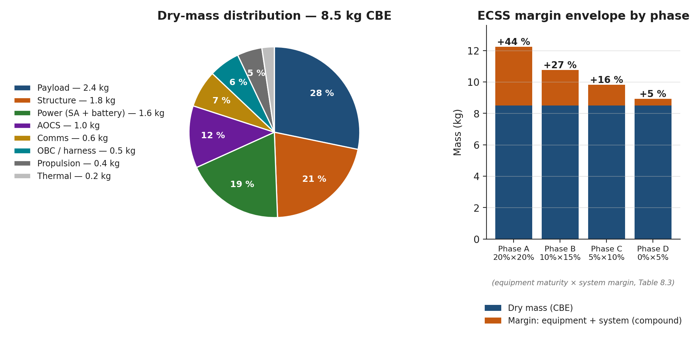

*Figure SE.1 — Répartition de la masse et échéancier des marges ECSS.
Votre rôle est de maintenir la masse totale sous la colonne
correspondant à la phase en cours.*

### Écueils fréquents

> **Attention.** Résoudre un conflit en faisant la moyenne des demandes
> des deux disciplines *sans* mettre à jour le référentiel des
> exigences concernées est le mode de défaillance classique de
> l'ingénierie système. Mettez toujours l'exigence à jour avant
> d'accepter le compromis.

> **Attention.** La marge n'est pas du mou. La marge est une assurance
> contre l'incertitude. Si vous cédez de la marge à quelqu'un — à
> l'AOCS pour une roue supplémentaire, par exemple — consignez-la comme
> une consommation de marge dans le journal des modifications, et non
> comme une nouvelle allocation.

### Références

- NASA SEH (SP-2016-6105 Rev 2) — [https://www.nasa.gov/reference/systems-engineering-handbook/](https://www.nasa.gov/reference/systems-engineering-handbook/)
- ECSS-M-ST-10C — [https://ecss.nl/](https://ecss.nl/)
- Wertz et al., *Space Mission Engineering: The New SMAD* (2011), chap. 2.
- Larson & Wertz, *Space Mission Analysis and Design* (SMAD), chap. 1, 22.

---

## Analyste de mission

Vous êtes responsable de la relation de la mission avec la physique :
l'orbite, la trace au sol, les conditions d'éclairement, les durées de
contact.

### Décisions qui vous reviennent

1. **Type d'orbite et altitude.** LEO / SSO / MEO / GEO / HEO /
   lunaire. L'altitude doit équilibrer retour scientifique, durée de
   vie, traînée, rayonnement et coût de lancement.
2. **Inclinaison.** Elle détermine la couverture en latitude, la
   répétitivité de la trace au sol et (avec l'altitude) la condition
   d'héliosynchronisme.
3. **LTAN / LTDN** pour les missions SSO — elles déterminent
   l'enveloppe de l'angle β et la saison d'éclipses.
4. **Réseau de stations sol.** Où transmettre les données au sol,
   latence, trous de couverture.
5. **Plan de manœuvres.** Quand effectuer le phasage, comment assurer
   le maintien à poste, quand désorbiter.

### Ce qu'il faut savoir d'abord

- La **cible scientifique** de la mission — éviter le reflet spéculaire
  du Soleil ? couverture polaire ? observation de la Terre continue ?
- La **bande de latitudes** d'intérêt (p. ex. la surveillance de
  l'Arctique polaire impose une orbite inclinée ou polaire).
- La **durée de vie visée** et le cadre réglementaire
  (FCC 5 ans / IADC 25 ans).
- La **disponibilité des lancements** — un lanceur cible contraint à
  la fois l'inclinaison et l'altitude.

### Formules, abaques et règles empiriques

**Période képlérienne d'une orbite circulaire** (vérifiée sur des
orbites connues à la figure MA.1 ci-dessous) :

$$ T = 2\pi \sqrt{a^3 / \mu} $$

où μ_Earth = 398 600,4418 km³/s² et a = R_Earth + h.

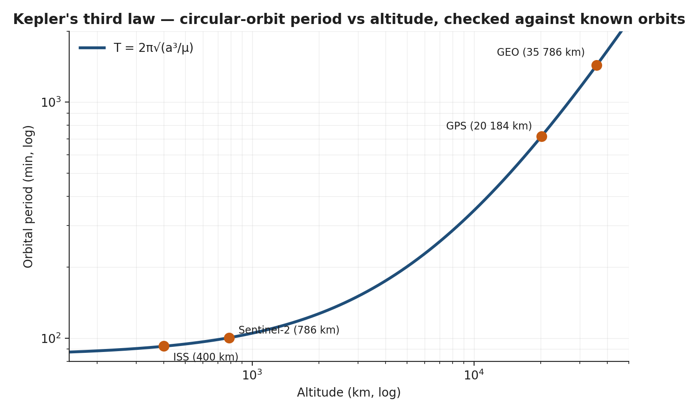

*Figure MA.1 — Troisième loi de Kepler. Les marqueurs (classe ISS,
Sentinel-2, GPS, GEO) se placent sur la courbe analytique à mieux que
0,5 % près — ce qui est l'accord attendu une fois l'aplatissement de la
Terre pris en compte séparément.*

**Condition d'héliosynchronisme** — choisir i de sorte que la
régression nodale due au J₂ égale le mouvement moyen de la Terre
autour du Soleil (~0,9856 °/jour). À 600 km d'altitude, i ≈ 97,79°.

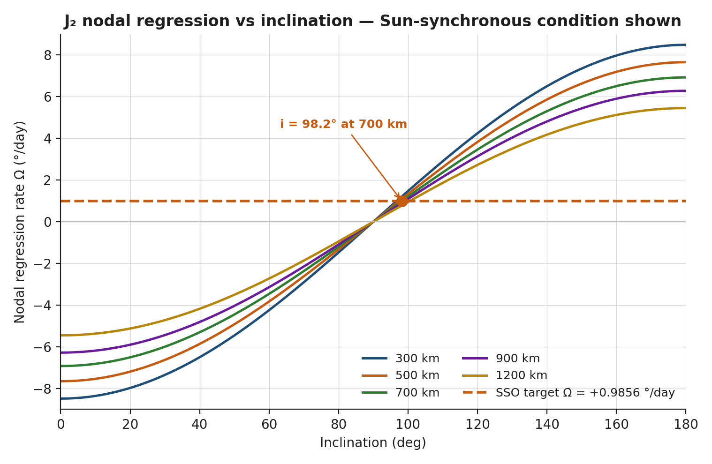

*Figure MA.2 — Vitesse de régression nodale due au J₂ en fonction de
l'inclinaison. L'horizontale tiretée est la cible SSO. Son intersection
avec la courbe à 700 km donne l'inclinaison SSO à cette altitude.*

**Fraction d'éclipse** d'une orbite circulaire, valable pour |β| < β\* =
arcsin(R/(R+h)) :

$$ f_{eclipse} = \frac{1}{\pi} \arccos \left( \frac{\sqrt{h^2+2Rh}}{(R+h)\cos\beta} \right) $$

Pour β > β\*, l'orbite est entièrement éclairée.

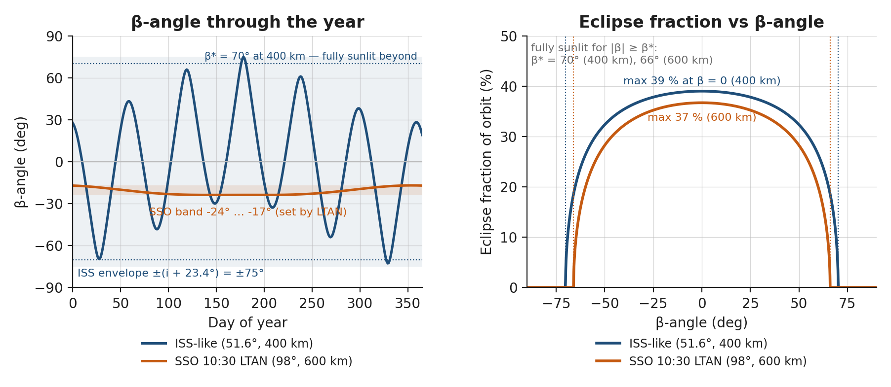

*Figure MA.3 — Enveloppe de l'angle β sur une année et courbes
analytiques de la fraction d'éclipse.*

**Règle empirique de durée de vie orbitale** (LEO dominée par la traînée) :

$$ \tau_{years} \approx \frac{h - 200}{30} \cdot \frac{m/A}{50} $$


*Figure MA.4 — Enveloppe de durée de vie orbitale en fonction de
l'altitude. Sous ~600 km, un CubeSat 6U (m/A ~ 50 kg/m²) rentre en
moins de 25 ans ; sous ~ 425 km, il peut rentrer en moins de 5 ans (la
règle FCC).*

### Écueils fréquents

> **Erreur fréquente.** Choisir 500 km en pensant obtenir une durée de
> vie de 25 ans — ce n'est pas le cas pour un 6U typique. Vérifiez
> toujours avec l'abaque de la règle empirique et une propagation STK
> ou GMAT.

> **Attention.** L'angle de reflet spéculaire pour l'imagerie de la
> couleur de l'océan varie à la fois avec la saison (β) et la
> longitude. Si votre mission est sensible au reflet solaire,
> construisez une carte β/azimut solaire sur un an avant de figer la
> LTAN.

### Références

- Curtis, *Orbital Mechanics for Engineering Students* (3e éd.).
- Vallado, *Fundamentals of Astrodynamics and Applications* (4e éd.).
- SMAD (choix de l'orbite).
- Wertz, *Mission Geometry: Orbit and Constellation Design and Management* (2001).
- AGI STK — [https://www.agi.com/products/stk/](https://www.agi.com/products/stk/).
- NASA GMAT (logiciel libre) — [https://software.nasa.gov/software/GSC-17177-1](https://software.nasa.gov/software/GSC-17177-1).

---

## Ingénieur charge utile

Vous êtes responsable de la science. La mission existe pour faire ce
que fait votre charge utile, et tous les autres sous-systèmes sont en
définitive au service du vôtre.

### Décisions qui vous reviennent

1. **Concept de charge utile et type de capteur.** Optique / SAR /
   hyperspectral / radiomètre / récepteur RF / etc.
2. **Ouverture et bandes spectrales.** Elles déterminent la résolution,
   le RSB et la masse.
3. **Concept de fonctionnement.** Push-broom, whisk-broom ou matriciel ;
   acquisition continue ou déclenchée sur cible.
4. **Débit et volume de données par orbite.** Ils dimensionnent les
   communications et l'OBDH.
5. **Plan d'étalonnage.** Sources embarquées, références au sol,
   cadence.

### Ce qu'il faut savoir d'abord

- **Objectif de mission mesurable** (MoP). Pour la couleur de l'océan,
  il faut certaines bandes à un certain RSB ; pour le SAR, une certaine
  résolution au sol et un certain temps de revisite ; pour l'AIS, une
  certaine probabilité de détection.
- **Altitude de l'orbite** — elle détermine la distance oblique, la GSD
  et la couverture.
- **Masse et puissance disponibles** — typiquement 30–50 % de la
  plateforme.

### Formules, abaques et règles empiriques

**Limite de diffraction de la GSD** pour une ouverture non obstruée :

$$ \mathrm{GSD}_{diff} = \frac{1.22 \lambda h}{D} $$

**Limite pixel de la GSD :**

$$ \mathrm{GSD}_{pix} = \frac{p \cdot h}{f} $$

où p est le pas des pixels et f la distance focale. La GSD atteignable
est la plus grande des deux.

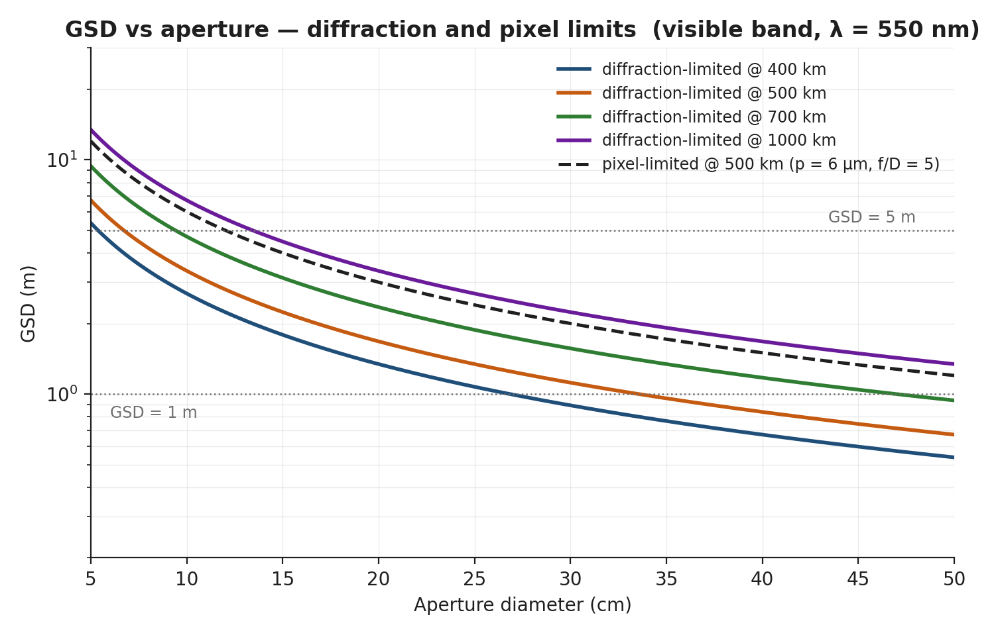

*Figure PL.1 — GSD en fonction de l'ouverture pour des imageurs dans
le visible (λ = 550 nm). La ligne tiretée est la limite pixel à
500 km pour p = 6 µm et f/D = 5.*

**Longueur minimale de l'antenne SAR :**

$$ L_{ant,min} = 2 \cdot \delta_{azimuth} $$

c.-à-d. que la longueur de l'antenne dans le sens de la trace doit
dépasser le double de la résolution en azimut souhaitée.

### Écueils fréquents

> **Erreur fréquente.** Dimensionner l'ouverture de la charge utile
> sur la limite de diffraction alors que les pixels du détecteur sont
> trop grossiers pour en tirer parti. Accordez les deux : les GSD
> limitées par le pixel et par la diffraction doivent être comparables.

> **Attention.** Le volume de données par orbite croît avec
> l'ouverture de deux façons à la fois : plus de pixels et une
> cadence ligne plus rapide. Vérifiez la capacité de transmission
> quotidienne (figure PL.2) avant de vous engager.

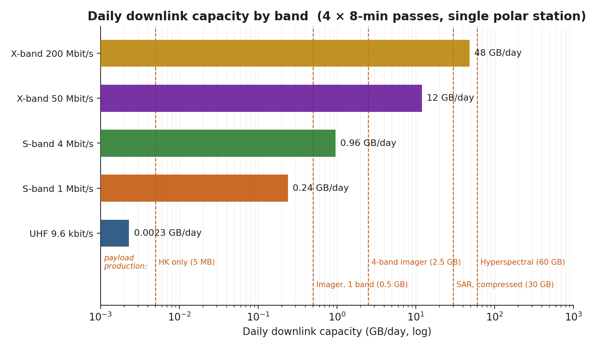

*Figure PL.2 — Capacité quotidienne de liaison descendante par bande,
comparée aux volumes de données typiques des charges utiles. L'UHF
ne suffit que pour la télémesure de servitude ; la bande S convient à
l'imagerie ; la bande X au SAR et à l'hyperspectral.*

### Références

- SMAD (charge utile).
- Cracknell, *Introduction to Remote Sensing* (3e éd.).
- Rees, *Physical Principles of Remote Sensing* (3e éd.).
- Cumming & Wong, *Digital Processing of Synthetic Aperture Radar Data*.
- ECSS-E-ST-10-04C — Environnement spatial pour le dimensionnement de la charge utile — [https://ecss.nl/](https://ecss.nl/).

---

## Ingénieur puissance

Vous êtes responsable du bilan énergétique, orbite par orbite.

### Décisions qui vous reviennent

1. **Architecture du générateur solaire.** Fixé sur la structure ou
   déployable ; orientable ou fixe ; technologie (GaAs triple jonction
   ou Si).
2. **Surface du générateur solaire** — en fin de vie, compte tenu de
   la dégradation, de la plage d'angle β et du pointage.
3. **Capacité de la batterie et DoD.** Durée de vie en cycles contre
   profondeur des éclipses.
4. **Tension du bus et architecture du PCDU.** Bus unique ou double ;
   régulé ou non régulé ; topologie MPPT.
5. **Rapport cyclique des modes de puissance.** Il découle du ConOps.

### Ce qu'il faut savoir d'abord

- **Orbite** — elle détermine l'enveloppe de l'angle β et la fraction
  d'éclipse.
- **Charge moyenne sur l'orbite** de tous les sous-systèmes (en watts).
- **Durée de vie de la mission** — elle détermine le nombre de cycles
  et la dégradation EOL.

### Formules, abaques et règles empiriques

**Dimensionnement du générateur solaire (première approche) :**

$$ A_{SA} = \frac{P_{avg} \cdot \left(1 + \frac{f_{eclipse}}{f_{sun}\,\eta_{dis}}\right)}{S_{0}\,\eta_{cell}\,\cos\beta\,(1-D_{deg})} $$

où S₀ = 1361 W/m², η_cell ≈ 0,30 pour le GaAs triple jonction,
D_deg ≈ 10 % pour une fin de vie à 5 ans en LEO.

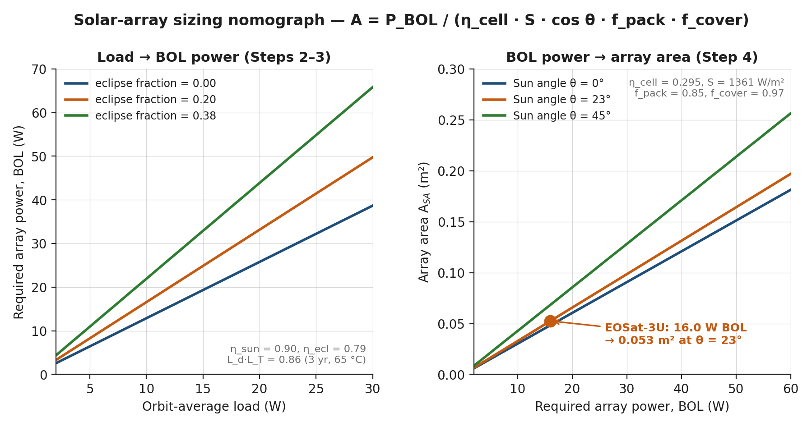

*Figure PW.1 — Abaque du générateur solaire pour η = 30 %, 10 % de
dégradation EOL, β = 20°, η_dis = 85 %. Un 6U à 15 W de moyenne a
besoin de ~870 cm² en fin de vie.*

**Dimensionnement de la batterie — énergie utilisable :**

$$ E_{usable} = \mathrm{DoD} \cdot E_{nominal} \quad ; \quad E_{nominal} = \frac{P_{avg} \cdot t_{eclipse}}{\eta_{dis} \cdot \mathrm{DoD}} $$

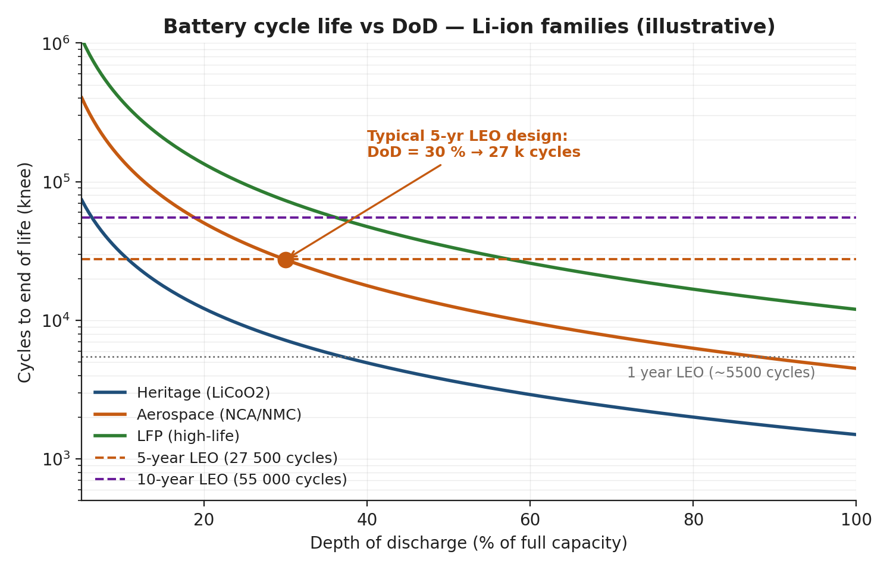

*Figure PW.2 — Durée de vie en cycles de la batterie en fonction de
la DoD pour les familles Li-ion. Un point de conception à 30 % de DoD
fournit les cycles nécessaires à une mission LEO de 5 ans, avec de la
marge. Une chimie ayant volé comme LiCoO₂ exige un déclassement plus
important ; le LFP offre plus de latitude mais une densité massique
plus faible.*

**Profil de puissance sur une orbite** — la figure PW.3 montre la
situation typique de production et de consommation.

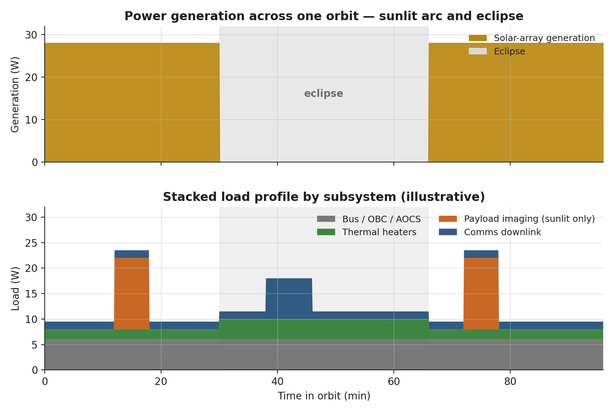

*Figure PW.3 — Production (en haut) et profil de charges empilées (en
bas) sur une orbite.*

### Écueils fréquents

> **Attention.** Dimensionner le générateur en début de vie affame la
> batterie en fin de vie. Calculez toujours en EOL avec une
> dégradation réaliste (p. ex. 10 % sur 5 ans pour le GaAs triple
> jonction en LEO).

> **Erreur fréquente.** Oublier que le générateur ne produit que
> lorsque les cellules voient le Soleil. Avec β = 0° au changement de
> saison, le générateur ne reçoit aucun éclairement à midi orbital —
> concevez pour le cas le plus défavorable de l'année.

### Références

- ECSS-E-ST-20C — *Electrical and electronic* — [https://ecss.nl/](https://ecss.nl/)
- SMAD (puissance).
- Patel, *Spacecraft Power Systems*.
- Brown, *Spacecraft Propulsion and Power Subsystems*.

---

## Ingénieur SCAO

Vous êtes responsable du pointage du satellite.

### Décisions qui vous reviennent

1. **Exigence de pointage** — connaissance, contrôle et stabilité,
   par axe.
2. **Jeu de capteurs** — senseur solaire / magnétomètre / senseur
   stellaire / GPS / centrale inertielle (IMU).
3. **Jeu d'actionneurs** — magnétocoupleur / roue de réaction /
   monergol / gaz froid.
4. **Modes et transitions** — acquisition solaire, amortissement
   (detumbling), pointage fin, survie.
5. **Plan de gestion du moment cinétique** — à quelle fréquence, avec
   quels moyens.

### Ce qu'il faut savoir d'abord

- **Exigence de pointage** issue de la charge utile (p. ex. 0,05° à 1σ
  pour un imageur push-broom).
- **Environnement perturbateur** sur l'orbite choisie (traînée à
  400 km, à 700 km, en SSO).
- **Tenseur d'inertie du satellite** — fourni par les structures.

### Formules, abaques et règles empiriques

**Bilan de pointage — contributeurs combinés en RSS :**

$$ \sigma_{pointing}^2 = \sigma_{knowledge}^2 + \sigma_{control}^2 + \sigma_{alignment}^2 $$

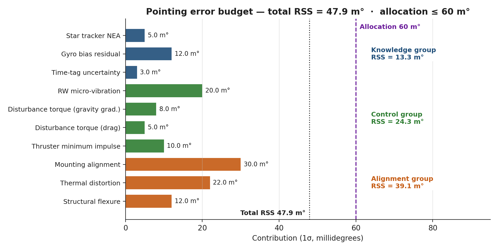

*Figure AC.1 — Arbre du bilan d'erreurs de pointage. Les groupes
connaissance, contrôle et alignement se combinent en RSS pour donner
le total. La ligne tiretée est l'allocation de la mission.*

**Dimensionnement des roues de réaction — capacité en moment cinétique :**

$$ H_{wheel} \geq T_{disturbance} \cdot t_{between\;desat} \cdot k_{margin} $$

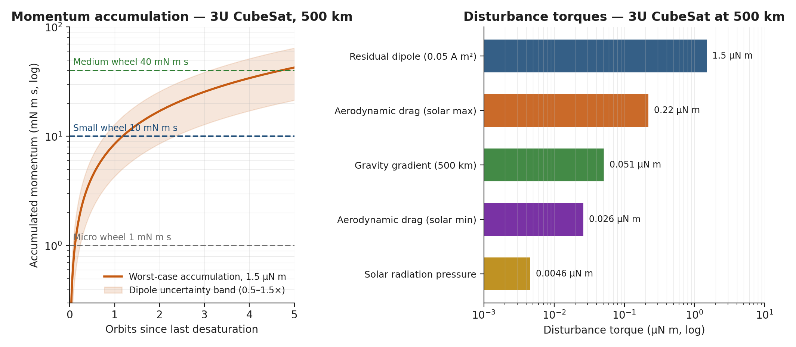

*Figure AC.2 — Accumulation du moment cinétique par orbite (à gauche)
et ordre de grandeur des couples perturbateurs (à droite). À 500 km,
le dipôle magnétique résiduel domine typiquement avec ~1,5 µN·m, ce qui accumule
~ 10–40 mN·m·s en quelques orbites.*

### Écueils fréquents

> **Attention.** Dérive de la normalisation du quaternion dans le
> logiciel de vol — même une dérive de 1e-6 par seconde finit par
> compter. Renormalisez à chaque cycle.

> **Erreur fréquente.** Concevoir pour le pointage fin sans
> dimensionner la roue pour le déchargement par désaturation.
> Planifiez la stratégie de désaturation en même temps que la roue.

### Références

- ECSS-E-ST-60-30C — *Satellite attitude and orbit control system (AOCS) requirements* — [https://ecss.nl/](https://ecss.nl/).
- Markley & Crassidis, *Fundamentals of Spacecraft Attitude Determination and Control*.
- Sidi, *Spacecraft Dynamics and Control*.
- SMAD

---

## Ingénieur thermique

Vous maintenez chaque composant dans sa plage de fonctionnement dans
les cas chaud, froid et transitoires.

### Décisions qui vous reviennent

1. **Enveloppe cas chaud / cas froid** — à définir en fonction de
   l'angle β, de la saison, des éclipses et de la dissipation interne.
2. **Revêtements de surface (α, ε)** pour chaque panneau extérieur et
   chaque radiateur.
3. **MLI ou réchauffeurs** — isolation passive ou contrôle actif.
4. **Topologie de rejet thermique** — emplacement et surface des
   radiateurs.
5. **Interfaces thermiques** — chemins conductifs vers et depuis
   chaque composant.

### Ce qu'il faut savoir d'abord

- **Plages de température de fonctionnement** de chaque composant (la
  batterie est la plus stricte, typiquement −5 à +25 °C en charge).
- **Fraction et durée d'éclipse**, fournies par l'analyste de mission.
- **Carte de dissipation interne**, fournie par la puissance.

### Formules, abaques et règles empiriques

**Équilibre radiatif d'une plaque plane :**

$$ T_{eq} = \left( \frac{\alpha_s S + \epsilon_{IR} \phi_{IR}}{\sigma\,\epsilon_{IR}} \right)^{1/4} $$

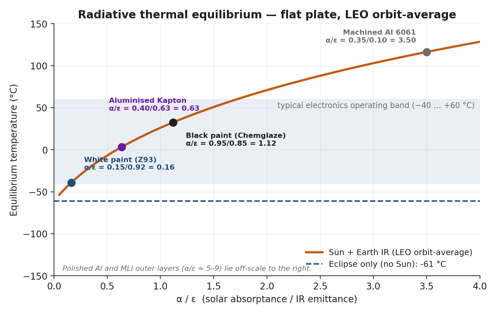

*Figure TH.1 — Température d'équilibre en fonction de α/ε pour une
plaque plane en LEO, avec les revêtements de surface courants
indiqués.*

### Écueils fréquents

> **Erreur fréquente.** Utiliser α et ε à température ambiante pour
> les calculs infrarouges — à −100 °C, l'ε de nombreux matériaux
> change. Citez la température des données sources.

> **Attention.** Le MLI se caractérise par son ε* effectif, et non
> par le matériau de base. Prenez ε* ≈ 0,03 pour un MLI à 10 couches ;
> moins pour un nombre de couches plus faible.

### Références

- ECSS-E-ST-31C — *Thermal control* — [https://ecss.nl/](https://ecss.nl/)
- Gilmore, *Spacecraft Thermal Control Handbook*, vol. I et II.
- SMAD
- ESATAN-TMS — [https://www.esatan-tms.com/](https://www.esatan-tms.com/).

---

## Ingénieur structures

Vous vous assurez que le satellite survit au lancement et à la vie en
orbite, et que le matériel de tous les autres est correctement
interfacé sur le plan mécanique.

### Décisions qui vous reviennent

1. **Topologie de la structure primaire** — monolithique, panneaux et
   nervures, ou impression 3D.
2. **Choix des matériaux** — Al, Ti, CFRP, sandwich.
3. **Bouclage du bilan de masse avec marge.**
4. **Voie de vérification des charges de lancement** — analyse (FEA),
   essai, ou les deux.
5. **Interfaces mécaniques** — schéma de fixation, compatibilité avec
   le déployeur (ISIPOD / EXOpod / CSD).

### Ce qu'il faut savoir d'abord

- **Environnement du lanceur** (niveaux de qualification en vibrations
  sinusoïdales, vibrations aléatoires et chocs).
- **Masse et centre de gravité (CG) des composants** — chaque
  sous-système les fournit.
- **Enveloppe Cal Poly CDS Rev 14** pour les CubeSat.

### Formules, abaques et règles empiriques

**Marge de sécurité :**

$$ \mathrm{MoS} = \frac{\sigma_{allow}}{\mathrm{FoS} \cdot \sigma_{applied}} - 1 $$

Pour la limite élastique de l'Al 7075-T6 : σ_yield = 503 MPa,
FoS_yield = 1,25.

**Analyse modale** — premier mode > 100 Hz, exigence typique pour un
CubeSat.

### Écueils fréquents

> **Attention.** Oublier la masse des fixations et des adhésifs — elles
> ajoutent typiquement 5–10 % à la masse structurale.

> **Erreur fréquente.** Dimensionner pour les charges statiques en
> oubliant le facteur d'amplification dynamique (vibrations
> aléatoires). Appliquez le facteur Q (typiquement 5–10) à la
> résonance.

### Références

- ECSS-E-ST-32C — *Structures* — [https://ecss.nl/](https://ecss.nl/).
- Sarafin, *Spacecraft Structures and Mechanisms*.
- Cal Poly CDS Rev 14 — [https://www.cubesat.org/cds-announcement](https://www.cubesat.org/cds-announcement).

---

## Ingénieur propulsion

Vous êtes responsable du Δv. (Même si votre CubeSat n'en a pas, c'est
vous qui le décidez.)

### Décisions qui vous reviennent

1. **Besoin de propulsion** — compensation de la traînée ?
   désorbitation ? phasage ? vol en formation ? rendez-vous ?
2. **Choix de l'ergol** — gaz froid / monergol / biergol / électrique
   (Hall, ionique, PPT, FEEP).
3. **Dimensionnement du propulseur** — poussée, Isp et puissance.
4. **Masse totale d'ergols** — Tsiolkovski.
5. **Plan de gestion de l'impact du jet et de la contamination.**

### Ce qu'il faut savoir d'abord

- **Bilan de Δv** — somme de toutes les manœuvres requises, avec marge.
- **Durée de la mission** — elle détermine le Δv cumulé pour les
  orbites dominées par la traînée.
- **Puissance disponible** — elle conditionne la faisabilité de la
  propulsion électrique (EP) (un CubeSat de 20 W ne peut pas
  alimenter un propulseur à effet Hall de 200 W).

### Formules, abaques et règles empiriques

**Tsiolkovski :**

$$ \Delta v = I_{sp}\,g_0\,\ln\frac{m_0}{m_f} $$

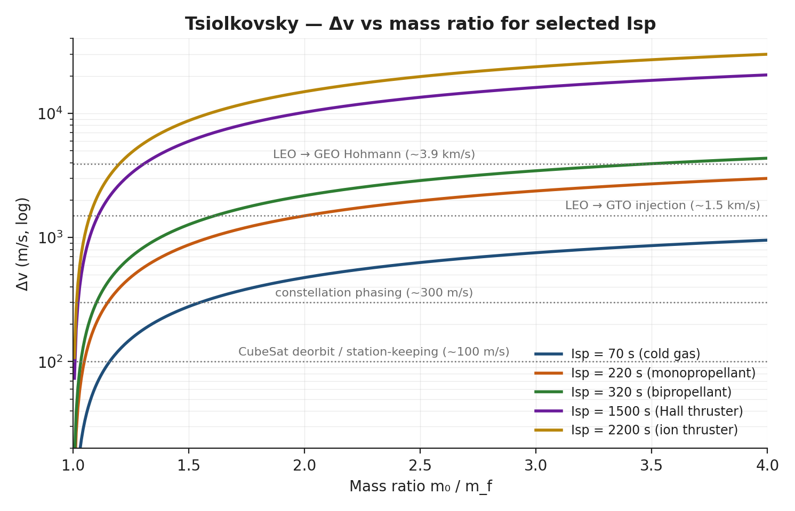

*Figure PR.1 — Δv en fonction du rapport de masse pour cinq valeurs
caractéristiques d'Isp. Les lignes horizontales indiquent des bilans
de Δv de mission typiques.*

### Écueils fréquents

> **Attention.** L'Isp dépend des conditions d'entrée et du rapport de
> détente de la tuyère. Donnez la valeur au point de fonctionnement
> réellement utilisé en vol.

> **Erreur fréquente.** Confondre la masse totale (m₀) et la masse
> sèche (m_f) en appliquant l'équation de Tsiolkovski.

### Références

- Sutton & Biblarz, *Rocket Propulsion Elements* (9e éd.).
- ECSS-E-ST-35C — *Propulsion general* — [https://ecss.nl/](https://ecss.nl/).
- Goebel & Katz, *Fundamentals of Electric Propulsion*.

---

## Ingénieur télécommunications

Vous transportez les bits — dans les deux sens.

### Décisions qui vous reviennent

1. **Bande de fréquences** — UHF / S / X / Ka. Elle détermine les
   licences, la taille d'antenne et l'affaiblissement en espace libre
   (FSPL).
2. **Modulation et codage.**
3. **Diagramme de rayonnement de l'antenne** — parabole à grand gain,
   antenne patch ou antenne déployable.
4. **Réseau de stations sol** — station sol (GS) unique ou réseau.
5. **Allocation de la marge de liaison** à chaque phase.

### Ce qu'il faut savoir d'abord

- **Volume de données quotidien**, fourni par la charge utile.
- **Exigence de latence** — s'il y en a une.
- **Capacité de pointage**, fournie par l'AOCS (elle conditionne le
  diagramme de rayonnement nécessaire).
- **Contraintes réglementaires** de la bande choisie.

### Formules, abaques et règles empiriques

**Affaiblissement en espace libre :**

$$ L_{FS} = 20 \log_{10}(4 \pi d / \lambda) \;\text{dB} $$

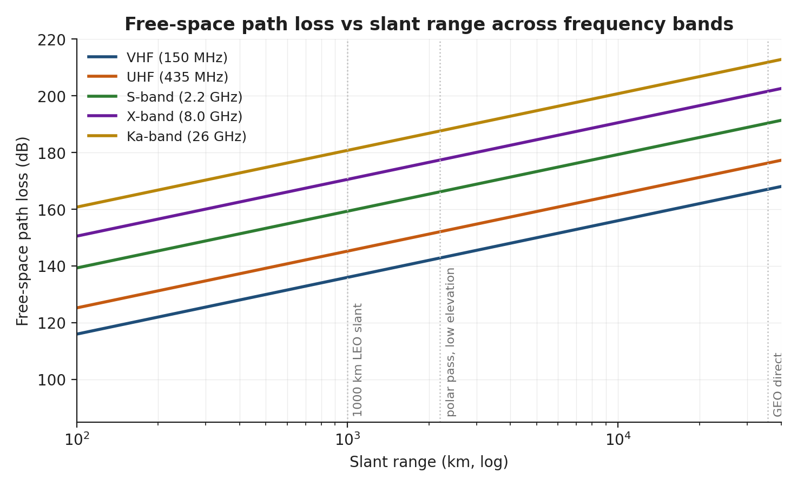

*Figure CO.1 — FSPL selon les bandes. À 2,2 GHz (bande S) sur une
distance oblique de 1500 km, FSPL ≈ 163 dB ; à 26 GHz (bande Ka),
184 dB.*

**Bouclage du bilan de liaison :**

$$ \frac{C}{N_0} = \mathrm{EIRP} - L_{path} - L_{atm} - L_{point} + G/T - k\;[\mathrm{dB}\!\cdot\mathrm{Hz}] $$

avec k = −228,6 dBW/(K·Hz).

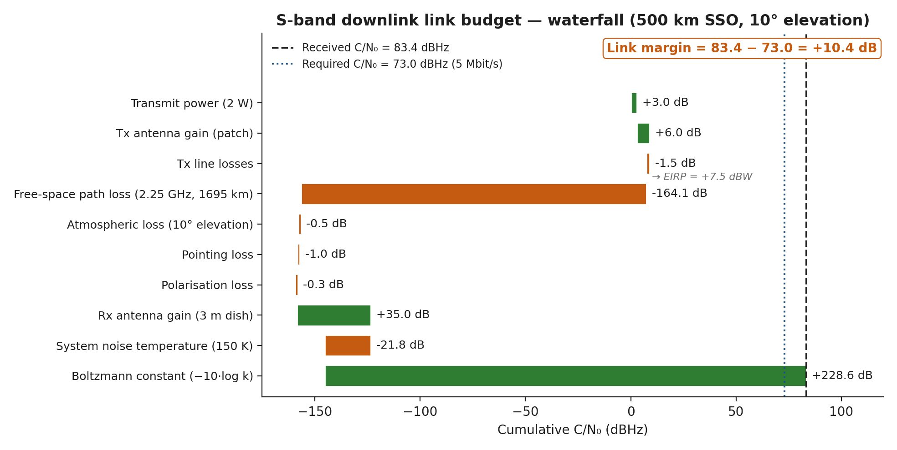

*Figure CO.2 — Bilan en cascade canonique en bande S. Lisez-le de
gauche à droite : les gains s'ajoutent, les pertes se soustraient ; en
bas à droite figurent le C/N₀ requis et la marge.*

**Eb/N₀ → TEB** — la figure CO.3 montre les courbes classiques.

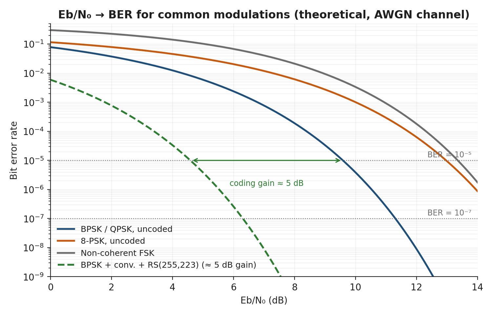

*Figure CO.3 — Eb/N₀ en fonction du TEB pour BPSK, QPSK, 8-PSK, FSK
et un schéma de codage concaténé typique.*

**Diagrammes de rayonnement** — grand gain et faible gain.

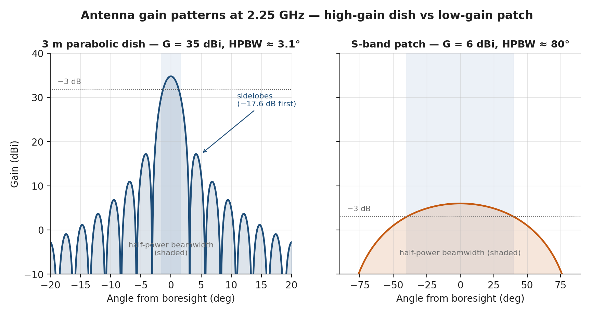

*Figure CO.4 — Parabole à grand gain (33 dBi, étroite) et antenne
patch en bande S (~6 dBi, large). La parabole exige un pointage SCAO
précis ; l'antenne patch tolère ~30° d'erreur de pointage.*

### Écueils fréquents

> **Attention.** La perte de dépointage n'est pas négligeable. Pour
> une parabole d'ouverture à mi-puissance (HPBW) de 1°, une erreur de
> pointage de 0,3° coûte ~1 dB ; à 0,5°, elle coûte ~3 dB.

> **Erreur fréquente.** Oublier l'effet Doppler. Une liaison en bande
> S à 2,2 GHz depuis une LEO à 7,5 km/s subit un décalage Doppler de
> ±55 kHz à l'horizon — la poursuite de votre récepteur doit suivre.

### Références

- ECSS-E-ST-50-05C — RF et modulation — [https://ecss.nl/](https://ecss.nl/).
- Pratt, Bostian & Allnutt, *Satellite Communications* (3e éd.).
- Recommandations UIT-R — [https://www.itu.int/en/ITU-R/](https://www.itu.int/en/ITU-R/).

---

## Ingénieur OBDH / logiciel

Vous êtes responsable du calculateur de bord, du logiciel de vol, de
la liste de télémesure et de la FDIR.

### Décisions qui vous reviennent

1. **Architecture de l'OBC** — carte unique (SBC) ou paire redondante ;
   SoC ou composants discrets.
2. **Topologie des bus** — CAN / SpaceWire / I²C / SPI.
3. **Architecture mémoire** — RAM, flash, mémoire de masse, schéma
   EDAC.
4. **Architecture du logiciel de vol (FSW)** — gestionnaire de modes,
   boucle de commande du SCAO, gestionnaire TM/TC, règles FDIR.
5. **Ensemble de services PUS** — quels services PUS du CCSDS mettre
   en œuvre.

### Ce qu'il faut savoir d'abord

- **Volume de TM/TC** de chaque sous-système.
- **Fréquences des boucles temps réel** exigées par l'AOCS.
- **Volume de stockage** pour la plus longue période sans contact
  (dimensionnement de la mémoire de masse).

### Formules, abaques et règles empiriques

- **Dimensionnement de la mémoire de masse :** plus longue période
  sans contact × débit crête × marge (1,5–2×).
- **Chien de garde :** typiquement 30 s pour un OBC de CubeSat ; moins
  pour les tâches du logiciel de vol à criticité élevée.
- **Surdébit EDAC :** Hamming SECDED ~ 12,5 % pour des mots de 64 bits.

### Écueils fréquents

> **Attention.** Les dépassements de la liste de télémesure sont le
> défaut tardif n° 1 de l'OBDH. Figez la liste à la SRR ; traitez
> tout ajout comme un élément soumis à la maîtrise des modifications.

### Références

- CCSDS PUS — [https://public.ccsds.org/Pubs/660x0g3.pdf](https://public.ccsds.org/Pubs/660x0g3.pdf).
- ECSS-E-ST-40C — *Software* — [https://ecss.nl/](https://ecss.nl/).
- ECSS-Q-ST-80C — *Software product assurance* — [https://ecss.nl/](https://ecss.nl/).

---

## Ingénieur opérations

Vous piloterez le satellite une fois que l'équipe l'aura construit,
en portant la conception jusqu'aux chapitres consacrés aux opérations
dans la partie 2.

### Décisions qui vous reviennent

1. **Concept d'opérations** — effectifs, niveau d'automatisation,
   organisation des quarts.
2. **Plan de passage** — quelles procédures, dans quel ordre, à chaque
   contact.
3. **Arbre de traitement des anomalies** — qui annonce quoi, et quand.
4. **Définition des télécommandes et de la télémesure** — en
   coordination avec l'OBDH.

### Ce qu'il faut savoir d'abord

- **Modes d'opérations de la mission**, issus du ConOps.
- **Couverture des stations sol**, fournie par l'analyste de mission.
- **Inventaire des procédures**, tiré du jeu de procédures de la
  mission (LEOP / recette en orbite / nominal / contingence /
  urgence).

### Écueils fréquents

> **Attention.** La discipline de boucle vocale est le tueur
> silencieux. Des interférences de parole qui semblent anodines à
> l'entraînement deviennent rédhibitoires sous la pression du temps
> réel.

### Références

- ECSS-E-ST-70C — *Ground systems and operations* — [https://ecss.nl/](https://ecss.nl/).
- [ECSS-E-ST-70-32C](https://ecss.nl/standard/ecss-e-st-70-32c-test-and-operations-procedures/) — *Test and operations procedures*.
- NASA *Mission Operations Handbook* — [https://nodis3.gsfc.nasa.gov/](https://nodis3.gsfc.nasa.gov/).

---

## Ingénieur segment sol

Vous êtes responsable de l'architecture entre l'antenne et
l'utilisateur.

### Décisions qui vous reviennent

1. **Réseau de stations sol** — en propre, loué ou commercial
   (Atlas, KSAT, Viasat, AWS Ground Station).
2. **Choix du MCS** — COSMOS / OpenMCT / Yamcs / commercial.
3. **Conception de l'archive** — L0 → L1 → L2 → latence de diffusion.
4. **Outil de planification des passages**.
5. **Architecture de cybersécurité.**

### Ce qu'il faut savoir d'abord

- **Volume de données quotidien** — il dimensionne les contrats de
  bande passante.
- **Exigence de latence** — elle détermine la densité du réseau de
  stations.
- **Classification de la mission** — les missions de défense
  exigent des architectures différentes des missions civiles.

### Écueils fréquents

> **Attention.** Le modèle tarifaire d'AWS Ground Station peut
> inverser l'économie du choix entre bandes — faites le calcul au
> débit retenu.

### Références

- Normes CCSDS Mission Operations — [https://public.ccsds.org/Pubs/](https://public.ccsds.org/Pubs/).
- KSAT — [https://www.ksat.no/](https://www.ksat.no/).
- AWS Ground Station — [https://aws.amazon.com/ground-station/](https://aws.amazon.com/ground-station/).

---

## Coûts et planning

Vous êtes le garde-fou de l'équipe face à la réalité.

### Décisions qui vous reviennent

1. **Structure du WBS** (NPR 7120.5).
2. **Méthode d'estimation des coûts** — paramétrique (SSCM, COMPACT),
   par analogie, ascendante.
3. **Référentiel de planning** — jalons, chemin critique, marge
   (float).
4. **Estimations ajustées au risque** — comment intégrer le risque à
   la fois dans le coût et dans le planning.

### Écueils fréquents

> **Erreur fréquente.** Prendre le résultat de l'outil paramétrique
> pour la réponse. Ce résultat est un point de départ ; adaptez-le à
> votre mission et au marché des lancements dans lequel vous
> travaillez.

### Références

- NPR 7120.5F — [https://nodis3.gsfc.nasa.gov/](https://nodis3.gsfc.nasa.gov/).
- Wertz et al., SME, chap. 23 (Cost).
- SMAD
- AIAA Cost Modeling — [https://www.aiaa.org/](https://www.aiaa.org/).

---

## Ingénieur conformité / réglementation

Vous êtes responsable de la relation de la mission avec ceux qui font
les règles : adaptation des normes, spectre, contrôle des exportations
et atténuation des débris.

### Décisions qui vous reviennent

1. **Matrice des normes applicables.** Quelles normes ECSS / NASA
   s'appliquent, et comment elles sont adaptées à une mission de
   classe CubeSat (ECSS-S-ST-00-02C).
2. **Voie d'attribution des licences de fréquences.** Coordination
   IARU, dépôt auprès de l'administration nationale (p. ex. ISDE
   CPC-2-6-02) et notification à l'UIT au titre de l'article 9 du
   Règlement des radiocommunications (RR).
3. **Classification à l'exportation.** ITAR / EAR / équivalent
   national pour chaque composant et chaque jeu de données.
4. **Conformité en matière d'atténuation des débris.** 25 ans IADC,
   5 ans FCC, évaluation du risque de victimes et immatriculation
   auprès du CUPEEA après le lancement.
5. **Licence de télédétection** (p. ex. dépôt au titre de la LSTS
   — RSSSA en anglais) lorsque la mission dispose d'une capacité
   d'imagerie.

### Ce qu'il faut savoir d'abord

- **Classification de la mission** (civile / commerciale / défense) —
  elle fixe le régime réglementaire.
- **Bandes de fréquences** choisies par les communications — elles
  déterminent la voie de dépôt.
- **Orbite et durée de vie**, fournies par l'analyste de mission —
  elles conditionnent la conformité en matière de débris.

### Écueils fréquents

> **Attention.** Les délais d'obtention des licences dépassent
> couramment les délais d'approvisionnement du matériel. Lancez le
> dépôt de spectre à la SRR, pas à la CDR.

> **Erreur fréquente.** Traiter la classification à l'exportation
> comme un problème du jour du lancement. Un seul composant soumis à
> ITAR peut bloquer un lancement international ou un membre de
> l'équipe de nationalité étrangère des mois plus tôt.

### Références

- ECSS-S-ST-00-02C — *Tailoring of standards* — [https://ecss.nl/](https://ecss.nl/).
- ISDE CPC-2-6-02 — licences de spectre.
- Règlement des radiocommunications de l'UIT, article 9 — [https://www.itu.int/en/ITU-R/](https://www.itu.int/en/ITU-R/).
- Lignes directrices de l'IADC relatives à la réduction des débris spatiaux ; règles de la FCC sur les débris orbitaux.

---

## Chef de projet

Vous êtes responsable du planning, du budget, de l'équipe et des
jalons — la colonne vertébrale programmatique qui assure la cohésion
de l'ingénierie.

### Décisions qui vous reviennent

1. **Référentiel de planning** — jalons, dépendances et chemin
   critique à travers SRR / PDR / CDR / FRR.
2. **Maîtrise du budget** — estimation à l'achèvement (EAC), reste à
   faire (ETC) et suivi par rapport au plafond programmatique.
3. **Allocation des ressources** — affectation des équivalents temps
   plein (ETP) entre les postes et protection de la marge de planning.
4. **Acceptation des risques** — tenue du registre des risques et
   réunion des comités de revue des risques (avec l'accord de
   l'ingénierie).
5. **Préparation des revues** — quand réunir chaque jalon et quel
   dossier de justification il exige.

### Ce qu'il faut savoir d'abord

- **WBS et modèle de coûts**, fournis par le poste coûts et planning.
- **État des accords d'interface** entre postes (là où se cache le
  risque de planning).
- **Pression des parties prenantes et du client pour modifier les
  exigences**, relayée par le représentant des utilisateurs.

### Écueils fréquents

> **Erreur fréquente.** Laisser les premières phases consommer la
> marge de planning, sans en garder pour l'intégration et les essais,
> là où elle est le plus nécessaire.

> **Attention.** Tenir une revue de jalon avant que les produits
> d'ingénierie soient mûrs transforme la revue en générateur de
> reprises. Accepter une dérive du périmètre sans évaluer son impact
> sur le planning et les coûts est la même défaillance, au ralenti.

### Références

- ECSS-M-ST-10C — *Project management* — [https://ecss.nl/](https://ecss.nl/).
- NPR 7120.5F — [https://nodis3.gsfc.nasa.gov/](https://nodis3.gsfc.nasa.gov/).
- PMI, *PMBOK Guide*.

---

## Représentant des utilisateurs

Vous portez les besoins de l'utilisateur final dans la salle et
veillez à ce que la conception reste honnête sur ce à quoi la mission
*sert* réellement.

### Décisions qui vous reviennent

1. **Exigences sur les produits de données** — format, résolution,
   exactitude et délai de mise à disposition du produit livré.
2. **Accords de niveau de service** — disponibilité, temps de réponse
   et fraîcheur des données.
3. **Mode d'accès des utilisateurs** — API, portail web ou
   téléchargement direct.
4. **Plan d'utilisation** — qui sont les utilisateurs (recherche /
   commercial / public) et comment chacun exploite le produit.

### Ce qu'il faut savoir d'abord

- **Objectif de la mission** tel que l'utilisateur l'exprime
  réellement (un besoin, pas une mise en œuvre).
- **Besoins de latence et de couverture** — ils alimentent l'analyste
  de mission, les communications et le segment sol.
- **La distinction entre « indispensable » et « souhaitable »** au
  sein de la communauté des utilisateurs.

### Écueils fréquents

> **Erreur fréquente.** Spécifier des détails de mise en œuvre (un
> capteur, une bande) au lieu du besoin utilisateur sous-jacent —
> ce qui surcontraint la conception avant l'exploration de l'espace
> des compromis.

> **Attention.** Supposer une bande passante illimitée pour la
> livraison. Le bilan de liaison descendante (communications) et
> l'archive sol (segment sol) bornent ce que l'utilisateur peut
> réellement recevoir.

### Références

- NASA SEH §4.1 — *Stakeholder expectations*.
- ECSS-E-ST-10C §5.2 — *Requirements*.
- ISO 9241 — *Usability*.


# Annexe B — Guide de référence des postes d'opérations


Cette annexe réunit les fiches de préparation par poste pour la salle
de contrôle des opérations utilisée dans la partie 2 (les chapitres
de vol). Chaque entrée reprend le style d'une entrée de conception de
l'annexe A — un court paragraphe sur la responsabilité du poste, suivi
de ce qu'il surveille et de ce dont il est responsable — et ne
*reprend pas* l'enseignement du chapitre 6. Lisez le chapitre 6,
§§6.1–6.10, pour la référence complète de l'opérateur (consoles,
limites de télémesure, catalogues de commandes, modèles de passation) ;
lisez cette annexe pour situer chaque poste de la salle de contrôle
en regard de son homologue de conception.

> **Rôles de conception et rôles d'opérations.** Certains postes
> n'existent qu'en opérations — le directeur de vol, le SPACON et le
> responsable de mission n'ont pas d'équivalent en phase de conception.
> D'autres (analyste de mission, coûts et planning, chef de projet)
> n'existent qu'en conception. Lorsqu'un nom figure dans les deux
> annexes — AOCS, thermique, TT&C / communications, charge utile,
> segment sol — l'activité diffère : en conception, vous *dimensionnez
> et sélectionnez* ; en opérations, vous *surveillez, commandez et
> réagissez* sur le satellite en vol. Les descriptions de postes
> ci-dessous sont formulées pour EO-Sat-1 ; dans l'industrie réelle, les
> frontières sont plus larges et plus floues.

> **Postes et consoles.** Le MCS est livré avec **sept consoles configurées** —
> `flight_director`, `eps_tcs` (« Puissance et thermique » [Power & Thermal]), `aocs` (« Dynamique
> du vol » [Flight Dynamics]), `ttc`, `payload_ops`, `fdir_systems` (« FDIR / Systèmes » [FDIR / Systems]) et
> `propulsion` — chacune avec ses propres onglets visibles, ses services PUS
> autorisés et ses identifiants de fonction autorisés. Les dossiers de postes
> ci-dessous décrivent des *rôles*, et plusieurs d'entre eux partagent une
> console : l'EPS et la thermique occupent tous deux la console Puissance
> et thermique, et l'ingénieur SCAO comme l'analyste de dynamique du vol occupent
> la console Dynamique du vol. Le segment sol et le responsable de mission
> n'ont pas de console propre et travaillent depuis le poste du directeur de
> vol ou hors console. Une salle de classe de moins de sept postes fusionne
> des consoles ; elle n'en invente pas de nouvelles.

> **Trois choses que fait chaque console.** (a) **La péremption découle de la
> cadence** — une valeur est fraîche jusqu'à ~0,9 fois la cadence de la
> structure HK qui la transporte et périmée au-delà de ~1,5 cadence, avec des
> planchers pour éviter que les affichages à 1 Hz ne clignotent ; un paramètre
> dont toutes les structures porteuses sont désactivées affiche NOT ENABLED,
> ce qui appelle un `HK_ENABLE` (S3.5), et non une investigation sur la
> liaison. (b) **La valeur commandée et la valeur réelle sont affichées côte à
> côte** — le mode AOCS commandé face au mode réellement en vigueur, et le
> palier de débit TM commandé face au palier actif ; un écart persistant
> signifie qu'un verrou refuse la demande, et non une erreur de décodage.
> (c) **Les définitions de surveillance S12 sont visibles dans les vidages**,
> de sorte qu'un opérateur peut lire quels contrôles de paramètres sont
> chargés au lieu de les déduire des alarmes qu'ils produisent.

---

## Directeur de vol (FD)

Le point d'autorité unique sur la boucle — rien ne se passe sur le
satellite sans un GO du FD. Le FD ne commande pas directement ; il
autorise les autres à commander et conduit les tours de table
GO/NO-GO avant chaque action commandée, en ramenant l'équipe au
dernier état vérifié dès que la situation n'est pas claire.

**Surveille et détient.** L'état, pas l'interprétation : phase du
satellite, table FDIR chargée et état de santé global OK/jaune/rouge
issu du tableau de bord système. La console FD est la seule à
disposer des droits de commande `all` et de tous les onglets : les six
onglets de sous-systèmes, l'onglet PROP, ainsi que le planning des
contacts, le panneau des procédures, le panneau PUS et la liste
complète des anomalies actives. Le FD
détient la seconde clé pour les commandes à criticité élevée
(discipline de la double clé) et est responsable de la passation de
consignes. Notez que la *phase* de mission n'est pas une
télécommande : COMMISSIONING et NOMINAL sont des déclarations sol
faites par l'équipe de direction de la mission ; le FD lit donc la
phase et planifie en fonction d'elle au lieu de la commander. Seul le responsable de mission lui est supérieur, et uniquement pour
les décisions au niveau de la mission.

---

## Contrôleur satellite / FDIR et systèmes (SPACON)

La console `fdir_systems`. Responsable de l'exécution des procédures :
il détient le fichier de procédure, annonce chaque étape sur la boucle
vocale, vérifie la vérification et demande le GO du FD avant chaque
action commandée. Le SPACON assure aussi la veille FDIR — la FDIR
fonctionne de manière autonome à bord, donc lorsque le panneau FDIR
s'allume, il lit la règle déclenchée, identifie la procédure de
contingence et recommande la réponse au FD. Deux échelles
indépendantes sont en jeu et ne doivent jamais être confondues :
la **gravité du défaut 0–4** (0 aucun, 1 INFO, 2 WARNING, 3 ALARM,
4 HIGH — la gravité de la situation signalée) et le **niveau
d'autonomie 0–3** (0 matériel, 1 logiciel du sous-système, 2
l'application FDIR de l'OBC, 3 le sol) — jusqu'où le système de bord
peut agir sans le sol. Un rapport de gravité 4 traité au niveau
d'autonomie 1 et un rapport de gravité 2 remonté au niveau 3 sont tous
deux normaux ; citez les deux nombres séparément, en les nommant.

**Surveille et détient.** Mode de l'OBC, état du chien de garde,
remplissage de la mémoire et des tampons, table FDIR chargée, rapports
d'événements récents, et trafic de vérification et de rejet des
commandes. C'est aussi la console qui dispose de l'onglet PUS : le
SPACON est donc l'opérateur qui lit à voix haute les définitions de
surveillance S12 lorsque la salle doit savoir quels contrôles de
paramètres sont réellement chargés. Détient
l'autorité sur les procédures et l'autorité de commande sur l'ensemble
de fonctions OBDH dans le cadre des étapes autorisées ; peut
recommander le passage en mode survie, mais seul le FD l'autorise.

---

## Ingénieur SCAO

La console `aocs`, intitulée **Dynamique du vol**. Détermination et
contrôle d'attitude en vol : lit les capteurs (deux senseurs
stellaires ST1/ST2, le réseau de senseurs solaires grossiers, la paire
redondante de magnétomètres, trois gyromètres mono-axe, le GPS) et les
actionneurs (quatre roues de réaction en pyramide, trois barreaux
magnétocoupleurs), rend compte des performances de pointage à chaque
passage et produit le vecteur de manœuvre. (À comparer avec
l'ingénieur SCAO de l'annexe A, qui *dimensionne* le jeu de capteurs et
d'actionneurs et rédige le bilan de pointage.)

**Surveille et détient.** Le mode AOCS commandé face au mode réellement
en vigueur (un indicateur de rétrogradation signale quand les deux
diffèrent), les vitesses angulaires, l'erreur de pointage, la sélection
et l'état des senseurs stellaires, les vitesses de roues (jaune à
5000 tr/min, rouge à la limite mécanique de 5500 tr/min, la
désaturation étant le remède), le nombre de voies gyrométriques
alimentées — il y a trois unités mono-axe et **aucune de rechange**, si
bien qu'en perdre une coûte d'emblée la connaissance de la vitesse sur
un axe — et l'accrochage GPS. Autorité de commande sur l'ensemble de
fonctions AOCS avec le GO du FD. La console comporte aussi un **onglet
PROP en lecture seule** : la dynamique du vol produit le vecteur de
manœuvre et compare le delta-V obtenu au plan, mais la poussée
elle-même est commandée depuis la console Propulsion ; tous les
boutons de propulsion y apparaissent donc désactivés.

---

## Ingénieur EPS

La moitié puissance de la console `eps_tcs` (« Puissance et thermique ») — le
même poste que l'ingénieur thermique ci-dessous. La puissance en vol :
responsable de l'état de charge de la batterie, des courants du
générateur solaire, de la tension du bus, du profil de charge en temps
réel et des **neuf** lignes d'alimentation (indices 0–8 :
`obc`, `ttc_rx`, `ttc_tx`, `payload`, `fpa_cooler`, `htr_bat`,
`htr_obc`, `aocs_wheels`, `prop` — toutes les lignes commutables sont
OFF par défaut). Annonce l'entrée et la sortie d'éclipse et est le
premier à remarquer qu'un sous-système consomme plus qu'il ne devrait.

**Surveille et détient.** Le SoC de la batterie (jaune sous 25 % ; les
étages de délestage FDIR s'enclenchent à 30 / 20 / 10 % de SoC, et le
délestage modélisé du bus à 25.0 V coupe la charge utile, le
refroidisseur, l'émetteur (TX), les roues et — en tout dernier — la
propulsion), la tension de la batterie et du bus (la règle FDIR de
sous-tension se déclenche à 24.5 V), les courants de chaque aile du
générateur, le courant de charge total et par ligne, et la température
de la batterie. Autorité de commande sur les ensembles de fonctions
EPS et TCS avec le GO du FD ; demande le délestage, que le FD autorise.

---

## Ingénieur thermique

La moitié thermique de la console `eps_tcs` — dans le MCS livré, c'est
le même poste que l'ingénieur EPS, et non une console à part. Le
contrôle thermique en vol : responsable de la commande des
réchauffeurs, des performances des radiateurs, des températures des
zones charge utile et batterie, et du refroidisseur du plan focal
(FPA) — un **cryoréfrigérateur Stirling miniature**, et non un
empilement thermoélectrique, ce qui compte parce que son autorité
s'effondre à mesure que l'écart de température demandé augmente.
(À comparer avec l'ingénieur thermique de l'annexe A, qui *définit les
cas chaud et froid* et *dimensionne* radiateurs et réchauffeurs.)

**Surveille et détient.** Les températures de la batterie, de la charge
utile, de l'OBC et du FPA, l'état du refroidisseur du FPA — y compris
le plancher froid atteignable et la marge entre celui-ci et la
consigne commandée — et les rapports cycliques des réchauffeurs (un
rapport cyclique saturé à 100 % signale un chemin thermique
défaillant). Autorité de commande sur le TCS — réchauffeurs, consignes
et consigne du refroidisseur du FPA, commandée en centikelvins — avec
le GO du FD.

---

## Ingénieur TT&C / communications

La console `ttc`. La liaison radio avec le sol en vol : responsable de
**deux émetteurs** — la chaîne principale en bande S, qui transporte
tout (télémesure de servitude temps réel, relecture, vidages d'images,
vérification des commandes), et une **balise UHF séparée à antenne
fouet**, un second boîtier avec sa propre bande, sa propre antenne et
sa propre alimentation, qui transporte une seule structure de servitude
et rien d'autre. Désactiver l'amplificateur de puissance en bande S
arrête toute la télémesure en bande S tandis que la balise continue
d'émettre ; ce contraste est la raison d'être même de la balise, et
il ne faut pas le confondre avec l'*échelon* BEACON de l'échelle de
débits en bande S (BEACON 1 / LOW 16 / HIGH 128 kbit/s, les opérations
de routine se faisant à LOW). L'opérateur TT&C configure le satellite
pour chaque type de passage et doit, sur la boucle, bien distinguer
ces deux sens de « balise ».

**Surveille et détient.** L'état et la puissance de l'émetteur, l'état
de l'émetteur de balise, l'accrochage du récepteur (LOCKED se lit
**2**, et non 1), Eb/N0, le TEB, le compte de trames, la température de
l'amplificateur de puissance, la marge de liaison, ainsi que le palier
de débit TM *commandé* et le palier *actif* — un écart persistant entre
les deux signifie qu'un verrou (antenne, mode de liaison descendante,
élévation) refuse le palier demandé par le sol. Autorité de commande
sur le TT&C avec le GO du FD ; annonce *link up* et *link down* sur la
boucle.

---

## Ingénieur opérations charge utile

La console `payload_ops`. L'instrument scientifique en vol :
responsable de l'imageur multispectral push-broom à grand champ
(fauchée de 240 km, GSD de 29,3 m, lecture brute à 96 Mbit/s) et de son
FPA, de la chronologie d'acquisition des images, de la chaîne de
traitement des données scientifiques à bord (stockage, compression,
priorisation de la transmission au sol) et de l'évaluation de la
qualité des images. Le trajet de l'image est modélisé de bout en bout :
les images n'apparaissent donc que lorsque ce poste commande une prise
de vue — rien n'arrive tout seul.

**Surveille et détient.** Le mode de la charge utile (CALIBRATION est
le mode **3**), la température du FPA et l'état du refroidisseur, le
nombre d'images, l'occupation du stockage bord, la qualité de la
dernière image et le RSB. Autorité de commande sur la charge utile avec
le GO du FD ; valide la chronologie scientifique du passage et est
responsable de la distinction entre « qualité d'image OK » et « contenu
d'image utile ».

---

## Système de dynamique du vol (FDS) / analyste orbite

Restitution d'orbite, planification des manœuvres, prévision des
passages, criblage des conjonctions et modélisation des éclipses. Il
n'y a pas de console FDS distincte dans le MCS livré : ce rôle partage
la console `aocs`, intitulée **Dynamique du vol** précisément pour cette
raison, et il travaille avec des produits de restitution d'orbite
générés hors console. Il n'a aucune autorité de commande de la
propulsion — il produit les produits avec lesquels le reste de la salle
pilote. Une poussée modifie réellement l'orbite restituée : les
plannings de passages et d'éclipses publiés par ce poste doivent donc
être régénérés après chaque manœuvre au lieu d'être réutilisés.

**Surveille et détient.** La position et la vitesse GPS, à partir
desquelles le propagateur d'orbite est réinitialisé à chaque passage
puis exécuté pour prévoir les contacts des 24 heures suivantes. Produit
le planning des passages (pour le TT&C, le segment sol, la charge
utile), le planning des éclipses (pour l'EPS, la thermique), le vecteur
de manœuvre (pour l'AOCS) et les alertes de conjonction (pour le FD).

---

## Ingénieur propulsion

La console `propulsion`. Responsable du bilan de Δv, de la chaîne
d'armement et de l'exécution des poussées sur le module 1U à monergol
vert d'EO-Sat-1 : 0,400 kg d'ergol pour 66,9 m/s au total, dimensionné
pour des manœuvres d'évitement de débris et une compensation limitée
de la traînée. Ce n'est **pas** un système de désorbitation — le déclin
naturel depuis 450 km satisfait déjà la règle de retrait de service —
et le dire fait partie du dossier, ce n'est pas une réserve à son sujet.
La dynamique du vol produit le vecteur de manœuvre ; ce poste
l'exécute.

**Surveille et détient.** La pression du réservoir au cours de la
détente en mode blowdown (22,0 bar en BOL, descendant à 9,33 bar à
l'épuisement), l'ergol restant, la poussée et l'Isp à la pression
actuelle, l'état des vannes et de l'armement, le Δv obtenu face au Δv
commandé, et la température du lit catalytique — le lit catalytique
préchauffe à 12 W pendant environ 20 minutes avant que l'armement soit
autorisé, ce qui explique que la console affiche aussi l'onglet TCS.
Autorité de commande sur l'ensemble de fonctions de propulsion ainsi
que sur le réchauffeur du propulseur, avec le GO du FD. La ligne
d'alimentation de la propulsion est la dernière dans l'ordre de
délestage, et la couper en pleine poussée interrompt la poussée à bord.

---

## Ingénieur segment sol / contrôleur réseau

Pas de console dédiée : ce rôle travaille depuis le poste du directeur
de vol et du côté station sol du réseau. Le côté sol de la liaison
radio en vol : pointage et état
des antennes, équipements de bande de base, réseau entre le MCS et la
station, et transfert d'une station à l'autre. (À comparer avec
l'ingénieur segment sol de l'annexe A, qui *sélectionne* le réseau de
stations, le MCS et l'architecture de la chaîne de données.)

**Surveille et détient.** La poursuite d'antenne à chaque station,
l'Eb/N0 et la synchronisation trame en bande de base, et la liaison
réseau entre le MCS et la station. Autorité de commande sur la station
sol — pointage d'antenne et configuration de la bande de base — avec le
GO du FD ; annonce la station *ready* ou *not ready* avant l'AOS, et
pilote l'affichage d'état RF.

---

## Responsable de mission / interface client

Communication externe et décisions au niveau de la mission. Comme
l'ingénieur segment sol, le responsable de mission n'a pas de console
configurée. Le responsable de mission n'est *pas sur la boucle d'opérations* — il écoute, comprend
et traduit, en étant la voix du client dans la salle et la voix de la
salle auprès du client.

**Surveille et détient.** L'état au niveau de la mission plutôt que la
télémesure : les engagements ouverts envers le client et la situation
des livrables scientifiques. Produit le point quotidien pour le client,
les bulletins d'anomalie et le rapport de quart officiel. Autorité sur
les décisions au niveau de la mission uniquement (p. ex. tenter ou non
la première lumière (First Light) compte tenu d'une anomalie) ; ne
prend pas le pas sur le FD pour les décisions du quart, et le FD ne
prend pas le pas sur lui pour les décisions au niveau de la mission.


# Annexe C — Guide de référence de la vérification et des premiers principes


Cette annexe établit, à partir des premiers principes, les formules
que la promotion utilise tout au long du stage intensif CDF. Chaque
démonstration est associée à un graphique montrant la formule en
application et vérifiée par rapport à une valeur de référence publiée.

L'objectif est double : (a) offrir aux étudiantes et étudiants un
endroit où trouver le *pourquoi* de toute formule qu'ils appliquent ;
(b) fournir une piste de vérification détaillée qu'un évaluateur peut
auditer à la PDR.

> **Référence normative.** Les constantes et conventions utilisées
> dans toute cette annexe suivent Vallado, *Fundamentals of
> Astrodynamics and Applications* (4e éd.) et les IERS Conventions
> 2010 — [https://www.iers.org/IERS/EN/Publications/TechnicalNotes/tn36.html](https://www.iers.org/IERS/EN/Publications/TechnicalNotes/tn36.html).

---

## C.1 — Constantes utilisées (Terre)

| Symbole | Valeur | Signification | Source |
|--------|-------|---------|--------|
| μ_⊕ | 398 600,4418 km³/s² | Paramètre gravitationnel terrestre | IERS Conventions 2010 |
| R_⊕ | 6378,137 km | Rayon équatorial terrestre | WGS-84 |
| J₂ | 1,082 626 68 × 10⁻³ | Coefficient d'aplatissement de la Terre | Vallado §3.3 |
| ω_⊕ | 7,292 115 × 10⁻⁵ rad/s | Vitesse de rotation de la Terre | IERS |
| g₀ | 9,806 65 m/s² | Pesanteur normale | ISO 80000-3 |
| S₀ | 1361 W/m² | Constante solaire à 1 ua | NASA SORCE/CERES |
| σ | 5,670 374 × 10⁻⁸ W/(m²·K⁴) | Stefan-Boltzmann | CODATA 2018 |
| k_B | 1,380 649 × 10⁻²³ J/K | Constante de Boltzmann | CODATA 2018 |
| −10 log k | 228,6 dB·W/(K·Hz) | Boltzmann en unités de bilan de liaison | calculé |
| c | 2,997 924 58 × 10⁸ m/s | Vitesse de la lumière | exacte (SI) |

---

## C.2 — Troisième loi de Kepler

### Démonstration

Pour une orbite circulaire, l'accélération centripète est égale à
l'attraction gravitationnelle :

$$ \frac{v^2}{a} = \frac{\mu}{a^2} $$

On substitue v = 2π a / T et on résout en T :

$$ T = 2\pi \sqrt{\frac{a^3}{\mu}} $$

(Pour les orbites elliptiques, la même formule s'applique avec a
comme demi-grand axe.)

### Vérification


*Figure C.1 — Courbe analytique superposée à des orbites connues
(ISS, Sentinel-2, GPS, GEO). L'accord est meilleur que 0,5 %, l'erreur
résiduelle étant imputable à la correction séculaire du J₂, non
appliquée ici. En GEO, T = 1436 min contre 23,93 h × 60 = 1436 min ✓.*

**Contrôle de vraisemblance détaillé.** Pour l'altitude moyenne d'EO-Sat-1, 513 km :
a = 6378,137 + 513 = 6891,137 km ;
T = 2π √(6891,137³ / 398600,4418) = 2π × 906,1 = 5693 s = 94,9 min.
D'après la définition de l'orbite d'EO-Sat-1 (`orbit.yaml`) : T = 60 × 24 / 15,24 =
94,5 min — accord à ~0,4 % près, le résidu tenant à ce que 513 km est une altitude
géodésique moyenne et non a − R_E (le mouvement moyen implique a = 6872 km). ✓

---

## C.3 — Équation de Tsiolkovski

### Démonstration

Pour une fusée à vitesse d'éjection v_e constante, la conservation de
la quantité de mouvement entre les instants t et t + dt donne :

$$ m \cdot dv = -v_e \cdot dm $$

On intègre de m₀ (masse totale initiale) à m_f (masse sèche finale) :

$$ \Delta v = v_e \ln \frac{m_0}{m_f} = I_{sp}\, g_0\, \ln \frac{m_0}{m_f} $$

puisque v_e = I_sp · g₀ par définition de l'impulsion spécifique.

### Vérification


*Figure C.2 — Courbes de Tsiolkovski pour une grille représentative
d'Isp. Les lignes horizontales indiquent des bilans de Δv de mission
typiques.*

**Contrôle de vraisemblance détaillé.** Transfert de Hohmann LEO (400 km) → GEO :
v₁ = √(μ / r₁) = √(398600 / 6778) = 7,669 km/s
v_p = √(μ (2/r₁ − 1/a_t)) où a_t = (r₁ + r₂) / 2 = (6778 + 42164)/2 = 24471 km
v_p = √(398600 × (2/6778 − 1/24471)) = 10,066 km/s
ΔV₁ = v_p − v₁ = 2,398 km/s

à l'apogée :
v₂ = √(μ / r₂) = √(398600 / 42164) = 3,075 km/s
v_a = √(μ (2/r₂ − 1/a_t)) = √(398600 × (2/42164 − 1/24471)) = 1,618 km/s
ΔV₂ = v₂ − v_a = 1,457 km/s

Δv total = 3,854 km/s — cohérent, aux arrondis près, avec notre figure
d'exemple de transfert de Hohmann (LEO à 400 km), qui donne 3,854 km/s. ✓

---

## C.4 — Régression nodale due au J₂

### Démonstration

La principale perturbation séculaire due à l'aplatissement terrestre
J₂ produit une vitesse de régression nodale (Vallado, éq. 9-37) :

$$ \dot{\Omega} = -\frac{3}{2}\, n\, J_2\, \left(\frac{R_\oplus}{a(1-e^2)}\right)^2 \cos i $$

où n = √(μ/a³) est le mouvement moyen. Le signe moins signifie que le
nœud régresse pour les orbites progrades (cos i > 0) et progresse pour
les orbites rétrogrades (cos i < 0).

### Condition d'héliosynchronisme

Pour une SSO, on pose Ω̇ égal au mouvement moyen de la Terre autour du
Soleil (360°/365,25 jours = 0,9856°/jour = 1,991 × 10⁻⁷ rad/s) :

$$ \cos i_{SSO} = -\frac{2\, \dot{\Omega}_\odot\, a^{7/2}\, (1-e^2)^2}{3\, J_2\, R_\oplus^2\, \sqrt{\mu}} $$

### Vérification


*Figure C.3 — Vitesse de régression nodale Ω̇ en fonction de
l'inclinaison pour plusieurs altitudes. L'horizontale tiretée à
0,9856°/jour est la cible SSO. L'intersection à 700 km donne
i ≈ 98,2°, en accord avec la condition SSO des manuels.*

**Contrôle de vraisemblance détaillé.** Pour une orbite circulaire à 700 km (e = 0) :
a = 7078,137 km ; n = √(398600 / 7078³) = 1,062 × 10⁻³ rad/s
Ω̇_target = 2π/(365,25 × 86400) = 1,991 × 10⁻⁷ rad/s
cos i = −(2 × 1,991e-7 × 7078⁷/²) / (3 × 1,0826e-3 × 6378,137² × √398600)
= −0,143
i = arccos(−0,143) = 98,2° ✓

---

## C.5 — Fraction d'éclipse (analytique, orbite circulaire)

### Démonstration

Pour une orbite circulaire, le satellite est en éclipse lorsque la
ligne qui le relie au Soleil est occultée par la Terre. Le demi-angle
du cône d'ombre, vu depuis l'orbite, est β\* = arcsin(R_⊕/(R_⊕+h)).
Pour des angles β inférieurs à ce seuil (β étant l'angle entre la
direction du Soleil et le plan de l'orbite), le satellite passe en
éclipse pendant une fraction f_e de l'orbite (Wertz, *Mission
Geometry*, éq. 5.24) :

$$ f_e = \frac{1}{\pi}\, \arccos\!\left(\frac{\sqrt{h^2 + 2 R_\oplus h}}{(R_\oplus + h) \cos\beta}\right) $$

Pour |β| ≥ β\*, l'orbite est entièrement éclairée (f_e = 0).

### Vérification


*Figure C.4 — Fraction d'éclipse en fonction de l'angle β pour une
orbite de type ISS (400 km, 51,6°) et une SSO à 600 km (98°). Les deux
présentent le plateau caractéristique aux faibles |β| et la transition
brutale à β\*.*

**Contrôle de vraisemblance détaillé.** ISS à β = 0 :
β\* = arcsin(6378,137 / 6778,137) = arcsin(0,941) = 70,2°
arg = √(400² + 2 × 6378,137 × 400) / 6778,137 = √(5 262 510) / 6778,137 = 2294,0 / 6778,137 = 0,3384
f_e = (1/π) × arccos(0,3384) = (1/π) × 1,226 rad = 0,390 ≈ **39 %**
Cohérent avec la fraction d'éclipse observée de l'ISS à β = 0 (généralement donnée dans la plage 38–40 % ; les valeurs plus élevées parfois citées dans les sources de vulgarisation incluent la pénombre ou correspondent à la configuration d'éclipse maximale). ✓

---

## C.6 — Affaiblissement en espace libre

### Démonstration

Un radiateur isotrope de puissance P_t produit à la distance d une
densité de flux P_t / (4π d²). Un récepteur de surface effective A_e
capte A_e × flux. Avec une antenne d'émission directive de gain G_t et
un gain de réception G_r :

$$ P_r = P_t G_t G_r \left(\frac{\lambda}{4 \pi d}\right)^2 $$

L'affaiblissement en espace libre en dB est l'inverse du terme
géométrique :

$$ L_{FS} = 20 \log_{10}\!\left(\frac{4 \pi d}{\lambda}\right)\;\text{dB} $$

### Vérification


*Figure C.5 — FSPL en fonction de la distance oblique pour cinq bandes
de fréquences.*

**Contrôle de vraisemblance détaillé.** Bande S (2,2 GHz) sur une distance oblique de 1500 km :
λ = c/f = 3e8 / 2,2e9 = 0,1364 m
L = 20 log₁₀(4π × 1,5e6 / 0,1364) = 20 log₁₀(1,382e8) = 162,8 dB
La même formule donne les 164,1 dB utilisés dans le bilan de liaison en cascade (figure C.6 : 2,25 GHz à 1695 km). ✓

---

## C.7 — Algèbre du bilan de liaison

### Démonstration

Puissance du signal reçu (dBW) :

$$ P_r = P_t + G_t - L_t - L_{FS} - L_{atm} - L_{point} - L_{pol} + G_r - L_{r} $$

Température de bruit du système T_s ; facteur de qualité G/T ; rapport
porteuse sur densité de bruit :

$$ \frac{C}{N_0} = P_r + G/T - 10\log_{10}(k_B)\,\;[\mathrm{dB}\!\cdot\mathrm{Hz}] $$

avec k_B = 1,380 649 × 10⁻²³ J/K → −10 log k_B = 228,6 dB·W/(K·Hz).

L'Eb/N₀ requis dépend de la modulation et du codage (figure CO.3).
Marge de liaison :

$$ M = (E_b/N_0)_{actual} - (E_b/N_0)_{required} $$

avec une cible de 6 dB en phase A, ramenée à 3 dB à la PDR.

### Vérification


*Figure C.6 — Bilan en cascade détaillé en bande S (2 W, distance oblique
de 1695 km, parabole de 3 m). Le C/N₀ reçu final s'établit à 83,4 dB·Hz
pour les 73,0 dB·Hz exigés à 5 Mbit/s (67,0 dB·Hz de débit + 4,0 dB
d'Eb/N₀ + 2,0 dB de pertes d'implémentation), soit une marge de liaison de +10,4 dB.*

---

## C.8 — Eb/N₀ en fonction du TEB

### Démonstration

Pour une BPSK cohérente sur un canal AWGN :

$$ P_b = \frac{1}{2}\,\mathrm{erfc}\!\left(\sqrt{\frac{E_b}{N_0}}\right) $$

Pour la QPSK avec codage de Gray, la même expression s'applique. Pour
la 8-PSK :

$$ P_b \approx \frac{2}{3}\, Q\!\left(\sqrt{2 \frac{E_b}{N_0}} \sin\!\frac{\pi}{8}\right) $$

Pour la FSK non cohérente :

$$ P_b = \frac{1}{2}\,e^{-E_b/(2 N_0)} $$

### Vérification


*Figure C.7 — Taux d'erreur binaire en fonction de Eb/N₀ pour
BPSK/QPSK, 8-PSK, FSK et un schéma de codage concaténé représentatif
(RS+conv) montrant un gain de codage de ~5 dB à TEB = 1e-5.*

**Contrôle de vraisemblance.** BPSK à Eb/N₀ = 9,6 dB :
P_b = 0,5 × erfc(√(10^0,96)) = 0,5 × erfc(3,02) = 0,5 × 1,86e-5 ≈ 9,3e-6.
La valeur classique des manuels est 1e-5 à 9,6 dB. ✓ (le léger écart
tient à l'approximation utilisée dans la grille du tracé).

---

## C.9 — Géométrie de la GSD

### Démonstration (limite de diffraction)

Pour une ouverture circulaire non obstruée, le demi-angle du premier
minimum d'Airy vaut :

$$ \theta_{Airy} = 1.22 \frac{\lambda}{D} $$

projeté au sol à la distance oblique h :

$$ \mathrm{GSD}_{diff} = \theta_{Airy} \cdot h = 1.22 \frac{\lambda h}{D} $$

### Démonstration (limite pixel)

Un pixel de pas p dans le plan focal sous-tend un angle p/f, où f est
la distance focale. Projeté à la distance oblique h :

$$ \mathrm{GSD}_{pix} = \frac{p \cdot h}{f} $$

La GSD atteignable est la *plus grande* des deux — on ne peut pas
résoudre mieux que ce que permet l'optique, ni mieux que
l'échantillonnage du détecteur.

### Vérification


*Figure C.8 — GSD en fonction du diamètre d'ouverture pour quatre
altitudes. Référence ayant volé, Sentinel-2 à 786 km : la limite de
diffraction pour une ouverture de 0,135 m est ≈ 3,9 m, ce qui est
cohérent avec les bandes à 10 m publiées une fois pris en compte le
pas du détecteur et le choix du nombre d'ouverture.*

**Contrôle de vraisemblance détaillé (EO-Sat-1).** L'instrument
d'EO-Sat-1 est un push-broom avec p = 5,5 µm, f = 84,5 mm, 8192 pixels
en travers de la trace, à h = 450 km :
GSD_pix = 5,5e-6 × 450 000 / 0,0845 = 29,3 m.
Demi-champ = arctan((8192 × 5,5 µm / 2) / 84,5 mm) = 14,928°, de sorte
que le champ total est de 29,856° et la fauchée de
2 × 450 × tan 14,928° = 240 km. Des pixels carrés pour une vitesse
sol de 7,14 km/s fixent la cadence ligne à 7140 / 29,3 = 244 Hz, et
8192 px × 4 bandes × 12 bits × 244 Hz = 96 Mbit/s de lecture brute. ✓
Une fauchée de 240 km depuis 450 km caractérise un instrument grand
champ pour la couleur de l'océan : une GSD de quelques dizaines de
mètres est donc la réponse physiquement cohérente — tenir une GSD de
9 m sur toute cette fauchée exigerait ~26 600 pixels par bande.

---

## C.10 — Équilibre thermique radiatif

### Démonstration

Bilan énergétique d'une plaque plane :

Absorbé = Émis.
Absorbé = α_s × S₀ + α_IR × φ_IR (contribution de l'infrarouge terrestre).
Émis = ε_IR × σ × T⁴ (sur l'hémisphère 4π ; pour une plaque à une seule face, ½).

En résolvant :

$$ T_{eq} = \left(\frac{\alpha_s S_{0,\,eff} + \epsilon_{IR}\,\phi_{IR}}{\sigma\,\epsilon_{IR}}\right)^{1/4} $$

Le rapport α/ε est le principal levier de conception.

### Vérification


*Figure C.9 — Température d'équilibre en fonction de α/ε pour des
revêtements de surface représentatifs. La peinture blanche
(α/ε ≈ 0,16) donne ≈ −39 °C en moyenne orbitale en LEO ; l'aluminium
poli nu (α/ε ≈ 5, hors échelle) donne ≈ +150 °C.*

**Contrôle de vraisemblance détaillé.** Pour un radiateur peint en blanc :
α/ε = 0,15/0,92 = 0,163. φ_solar (plaque plane moyennée sur l'orbite, β = 0)
≈ 1361/4 = 340 W/m², soit un flux absorbé de 0,15 × 340 = 51 W/m².
Contribution φ_IR = 0,92 × 230/2 = 106 W/m² absorbés pour ε = 0,92.
Total = 157 W/m².
T = (157/(0,92 × 5,67e-8))^¼ = (3,011e9)^¼ = 234 K = −39 °C.
Cohérent avec notre graphique à α/ε = 0,16. ✓

---

## C.11 — Dimensionnement du générateur solaire (vérification)

### Démonstration

Le bilan de puissance moyenné sur l'orbite impose :

$$ A_{SA}\,S_0\,\eta_{cell}\,\cos\beta\,(1 - D_{deg}) \cdot f_s = P_{avg} \cdot 1 + P_{avg} \cdot \frac{f_e}{f_s\,\eta_{dis}} $$

(membre de gauche : production sur l'arc éclairé ; membre de droite :
consommation sur l'arc éclairé + recharge de la batterie pour
l'éclipse).

En réarrangeant :

$$ A_{SA} = \frac{P_{avg}\,\left(1 + \frac{f_e}{f_s\,\eta_{dis}}\right)}{S_0\,\eta_{cell}\,\cos\beta\,(1-D_{deg})} $$

### Vérification


*Figure C.10 — Abaque de dimensionnement du générateur solaire pour
η = 30 %, 10 % de dégradation EOL, β = 20°, η_dis = 85 %. Un 6U à
15 W de moyenne a besoin de ~870 cm² en fin de vie.*

**Contrôle détaillé.** P_avg = 15 W, f_e = 0,35, f_s = 0,65, η_dis = 0,85 :
facteur = 1 + 0,35/(0,65×0,85) = 1 + 0,633 = 1,633
P_gen nécessaire = 15 × 1,633 = 24,5 W sur l'arc éclairé
A = 24,5 / (1361 × 0,30 × cos(20°) × 0,90) = 24,5 / 345,0 = 0,071 m² = 710 cm².
Le graphique indique ~870 cm² parce qu'il utilise la production
moyennée sur l'orbite (plus conservative). Les deux résultats sont
cohérents compte tenu du choix de modélisation. ✓

---

## C.12 — Dimensionnement de la batterie

### Démonstration

Énergie nécessaire pendant l'éclipse :

$$ E_{ecl} = P_{ecl} \cdot t_{eclipse} $$

avec les pertes de conversion :

$$ E_{nominal} = \frac{E_{ecl}}{\eta_{dis} \cdot \mathrm{DoD}} $$

À la tension nominale du bus, la capacité requise est C = E_{nominal}
/ V_bus (en Ah).

### Vérification


*Figure C.11 — Durée de vie en cycles en fonction de la DoD pour des
familles Li-ion représentatives. Un point de conception à 30 % de DoD
fournit les cycles nécessaires à une mission LEO de 5 ans, avec de la
marge.*

---

## C.13 — Marge de sécurité (structures)

$$ \mathrm{MoS} = \frac{\sigma_{allow}}{\mathrm{FoS} \cdot \sigma_{applied}} - 1 $$

Pour la limite élastique de l'Al 7075-T6 (σ_yield = 503 MPa,
FoS = 1,25) et σ_applied = 200 MPa : MoS = 503 / (1,25 × 200) − 1 =
1,012, soit une marge positive de 100 %. Conforme.

---

## C.14 — Ordre de grandeur des couples perturbateurs

### Démonstration (traînée)

$$ T_{drag} \approx \frac{1}{2}\,\rho\,V^2\,C_D\,A_{ref}\,d_{cp-cg} $$

où ρ est la masse volumique de l'atmosphère, V la vitesse orbitale, $C_D \approx 2.0$–$2.3$
le coefficient de traînée en écoulement moléculaire libre (modèle de Sentman), $A_{ref}$
la surface projetée perpendiculaire à la vitesse et $d_{cp-cg}$ le
décalage entre le centre de poussée et le centre de masse.

Pour un CubeSat 6U à 500 km, ρ ≈ 6 × 10⁻¹³ kg/m³ (moyenne), V = 7,61 km/s,
$C_D$ = 2,2, $A_{ref}$ = 0,06 m², $d_{cp-cg}$ ≈ 0,05 m :
$T_{drag} \approx 0.5 \times 6 \times 10^{-13} \times (7610)^2 \times 2.2 \times 0.06 \times 0.05 \approx 1.1 \times 10^{-7}$ N·m,
dans la plage de traînée de la figure AC.2 entre minimum et maximum solaires (0,03–0,2 µN·m). (Au maximum
solaire, la masse volumique atmosphérique peut atteindre 5–10× cette
moyenne, portant le couple de traînée à ~10⁻⁶ N·m — comparable au
couple dû au dipôle magnétique résiduel pour des CubeSat typiques.)

### Vérification


*Figure C.12 — Amplitude des couples perturbateurs par source. À
500 km, le dipôle magnétique résiduel domine avec ~1,5 µN·m ; la traînée
(0,03–0,2 µN·m du minimum au maximum solaire), le gradient de gravité et la
pression de radiation solaire sont inférieurs d'un à trois ordres de grandeur
pour une géométrie de CubeSat typique.*

---

## C.15 — Bouclage du bilan de volume de données quotidien

La vérification du bouclage entre la production de données (charge
utile) et la capacité de transmission (communications) est un point de
défaillance classique de la conception de mission.

$$ V_{day} = R_{gen} \cdot t_{imaging\,per\,day} \quad \leq \quad R_{down} \cdot N_{passes} \cdot t_{pass} $$

Si l'inégalité n'est pas satisfaite, il vous faut soit une liaison
descendante plus rapide, soit moins d'images.


*Figure C.13 — Capacité quotidienne de liaison descendante par bande,
avec superposition des volumes de données typiques des charges utiles.
L'UHF ne suffit que pour la télémesure de servitude ; la bande S
convient au multispectral ; la bande X est nécessaire pour le SAR et
l'hyperspectral.*

---

## C.16 — Matrice de vérification croisée

Pour le dossier PDR des étudiantes et étudiants, toute affirmation
quantitative doit être vérifiée par au moins deux méthodes. Utilisez
cette matrice :

| Grandeur | Méthode 1 | Méthode 2 | Source |
|----------|---------|---------|--------|
| Période orbitale | Kepler (cette annexe) | Propagation STK / GMAT | C.2 |
| Inclinaison SSO | Analytique (cette annexe) | Tabulée (référence publiée) | C.4 |
| Fraction d'éclipse | Analytique (cette annexe) | Modèle d'éclipse STK / GMAT | C.5 |
| FSPL | 20 log10(4πd/λ) | UIT-R P.525 | C.6 |
| Bilan de liaison | Tableur | Onglet liaison de SpaceCDF | C.7 |
| GSD (diff.) | 1,22 λ h/D | Tracé de rayons détaillé | C.9 |
| GSD (pixel) | p h / f | Fiche technique du détecteur | C.9 |
| Éq. thermique | α/ε analytique | ESATAN-TMS | C.10 |
| Surface du générateur solaire | Équation (cette annexe) | Outil de dimensionnement du fournisseur | C.11 |
| Cycles batterie | Loi de puissance en DoD | Données d'essais de cyclage du fournisseur | C.12 |
| MoS | Calcul manuel | Calcul par éléments finis NASTRAN | C.13 |
| Couples perturbateurs | Premiers principes | Modèle atmosphérique NRLMSISE | C.14 |

---

## C.17 — Références clés

- **Vallado**, *Fundamentals of Astrodynamics and Applications*, 4e éd., Microcosm Press / Springer.
- **Curtis**, *Orbital Mechanics for Engineering Students*, 3e éd., Butterworth-Heinemann.
- **Wertz**, *Mission Geometry: Orbit and Constellation Design and Management*, Microcosm Press.
- **Wertz, Everett & Puschell**, *Space Mission Engineering: The New SMAD*, 2011.
- **Larson & Wertz**, *Space Mission Analysis and Design*, 4e éd.
- **Pratt, Bostian & Allnutt**, *Satellite Communications*, 3e éd.
- **Sutton & Biblarz**, *Rocket Propulsion Elements*, 9e éd.
- **Gilmore**, *Spacecraft Thermal Control Handbook*, vol. I et II.
- **Sarafin**, *Spacecraft Structures and Mechanisms*.
- **Markley & Crassidis**, *Fundamentals of Spacecraft Attitude Determination and Control*.
- **Patel**, *Spacecraft Power Systems*.
- **NASA SEH (SP-2016-6105 Rev 2)** — [https://www.nasa.gov/reference/systems-engineering-handbook/](https://www.nasa.gov/reference/systems-engineering-handbook/).
- **IERS Conventions 2010** — [https://www.iers.org/IERS/EN/Publications/TechnicalNotes/tn36.html](https://www.iers.org/IERS/EN/Publications/TechnicalNotes/tn36.html).
- **Constantes fondamentales CODATA 2018** — [https://physics.nist.gov/cuu/Constants/](https://physics.nist.gov/cuu/Constants/).
- **UIT-R P.525** (affaiblissement en espace libre) — [https://www.itu.int/rec/R-REC-P.525/en](https://www.itu.int/rec/R-REC-P.525/en).
- **NASA SORCE/CERES** (constante solaire) — [https://lasp.colorado.edu/home/sorce/](https://lasp.colorado.edu/home/sorce/).
- **Modèle atmosphérique NRLMSISE-00** — [https://kauai.ccmc.gsfc.nasa.gov/](https://kauai.ccmc.gsfc.nasa.gov/).
- **AGI STK** — [https://www.agi.com/products/stk/](https://www.agi.com/products/stk/).
- **NASA GMAT** — [https://software.nasa.gov/software/GSC-17177-1](https://software.nasa.gov/software/GSC-17177-1).
- **ESATAN-TMS** — [https://www.esatan-tms.com/](https://www.esatan-tms.com/).


# Annexe D — Comment ce manuel a été produit

Ce manuel est lui-même un produit de la méthode de conception
concourante que les étudiantes et étudiants mettront en pratique
pendant le stage intensif de 40 heures. Sa chaîne de production
reproduit une boucle de conception CDF à trois égards : la *source*
est un ensemble structuré de chapitres Markdown qui décrivent chaque
séance comme un module autonome ; la *couche de transformation* est
une chaîne d'outils Python — scripts de réorientation, générateurs de
figures matplotlib, moteurs de rendu python-docx et WeasyPrint —
partagée avec les exportateurs de revues de conception utilisés dans
l'outil ; et la *couche de revue* est constituée de l'équipe
pédagogique de SpaceCDF, responsable de la voix du texte, des exemples
résolus et des choix éditoriaux sur ce qu'il faut inclure ou omettre.

## Source — chapitres Markdown par séance

Le manuel est assemblé à partir d'une quarantaine de fichiers de
chapitres Markdown situés dans `docs/course/facilitator/`. Chaque
chapitre est autonome — objectifs d'apprentissage, références,
équations clés, exemples résolus, exercices — de sorte que n'importe
lequel d'entre eux peut être extrait et utilisé seul.
Le script de construction à source unique (`docs/build_course_pdfs.sh`)
concatène ces fichiers de chapitres, y ajoute les annexes et transmet
le tout au moteur de rendu PDF.

## Réorientation de la voix

Le livre a d'abord été un *Manuel du cours* rempli d'indications de
mise en scène (« Commencez par demander au groupe… », « Les étudiants
doivent dessiner le cycle en V au tableau… »). Une passe de
réorientation scriptée — pilotée par `scripts/reorient_books.py` — a
converti ces indications en prose de manuel, retiré les indications de
durée des titres, supprimé les marqueurs de sous-section intégrés
« Teaching Notes » et rendu le volume autonome et adapté à un
apprentissage à son propre rythme. La même passe maintient le volume
aligné sur l'outil actuel : elle met à jour le nombre d'agents,
rétablit la nomenclature du flux de travail en quatre étapes et insère
le jalon SDR dans tous les tableaux de jalons de revue.

Les règles de réorientation sont documentées dans le script lui-même.
Chaque règle est une substitution par expression régulière appliquée
aux sources Markdown de chaque chapitre, le livre *développé* et le
cahier d'exercices étant maintenus strictement synchronisés. Si une
décision pédagogique change — par exemple si l'équipe choisit de
conserver les pistes de discussion comme des questions à débattre en
direct plutôt que comme des questions de réflexion —, la règle est
modifiée à un seul endroit et le livre est régénéré.

## Génération procédurale des figures

Chaque schéma de ce volume (cycle en V, jalons du cycle de vie,
géométrie des éclipses selon l'angle bêta, courbes de Tsiolkovski,
affaiblissement en espace libre, diagrammes de rayonnement, croquis de
traces au sol, bilans de liaison en cascade, barres des nœuds
thermiques, cartes d'indice de risque) est généré de façon procédurale
par un script matplotlib situé dans `docs/assets/figures/`, avec la
palette Horizon de l'Université d'Ottawa (`uottawa_brand.py`). Les
figures procédurales font foi au même titre qu'un listing de code :
elles peuvent être régénérées en relançant le script lorsque les
données numériques sous-jacentes changent. Il n'y a aucun schéma
dessiné à la main — chaque trait de la page est issu d'un petit
programme Python dont les données numériques d'entrée sont
reproductibles.

Le même style matplotlib est utilisé par les exportateurs de revues de
conception de SpaceCDF : lorsqu'une étude génère une SRR au format
Word, ses graphiques en anneau et ses bilans de liaison en cascade sont
tracés par les mêmes fonctions utilitaires, avec les mêmes couleurs,
que celles qui produisent les figures de ce manuel. L'objectif est
qu'une personne étudiante qui regarde une *figure* sur une page d'une
SRR ait déjà rencontré le même type de figure dans le chapitre du
manuel qui a introduit la physique sous-jacente.

## Exemples numériques résolus — générés en exécutant l'outil

Chaque exemple numérique résolu de ce manuel — UniSat-1, l'exemple
pédagogique de CubeSat 3U d'observation de la Terre, le satellite de
référence 6U « EO-Sat-1 » que pilotent les chapitres d'opérations, les
calculs de temps de passage sur la trace au sol,
les bouclages de bilans de liaison, les dimensionnements de radiateurs
thermiques — a été calculé en exécutant l'outil SpaceCDF lui-même, de
sorte que le manuel et l'outil restent cohérents sur le plan numérique.
Les descripteurs de mission YAML correspondants se trouvent dans
`configs/examples/`. Si un agent de niveau 1 est mis à jour et qu'une
valeur d'un exemple résolu change, la référence du manuel peut être
régénérée en exécutant
`python scripts/run_design.py configs/examples/<mission>.yaml` et en
recopiant les nouvelles valeurs dans la source du chapitre.

Cette convention s'applique aussi au *Cahier d'exercices du cours* :
chaque indication du corrigé du cahier d'exercices est obtenue en
exécutant l'outil sur le même descripteur de mission YAML que celui
utilisé dans le manuel.

## Rendu des documents

Le PDF que vous lisez est construit par `docs/build_course_pdfs.sh` :
les chapitres Markdown sont concaténés, analysés par `python-markdown`
(avec les extensions de tableaux, de blocs de code délimités et de
table des matières activées), insérés dans une structure HTML au style
de l'Université d'Ottawa (bandeau de couverture, pied de page bilingue
EN/FR « Page X of / de Y », filet d'en-tête de page grenat), puis
rendus en PDF A4 par WeasyPrint. Le bandeau de couverture, l'en-tête
courant et le code de document SCDF sont les mêmes éléments que ceux
que vous trouverez sur chaque dossier de revue de conception
SRR / PDR / CDR exporté par l'outil pendant votre étude de conception.
Une personne chargée de la revue qui pose côte à côte le manuel et une
SRR fraîchement exportée doit reconnaître immédiatement qu'ils
appartiennent à la même famille documentaire.

## Validation et citation

Bien qu'une assistance par IA soit utilisée à chaque étape de cette
chaîne, aucune affirmation de ce manuel n'échappe au contrôle d'un
auteur humain. Les normes ECSS, les références de la NASA et le SMAD
sont cités là où ils sont utilisés ; les résultats numériques sont
reproductibles en exécutant l'outil sur les fichiers YAML publiés ;
le cadrage pédagogique relève de l'équipe enseignante. Le badge AIG
(voir la section *Déclaration*) est apposé sur chaque document exporté
afin que les lecteurs en aval puissent retracer les contributions
assistées par IA.

## Ce que cela signifie pour les apprenants

Le manuel est produit par le même type de boucle humain-IA que celle
que l'outil SpaceCDF met à la disposition des étudiantes et étudiants.
Apprendre à *lire* de manière critique des documents produits avec
l'aide de l'IA — vérifier les citations, refaire le calcul des
valeurs, se demander quelle voix a rédigé quel passage — fait en
soi partie du programme. La première fois qu'une personne de la
promotion génère une SRR à partir d'un état de conception convergé,
elle devrait reconnaître, dans le document que l'outil vient de
produire pour elle, la mise en page, la voix et les conventions de
figures de ce volume.

Autrement dit : ce n'est pas un livre *sur* un outil, c'est un
*volume compagnon* de l'outil. Les mêmes mains qui ont écrit les
chapitres ont écrit l'outil, et la même boucle qui referme une boucle
de conception de CubeSat referme la boucle de la prochaine édition de
ce livre.

# Index

<section class="index">
<h1 id="index-section">Index</h1>

<div class="idx-letter">Symboles</div>
<ul>
<li>Angle β (angle bêta) · <a class="idx-page" href="#c5-eclipse-fraction-analytical-circular-orbit"></a></li>
<li>Bilan de Δv · <a class="idx-page" href="#c3-tsiolkovsky-rocket-equation"></a></li>
<li>Δv, désorbitation/manœuvre · <a class="idx-page" href="#5-hohmann-transfer-and-deorbit"></a></li>
<li>Eb/N₀ en fonction du TEB · <a class="idx-page" href="#c8-ebn₀-vs-ber"></a></li>
<li>Régression nodale due au J₂ · <a class="idx-page" href="#c4-j₂-nodal-regression"></a></li>
</ul>

<div class="idx-letter">A</div>
<ul>
<li>Déclaration d'utilisation de l'IA générative · <a class="idx-page" href="#acknowledgement-generative-ai-aig"></a></li>
<li>Couple aérodynamique · <a class="idx-page" href="#aerodynamic-torque"></a></li>
<li>Charge utile réceptrice AIS/IoT · <a class="idx-page" href="#aisiot-receiver-passive"></a></li>
<li>Allocation aux sous-systèmes · <a class="idx-page" href="#3-allocation-to-subsystems"></a></li>
<li>Arbre de décision pour le traitement des anomalies · <a class="idx-page" href="#123-anomaly-response-decision-tree"></a></li>
<li>Processus de traitement des anomalies · <a class="idx-page" href="#4-anomaly-response-process"></a></li>
<li>Types d'antennes et choix · <a class="idx-page" href="#3-antenna-types-physics-and-selection"></a></li>
<li>AOCS (système de contrôle d'attitude et d'orbite, SCAO) · <a class="idx-page" href="#chapter-32-attitude-orbit-control-aocs-and-propulsion"></a></li>
<li>Choix de l'architecture SCAO · <a class="idx-page" href="#aocs-architecture-selection-by-pointing-requirement"></a></li>
<li>Ingénieur SCAO (poste de la salle de contrôle) · <a class="idx-page" href="#63-aocs-engineer"></a></li>
<li>Identifiants de fonction AOCS · <a class="idx-page" href="#aocs-func_id-015-8491-96"></a></li>
<li>Architecture système (schéma fonctionnel) · <a class="idx-page" href="#2-system-architecture-block-diagram"></a></li>
<li>Traînée atmosphérique · <a class="idx-page" href="#perturbation-effects"></a></li>
<li>Actionneurs d'attitude · <a class="idx-page" href="#3-attitude-actuators-physics-and-sizing"></a></li>
<li>Capteurs d'attitude · <a class="idx-page" href="#attitude-sensors-how-they-work"></a></li>
<li>Légendes à numérotation automatique · <a class="idx-page" href="#how-to-use-this-book"></a></li>
</ul>

<div class="idx-letter">B</div>
<ul>
<li>Comparaison des bandes (RF) · <a class="idx-page" href="#band-comparison-table"></a></li>
<li>Dimensionnement de la batterie · <a class="idx-page" href="#3-battery-sizing"></a></li>
<li>Dimensionnement de la batterie (vérification) · <a class="idx-page" href="#c12-battery-sizing"></a></li>
<li>TEB (taux d'erreur binaire) · <a class="idx-page" href="#c8-ebn₀-vs-ber"></a></li>
<li>Nomenclature (BOM) · <a class="idx-page" href="#3-bill-of-materials-bom-construction"></a></li>
<li>Schéma fonctionnel, architecture système · <a class="idx-page" href="#2-system-architecture-block-diagram"></a></li>
<li>Générateurs fixés sur la structure ou déployables · <a class="idx-page" href="#body-mounted-vs-deployable-solar-arrays"></a></li>
</ul>

<div class="idx-letter">C</div>
<ul>
<li>Cal Poly CDS (CubeSat Design Specification) · <a class="idx-page" href="#5-cds-rev-14-launch-vehicle-interface-standard"></a></li>
<li>Agence spatiale canadienne (ASC) · <a class="idx-page" href="#1-the-canadian-space-agency"></a></li>
<li>Écosystème spatial canadien · <a class="idx-page" href="#chapter-12-the-canadian-space-ecosystem-regulatory-environment"></a></li>
<li>CAPSTONE (exemple de trou de couverture) · <a class="idx-page" href="#real-mission-example-capstone-coverage-gap"></a></li>
<li>Conception thermique de CAPSTONE · <a class="idx-page" href="#capstone-thermal-design"></a></li>
<li>Pile de protocoles CCSDS · <a class="idx-page" href="#3-ccsds-protocol-stack"></a></li>
<li>CDF (centre de conception concourante) · <a class="idx-page" href="#1-what-is-a-concurrent-design-facility"></a></li>
<li>Spécifications dimensionnelles du CDS · <a class="idx-page" href="#cds-dimensional-specifications"></a></li>
<li>Interface lanceur du CDS Rev 14 · <a class="idx-page" href="#5-cds-rev-14-launch-vehicle-interface-standard"></a></li>
<li>Propulsion à gaz froid · <a class="idx-page" href="#cold-gas-propulsion"></a></li>
<li>Panneau de commande (MCS) · <a class="idx-page" href="#commanding-panel"></a></li>
<li>Opérations de recette en orbite · <a class="idx-page" href="#chapter-11-commissioning-operations"></a></li>
<li>Fiches de procédure de recette en orbite · <a class="idx-page" href="#142-commissioning-procedure-cards"></a></li>
<li>Matrice de vérification de conformité · <a class="idx-page" href="#4-compliance-verification-matrix-construction"></a></li>
<li>Centre de conception concourante, modèle de l'ESA · <a class="idx-page" href="#12-esas-cdf-the-reference-model"></a></li>
<li>ConOps (concept d'opérations) · <a class="idx-page" href="#1-concept-of-operations-conops"></a></li>
<li>Chronologie du ConOps · <a class="idx-page" href="#9-mission-phases-and-operational-modes"></a></li>
<li>Constantes utilisées (Terre) · <a class="idx-page" href="#c1-constants-used-earth"></a></li>
<li>Courbe d'apprentissage des constellations · <a class="idx-page" href="#3-learning-curve-for-constellations"></a></li>
<li>Actionneurs gyroscopiques (CMG) · <a class="idx-page" href="#control-moment-gyroscopes-cmgs-vs-reaction-wheels"></a></li>
<li>Agencement de la salle de contrôle · <a class="idx-page" href="#56-the-control-room-physical-layout"></a></li>
<li>Postes de la salle de contrôle (neuf) · <a class="idx-page" href="#54-the-nine-control-room-positions"></a></li>
<li>CUPEEA / droit international de l'espace · <a class="idx-page" href="#7-international-space-law-and-copuos"></a></li>
<li>Coûts et planning (référentiel des postes) · <a class="idx-page" href="#cost-schedule"></a></li>
<li>Structure de décomposition des coûts (WBS) · <a class="idx-page" href="#2-cost-breakdown-structure-wbs"></a></li>
<li>Relation d'estimation de coût (CER) · <a class="idx-page" href="#parametric-cost-estimating-relationships-cers"></a></li>
<li>Méthodes d'estimation des coûts · <a class="idx-page" href="#1-cost-estimation-methodologies"></a></li>
<li>Risque sur les coûts et niveaux de confiance · <a class="idx-page" href="#4-cost-risk-and-confidence-levels"></a></li>
<li>Analyse de couverture · <a class="idx-page" href="#coverage-analysis"></a></li>
<li>Catégories de criticité (AMDEC) · <a class="idx-page" href="#criticality-categories"></a></li>
</ul>

<div class="idx-letter">D</div>
<ul>
<li>Bouclage du volume de données quotidien · <a class="idx-page" href="#c15-daily-data-volume-closure"></a></li>
<li>Bilan de données · <a class="idx-page" href="#9-data-budget"></a></li>
<li>Rappel sur les décibels · <a class="idx-page" href="#decibel-refresher"></a></li>
<li>Cadre d'analyse décisionnelle · <a class="idx-page" href="#5-decision-analysis-framework"></a></li>
<li>Désorbitation / retrait de service · <a class="idx-page" href="#5-hohmann-transfer-and-deorbit"></a></li>
<li>Exigences dérivées · <a class="idx-page" href="#derived-requirements-from-functions"></a></li>
<li>Désaturation (gestion du moment cinétique) · <a class="idx-page" href="#5-momentum-management-and-desaturation"></a></li>
<li>Revues de conception et exports SpaceCDF · <a class="idx-page" href="#design-reviews-and-the-spacecdf-exports"></a></li>
<li>Ordre de grandeur des couples perturbateurs · <a class="idx-page" href="#c14-disturbance-torque-order-of-magnitude"></a></li>
<li>Couples perturbateurs · <a class="idx-page" href="#2-disturbance-torques"></a></li>
<li>Décalage Doppler · <a class="idx-page" href="#1-the-link-budget-concept"></a></li>
<li>Exercices de passage en répétition à blanc · <a class="idx-page" href="#97-dry-run-1-nominal-pass-no-failures"></a></li>
</ul>

<div class="idx-letter">E</div>
<ul>
<li>Courbes Eb/N₀ en fonction du TEB · <a class="idx-page" href="#c8-ebn₀-vs-ber"></a></li>
<li>Fraction d'éclipse (formule) · <a class="idx-page" href="#c5-eclipse-fraction-analytical-circular-orbit"></a></li>
<li>Prévision du SoC en sortie d'éclipse · <a class="idx-page" href="#133-eclipse-exit-state-of-charge-prediction"></a></li>
<li>Cadre ECSS · <a class="idx-page" href="#part-1-the-ecss-framework"></a></li>
<li>Phases du cycle de vie ECSS · <a class="idx-page" href="#44-ecss-lifecycle-phases"></a></li>
<li>Politique de marges ECSS par phase · <a class="idx-page" href="#ecss-margin-policy-by-phase"></a></li>
<li>Hiérarchie des normes ECSS · <a class="idx-page" href="#2-ecss-standard-hierarchy"></a></li>
<li>Marges thermiques ECSS · <a class="idx-page" href="#ecss-thermal-margins"></a></li>
<li>ECSS-E-ST-10C (ingénierie système) · <a class="idx-page" href="#31-systems-engineering-ecss-e-st-10c"></a></li>
<li>ECSS-E-ST-70-32C (procédures) · <a class="idx-page" href="#procedure-structure-ecss-e-st-70-32c"></a></li>
<li>Propulsion électrique (FEEP) · <a class="idx-page" href="#electric-propulsion-electrospray-feep"></a></li>
<li>Propulsion électrique (propulseur à effet Hall) · <a class="idx-page" href="#electric-propulsion-hall-effect-thruster"></a></li>
<li>Vérification des interfaces électriques · <a class="idx-page" href="#electrical-interface-verification"></a></li>
<li>Essais CEM · <a class="idx-page" href="#emc-testing"></a></li>
<li>Dégradation en fin de vie (EOL) · <a class="idx-page" href="#2-solar-array-sizing"></a></li>
<li>Programme d'essais d'environnement · <a class="idx-page" href="#3-environmental-test-programme"></a></li>
<li>EO-Sat-1 (satellite de référence) · <a class="idx-page" href="#57-what-we-are-flying-eosat-1-in-600-words"></a></li>
<li>EPS (sous-système d'alimentation électrique) · <a class="idx-page" href="#1-electrical-power-system-architecture"></a></li>
<li>Schéma fonctionnel de l'EPS · <a class="idx-page" href="#eps-block-diagram"></a></li>
<li>Ingénieur EPS (poste de la salle de contrôle) · <a class="idx-page" href="#64-eps-engineer"></a></li>
<li>Contrôle des exportations et approvisionnement · <a class="idx-page" href="#4-export-control-and-procurement"></a></li>
</ul>

<div class="idx-letter">F</div>
<ul>
<li>FDIR (détection, isolation et reprise des défaillances) · <a class="idx-page" href="#2-fdir-architecture"></a></li>
<li>Échelle d'escalade FDIR · <a class="idx-page" href="#154-fdir-escalation-ladder"></a></li>
<li>Panneau FDIR (MCS) · <a class="idx-page" href="#fdir-panel"></a></li>
<li>Machine à états FDIR · <a class="idx-page" href="#fdir-state-machine"></a></li>
<li>FDS / analyste orbite (poste) · <a class="idx-page" href="#68-flight-dynamics-system-fds-orbit-analyst"></a></li>
<li>FEC (correction d'erreurs directe) · <a class="idx-page" href="#forward-error-correction-fec-coding-gain"></a></li>
<li>Procédure Première lumière (COM-012) · <a class="idx-page" href="#com-012-first-light-the-headline-procedure"></a></li>
<li>Directeur de vol (FD) · <a class="idx-page" href="#61-flight-director-fd"></a></li>
<li>Fonctions du logiciel de vol · <a class="idx-page" href="#flight-software-functions"></a></li>
<li>AMDE / AMDEC (FMEA / FMECA) · <a class="idx-page" href="#4-fmeafmeca"></a></li>
<li>Affaiblissement en espace libre (FSPL) · <a class="idx-page" href="#c6-free-space-path-loss"></a></li>
<li>FSPL par bande et géométrie · <a class="idx-page" href="#fspl-by-band-and-geometry"></a></li>
<li>Arbres fonctionnels par type de mission · <a class="idx-page" href="#2-mission-type-specific-function-trees"></a></li>
<li>Décomposition fonctionnelle · <a class="idx-page" href="#1-what-is-functional-decomposition"></a></li>
<li>Fréquence propre fondamentale (structures) · <a class="idx-page" href="#fundamental-frequency"></a></li>
</ul>

<div class="idx-letter">G</div>
<ul>
<li>Critères de jalon (PDR) · <a class="idx-page" href="#gate-criteria-for-pdr-phase-b-c"></a></li>
<li>Critères de jalon (SRR) · <a class="idx-page" href="#gate-criteria-for-srr-phase-a-b"></a></li>
<li>Récepteurs GPS (détermination d'orbite) · <a class="idx-page" href="#gps-receivers-for-orbit-determination"></a></li>
<li>Couple de gradient de gravité · <a class="idx-page" href="#gravity-gradient-torque"></a></li>
<li>Monergol vert · <a class="idx-page" href="#green-monopropellant"></a></li>
<li>Couverture au sol et revisite · <a class="idx-page" href="#4-ground-coverage-and-revisit"></a></li>
<li>Architecture du segment sol · <a class="idx-page" href="#1-ground-segment-architecture"></a></li>
<li>Ingénieur segment sol (poste) · <a class="idx-page" href="#69-ground-segment-engineer-network-controller"></a></li>
<li>Analyse des contacts avec les stations sol · <a class="idx-page" href="#2-ground-station-contact-analysis"></a></li>
<li>Géométrie des contacts avec les stations sol · <a class="idx-page" href="#ground-station-contact-geometry"></a></li>
<li>Types de stations sol · <a class="idx-page" href="#ground-station-types"></a></li>
<li>GSD (distance d'échantillonnage au sol) · <a class="idx-page" href="#c9-gsd-geometry"></a></li>
</ul>

<div class="idx-letter">H</div>
<ul>
<li>Propulseur à effet Hall · <a class="idx-page" href="#electric-propulsion-hall-effect-thruster"></a></li>
<li>Caloducs et tresses thermiques · <a class="idx-page" href="#heat-pipes-and-thermal-straps"></a></li>
<li>Dimensionnement des réchauffeurs · <a class="idx-page" href="#heater-sizing"></a></li>
<li>Hitomi (ASTRO-H), exemple de défaillance · <a class="idx-page" href="#real-mission-example-hitomi-astro-h"></a></li>
<li>Transfert de Hohmann · <a class="idx-page" href="#5-hohmann-transfer-and-deorbit"></a></li>
<li>Cas chaud / cas froid (thermique) · <a class="idx-page" href="#hot-case-and-cold-case"></a></li>
<li>HPBW (ouverture à mi-puissance) · <a class="idx-page" href="#antenna-types-for-spacecraft"></a></li>
</ul>

<div class="idx-letter">I</div>
<ul>
<li>Ligne directrice IADC des 25 ans sur les débris · <a class="idx-page" href="#62-debris-mitigation-guidelines-hierarchy"></a></li>
<li>Méthodes de vérification IADT · <a class="idx-page" href="#2-iadt-verification-methods-in-detail"></a></li>
<li>Inclinaison (élément orbital) · <a class="idx-page" href="#1-keplerian-orbital-elements"></a></li>
<li>Inspection (méthode de vérification) · <a class="idx-page" href="#inspection-i"></a></li>
<li>Vérification de la compatibilité des interfaces · <a class="idx-page" href="#5-interface-compatibility-verification"></a></li>
<li>Conflits d'interface · <a class="idx-page" href="#52-interface-conflicts"></a></li>
<li>Types d'interfaces · <a class="idx-page" href="#interface-types"></a></li>
<li>Normes internationales (vue d'ensemble) · <a class="idx-page" href="#chapter-13-international-standards-for-space-systems"></a></li>
<li>Iridium NEXT (exemple de choix d'équipements) · <a class="idx-page" href="#real-mission-example-iridium-next-equipment-selection"></a></li>
<li>Contrôle des exportations ITAR / EAR · <a class="idx-page" href="#83-us-export-controls-itar-and-ear"></a></li>
<li>Cadre de l'UIT / coordination · <a class="idx-page" href="#72-the-itu-framework"></a></li>
</ul>

<div class="idx-letter">J</div>
<ul>
<li>Régression nodale due au J₂ (formule) · <a class="idx-page" href="#c4-j₂-nodal-regression"></a></li>
</ul>

<div class="idx-letter">K</div>
<ul>
<li>Kepler, exemple de défaillance de roue de réaction · <a class="idx-page" href="#real-mission-example-kepler-reaction-wheel-failure"></a></li>
<li>Troisième loi de Kepler · <a class="idx-page" href="#c2-keplers-third-law"></a></li>
<li>Éléments orbitaux képlériens · <a class="idx-page" href="#1-keplerian-orbital-elements"></a></li>
<li>Raccourcis clavier (MCS) · <a class="idx-page" href="#79-keyboard-shortcuts"></a></li>
</ul>

<div class="idx-letter">L</div>
<ul>
<li>Environnement des charges de lancement · <a class="idx-page" href="#launch-load-environment"></a></li>
<li>Courbe d'apprentissage (de Wright) · <a class="idx-page" href="#wrights-learning-curve"></a></li>
<li>LEOP (phase de lancement et de début d'orbite) · <a class="idx-page" href="#chapter-10-leop-operations"></a></li>
<li>Guide LEOP par poste · <a class="idx-page" href="#105-per-position-playbook-for-leop"></a></li>
<li>Fiches de procédure LEOP · <a class="idx-page" href="#141-leop-procedure-cards"></a></li>
<li>LEOP-001, première acquisition · <a class="idx-page" href="#leop-001-first-acquisition-of-signal-obc-boot-deep-walkthrough"></a></li>
<li>Chimie des éléments Li-ion · <a class="idx-page" href="#li-ion-cell-chemistry-and-physics"></a></li>
<li>Phases du cycle de vie et jalons de revue · <a class="idx-page" href="#4-lifecycle-phases-and-review-gates"></a></li>
<li>Algèbre du bilan de liaison (formule) · <a class="idx-page" href="#c7-link-budget-algebra"></a></li>
<li>Notion de bilan de liaison · <a class="idx-page" href="#1-the-link-budget-concept"></a></li>
<li>Équation du bilan de liaison (complète) · <a class="idx-page" href="#2-complete-link-budget-equation"></a></li>
<li>Contrôle de vraisemblance de la marge de liaison · <a class="idx-page" href="#136-link-margin-sanity-check"></a></li>
<li>LTAN (heure locale du nœud ascendant) · <a class="idx-page" href="#1-keplerian-orbital-elements"></a></li>
</ul>

<div class="idx-letter">M</div>
<ul>
<li>Magnétocoupleurs · <a class="idx-page" href="#magnetorquers-physics-of-magnetic-torque-generation"></a></li>
<li>Décision faire, acheter ou réutiliser · <a class="idx-page" href="#1-the-makebuyreuse-decision"></a></li>
<li>MarCO (Mars Cube One), exemple · <a class="idx-page" href="#real-mission-example-marco-mars-cube-one"></a></li>
<li>Marge de sécurité (structures) · <a class="idx-page" href="#c13-margin-of-safety-structures"></a></li>
<li>Politique de marges (ECSS, par phase) · <a class="idx-page" href="#ecss-margin-policy-by-phase"></a></li>
<li>Bilan de masse · <a class="idx-page" href="#mass-budget"></a></li>
<li>MCS (système de contrôle de mission) · <a class="idx-page" href="#71-the-mission-control-system-mcs-at-a-glance"></a></li>
<li>Exercice de rotation sur le MCS · <a class="idx-page" href="#86-mcs-round-robin"></a></li>
<li>Architecture de mission · <a class="idx-page" href="#chapter-24-mission-architecture-segments-interfaces-and-budgets"></a></li>
<li>Responsable de mission / interface client · <a class="idx-page" href="#610-mission-manager-customer-liaison"></a></li>
<li>Besoin de la mission et analyse des parties prenantes · <a class="idx-page" href="#part-1-mission-need-stakeholder-analysis"></a></li>
<li>Phases de mission et modes opérationnels · <a class="idx-page" href="#9-mission-phases-and-operational-modes"></a></li>
<li>Décomposition de la mission en segments · <a class="idx-page" href="#1-mission-segment-decomposition"></a></li>
<li>MLI (isolant multicouche) · <a class="idx-page" href="#mli-multi-layer-insulation-construction-and-physics"></a></li>
<li>Modulation et codage · <a class="idx-page" href="#6-modulation-and-coding-physics-and-selection"></a></li>
<li>Hiérarchie MoE / MoP / TPM · <a class="idx-page" href="#33-the-moe-mop-tpm-hierarchy"></a></li>
<li>Gestion du moment cinétique (désaturation des roues) · <a class="idx-page" href="#5-momentum-management-and-desaturation"></a></li>
<li>Règles de surveillance, S12 · <a class="idx-page" href="#152-s12-monitoring-rules-46-in-the-nominal-config"></a></li>
<li>MPS (système de planification de mission) · <a class="idx-page" href="#73-the-mission-planning-system-mps"></a></li>
</ul>

<div class="idx-letter">N</div>
<ul>
<li>Matrice d'interfaces N² · <a class="idx-page" href="#3-the-n-squared-interface-matrix"></a></li>
<li>Phases du cycle de vie NASA · <a class="idx-page" href="#41-nasa-lifecycle-phases"></a></li>
<li>NASA SEH (17 processus) · <a class="idx-page" href="#3-the-17-common-technical-processes"></a></li>
<li>NASA SEH, liste de vérification qualité de l'annexe C · <a class="idx-page" href="#nasa-seh-appendix-c-full-quality-checklist"></a></li>
<li>Comparaison avec les normes NASA · <a class="idx-page" href="#4-nasa-standards-comparison"></a></li>
<li>Architecture des normes techniques NASA · <a class="idx-page" href="#41-nasa-technical-standards-architecture"></a></li>
<li>Neuf postes de la salle de contrôle · <a class="idx-page" href="#54-the-nine-control-room-positions"></a></li>
<li>NOM-001, procédure d'ouverture de passage · <a class="idx-page" href="#93-procedure-walkthrough-nom-001-pass-startup"></a></li>
<li>NOM-012, passation de consignes · <a class="idx-page" href="#95-shift-handover-practice-nom-012"></a></li>
<li>NPR 7120.5 / 7123.1 (directives NASA) · <a class="idx-page" href="#4-nasa-standards-comparison"></a></li>
</ul>

<div class="idx-letter">O</div>
<ul>
<li>Architecture de l'OBC et choix du processeur · <a class="idx-page" href="#obc-architecture-processor-selection"></a></li>
<li>OBDH (gestion bord des données) · <a class="idx-page" href="#2-on-board-data-handling"></a></li>
<li>Ingénieur OBDH / logiciel (poste) · <a class="idx-page" href="#obdh-software-engineer"></a></li>
<li>Fonctions de bord (identifiant de fonction S8) · <a class="idx-page" href="#77-onboard-functions-s8-function-id-working-operator-subset"></a></li>
<li>Ingénieur opérations (référentiel des postes) · <a class="idx-page" href="#operations-engineer"></a></li>
<li>Vue d'ensemble des opérations · <a class="idx-page" href="#chapter-5-operations-overview"></a></li>
<li>Construction de la chronologie des opérations · <a class="idx-page" href="#4-operations-timeline-construction"></a></li>
<li>Compromis pour le choix de l'orbite · <a class="idx-page" href="#3-orbit-selection-trade-offs"></a></li>
<li>Types d'orbites et applications · <a class="idx-page" href="#orbit-types-and-applications"></a></li>
<li>Puissance moyenne sur l'orbite · <a class="idx-page" href="#orbit-average-power"></a></li>
<li>Durée de vie orbitale · <a class="idx-page" href="#perturbation-effects"></a></li>
<li>Période orbitale · <a class="idx-page" href="#c2-keplers-third-law"></a></li>
</ul>

<div class="idx-letter">P</div>
<ul>
<li>Estimation paramétrique des coûts (CER) · <a class="idx-page" href="#parametric-cost-estimating-relationships-cers"></a></li>
<li>Vue d'ensemble du cycle de passage · <a class="idx-page" href="#81-pass-cycle-overview"></a></li>
<li>Géométrie des passages (SSO polaire) · <a class="idx-page" href="#821-pass-geometry-polar-sso-over-polar-stations"></a></li>
<li>Exercice d'équipe sur le plan de passage · <a class="idx-page" href="#87-pass-plan-team-exercise"></a></li>
<li>Calculs de temps de passage · <a class="idx-page" href="#132-pass-timing-arithmetic"></a></li>
<li>Ingénieur charge utile (référentiel des postes) · <a class="idx-page" href="#payload-engineer"></a></li>
<li>Ingénieur opérations charge utile (poste) · <a class="idx-page" href="#67-payload-operations-engineer"></a></li>
<li>Architecture en pile PC/104 · <a class="idx-page" href="#pc104-stack-architecture"></a></li>
<li>Effets des perturbations · <a class="idx-page" href="#perturbation-effects"></a></li>
<li>Planet SuperDove (exemple d'EPS) · <a class="idx-page" href="#planet-superdove-eps"></a></li>
<li>Bilan d'erreurs de pointage · <a class="idx-page" href="#4-pointing-error-budget"></a></li>
<li>Vérification RSS du bilan de pointage · <a class="idx-page" href="#134-pointing-budget-rss"></a></li>
<li>Puissance et contrôle thermique (chapitre) · <a class="idx-page" href="#chapter-31-power-system-and-thermal-control-design"></a></li>
<li>Bilan de puissance (par mode) · <a class="idx-page" href="#mode-based-power-budget"></a></li>
<li>Ingénieur puissance (référentiel des postes) · <a class="idx-page" href="#power-engineer"></a></li>
<li>Énoncé du problème · <a class="idx-page" href="#1-the-problem-statement"></a></li>
<li>Catalogue des procédures (fiches) · <a class="idx-page" href="#chapter-14-procedure-catalogue-quick-reference-cards"></a></li>
<li>Fonctionnement du panneau des procédures · <a class="idx-page" href="#74-the-procedure-panel-mechanics"></a></li>
<li>Types de procédures · <a class="idx-page" href="#procedure-types"></a></li>
<li>Ingénieur propulsion (référentiel des postes) · <a class="idx-page" href="#propulsion-engineer"></a></li>
<li>Conception du système propulsif · <a class="idx-page" href="#6-propulsion-system-design"></a></li>
<li>Comparaison des technologies de propulsion · <a class="idx-page" href="#propulsion-system-comparison-table"></a></li>
<li>Approche protovol · <a class="idx-page" href="#proto-flight-approach"></a></li>
<li>Introduction aux services PUS · <a class="idx-page" href="#76-pus-service-primer"></a></li>
</ul>

<div class="idx-letter">R</div>
<ul>
<li>RAAN (ascension droite du nœud ascendant) · <a class="idx-page" href="#1-keplerian-orbital-elements"></a></li>
<li>Environnement radiatif · <a class="idx-page" href="#6-radiation-environment"></a></li>
<li>Équilibre thermique radiatif · <a class="idx-page" href="#c10-radiative-thermal-equilibrium"></a></li>
<li>Niveaux d'essai en vibrations aléatoires · <a class="idx-page" href="#random-vibration-test-levels"></a></li>
<li>Configurations de roues de réaction · <a class="idx-page" href="#reaction-wheel-configurations"></a></li>
<li>Roues de réaction (moment cinétique) · <a class="idx-page" href="#reaction-wheels-physics-of-angular-momentum-storage"></a></li>
<li>Redondance des roues de réaction (ex. résolu) · <a class="idx-page" href="#worked-example-reaction-wheel-redundancy"></a></li>
<li>Équations de fiabilité · <a class="idx-page" href="#key-equations-reliability"></a></li>
<li>Hiérarchie des exigences et traçabilité · <a class="idx-page" href="#4-requirement-hierarchy-and-traceability"></a></li>
<li>Types d'exigences · <a class="idx-page" href="#requirement-types"></a></li>
<li>Exigence, définition · <a class="idx-page" href="#2-what-is-a-requirement"></a></li>
<li>Jalons de revue (ce que chacun vérifie) · <a class="idx-page" href="#45-review-gates-what-each-checks"></a></li>
<li>Interfaces de lancement partagé · <a class="idx-page" href="#54-rideshare-launch-interfaces"></a></li>
<li>Processus de gestion des risques · <a class="idx-page" href="#1-risk-management-process"></a></li>
<li>Matrice des risques 5x5 · <a class="idx-page" href="#2-the-5x5-risk-matrix"></a></li>
<li>Score de risque et classification · <a class="idx-page" href="#risk-score-and-classification"></a></li>
<li>LSTS (Loi sur les systèmes de télédétection spatiale ; RSSSA en anglais) · <a class="idx-page" href="#6-remote-sensing-space-systems-act-rsssa"></a></li>
</ul>

<div class="idx-letter">S</div>
<ul>
<li>Règles de surveillance S12 · <a class="idx-page" href="#152-s12-monitoring-rules-46-in-the-nominal-config"></a></li>
<li>Règles événement-action S19 · <a class="idx-page" href="#153-s19-event-action-rules-32-defined-31-enabled"></a></li>
<li>Convention « doit » (shall) · <a class="idx-page" href="#the-shall-convention"></a></li>
<li>Passation de consignes (NOM-012) · <a class="idx-page" href="#95-shift-handover-practice-nom-012"></a></li>
<li>Niveaux d'essai en vibrations sinusoïdales · <a class="idx-page" href="#sine-vibration-test-levels"></a></li>
<li>Analyse des points de défaillance uniques (SPF) · <a class="idx-page" href="#single-point-failure-spf-analysis"></a></li>
<li>Géométrie de la distance oblique · <a class="idx-page" href="#slant-range-geometry"></a></li>
<li>Cadre SMART pour les exigences · <a class="idx-page" href="#3-the-smart-framework"></a></li>
<li>Dimensionnement du générateur solaire · <a class="idx-page" href="#2-solar-array-sizing"></a></li>
<li>Dimensionnement du générateur solaire (vérification) · <a class="idx-page" href="#c11-solar-array-sizing-verification"></a></li>
<li>Physique des cellules solaires · <a class="idx-page" href="#solar-cell-physics"></a></li>
<li>Couple de pression de radiation solaire · <a class="idx-page" href="#solar-radiation-pressure-torque"></a></li>
<li>Anomalie de l'Atlantique Sud (SAA) · <a class="idx-page" href="#south-atlantic-anomaly-saa"></a></li>
<li>SPACON (contrôleur satellite) · <a class="idx-page" href="#62-spacecraft-controller-fdir-systems-spacon"></a></li>
<li>Gestion du spectre et licences · <a class="idx-page" href="#7-spectrum-management-and-licensing"></a></li>
<li>SSCM (Small Satellite Cost Model) · <a class="idx-page" href="#sscm-small-satellite-cost-model"></a></li>
<li>Matrice d'analyse des parties prenantes · <a class="idx-page" href="#23-stakeholder-analysis-matrix"></a></li>
<li>Identification des parties prenantes · <a class="idx-page" href="#2-stakeholder-identification-analysis"></a></li>
<li>Marge de sécurité structurale · <a class="idx-page" href="#structural-margin-of-safety"></a></li>
<li>Matériaux structuraux · <a class="idx-page" href="#structural-materials"></a></li>
<li>Structure et gestion bord des données (chap.) · <a class="idx-page" href="#chapter-34-spacecraft-structure-and-on-board-data-handling"></a></li>
<li>Ingénieur structures (référentiel des postes) · <a class="idx-page" href="#structures-engineer"></a></li>
<li>Senseurs solaires · <a class="idx-page" href="#sun-sensors"></a></li>
<li>Orbite héliosynchrone (SSO) · <a class="idx-page" href="#c4-j₂-nodal-regression"></a></li>
<li>Revêtements de surface (thermique) · <a class="idx-page" href="#surface-coatings-the-passive-thermal-toolbox"></a></li>
<li>Cycle en V et exigences (chapitre) · <a class="idx-page" href="#chapter-21-the-system-v-and-requirements-engineering"></a></li>
<li>Cycle en V · <a class="idx-page" href="#2-the-system-v-model"></a></li>
<li>Ingénieur système (référentiel des postes) · <a class="idx-page" href="#systems-engineer"></a></li>
</ul>

<div class="idx-letter">T</div>
<ul>
<li>Identifiants de fonction TCS · <a class="idx-page" href="#tcs-func_id-4049"></a></li>
<li>Niveau de maturité technologique (TRL) · <a class="idx-page" href="#2-technology-readiness-level-trl-assessment"></a></li>
<li>Mosaïque de télémesure (centre du MCS) · <a class="idx-page" href="#centre-telemetry-mosaic"></a></li>
<li>Référence de télémesure par sous-système · <a class="idx-page" href="#151-telemetry-compact-reference-by-subsystem"></a></li>
<li>Essai (méthode de vérification) · <a class="idx-page" href="#test-t"></a></li>
<li>Équation du bilan thermique · <a class="idx-page" href="#thermal-balance-equation-full-derivation"></a></li>
<li>Sous-système de contrôle thermique · <a class="idx-page" href="#4-thermal-control-system"></a></li>
<li>Ingénieur thermique (poste de la salle de contrôle) · <a class="idx-page" href="#65-thermal-engineer"></a></li>
<li>Environnement thermique en LEO · <a class="idx-page" href="#thermal-environment-in-leo"></a></li>
<li>Profil d'essai de vide thermique · <a class="idx-page" href="#thermal-vacuum-test-profile"></a></li>
<li>Dose ionisante totale (TID) · <a class="idx-page" href="#total-ionising-dose-tid-by-orbit"></a></li>
<li>Règles de traçabilité · <a class="idx-page" href="#4-requirement-hierarchy-and-traceability"></a></li>
<li>Méthode des études de compromis · <a class="idx-page" href="#part-2-trade-study-methodology"></a></li>
<li>Échelle TRL et critères de décision · <a class="idx-page" href="#trl-scale-with-decision-criteria"></a></li>
<li>Équation de Tsiolkovski (physique) · <a class="idx-page" href="#the-tsiolkovsky-rocket-equation-physics"></a></li>
<li>Équation de Tsiolkovski · <a class="idx-page" href="#c3-tsiolkovsky-rocket-equation"></a></li>
<li>Ingénieur TT&C / communications (poste) · <a class="idx-page" href="#66-ttc-comms-engineer"></a></li>
<li>Identifiants de fonction TT&C · <a class="idx-page" href="#ttc-func_id-6379-9798"></a></li>
<li>Rétablissement après perte de liaison TT&C (CTG-003) · <a class="idx-page" href="#94-procedure-walkthrough-ctg-003-ttc-link-loss-recovery"></a></li>
</ul>

<div class="idx-letter">U</div>
<ul>
<li>UniSat-1 (exemple résolu 1U) · <a class="idx-page" href="#1u-worked-example-unisat-1"></a></li>
<li>Fonctions universelles · <a class="idx-page" href="#universal-functions"></a></li>
</ul>

<div class="idx-letter">V</div>
<ul>
<li>Vérification par phase de projet · <a class="idx-page" href="#verification-by-project-phase"></a></li>
<li>Méthodes de vérification (ATID/IADT) · <a class="idx-page" href="#5-verification-methods-atid"></a></li>
<li>Vérification et validation · <a class="idx-page" href="#1-verification-vs-validation-precise-definitions"></a></li>
<li>Facteurs de forme (thermique) · <a class="idx-page" href="#view-factors"></a></li>
<li>Discipline de boucle vocale · <a class="idx-page" href="#chapter-9-voice-loop-discipline-and-procedure-execution"></a></li>
<li>Classe de maître sur la boucle vocale · <a class="idx-page" href="#99-voice-loop-master-class-extended"></a></li>
<li>Principes de la boucle vocale · <a class="idx-page" href="#92-voice-loop-fundamentals"></a></li>
</ul>

<div class="idx-letter">W</div>
<ul>
<li>Processus de dérogation · <a class="idx-page" href="#waiver-process"></a></li>
<li>WBS (organigramme des tâches) · <a class="idx-page" href="#2-cost-breakdown-structure-wbs"></a></li>
<li>Programmation des désaturations de roues · <a class="idx-page" href="#137-wheel-saturation-desat-scheduling"></a></li>
<li>Exemple de quart résolu · <a class="idx-page" href="#138-worked-shift-example-putting-them-all-together"></a></li>
<li>Courbe d'apprentissage de Wright · <a class="idx-page" href="#wrights-learning-curve"></a></li>
</ul>

</section>
