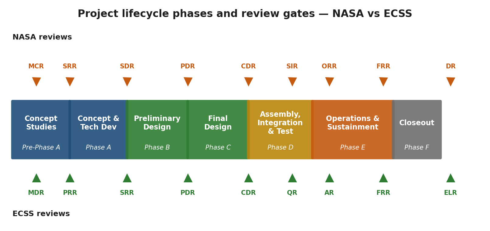

# Part 2 — CubeSat Operations {: .part-divider}

This part of the textbook is the operations volume of the SpaceCDF
programme. It is the practical companion to Sessions 5.1 – 5.4
(the operations-concepts material in Part 1).

Part 2 is anchored on a single fictitious reference spacecraft —
**EOSAT-1**, a 6-unit CubeSat in a 450 km Sun-synchronous orbit —
flown by the SpaceCDF cohort against an accompanying simulator.

How to read Part 2:

- **Chapters 5 – 7** define the control room: the nine operator
  positions, the consoles they sit at, the tools and command
  types they use, and the voice-loop discipline that ties the
  team together.
- **Chapters 8 – 11** walk pass operations end-to-end: nominal
  passes, LEOP, commissioning, and the recovery patterns operators
  follow when an anomaly fires.
- **Chapter 12** covers contingency operations: the mindset and
  decision framework for reacting to the unexpected, the classes of
  contingency, and the anomaly-response decision tree.
- **Chapters 13 – 15** are working reference material: operator
  calculations, the procedure catalogue, and the telemetry / FDIR /
  monitoring reference cards.

The companion **SpaceCDF Course Workbook** has one worksheet per
chapter, plus per-procedure confirm-and-note checklists, anomaly
tickets, and handoff forms.

---

# Chapter 5 — Operations Overview


## 5.1 From design to operations

The engineers who specify a spacecraft are not, in general, the
ones who fly it. The discipline is different. Design is a
solo or small-group activity, written down and checked against
requirements before anything moves. **Operations is a team
performance** — repeated, time-pressured, voice-coordinated, and
unforgiving of ambiguity. The spacecraft does not pause for the
operator to think.

This Part covers the **transition from design to operations**: how
a 6U CubeSat (the EOSAT-1 reference mission, §5.7) is flown by
a control-room team from launcher separation through routine
imaging operations, the procedures the team executes pass-by-pass,
the contingencies they prepare for, and the calculations every
operator on console must be able to do in their head or on the back
of a shift log.

The chapter is anchored in published operability and procedure
standards: ECSS-E-ST-70-11C *Space segment operability*,
ECSS-E-ST-70-32C *Test and operations procedures*, NASA's *Space Flight
Program and Project Management Requirements* ([NPR 7120.5F](https://nodis3.gsfc.nasa.gov/displayDir.cfm?t=NPR&c=7120&s=5F)), and the CCSDS Mission
Operations Reference Model (CCSDS 520.0-G-4). Specific PUS
service references follow ECSS-E-ST-70-41C and the CCSDS PUS
green book (660.0-G-3).

## 5.2 The arc of an operational mission

A spacecraft's operational life splits cleanly into phases. The
operator's mandate, the procedures available, the tempo of
commanding, and the team staffing are all different in each phase.

Table 5.1 — Operational mission phases with duration, scope, and associated procedure families.

| Phase | Typical duration | What operations does | Procedure family |
|---|---|---|---|
| Phase 3 — Bootloader / first contact | hours | Acquire the link; boot application SW; sync time; first health check | LEOP-001..002, LEOP-006 |
| Phase 4 — LEOP | 0–72 hrs | Sequential power-on; antenna deploy; detumble; sun acquisition | LEOP-003..007 |
| Phase 5 — Commissioning | 1–4 weeks | Subsystem checkout; sensor calibration; payload power-on; First Light | COM-001..013 |
| Phase 6 — Nominal operations | mission lifetime | Routine imaging, downlink, momentum management, eclipse transitions, orbit maintenance | NOM-001..013 |
| (any phase) — Contingency | minutes to hours | FDIR rule fires; operator responds | CTG-001..028 |
| (any phase) — Emergency | hours | Safe-mode entry; multi-system failure recovery | EMG-001..006 |
| Disposal (not a modelled phase) | years | Passivation, then passive orbital decay | (mission-specific) |

The remainder of Part 2 walks each phase's nominal sequence, the
common contingencies, and the operator checks for each. The
simulator that supports this material is referenced where useful,
but the textbook content is **what an operator must know**, not
what a particular simulator does.

## 5.3 What an operator must be able to do

An operator who has worked through this Part should be able to:

1. Sit any of the **nine control-room positions** (Chapter 6)
   and read their telemetry mosaic, recognise off-nominal trends,
   and execute their position's commands with FD authorisation.
2. **Run a planning cycle end-to-end** (Chapter 7): pick
   imaging targets, build an activity sequence, run the conflict
   checker, uplink the plan, and verify execution.
3. **Execute a nominal procedure** as lead operator (Chapter 8):
   hold the procedure file, call each step on the voice loop,
   request FD GO before each commanded action.
4. **Execute a contingency or emergency procedure** in response to
   an FDIR trigger (Chapter 12), and file the resulting anomaly
   ticket cleanly.
5. **Critique another team's shift** using the four-axis observer
   framework (Appendix to this Part), with timestamps and specific
   recommendations.
6. **Compute the operator checks** every shift requires
   (Chapter 13): pass timing, eclipse-exit SoC prediction,
   pointing-budget RSS, delayed-TM gap analysis, link-margin
   sanity.

## 5.4 The nine control-room positions

A real operations control room has between 6 and 12 positions
depending on mission size and phase. EOSAT-1 operations use the
following **nine-position structure**, which mirrors what industry
mission-control rooms staff for a small EO mission and what
operations training rigs implement.

Table 5.2 — Nine control-room operator positions with mandates and primary subsystem focus.

| # | Position | Mandate (one sentence) | Primary subsystem focus |
|---|----------|------------------------|-------------------------|
| 1 | Flight Director (FD) | Sole authority on the loop; grants every GO; does not command. | All — situational awareness, decision authority |
| 2 | Spacecraft Controller / FDIR & Systems (SPACON) | Drives procedure execution; watches FDIR; assesses anomalies. | OBDH, FDIR rules, procedure panel |
| 3 | AOCS Engineer | Attitude determination and control; attitude for manoeuvre execution. | Reaction wheels, two star trackers, gyros, magnetometer, torquers |
| 4 | EPS Engineer | Battery, solar arrays, power-line switching matrix, load shed. | Bus voltage, SoC, per-line current, regulator |
| 5 | Thermal Engineer | Heater control, radiator performance, payload/FPA zones. | Zones, heater duty cycle, FPA cooler |
| 6 | TT&C / Comms Engineer | Radio link to ground; transponder, encoding, data rate. | Tx, link margin, BER, frame counter |
| 7 | Payload Operations Engineer | Science instrument; image acquisition, storage, downlink queue. | Imager, FPA, mass memory, image quality |
| 8 | Flight Dynamics (FDS) / Orbit Analyst | Orbit determination, pass prediction, manoeuvre planning, conjunction screening. | GPS, orbit propagator, contact schedule |
| 9 | Ground Segment Engineer / Network Controller | Ground antenna, baseband, radio (RF) status display, network. | Antenna pointing, baseband health, RF chain |
| — | Mission Manager / Customer Liaison | External communication, customer reporting, mission-level decisions. | (non-console; observer area) |

> **The simulator's position list is not the same list.** The MCS
> defines **seven** console positions in `mcs/positions.yaml`:
> `flight_director`, `fdir_systems` ("FDIR / Systems"), `eps_tcs`
> ("Power & Thermal"), `aocs` ("Flight Dynamics"), `ttc`,
> `payload_ops` and `propulsion`. The nine-position room above maps
> onto them: EPS and Thermal both sit at `eps_tcs`; the AOCS
> Engineer and the FDS analyst both work from `aocs`; Ground
> Segment and Mission Manager have no MCS position at all. The one
> position the room roster must add that the table above does not
> name is the **Propulsion Engineer** — EOSAT-1 flies a 1U green
> monopropellant module (66.9 m/s total), and `propulsion` is the
> only position whose `allowed_func_ids` include the burn commands
> (S8 funcs 108–118). In a nine-seat rehearsal the FDS operator
> normally doubles as Propulsion, because FDS produces the
> manoeuvre vector that Propulsion executes.

The EPS and Thermal Engineer positions share a single MCS console
image — the `eps_tcs` position, with EPS+TCS tabs — in many control
rooms (including the EOSAT-1 reference rig); they are seated
**adjacent** so commanding authority hands between them by physical
proximity and a single voice-loop callout.

The FDS position works from the `aocs` MCS console (labelled
*Flight Dynamics*) plus a workstation outside the MCS rig: it
ingests GPS telemetry, propagates the orbit forward, produces
the pass schedule the rest of the team flies, and computes
manoeuvre vectors when needed. The `aocs` position also carries a
**read-only** PROP tab: Flight Dynamics can watch a burn but
cannot command one.

The Ground Segment Engineer runs from a secondary workstation and
is the **only operator who routinely watches the ground-station
RF chain end-to-end** — antenna pointing, baseband health, and
the radio status display (carrier presence, lock status, sweep,
Doppler estimate). They are the voice of the ground network on
the loop.

The Mission Manager is *non-console*: they sit at the back of the
room, on the loop but not commanding, and own the customer-facing
status report and external mission-level decisions.

Chapter 6 walks each position in depth: the mandate, the
console, the telemetry to watch, the commands typically issued,
the handover content, the cross-position dependencies, and the
common failure modes.

## 5.5 How the team works: passes, shifts, and the voice loop

Operations is structured around **passes**: the orbital periods
when the spacecraft is in contact with a ground station. The
EOSAT-1 reference orbit (sun-synchronous, 450 km, 98°) produces
8–12 minute passes over the five polar stations of the teaching
baseline (Iqaluit, Troll, Svalbard, Inuvik and O'Higgins), with
roughly 4–6 contacts per ground station per day depending on the
exact node geometry.

Shifts are organised around the contact schedule. A LEOP shift in
industry runs **24/7 with three eight-hour shifts** until phase 4
is complete; commissioning typically runs **16-hour days with two
shifts**; nominal operations usually run **8/5 with automation**
filling in the rest of the day's passes. The pass discipline is
the same across all of these: operators are at their consoles, on
the voice loop, ready to command, from AOS minus 5 minutes through
LOS plus 5 minutes.

Between passes the team **debriefs** the just-finished pass
(5-minute hot-wash), **re-plans** the next pass (planning panel),
**reads ahead** in the procedure file for the next phase activity,
and **rests, hydrates, and eats** — all four are mission-critical
in equal measure across a multi-day LEOP.

The **voice loop** is the spine of the room. Every position is on
the loop; every commanded action is voice-coupled. Discipline on
the loop matters more than any other single operator skill —
industry data attributes ~80% of "recoverable made
unrecoverable" anomalies to voice-loop failures, not telemetry
misreads. Chapter 9 covers loop discipline in depth.

## 5.6 The control room physical layout

The control room operations room is laid out as a **horseshoe
of consoles facing a central display wall**. The Flight Director
seat is at the apex of the horseshoe; the eight operator consoles
flank it; the Mission Manager and Mission Director sit at the open
end of the horseshoe behind the FD. Voice loop hardware (softphone
headsets) is at each seat. The display wall shows the master
ground-station map and the AOS/LOS countdown.

<svg viewBox="0 0 760 420" xmlns="http://www.w3.org/2000/svg" style="max-width:720px; font-family:'Calibri','Helvetica Neue',Arial,sans-serif; font-size:11px;">
  <!-- Display wall -->
  <rect x="170" y="20" width="420" height="50" rx="4" fill="#fef3c7" stroke="#d97706" stroke-width="2"/>
  <text x="380" y="42" text-anchor="middle" fill="#92400e" font-weight="bold">Display wall</text>
  <text x="380" y="58" text-anchor="middle" fill="#92400e" font-size="10">Ground-track map · AOS/LOS countdown · master alert banner</text>

  <!-- Horseshoe outline -->
  <path d="M 130 120 Q 130 250 200 320 L 560 320 Q 630 250 630 120 Z" fill="none" stroke="#80746c" stroke-width="1.2" stroke-dasharray="4 4"/>

  <!-- FD seat at apex -->
  <rect x="320" y="100" width="120" height="48" rx="6" fill="#8f001a" stroke="#5e0011" stroke-width="2"/>
  <text x="380" y="122" text-anchor="middle" fill="white" font-weight="bold">Flight Director</text>
  <text x="380" y="138" text-anchor="middle" fill="white" font-size="10">(FD seat)</text>

  <!-- Inner ring: 6 console positions -->
  <g font-size="10.5">
    <rect x="170" y="170" width="90" height="40" rx="4" fill="#e0e7ff" stroke="#4338ca"/>
    <text x="215" y="195" text-anchor="middle" fill="#1e1b4b" font-weight="bold">SPACON</text>
    <rect x="270" y="170" width="80" height="40" rx="4" fill="#e0e7ff" stroke="#4338ca"/>
    <text x="310" y="195" text-anchor="middle" fill="#1e1b4b" font-weight="bold">AOCS</text>
    <rect x="360" y="170" width="80" height="40" rx="4" fill="#dcfce7" stroke="#15803d"/>
    <text x="400" y="195" text-anchor="middle" fill="#14532d" font-weight="bold">EPS</text>
    <rect x="450" y="170" width="80" height="40" rx="4" fill="#dcfce7" stroke="#15803d"/>
    <text x="490" y="195" text-anchor="middle" fill="#14532d" font-weight="bold">Thermal</text>
    <rect x="540" y="170" width="80" height="40" rx="4" fill="#fee2e2" stroke="#b91c1c"/>
    <text x="580" y="195" text-anchor="middle" fill="#7f1d1d" font-weight="bold">TT&amp;C</text>
  </g>

  <!-- Second ring: Payload + FDS + Ground Seg -->
  <g font-size="10.5">
    <rect x="170" y="240" width="90" height="40" rx="4" fill="#fef3c7" stroke="#d97706"/>
    <text x="215" y="265" text-anchor="middle" fill="#92400e" font-weight="bold">Payload</text>
    <rect x="270" y="240" width="100" height="40" rx="4" fill="#cffafe" stroke="#0e7490"/>
    <text x="320" y="265" text-anchor="middle" fill="#164e63" font-weight="bold">FDS</text>
    <rect x="430" y="240" width="160" height="40" rx="4" fill="#cffafe" stroke="#0e7490"/>
    <text x="510" y="265" text-anchor="middle" fill="#164e63" font-weight="bold">Ground Segment</text>
  </g>

  <!-- Back area: Mission Manager + coach -->
  <rect x="220" y="350" width="320" height="42" rx="4" fill="#f3f4f6" stroke="#6b7280" stroke-dasharray="3 3"/>
  <text x="380" y="370" text-anchor="middle" fill="#374151" font-weight="bold">Mission Manager + Mission Director</text>
  <text x="380" y="385" text-anchor="middle" fill="#374151" font-size="9.5">(non-console, observer area at the back of the room)</text>

  <!-- Eye-line arrows from FD to operators (showing line-of-sight requirement) -->
  <g stroke="#8f001a" stroke-width="0.7" stroke-dasharray="2 2" fill="none" opacity="0.5">
    <line x1="380" y1="148" x2="215" y2="170"/>
    <line x1="380" y1="148" x2="310" y2="170"/>
    <line x1="380" y1="148" x2="400" y2="170"/>
    <line x1="380" y1="148" x2="490" y2="170"/>
    <line x1="380" y1="148" x2="580" y2="170"/>
  </g>
  <text x="125" y="125" font-size="9" fill="#8f001a">FD line of sight</text>
</svg>

*Figure 5.1 — Control-room console layout. The Flight Director seat sits at the apex of a horseshoe with line-of-sight to every operator seat (dashed red lines). Subsystem operators (SPACON, AOCS, EPS, Thermal, TT&C) form the inner ring; Payload, FDS and Ground Segment form the outer ring. The Mission Manager and Mission Director sit at the back, on the loop but not commanding.*

The layout matters. A student commanding from the EPS seat must be
able to **make eye contact with the FD** before issuing a power-on
command, because the GO is voice-and-eye. A student at the Payload
seat must be able to **see the AOS countdown** without turning
around. These are not arbitrary ergonomics; they directly affect
shift performance, and they are scored on the *Space usage* axis
of the peer-review worksheet.

## 5.7 What we are flying — EOSAT-1 in 600 words

EOSAT-1 is a **6-unit CubeSat** built in the uOttawa SmallSat lab,
launched June 2026 into a sun-synchronous orbit at **450 km
altitude, 98° inclination**, with a 14:00 local time of ascending
node. Its mission: ocean-current monitoring along the Canadian
coastlines using a four-band multispectral imager (Bands at 443,
560, 665, and 865 nm — blue, green, red, and near-infrared
respectively, chosen to maximise sensitivity to dissolved organic
carbon and surface chlorophyll).

The spacecraft is **12.0 kg dry** (12.40 kg wet, with 400 g of
propellant). The orbit-average load with all nominal systems on is
**≈ 28 W**; the peak instantaneous load during a payload pass is
higher still once the imager, FPA cooler, and transmitter come on.
The two deployable wings carry 0.120 m² of cells each and are
rated **70.1 W BOL at β = 0**; whole-spacecraft peak generation,
including the body panels, is **88.6 W**, and orbit-average
generation at the worst beta angle at end of life is 38 W — a
nominal margin of about +9 W, or 1.33×. Storage is a **100 Wh
Li-ion pack** (GomSpace NanoPower BPX class, 8S-1P; `eps.yaml`
`voltage_nom` 26.4 V, 29.2 V at 100 % SoC, 21.5 V at 0 %). *(These
are flight-part-derived numbers: 12–18 W of orbit-average payload
headroom is what a real 6U with deployables delivers. Do not
expect the +40 W of slack a mis-sized budget would show.)*

The spacecraft carries **two transmitters**: an S-band prime chain
(deployable patch, 2200 MHz downlink / 2025 MHz uplink) for
commanding and full-rate telemetry, and a **separate UHF whip
beacon** at 437.5 MHz, 1 W, which carries HK SID 11 and nothing
else. The distinction matters operationally: switching the S-band
PA off stops all S-band telemetry, and the beacon keeps
transmitting. It is a second radio, not a mode of the first.

Attitude control is a 4-wheel pyramid with magnetic torquers for
momentum management (FINE pointing is flown on three wheels if one
is lost, flagged as degraded). Sensors are **two star trackers,
ST1 and ST2** (primary attitude determination; the active head is
selected with `ST_SELECT`, S8 func 6), coarse sun sensors on all
six faces (for safe mode and sun acquisition), one magnetometer (no spare),
**three single-axis gyros with no redundant unit**, and a GPS
receiver (orbit determination). Pointing performance is read from
`aocs.total_pointing_err_3sig` (0x02AA, the RSS of knowledge and
control error) and policed on `aocs.att_error` (0x0217), whose
alarm bands are ±1.0° yellow and ±2.0° red; measured FINE_POINT
performance is 0.021° mean on four wheels and 0.019° on a
three-wheel degraded set.

Orbit control is a **1U green monopropellant module**, 400 g of
propellant, 66.9 m/s total delta-V, flown for debris avoidance and
limited drag make-up. There is no propulsive disposal capability.

The **ground segment** is a five-station polar S-band network
(the teaching baseline throughout Part 2):

- **Iqaluit** (Nunavut, 63.75° N): primary, owned by uOttawa, 9 m
  antenna, G/T 20.0 dB/K.
- **Troll** (Antarctica, 72.01° S): KSAT lease, 7.3 m, G/T 18.5.
- **Svalbard** (78.23° N): 11.3 m, G/T 21.5.
- **Inuvik** (68.32° N): 13.0 m, G/T 22.0.
- **O'Higgins** (63.32° S): 9 m, G/T 20.0.

All five have a 5° minimum elevation mask; the geometry of record
is `orbit.yaml`, with RF augmentation in
`planning/ground_stations.yaml`.

Mission operations are split into **phases**:

Table 5.3 — EOSAT-1 mission phase plan from launch through disposal with durations and activities.

| Phase | Name | Duration | Activity |
|-------|------|----------|----------|
| 0 | PRE_SEPARATION | (launch) | On the launch vehicle; everything off, no subsystem ticks |
| 1 | SEPARATION_TIMER | minutes | Deployer release, tip-off, inhibit timer running |
| 2 | INITIAL_POWER_ON | minutes | PDM brings up the unswitchable lines (OBC, TTC RX) |
| 3 | BOOTLOADER_OPS | hours | UHF beacon (SID 11 only), OBC bootloader, first AOS |
| 4 | LEOP | 0–72 hrs | Detumble, deploy antenna and wings, sequential power-on, full HK |
| 5 | COMMISSIONING | 1–4 weeks | Subsystem checkouts, calibration, First Light |
| 6 | NOMINAL | nominal mission | Routine imaging, downlink, health checks |

Part 2 covers phases **3, 4, 5, and 6** in operational depth — LEOP,
commissioning, and routine nominal operations. Phases 0–2 (launch,
separation timer, initial power-on) happen before the first ground
contact and are entirely autonomous. There is no disposal phase in
the enumeration: EOSAT-1's propulsion is sized for debris
avoidance and drag make-up only, and end-of-life disposal is
passivation followed by passive decay.

The phase counter is `eps.spacecraft_phase` (0x0129), carried in
HK SID 4. **Phase transitions are ground declarations** — the mission
management team declares the phase with the
`SYS_SET_MISSION_PHASE` telecommand (S8 func 120); nothing on board advances it past 4 (LEOP).

The full reference-spacecraft documentation lives in the simulator
repo under `configs/eosat1/manual/00..12_*.md`. The most-cited
chapters when reading Part 2 are 00 (mission overview), 07 (orbit
operations), and 09 (LEOP, `09_leop.md`; the command reference is
also numbered 09).

## 5.8 Reading guide

Operator familiarisation should proceed in this order:

1. **This Chapter (5.0) in full** — the mission, phases, control
   room.
2. **Chapter 6** — every position, in depth. Read your assigned
   position first; skim the rest so you know who you're talking
   to on the loop.
3. **Chapter 7 §§7.1–7.5** — the MCS UI, MPS panels, procedure
   panel, FDIR panel.
4. **Chapter 8** — pass operations: NOM-001 startup through
   NOM-012 handover, the routine flow.
5. **Chapter 9** — voice-loop discipline. Read before any shift
   you're on the loop for.
6. **Chapters 10 and 11** — LEOP and Commissioning sequences,
   procedure by procedure.
7. **Chapter 12** — contingency operations: the decision framework
   and anomaly-response decision tree (§12.3). Read before any shift
   that may face a contingency.
8. **Chapter 13** — operator calculations and checks you'll do
   every shift.
9. **Chapters 14 and 15** — the procedure catalogue and the
   telemetry / command / FDIR reference, kept at the console for lookup.
10. **§14.4 and §14.5** — the contingency procedure cards and the
    emergency procedure cards. Read alongside Chapter 12 before any
    shift that may face a contingency.
11. **the source-of-truth note** — the source-of-truth reconciliation note —
    read if you find your simulator giving you values that
    disagree with this textbook.

External standards cited throughout Part 2. **Executive summary
only** is enough for first reading; the vocabulary is used
freely throughout.

Table 5.4 — External operability and procedure standards cited throughout Part 2.

| Standard | What it covers |
|---|---|
| ECSS-E-ST-70C | The operator-side of the ground/space contract |
| ECSS-E-ST-70-11C | What "operability" means for the space segment |
| ECSS-E-ST-70-32C | What a procedure file looks like |
| ECSS-E-ST-70-41C | Packet Utilization Standard (PUS) — telemetry/telecommand framing |
| CCSDS 520.0-G-4 | Mission-operations reference model and vocabulary |
| CCSDS 660.0-G-3 | PUS green book — implementation notes |
| NASA NPR 7120.5F | Space Flight Program and Project Management Requirements |

Full URLs are in the References section at the end of this Part.

---


### 5.20 Mission Operations Concepts

> **Expected reading before this session.** [ITU Radio Regulations](https://www.itu.int/pub/R-REG-RR) Article 21; ISED CPC-2-6-02; RSSSA — [https://laws-lois.justice.gc.ca/eng/acts/R-5.4/](https://laws-lois.justice.gc.ca/eng/acts/R-5.4/).


**Prerequisites:** §7.20 (ground segment architecture understood)
**References:** ECSS-E-ST-70-11C (Space Segment Operability), ECSS-E-ST-70-32C (Procedures), ECSS-E-ST-70-41C (Packet Utilisation Standard), NPR 7120.5F, NASA Fault Management Handbook (NASA-HDBK-1002)

---

### Learning Objectives

By the end of this session, participants will be able to:
1. Define a Concept of Operations (ConOps) with operational modes and transitions
2. Design an FDIR (Fault Detection, Isolation, Recovery) architecture
3. Write operational procedures for routine and contingency operations
4. Describe anomaly response process with escalation levels
5. Plan spacecraft operational modes and their entry/exit criteria

---

### 1. Concept of Operations (ConOps)
The ConOps is the bridge between engineering design and operational reality. It describes HOW the system will be used, not just WHAT it can do.

*[Source: [ECSS-E-ST-70-11C](https://ecss.nl/standard/ecss-e-st-70-11c-space-segment-operability/) (Space Segment Operability); IEEE 1362 (Concept of Operations Document)]*

#### ConOps Structure

A complete ConOps document covers:

1. **Mission overview** -- Objectives, stakeholders, success criteria
2. **System description** -- Space segment, ground segment, user segment
3. **Operational scenarios** -- Nominal operations, contingency operations
4. **Operational modes** -- Definition, transitions, constraints
5. **Resource management** -- Power, data, propellant budgets over time
6. **Communication plan** -- Contact schedule, data flow, latency requirements
7. **Staffing plan** -- Personnel, shifts, training requirements
8. **Maintenance and logistics** -- Software updates, ground equipment maintenance

#### Operational Modes

Every spacecraft has a defined set of operational modes. Each mode specifies which subsystems are active, power consumption, and data rates.

Table 5.5 — Spacecraft operational modes with power draw, data rate, duration, and entry conditions.

| Mode | Description | Power (W) | Data Rate | Typical Duration | Entry Condition |
|------|------------|-----------|-----------|-----------------|----------------|
| **Safe** | Minimum functionality; survival only | 5-10 | Beacon only (1 bps) | Until ground intervenes | Autonomous fault detection |
| **Detumble** | Stop rotation after deployment | 8-12 | HK only (100 bps) | Minutes to hours | Post-separation; high angular rate |
| **Standby** | Sun-pointing; all subsystems ready | 12-18 | HK telemetry (1 kbps) | Between activities | After detumble; idle periods |
| **Science** | Payload operating; attitude controlled | 25-40 | Science data (variable) | Target-dependent | Scheduled; attitude achieved |
| **Downlink** | High-rate data transfer to ground | 20-30 | Full rate (2-10 Mbps) | During GS contact | GS in view; link established |
| **Manoeuvre** | Orbit adjustment or desaturation | 15-25 | HK only | Minutes | Scheduled; constraints met |
| **Eclipse** | Reduced operations during eclipse | 8-15 | HK only (100 bps) | ~35 min (LEO) | Sun not in view |

#### Mode Transition State Machine


*Spacecraft mode-transition state machine with nominal (green), standby (amber), and anomaly (red) states and the labelled triggers that move the spacecraft between them.*

#### Real Mission Example: PROBA-2 Operations

ESA's PROBA-2 (launched 2009, still operational in 2026) demonstrates mature CubeSat-class operations:
- **5 operational modes:** Standby, Science, Manoeuvre, Safe, Off
- **Autonomous operations:** 95% of routine activities automated via onboard timeline
- **Ground contacts:** 4-6 passes/day via ESA Redu station (S-band)
- **Anomaly rate:** ~2-3 per year requiring ground intervention (after initial commissioning)
- **Key lesson:** Investing in onboard autonomy dramatically reduces operations cost

*[Source: ESA PROBA-2 Operations Team, "PROBA-2: Over a Decade of Operations", SpaceOps 2020]*

---

### 2. FDIR Architecture
FDIR (Fault Detection, Isolation, Recovery) is the spacecraft's autonomous ability to detect failures, determine which component failed, and take corrective action -- all without ground intervention.

*[Source: NASA Fault Management Handbook (NASA-HDBK-1002); [ECSS-E-ST-70-11C](https://ecss.nl/standard/ecss-e-st-70-11c-space-segment-operability/) section 5.3]*
*[URL: [https://standards.nasa.gov/standard/NASA/NASA-HDBK-1002](https://standards.nasa.gov/standard/NASA/NASA-HDBK-1002)]*

#### Why FDIR is Critical for CubeSats

- **Limited ground contact:** LEO CubeSats are out of view ~85% of the time
- **No crewed intervention:** Unlike ISS, there is no astronaut to "fix" problems
- **Thermal constraints:** A safe mode must maintain thermal limits within minutes
- **Power constraints:** Battery can discharge completely in one eclipse without load shedding

#### FDIR Hierarchy (Levels)

Table 5.6 — Five-level FDIR hierarchy from hardware watchdogs to ground-commanded recovery.

| Level | Detection | Response | Latency | Example |
|-------|-----------|----------|---------|---------|
| **0 -- Hardware** | Built-in watchdog | Component reset | Milliseconds | Processor watchdog timer |
| **1 -- Unit** | Unit-level monitoring | Unit reconfiguration | Seconds | EPS over-current trip |
| **2 -- Subsystem** | Subsystem health check | Subsystem fallback mode | Seconds-minutes | Switch to backup star tracker |
| **3 -- System** | System-level anomaly detection | Mode change (e.g., enter Safe) | Minutes | Transition to Safe Mode |
| **4 -- Ground** | Human-in-the-loop diagnosis | Ground command recovery | Hours-days | Anomaly investigation + patch |

#### FDIR State Machine


*FDIR state machine: NORMAL → MONITOR → DETECT → ISOLATE → RECOVER → EVALUATE, with the fault levels that trigger each transition (the same state machine is used as the operational reference in §15.4).*

#### Common CubeSat FDIR Rules

Table 5.7 — Common CubeSat FDIR rules with detection method, threshold, and autonomous response.

| Fault | Detection Method | Threshold | Response |
|-------|-----------------|-----------|----------|
| Processor lockup | Watchdog timer | No heartbeat for 60 s | Hardware reset (Level 0) |
| Battery under-voltage | EPS voltage monitor | V_bat < 6.0V | Load shedding; enter Safe Mode |
| Battery over-temperature | Temperature sensor | T_bat > 45 C | Disable charging; reduce loads |
| Attitude loss | No attitude solution for 5 min | ADCS health flag timeout | Enter Detumble Mode |
| Communication loss | No uplink for 48 hr | Timer-based | Reset TTC; revert to beacon mode |
| Memory corruption | EDAC error count | > 10 uncorrectable errors/hr | Memory scrub; reboot from backup |
| Solar array current anomaly | Current sensor | I_SA < expected - 30% | Check attitude; enter Standby |
| Reaction wheel over-speed | Wheel speed monitor | Omega > 5000 RPM | Reduce momentum; desaturation |

#### Key Design Principles

1. **Safe Mode must always work** -- It is the last resort; it must be tested exhaustively
2. **Fail operational, then fail safe** -- Try to continue the mission before giving up
3. **No single fault should cause mission loss** -- Cross-reference with FMECA
4. **Ground override capability** -- Every autonomous action must be commandable from ground
5. **Logging** -- Record all fault events in non-volatile memory for post-analysis

---

### 3. Operational Procedures
*[Source: [ECSS-E-ST-70-32C](https://ecss.nl/standard/ecss-e-st-70-32c-test-and-operations-procedures/) (Procedure Definition Language); ECSS-E-ST-70-01C section 5.6]*

#### Procedure Types

Table 5.8 — Four procedure types distinguished by purpose, execution mode, and example.

| Type | Purpose | Execution | Example |
|------|---------|-----------|---------|
| **Nominal** | Routine scheduled operations | Automated (timeline) or manual | Science observation sequence |
| **Contingency** | Response to known anomaly types | Semi-automated; operator decision | Safe mode recovery |
| **Emergency** | Response to critical unexpected events | Manual; real-time decision | Communication loss recovery |
| **Maintenance** | Periodic calibration or updates | Scheduled manual | Magnetometer calibration |

#### Procedure Structure (ECSS-E-ST-70-32C)

Each procedure has:
1. **Identifier** -- Unique procedure number (e.g., NOM-001)
2. **Purpose** -- What the procedure accomplishes
3. **Preconditions** -- System state required before starting
4. **Steps** -- Ordered list of actions, verifications, decisions
5. **Expected results** -- What should happen at each step
6. **Recovery actions** -- What to do if expected results are not observed
7. **Post-conditions** -- System state after successful completion

#### Example: Science Observation Procedure

```
Procedure: NOM-SCI-001 "Earth Observation Target Acquisition"
Preconditions: Mode = Standby, Battery SoC > 60%, Target in FOV within 10 min

Step 1: Verify ADCS mode = Fine Pointing
  Expected: ADCS status = FINE, pointing error < 0.1 deg
  If not: Wait 60 s, retry. If still not achieved -> ABORT, remain in Standby

Step 2: Command payload power ON
  Expected: Payload HK reports power = ON within 5 s
  If not: Retry power command. If 3 fails -> ABORT, log anomaly

Step 3: Wait for payload thermal stabilisation (90 s)
  Expected: Payload temperature within operational range

Step 4: Command payload to imaging mode
  Expected: Payload status = IMAGING, frame counter incrementing

Step 5: Wait for target acquisition (ground-predicted start time)
  Expected: Imaging starts at predicted time +/- 5 s

Step 6: Collect imagery for scheduled duration

Step 7: Command payload to standby
  Expected: Payload status = STANDBY

Step 8: Command payload power OFF (if no more targets this orbit)
  Expected: Payload HK reports power = OFF

Post-conditions: Mode = Standby, imagery stored in mass memory
```

---

### 4. Anomaly Response Process
*[Source: NASA-HDBK-1002 (Fault Management Handbook); ESA Anomaly Review Board procedures]*

#### Anomaly Escalation Levels

Table 5.9 — Four anomaly severity levels with response time, authority, and example trigger.

| Level | Severity | Response Time | Authority | Example |
|-------|----------|--------------|-----------|---------|
| **Green** | Informational | Next business day | Operations engineer | Minor parameter out of expected range |
| **Yellow** | Warning | Within 4 hours | Lead operator | Subsystem performance degraded |
| **Orange** | Serious | Within 1 hour | Flight director | Mode change required; mission impact |
| **Red** | Critical | Immediate | Project manager + FD | Mission-threatening; safe mode entered |

#### Anomaly Response Workflow

```
1. DETECT: Telemetry alarm or operator observation
2. ASSESS: Is this a known anomaly type? Check procedures library
   -> Known: Execute contingency procedure
   -> Unknown: Continue to step 3
3. DIAGNOSE: Gather additional telemetry, correlate events, form hypothesis
4. PLAN: Develop response plan (may require Anomaly Review Board)
5. EXECUTE: Implement recovery commands (verify each step)
6. VERIFY: Confirm system returned to expected state
7. DOCUMENT: Record anomaly, root cause, response, and lessons learned
```

#### Anomaly Report Form Fields

Table 5.10 — Standard fields required on a written anomaly report form.

| Field | Description |
|-------|------------|
| **Anomaly ID** | Unique identifier (e.g., ANO-2026-042) |
| **Date/Time (UTC)** | When the anomaly was detected |
| **Severity** | Green / Yellow / Orange / Red |
| **Affected subsystem** | EPS, AOCS, TTC, Payload, etc. |
| **Observation** | What was observed (TM values, trends) |
| **Diagnosis** | Root cause analysis |
| **Action taken** | Commands sent, procedures executed |
| **Result** | System state after response |
| **Status** | Open / Resolved / Under investigation |
| **Lessons learned** | Preventive measures for future |

#### Real Mission Example: Kepler Reaction Wheel Failure

NASA's Kepler space telescope lost reaction wheel #2 in July 2012, followed by wheel #4 in May 2013. The anomaly response:

1. **Detection:** Elevated friction torque in wheel #2 HK telemetry
2. **Assessment:** Known degradation signature; monitoring intensified
3. **Failure:** Wheel #2 ceased operation. Mission continued on 3 wheels.
4. **Second failure:** Wheel #4 failed 10 months later. Only 2 wheels remaining -- insufficient for fine pointing.
5. **Recovery:** Engineering team developed the "K2" mission concept using solar radiation pressure as a "virtual third wheel"
6. **Result:** K2 operated for 4+ additional years, discovering 2,700+ exoplanet candidates

*Lesson: Creative operational workarounds can save missions. FDIR should be designed with graceful degradation, not just "safe mode or nothing."*

*[Source: Howell et al., "The K2 Mission: Characterization and Early Results", PASP, 2014]*

---

### 5. Operations Concepts Exercise
#### Instructions

1. **ConOps Editor** in SpaceCDF:
   - Define all operational modes for your mission (at least 5)
   - Set entry/exit conditions for each mode
   - Verify power budget closes in each mode (especially Safe and Eclipse)

2. **FDIR Design:**
   - Define 5 FDIR rules for your mission (fault, detection, threshold, response)
   - Verify that Safe Mode power budget is sustainable indefinitely
   - Check: Can every FDIR response be overridden from ground?

3. **Worksheet 5.2:**
   - Complete the operational modes table
   - Write one nominal procedure (science observation or downlink)
   - Write one contingency procedure (safe mode recovery)
   - Fill in the FDIR rules table

#### Discussion Prompts

- "What is the worst anomaly that could happen to your satellite? How would you respond?"
- "If the satellite enters safe mode on Friday evening and the next ground contact is Monday, will it survive?"
- "How much autonomy should the spacecraft have? Where is the line between onboard and ground decision-making?"

#### Worksheet 5.2 Tasks

1. Complete the operational modes table (5+ modes with power, data rate, entry/exit)
2. Design the FDIR state machine (at least 5 rules)
3. Write one nominal and one contingency procedure
4. Complete the anomaly response form for a hypothetical scenario
5. Estimate operations staffing requirements by mission phase

---

### Cited References

Table 5.11 — Cited references for the Mission Operations Concepts session with URLs.

| # | Reference | URL |
|---|-----------|-----|
| 1 | ECSS-E-ST-70-11C (Space Segment Operability) | [https://ecss.nl/standard/ecss-e-st-70-11c-space-segment-operability/](https://ecss.nl/standard/ecss-e-st-70-11c-space-segment-operability/) |
| 2 | ECSS-E-ST-70-32C (Procedures) | [https://ecss.nl/standard/ecss-e-st-70-32c-test-and-operations-procedure-language/](https://ecss.nl/standard/ecss-e-st-70-32c-test-and-operations-procedure-language/) |
| 3 | NASA Fault Management Handbook (NASA-HDBK-1002) | [https://standards.nasa.gov/standard/NASA/NASA-HDBK-1002](https://standards.nasa.gov/standard/NASA/NASA-HDBK-1002) |
| 4 | ESA PROBA-2 Operations, SpaceOps 2020 | [https://www.spaceops.org/](https://www.spaceops.org/) |
| 5 | Howell et al., K2 Mission, PASP 2014 | [https://doi.org/10.1086/676406](https://doi.org/10.1086/676406) |
| 6 | ECSS-E-ST-70-41C (Packet Utilisation Standard) | [https://ecss.nl/standard/ecss-e-st-70-41c-telemetry-and-telecommand-packet-utilization/](https://ecss.nl/standard/ecss-e-st-70-41c-telemetry-and-telecommand-packet-utilization/) |

---

### Session Summary

Table 5.12 — Session-summary key takeaways across operations-concepts topics.

| Topic | Key Takeaway |
|-------|-------------|
| ConOps | Defines HOW the system is operated: modes, transitions, schedules, staffing |
| Operational modes | Safe, Detumble, Standby, Science, Downlink, Manoeuvre, Eclipse (minimum set) |
| Mode transitions | Defined by entry/exit conditions; Safe Mode always reachable from any mode |
| FDIR | 5 levels: Hardware -> Unit -> Subsystem -> System -> Ground; Safe Mode is last resort |
| Procedures | Nominal (routine), Contingency (known faults), Emergency (unknown), Maintenance |
| Anomaly response | Detect -> Assess -> Diagnose -> Plan -> Execute -> Verify -> Document |
| Design principles | Safe Mode must always work; fail operational before fail safe; ground override always |

## 5.9 References

- ECSS-E-ST-70-11C — Space segment operability — [ecss.nl](https://ecss.nl/standards/active-standards/ecss-e-st-70-11c-space-segment-operability/)
- CCSDS 520.0-G-4 — Mission Operations Reference Model — [public.ccsds.org](https://public.ccsds.org/Pubs/520x0g4.pdf)
- NASA NPR 7120.5F — NASA Space Flight Program and Project Management Requirements — [nodis3.gsfc.nasa.gov](https://nodis3.gsfc.nasa.gov/displayDir.cfm?Internal_ID=N_PR_7120_005F_)

# Chapter 6 — The Control Room: Nine Positions in Depth

This chapter is the operator's reference: one section per
position. For each, you will find the **mandate**, the **console**
(visible tabs and the position's place in the room), the
**telemetry to watch** (top mnemonics with limits), the **commands
typically issued** (with PUS service and function ID), the
**handoff content** (what the outgoing operator must brief their
relief), and **cross-position dependencies** (who do you talk to
first).

The position descriptions are valid for **EOSAT-1 only**. Real
industry positions are broader and the boundaries blur — but the
discipline of *one operator, one mandate, one set of telemetry,
one set of commands* is universal.

> **In-tool vs off-tool positions.** The MCS defines **seven**
> console positions in `mcs/positions.yaml`: `flight_director`,
> `fdir_systems` (the SPACON seat), `eps_tcs` ("Power & Thermal"),
> `aocs` ("Flight Dynamics"), `ttc`, `payload_ops` and
> `propulsion`. Each position gets a filtered tab set, a
> subsystem list and — except for the Flight Director, who has
> `allowed_commands: all` — an explicit `allowed_func_ids`
> whitelist, so a button the position may not press renders
> disabled. Two of the nine room positions are held *off-tool*: the
> **Mission Manager** tracks the mission programme externally
> (programme tracker, customer comms, schedule), and the **Ground
> Segment** position drives the RF simulation tool rather than the
> MCS — its primary display is the radio page served by
> `smo-rfsim`, not a position tab. The **Flight Dynamics System**
> engineer works from orbit-determination software on a separate
> workstation *and* the `aocs` console. When this chapter says
> "switch to the EPS tab", treat that as MCS-relative; when it says
> "FD calls GO/NO-GO", that is a headset action — the MCS has no
> GO/NO-GO button and no voice-loop feature.

## 6.1 Flight Director (FD)

**Mandate.** The FD is the single point of authority on the loop.
Nothing happens on the spacecraft without an FD GO. The FD does
**not command** — the FD authorises others to command. The FD
runs the GO/NO-GO rounds before every commanded action. The FD
calls *no-go* and rolls the team back to the last verified state
when the situation is unclear.

**Authority.** Highest in the room. Outranked only by the Mission
Manager on mission-level decisions (e.g. "should we attempt First
Light during this pass with the star tracker degraded?" — the FD
recommends, the Mission Manager decides).

**Console.** Every tab visible — `overview`, `eps`, `aocs`, `tcs`,
`obdh`, `ttc`, `payload`, `prop`, `commanding`, `pus`,
`procedures`, `trends`, `manual` — plus the four FD-only displays
declared in `mcs/displays.yaml`: the *system dashboard* (a
composite health view), the *power monitor*, the *contact
schedule* (next AOS/LOS, station, time-to-AOS), the *procedure
panel* (progress, current step, state) and the *FDIR panel*
(alert level and alarm counts). The FD's two monitors are usually
configured: **left** = system dashboard + contact schedule;
**right** = current procedure file with the active step
highlighted. There is no voice-loop chat in the MCS; the loop is
headsets.

**Telemetry to watch.** The FD does not *interpret* telemetry —
that is the subsystem operator's job. The FD watches **state**:
which phase the spacecraft is in (`eps.spacecraft_phase`, 0x0129,
carried in HK SID 4), the FDIR alert level and alarm counts
(`fdir.level` 0x0700, `fdir.active_alarms` 0x0701,
`fdir.critical_alarms` 0x0702, `fdir.high_alarms` 0x0703 — the
FDIR panel's four parameters), and the top-level OK/yellow/red
state from the system dashboard. If any
position calls *yellow*, the FD wants to know within 5 seconds; if
any position calls *red*, the FD wants to know on the loop, by
name, with the parameter and the value.

**Commands typically issued.** Zero, *by discipline* — not by
tooling. The `flight_director` position is the only one with
`allowed_commands: all`, so the MCS will let the FD send anything;
the rule that the FD authorises rather than commands is a room
convention the team enforces on the loop. There is no FD second-key
interlock in the MCS. What the tool does give you is a
**criticality flag on each telecommand** in
`commands/tc_catalog.yaml` — `nominal`, `caution` or `critical`
(`OBC_REBOOT`, `OBC_SWITCH_UNIT`, `PROP_ARM`, `PROP_SET_BURN`,
`SYS_SET_MISSION_PHASE`; the sender must press ARM before SEND on these) —
and the dual-key discipline of this course is: nothing marked
*caution* or *critical* leaves the console without a spoken FD GO,
read back by name.

**Handoff content.** When an FD hands shift to the relieving FD,
the brief must cover:

1. **Current phase** and time-to-next-phase boundary.
2. **All active anomalies** and which procedure addresses each.
3. **Open work items** — procedures begun but not completed.
4. **Next pass** — station, AOS time, planned activities, who is
   the operator-of-record for each major step.
5. **Customer commitments** active in this shift (Mission Manager
   provides the list).
6. **Any GO authorisations granted but not yet executed** — these
   are the bear traps.
7. **The voice-loop tone** — is the team tight? tired? distracted?
   The relieving FD needs the human read.

A formal NOM-012 *Shift Handover* template is provided in the
workbook; the target completion time is 6 minutes.

**Cross-position dependencies.** The FD talks to everyone. By
priority order during a pass: SPACON (running the procedure),
TT&C (link health), the originating subsystem operator (whoever
is about to command), Ground Segment (station health), AOCS
(pointing), then EPS/Thermal/Payload/FDS as needed.

**Common failure modes (FD-specific).** Over-driving the
position — telling operators what to command rather than asking
for their assessment. Going silent on the loop during a tense
moment — operators interpret silence as "FD is processing", and
that pause is exactly when wrong commands happen. Granting GO
prematurely — *always* poll all relevant positions, even when the
answer feels obvious.

## 6.2 Spacecraft Controller / FDIR & Systems (SPACON)

**Mandate.** The SPACON owns the **procedure execution**. They
hold the procedure file, call each step on the voice loop, verify
the verification, and request FD GO before each commanded action.
They are also the FDIR watch — when the FDIR panel lights up, the
SPACON is the operator who reads the rule, identifies the
contingency procedure to invoke, and recommends the response to
the FD.

**Authority.** Procedure authority. Commanding authority within
authorised steps, with FD GO. Recommends safe-mode entry; only the
FD authorises safe-mode entry.

**Console.** The `fdir_systems` position: overview, obdh,
commanding, pus, procedures, trends, manual. It is the only
position other than the FD with the **PUS tab**, and the only one
allowed service 12 (on-board monitoring) and service 19 (event-action).
The SPACON has two monitors: **left** = procedure panel + FDIR
panel; **right** = OBDH telemetry (OBC state, memory, bus health,
reboot cause).

**Telemetry to watch.** OBC mode (`obdh.mode`, 0x0300, SID 4),
running image (`obdh.sw_image`, 0x0311 — 0 = bootloader,
1 = application), active OBC and backup status (`obdh.active_obc`
0x030C, `obdh.obc_b_status` 0x030D), bus selection and health
(`obdh.active_bus` 0x030E, `obdh.bus_a_status` 0x030F,
`obdh.bus_b_status` 0x0310), reboot count and cause
(`obdh.reboot_count` 0x030A, `obdh.last_reboot_cause` 0x0316),
recent event reports (the S5 event log), and the command counters:
received `obdh.tc_rx_count` (0x0304), accepted `obdh.tc_acc_count`
(0x0305), rejected `obdh.tc_rej_count` (0x0306) — and, next to
it, `obdh.last_tc_error_code` (0x0315), the S1 failure code of the
most recent refusal. Read the code, not just the counter: a
rejection counter that ticks without a code tells you nothing.
Yellow at 5 rejects in any 30 s; red at 10. Note there is **no
`fdir_table_id` parameter and no rule-table concept** — see the
commanding note below.

**Commands typically issued.** All procedure-driven commands flow
*through* the SPACON. Direct OBDH commands the SPACON owns:

- `OBC_REBOOT` (S8 func_id 52) — restart the OBC.
- `OBC_SWITCH_UNIT` (S8 func_id 53) — switch to redundant OBC.
- `OBC_BOOT_APP` (S8 func_id 55) — boot application software from
  bootloader.
- `SET_TIME` (S9.1) — synchronise onboard clock;
  `OBC_GPS_TIME_SYNC` (S8 func_id 80) for the GPS-sourced update.
- `EA_ENABLE` / `EA_DISABLE` (S19.4 / S19.5, argument `ea_id`) —
  enable or inhibit individual event-action rules. The simulator
  does not implement rule-table swapping; commissioning-phase
  isolation is achieved by inhibiting nominal rules while LEOP
  rules stay enabled, then re-enabling them one at a time once
  commissioning closes. `EA_ADD` (S19.1) and `EA_DELETE` (S19.2)
  define and remove rules; `EA_REPORT_DEFS` (S19.8) dumps them.
- `MON_ENABLE_DEF` / `MON_DISABLE_DEF` (S12.3 / S12.4) — the
  on-board limit monitors, which only this position may command.

**Handoff content.** Current procedure in progress (step number,
last verified step), all FDIR anomalies and their state
(triggered/acknowledged/cleared), any event-action rules or S12
monitors manually disabled (and why), command rejection rate
trend and the last TC failure code.

**Cross-position dependencies.** Constantly with FD (every GO
request). Constantly with the operator-of-record for the active
step (e.g. AOCS engineer if the step is a wheel command). With
Ground Segment if a TC is rejected by the spacecraft — sometimes
the rejection is uplink (a flipped bit), not onboard.

**Common failure modes.** Skipping verification steps to stay on
schedule. Reading ahead in the procedure and pre-commanding
("priming the next step") — pre-commanding without an explicit FD
GO is a procedure violation. Failing to log an anomaly because the
team is busy responding to it.

## 6.3 AOCS Engineer

**Mandate.** Attitude determination and control. Reads the
attitude sensors (two star trackers, coarse sun sensors, gyros,
the magnetometer, GPS), the actuators (four reaction wheels, magnetic
torquers), and the AOCS state machine. Reports pointing
performance every pass. Owns the **attitude** for a manoeuvre —
the burn itself belongs to the Propulsion position.

**Authority.** Commanding authority for the AOCS subsystem with FD
GO (`allowed_func_ids` 0–15, 84–91 and 96). Recommends AOCS mode
transitions; the FD authorises. **No** propulsion commanding: funcs
108–118 are deliberately absent from this position's whitelist, so
every button on its PROP tab is disabled.

**Console.** The `aocs` position, labelled *Flight Dynamics*:
overview, aocs, prop (read-only), commanding, procedures, trends,
manual. The AOCS tab shows attitude and reference quaternions,
body rates, the pointing-error channels, wheel speeds and
temperatures, sensor health, the AOCS mode integer — **and, since
the 2026-08b batch, the commanded mode alongside the actual one**
(`aocs.commanded_mode` 0x0297, `aocs.mode_demoted` 0x0298), which
is how you tell a transient apart from a spacecraft that has
quietly abandoned its mission mode.

**Telemetry to watch.**

Table 6.1 — AOCS telemetry parameters with SIDs and nominal, yellow, and red limit bands.

| Mnemonic | Hex id | SID | Nominal | Yellow | Red |
|---|---|---|---|---|---|
| `aocs.mode` | 0x020F | 2 | 4 (NOMINAL) / 5 (FINE_POINT) | 2 (DETUMBLE) / 3 (COARSE_SUN) | 0 (OFF) / 1 (SAFE_BOOT) |
| `aocs.rate_roll` / `rate_pitch` / `rate_yaw` | 0x0204–06 | 2 | < 0.01 °/s | ±0.5 | ±2.0 |
| `aocs.att_error` | 0x0217 | 2 | < 0.3° | ±1.0 | ±2.0 |
| `aocs.st1_status` / `st2_status` | 0x0240 / 0x0243 | 2 | 2 (tracking) | 1 (boot) / 3 (blind) | 0 (off) / 4 (failed) |
| `aocs.rw1_speed`..`rw4_speed` | 0x0207–0A | 2 | < 3000 rpm | ±5000 | ±5500 (speed limit) |
| `aocs.gyro_units_on` | 0x0294 | 2 | 3 | 2 | 0–1 (no rate reference) |
| `aocs.gps_fix` | 0x0274 | 2 | 3 (3D+vel) | 1–2 | 0 (no fix) > 10 min |
| `aocs.h_env_frac` | 0x02BA | 7 | < 50 % | > 70 % | > 90 % (desat now) |

(Mode integers per `aocs/aocs_mode_codes.yaml`, which is the
single source of truth: 0 = OFF, 1 = SAFE_BOOT, 2 = DETUMBLE,
3 = COARSE_SUN, 4 = NOMINAL, 5 = FINE_POINT, 6 = SLEW, 7 = DESAT,
8 = ECLIPSE, 9 = INERTIAL. Older cards and older printings of this
book were systematically **off by one** — check every mode number
you read against that file. Note also that the determination
block, including the momentum-envelope figure, is HK **SID 7**,
which is disabled at boot and must be enabled with `HK_ENABLE`.)

**Commands typically issued.**

- `AOCS_SET_MODE` (S8 func_id 0) with mode integer.
- `AOCS_ENABLE_WHEEL` / `AOCS_DISABLE_WHEEL` (S8 func_id 3 / 2)
  with `wheel_idx`.
- `RW_SET_SPEED_BIAS` (S8 func_id 8) with `wheel_idx`, `bias_rpm`
  — the bias is **added to** the current speed, not an absolute
  setpoint. `AOCS_RW_RAMP_DOWN` (func_id 14) ramps a wheel to a
  target speed; `wheel_idx=255` means all four. Wheel speeds
  (0x0207–0x020A) are **read-only telemetry**: these two commands
  are the only way to move them from the ground.
- `ST1_POWER` / `ST2_POWER` (S8 func_id 4 / 5) with `on`, and
  `ST_SELECT` (S8 func_id 6) with `unit` — 1 or 2 — to choose the
  active head. Two star trackers, two commands.
- `MTQ_ENABLE` (S8 func_id 9) with `enable`.
- `AOCS_DESATURATE` (S8 func_id 1) — runs the momentum dump per
  NOM-007. `AOCS_SET_DESAT_INHIBIT` (func_id 96) latches dumps off.
- `AOCS_GYRO_CALIBRATION` (S8 func_id 13) — gyro bias calibration
  is computed **on board**; there is no ground-computed bias upload.
- `AOCS_EST_RESET` (S8 func_id 91) — reset the MEKF; check
  `aocs.est_source` (0x02C1) afterwards for which sensors it is
  actually using.
- `AOCS_SET_TARGET_QUAT` (func_id 86) / `AOCS_SET_TARGET_GEO`
  (func_id 87) / `AOCS_SLEW_TO` (func_id 10) — pointing targets.
- Gyros are powered individually as S2 devices:
  `S2_AOCS_GYROSCOPE_0/1/2` (S2.1). There are three of them, one
  per axis, and **no redundant unit**.

**Handoff content.** Current AOCS mode and time since last
transition (`aocs.time_in_mode`, 0x0264), and whether the actual
mode matches the commanded one; pointing-error trend over the
pass; momentum envelope usage and any wheel approaching the
5500 rpm speed limit; which star tracker is selected
(`aocs.st_selected`, 0x0244) and the health of both; whether FINE
is running degraded on three wheels (`aocs.fine_degraded`,
0x0299); any desat inhibit still latched.

**Cross-position dependencies.** With FDS for manoeuvre planning
(FDS produces the vector) and with Propulsion, who arms and fires
it while AOCS holds the burn attitude. With Payload for pointing
during imaging (Payload requests fine-point mode 60 s before
imaging). With SPACON for FDIR rules that touch attitude (many of
them — momentum saturation, star-tracker loss, gyro disagreement).

**Common failure modes.** Commanding NOMINAL (mode 4) before
detumble has converged — and detumble is genuinely slow: the
B-dot law is magnetometer-driven with the dipole saturating at
1.6 A·m² per axis, so a 14 °/s separation tumble takes of order
3.5 × 10³ s to damp, passing below the 0.5 °/s exit guard at
around 1166 s. Any expectation of a fast detumble is wrong.
Mis-reading the mode integer (the off-by-one described above is
specifically here). Not noticing momentum building over many
orbits. Expecting a desat to finish in five minutes: an honest
dump is **20–50 minutes**, it inhibits imaging while it runs, it
has a timeout, and it returns the spacecraft to its pre-desat mode.

## 6.4 EPS Engineer

**Mandate.** The power story. Owns battery state of charge,
solar array currents, the bus voltage, the load profile, and the
power-line switching matrix. Calls eclipse entry and exit. First
position to recognise that a subsystem is drawing more than it
should.

**Authority.** Commanding authority for EPS subsystem (power-line
on/off, charge regulator parameters) with FD GO. Calls for load
shed (the FD authorises).

**Console.** Overview, EPS, TCS, commanding, procedures, trends,
manual. Shared `eps_tcs` console image with the Thermal Engineer in the
simulator; in the operations programme the two operators sit side-by-side and
the EPS Engineer focuses on the *EPS* tab while Thermal focuses on
the *TCS* tab.

**Telemetry to watch.**

Table 6.2 — EPS telemetry parameters with SIDs and nominal, yellow, and red limit bands.

*(The pack is 8S — nominally 26.4 V, 29.2 V at 100 % SoC and
21.5 V at 0 %. That is high for a 6U, where 2S buses are common;
it is what `eps.yaml` models, so treat the voltage values below as
simulator-specific. Bands are as shipped in `mcs/limits.yaml`.)*

| Mnemonic | Hex id | SID | Nominal | Yellow | Red |
|---|---|---|---|---|---|
| `eps.bat_soc` | 0x0101 | 1 | 70–95 % | < 25 % | < 15 % |
| `eps.bat_voltage` | 0x0100 | 1 | 26–29 V | < 23.0 | < 22.0 |
| `eps.bus_voltage` | 0x0105 | 1 | 27–29 V | < 27.0 | < 26.5 |
| `eps.sa_a_current` / `sa_b_current` | 0x0103 / 0x0104 | 1 | lit-side nominal | low (lit) | ≈ 0 (lit) |
| `eps.bus_load_current` | 0x0148 | 1 | sum of the nine lines | rising trend | per-line trip |
| Per-line current (9 lines, 0–8) | 0x0118–0x011F, 0x014B | 1 | per-line nominal | per-line yellow | per-line red |
| `eps.bat_temp` | 0x0102 | 1 | 5–25 °C | < 2 or > 40 | < 0 or > 45 |
| `eps.wing_status` | 0x0144 | 1 | bits 0+1 set (both deployed) | bit 4/5 (in progress) | neither bit set post-LEOP |

The **FDIR undervoltage ladder trips at 24.5 V**, above the
yellow band on `eps.bat_voltage` — so the spacecraft can start
shedding before the battery-voltage limit alarms. Watch the bus.

**Commands typically issued.**

- `EPS_POWER_ON` (S8 func_id 19) with `line_index`.
- `EPS_POWER_OFF` (S8 func_id 20) with `line_index`.
- `EPS_RESET_OC_FLAG` (S8 func_id 21) with `line_index` — clear an
  overcurrent trip.
- `EPS_EMERGENCY_LOAD_SHED` (S8 func_id 25) with `stage` (0–3).
- `EPS_SET_CHARGE_RATE` (S8 func_id 23) — override charge current.
- `EPS_DEPLOY_WING` (S8 func_id 81) with `wing`, and
  `EPS_WING_STATUS` (func_id 82).

There are **nine power lines, indices 0–8**: 0 obc, 1 ttc_rx,
2 ttc_tx, 3 payload, 4 fpa_cooler, 5 htr_bat, 6 htr_obc,
7 aocs_wheels, 8 prop. Lines 0 and 1 are unswitchable; every
switchable line **defaults OFF at power-up**, which is why LEOP-007
exists. EPS bills each line from the actual state of the hardware
on it, not from the position of the switch — a line that is on but
idle costs almost nothing.

**Handoff content.** Battery SoC trend across the pass; predicted
SoC at next eclipse exit; any line drawing more than nominal; load
shed level currently active (if any); battery temperature trend;
per-wing currents (`eps.sa_wing_py_current` 0x0146,
`eps.sa_wing_my_current` 0x0147) — asymmetry between the two wings
is the tell for panel degradation or a seized array drive
(`sada_stuck`).

**Cross-position dependencies.** With Thermal (heaters are the
largest controlled load and EPS sees their duty cycle). With
Payload (the payload power-on draw is the largest predictable load
spike; coordinated with EPS pre-pass). With FDS (eclipse times —
EPS uses them for SoC prediction).

**Common failure modes.** Failing to plan for eclipse depth
before commanding a high-load activity. Reading load current
yellow but not raising it because "we usually run a bit hot".
Forgetting to re-enable the line after a manual load-shed test.

## 6.5 Thermal Engineer

**Mandate.** Thermal control. Owns heater control, radiator
performance, payload-zone temperatures (critical for FPA),
battery-zone temperatures, and the FPA cooler.

**Authority.** Commanding authority for TCS (heater on/off,
heater set-points, FPA cooler enable) with FD GO.

**Console.** Overview, EPS, TCS, commanding, procedures, trends,
manual. Shared `eps_tcs` image (see EPS note above).

**Telemetry to watch.**

Table 6.3 — Thermal-control telemetry parameters with SIDs and nominal, yellow, and red limit bands.

| Mnemonic | Hex id | SID | Nominal | Yellow | Red |
|---|---|---|---|---|---|
| `tcs.temp_battery` | 0x0407 | 3 | 5–25 °C | < 2 or > 40 | < 0 or > 45 |
| `tcs.temp_obc` | 0x0406 | 3 | 10–30 °C | < 5 or > 60 | < 0 or > 70 |
| `tcs.temp_fpa` | 0x0408 | 3 | −15 (at setpoint) | < −22 or > 14 | < −25.5 or > 17.5 |
| `tcs.cooler_fpa` | 0x040C | 3 | ON / OFF (commanded) | (n/a) | UNEXPECTED OFF |
| `tcs.htr_duty_battery` / `htr_duty_obc` | 0x040E / 0x040F | 3 | 10–60 % | > 80 % | 100 % saturated |
| `tcs.htr_total_power` | 0x0411 | 3 | < 12 W installed | > 12.5 | > 14 |
| `tcs.fpa_cooler_floor_c` | 0x0424 | (on demand) | below setpoint | within 2 K | above setpoint |
| `tcs.fpa_cooler_margin_k` | 0x0425 | (on demand) | > 2 K | 0–2 K | ≤ 0 (setpoint unreachable) |

**Commands typically issued.**

- `HEATER_BATTERY` / `HEATER_OBC` / `HEATER_THRUSTER` (S8 func_id
  40/41/42) with `on=0/1` — per-circuit heater control.
- `HEATER_SET_SETPOINT` (S8 func_id 44) with `circuit`, `on_temp`,
  `off_temp`; `HEATER_AUTO_MODE` (func_id 45) with `circuit`.
- `EPS_FPA_COOLER` (S8 func_id 17) or `FPA_COOLER` (S8 func_id 43)
  with `on=0/1`.
- `PAYLOAD_COOLER_SETPOINT` (S8 func_id 36) — argument `setpoint`
  is a **uint16 in centi-kelvin**, `raw = round((T_degC + 273.15)
  × 100)`, so −15 °C is 25815 = 0x64D7. The commandable envelope is
  [−20 °C, 0 °C]; outside it the TC is rejected with S1.8 error
  0x0003, not silently clamped.

*(Editor's note. Real-mission multispectral imagers run FPA
setpoints far colder — often near −50 °C — to suppress dark
current. EOSAT-1's cooler is a **miniature Stirling-class
cryocooler**, not a Peltier stack, but it is a small one: its
authority is modelled at 23 % of Carnot
(`fpa_cooler_carnot_fraction`, 15 W input), so its heat lift
collapses as the temperature difference grows and the commandable
envelope stops at −20 °C. That is why `fpa_cooler_margin_k`
(0x0425) exists: "the cooler is struggling" is a readable state,
and a negative margin is the honest answer to an FPA that will not
come ready. The wording "Peltier envelope" survives in a few
generated files; the machine being modelled is Stirling.)*

**Handoff content.** All zones in band? Any heater at saturated
duty cycle (indicates failing thermal path)? FPA cooler state,
temperature, and remaining cooling margin — critical for payload commissioning.
Any thermal trend with the orbit (entering/exiting eclipse).

**Cross-position dependencies.** With EPS (heater power, cooler
power). With Payload (FPA temperature is a hard constraint for
imaging). With AOCS (sun angle affects radiator efficiency —
sometimes the team has to coordinate a slight attitude bias for
thermal reasons).

**Common failure modes.** Commanding the FPA cooler on before
the payload zone is at the right baseline temperature — wastes
cooler energy and can over-cool. Missing a heater stuck-on case
(duty cycle 100%) because it produces no telemetry red until the
zone is already out of band.

## 6.6 TT&C / Comms Engineer

**Mandate.** The radio links to the ground — plural. Owns the
S-band transponder (uplink + downlink), encoding/modulation
parameters, the link margin, the TM rate ladder, **and the
separate UHF beacon transmitter**. Configures the spacecraft for
each pass type.

**Authority.** Commanding authority for TT&C subsystem with FD
GO (`allowed_func_ids` 63–79). Calls *link is up* and *link is
down* on the loop.

**Console.** Overview, TTC, commanding, procedures, trends, manual.

**Telemetry to watch.**

Table 6.4 — TT&C telemetry parameters with SIDs and nominal, yellow, and red limit bands.

| Mnemonic | Hex id | SID | Nominal | Yellow | Red |
|---|---|---|---|---|---|
| `ttc.tx_active` | 0x0525 | 6 | 1 (radiating) | (n/a) | 0 when expected 1 |
| `ttc.link_status` | 0x0501 | 6 | **2 = LOCKED** | 1 = ACQUIRING | 0 = NO_LINK |
| `ttc.pa_on` | 0x0516 | 6 | 1 during pass | (n/a) | 0 during pass |
| `ttc.tx_fwd_power` | 0x050D | 6 | 27–33 dBm | drop of > 3 dB | ≈ 0 |
| `ttc.carrier_lock` / `bit_sync` / `frame_sync` | 0x0510–0x0512 | 6 | 1 | (n/a) | 0 during pass |
| `ttc.eb_n0` | 0x0519 | 6 | > 10 dB | 4–10 dB | < 4 dB |
| `ttc.ber` (log10) | 0x050C | 6 | < −7 | −7 to −5 | < −8 or > −4 |
| `ttc.cmd_rx_count` | 0x0513 | 6 | increasing | stalled | decreasing(!) |
| `ttc.pa_temp` | 0x050F | 6 | < 55 °C | 0–55 band edge | < −10 or > 65 |
| `ttc.link_margin` | 0x0503 | 6 | > 6 dB | 3–6 dB | < 3 dB |
| `ttc.tm_data_rate` | 0x0506 | 6 | 16000 bps (LOW, routine) | 128000 (HIGH, dumps) | < 16000 (beacon lifeline) |
| `ttc.tm_tier` / `tm_tier_cmd` | 0x0539 / 0x053A | 6 | equal | differ (a gate is refusing) | index off the ladder |
| `ttc.downlink_mode` | 0x053C | 6 | 1 during a dump | 0 with HIGH commanded | out of {0,1} |

`link_status` **LOCKED is 2**, not 1. A 1 means carrier lock
without frame sync — acquiring, not locked. This is the single
most-repeated misreading in the shipped material.

**Commands typically issued.**

- `EPS_TRANSPONDER_TX` (S8 func_id 18) `on=1` — power the
  transmit chain.
- `TTC_PA_ON` (S8 func_id 66) / `TTC_PA_OFF` (S8 func_id 67) —
  power amplifier on/off.
- `TTC_SET_DATA_RATE` (S8 func_id 65) — `rate=0` selects LOW
  (16 kbps BPSK, conv(7,1/2)+RS — routine operations and the
  FDIR fallback), `rate=1` selects HIGH (128 kbps QPSK, RS(255,223)
  — dumps only). The third rung, BEACON (1 kbps), is entered with
  `TTC_SET_BEACON_MODE`, not selected here. HIGH is *gated*: it
  needs a deployed antenna, DOWNLINK mode on, and elevation ≥ 10°,
  and an unmet gate produces an S1.8 rejection (error 0x0007)
  naming the gate — never a silent clamp.
- `TTC_SET_DOWNLINK_MODE` (S8 func_id 79) — `on=1`; this is the
  mode gate on the HIGH tier, and without it func 65's HIGH rung is
  unreachable.
- `TTC_SET_TX_POWER` (S8 func_id 68) — `level`.
- `TTC_SET_MODULATION` (S8 func_id 74) — 0=BPSK, 1=QPSK, 2=8PSK,
  3=OQPSK.
- `TTC_SET_BEACON_MODE` (S8 func_id 70) — `on=1` drops the S-band
  link to the 1 kbps beacon *tier*.
- `TTC_BEACON_TX_ON` / `TTC_BEACON_TX_OFF` (S8 func_id 97 / 98) —
  the **UHF beacon transmitter**, which is a different box from the
  beacon tier above. Turning it off is a `caution` command.
- `TTC_DEPLOY_ANTENNA` (S8 func_id 69) — one-shot, in LEOP-007.
- `CONNECTION_TEST` (S17.1) — link test ping.

> **The teaching point of this position.** EOSAT-1 has two
> transmitters. `TTC_PA_OFF` kills the S-band prime chain and with
> it every telemetry packet except SID 11 — and the UHF whip
> beacon at 437.5 MHz, 1 W, keeps radiating SID 11 regardless of
> the PA, the `ttc_tx` power line, the transponder, or the S-band
> patch. `ttc.tx_active` (0x0525) is the S-band gate;
> `ttc.beacon_active` (0x0527) is the beacon's, and the two are
> independent by construction. When an operator says "we lost
> telemetry", the first question is *which radio*.

**Handoff content.** Current link state and configuration; the
active and commanded tier and whether they agree; BER trend; any
amplifier temperature concern; predicted link margin for next pass
given orbit geometry; the beacon transmitter's commanded state;
the *standby data rate* (what tier the spacecraft is configured to
come up at after the next pass).

**Cross-position dependencies.** With Ground Segment (ground
antenna gain, ground LNA temperature, station status). With
Payload (the data rate must match the payload data production
rate, or the mass memory either fills up or starves). With FDS
(predicted Doppler and range for the next pass).

**Common failure modes.** Not returning the link to the LOW tier
at end of pass — the HIGH tier costs 11 W on the TX line against
5 W at LOW. Commanding HIGH and assuming it took: if the antenna,
DOWNLINK mode or the 10° elevation gate is unmet the command is
**rejected**, and the giveaway is `ttc.tm_tier` disagreeing with
`ttc.tm_tier_cmd`. Confusing the beacon *tier* (`TTC_SET_BEACON_MODE`,
still S-band) with the beacon *transmitter* (`TTC_BEACON_TX_ON`,
UHF, a different radio). Failing to log the link configuration in the shift
log so the next shift doesn't know what it's coming up to.

## 6.7 Payload Operations Engineer

**Mandate.** The science instrument. Owns the multispectral
imager, the FPA, the image acquisition timeline, the science data
pipeline (onboard storage, compression, prioritisation for
downlink), and image quality assessment.

**Authority.** Commanding authority for the payload with FD GO.
Commits the science timeline for the pass.

**Console.** Overview, Payload, commanding, procedures, trends,
manual. This position also holds service 2, so the payload devices
— FPA (0x0600), cooler (0x0601), calibration lamp (0x0602),
shutter (0x0603), compression (0x0604) — are reachable from here.

**Telemetry to watch.**

Table 6.5 — Payload telemetry parameters with SIDs and nominal, yellow, and red limit bands.

| Mnemonic | Hex id | SID | Nominal | Yellow | Red |
|---|---|---|---|---|---|
| `payload.mode` | 0x0600 | 5 | 0 OFF / 1 STANDBY / 2 IMAGING / 3 CALIBRATION | unexpected | FAULT |
| `payload.fpa_temp` | 0x0601 | 5 | −15 (at setpoint) | < −22.5 or > 13.5 | < −26 or > 17 |
| `payload.fpa_ready` | 0x0610 | 5 | 1 before a capture | 0 with cooler on | 0 at capture time |
| `payload.cooler_pwr` | 0x0602 | 5 | ≈ 15 W when cooling | (n/a) | 0 W when cooling expected |
| `payload.image_count` | 0x0605 | 5 | increasing per plan | stalled | unexpected drop |
| `payload.store_used` | 0x0604 | 5 | < 80 % | > 90 % | > 95 % (full) |
| `payload.last_scene_quality` | 0x060D | 5 | high % | falling | corrupt |
| `payload.snr` | 0x0616 | 5 | 30–55 dB | 20–30 dB | < 20 dB |
| `payload.checksum_errors` | 0x0609 | 5 | 0 | any | rising |

**Commands typically issued.**

- `EPS_POWER_ON(line_index=3)` (S8 func_id 19) — switch payload power
  line ON, then `PAYLOAD_SET_MODE(mode=1)` (S8 func_id 26) to
  bring the payload to standby. There is no single
  `PAYLOAD_POWER_ON` opcode in the telecommand catalogue.
- `PAYLOAD_SET_MODE` (S8 func_id 26) — 0=OFF, 1=STANDBY,
  2=IMAGING, **3=CALIBRATION**. Modes 1, 2 and 3 all request the
  FPA cooler; mode 0 releases it, and the request now drives both
  the TCS cooler flag and the EPS `fpa_cooler` power line.
- `PAYLOAD_CAPTURE` (S8 func_id 28) with `scene_id`, `lines`.
- `PAYLOAD_START_CALIBRATION` (S8 func_id 37) with `mode`;
  `PAYLOAD_STOP_CALIBRATION` (func_id 38). Dark calibration no
  longer requires IMAGING mode.
- `PAYLOAD_SET_SHUTTER` (S8 func_id 119) with `position` — an
  absolute shutter command; `PAYLOAD_CYCLE_SHUTTER` (func_id 93)
  exercises it. `PAYLOAD_CAL_LAMP` (func_id 95) with `on`.
- `S13_CREATE_TRANSFER` → `S13_REPORT_STATUS` (S13.1 / S13.9) —
  canonical large-data downlink workflow;
  `PAYLOAD_INITIATE_TRANSFER` (S8 func_id 94) stages a scene.
- `PAYLOAD_DELETE_IMAGE` (S8 func_id 30) — purge downlinked image.

Five calibration-refusal failure codes are worth memorising,
because they are the ones this position will actually see:
**0x0024** refused because the payload is IMAGING, **0x0025** FPA
not ready, **0x0026** shutter in the wrong position, **0x0027**
lamp in the wrong state, **0x0028** capture attempted with the
shutter closed. (0x0021–0x0023 remain the capture-pointing codes.)

The image path is real end to end: **images do not appear on their
own.** Nothing is captured that was not commanded, and nothing
reaches the ground that was not transferred.

**Handoff content.** Current payload mode; FPA temperature and
whether `payload.fpa_ready` is set (and if not, the cooler margin
at 0x064B); storage usage and predicted fill rate; product count
and volume (0x0648 / 0x0647); image quality across the shift;
outstanding downlink queue.

**Cross-position dependencies.** With AOCS (need fine-point mode
60 s before imaging). With Thermal (FPA temperature). With TT&C
(downlink rate must support the image volume). With FDS
(imaging-target geometry — payload may ask FDS for the predicted
ground swath at acquisition).

**Common failure modes.** Commanding imaging before fine-point
is established. Failing to downlink before storage saturates.
Mis-reading "image quality OK" as "image content useful" — the
two are not the same and Payload Ops owns the distinction.

## 6.8 Flight Dynamics System (FDS) / Orbit Analyst

**Mandate.** Orbit determination, manoeuvre planning, pass
prediction, conjunction screening, eclipse modelling. In the MCS
the FDS analyst sits at the `aocs` position, which is labelled
*Flight Dynamics* for exactly this reason; in industry the seat is
sometimes called the *Orbit Analyst* or *Mission Analyst*
depending on the agency.

**Authority.** No direct commanding authority for the burn.
Produces the **manoeuvre vector** and checks the achieved delta-V
against the plan; the Propulsion position arms and fires
(`PROP_SET_BURN` S8 func 110, `PROP_ARM` 108, `PROP_EXECUTE` 111).
Produces the **pass plan** the team flies. NOM-004 (planning) and
NOM-013 (execution) both list `flight_director`, `aocs` and
`propulsion` as required positions.

**Console.** The `aocs` MCS position — including a **read-only
PROP tab**, on which every command button renders disabled — plus
a secondary workstation. Software: `tools/orbit_tools.py` (orbit
propagator, AOS/LOS predictor) and the planner.

**Telemetry/data to watch.** GPS state from `aocs.gps_lat`,
`aocs.gps_lon`, `aocs.gps_alt` (0x0210–0x0212), with
`aocs.gps_fix` (0x0274), `aocs.gps_pdop` (0x0275) and
`aocs.gps_num_sats` (0x0276) as the quality channels. These are
**on-demand parameters** — they are not in the periodic SID 2
sweep, so FDS polls them with `GET_PARAM` (S20.3) rather than
waiting for housekeeping. The orbit propagator on the FDS
workstation is reset every pass from these values and propagated
forward to predict the next 24 h of contacts. After a burn, watch
`prop.orbit_epoch_version` (0x0B19) and `prop.sma_km` (0x0B1A):
the ground segment re-fits the element set, so passes and eclipses
really do move — 1 m/s buys about +1.800 km of semi-major axis and
shifts the pass 33.5 s earlier at +24 h.

**Commands issued.** None directly. Outputs:

- Pass schedule (handed to TT&C, Ground Segment, Payload).
- Eclipse schedule (handed to EPS, Thermal).
- Manoeuvre vector (handed to Propulsion; AOCS holds the attitude).
- Conjunction warnings (handed to FD; rarely actionable in a
  control room training week, but the procedure exists).

**Handoff content.** Next 24 h pass schedule (printed); next
eclipse-entry and eclipse-exit times; any open manoeuvre planning
work; any conjunction alert.

**Cross-position dependencies.** Most cross-talk in the room.
FDS produces the timing every other position relies on.

**Common failure modes.** Using stale GPS data (must refresh
every pass). Producing pass times in the wrong reference frame
(spacecraft body vs ground-station). Forgetting to flag an
upcoming eclipse to EPS/Thermal.

## 6.9 Ground Segment Engineer / Network Controller

**Mandate.** The ground side of the radio link. Antenna pointing
and health, baseband equipment, network connectivity between MCS
and station, station-to-station handover. Real industry titles
include *Network Controller*, *Ground Operator*, *Antenna
Operator* depending on agency.

**Authority.** Commanding authority for the ground station
(antenna pointing, baseband config) with FD GO. Calls station
**ready** or **not ready** before AOS.

**Console.** Secondary workstation. Software: the planner (full
access, including station selection for the next pass), read
access to the TTC telemetry tab, and the **radio page served by
`smo-rfsim`** — carrier / bit-sync / frame-sync lock LEDs, Doppler
estimate, constellation and eye diagram. The GS Engineer is the
primary watcher of the ground-station radio chain. The RF bridge
runs in one of three modes (`PACKET`, `FRAME`, `RF`, set in
`rfsim.yaml`); only `RF` produces the modem-level displays.

**Telemetry to watch.**

Table 6.6 — Ground-segment items watched by the Ground Segment Engineer with concern indicators.

| Item | Where | Nominal | Concern |
|---|---|---|---|
| Antenna / tracking, per station | `ttc.gs_equipment_status` (0x0524), bit 0 | bit set = healthy | bit clear pre-AOS |
| LNA, uplink HPA, reference oscillator | `ttc.gs_equipment_status` bits 1–3 | 15 = all four healthy | any bit clear |
| Which station is up | `ttc.active_gs` (0x0523) | 1-based index into `orbit.yaml` | 0 = out of contact |
| Baseband — Eb/N0 | rfsim radio page | matches spacecraft Tx | mismatch suggests RF chain issue |
| Baseband — frame sync | rfsim radio page / `ttc.frame_sync` (0x0512) | locked during pass | loss during pass |

**Commands issued.** **None on the spacecraft, and none on the
ground station either** — there is no `GS_*` telecommand in the
catalogue. The Ground Segment position works entirely through the
ground-side tools:

- Station selection for the next pass (planner).
- RF bridge mode and pipeline configuration (`rfsim.yaml`, radio page).
- Station equipment health is *observed* through
  `ttc.gs_equipment_status`, and is maintained by the ground station,
  not by an operator command.

**Handoff content.** Station readiness for each upcoming pass;
any antenna health concern; any network degradation seen during
the shift; baseband configuration in use (rate, encoding).

**Cross-position dependencies.** With TT&C constantly (the
spacecraft side and ground side of the same link). With FDS for
pass-by-pass station selection.

**Common failure modes.** Not catching that the antenna is
tracking the wrong slot in the schedule. Missing a baseband
re-sync that lost a partial pass.

## 6.10 Mission Manager / Customer Liaison

**Mandate.** External communication and mission-level decisions.
The Mission Manager is **not on the operating loop** — they
listen, they understand, they translate. They are the customer's
voice in the room and the room's voice to the customer.

**Authority.** Mission-level decisions only (e.g. *should we
attempt First Light tomorrow given today's anomaly?*). They do
not override the FD on shift-level decisions; the FD does not
override the Mission Manager on mission-level decisions.

**Console.** None operational. A laptop for shift reporting and
customer communications. Sits at the back of the room.

**Outputs.**

- **Daily customer briefing** — short written summary of the
  shift, sent end-of-day. Template in workbook.
- **Anomaly bulletin** — if an injected anomaly results in a
  meaningful loss (deferred First Light, missed imaging target),
  the Mission Manager writes the customer-facing bulletin.
- **Shift report** — files the shift's official mission log.

**Handoff content.** Open customer commitments; any pending
external communication; mission-level decisions taken or
deferred.

**Cross-position dependencies.** With FD (operational status).
With Payload Operations (science deliverable status). Outside the
room with the customer (who, in rehearsals, is represented by
the Mission Director).

**Common failure modes.** Drifting into operational discussion
on the loop — confuses authority. Not capturing the mission-level
trade-off when the FD makes an in-shift decision.

---

# Chapter 7 — Tools, Consoles, and Command Types

This chapter is the operator's tools reference. You will use it on
the operations console familiarisation walkthrough and during ongoing operations. Treat it
like the cockpit handbook: you don't read it cover to cover; you
look up the bit you need *right now*.

## 7.1 The Mission Control System (MCS) at a glance

The MCS is a single webapp served at `[http://localhost:9090/`](http://localhost:9090/`) on
the control room. Every operator's console runs an instance,
configured for that operator's position (the `mcs/positions.yaml`
file in the simulator maps each position to the tabs it shows).
Two other webapps sit alongside it and are easy to confuse with it:
the simulator / instructor console on port **8080** and the Mission
Planning System on port **9091** (§7.3).

The MCS has five regions:

<svg viewBox="0 0 760 460" xmlns="http://www.w3.org/2000/svg" style="max-width:720px; font-family:'Calibri','Helvetica Neue',Arial,sans-serif; font-size:11px;">
  <!-- Top header -->
  <rect x="20" y="20" width="720" height="60" rx="4" fill="#fef3c7" stroke="#d97706" stroke-width="2"/>
  <text x="380" y="40" text-anchor="middle" fill="#92400e" font-weight="bold" font-size="12">TOP HEADER (always visible)</text>
  <text x="380" y="58" text-anchor="middle" fill="#92400e" font-size="10">callsign · phase · spacecraft time · pass status · red-band alert banner</text>

  <!-- Left rail -->
  <rect x="20" y="90" width="120" height="280" rx="4" fill="#e0e7ff" stroke="#4338ca" stroke-width="2"/>
  <text x="80" y="115" text-anchor="middle" fill="#1e1b4b" font-weight="bold">LEFT RAIL</text>
  <text x="80" y="132" text-anchor="middle" fill="#1e1b4b" font-size="9">(tabs)</text>
  <g font-size="9" fill="#1e1b4b">
    <text x="35" y="160">• overview</text>
    <text x="35" y="178">• eps</text>
    <text x="35" y="196">• aocs</text>
    <text x="35" y="214">• tcs</text>
    <text x="35" y="232">• obdh</text>
    <text x="35" y="250">• ttc</text>
    <text x="35" y="268">• payload</text>
    <text x="35" y="286">• commanding</text>
    <text x="35" y="304">• procedures</text>
    <text x="35" y="322">• manual</text>
    <text x="35" y="340">• fdir_panel</text>
    <text x="35" y="358">… per position</text>
  </g>

  <!-- Centre: telemetry mosaic -->
  <rect x="150" y="90" width="430" height="180" rx="4" fill="#dcfce7" stroke="#15803d" stroke-width="2"/>
  <text x="365" y="115" text-anchor="middle" fill="#14532d" font-weight="bold" font-size="12">CENTRE — TELEMETRY MOSAIC</text>
  <text x="365" y="132" text-anchor="middle" fill="#14532d" font-size="9">(grid of widgets for current tab)</text>
  <g stroke="#15803d" fill="#fff" stroke-width="0.5">
    <rect x="170" y="145" width="115" height="50"/>
    <rect x="290" y="145" width="115" height="50"/>
    <rect x="410" y="145" width="115" height="50"/>
    <rect x="170" y="200" width="115" height="50"/>
    <rect x="290" y="200" width="115" height="50"/>
    <rect x="410" y="200" width="115" height="50"/>
  </g>
  <g font-size="8" fill="#14532d" text-anchor="middle">
    <text x="227" y="172">bus_voltage</text><text x="227" y="184">28.1 V</text>
    <text x="347" y="172">battery_soc</text><text x="347" y="184">84%</text>
    <text x="467" y="172">aocs.mode</text><text x="467" y="184">NOMINAL</text>
    <text x="227" y="227">fpa_temp</text><text x="227" y="239">−15.0 °C</text>
    <text x="347" y="227">link_margin</text><text x="347" y="239">8.2 dB</text>
    <text x="467" y="227">ttc.ber</text><text x="467" y="239">1e-8</text>
  </g>

  <!-- Procedure panel (collapsible) -->
  <rect x="150" y="280" width="430" height="90" rx="4" fill="#fef3c7" stroke="#d97706" stroke-width="2"/>
  <text x="365" y="305" text-anchor="middle" fill="#92400e" font-weight="bold" font-size="12">PROCEDURE PANEL (collapsible)</text>
  <text x="365" y="322" text-anchor="middle" fill="#92400e" font-size="9">numbered step list · owner · action · verification · Begin/Verify/Skip buttons</text>
  <line x1="170" y1="335" x2="560" y2="335" stroke="#d97706" stroke-width="0.5"/>
  <text x="180" y="350" fill="#92400e" font-size="9">▸ Step 7: TT&amp;C — TTC_PA_ON — verify ttc.pa_on = 1</text>
  <text x="180" y="362" fill="#92400e" font-size="9">▸ Step 8: AOCS — wait for pointing &lt; 0.05° before imaging</text>

  <!-- Right rail -->
  <rect x="590" y="90" width="150" height="280" rx="4" fill="#fee2e2" stroke="#b91c1c" stroke-width="2"/>
  <text x="665" y="115" text-anchor="middle" fill="#7f1d1d" font-weight="bold">RIGHT RAIL</text>
  <text x="665" y="132" text-anchor="middle" fill="#7f1d1d" font-size="9">(operator workspace)</text>
  <g font-size="10" fill="#7f1d1d">
    <text x="605" y="160" font-weight="bold">FDIR panel</text>
    <text x="615" y="174" font-size="8">all active rules</text>
    <text x="615" y="186" font-size="8">severity 0–4</text>
    <text x="605" y="215" font-weight="bold">Command history</text>
    <text x="615" y="229" font-size="8">recent sends</text>
    <text x="615" y="241" font-size="8">+ S1 verification log</text>
    <text x="605" y="270" font-weight="bold">Commanding panel</text>
    <text x="615" y="284" font-size="8">build / FD GO (voice) /</text>
    <text x="615" y="296" font-size="8">ARM if critical / SEND</text>
    <text x="615" y="320" font-size="8" fill="#374151">▸ S8 func: 55</text>
    <text x="615" y="332" font-size="8" fill="#374151">▸ OBC_BOOT_APP</text>
    <text x="615" y="344" font-size="8" fill="#374151">[ SEND ]</text>
  </g>

  <!-- Footer bar -->
  <rect x="20" y="385" width="720" height="55" rx="4" fill="#f3f4f6" stroke="#6b7280" stroke-width="1"/>
  <text x="380" y="405" text-anchor="middle" fill="#374151" font-weight="bold" font-size="11">STATUS BAR (bottom)</text>
  <text x="380" y="423" text-anchor="middle" fill="#374151" font-size="9.5">connection state · time to next AOS · last command timestamp · operator initials</text>
</svg>

*Figure 7.1 — MCS regions. Header is always visible at the top. The left rail lists the position-specific tabs. The centre splits between the telemetry mosaic (top, grid of pinned widgets) and the procedure panel (bottom, collapsible). The right rail is the operator's working zone — FDIR panel, command history, and commanding panel — and is the most-used region during a pass.*

### Top header

Five fields, always visible:

1. **Callsign.** `EOSAT-1`.
2. **Phase.** Integer 0–6 plus name: 0 PRE_SEPARATION, 1
   SEPARATION_TIMER, 2 INITIAL_POWER_ON, 3 BOOTLOADER_OPS, 4 LEOP,
   5 COMMISSIONING, 6 NOMINAL. **Phases 5 and 6 are set by telecommand.**
   The mission management team declares them with `SYS_SET_MISSION_PHASE`
   (S8 func 120); the instructor console (`set_phase`, range 0–6) and scenario
   scripts are instructor overrides only; the
   spacecraft also advances 1→2→3 on its own once the separation
   timer expires. Do not look for a `SET_PHASE` TC in the
   catalogue — the mnemonic used to exist as an alias of
   `OBC_BOOT_APP` (S8 func 55) and was removed in 2026-08 precisely
   because it invited an operator who wanted a phase advance to
   reboot the OBC instead.
3. **Spacecraft time.** Onboard clock as `YYYY-MM-DDTHH:MM:SSZ`.
   Yellow if drift > 1 s vs ground; red if drift > 5 s.
4. **Pass status.** `IN PASS (Svalbard, T-LOS 04:32)` or `BETWEEN
   PASSES (next: Iqaluit AOS T+18:21)`. The station named is
   `ttc.active_gs` (0x0523), a 1-based index into the five-station
   list in `orbit.yaml`; 0 means out of contact.
5. **Alert banner.** Empty when nominal; red bar when any active
   FDIR rule is severity 3 or 4.

### Left rail — tabs

The tab set depends on the operator's position. The full superset
(eighteen tabs, visible to FD only) is:

Table 7.1 — Full MCS left-rail tab catalogue with purpose of each tab.

| Tab | Use |
|---|---|
| `system_dashboard` | Composite health view across all subsystems |
| `power_monitor` | EPS-dedicated trend view |
| `fdir_panel` | All active rules, all rule definitions |
| `contact_schedule` | Next 24 h passes per station |
| `procedure_panel` | Load and run procedures |
| `overview` | The cross-position health summary |
| `eps` | EPS telemetry mosaic |
| `aocs` | AOCS visualiser + telemetry |
| `tcs` | TCS zones + heater duty cycles |
| `obdh` | OBC state, watchdog, memory, bus |
| `ttc` | Transponder, link margin, BER |
| `payload` | Imager state, FPA, storage |
| `prop` | Propulsion: tank, valves, arm state, burn progress |
| `commanding` | Direct command builder |
| `pus` | Raw PUS service view (advanced) |
| `procedures` | Procedure file viewer (read-only browser) |
| `trends` | Long-window parameter trending |
| `manual` | Spacecraft manual reader |

Position tab maps are in Chapter 6 and in `mcs/positions.yaml`.

### Centre — telemetry mosaic

A grid of widgets, one per parameter or parameter group. Each
widget shows current value, units, limit colouring (green/yellow/
red bands), and a trend sparkline. Click a widget to expand it
to a full-screen plot with selectable history window.

The mosaic is **position-configured**: each operator sees the
parameters their position cares about by default, but any
operator can pin any parameter to their mosaic for the shift.
The pin survives a logout/login.

### Telemetry status indicators

- **Green** — value within nominal band.
- **Yellow** — value in yellow band; not an FDIR trigger but the
  operator should note it on the loop.
- **Red** — value in red band; usually an FDIR trigger fires
  simultaneously.
- **Degraded / Stale** — the value is older than its own downlink
  cadence allows. The thresholds are **derived per parameter from
  the HK structure that carries it** (`mcs/staleness.yaml`), not
  from one global timeout: a value is fresh while its age is under
  `max(10 s, interval × 0.9)`, degraded while under
  `max(20 s, interval × 1.5)`, and stale beyond that. This matters
  because SID 3 (TCS) downlinks every 60 s and SID 11 (beacon)
  every 30 s — under a flat 10 s rule those displays would read
  stale most of the time. Stale is *not* the same as red — stale
  means *I don't know the value*.
- **Not enabled** — every HK structure carrying the parameter is
  disabled, or has never been seen. This is not a link fault: only
  SIDs **1 (EPS)** and **11 (Beacon)** are enabled at application
  boot, so the correct response is `HK_ENABLE` (TC(3,5)), not
  chasing the radio.
- **Flagged** — operator-marked. Right-click a widget → Flag. The
  flag stays through the shift and is captured in the shift log.

### Procedure panel

Collapsible bottom-of-centre region. Shows the currently loaded
procedure as a numbered step list with three columns: **owner**
(position responsible for the step), **action** (commanded or
observed), **verification** (what telemetry confirms the step).
Each step has three buttons: *Begin*, *Verify*, *Mark Skipped*.
A step's status is one of `pending`, `in-progress`, `verified`,
`skipped`, `failed`.

Procedures auto-log timestamps for each status change. The log
appears in the shift log at end-of-shift.

### FDIR panel

Right-rail upper region. Lists every monitoring rule (the **46**
definitions in `monitoring/s12_definitions.yaml`, each declared
`WARNING` or `ALARM`) and every event-action rule (the **32** rules
in `monitoring/s19_rules.yaml`) currently active, colour-coded by
severity. When a rule triggers, the panel:

1. Shows the rule name and triggering parameter value.
2. Plays a short audio tone when a new alarm appears.
3. Adds a row to the "active anomalies" list.
4. Suggests the canonical contingency procedure. The alarm →
   procedure linkage is data, not folklore: `mcs/alarm_procedures.yaml`
   resolves by parameter id first, then by event id, then by
   subsystem — so an over-current on any of the line 0–7
   currents (0x0118–0x011F) points at CTG-012 *Overcurrent
   Response*.

The SPACON and the FD watch the FDIR panel constantly during a
pass. Other operators rely on the audio alert and the FDIR row
appearing in their overview tab.

### Voice-loop chat

The current MCS has **no** text channel: the voice loop is headsets
only, and *low-priority informational* traffic (e.g. "PAYLOAD:
storage 42% used") goes on the loop or into the shift log. A text
backup channel is being considered for the planned web-architecture
work; do not plan a shift around it. Either way, commanding
intentions are voice-only.

### Commanding panel

Right-rail lower region. The position's command builder. Three
input modes:

- **Catalogue command** — pick the mnemonic from `tc_catalog.yaml`;
  the builder fills the service, function ID and typed fields, and
  shows the packed hex and its byte count.
- **Direct command** — for ad-hoc commands. Operator picks the
  service and subtype and types (or pastes) the data hex;
  *DECODE HEX → FIELDS* checks it against the catalogue.
- **Quick commands** — one-press presets for the position. An
  entry the position may not send is shown denied, with the
  owning position named.

Every command goes through:

1. **Authority check.** *SEND* is enabled only if the position
   holds the commanding authority (`mcs/positions.yaml`); the
   server refuses the command otherwise.
2. **FD GO.** Operator requests GO on the voice loop. FD polls
   relevant positions and authorises. The tool neither records
   nor enforces this; it is room discipline.
3. **ARM.** For the *critical* commands the originating operator
   must press *ARM* before *SEND* (a critical quick command arms on
   the first press and executes on a second press within 8 s).
   There is no FD *Second-Key* button; an FD-side second key is
   among the ideas for the planned web-architecture work, not a
   current feature. Other commands skip this step.
4. **Uplink.** The command goes to the ground-station
   transmitter. The spacecraft answers with the S1 verification
   chain: **S1.1** acceptance success, **S1.3** execution start,
   **S1.5** progress, **S1.7** execution complete. A refusal comes
   back as **S1.2** (acceptance failure), **S1.4** (execution-start
   failure) or **S1.8** (execution failure), each carrying a
   16-bit failure code and, on this spacecraft, an appended
   human-readable failure notice — so the console prints *why*
   ("Capture refused: AOCS not in FINE_POINT", 0x0021) rather than
   a bare number. A refusal also raises the `COMMAND_REJECTED`
   event 0x030B.

Command outcomes are auto-logged in the command history and the
verification log: timestamp, the command itself, the send result
and the spacecraft's S1 response. The FD authoriser is not
captured; SPACON records the GO in the shift log.

**Criticality is declared in the catalogue, not remembered.**
`commands/tc_catalog.yaml` marks five commands `critical` —
`OBC_REBOOT` (52), `OBC_SWITCH_UNIT` (53), `PROP_ARM` (108),
`PROP_SET_BURN` (110) and `SYS_SET_MISSION_PHASE` (120) — and
fourteen more `caution`. ARM is required for the critical set.

## 7.2 Position-specific tab sets (cheat sheet)

Table 7.2 — Position-specific MCS tab visibility cheat sheet across the seven configured consoles.

| Position key | Display name | Visible tabs |
|---|---|---|
| `flight_director` | Flight Director | All eighteen (system_dashboard, power_monitor, fdir_panel, contact_schedule, procedure_panel, overview, eps, aocs, tcs, obdh, ttc, payload, prop, commanding, pus, procedures, trends, manual) |
| `eps_tcs` | Power & Thermal | overview, eps, tcs, commanding, procedures, trends, manual |
| `aocs` | Flight Dynamics | overview, aocs, prop (read-only), commanding, procedures, trends, manual |
| `ttc` | TT&C | overview, ttc, commanding, procedures, trends, manual |
| `payload_ops` | Payload Operations | overview, payload, commanding, procedures, trends, manual |
| `fdir_systems` | FDIR / Systems | overview, obdh, commanding, pus, procedures, trends, manual |
| `propulsion` | Propulsion | overview, prop, tcs, commanding, procedures, trends, manual |

Note what the file actually contains: **seven** console positions,
not nine. EPS and Thermal share one *Power & Thermal* console;
there is no separate SPACON, FDS or Ground Segment position in
`mcs/positions.yaml` — those are room roles the course assigns on
top of the seven configured consoles. Propulsion is a first-class
position (the 1U green monoprop is flown hardware).

The `overview` tab is always visible to every position — this is
the shared situational awareness.

Commanding authority is gated separately from viewing:
`allowed_services` and `allowed_func_ids` decide which buttons are
live. Flight Dynamics can *see* the PROP tab but func_ids 108–118
are deliberately absent from its list, so every propulsion button
renders disabled for that operator.


*Combined view of the OSI 7-layer model alongside the equivalent space-protocol stack (Application → PUS → CCSDS Space Packet → TM/TC Transfer Frame → CLTU/CADU → RF), with PUS service types and packet byte structures.*

## 7.3 The Mission Planning System (MPS)

The MPS is a separate webapp on its own port,
<http://localhost:9091/> (a wide-screen
layout is at `/wide`). Three positions use it routinely:

- **Payload Operations** — for imaging-target selection and
  activity scheduling.
- **FDS** — for pass prediction and manoeuvre window planning.
- **Ground Segment** — for station readiness and pass-by-pass
  resource allocation.

### MPS panels

1. **Imaging-target picker.** A map of the world with the
   pre-loaded ocean-current targets from
   `planning/imaging_targets.yaml` overlaid as boxes — each target
   is a lat/lon bounding box (`OCM-001` Gulf Stream, `OCM-002`
   Kuroshio, `OCM-003` Agulhas, …), with a `priority`, a
   `revisit_days` interval and a `min_solar_elevation_deg` gate.
   Those are the fields you filter on. Targets are not
   band-specific: the imager's four ocean-colour bands (443, 560,
   665, 865 nm) are configured per acquisition with
   `PAYLOAD_SET_BAND_CONFIG`, not per target.
2. **Activity-type catalogue.** From `planning/activity_types.yaml`.
   Ten types: `imaging_pass`, `data_dump`, `calibration`,
   `housekeeping_collection`, `software_upload`,
   `momentum_desaturation`, `thermal_rebalance`, `load_shedding`,
   `fdir_recovery`, `orbit_manoeuvre`. Each type has a power
   profile, a thermal profile, a pointing requirement, and a
   duration.
3. **Ground-station schedule.** Per-station pass table for the
   next 24 h over all **five** stations (Iqaluit, Troll, Svalbard,
   Inuvik, O'Higgins), computed from the orbit propagator.
   Columns: AOS, max elevation, LOS, duration, station, visibility
   quality. Max elevation is not cosmetic — the 128 kbps HIGH tier
   is gated at 10° elevation, so a pass that peaks below 10° can
   carry commanding and housekeeping but no image dump.
4. **Conflict checker.** When you stage an activity in a pass,
   the conflict checker validates: slew-time between consecutive
   activities, power budget (cumulative load vs available), thermal
   envelope (no zone goes out of band), pointing budget (no
   activity requested in a pointing mode that can't deliver).
   Conflicts are red; warnings yellow.
5. **Plan exporter.** Converts the staged plan into the activity
   sequence file the OBC ingests via S11 time-tagged scheduling —
   `SCHEDULE_TC` is **S11.4**, with `ENABLE_SCHEDULE` (S11.13),
   `DISABLE_SCHEDULE` (S11.9), `DELETE_SCHEDULED` (S11.7),
   `DELETE_ALL_SCHEDULED` (S11.11) and `LIST_SCHEDULE` (S11.17)
   around it.

The MPS is read-only for most positions; the Payload Ops, FDS,
and Ground Segment operators have write access.

## 7.4 The Procedure Panel — mechanics

Procedures live in the simulator as Markdown files under
`configs/eosat1/procedures/{leop,commissioning,nominal,contingency,emergency}/`.
They are indexed in `procedures/procedure_index.yaml`. The MCS
procedure panel reads from this index.

### Procedure file structure

Every shipped procedure card has the same structure — open
`procedures/nominal/routine_health_check.md` alongside this and
follow along:

```
# {ID}: {Title}
**Subsystem:** {ALL | EPS | AOCS | …}
**Phase:** {LEOP | COMMISSIONING | NOMINAL | …}
**Revision:** {n.n}
**Approved:** {authority}

## Purpose
…

## Prerequisites
- [ ] `ttc.link_status` (0x0501) = 2 (LOCKED)
- [ ] …

## Procedure Steps

### Step 1 --- {name}
**TC:** `HK_REQUEST(sid=1)` (Service 3, Subtype 27) --- EPS housekeeping
**Verify:** `eps.bat_soc` (0x0101) > 50 % within 10 s
**GO/NO-GO:** {what to do if it fails}

## Off-Nominal Handling
- …

## Post-Conditions
- [ ] …
```

Note the shape of a step: it is not a four-column table but a set
of bolded labels — **TC**, **Verify**, **Action**, **Note**,
**GO/NO-GO**, **Trend**, **Flag**. Every command is written with
its arguments **inside** the backticks and with the service and
subtype spelled out beside it, and every verification names both
the parameter mnemonic and its hex id. Write your own cards the
same way; a command name with the arguments floating outside the
code span is the single most common defect found in this
courseware.

Machine-runnable cards are flagged in the index. Eight cards are
executable end to end (NOM-002, NOM-003, NOM-004, NOM-008,
NOM-009, CTG-001, CTG-008, EMG-006); the executor no longer
reports success for a procedure that did nothing, and it fails
closed on any step type it does not understand. A card that
deliberately commands nothing is declared with `advisory: true`
and an `advisory_reason` on its index entry — CTG-020 (ground-station
antenna failure) is the shipped example.

### Running a procedure

1. **Load.** Search the procedure index in the panel; click to
   load. The procedure becomes the *active procedure* for the
   shift. Only one active procedure at a time (per FD's policy).
2. **Begin.** The SPACON clicks *Begin step 1*. The step status
   changes to `in-progress`.
3. **Call.** The step *Owner* position is paged on the voice
   loop ("AOCS, beginning ST1_POWER").
4. **Request GO.** Owner requests GO. FD polls. FD authorises.
5. **Execute.** Owner clicks the commanding panel's
   auto-populated TC and first-keys. Second-key if required.
   Uplink.
6. **Verify.** Owner reads the verification telemetry on the
   loop. SPACON clicks *Verify step 1* on confirmation.
7. **Repeat** for next step.

A procedure usually has 5–15 steps and takes from a few minutes
(LEOP-006 *Time Sync*) to 40 minutes (LEOP-007 *Sequential
Power-On*) of real time. The nominal set runs **NOM-001 to
NOM-013**; note that `nominal/clock_sync.md` is **NOM-008** and
NOM-006 is *Software Upload* — a pairing the older courseware had
the wrong way round.

### Skip and Hold

- **Skip.** Allowed only if the step's verification confirms the
  state is already met (e.g. step says "enable battery heater"
  but the heater is already enabled per telemetry). The skip is
  logged with the verifying telemetry value.
- **Hold.** Allowed if the operator needs time to assess. The
  procedure pauses; the team can confer; the FD authorises
  resumption. Holds are logged with duration.

Anything other than verified-skip or authorised-hold is a
**procedure violation** — logged as such in the shift log and
discussed at debrief.

## 7.5 The FDIR Panel — mechanics

FDIR (Fault Detection, Isolation, and Recovery) rules live in
`monitoring/s12_definitions.yaml` (monitoring rules — what's
watched) and `monitoring/s19_rules.yaml` (event-action rules —
what to do when something triggers). The MCS FDIR panel reads
from both.

### Rule structure

Each rule has:

- **Name** (human-readable, e.g. `eps_overcurrent_payload`).
- **Parameter** monitored (e.g. `eps.payload_line_current_a`).
- **Threshold** and **persistence time** (e.g. `> 0.6 A for > 2 s`).
- **Severity** (level 0 informational → level 4 safe-mode
  candidate). Do not confuse FDIR **severity** (0–4) with onboard
  **autonomy level** (0–3); they are different scales and the book
  never uses one for the other.
- **Action** — for an S19 rule, the `action_func_id` the spacecraft
  autonomously invokes when its trigger event fires (each rule
  carries an `ea_id`, a trigger and one function id). S12 monitors
  have no action; they raise an out-of-limit event and alert the
  ground.

The two files are the rule list: **32 S19 event-action rules** and
**46 S12 monitor definitions**. Read them directly — there is no
separate index document.

### Severity escalation ladder

Table 7.3 — FDIR severity ladder with default action and required operator response per level.

| Level | Meaning | Default action | Operator response |
|-------|---------|----------------|-------------------|
| 0 | Informational | Log only | Note on loop; no action |
| 1 | Caution | Log + alert | Discuss in next debrief |
| 2 | Warning | Log + alert + autonomous mitigation if defined | Run the recovery procedure |
| 3 | Severe | Autonomous + ground alert + flag for next pass | Run recovery + ticket |
| 4 | Critical | Safe-mode candidate (autonomous if rule says so) | Confirm safe-mode entry, brief Mission Manager |

The FDIR panel colour-codes by severity. A level-3 or level-4
trigger raises the red alert banner in the MCS top header.

### Acknowledging vs clearing

- **Acknowledge.** Operator confirms they have seen the rule
  trigger. Silences the audio alert. Does NOT clear the rule;
  the parameter is still in violation.
- **Clear.** Available only when the parameter has returned to
  within band. The rule moves from "active" to "history" in the
  panel. Always preceded by an anomaly ticket.

### Manual override

A FDIR rule can be disabled by the SPACON with FD authorisation
(e.g. during a known-bad-sensor calibration where the sensor will
read out of band for a planned reason). Disabled rules show on
the panel in grey with a *Manual override* tag. Re-enabled
through a paired procedure step.


*Ground segment architecture: spacecraft RF link to ground station, MOC components (TM/TC server, MPS, FDS, archive), POC, and external interfaces.*

## 7.6 PUS Service Primer

The spacecraft talks to the ground using the **Packet Utilization
Standard** (PUS, ECSS-E-ST-70-41C / CCSDS 660.0-G-3). It defines
a set of *services* and *subservices* the spacecraft must
implement. Operators don't write PUS frames — the MCS does — but
operators do read PUS service IDs in procedure files and in the
commanding panel.

EOSAT-1 declares **fifteen** services in `mcs/pus_services.yaml`,
and all fifteen appear in `commands/tc_catalog.yaml`. The
uplink (TC) subtypes below are the ones the catalogue actually
defines; the downlink (TM) column is what comes back.

Table 7.5 — The PUS services implemented on EOSAT-1 with subservices and operator-facing purpose.

| Service | TC subtypes | TM subtypes | Purpose | Where you see it |
|---|---|---|---|---|
| **S1** | — | 1, 2, 3, 4, 5, 7, 8 | Telecommand verification | Every TC produces an S1 chain |
| **S2** | 1, 6 | 6 | Device access | Direct on/off of a named device — commissioning and contingency only |
| **S3** | 5, 6, 27, 31 | 25 | Housekeeping | `HK_ENABLE` **S3.5**, `HK_DISABLE` S3.6, `HK_REQUEST` **S3.27**, `HK_SET_INTERVAL` S3.31; the HK packet itself is TM(3,25) |
| **S5** | 5, 6 | 1, 2, 3, 4 | Event reporting | `EVENT_ENABLE`/`EVENT_DISABLE`; the report subtype **is** the severity |
| **S6** | 2, 5, 9 | 6, 10 | Memory management | Read/write/checksum OBC memory (advanced) |
| **S8** | 1 | — | Function management | The big one — invoke a function by `func_id` |
| **S9** | 1, 2 | 2 | Time management | `SET_TIME` S9.1, `REQUEST_TIME` S9.2 |
| **S11** | 4, 7, 9, 11, 13, 17 | 5, 18 | Time-tagged commanding | Onboard schedule; `SCHEDULE_TC` is S11.4 |
| **S12** | 1, 2, 3, 4, 6, 7, 12 | 9, 13 | On-board monitoring | The 46 monitor definitions |
| **S13** | 1, 3, 5, 9 | 2, 4, 10 | Large-data transfer | Science-image downlink session |
| **S15** | 1, 2, 9, 11, 13 | 14 | Onboard storage | The four packet stores (HK, event, science, alarm) |
| **S17** | 1 | 2 | Connection test | Link health ping |
| **S18** | 1, 2, 3, 4, 6 | 7 | On-board control procedures | OBCP load / start / stop / report |
| **S19** | 1, 2, 4, 5, 8 | 128 | Event-action | The 32 FDIR autonomous rules; `EA_ENABLE` S19.4, `EA_DISABLE` S19.5 |
| **S20** | 1, 3 | 2 | Parameter management | `SET_PARAM` S20.1, `GET_PARAM` S20.3 |

Three PUS traps are worth memorising, because they are the ones
this course's earlier editions got wrong:

- **`HK_ENABLE` is S3.5 and `HK_REQUEST` is S3.27.** Not subtype 1,
  and not subtype 25 — 25 is the *downlinked HK packet*, not a
  request for one.
- **S8 has exactly one subtype: 1.** There is no scheme in which
  the S8 subtype names the subsystem. The subsystem is implied by
  the `func_id` block, and the `func_id` is the first octet of the
  TC data field.
- **Only SIDs 1 (EPS) and 11 (Beacon) are enabled at boot**
  (`simulation.yaml: default_enabled_sids: [1, 11]`, re-applied by
  the engine on every application boot). Everything else — AOCS,
  TCS, OBDH, Payload, TT&C, the extended EPS structure, PROP —
  needs an explicit `HK_ENABLE`.

The HK structure ID map (`telemetry/hk_structures.yaml`) is:

Table 7.5b — Housekeeping structure IDs, contents and downlink cadence.

| SID | Contents | Interval |
|---|---|---|
| 1 | EPS | 1 s (enabled at boot) |
| 2 | AOCS | 4 s |
| 3 | TCS | 60 s |
| 4 | Platform / OBDH | 8 s |
| 5 | Payload | 8 s |
| 6 | TT&C | 8 s |
| 7 | AOCS determination | 4 s |
| 8 | EPS power management (extended) | 8 s |
| 9 | PROP | 8 s |
| 11 | Beacon | 30 s (enabled at boot) |

You'll meet **S8** most often in procedures — it's the way the
ground asks the spacecraft to do anything other than report
telemetry or accept a parameter change. Each S8 invocation
carries a *function ID*. The EOSAT-1 function ID catalogue is in
`commands/tc_catalog.yaml`; the generated, wire-exact reference —
every argument with its type, offset, unit, scale, range and a
worked hex example — is `manual/09_command_reference.md`. A
working subset is in §7.7 below.

## 7.7 Onboard functions (S8 Function ID — working operator subset)

The EOSAT-1 telecommand database (`commands/tc_catalog.yaml`) defines S8
function IDs **0–98** across all subsystems, a legacy block
**100–107** for the EPS/TCS quick-action buttons, the propulsion
block **108–118**, and 119 (`PAYLOAD_SET_SHUTTER`). The tables
below list every function-ID the operator will meet during a
typical operational pass, grouped by the position that owns the
commanding authority. These are extracted directly from
`tc_catalog.yaml` — the catalogue file is the canonical authority,
and `manual/09_command_reference.md` is generated from it.

**Arguments belong inside the backticks.** The catalogue now
carries a typed argument schema — name, type, byte offset, unit,
raw↔engineering calibration, permitted range and default — so
there is a right answer for every argument and no reason to write
a bare command name. Write `PAYLOAD_COOLER_SETPOINT(setpoint=-15.0 degC)`,
not "PAYLOAD_COOLER_SETPOINT, setpoint minus fifteen". Values
outside the declared range are **rejected** with TM(1,8) error
0x0003, never silently clamped.

### AOCS (func_id 0–15, 84–91, 96)

Table 7.6a — S8 AOCS function IDs for mode, wheel, sensor, and
actuator control.

| Func ID | Name | Purpose |
|---|---|---|
| 0 | `AOCS_SET_MODE(mode=…)` | Set AOCS mode. `mode` uint8: 0=OFF, 1=SAFE_BOOT, 2=DETUMBLE, 3=COARSE_SUN, 4=NOMINAL (nadir), 5=FINE_POINT, 6=SLEW, 7=DESAT, 8=ECLIPSE, 9=INERTIAL. Mode 5 is refused with TM(1,8) unless the `aocs.fine_ready` precondition bitmask (0x02C5) is 0 |
| 1 | `AOCS_DESATURATE` | Start wheel desaturation (no arguments) |
| 2 | `AOCS_DISABLE_WHEEL(wheel_idx=0…3)` | Disable a specific reaction wheel |
| 3 | `AOCS_ENABLE_WHEEL(wheel_idx=0…3)` | Enable a specific reaction wheel |
| 4 | `ST1_POWER(on=0/1)` | Star tracker 1 power on/off |
| 5 | `ST2_POWER(on=0/1)` | Star tracker 2 power on/off |
| 6 | `ST_SELECT(unit=1/2)` | Select primary star tracker (1=ST1, 2=ST2; 0 is refused) — there are **two** heads |
| 7 | *(retired)* | Formerly `MAG_SELECT`. EO-Sat-1 flies a **single** magnetometer, so there is nothing to select; func 7 is refused on board with 0x0007 |
| 8 | `RW_SET_SPEED_BIAS(wheel_idx=…, bias_rpm=… RPM)` | Wheel speed bias, float32. The bias is **added** to the wheel's current speed |
| 9 | `MTQ_ENABLE(enable=0/1)` | Enable / disable magnetorquers |
| 10 | `AOCS_SLEW_TO(q_x, q_y, q_z, q_w, rate_dps)` | Slew to target quaternion, five float32 |
| 11 | `AOCS_CHECK_MOMENTUM` | Query wheel momentum status |
| 12 | `AOCS_BEGIN_ACQUISITION` | Start automated attitude acquisition |
| 13 | `AOCS_GYRO_CALIBRATION` | Run the **on-board** gyro bias calibration. Not a ground-computed bias upload |
| 14 | `AOCS_RW_RAMP_DOWN(wheel_idx=…, target_rpm=… RPM)` | Ramp wheel(s) down; `wheel_idx=255` means all four |
| 15 | `AOCS_SET_DEADBAND(deadband_deg=… deg)` | Set attitude-error deadband, float32 |

Wheel speeds themselves are **read-only** telemetry
(0x0207–0x020A, temperatures 0x0218–0x021B); funcs 8 and 14 are
the only commanding path to them. Fine pointing works on **three**
wheels — bit 1 of the `aocs.fine_ready` bitmask 0x02C5 means
"fewer than three wheels", not fewer than four.

Later AOCS additions (Flight Dynamics console, funcs 84–91 and 96):
84 `AOCS_GPS_SET_START_MODE`, 85 `AOCS_SET_POINTING_FRAME`,
86 `AOCS_SET_TARGET_QUAT`, 87 `AOCS_SET_TARGET_GEO(lat, lon, alt_m)`,
88 `AOCS_SET_CONTROL_BW(omega_n, zeta)`, 89 `AOCS_FINE_READY_CHECK`,
90 `AOCS_SET_MOM_MGMT(enable, entry_pct, exit_pct)`,
91 `AOCS_EST_RESET(mode=0 cold / 1 warm)`,
96 `AOCS_SET_DESAT_INHIBIT(inhibit=0/1)`.

### EPS (func_id 16–25, 81–83)

Table 7.6b — S8 EPS function IDs for power-line control, load
shedding, wing deployment, and the cooler/transponder enables that
physically live on the EPS distribution bus.

| Func ID | Name | Purpose |
|---|---|---|
| 16 | `EPS_PAYLOAD_MODE(mode=0/1/2)` | Payload power mode (0=off, 1=standby, 2=imaging) |
| 17 | `EPS_FPA_COOLER(on=0/1)` | Enable / disable the FPA cryocooler line |
| 18 | `EPS_TRANSPONDER_TX(on=0/1)` | Enable / disable transponder TX |
| 19 | `EPS_POWER_ON(line_index=0…8)` | Switch power line ON |
| 20 | `EPS_POWER_OFF(line_index=0…8)` | Switch power line OFF |
| 21 | `EPS_RESET_OC_FLAG(line_index=0…8)` | Reset overcurrent trip flag, re-enable line |
| 22 | `EPS_SWITCH_LOAD(load_id=…, state=0/1)` | Switch individual power load on/off |
| 23 | `EPS_SET_CHARGE_RATE(rate_a=… A)` | Override battery charge rate, float32 |
| 24 | `EPS_SOLAR_ARRAY_DRIVE(angle_deg=… deg)` | Drive solar array angle, int16 |
| 25 | `EPS_EMERGENCY_LOAD_SHED(stage=0…3)` | Immediate load shed |
| 81 | `EPS_DEPLOY_WING(wing=0/1/2)` | Burn-wire wing deploy (0=+Y, 1=−Y, 2=both) |
| 82 | `EPS_WING_STATUS` | Query wing deployment status (0x0144) |
| 83 | `EPS_SET_MODE(mode=…)` | Set EPS mode |

**There are nine power lines, indices 0–8**, not seven:
0 `obc`, 1 `ttc_rx`, 2 `ttc_tx`, 3 `payload`, 4 `fpa_cooler`,
5 `htr_bat`, 6 `htr_obc`, 7 `aocs_wheels`, 8 `prop`. Lines 0 and 1
are non-switchable and always on; **every switchable line defaults
OFF**, which is why a freshly booted spacecraft generates
telemetry and does nothing else until the operator turns things
on. The line-status flags are 0x0110–0x0117 (line 8, prop, is 0x014A) and the per-line
currents 0x0118–0x011F (line 8 is 0x014B); wing deployment status is 0x0144 (bit 0
+Y, bit 1 −Y, bits 4/5 in progress) with per-wing currents at
0x0146 (+Y) and 0x0147 (−Y).

### Payload (func_id 26–39, 92–95, 119)

Table 7.6c — S8 payload function IDs for imager mode, capture,
scene management, calibration, and detector configuration.

| Func ID | Name | Purpose |
|---|---|---|
| 26 | `PAYLOAD_SET_MODE(mode=0…3)` | 0=OFF, 1=STANDBY, 2=IMAGING, **3=CALIBRATION**. Modes 1/2/3 all request the FPA cooler; mode 0 releases it |
| 27 | `PAYLOAD_SET_SCENE(scene_id=…)` | Set scene ID for imaging, uint16 |
| 28 | `PAYLOAD_CAPTURE(scene_id=…, lines=…)` | Trigger capture — **caution** |
| 29 | `PAYLOAD_DOWNLOAD_IMAGE(scene_id=…)` | Queue image for downlink |
| 30 | `PAYLOAD_DELETE_IMAGE(scene_id=…)` | Delete image from store — **caution** |
| 31 | `PAYLOAD_MARK_BAD_SEGMENT(segment_id=…)` | Mark memory segment unusable — **caution** |
| 32 | `PAYLOAD_GET_IMAGE_CATALOG` | Request stored image catalog |
| 33 | `PAYLOAD_SET_BAND_CONFIG(mask=…)` | Spectral band enable mask (443/560/665/865 nm) |
| 34 | `PAYLOAD_SET_INTEGRATION_TIME(blue_ms, green_ms, red_ms, nir_ms)` | Per-band integration time, uint16 ms each |
| 35 | `PAYLOAD_SET_GAIN(gain=… ×)` | Detector gain, uint16 |
| 36 | `PAYLOAD_COOLER_SETPOINT(setpoint=… degC)` | FPA regulation setpoint — **caution**. Wire field is a **uint16 in centi-kelvin**: `raw = round((T_degC + 273.15) × 100)`, so −15.00 °C is 25815 = `0x64D7`. Engineering range −20…0 °C (raw 25315…27315); outside it the TC is **rejected** with S1.8 / 0x0003, not clamped |
| 37 | `PAYLOAD_START_CALIBRATION(mode=0/1/2)` | 0=DARK, 1=FLAT, 2=BOTH. Runs from STANDBY **or** CALIBRATION mode — **never** from IMAGING |
| 38 | `PAYLOAD_STOP_CALIBRATION` | Abort calibration |
| 39 | `PAYLOAD_SET_COMPRESSION(algorithm=…, ratio=… ×)` | Override compression |
| 92 | `PAYLOAD_SELECT_FILTER(position=…)` | Filter-wheel position |
| 93 | `PAYLOAD_CYCLE_SHUTTER(cycles=… transitions)` | Relative shutter exercise |
| 94 | `PAYLOAD_INITIATE_TRANSFER(scene_id=…)` | Start an image transfer |
| 95 | `PAYLOAD_CAL_LAMP(on=0/1)` | Calibration lamp |
| 119 | `PAYLOAD_SET_SHUTTER(position=0/1)` | Drive the shutter to an **absolute** position (0=CLOSED, 1=OPEN) — **caution**. Idempotent, and the only way to reach a *known* shutter state |

Calibration has its own refusal vocabulary, so the console tells
you which gate failed rather than printing "invalid in the current
mode" five different ways: **0x0024** refused because IMAGING,
**0x0025** FPA not thermally ready (0x0610), **0x0026** shutter in
the wrong position (0x063C), **0x0027** calibration lamp in the
wrong state (0x0615), **0x0028** capture attempted with the
shutter closed. Codes 0x0021–0x0023 remain the capture-pointing
gates (not FINE_POINT / pointing error > 0.05° / rate > 0.005 °/s).
Dark calibration no longer requires IMAGING mode.

### TCS (func_id 40–49)

Table 7.6d — S8 TCS function IDs for the three heater circuits,
the FPA cooler, thermostat setpoints, and decontamination.

| Func ID | Name | Purpose |
|---|---|---|
| 40 | `HEATER_BATTERY(on=0/1)` | Battery heater on/off |
| 41 | `HEATER_OBC(on=0/1)` | OBC heater on/off |
| 42 | `HEATER_THRUSTER(on=0/1)` | Thruster (catalyst-bed) heater on/off |
| 43 | `FPA_COOLER(on=0/1)` | FPA cooler on/off (TCS-side enable) |
| 44 | `HEATER_SET_SETPOINT(circuit=…, on_temp=… degC, off_temp=… degC)` | Thermostat band for a circuit, two float32 |
| 45 | `HEATER_AUTO_MODE(circuit=…)` | Return heater to autonomous thermostat |
| 46 | `TCS_SET_HEATER_DUTY_LIMIT(circuit=…, max_duty_pct=… %)` | Limit heater duty cycle |
| 47 | `TCS_DECONTAMINATION_START(target_temp_c=… degC)` | Begin decontamination heating |
| 48 | `TCS_DECONTAMINATION_STOP` | Abort decontamination |
| 49 | `TCS_GET_THERMAL_MAP` | Request thermal status of all zones |

The FPA cooler is a **miniature Stirling-class cryocooler**, not a
Peltier stack, and its authority falls away as the temperature
difference grows (`fpa_cooler_carnot_fraction`, 0.23). Two
telemetry points exist specifically so the operator can see that:
`tcs.fpa_cooler_floor_c` (0x0424), the coldest temperature the
cooler can actually hold in the present thermal state, and
`tcs.fpa_cooler_margin_k` (0x0425), the margin between that floor
and the commanded setpoint. A setpoint below the floor is not a
fault — it is a request the physics cannot fill.

### OBDH / SPACON (func_id 50–62, 80)

Table 7.6e — S8 OBDH function IDs for OBC mode, reboot, redundant
selection, watchdog, and time-sync.

| Func ID | Name | Purpose |
|---|---|---|
| 50 | `OBC_SET_MODE(mode=0/1/2)` | Set OBC mode (0=nominal, 1=safe, 2=emergency) |
| 51 | `OBC_MEMORY_SCRUB` | Trigger manual memory scrub |
| 52 | `OBC_REBOOT` | Force OBC reboot (drops to bootloader) — **critical** |
| 53 | `OBC_SWITCH_UNIT` | Switch to redundant OBC — **critical** |
| 54 | `OBC_SELECT_BUS(bus=0/1)` | Select active CAN bus (0=A, 1=B) — **caution** |
| 55 | `OBC_BOOT_APP` | Boot application software from bootloader — **caution**. No arguments |
| 56 | `OBC_BOOT_INHIBIT(inhibit=0/1)` | Inhibit auto-boot (stay in bootloader) |
| 57 | `OBC_CLEAR_REBOOT_CNT` | Reset reboot counter |
| 58 | `OBC_SET_WATCHDOG_PERIOD(period_ticks=…)` | Configure watchdog timeout, uint16 |
| 59 | `OBC_WATCHDOG_ENABLE` | Enable watchdog monitoring |
| 60 | `OBC_WATCHDOG_DISABLE` | Disable watchdog monitoring |
| 61 | `OBC_DIAGNOSTIC` | Request OBC health diagnostic |
| 62 | `OBC_ERROR_LOG` | Request recent error-log entries |
| 80 | `OBC_GPS_TIME_SYNC` | Sync onboard clock to GPS — **caution** (may invalidate AOCS attitude solution; recover with `AOCS_EST_RESET`, func 91) |

`OBC_BOOT_APP` boots the application image and does nothing else.
It used to carry a `SET_PHASE` alias; that alias was **removed**
in 2026-08, because booting a software image has nothing to do
with the mission phase, and the mnemonic tempted operators
looking for a phase advance into rebooting the OBC. There is no
phase telecommand at all — see §7.1.

### TT&C (func_id 63–79, 97–98)

Table 7.6f — S8 TT&C function IDs for transponder switching, data
rate, transmit power, modulation, downlink mode, both beacons, and
ranging.

| Func ID | Name | Purpose |
|---|---|---|
| 63 | `TTC_SWITCH_PRIMARY` | Switch to primary transponder |
| 64 | `TTC_SWITCH_REDUNDANT` | Switch to redundant transponder |
| 65 | `TTC_SET_DATA_RATE(rate=0/1)` | Select a rung of the TM rate ladder: **0 = LOW (16 kbps, BPSK, conv(7,1/2)+RS) — routine operations**; **1 = HIGH (128 kbps, QPSK, RS(255,223)) — dumps only**. 255 = BEACON (1 kbps) is not selectable here |
| 66 | `TTC_PA_ON` | Enable the S-band power amplifier |
| 67 | `TTC_PA_OFF` | Disable the S-band power amplifier |
| 68 | `TTC_SET_TX_POWER(level=0/1/2)` | **0 = LOW 1.0 W, 1 = NOMINAL 2.0 W, 2 = HIGH 5.0 W** RF — **caution**. 5 W is the ceiling (`pa_max_power_w`); an unknown code is rejected with 0x0003, never clamped |
| 69 | `TTC_DEPLOY_ANTENNA` | Deploy spacecraft antenna (burn-wire) |
| 70 | `TTC_SET_BEACON_MODE(on=0/1)` | Latch the S-band chain into its 1 kbps beacon rung |
| 71 | `TTC_CMD_CHANNEL_START` | Start dedicated command channel (15-min) |
| 72 | `TTC_SET_UL_FREQ(freq_mhz=… MHz)` | Set uplink frequency, float32 |
| 73 | `TTC_SET_DL_FREQ(freq_mhz=… MHz)` | Set downlink frequency, float32 |
| 74 | `TTC_SET_MODULATION(mode=0…3)` | 0=BPSK, 1=QPSK, 2=8PSK, 3=OQPSK |
| 75 | `TTC_SET_RX_GAIN(agc_db=… dB)` | Set receiver AGC target, float32 |
| 76 | `TTC_RANGING_START` | Begin ranging sequence |
| 77 | `TTC_RANGING_STOP` | Stop ranging sequence |
| 78 | `TTC_SET_COHERENT_MODE(on=0/1)` | Coherent transponder on/off |
| 79 | `TTC_SET_DOWNLINK_MODE(on=0/1)` | Enter / leave DOWNLINK (payload-dump) mode. **This is the gate on the HIGH tier** |
| 97 | `TTC_BEACON_TX_ON` | Switch the **UHF whip beacon transmitter** on |
| 98 | `TTC_BEACON_TX_OFF` | Switch the UHF beacon transmitter off — **caution** |

**Three rungs, not two.** The TM rate ladder in
`subsystems/ttc.yaml` is BEACON / LOW / HIGH = **1 / 16 /
128 kbps**. The legacy argument encoding was preserved verbatim —
`rate=0` still means "the low rate" and `rate=1` still means "the
high rate" — but those now select 16 kbps and 128 kbps rather than
the 1 kbps and 64 kbps of the older configuration. HIGH is refused
with S1.8 / 0x0007 unless the antenna is deployed, DOWNLINK mode
is on (func 79) and elevation is at least 10°. Watch the two tier
parameters side by side: `ttc.tm_tier_cmd` (0x053A) is what you
asked for and `ttc.tm_tier` (0x0539) is what is on air after the
gates — a demotion shows as a disagreement between them.

**Two transmitters, and they fail independently.** EO-Sat-1
carries an S-band prime chain (2025 MHz up / 2200 MHz down,
2 W nominal, all real-time HK, playback, image dumps and S1
verification) *and* a separate UHF whip beacon (437.5 MHz, 1 W
into a dipole, 1 kbps, carrying HK **SID 11 and nothing else**).
They are separate radios with separate PAs, antennas and link
budgets. Funcs 66/67 and the EPS `ttc_tx` line kill the **S-band**
downlink — `ttc.tx_active` (0x0525) goes to 0 and S-band telemetry
stops — while the beacon keeps radiating: `ttc.beacon_tx_on`
(0x0526) and `ttc.beacon_active` (0x0527) are independent of it by
construction. That is what "is the OBC alive?" is answered with
when the prime chain is dead. Do not confuse either of them with
`ttc.beacon_mode` (0x0521), which is a *rung of the S-band ladder*
selected by func 70 — three different things sharing one word.

### Propulsion (func_id 108–118)

Table 7.6g — S8 propulsion function IDs. EO-Sat-1 flies a 1U green
monopropellant module with **66.9 m/s** total delta-V, used for
debris avoidance and limited orbit maintenance — not for
end-of-life deorbit. These are owned by the Propulsion console.

| Func ID | Name | Purpose |
|---|---|---|
| 108 | `PROP_ARM(arm_code=…)` | Arm the propulsion module — **critical** |
| 109 | `PROP_DISARM` | Return to SAFED |
| 110 | `PROP_SET_BURN(dv_m_s=… m/s, direction=…, mode=…, t_start_cuc=… s)` | Load a burn — **critical** |
| 111 | `PROP_EXECUTE` | Execute the loaded, armed burn |
| 112 | `PROP_ABORT` | Abort a burn in progress |
| 113 | `PROP_ISO_OPEN(branch=…)` | Open a latch-valve branch |
| 114 | `PROP_ISO_CLOSE(branch=…)` | Close a latch-valve branch |
| 115 | `PROP_SET_LIMITS(att_err_max_deg, p_min_bar, catbed_max_c, t_burn_max_s)` | Set arm interlock limits |
| 116 | `PROP_INHIBIT_SET(on=0/1)` | Latch the propulsion inhibit |
| 117 | `PROP_INHIBIT_CLR(key=…)` | Clear the inhibit with the key |
| 118 | `PROP_GET_STATUS` | Report propulsion status |

Arm interlocks each have their own failure code (0x0B01–0x0B13),
mirroring the `arm_inhibit_mask` at 0x0B15, so a refusal names the
gate rather than returning a generic "not permitted". Propulsion
telemetry starts at 0x0B00 and rides HK **SID 9**. A burn re-fits
the on-board element set, so passes and eclipses genuinely move
afterwards (1 m/s gives about +1.800 km in semi-major axis and
−33.5 s in pass time at +24 h) — re-read the contact schedule
after every manoeuvre. Simulation speed is clamped to ≤ 10× while
a burn runs.

### What you will *not* find in the simulator

The textbook used to reference a few "natural" command names that
are *not* in `tc_catalog.yaml`. Use the workarounds below:

| Old textbook name | Use instead |
|---|---|
| `OBC_NOOP` | (no heartbeat command; the watchdog handles liveness) |
| `OBC_WATCHDOG_KICK` | `OBC_WATCHDOG_ENABLE` (59) and `OBC_SET_WATCHDOG_PERIOD` (58) |
| `FDIR_LOAD_TABLE` | Enable/disable individual rules via `EA_ENABLE` (S19.4) and `EA_DISABLE` (S19.5); see Chapter 15 |
| `FDIR_ENABLE_RULE` / `FDIR_DISABLE_RULE` | `EA_ENABLE` / `EA_DISABLE` (S19.4 / S19.5) |
| `EPS_LOAD_SHED` | `EPS_EMERGENCY_LOAD_SHED` (25), stage 0–3 |
| `TCS_HEATER_ENABLE` / `TCS_HEATER_DISABLE` | Per-circuit `HEATER_BATTERY` / `HEATER_OBC` / `HEATER_THRUSTER` (40/41/42) with `on=0/1` |
| `FPA_COOLER_ENABLE` | `EPS_FPA_COOLER` (17) and/or `FPA_COOLER` (43) |
| `IMU_ENABLE` | The gyros are three **individually powerable devices** — `S2_AOCS_GYROSCOPE_0/1/2` at device ids 0x0206, 0x0207, 0x0208 — commanded with S2.1 `(device_id, state)`. There is no redundant IMU unit, no IMU power line and no cold-boot delay; bias calibration is on-board via `AOCS_GYRO_CALIBRATION` (13) |
| `STAR_TRACKER_ENABLE` | `ST1_POWER` (4), `ST2_POWER` (5), `ST_SELECT` (6) |
| `WHEEL_ENABLE` / `WHEEL_DISABLE` | `AOCS_ENABLE_WHEEL` (3) / `AOCS_DISABLE_WHEEL` (2) |
| `MAGNETOTORQUER_ENABLE` | `MTQ_ENABLE` (9) |
| `MOMENTUM_DUMP_INITIATE` | `AOCS_DESATURATE` (1) |
| `TTC_TX_ENABLE` / `TTC_TX_DISABLE` | `EPS_TRANSPONDER_TX` (18) or `EPS_POWER_ON/OFF(line_index=2)` for the `ttc_tx` line, plus `TTC_PA_ON` / `TTC_PA_OFF` (66/67). All of these kill the **S-band** downlink only |
| `TTC_BEACON_ENABLE` | Decide which beacon you mean. The **UHF whip beacon transmitter** is `TTC_BEACON_TX_ON` / `TTC_BEACON_TX_OFF` (97/98). The **S-band 1 kbps beacon rung** is `TTC_SET_BEACON_MODE` (70) |
| `PAYLOAD_POWER_ON` / `PAYLOAD_POWER_OFF` | `EPS_POWER_ON(line_index=3)` (19) then `PAYLOAD_SET_MODE` (26) |
| `PAYLOAD_MODE_SET` | `PAYLOAD_SET_MODE` (26) |
| `IMAGE_ACQUIRE` | `PAYLOAD_CAPTURE` (28) |
| `PAYLOAD_CALIBRATE` | `PAYLOAD_START_CALIBRATION(mode=0/1/2)` (37) |
| `SET_PHASE` | Nothing. The alias was removed; mission phase is declared by mission management only (§7.1) |
| `SHUTTER_OPEN` / `SHUTTER_CLOSE` | `PAYLOAD_SET_SHUTTER(position=0/1)` (119) — absolute, idempotent |
| `STORAGE_REQUEST_DOWNLINK` | `S13_CREATE_TRANSFER` (S13.1) then poll `S13_REPORT_STATUS` (S13.9) |

The full catalogue, including the legacy quick-action IDs (100–107)
that drive the EPS/TCS MCS display buttons, is in
`commands/tc_catalog.yaml`, rendered wire-exact in
`manual/09_command_reference.md`.

## 7.8 Direct commands vs procedure-driven commands

Table 7.12 — When to use each command path (procedure-driven, direct, raw PUS) with associated risk.

| Path | When to use | Risk |
|---|---|---|
| **Procedure-driven** | Whenever a procedure exists for what you're doing. | Lowest. The auto-populated command has parameters validated. |
| **Direct from commanding panel** | (a) Ad-hoc actions during anomaly recovery, with FD explicit authorisation; (b) the "fix-it-now" steps you've practised. | Operator typing errors, mis-remembered parameters. Always slower than the procedure path. |
| **Raw PUS frame** | Almost never. Reserved for debugging the simulator. | High. No safeties. |

The default is *always* procedure-driven. If you find yourself
needing a direct command, ask: *is there a procedure I should
load first?*

## 7.9 Keyboard shortcuts

Keyboard shortcuts are not standardised across MCS deployments — they
differ between installations and between operator workstations. Refer
to your installation's quick-reference card for the local conventions
(focus telemetry, focus commanding, command picker, first-key /
second-key bindings, mark-time-in-log).

## 7.10 Where to read more

Table 7.14 — Source files and configuration paths for telemetry, limits, procedures, and command catalogues.

| Topic | Source |
|---|---|
| Subsystem manuals | `configs/eosat1/manual/0*.md` |
| Generated command reference | `configs/eosat1/manual/09_command_reference.md` |
| Position role analyses | `configs/eosat1/mcs/role_analysis/*.md` |
| Position tab / command gating | `configs/eosat1/mcs/positions.yaml` |
| Telemetry parameters | `configs/eosat1/telemetry/parameters.yaml` |
| HK structures and SIDs | `configs/eosat1/telemetry/hk_structures.yaml` |
| Display staleness policy | `configs/eosat1/mcs/staleness.yaml` |
| Telemetry limits | `configs/eosat1/mcs/limits.yaml` |
| Alarm → procedure linkage | `configs/eosat1/mcs/alarm_procedures.yaml` |
| AOCS mode codes (canonical) | `configs/eosat1/aocs/aocs_mode_codes.yaml` |
| Procedure index | `configs/eosat1/procedures/procedure_index.yaml` |
| FDIR rules | `configs/eosat1/monitoring/s19_rules.yaml` |
| Monitoring rules | `configs/eosat1/monitoring/s12_definitions.yaml` |
| PUS service implementation | `configs/eosat1/mcs/pus_services.yaml` |
| Command catalogue | `configs/eosat1/commands/tc_catalog.yaml` |
| Ground-station geometry (canonical) | `configs/eosat1/orbit.yaml` |
| Ground-station RF augmentation | `configs/eosat1/planning/ground_stations.yaml` |
| TM rate ladder | `configs/eosat1/subsystems/ttc.yaml` |

External references:

- ECSS-E-ST-70-41C — Packet Utilization Standard —
  [ecss.nl](https://ecss.nl/standards/active-standards/ecss-e-st-70-41c-telemetry-and-telecommand-packet-utilization/)
- CCSDS 660.0-G-3 — PUS green book —
  [public.ccsds.org](https://public.ccsds.org/Pubs/660x0g3.pdf)
- ECSS-E-ST-70-11C — Space segment operability —
  [ecss.nl](https://ecss.nl/standards/active-standards/ecss-e-st-70-11c-space-segment-operability/)
- ECSS-E-ST-70-32C — Test and operations procedures —
  [ecss.nl](https://ecss.nl/standards/active-standards/ecss-e-st-70-32c-test-and-operations-procedures/)

---


### 7.20 Chapter 20 — Ground Segment & Operations Architecture



*Gate sequence at a glance.*


> **Expected reading before this session.** ECSS-M-ST-10C §6 — Review gates (≈ 60 min).


**Prerequisites:** Week 2 complete (full design cycle through cost estimation)
**References:** ECSS-E-ST-70C (Ground Systems), ECSS-E-ST-70-01C (Spacecraft On-Board Control Procedures), CCSDS 131.0-B-4 (TM Coding), CCSDS 231.0-B-4 (TC Coding), CCSDS 133.0-B-2 (Space Packet Protocol), NASA DSN Handbook (810-005)

---

### Learning Objectives

By the end of this session, participants will be able to:
1. Describe the components of a ground segment architecture (antennas, MCS, FDS, networks)
2. Calculate ground station contact time and data volume per pass
3. Explain the CCSDS protocol stack for space communication
4. Design a ground station network for a given orbit and data downlink requirement
5. Construct a mission operations timeline with key milestones

---

### 1. Ground Segment Architecture
The ground segment is everything on the ground that supports the space mission. It is frequently underestimated in early mission design but accounts for 5-15% of total mission cost and is critical to mission success.

*[Source: ECSS-E-ST-70C (Ground Systems and Operations); ECSS-E-ST-70-01C (Spacecraft On-Board Control Procedures)]*
*[URL: [https://ecss.nl/standard/ecss-e-st-70c-ground-systems-and-operations/](https://ecss.nl/standard/ecss-e-st-70c-ground-systems-and-operations/)]*

#### Ground Segment Components

The ground-segment architecture — the ground-station network, the Mission Control System (MCS), and the Flight Dynamics System (FDS), with their external interfaces — is shown in the **ground-segment architecture figure** in §7.5.

#### Ground Station Components

Table 7.15 — Ground-station hardware components with their function and typical specification.

| Component | Function | Typical Specification |
|-----------|----------|---------------------|
| **Antenna** | Transmit uplink commands, receive downlink telemetry | 3-13 m dish (S/X-band); Yagi/turnstile (UHF) |
| **RF front-end** | Low-noise amplifier (LNA), power amplifier, filters | LNA NF < 1 dB; PA 50-500 W |
| **Modem/baseband** | Modulation/demodulation, coding/decoding | CCSDS-compliant; BPSK/QPSK/8PSK |
| **Tracking system** | Antenna pointing, Doppler tracking, ranging | Autotrack or program-track |
| **Data capture** | Record raw baseband data for post-processing | High-speed disk array |
| **Timing** | GPS-disciplined oscillator for time synchronisation | < 1 microsecond accuracy |

#### Mission Control System (MCS)

Table 7.16 — Mission Control System functions with descriptions and example tooling.

| Function | Description | Tools |
|----------|------------|-------|
| **Telemetry processing** | Decode, decommutate, display, and archive TM packets | COSMOS, YAMCS, EGOS (ESA) |
| **Telecommand generation** | Create, validate, encode, and uplink TC packets | Same MCS tools |
| **Pass scheduling** | Schedule antenna time, plan contact windows | STK, GMAT, custom schedulers |
| **Monitoring & control** | Real-time health monitoring, limit checking, alarming | MCS dashboards |
| **Anomaly management** | Detect, diagnose, and resolve anomalies | Procedures + expert judgment |

#### Flight Dynamics System (FDS)

Table 7.17 — Flight Dynamics System functions with descriptions and required inputs.

| Function | Description | Inputs |
|----------|------------|--------|
| **Orbit determination** | Compute current orbit from tracking data | Range, Doppler, GPS (if onboard) |
| **Orbit prediction** | Propagate orbit forward for pass planning | Current state vector, perturbation models |
| **Manoeuvre planning** | Compute delta-V for orbit maintenance | Target orbit, propulsion model |
| **Conjunction assessment** | Predict close approaches with debris/other objects | TLE catalogue, own orbit |
| **End-of-life planning** | Compute deorbit manoeuvre or passivation plan | Remaining propellant, target orbit |

---

### 2. Ground Station Contact Analysis
Understanding how much data can be transferred per pass is fundamental to mission design. The data budget depends on the contact geometry, data rate, and pass duration.

#### Contact Geometry

For a circular LEO orbit, the visibility of a ground station is determined by the minimum elevation angle constraint.

> **Maximum Slant Range at Minimum Elevation:**
>
> rho = R_E x (sqrt((h/R_E + 1)^2 - cos^2(epsilon)) - sin(epsilon))
>
> Where:
> - R_E = Earth radius (6371 km)
> - h = orbital altitude
> - epsilon = minimum elevation angle (typically 5-10 degrees)
>
> For h = 500 km, epsilon = 5 degrees:
> rho = 6371 x (sqrt((500/6371 + 1)^2 - cos^2(5)) - sin(5))
> rho = 6371 x (sqrt(1.0785^2 - 0.9962^2) - 0.0872)
> rho = 6371 x (sqrt(1.1632 - 0.9924) - 0.0872)
> rho = 6371 x (sqrt(0.1708) - 0.0872)
> rho = 6371 x (0.4133 - 0.0872)
> rho = 6371 x 0.3261
> rho = 2077 km

> **Maximum Pass Duration (overhead pass):**
>
> T_max = 2 x R_E x arccos(R_E x cos(epsilon) / (R_E + h)) / V_ground_track
>
> Simplified approximation for LEO:
> T_max ~ (2 x rho_max) / V_orbital x (R_E / (R_E + h))
>
> For 500 km SSO:
> V_orbital = sqrt(mu / (R_E + h)) = sqrt(3.986e14 / 6.871e6) = 7613 m/s
> T_max ~ 2 x 2077e3 / 7613 x (6371/6871) ~ 505 s ~ 8.4 minutes
>
> *Typical average pass duration (not all passes are overhead): ~6 minutes*

> **Data Volume per Pass:**
>
> V_data = R_data x T_contact x eta_protocol
>
> Where:
> - R_data = downlink data rate (bps)
> - T_contact = contact duration (seconds)
> - eta_protocol = protocol efficiency (typically 0.85-0.95 for CCSDS)
>
> Example: R = 2 Mbps, T = 360 s (6 min average), eta = 0.9:
> V_data = 2e6 x 360 x 0.9 = 648 Mbit = 81 MB per pass

#### Contact Frequency

Table 7.18 — Daily passes and downlink-volume estimates by ground-station latitude for a 500 km SSO.

| Orbit | GS Latitude | Passes per Day | Avg Duration | Daily Data Volume (2 Mbps) |
|-------|-------------|----------------|-------------|---------------------------|
| 500 km SSO | 52 N (e.g., Waterloo) | 3-5 | 6 min | 243-405 MB |
| 500 km SSO | 69 N (e.g., Kiruna) | 6-8 | 7 min | 567-756 MB |
| 500 km, 51.6 (ISS) | 52 N | 2-4 | 5 min | 135-270 MB |
| 500 km SSO | SatNOGS network (global) | 10-15 | 5 min | 675-1013 MB |

*[Source: STK simulations; validated against SatNOGS observation logs]*

#### Worked Example: Data Budget Closure

*Problem:* An Earth observation mission generates 500 MB/day of imagery. Is a single ground station at 52 N latitude sufficient with 2 Mbps S-band downlink?

*Calculation:*
- Passes per day: ~4 (500 km SSO from 52 N)
- Avg pass duration: 6 min = 360 s
- Data per pass: 2e6 bps x 360 s x 0.9 / 8 = 81 MB
- Daily capacity: 4 x 81 = 324 MB
- Required: 500 MB/day
- **Shortfall: 176 MB/day -- budget does not close!**

*Solutions:*
1. Add a second ground station at high latitude (e.g., Kiruna -> +6 passes -> +486 MB)
2. Increase data rate to X-band (10 Mbps -> 405 MB/pass -> easily sufficient)
3. Reduce data generation (lower duty cycle or reduce image resolution)
4. Add onboard data compression (2:1 lossless -> 250 MB/day required)
5. Use SatNOGS network for additional UHF passes (housekeeping only)

---

### 3. CCSDS Protocol Stack
The Consultative Committee for Space Data Systems (CCSDS) defines the standard protocols for space communication, analogous to TCP/IP for ground networks.

*[Source: CCSDS 131.0-B-4 (TM Synchronization and Channel Coding); CCSDS 231.0-B-4 (TC Synchronization and Channel Coding); CCSDS 133.0-B-2 (Space Packet Protocol)]*
*[URL: [https://public.ccsds.org/Pubs/131x0b4.pdf](https://public.ccsds.org/Pubs/131x0b4.pdf) (freely available)]*

#### Protocol Layers

Table 7.19 — CCSDS protocol-stack layers mapped to their function and terrestrial analogues.

| Layer | CCSDS Standard | Function | Ground Analogy |
|-------|---------------|----------|----------------|
| **Application** | CCSDS 133.0 (Space Packet) | Mission data and housekeeping packets | HTTP/application data |
| **Network** | CCSDS 732.0 (AOS) or 132.0 (TM) | Virtual channels, multiplexing | IP routing |
| **Data Link** | CCSDS 131.0 (TM coding) / 231.0 (TC coding) | FEC, frame sync, CRC | Ethernet |
| **Physical** | CCSDS 401.0 (RF & Modulation) | Modulation, frequency, power | Physical layer |

#### Telemetry (TM) Frame Structure

The TM/TC Transfer Frame layout — header, data field, and error-control
trailer, with the spacecraft ID, virtual-channel ID, and frame-counter
fields inside the header — is shown in context in the protocol-stack figure in §7.2, which maps
the full protocol stack from the PUS service layer down to the CADU on the
RF link.

#### Forward Error Correction (FEC) Options

Table 7.20 — Forward error-correction code options with rate, coding gain, and use case.

| Code | Rate | Coding Gain (dB) | Use Case |
|------|------|------------------|----------|
| Convolutional (7, 1/2) | 1/2 | 5.5 | Legacy CubeSats |
| Reed-Solomon (255, 223) | 0.87 | 3.5 | Combined with convolutional |
| Turbo (rate 1/2) | 1/2 | 7.5 | High-performance CubeSats |
| LDPC (rate 7/8) | 7/8 | 6.0 | High data rate, bandwidth efficient |

*Modern CubeSats typically use LDPC coding for downlink (high data rate) and convolutional + RS for uplink (robustness priority).*

---

### 4. Operations Timeline Construction
The operations timeline (or operations concept timeline) defines all major activities from launch to end of life. It is part of the ConOps and drives ground segment design.

#### Mission Phases (Operations Perspective)

Table 7.21 — Mission operations phases with duration, activities, and staffing model.

| Phase | Duration | Key Activities | Staffing |
|-------|----------|---------------|---------|
| **LEOP** | 0-72 hours | Separation, beacon acquisition, SA/antenna deploy, initial health check | 24/7 (3 shifts) |
| **Commissioning** | 1-4 weeks | Subsystem checkout, ADCS calibration, payload first light | 16/7 (2 shifts) |
| **Early Operations** | 1-3 months | Performance characterisation, procedure refinement | 8/5 (1 shift) |
| **Nominal Operations** | Mission lifetime | Routine science/service, orbit maintenance | 8/5 or automated |
| **Extended Operations** | If approved | Degraded mode operations, reduced data | Part-time |
| **End of Life** | 1-4 weeks | Passivation, deorbit manoeuvre, final telemetry | 8/5 |

#### Operations Timeline (Gantt-Style)


*Operations timeline: mission phases (LEOP, commissioning, early operations, nominal operations) and console staffing levels (24/7, 16/7, 8/5) across the first year, by week from launch.*

#### LEOP Timeline Detail

Table 7.22 — Hourly LEOP timeline for the first 72 hours with activities and success criteria.

| Time (after separation) | Activity | Success Criterion |
|------------------------|----------|-------------------|
| T+0 s | Separation from deployer | Deployment switches released |
| T+0 to T+30 min | Deployment timer countdown (no RF) | Timer runs; all inhibits clear |
| T+30 min | Antenna deployment | Beacon detected by ground station |
| T+30 to T+60 min | Beacon acquisition | Carrier lock; beacon decoded |
| T+1 hr | First telemetry downlink | Housekeeping data received and validated |
| T+1 to T+6 hr | Initial health assessment | All subsystems reporting nominal HK |
| T+6 to T+12 hr | Solar array deployment (if separate) | Power generation confirmed |
| T+12 to T+24 hr | ADCS initialisation | Attitude determination active |
| T+24 to T+48 hr | ADCS calibration (magnetometer, sun sensor) | Pointing within coarse spec |
| T+48 to T+72 hr | Communication chain validation (full duplex) | Uplink and downlink at operational rate |

#### SpaceCDF Operations Planning

SpaceCDF's **ConOps Editor** allows you to:
- Define mission phases with start/end conditions
- Specify operational modes per phase (safe, nominal, science, downlink)
- Set ground contact requirements per phase (frequency, duration)
- The system validates that the ground segment design supports the operations concept

---

### 5. Ground Segment Design Exercise
#### Instructions

1. **Data Budget** tab -- Review the daily data generation vs downlink capacity
   - Is the data budget closing? If not, identify the bottleneck
   - How many ground station passes per day does your orbit provide?

2. **ConOps Editor** -- Define mission phases:
   - LEOP (duration, staffing, contact requirements)
   - Commissioning (activities, success criteria)
   - Nominal operations (duty cycle, data volume, contact frequency)

3. On Worksheet 5.1:
   - Calculate data volume per pass for your mission
   - Determine number of ground stations needed to close the data budget
   - Construct a LEOP timeline
   - Draft a simplified operations timeline (Gantt chart)

#### Discussion Prompts

- "What happens if your first pass after deployment has no signal?"
- "How would you handle a safe mode entry at 3 AM on a Saturday?"
- "What is the minimum ground segment that could support your mission?"

#### Worksheet 5.1 Tasks

1. Calculate ground station contact time and data volume per pass
2. Design a ground station network (locations, antenna sizes, data rates)
3. Construct a LEOP timeline (first 72 hours, hourly resolution)
4. Draft a mission operations timeline (Gantt chart, weekly resolution)
5. Estimate ground segment cost (antennas + MCS + FDS + operations staff)

---

### Cited References

Table 7.23 — Cited references for the Ground Segment and Operations Architecture session with URLs.

| # | Reference | URL |
|---|-----------|-----|
| 1 | ECSS-E-ST-70C (Ground Systems and Operations) | [https://ecss.nl/standard/ecss-e-st-70c-ground-systems-and-operations/](https://ecss.nl/standard/ecss-e-st-70c-ground-systems-and-operations/) |
| 2 | CCSDS 131.0-B-4 (TM Synchronization and Channel Coding) | [https://public.ccsds.org/Pubs/131x0b4.pdf](https://public.ccsds.org/Pubs/131x0b4.pdf) |
| 3 | CCSDS 133.0-B-2 (Space Packet Protocol) | [https://public.ccsds.org/Pubs/133x0b2.pdf](https://public.ccsds.org/Pubs/133x0b2.pdf) |
| 4 | CCSDS 231.0-B-4 (TC Synchronization and Channel Coding) | [https://public.ccsds.org/Pubs/231x0b4.pdf](https://public.ccsds.org/Pubs/231x0b4.pdf) |
| 5 | SatNOGS Network | [https://network.satnogs.org/](https://network.satnogs.org/) |
| 6 | NASA DSN Handbook (810-005) | [https://deepspace.jpl.nasa.gov/dsndocs/810-005/](https://deepspace.jpl.nasa.gov/dsndocs/810-005/) |
| 7 | YAMCS Mission Control Software | [https://yamcs.org/](https://yamcs.org/) |

---

### Session Summary

Table 7.24 — Session-summary key takeaways across ground-segment and operations-architecture topics.

| Topic | Key Takeaway |
|-------|-------------|
| Ground segment | Antenna network + MCS + FDS + mission planning + data processing |
| Contact analysis | Pass duration ~6 min (LEO/SSO); data volume = rate x time x efficiency |
| Data budget | Must close: daily generation <= daily downlink capacity; add GS or increase rate |
| CCSDS | Standard protocol stack: Space Packet, AOS/TM frames, FEC coding, RF modulation |
| Operations timeline | LEOP (24/7) -> Commissioning (16/7) -> Nominal (8/5 or automated) |
| LEOP | First 72 hours critical: antenna deploy, beacon acquisition, health check |
| SpaceCDF | ConOps Editor defines phases; Data Budget validates ground segment sizing |

## 7.11 References

- ECSS-E-ST-70C — Ground systems and operations — [ecss.nl](https://ecss.nl/standards/active-standards/ecss-e-st-70c-ground-systems-and-operations/)
- ECSS-E-ST-70-41C — Telemetry and telecommand packet utilization (PUS) — [ecss.nl](https://ecss.nl/standards/active-standards/ecss-e-st-70-41c-telemetry-and-telecommand-packet-utilization/)
- CCSDS 132.0-B-3 — TM Space Data Link Protocol — [public.ccsds.org](https://public.ccsds.org/)
- CCSDS 232.0-B-4 — TC Space Data Link Protocol — [public.ccsds.org](https://public.ccsds.org/)
- CCSDS 660.0-G-3 — PUS green book — [public.ccsds.org](https://public.ccsds.org/Pubs/660x0g3.pdf)

# Chapter 8 — Pass Operations (Routine)

This chapter walks the **routine pass cycle** during nominal
operations (phase 6) — the post-commissioning steady state that
constitutes most of the mission's operational life. A nominal pass
runs: pre-pass briefing → AOS → pass startup → in-pass activities
(imaging, downlink, health check) → LOS → post-pass debrief →
shift handover (if at shift boundary).

The procedures referenced in this chapter are NOM-001 through
NOM-013 (Chapter 14 holds the full catalogue). Each procedure is
walked step-by-step with the FD call, the operator action, the
verification telemetry, and the on-fail cross-reference.


*Single ground-pass cycle in swimlane view across FD, FE, payload, and ground-station roles, with AOS/LOS guides and an example FDIR rule firing mid-pass.*

## 8.1 Pass cycle overview

A routine pass on a 450 km SSO spacecraft like EOSAT-1 lasts
between 3 and 12 minutes depending on the maximum elevation of the
node crossing — 3–5 min for a 5–10° grazing pass, 10–12 min for a
near-overhead one, with a working mean around 6 minutes. Across
the **five-station** network the spacecraft is in contact with
some station on most orbits, often more than once. The
operator-side timeline:

Table 8.1 — Pass-cycle activity timeline from pre-pass briefing through post-pass debrief.

| Time relative to AOS | Activity | Lead | Procedure |
|---|---|---|---|
| AOS-30 to AOS-15 min | Pre-pass briefing; plan review; ticket review | FD | (none — briefing) |
| AOS-10 to AOS-5 min | Station readiness check; antenna pre-position; baseband ready | Ground Seg | (NOM-001 step 1) |
| AOS-2 to AOS | Transmitter pre-arm; carrier acquisition standby | TT&C | (NOM-001 steps 2-3) |
| AOS | Carrier locks; full HK begins. **`ttc.link_status` (0x0501) = 2 is LOCKED**; 1 is only ACQUIRING (carrier lock without frame sync) and 0 is NO_LINK — do not read a non-zero value as a good link | TT&C + SPACON | NOM-001 (Pass Startup) |
| AOS+1 min | S17.1 `CONNECTION_TEST`; full HK verification; FDIR sweep | SPACON | NOM-001 steps 4–5 |
| AOS+2 to LOS-2 | Planned activities (imaging, downlink) | per plan | NOM-002, NOM-003 |
| LOS-2 min | Pre-LOS health check; pass-end log entry | SPACON | NOM-009 |
| LOS | S-band chain back to LOW (16 kbps), DOWNLINK mode off; configuration recorded | TT&C | NOM-001 close-out |
| LOS+0 to LOS+15 | Hot-wash debrief; ticket close-out; next-pass review | FD | (NOM-012 handover if at shift end) |

The mission planning system (MPS) builds the pass plan upstream;
the team's job during the pass is to **execute the plan and
respond to anomalies**, not to plan in real time.

## 8.2 Reference spacecraft and pass geometry

The sections that follow assume the EOSAT-1 reference mission
(Chapter 5 §5.7), the ground segment (Chapter 7 §7.1),
and the control room (Chapter 5 §5.4). Students will
have read these chapters. The brief is *check for comprehension*
rather than first-presentation.

The four ground-segment elements, in turn:

1. **Ground stations.** Open the MPS station-status panel. Walk
   all **five** stations — Iqaluit (63.7° N), Inuvik (68.3° N),
   Svalbard (78.2° N), Troll (72.0° S) and O'Higgins (63.3° S) —
   and show the per-station next-AOS countdown. Confirm on the
   MCS which one is live now: `ttc.active_gs` (0x0523) is a
   1-based index into that same list.
2. **Baseband.** Open the rfsim baseband health feed. Show the
   Eb/N0 and frame-sync state, both currently nominal because
   we are *in* a pass.
3. **Mission Control System (MCS).** Open the FD's MCS dashboard
   at `:9090`. Walk the regions (top, left, centre, right,
   procedure).
4. **Flight Dynamics.** Show the FDS workstation. Read the pass
   list from the planner's contact schedule at `:9091`, and run
   `python3 tools/pass_gap_analysis.py --config configs/eosat1 --hours 24`
   for the gap statistics behind it.

The brief closes on **pass geometry**: why polar SSO with polar
ground stations gives many short passes per day rather than
fewer, longer ones. See Figure 8.1.

### 8.2.1 Pass geometry — polar SSO over polar stations

A sun-synchronous orbit at 450 km has a period of ~93.5 minutes
and is flown **dawn-dusk**, with the local solar time at the
ascending node held near 06:00/18:00. All five stations —
Svalbard (78.2° N), Inuvik (68.3° N), Iqaluit (63.7° N),
Troll (72.0° S) and O'Higgins (63.3° S) — sit at high latitude,
close to where the ground track converges, so most ascending or
descending nodes bring the spacecraft into at least one station
footprint.

Result, measured over 48 h from the mission epoch with
`tools/pass_gap_analysis.py`: **103 passes in 48 h** — call it
~50 per day — with a **median gap of 33 minutes** and a **worst
gap of 79 minutes**. (The two-station network the older courseware
assumed gives 39 passes, an 84-minute median gap and a 148-minute
worst case; the five-station baseline is what this course uses
throughout.) Pass duration runs **3 to 12 minutes** and maximum
elevation anywhere from the 5° mask to overhead, depending on the
geometry of the node crossing. There is still no contact when the
spacecraft is over the equator or mid-latitudes — radio-silence
segments are normal, just shorter. EPS and Thermal must plan
accordingly.

Note the operational consequence of elevation: the 128 kbps HIGH
tier is gated at **10° elevation**, so a pass that never rises
above 10° is usable for commanding and 16 kbps housekeeping but
carries no imagery at all.

Worked example: at 450 km, the geometric horizon-to-horizon transit
at maximum elevation (overhead) is

$$ t_{transit} = 2 \cdot \arccos\left(\frac{R_E + h_{station}}{R_E + h_{sat}}\right) \cdot \frac{T_{orbit}}{2\pi} $$

With $R_E = 6371$ km, $h_{sat} = 450$ km, $h_{station} \approx 0$,
and $T_{orbit} = 5610$ s, the geometric transit is
$\approx 10.9$ minutes. Adding the 5° elevation mask —
$\lambda = \arccos\!\left(\frac{R_E\cos\varepsilon}{R_E+h}\right) - \varepsilon = 16.4°$,
so a $32.8°$ arc — the usable overhead contact reduces to
$\approx 8.5$ minutes. With the mask plus realistic
mid-elevation passes the operational mean is closer to
6 minutes.

*Figure 8.1 — Schematic of one EOSAT-1 orbit with the five-station visibility cones (5° elevation mask). Lit and eclipsed segments are shaded.*

## 8.5 Mission Planning System hands-on

Operators work at their workstations with the MPS open and
work through the exercise individually.

### Exercise objective

Build, validate, and export a 60–90 minute pass plan for the next
Iqaluit pass. Plan must include one imaging activity and the
associated slew, the downlink for the resulting image, and a
routine health check.

### Steps

1. **Open MPS** at <http://localhost:9091/>.
2. **Open the contact schedule.** Find the next Iqaluit pass.
   Note AOS, max elevation, LOS, duration. If its maximum
   elevation is under 10°, note that it cannot carry a dump and
   pick the downlink pass accordingly.
3. **Open the imaging-target picker.** Pick three ocean-current
   targets (`OCM-…`) visible during the pass; the picker shows
   visibility per pass and each target's `min_solar_elevation_deg`
   gate.
4. **Drop a slew + image + slew sequence** into the pass. The
   conflict checker runs automatically.
5. **Resolve any conflict.** Likely conflicts: slew time too
   short between targets (reduce to two targets); cumulative
   power exceeds budget (drop one band); requested downlink needs
   the HIGH tier on a pass that never clears 10°.
6. **Add a downlink activity** for the resulting image(s) using
   the same pass or the next pass (whichever has more contact
   time).
7. **Add an NOM-009 routine health check** at the start of the
   pass.
8. **Run final conflict check.** Should be green.
9. **Export the plan.** Save the file under
   `outputs/student_plans/<your-name>_day1.yaml`.
10. **Open the plan in the MCS procedure panel.** Verify the
    activity sequence appears as expected.

### What good looks like

- All conflicts resolved (green status).
- Pass plan duration matches actual pass window minus a 60 s
  margin at each end.
- Health check is the first activity (NOM-009 step 1 requests the
  six subsystem HK SIDs with `HK_REQUEST(sid=…)` (S3.27); do it
  before commanding anything else). Remember that only SIDs 1 and
  11 are enabled at boot — if a SID has never been enabled this
  session you need `HK_ENABLE(sid=…)` (S3.5) first.
- Downlink activity matches the image volume produced (rule of
  thumb: `image_size_mb` is 4 MB per imaging session; at the HIGH
  tier's 128 kbps that is 4 × 8 / 0.128 ≈ **250 s**, a little over
  four minutes — a real bite out of a six-minute pass, and it
  needs DOWNLINK mode on and elevation above 10° for its whole
  duration).

## 8.6 MCS round-robin

Seven configured consoles (§7.2), 12 minutes each. Each student
visits all seven during the afternoon. At each station, the
seat-holder reads the position's brief aloud (Chapter 6), then
completes one position-specific task while watching live
telemetry.

Table 8.2 — Round-robin tasks assigned to each control-room position during the familiarisation rotation.

| Position | Task |
|---|---|
| Flight Director | Run a GO/NO-GO round on the live dashboard. Poll three positions for *go for* `CONNECTION_TEST` (S17.1) — there is no NOOP or heartbeat command on this spacecraft; record the responses. |
| FDIR / Systems | Walk through one FDIR rule on the FDIR panel; explain its trigger, threshold, severity, and the contingency procedure `mcs/alarm_procedures.yaml` points it at. |
| Flight Dynamics (AOCS) | Read the current attitude error from the visualiser and compare it against both budgets: the NOM-001 nadir-tracking check (`aocs.att_error` 0x0217 < 1.0°) and the far tighter capture gate (FINE_POINT, total pointing error < 0.05°, rate stability < 0.005 °/s). |
| Power & Thermal | Predict battery SoC at exit of the next eclipse from the contact schedule; then identify which heater is at the highest duty cycle and predict whether it will saturate next eclipse. |
| TT&C | Command the LOW → HIGH rate transition at AOS: `TTC_SET_DOWNLINK_MODE(on=1)` (79) then `TTC_SET_DATA_RATE(rate=1)` (65). Confirm `ttc.tm_tier` (0x0539) actually reaches 2 and does not sit demoted below `ttc.tm_tier_cmd` (0x053A). Read the link margin after the transition. Then, with FD authorisation, watch what `TTC_PA_OFF` (67) does: S-band telemetry stops (`ttc.tx_active` 0x0525 → 0) while the UHF beacon at `ttc.beacon_active` (0x0527) keeps reporting. |
| Payload Operations | Schedule a single imaging session via the MPS. Confirm FPA temperature is at setpoint and `FPA ready` (0x0610) = 1 before commanding. |
| Propulsion | Read the arm interlock mask (`arm_inhibit_mask`, 0x0B15) and name which gate is currently blocking an arm, without commanding anything. |

The Mission Manager and Ground Segment roles are not part of the
round-robin — they are room roles rather than configured MCS
consoles, and are held by the Mission Director or a designated
operator throughout the day.

A position-score card is in the workbook (WB-5.3-RR). The
student writes one observation per station.

## 8.7 Pass-plan team exercise

Teams of 4–6 (Borealis and Austral) work in parallel. Each team
produces a written 60–90 minute pass plan for the same upcoming
Iqaluit pass. The plan must include:

- Pass timing (AOS – TCA – LOS) with margins.
- Procedures to run, by procedure ID.
- Imaging window, target ID, predicted ground swath, science
  band(s) chosen, integration time.
- Downlink config: which rung of the ladder (LOW 16 kbps BPSK
  conv(7,1/2)+RS, or HIGH 128 kbps QPSK RS(255,223)), whether the
  pass clears the 10° HIGH gate for long enough, and the expected
  duration.
- Anomaly contingency: **two** plausible failures and the
  procedure ID to invoke for each.

Plans are read aloud at 16:30. The other team uses the *Technical*
peer-review worksheet axis to critique.

## 8.8 Debrief and this-shift reading

Debrief questions:

1. Which MCS position felt most natural to you? Why?
2. What surprised you about a ground-station pass timing-wise?
   Did the five-station network behave the way you expected?
3. What's one thing you'd want documented better before the next shift?

this-shift reading: Chapter 9 in full, plus simulator procedures
`procedures/nominal/startup.md` (NOM-001) and
`procedures/contingency/ttc_link_loss.md` (CTG-003) — approximately
45 minutes.

---

## 8.9 References

- ECSS-E-ST-70C — Ground systems and operations — [ecss.nl](https://ecss.nl/standards/active-standards/ecss-e-st-70c-ground-systems-and-operations/)
- CCSDS 520.0-G-4 — Mission Operations Reference Model — [public.ccsds.org](https://public.ccsds.org/Pubs/520x0g4.pdf)

# Chapter 9 — Voice-Loop Discipline and Procedure Execution

The voice loop is the spine of the operations room. Every position
is on the loop; every commanded action is voice-coupled. This
chapter covers the **discipline** of operating on the loop — the
patterns, the vocabulary, and the protocols that distinguish a
team that responds to an anomaly in 90 seconds from one that
responds in 5 minutes — and the **procedure-execution rhythm**
that maps voice callouts to command actions.

The chapter is reference material, used by every operator before
every shift. The drill exercises are in §9.2.

## 9.1 Why the voice loop matters

Industry data: in roughly 80% of cases where a mission operations
team turns a recoverable anomaly into an unrecoverable one, the
root cause traces to a voice-loop failure — a callout missed, an
ambiguous instruction, a parallel conversation that hid an
important update — not a telemetry misread or a wrong command.
Voice-loop discipline is the single highest-leverage operator
skill, ahead of even telemetry interpretation.

## 9.2 Voice-loop fundamentals 

Voice-loop discipline is a learned skill that distinguishes a
team that responds to an anomaly in 90 seconds from one that
responds in 5 minutes. The reference standards are:

- ESA *Operations Manual for Mission Control*, especially the
  loop-discipline chapter
- NASA APPEL voice-procedure materials
- FAA Crew Resource Management (CRM) AC-120-51E — the underlying
  theory of multi-position crew coordination

Three drills build the skill:

### Drill 1 — Addressing pattern

Operators pair up — one as FD, one as a subsystem
operator — and run 10 paired callouts using the pattern
`[ADDRESSEE], [SPEAKER] — [MESSAGE]`. Examples:

- "AOCS, FD — pointing report."
- "FD, AOCS — pointing 0.28° (NADIR), nominal."
- "EPS, FD — eclipse-entry predictor."
- "FD, EPS — eclipse-entry T+04:12, SoC at exit 78%."

Score cross-talk and missed addressing.

### Drill 2 — GO / NO-GO with hold

A scenario is set: the team is about to command a payload power-on
during a pass. The FD must poll EPS, Thermal, and Payload for GO.
Each operator has been briefed on a *secret state* (e.g. EPS sees
unexpected load already, Thermal sees FPA still warming up). They
must respond honestly: *go*, *no-go* with reason, or *hold* with
reason.

The FD makes the decision and explains it on the loop. The
secret states are then revealed and the team discusses.

### Drill 3 — Anomaly callout

An anomaly is injected off-loop (a parameter goes
yellow on one operator's tab). The operator must:

1. Recognise the change.
2. Call it on the loop with the format *"FD, [POSITION] — anomaly,
   [parameter], [value], [trend]"*.
3. Wait for FD direction.

Time from first telemetry change to first
operator callout. The team target is **under 15 seconds**.

### Voice-loop reference: hardware, hot-mike, vocabulary, and GO/NO-GO

The fundamentals above are reinforced by a small set of standing
conventions every position is expected to know cold. A wallet-card
version of the callout vocabulary is in the workbook (WB-5.4-VC).

### Hardware

One control-room softphone headset per position, all conferenced
into a single channel. The Mission Manager is on the loop but
rarely speaks operationally.

### Hot-mike rule

Headsets are push-to-talk by default. Hot-mike (always-on)
is reserved for the FD during a critical phase (the FD calls
"hot mike on" before a complex sequence and "hot mike off"
after).

### Callout vocabulary

Table 7.4 — Standard voice-loop callout vocabulary with meaning and expected response.

| Callout | Meaning | Response |
|---|---|---|
| "Comm check 1-2-3" | Test voice loop | "FD copy, comm check loud and clear" |
| "Standby" | I am working; will respond | "Standby" or wait |
| "Standby plus 30" | Standby, I will be back in 30 s | (none required) |
| "Go for X" | Request authorisation to do X | "Go" or "No-go, [reason]" or "Hold, [reason]" |
| "Hold" | Pause the current action | All positions stop |
| "Resume" | Continue the held action | (action resumes) |
| "No-go" | Refuse the request, with reason | (next step is FD's call) |
| "AOS in N" | Acquisition of signal in N minutes | (no response required) |
| "AOS" | Spacecraft is in view | (Ground Segment confirms link) |
| "LOS in N" | Loss of signal in N minutes | (no response required) |
| "LOS" | Spacecraft is out of view | (operators wrap pending steps) |
| "Pass closed" | Pass is fully over, decompress | (debrief begins) |
| "Anomaly, [parameter], [value]" | Out-of-band telemetry | (SPACON confirms FDIR state) |
| "Mark" | Note the time for the log | (auto-stamps shift log) |
| "Loop discipline" | FD is calling cross-talk to order | All stop and re-acquire |

### GO / NO-GO protocol

Before any commanded action that affects spacecraft state:

1. FD polls relevant positions. ("AOCS, EPS, FDIR — go for
   ST1_POWER?")
2. Each position responds in poll order: "Go" / "No-go, [reason]"
   / "Hold, [reason]".
3. FD declares: "Go for ST1_POWER" or "Hold on
   ST1_POWER, [reason]".
4. Owner executes only on FD's explicit GO. Pre-staging the
   command (first-key) before the GO is fine; uplinking before
   the GO is a violation.


## 9.3 Procedure walkthrough — NOM-001 Pass Startup

NOM-001 is the canonical *pass startup* procedure, run at the
beginning of every pass during nominal operations. It is presented
below in **aircraft-QRH challenge–response format**: the SPACON
calls a *challenge*, the named owner gives the *response*, and the
*action* column shows the actual telecommand or read. Operators
write the actual telemetry value or a tick in the *Note / actual*
column.

**Source of truth:** `procedures/nominal/startup.md`.
**Owner positions:** SPACON (lead, holds the procedure file) ·
TT&C · Ground Segment · FD.
**Trigger:** AOS-5 min for any scheduled pass during phase 6.
**Pass criterion:** All ten steps verified; pass log entry made.
**Estimated duration:** 3–6 minutes.

> **Memory items** (operators do these *before* opening the
> procedure file, in order of priority):
>
> 1. **Confirm ground station tracking.**
> 2. **Verify spacecraft tx state ON before AOS-2 min.**
> 3. **At AOS, listen for carrier lock callout.**

### Pre-checklist calculations (operator does these before NOM-001 step 1)

Table 9.1 — Pre-pass operator calculations with reference section and expected typical answer.

| Calculation | Reference | Typical answer |
|---|---|---|
| Predicted AOS time | Contact schedule (MPS) — see §13.2 | nominal |
| Eclipse-exit SoC at AOS | §13.3 formula | > 55 % |
| Current pointing-error RSS | AOCS tab — see §13.4 | < 0.4 ° |
| Predicted link margin at TCA | MPS link-budget tab — see §13.6 | > 5 dB |

### NOM-001 checklist

Table 9.2 — NOM-001 Pass Startup challenge-response checklist with verifications and on-fail links.

| # | Owner | Challenge | Expected response | Action / TC | On-fail link | ☐ | Note / actual |
|---|---|---|---|---|---|:-:|---|
| 1 | Ground Seg | "GS, stations in view tracking?" | "FD, GS — stations in view tracking." | Read MPS station-status panel — every station in view shows TRACKING | CTG-020 | ☐ | __________ |
| 2 | TT&C | "TT&C, tx state pre-AOS?" | "FD, TT&C — `ttc.tx_active` = 1, time-to-AOS T-1:30." | Read TTC tab `tx_active` (0x0525); if it reads 0, `ttc.tx_gate_status` (0x052B) names the gate that is holding the downlink down | Check S11 onboard schedule | ☐ | __________ |
| 3 | TT&C | "TT&C, link status?" (at AOS) | "FD, TT&C — `ttc.link_status` 2 LOCKED, RSSI -98 dBm, margin 8.2 dB." | Read TTC tab `link_status` (0x0501), `rssi` (0x0502), `link_margin` (0x0503) within 30 s of AOS | CTG-003 | ☐ | __________ |
| 4 | SPACON | "SPACON, link test." | "FD, SPACON — S17.1 sent, response within 4 s." | Commanding panel: S17 sub-1; first-key; FD GO; uplink | CTG-019 (no TM) | ☐ | __________ |
| 5 | SPACON | "SPACON, full HK?" | "FD, SPACON — SIDs 1, 2, 3, 4, 5, 6 streaming." | FDIR panel + telemetry mosaic visual scan; a missing SID means the line is powered but the SID was never `HK_ENABLE`d (S3.5) | CTG-019 | ☐ | __________ |
| 6 | AOCS | "AOCS, mode and rates?" | "FD, AOCS — mode 4 NOMINAL, roll and yaw rates < 0.05 °/s, pitch -0.063 °/s." | AOCS tab `aocs.mode` (0x020F), `aocs.rate_roll/pitch/yaw` (0x0204–0x0206) | CTG-002 | ☐ | __________ |
| 7 | EPS | "EPS, bus and SoC?" | "FD, EPS — SoC 78 %, bus 28.1 V." | EPS tab | CTG-001 (load shed) | ☐ | __________ |
| 8 | Thermal | "Thermal, zones?" | "FD, Thermal — all zones green." | TCS tab | CTG-004 | ☐ | __________ |
| 9 | Payload | "Payload, state vs plan?" | "FD, Payload — mode per plan." | Payload tab | (per pass plan) | ☐ | __________ |
| 10 | SPACON | "SPACON, log pass start." | "FD, SPACON — entry logged at AOS+0:34." | Shift log | (none) | ☐ | __________ |

Two things in that table trip up new operators. First, **housekeeping does
not stream by default**: the power-up enable set is
`simulation.yaml` `default_enabled_sids: [1, 11]` — SID 1 (EPS) and SID 11
(the beacon) — and the engine re-applies exactly that set on every
application boot. Every other SID (2 AOCS, 3 TCS, 4 OBDH/Platform,
5 Payload, 6 TT&C, 8 EPS-extended, 9 PROP) has to be commanded on with
`HK_ENABLE(sid=N)` (**S3.5**), and powering a subsystem's line does not
enable its SID. During nominal operations they are already on from
commissioning; if one is missing, re-issue the `HK_ENABLE`, do not wait for
it. A one-off snapshot of any SID is `HK_REQUEST(sid=N)` (**S3.27**).

Second, in mode 4 (NOMINAL, nadir tracking) the pitch rate is *not* zero:
nadir tracking carries the orbit rate about body −Y, so `aocs.rate_pitch`
reads −0.063 ± 0.02 °/s. A pitch rate of zero here means the spacecraft is
**not** tracking nadir, and is the fault report — not the nominal reading.

> **Pause point — pass-start GO.** FD polls every position
> after step 10 with: *"All positions, pass start
> verified — GO for planned activities?"* Each position
> returns GO / NO-GO / HOLD with reason. The FD declares GO
> for the pass before any in-pass commanding.

### Post-conditions

- Pass log entry created with AOS time, link margin baseline,
  SoC at AOS, pointing-error RSS at AOS.
- FDIR panel scanned and clean.
- All positions ready to execute the in-pass plan.

### Common deviations

- Skipping step 4 (S17 link test). Without it, the team
  discovers the uplink is broken at the first commanded action
  ~8 minutes into the pass.
- Logging the pass start at end-of-pass rather than at AOS.
  The audit trail of when the pass actually began is important.

### Machine-runnable cards, advisory cards, and the executor

Most procedure cards are read-and-do documents for a human. A small,
explicitly marked subset is also **machine-runnable**: the index entry in
`procedures/procedure_index.yaml` carries a `runnable:` link, and the MCS
offers the card for execution. Today that is **eight cards** — NOM-002
(Imaging Session), NOM-003 (Data Downlink), NOM-004 (Orbit Maintenance
Manoeuvre Planning), NOM-008 (Clock Synchronisation), NOM-009 (Routine
Health Check), CTG-001 (Under-Voltage Load Shed), CTG-008 (Star Tracker
Failure) and EMG-006 (Thermal Runaway). Three kinds of link exist:
`activity_type` (the card maps onto a planner activity), `steps_file`
(a canonical YAML step list) and `markdown` (the command steps are derived
from the card's own `**TC:**` annotations, which is only legitimate when
those annotations are the *whole* of the card's commanding).

A card that deliberately commands nothing — a pure ground-segment
procedure, for instance — is declared as such with `advisory: true` and an
`advisory_reason` on its index entry. It carries **no** `runnable:` link
and the MCS reports it as not runnable. Do not read "advisory" as a weaker
kind of runnable: it is a first-class statement that the document has zero
telecommands in it.

Three executor behaviours matter at the console:

- **A procedure that did nothing is not a success.** The executor no
  longer reports success for a run in which no command was actually
  dispatched. A recovery that silently executed zero steps used to be
  indistinguishable from one that worked; it is now a failure you can see.
- **`label` and `branch` steps really execute.** The MCS runner addresses
  steps through a program counter rather than a fixed loop, so a `branch`
  can jump execution to a labelled step. Two independent guards keep this
  finite: a per-arm `max_taken` bound and a whole-procedure step budget.
- **Unknown step types fail closed.** If the runner meets a step type it
  does not understand, it fails the procedure rather than skipping the
  step and carrying on. If you see a run fail on an unrecognised step,
  the card is wrong — the run is not.

## 9.4 Procedure walkthrough — CTG-003 TTC Link Loss Recovery

CTG-003 fires when `ttc.link_status` (0x0501) sits at 0 for more than 30 s
after predicted AOS, or when an established link drops mid-pass.
LOCKED is **2**, not 1 — a card or a display that treats 1 as "locked" is
wrong. Presented below in
**aircraft-QRH problem-first format**: the operator's plain-
language symptom is the title, and the page tells them what to
expect to see, what could be causing it, what to try, and in
what order.

> # When I see: the link drop mid-pass
>
> **First indicators (≤ 3, in order of obviousness):**
> 1. **`ttc.link_status` (0x0501) drops from 2 (LOCKED) to 0** — the most
>    obvious symptom.
> 2. **`ttc.link_margin` (0x0503) collapses** and `ttc.rssi` (0x0502)
>    falls away with it.
> 3. **`ttc.tx_gate_status` (0x052B) shows which gate opened** — bit 0 PA
>    on, bit 1 EPS `ttc_tx` line on, bit 2 station in view, bit 3 S-band
>    radiating. 0xDF is transmitting normally.
>
> There is no `ttc_link_loss` FDIR rule to wait for; link loss is diagnosed
> from telemetry, not from a rule firing. Note also that the **UHF beacon
> is a separate transmitter**: losing the S-band prime does not
> necessarily mean the spacecraft is silent. Check `ttc.beacon_active`
> (0x0527) — SID 11 on the beacon can survive an S-band PA that is off.
>
> **Memory items (do BEFORE consulting this page):**
> 1. **Verify ground station is still tracking** (look at MPS
>    station-status panel — if NOT tracking, the spacecraft is
>    *not* the problem).
> 2. **Note the current spacecraft attitude** — fast slews can
>    drop the link briefly; if attitude is slewing, wait 10 s.
> 3. **Mark the time** on the loop so post-pass debrief has the
>    exact loss moment.
>
> **Cause hypotheses (most → least common):**
> - **RF path margin too low** — sun-shadow boundary, ground-
>   antenna shadowing, mid-pass elevation dip.
> - **Spacecraft tx amplifier overheat** — `ttc.pa_temp` (0x050F)
>   high; the `ttc_pa_overheat_pa_off` rule turns the PA off.
> - **Ground-station baseband re-sync** — recoverable in seconds.
> - **Spacecraft tx forward power dropped** — `ttc.tx_fwd_power`
>   (0x050D) low; `ttc.pa_on` (0x0516) = 0.
> - **Solar particle event interference** — rare; affects polar
>   passes during space-weather events.
>
> **Decision tree:** the recovery follows the escalation ladder below.


*TTC link-loss recovery escalation ladder: if `link_status` drops from 2 (LOCKED), check whether the ground station is still tracking, then blind-command the primary transponder, switch to the redundant transponder, retry the primary, and verify link quality and subsystem health, escalating to EMG-004 Loss of Communication if none restores the link.*

### CTG-003 checklist (read-and-do)

Table 9.3 — CTG-003 TTC Link Loss recovery read-and-do checklist with verifications and escalation links.

| # | Owner | Challenge | Action / TC | Expected response | On-fail link | ☐ | Note / actual |
|---|---|---|---|---|---|:-:|---|
| 1 | TT&C | Confirm link loss | Read `ttc.link_status` (0x0501), `ttc.rssi` (0x0502), `ttc.link_margin` (0x0503) | `link_status` = 0, margin collapsed | (none) | ☐ | status _____ margin _____ |
| 2 | Ground Seg | Is it a ground issue? | MPS station-status panel; check antenna tracking, uplink power, Doppler pre-compensation, local RFI/weather | Antenna pointing correct, baseband nominal | CTG-020 | ☐ | _____________ |
| 3 | TT&C | Blind re-acquire on primary | `HK_REQUEST(sid=6)` (S3.27), then wait 30 s | `ttc.link_status` = 2 (LOCKED) within 30 s; `ttc.rssi` > -95 dBm | (none) | ☐ | status: ____ |
| 4 | TT&C | Switch to redundant transponder (FD GO) | `TTC_SWITCH_REDUNDANT` (S8.1) — blind command, wait 45 s | `link_status` = 2 within 45 s; `ttc.mode` (0x0500) shows redundant active | (none) | ☐ | mode: ____ |
| 5 | TT&C | Retry the primary | `TTC_SWITCH_PRIMARY` (S8.1) — blind command, wait 45 s | `link_status` = 2 within 45 s | EMG-004 | ☐ | status: ____ |
| 6 | TT&C | Verify link quality | Read `link_status`, `rssi`, `link_margin`, `ttc.mode` | `link_status` = 2, RSSI > -90 dBm, margin > 3.0 dB | (none) | ☐ | margin ____ dB |
| 7 | SPACON | Rule out a spacecraft-side cause | `HK_REQUEST(sid=1)`, `HK_REQUEST(sid=4)`, `HK_REQUEST(sid=6)` (all S3.27) | `eps.bus_voltage` (0x0105) > 27.0 V; `obdh.mode` (0x0300) not safe/emergency | (per finding) | ☐ | bus ____ V |
| 8 | SPACON | Log recovery | Shift-log entry with every blind command and its timestamp | Log complete | (none) | ☐ | log ID: ________ |
| 9 | TT&C | File anomaly ticket | (ticket form) | Ticket logged with cause hypothesis | (none) | ☐ | ticket #: _______ |

> **Exit criterion.** Either: (a) `ttc.link_status` = 2 (LOCKED) with
> margin > 3 dB; or (b) link cannot be recovered on either transponder and
> EMG-004 (Loss of Communication) is declared by FD.
>
> **If the link comes back but weak** (RSSI < -95 dBm or margin < 1.5 dB),
> step the TM rate ladder *down* to LOW (16 kbps) with
> `TTC_SET_DATA_RATE(rate=0)` (S8.1, func 65). LOW is the routine
> operations rung: it carries the full housekeeping set, it just cannot
> dump. The ladder is BEACON / LOW / HIGH = 1 / 16 / 128 kbps.

**Ticket-items checklist** (must be filled before ticket
submission):

- ☐ Time of first indicator
- ☐ Time of recovery (or escalation to EMG-004)
- ☐ Step at which link was recovered (3, 4, 5, or "not recovered")
- ☐ Root-cause hypothesis (RF margin / amplifier / baseband / power / unknown)
- ☐ Recommendation for next pass

### Why it's structured this way

The procedure escalates from *least intrusive* (rule out the ground
segment, then a single blind housekeeping request on the transponder you
already have) to *most intrusive* (a blind transponder switchover, which
costs you the configuration you know and 45 s of pass time). The principle
is borrowed from medical CPR: try the cheap thing first; only escalate if
it doesn't work. The same principle governs most contingency procedures in
this textbook.

### What operators often miss

- Skipping to step 4 because *"the transponder has obviously failed"*.
  Steps 2 and 3 are cheap and tell you whether the problem is on the
  ground or on the spacecraft. Skipping them loses diagnostic information
  and can leave you on the redundant transponder for no reason.
- Forgetting step 9 (the ticket). Anomalies that
  "self-resolved during the pass" still get tickets. The
  accumulated tickets drive next pass's planning.

## 9.5 Shift handover practice — NOM-012

Source: `procedures/nominal/shift_handover.md`.

NOM-012 is the *outgoing FD briefs incoming FD* protocol. Target
completion time: **6 minutes**. A longer handover usually means
the outgoing FD didn't keep the shift log clean during the shift.

### NOM-012 template (verbatim from procedure)

The outgoing FD reads:

1. **Phase and time.** "Spacecraft is phase 6, mission elapsed
   time T+ [days]. Next phase boundary: nominal, none planned."
2. **Last completed pass.** "Last pass: Iqaluit AOS T-22:45 LOS
   T-13:20. Nominal."
3. **Open anomalies.** List each by FDIR rule name, status
   (active / acknowledged / cleared), and the recovery procedure
   in progress. "Open anomaly: `eps_payload_load_yellow`,
   acknowledged, CTG-012 step 3 of 7 complete."
4. **Open work items.** Procedures begun but not finished. "NOM-002
   imaging session in progress, two of three targets acquired,
   third deferred to next pass."
5. **Next pass.** "Next pass: Troll AOS T+05:12. Plan calls for
   NOM-001 startup, NOM-002 to acquire the deferred target,
   NOM-003 downlink, NOM-009 health check."
6. **Customer commitments.** "Customer expects Image Set 047 by
   end-of-day; we are tracking."
7. **GO authorisations outstanding.** "I have authorised AOCS
   wheel desaturation; AOCS has not yet executed. Recommend
   incoming FD re-confirm GO before they do."
8. **Voice-loop tone.** "Team is rested, no fatigue concerns."

Incoming FD reads back **two specific items** to confirm
comprehension (typically the open anomalies and the GO
authorisations outstanding).

### Drill

Each team does two handovers. Times under 6 min get a tick;
times over 8 min get a debrief note.

## 9.6 Flight-dynamics workshop

Workshop run by the FDS-seat-holder for the team. Three exercises:

1. **Predict the next three AOS times** from the current orbit.
   Use `tools/orbit_tools.py predict --hours 24`. Compare to MPS.
2. **Compute pass duration as a function of maximum elevation.**
   Use the geometric formula in §8.2.1. Verify that the next
   pass's duration matches the geometric prediction within 30 s.
3. **Explain eclipse.** Compute the eclipse fraction in the next
   24 h. Identify the longest eclipse and its duration. Predict
   what battery SoC will be at exit of that eclipse using:

$$ SoC_{exit} = SoC_{entry} - \frac{P_{avg} \cdot t_{eclipse}}{E_{battery}} \cdot 100\% $$

where $P_{avg}$ is the average eclipse-phase load, $t_{eclipse}$ is in
hours, and $E_{battery}$ is the battery energy. EO-Sat-1 flies a GomSpace
NanoPower BPX 8S-1P, so $E_{battery} = 100$ Wh, and the orbit-average
load at the *nominal* profile is 28.7 W (`docs/plan_2026-08b/POWER_SIZING.md`
§6; 25.5 W quiescent, 32.5 W with imaging duty-cycled in). Use ~29 W unless
the pass plan says otherwise.

Worked, for a ~35 min eclipse:
$SoC_{exit} = 85\% - \frac{29 \cdot 0.58}{100} \cdot 100\% = 85\% - 16.8\% = 68.2\%$.

Cross-check the answer against `tools/power_budget.py`, which is the same
model the closure criterion is judged on.

## 9.7 Dry-run 1 — nominal pass, no failures

- **Scenario:** BP-1 `nominal_ops.yaml`.
- **Duration:** 90 min real time at 1× sim speed.
- **Procedures expected:** NOM-001 → NOM-002 → NOM-003 → NOM-009 → LOS.
- **Failure injection:** none.
- **Outputs:** operator shift log per position; observer team uses
  the *Communications* peer-review worksheet only.

## 9.8 Dry-run 2 — nominal pass with one failure

- **Scenario:** BP-1 plus injection of `eps_overcurrent.yaml`
  (line = `payload`) at T+30 min into the pass.
- **Expected response:** CTG-012 *Overcurrent Response*.
- **Pass criterion:** anomaly detected within 30 s, isolated within
  90 s, CTG-012 executed in full, pass continues to LOS.
- **Outputs:** operator shift log + anomaly ticket; observer team
  uses the *Technical* peer-review worksheet.

## 9.9 Voice Loop Master Class (extended)

This section goes beyond the fundamentals in §9.2. The basics will
get a team through nominal passes; the master-class material is what
carries a team through a hot anomaly with composure intact.

### Why voice-loop discipline beats raw skill

As §9.1 noted, voice-loop failure — not telemetry misreads — is the
dominant cause of recoverable anomalies becoming unrecoverable.
Operators who can interpret telemetry but can't run the loop are
dangerous; operators who can run the loop but are slow on telemetry
can be coached. Spend the time on the loop.

### Three patterns to internalise

#### Pattern 1: Address-Sender-Message

Always: `[ADDRESSEE], [SENDER] — [MESSAGE].`

Why: the addressee's brain primes on hearing its callsign at
the front. By the time the message arrives, they're listening
rather than parsing.

Anti-pattern: `"Hey, can you check the battery voltage?"` —
nobody knows who's asking, nobody knows who's supposed to
answer.

#### Pattern 2: Standby — Working — Done

Never go silent during an active action. The loop expects to
hear at intervals of < 30 seconds. If you're busy:

- `"Standby."` — I'm working it; will respond.
- `"Standby plus 30."` — I'll be back in 30 seconds.
- `"Working it."` — Mid-action.
- `"Done."` — Action complete (always paired with what was
  done).

Silence is the loop's worst signal. Silence means "I might be
gone" or "I haven't heard you" or "I'm confused" — three
different things, all bad.

#### Pattern 3: Read-Back on Critical

For any commanded action that touches spacecraft state, the
owner reads back the FD's GO. Pattern:

- FD: `"AOCS, FD — go for ST1_POWER on, then mode 4 NOMINAL."`
- AOCS: `"FD, AOCS — going for ST1_POWER on, then mode 4 NOMINAL."`
  (then execute)

This is the same protocol airliners use for ATC clearances.
It catches mis-hearings, mis-rememberings, and mis-clicks. It
costs 1.5 seconds and saves missions.

### The callout vocabulary — hot-anomaly extension

(Basic vocabulary in §9.2; here we add the hot-anomaly
variants.)

Table 9.4 — Extended hot-anomaly voice-loop callouts with meaning and operational use case.

| Callout | Meaning | Use case |
|---|---|---|
| "Anomaly, [parameter], [value]" | Out-of-band telemetry | Always say the parameter and value; the FD needs both |
| "FDIR active, [rule]" | An FDIR rule triggered | SPACON's job; everyone listens for the rule name |
| "Recovery procedure, [ID]" | Invoking a contingency or emergency procedure | SPACON declares which |
| "Safe mode candidate" | Anomaly is severity 4 | FD's call to actually enter safe mode |
| "GO for safe mode" | FD authorises safe-mode entry | Said only by FD; requires Mission Manager acknowledgement |
| "Loss of [system]" | Subsystem appears to have failed | TT&C for link loss, EPS for power loss, etc. |
| "Recovered, [system]" | The failure passed | Counterpart to "loss of" |
| "Holding, [reason]" | Pausing the procedure | Anyone can call HOLD; FD authorises resume |
| "Continuing, on [step]" | Resuming after hold | SPACON resumes procedure |
| "Mark, [event]" | Stamp the time + event into the log | Standard event-logging callout |
| "Working an anomaly" | I'm focused, brief me only if critical | Tells the loop the speaker is in deep focus |
| "Clear to talk" | I'm available again | Counterpart to "working an anomaly" |
| "Confidence?" | Asks for an operator's confidence in their reading | FD's tool when telemetry is suspect |
| "[N] percent / [low/med/high]" | Confidence answer | Standard form |

### Example loop transcript — anomaly response

The following is a model transcript for a CTG-012 overcurrent
response during COM-009. Read this aloud as a team to feel
the rhythm.

---

```
T+24:18  EPS: "FD, EPS — anomaly, payload line current,
              0.92 A trending up. FDIR alert imminent."
T+24:20  Event log: 0x010F PDU_OVERCURRENT (severity HIGH,
                     subsystem EPS) — the EPS trips the payload
                     line and latches its overcurrent flag.
T+24:21  SPACON: "FD, SPACON — event 0x010F PDU overcurrent trip,
                  payload line, severity HIGH. Line opened
                  on board, OC flag latched."
T+24:22  EPS: "FD, EPS — confirming, payload line current 0 A,
              bus stable at 28.0 V. Line is OFF."
T+24:23  FD: "Copy all. SPACON, recovery procedure?"
T+24:24  SPACON: "FD, SPACON — recovery is CTG-012 Overcurrent
                  Response, six steps. The on-board trip did the
                  isolation for us. Step 1 identify — payload
                  line, confirmed. Step 2 per-line current —
                  `eps.line_current_3` reads 0 A. Step 3
                  isolate — Payload confirms no demand."
T+24:26  FD: "Steps 4 and 5 — reset the OC flag and re-enable —
              are next-pass work, not this shift. We are not
              re-energising a line we haven't diagnosed.
              Payload, file the ticket."
T+24:28  Payload: "FD, Payload — going for ticket. Working it."
T+24:35  Payload: "FD, Payload — ticket 003 filed. Root cause
                  hypothesis: cold-start in-rush exceeded the
                  trip threshold; cooler-side draw spike unlikely.
                  Recommend re-attempt next pass after thermal
                  stabilisation."
T+24:38  Mission Manager: "FD, MM — customer bulletin?"
T+24:39  FD: "MM, FD — yes, draft a bulletin: payload power-on
              deferred to next pass; FPA cool-down delayed by
              one pass; First Light projection shifts from end
              of Pass 4 to start of Pass 5. Standby for FD
              edit."
T+24:42  MM: "FD, MM — drafting, will read for your edit at
              plus 5 minutes."
T+24:43  FD: "All positions — we're holding COM-009 retry until
              next AOS. Until then, run COM-007 OBDH checkout
              early; that's productive work that doesn't depend
              on payload. SPACON, lead. Pass continues."
T+24:45  SPACON: "FD, SPACON — going for COM-007. Loading procedure.
                 OBDH, ready?"
```

Note the rhythm: an indicator at +18, an FDIR alert two seconds
later, recognition four seconds after that, a recovery decision
in another four seconds. From first indicator to "we're holding
COM-009" was 25 seconds. That's competent.

### Common loop failures (with corrections)

#### Failure: Cross-talk

Two people start talking simultaneously. Standard correction
is the FD calling `"Loop discipline."` — everyone stops, the
FD names who should speak first, that person speaks, then the
other.

If the cross-talk is *between FD and an operator*, the FD
defers to the operator (the operator usually has the time-
critical content; the FD's question can repeat). If between two
operators, the FD picks one.

#### Failure: The Silent FD

The FD doesn't speak for 30+ seconds during an active anomaly.
Operators stop knowing whether to act. Correction: the SPACON
calls `"FD, status?"` and the FD must respond within 5 seconds
with at least *"FD, standby."*

#### Failure: The Over-driving FD

The FD calls actions rather than asking operators for their
assessment. Symptoms: `"AOCS, do X"` rather than `"AOCS, FD —
recommend?"`. Operators feel demoted; engagement drops; the
FD becomes a single point of cognitive failure.

Correction: the Mission Director intervenes mid-
shift, calls a 30-second hold, reminds the FD to *ask, don't
tell*.

#### Failure: Dropped read-back

FD says `"GO for ST1_POWER on"`, AOCS executes without
read-back. If the wrong TC was just sent, nobody catches it
until the verification fails.

Correction: the Mission Director intervenes immediately. Operator does
not execute again without read-back.

#### Failure: The acronym storm

Operators string together so many acronyms that nobody knows
what was said. Symptoms: `"FD, AOCS — STR at FAULT, gyros in
DRA, resetting EST for ADQS."` — said at speed, in initials,
with no parameter and no command named.

Correction: at the next planning meeting, the team agrees a
shorthand library. New operators get briefed before joining
the loop.


### What to practice

Pair drills, 15 minutes each, before any high-stakes shift:

1. **Read-back drill.** One person plays FD, gives a series of
   commands. Other read each back.
2. **Loop-discipline drill.** Two people deliberately cross-talk
   on a scripted scenario; a third calls `"Loop discipline"` and
   restarts.
3. **Anomaly callout drill.** One person reads a telemetry
   value; the other has to compose the callout in <5 seconds.
4. **HOLD-and-resume drill.** Run a 90-second procedure with a
   surprise HOLD call halfway. Practice the resume.

---

## 9.10 References

- ECSS-E-ST-70-32C — Test and operations procedures — [ecss.nl](https://ecss.nl/standards/active-standards/ecss-e-st-70-32c-test-and-operations-procedures/)
- NASA APPEL voice-loop and mission-ops materials — [appel.nasa.gov](https://appel.nasa.gov/)
- FAA AC 120-71 — Standard Operating Procedures — [www.faa.gov](https://www.faa.gov/regulations_policies/advisory_circulars/)
- FAA Crew Resource Management AC 120-51E — [www.faa.gov](https://www.faa.gov/regulations_policies/advisory_circulars/)

# Chapter 10 — LEOP Operations

This chapter covers operations from launcher separation through
the end of the **Launch and Early Orbit Phase (LEOP)** —
the period where the spacecraft transitions from phase 3
(BOOTLOADER_OPS, just the OBC and the receiver energised and the
bootloader image running) through phase 4 (LEOP) and out the far side
into phase 5 (COMMISSIONING): every switchable power line on, the solar
wings deployed, detumble converged, time synced. Note that the **S-band
antenna** deployment is *not* a LEOP step — it is COM-006 step 0
(`TTC_DEPLOY_ANTENNA`, S8.1 func 69), because the LOW rung of the rate
ladder does not require it and LEOP never needs HIGH. The phase codes are
`eps.spacecraft_phase` (0x0129): 0 pre-separation, 1 separation timer,
2 initial power-on, 3 bootloader ops, 4 LEOP, 5 commissioning, 6 nominal.
The final declaration of phase 5 is made by the mission management team
with the flight telecommand `SYS_SET_MISSION_PHASE(phase=5)` (S8 func 120);
nothing on board advances the phase past 4 by itself.

LEOP is the highest-stakes phase of the mission. It is the *first*
time everything must work, with no opportunity to dry-run. A real
LEOP runs **24/7 with three eight-hour shifts**; this textbook
covers a compressed presentation suitable for training where the
LEOP sequence is split across a sequence of ground-station passes.

## 10.1 LEOP phase entry conditions

- **Sim checkpoint:** BP-2 *LEOP Day Start*
  (`scenarios/first_contact.yaml`).
- **Phase at start:** 3 (BOOTLOADER_OPS).
- **Initial visibility:** Iqaluit, AOS at scenario T+0.
- **`override_passes`** flag set so visibility holds for the pass.
- **Speed multiplier:** 1×.

## 10.3 Mission phase brief

The spacecraft has just exited the separation timer (phase 2, initial
power-on) and is at phase 3, BOOTLOADER_OPS. The OBC is running the
*bootloader*, which emits **SID 11 (Beacon) only** — the enabled-at-power-up
set is `default_enabled_sids: [1, 11]`, and in the bootloader only the
beacon structure is produced. Neither the S-band antenna nor the solar
wings are deployed: `ttc.antenna_deployed` (0x0520) = 0 and
`eps.wing_status` (0x0144) = 0x00. The
cold-boot line state is: `obc` and `ttc_rx` ON (non-switchable);
`ttc_tx`, `htr_bat`, `htr_obc`, `aocs_wheels`, `payload`, `fpa_cooler`
and `prop` all **OFF**. The spacecraft is therefore a one-way listener —
dark on the downlink until the first accepted telecommand arms the
transmitter.

AOCS is in **mode 0 (OFF)** — not detumbling, not even ticking — with
residual tumble rates of roughly 1–2 °/s from the separation impulse.
Detumble has *not* happened yet; it is commanded in LEOP-007 step 4.
Battery SoC is 90 % (`simulation.yaml` `eps.initial.soc_pct`). The
first Iqaluit AOS occurs at T+0 in the scenario.

The team's goal across the shift is to drive the spacecraft from
phase 3 (bootloader) through phase 4 (LEOP) to the point where the
mission management team can declare phase 5 (COMMISSIONING).

## 10.4 Procedure execution order

The six LEOP procedures, in execution order, with predicted
duration and lead position:

Table 10.1 — LEOP procedure execution order with lead position, duration, and critical step.

| # | Procedure | Lead position | Duration (sim) | Critical step |
|---|-----------|---------------|----------------|---------------|
| 1 | LEOP-001 First Acquisition of Signal & OBC Boot | TT&C + SPACON | ~6 min | Step 5: `OBC_BOOT_APP`, then step 5a: clear beacon mode |
| 2 | LEOP-002 Initial Health Check | SPACON + all positions | ~8 min | All subsystems report OK on SIDs 1–6 |
| 3 | LEOP-007 Sequential Power-On | SPACON + EPS + AOCS | ~25 min commanding, plus detumble convergence | Step 4: `aocs_wheels` line ON, SID 2 enabled, mode → 2 DETUMBLE |
| 4 | LEOP-004 Solar Array Verification | EPS | ~10 min | Step 0: `EPS_DEPLOY_WING(wing=2)`; step 6: wing symmetry |
| 5 | LEOP-005 Sun Acquisition | AOCS | detumble-limited | Step 4: rates < 0.5 °/s; step 6: mode → 3 COARSE_SUN |
| 6 | LEOP-006 Time Synchronisation | SPACON | ~3 min | Step 3: compute delta_t; step 5: residual < 1.0 s |

Note the ordering. **LEOP-007 runs before -004, -005 and -006**, because
under the cold-boot initial state those three need the wheels line
powered and the OBC in the application image
(`procedures/procedure_index.yaml`, LEOP block header comment).
LEOP-001 already performs a first time set at its own step 6, so LEOP-006
is the careful re-do — it is the card that computes the one-way light time
from the slant range and cross-checks the time report against the
housekeeping clock.

LEOP-003 (Initial Orbit Determination) runs autonomously from GPS lock and
is not driven from the console. LEOP-004 is **Solar Array Verification**,
not "Solar Array Deployment", and it does *not* describe something that
already happened: at cold boot both wings are stowed
(`eps.wing_status` 0x0144 = 0x00), and the card's step 0 actually commands
`EPS_DEPLOY_WING(wing=2)`. Budget the time for it.

## 10.5 Per-position playbook for LEOP

### Flight Director

- Pre-pass: confirm both teams' position assignments. Run a comm
  check on the loop.
- Pass: poll for GO on every commanded action. Watch the phase
  indicator. Authorise progression LEOP-001 → -002 → -007 → -004 →
  -005 → -006.
- Pass criterion: at LOS, every switchable line is energised, both wings
  read deployed on `eps.wing_status` (0x0144), and AOCS is damping in
  mode 2 or holding sun in mode 3. The advance to phase 5 is the
  instructor's, on the console, when the FD's poll is unanimous.
- Pitfalls: rushing into LEOP-007 before LEOP-002 confirms health.
  Granting GO for the COARSE_SUN transition without polling AOCS for the
  rate magnitude first. Treating the detumble wait as a schedule problem
  to be commanded away — it is set by the physics of the B-dot law, and
  the mode machine promotes itself when the rates are genuinely down.

### SPACON

- Pre-pass: load the LEOP procedure pack into the procedure panel.
  There is **no LEOP FDIR table and no nominal FDIR table** to swap
  between: the simulator arms every rule all the time, and individual
  event-action definitions are turned on and off one at a time with
  `EA_ENABLE` (S19.4) and `EA_DISABLE` (S19.5). If a rule is going to be
  inhibited for a step, inhibit that rule by `ea_id` and write the id in
  the shift log so it gets re-enabled.
- Pass: drive procedure execution. Watch the image transition in
  `obdh.sw_image` (**0x0311**): 0 = bootloader, 1 = application. There
  is no `obdh.obc_mode` parameter and no watchdog-kick counter; the
  reboot evidence is `obdh.uptime` (0x0308), `obdh.reboot_count`
  (0x030A) and `obdh.last_reboot_cause` (0x0316).
- Critical step: `OBC_BOOT_APP` (LEOP-001 step 5). The OBDH verifies the
  application CRC over a 10 s window before `sw_image` transitions, so a
  short telemetry gap there is normal. What is **not** automatic is the
  housekeeping: application boot re-applies
  `default_enabled_sids: [1, 11]`, so after the boot you have SID 1 and
  SID 11 and nothing else until you send `HK_ENABLE` (S3.5) for each of
  3, 4 and 6 — and later 2 and 5 in LEOP-007.
- Pitfalls: declaring LEOP-001 complete without the `HK_ENABLE`s.
  Forgetting step 5a — booting the application does **not** clear beacon
  mode, and while `ttc.beacon_mode` (0x0521) is 1 every
  `TTC_SET_DATA_RATE` is refused with S1.8 error `0x0007`.

### AOCS

- Pre-pass: review residual tumble rates from the scenario brief
  (~1–2 °/s, partially decayed from separation). Note that the AOCS
  model is not even ticking: the line is off and the mode is 0 (OFF).
- Pass: passive until LEOP-007 step 4. Then take lead for the AOCS
  boot-out-of-OFF: `HK_ENABLE(sid=2)` (S3.5) so you can see anything at
  all, then `AOCS_SET_MODE(mode=2)` — DETUMBLE — with S8.1 **func 0**,
  which is exempt from the subsystem mode gate and is therefore the
  command that boots AOCS out of OFF.
- Critical step: LEOP-007 step 4 and the wait that follows it. Detumble
  is a magnetometer-driven B-dot law, and it is slow (see §10.11).
  COARSE_SUN is not entered by hand at 2 °/s: the mode machine promotes
  DETUMBLE → COARSE_SUN itself once the rate magnitude has been below
  0.5 °/s for 30 consecutive seconds.
- Pitfalls: commanding mode 3 before the rates are down and reading the
  refusal as a fault. Reading a per-axis rate *increase* as a broken
  control law — B-dot damps only the rate component perpendicular to the
  local field, so energy genuinely moves between axes while the total
  magnitude falls. Judge the law on the RSS of the three rates, never on
  one axis. Magnetorquers are enabled with `MTQ_ENABLE` (S8.1
  **func 9**), state in `aocs.mtq_enabled` (0x025E), duties at
  0x0258–0x025A.

### EPS

- Pre-pass: SoC 90 %; `obc` and `ttc_rx` on and non-switchable; every
  switchable line OFF. There are **nine** power lines, indices 0–8:
  0 obc, 1 ttc_rx, 2 ttc_tx, 3 payload, 4 fpa_cooler, 5 htr_bat,
  6 htr_obc, 7 aocs_wheels, 8 prop. `EPS_POWER_ON` / `EPS_POWER_OFF` /
  `EPS_RESET_OC_FLAG` all take a `line_index` in 0–8.
- Pass: as each new line is enabled in LEOP-007, watch the
  per-line current draw (`eps.line_current_0`…`_7`, 0x0118–0x011F; line 8,
  prop, is `eps.line_current_8`, 0x014B) and
  the line flag (`eps.pl_*`, 0x0110–0x0117). Each new line is its own
  small commanding event with FD GO. Note that EPS bills from the actual
  actuator state, not from the line switch position — a heater line that
  is on but thermostatted off does not draw its rated power.
- Critical: LEOP-007 step 2 enables `htr_bat` with
  `EPS_POWER_ON(line_index=5)` (S8.1, **func 19**); confirm
  `eps.pl_htr_bat` (0x0115) = 1 and watch consumption rise by ~6 W and
  the battery temperature trend toward the 5 °C set point.
- Pitfalls: not catching an unexpected current spike when a
  heater first energises (the inrush is normal; sustained high
  draw is not).

### Thermal

- Pre-pass: all zones passive (no heaters on); battery zone may
  be at lower end of band.
- Pass: as each heater is enabled in LEOP-007, watch its zone's
  temperature trend and the heater's duty cycle.
- Pitfalls: not noticing that the battery zone takes ~15 minutes
  to reach band after `htr_bat` first enables. Pre-judging the
  battery heater as "stuck off".

### TT&C

- Pre-pass: confirm beacon reception at the station in view, and confirm
  the demodulator is on the **BEACON** rung — 1 000 bps BPSK,
  conv(7,1/2)+RS, 1 kBd. That is the only rate the bootloader transmits.
- Pass: lead LEOP-001 (link acquisition). At step 5a, clear beacon mode
  with `TTC_SET_BEACON_MODE(on=0)` (S8.1, func 70), then select the
  **LOW** rung — 16 000 bps, 16 kBd — with `TTC_SET_DATA_RATE(rate=0)`
  (S8.1, func 65). LOW is the routine operations rate; HIGH (128 kbps)
  is a dump rate and is not entered in LEOP. Then passive for the rest
  of the pass.
- Pitfalls: expecting HIGH to be selectable. The gates are, in order:
  beacon mode off → LOW selectable; antenna deployed (`TTC_DEPLOY_ANTENNA`,
  func 69) **and** downlink mode on (func 79) **and** elevation ≥ 10° →
  HIGH selectable. Every unmet gate returns S1.8 `0x0007` with a failure
  notice that names the gate in words — read the notice, not the code.
  Note also that clearing beacon *mode* is not the same thing as turning
  off the UHF beacon transmitter: the beacon is a **separate**
  transmitter (`TTC_BEACON_TX_ON/OFF`, funcs 97/98), and it keeps
  radiating SID 11 even when the S-band PA is off.

### Payload

- Pre-pass: payload line OFF, payload mode OFF, FPA cooler line OFF.
- Pass: passive until LEOP-007 **steps 6 and 7**, which are yours. LEOP
  does touch the payload: step 6 energises the payload line and commands
  STANDBY with `PAYLOAD_SET_MODE(mode=1)` (S8.1, func 26) — not
  `SET_PAYLOAD_MODE`, which the catalogue maps to a different command —
  and enables SID 5; step 7 energises the cooler line and starts the
  cooler with `FPA_COOLER(on=1)` (func 43).
- Pitfalls: expecting the FPA to reach an arbitrary cold temperature. The
  commandable set-point envelope is **−20 °C to 0 °C**, default −15 °C,
  and readiness (`payload.fpa_ready`, 0x0610) follows the *active* set
  point, not a fixed number. Also: distracted, not on the loop, missing
  being polled in a system-wide GO/NO-GO round.

### FDS

- Pre-pass: produce the 24-hour pass schedule. Hand to FD,
  TT&C, Ground Segment.
- Pass: passive until the OBC boots and GPS comes up. GPS is on the
  AOCS side, so a fix is not available until the `aocs_wheels` line is
  powered in LEOP-007 step 4; a cold start takes ~60 s from there.
  Then refresh orbit determination with the first GPS fix.
- Pitfalls: using the launch-vehicle-provided TLE rather than the
  fresh GPS-derived state vector once GPS is live.

### Ground Segment

- Pre-pass: verify Iqaluit antenna is on-target. Verify baseband
  is in the bootloader-beacon configuration (low-rate, narrow
  bandwidth).
- Pass: lead LEOP-001 step 1 (confirm antenna tracking, arm Pass
  Override). At LEOP-001 step **5a**, reconfigure the demodulator from
  1 kBd to **16 kBd** *before* expecting the subsystem SIDs — the beacon
  demodulator will not lock 16 kbps.
- Pitfalls: missing the baseband reconfiguration cue; the team ends up
  with the spacecraft on the LOW rung and the ground still on the beacon
  rung, and reads the resulting silence as a spacecraft fault.

### Mission Manager

- Pre-pass: brief any external watchers (customer reps observing
  the LEOP sim).
- Pass: passive listener. Notes any item for the customer
  bulletin.


The Mission Director picks **one** primary injection per team, plus one
optional rolling secondary if the primary is resolved cleanly.

Table 10.2 — LEOP anomaly-injection scenarios by severity with first indicators and recovery procedures.

| Severity | Scenario file | What students see first | Recovery procedure |
|---|---|---|---|
| Easy | `ttc_no_tm_at_aos.yaml` | Beacon present, full HK never reports despite OBC_BOOT_APP | CTG-019 No TM at Pass Start |
| Easy | `eps_overcurrent.yaml` | Sudden overcurrent on a power line during sequential power-on | CTG-012 Overcurrent Response |
| Medium | `aocs_actuator_stuck.yaml` | RW-1 (index 0) seizes at T+120 s — speed frozen and unresponsive to torque commands, wheel temperature rising | CTG-026 AOCS Actuator Stuck Recovery (CTG-007 Reaction Wheel Anomaly for the general case) |
| Medium | `aocs_star_tracker_failure.yaml` | Star tracker degrades after sun acquisition | CTG-008 Star Tracker Failure |
| Hard | `obc_watchdog.yaml` | OBC watchdog reset mid-deploy | CTG-010 OBDH Watchdog Recovery |
| Hard | `obc_bus_failure.yaml` | CAN bus A drops during sequential power-on | CTG-017 Bus Failure Switchover |
| Very hard | `gs_antenna_failure.yaml` | Iqaluit antenna degraded mid-pass; failover to Troll | CTG-020 Ground Station Antenna Failure |

Each injection has a one-page cue card in Chapter 14 (Procedure Catalogue).

## 10.7 End-of-pass GO/NO-GO criteria (review)

Table 10.3 — End-of-pass go/no-go criteria scored across the two training teams.

| Criterion | Pass 1 (Team A) | Pass 2 (Team B) |
|---|---|---|
| OBC application SW running (`obdh.sw_image` 0x0311 = 1) | ✓ | ✓ |
| Beacon mode cleared (`ttc.beacon_mode` 0x0521 = 0), downlink at LOW (`ttc.tm_tier` 0x0539 = 1) | ✓ | ✓ |
| Onboard time set, residual < 1.0 s | ✓ | ✓ |
| SIDs 1–6 enabled and emitting | ✓ | ✓ |
| Both solar wings deployed (`eps.wing_status` 0x0144 = 0x03) | ✓ | ✓ |
| Battery heater line ON (`eps.pl_htr_bat` 0x0115 = 1) | ✓ | ✓ |
| `aocs_wheels` line ON, AOCS in mode 2 DETUMBLE and rates falling | ✓ | ✓ |
| Rate magnitude below the 0.5 °/s exit guard; mode has promoted itself to 3 COARSE_SUN | optional | ✓ |
| Anomaly ticket filed for any injection | ✓ | ✓ |

The Mission Director sits behind the FD seat and coaches by
exception only:

- **Voice-loop discipline.** If the team starts cross-talking,
  stop on loop, name the rule, restart.
- **Procedure compliance.** If a position commands without FD
  GO, stop, log it, treat as a safety violation.
- **Anomaly response.** If the team is stuck > 5 minutes, drop a
  hint at the FDIR-panel level (do not name the procedure).
- **Time pressure.** Real-time clock — no pausing the sim for
  discussion. Pass closes when the orbit closes.

## 10.9 Debrief structure

1. **Hot-wash.** Each team's FD reads shift-log
   highlights. No critique yet.
2. **Anomaly walkthrough.** Operator team walks through
   the anomaly response; observer team challenges.
3. **Peer-review readout.** Each observer team reads its
   worksheet aloud (Communications + Technical). Operator team
   responds with one accept and one defend per axis.
4. **Lessons-learned synthesis.** The Mission Director consolidates
   into a single list. Logged in cohort lessons-learned register.
5. **Brief.** Reading: COM-001 through COM-008
   procedure cards.

## 10.10 Red lines

- **No commanding without FD authorisation.** Violation → the Mission Director
  calls the shift, team logs the violation, no penalty if
  learnt-from.
- **No simulator-pause to win an exercise.** The clock runs.
- **No silent FD.** The FD must be on the loop. If over-driven,
  the Mission Director calls a 30 s hold and resets the position.

---


## 10.11 Detailed LEOP Procedure Walkthroughs

This section expands each LEOP procedure into a minute-by-minute,
per-position playbook for the LEOP phase. The card-format
references in Chapter 14 are for at-console reference; this
chapter is the *training* material the team reads on Tuesday
evening before LEOP day.

For each procedure we cover:

- **Pre-step setup** — what the team should have ready before
  starting.
- **Per-step playbook** — every step, with the FD prompt, the
  owner's expected callout, the verification telemetry, and the
  *why* (the physics or operational reason the step exists).
- **Common deviations** — what really goes wrong and how to
  recover without abandoning the procedure.
- **Decision points** — places where the FD has a genuine choice
  to make.
- **Debrief prompts** — what to look at in post-shift review.

### LEOP-001 — First Acquisition of Signal & OBC Boot (deep walkthrough)

LEOP-001 is the most consequential 5–12 minutes of the entire
mission. The team has *one* Iqaluit window to take the spacecraft
from launcher-separated-and-tumbling to OBC-application-running-
with-full-HK. Miss the window, and the next chance is the next
Iqaluit pass (90 minutes later, with a degraded EPS picture and a
nervous customer).

#### Pre-step setup (before AOS-5 min)

The Mission Director confirms with the team:

1. **Position assignments confirmed.** TT&C is the lead operator
   for this procedure; SPACON drives the procedure panel; FD
   authorises every commanded action; Ground Segment owns the
   antenna and baseband.
2. **Procedure loaded.** `procedures/leop/first_acquisition.md`
   is the active procedure in the panel.
3. **Comm check completed.** All nine positions are on the loop,
   readable.
4. **Pre-pass briefing.** FD reads the LEOP pre-pass checklist
   (Workbook WB-5.5-PB) aloud. Each position confirms ready.
5. **Voice-loop language declared.** Callouts in English (standard
   phraseology, whatever the crew's language). Recorded in shift
   log.
6. **Anomaly ticket forms blank-printed at each console.**
7. **control room room set up.** FD has line-of-sight to TT&C and
   SPACON (the two operators most active in this procedure).

At AOS-2 min, FD calls *"Two minutes to AOS. All positions,
report ready."* Each position responds in order: *"FD, [POSITION] —
ready."* Any *not ready* call here triggers an immediate FD
decision: proceed or hold.

#### Per-step playbook

**Step 1 — Configure Ground Station Receiver and Force Pass Override**

Table 10.4 — LEOP-001 step 1 detail: ground-station receiver configuration and pass override.

| Element | Detail |
|---------|--------|
| FD prompt | "Ground Segment, FD — go for GS configure and pass override." |
| Owner | Ground Segment Engineer |
| Owner expected callout | "FD, Ground Seg — go for GS configure and pass override." → execute → "FD, Ground Seg — Iqaluit tracking ready, pass override armed." |
| Action | In MPS: command Iqaluit antenna to predicted AOS az/el; enable auto-tracking on S-band downlink; set the demodulator to the **BEACON** rung (1 000 bps BPSK, conv(7,1/2)+RS, 1 kBd) — the only rate the bootloader transmits. In MCS: enable Pass Override (`pass_override = 1`, parameter 0x05FF). |
| Verification | GS panel shows TRACKING_READY; MCS top header shows `Pass Override: ARMED`. |
| Why this step | The spacecraft is silent (no carrier to track). Auto-tracking can't lock onto nothing — we must point the antenna ourselves using the predicted ephemeris. Pass override tells the MCS "treat this as in-contact regardless of orbit math" so we can stage TCs before the spacecraft actually replies. |
| FD goes / no-goes on | Antenna actually pointing — if the slew is mid-flight the antenna won't be settled yet; wait. |

**Step 2 — Send First Uplink (Connection Test)**

Table 10.5 — LEOP-001 step 2 detail: first uplink via the S17 connection test.

| Element | Detail |
|---------|--------|
| FD prompt | "TT&C, FD — go for first uplink, S17 connection test." |
| Owner | TT&C Engineer |
| Owner expected callout | "FD, TT&C — go for first uplink, S17.1." → execute → "FD, TT&C — S17 sent, awaiting S1 ack and S17.2 report." |
| Action | In commanding panel: service S17, subservice 1, no payload. First-key. (No second-key required for S17 — it's connectivity test, low-risk.) |
| Verification | Within 10 s: S1.1 acceptance ack received; within 10 s: S17.2 connection-test report received; `eps.pl_ttc_tx` (**0x0112**) reports 1 — the transmitter is auto-armed by the hold-down timer. |
| Why this step | We have no idea yet whether the link works end-to-end. S17 is the cheapest, lowest-impact way to find out, and it is on the bootloader allow-list, so it is accepted before the application image is loaded. The acceptance ack confirms ground-to-spacecraft uplink; the connection-test reply confirms spacecraft-to-ground downlink. The **auto-TX hold-down** is the mechanism that makes the cold-boot downlink appear at all: any accepted TC autonomously powers the `ttc_tx` line ON for `simulation.yaml` `ttc.auto_tx_hold_s`, which EO-Sat-1 sets to **300 s (5 minutes)**, re-armed on every subsequent accepted TC. Go five minutes without commanding and the transmitter drops; send any TC to bring it back. |
| Common deviation | S1 ack received but no S17.2 — uplink works but downlink isn't decoded. Go to Step 3 (carrier-lock check) before declaring failure. |

**Step 3 — Verify Carrier Lock and Link Quality**

Table 10.6 — LEOP-001 step 3 detail: carrier-lock verification and link-quality readings.

| Element | Detail |
|---------|--------|
| FD prompt | "TT&C, FD — report link quality." |
| Owner | TT&C |
| Owner expected callout | "FD, TT&C — link status 2, LOCKED, RSSI minus 102 dBm, margin 5.8 dB, nominal." |
| Action | Read `ttc.link_status` (0x0501), `ttc.rssi` (0x0502), `ttc.link_margin` (0x0503). Record the measured Doppler offset for Flight Dynamics. |
| Verification | Within 30 s of step 2: `ttc.link_status` = **2** (LOCKED); `rssi > -110 dBm`; `link_margin > 3.0 dB`. LOCKED is 2 — 1 is not lock, and a display or a card that says otherwise is wrong. |
| Why this step | The link could be marginal — a 1 dB margin might work today but degrade next pass. We log baselines now so we have something to compare against if the link degrades later in the mission. |
| Common deviation | RSSI -111 dBm, margin 2 dB: pass margin gate but log a *low-margin caution* in the shift log. FD makes the call whether to continue at this margin or hold for next pass. |

**Step 4 — Confirm OBC is in Bootloader**

Table 10.7 — LEOP-001 step 4 detail: confirming the OBC is still in bootloader via SID 11.

| Element | Detail |
|---------|--------|
| FD prompt | "SPACON, FD — go for beacon SID request." |
| Owner | SPACON |
| Owner expected callout | "FD, SPACON — go for HK request SID 11." → execute → "FD, SPACON — beacon received, OBC in bootloader (sw_image 0)." |
| Action | `HK_REQUEST(sid=11)` — **S3.27**. (`HK_ENABLE` is S3.5; neither is S3.1 or S3.25.) |
| Verification | Beacon packet received; `obdh.sw_image` (**0x0311**) = 0 (BOOTLOADER) within 10 s. |
| Why this step | We need to confirm the OBC is actually in bootloader mode and not in some unexpected state (e.g. partial app boot from a previous test). SID 11 is the only structure the bootloader emits, and it carries `obdh.sw_image`, so it is both the proof of life and the proof of image. No subsystem SID is emitted periodically yet — and that is expected, not a fault. |
| Common deviation | `sw_image = 1` already — the OBC has already booted app. This means either the bootloader auto-progressed (unusual; usually requires explicit boot command) or the last test left the OBC in app state. Skip Step 5; verify full HK with Step 5's verification telemetry instead. |

**Step 5 — Boot OBC into Application Image** (the *critical step*)

Table 10.8 — LEOP-001 step 5 detail: dual-keyed OBC application boot with FD second-key.

| Element | Detail |
|---------|--------|
| FD prompt | "ALL POSITIONS, FD — going for OBC application boot. SPACON, ready?" |
| | "FD, SPACON — ready." |
| | "EPS, ready?" → "FD, EPS — ready, bus 28.4 V, SoC 89%." |
| | "AOCS, ready?" → "FD, AOCS — ready, no commands pending." |
| | "TT&C, ready?" → "FD, TT&C — ready, link nominal." |
| | "GO for OBC application boot." |
| Owner | SPACON (with FD second-key) |
| Owner expected callout | "FD, SPACON — first-key. FD second-key. Sending OBC_BOOT_APP." → execute → (10 s pause) "FD, SPACON — sw_image 1, application running, SIDs 1 and 11 only. Enabling 3, 4 and 6." |
| Action | `OBC_BOOT_APP` — Service S8, subtype 1, **func_id 55**. (There is no scheme by which the S8 *subtype* names the subsystem; the subtype is 1 and the func_id identifies the function.) High-criticality TC — dual-key: SPACON first-keys, FD second-keys. Then `HK_ENABLE(sid=3)`, `HK_ENABLE(sid=4)`, `HK_ENABLE(sid=6)`, all **S3.5**. |
| Verification | Within 5 s: S1.1 ack. S1.7 execution complete follows the ~10 s CRC check. Within 15 s: `obdh.sw_image` (0x0311) = 1 (APPLICATION). Then **SID 1 (EPS) and SID 11 (Beacon) — and only those two** — appear: application boot re-applies `simulation.yaml` `default_enabled_sids: [1, 11]`, so every other SID is disabled at boot. After the three `HK_ENABLE`s, SIDs 3, 4 and 6 appear within one structure interval (SID 3 = 60 s, SID 4 = 8 s, SID 6 = 8 s). SIDs 2 (AOCS) and 5 (Payload) are enabled in LEOP-007 once their lines are powered. |
| Why this step | The OBC has been running bootloader code only — limited functionality. Booting the application image starts the full mission software including FDIR, scheduler, command dispatcher, and HK collector. The OBDH verifies the application CRC over a 10 s window before the transition. The dual-key requirement reflects that a wrong boot (e.g. corrupted image) could brick the OBC. |
| Decision point | If S1.1 ack received but S1.7 (execution complete) doesn't arrive within 30 s, the application failed to start. FD must decide: retry from bootloader, or invoke CTG-010 (OBDH watchdog recovery). The retry is fine if the team has time in the pass; CTG-010 is the safer call if pass time is tight. |
| Common deviation | A SID commanded on *before* the boot is silent afterwards. That is the boot re-applying `[1, 11]`, not a fault: re-issue `HK_ENABLE(sid=N)` after the boot. Second deviation: the team reaches for `TTC_SET_DATA_RATE` here and gets S1.8 `0x0007`. Booting the application does **not** clear beacon mode — that is step 5a. |

**Step 5a — Clear Beacon Mode and Move to the LOW Rung**

Table 10.8a — LEOP-001 step 5a detail: clearing beacon mode and stepping the TM rate ladder to LOW.

| Element | Detail |
|---------|--------|
| FD prompt | "TT&C, FD — go for beacon-mode clear and LOW rung." |
| Owner | TT&C (Ground Segment reconfigures the demodulator) |
| Owner expected callout | "FD, TT&C — going for TTC_SET_BEACON_MODE off." → execute → "FD, TT&C — beacon_mode 0. Going for data rate LOW." → execute → "FD, TT&C — tm_tier 1, 16 000 bps, 16 kBd. Ground Seg, demod to 16 kBd." |
| Action | `TTC_SET_BEACON_MODE(on=0)` (S8.1, **func 70**), then `TTC_SET_DATA_RATE(rate=0)` (S8.1, **func 65**) for LOW. Ground Segment re-configures the demodulator from 1 kBd to 16 kBd *before* the subsystem SIDs are expected. |
| Verification | `ttc.beacon_mode` (0x0521) = 0 within 10 s; `ttc.tm_data_rate` (0x0506) = 16000; `ttc.tm_tier` (0x0539) = 1 (LOW); `ttc.tm_symbol_rate` (0x053B) = 16000 Bd. S1.7, **not** S1.8. |
| Why this step | Beacon mode is the gate on the whole rate ladder: while it is latched, BEACON is the only permitted tier and both LOW and HIGH are refused. It is a separate, deliberate step because the beacon rung is the lifeline — the spacecraft never leaves it by accident. LOW carries the full periodic housekeeping set at under 10 % duty; the BEACON rung at 1 kbps cannot (the shipped HK set is ~1 557 bps of channel, i.e. 156 % of the beacon rung, and the backlog simply grows). |
| Common deviation | S1.8 `0x0007` on the rate command. Read the failure notice, which names the gate in words — "TM rate is forced to the beacon tier in beacon mode (LOW refused)". The same text appears as S5 event `0x030B COMMAND_REJECTED`. Re-issue the beacon-mode clear. |

**Step 6 — Synchronise On-Board Time**

Table 10.9 — LEOP-001 step 6 detail: onboard time synchronisation and drift verification.

| Element | Detail |
|---------|--------|
| FD prompt | "SPACON, FD — go for time sync." |
| Owner | SPACON |
| Owner expected callout | "FD, SPACON — go for SET_TIME." → execute → "FD, SPACON — time set, drift 0.18 s." |
| Action | `SET_TIME(cuc_seconds=T_corrected)` — Service S9, subtype 1 — with current ground UTC as CUC seconds. Keep the argument **inside** the backticks: an annotation with the argument written outside them extracts as a `SET_TIME` with no argument, and the wire packs `cuc_seconds = 0` — an epoch reset, not a synchronisation. `SET_TIME` is not on the bootloader allow-list, so this only works after step 5. |
| Verification | Within 5 s: ack + complete. Within 10 s: `REQUEST_TIME` (**S9.2** — `TIME_REPORT_REQUEST` is only an alias; the catalogue name is `REQUEST_TIME`) returns TM(9,2) with `abs(T_obc − T_ground) < 1.0 s`. |
| Why this step | The OBC clock is whatever it was at launch — could be off by tens of seconds. Sub-second sync matters because (a) S11 time-tagged commands fire based on OBC clock, (b) telemetry timestamps must align with ground for log correlation, (c) AOCS uses time for orbit propagation. |
| Common deviation | Drift > 1 s after first set — the ground-to-spacecraft round-trip latency (typically 200-500 ms) wasn't compensated. Re-send with leading offset (FD will know whether to authorise; usually just sends again 10 s later). |

**Step 7 — Request EPS Housekeeping (Power Sanity Check)**

Table 10.10 — LEOP-001 step 7 detail: EPS housekeeping request and power sanity check.

| Element | Detail |
|---------|--------|
| FD prompt | "SPACON, FD — go for EPS HK." → "EPS, prepare to read." |
| Owner | SPACON requests; EPS reads |
| Owner expected callout | SPACON: "FD, SPACON — HK SID 1 received." → EPS: "FD, EPS — bus 28.2 V, SoC 89%, all switchable lines off, draws nominal." |
| Action | `HK_REQUEST(sid=1)` — S3.27. |
| Verification | `eps.bus_voltage` (0x0105) ∈ [26.0, 30.0] V; `eps.bat_soc` (0x0101) > 50 %; `eps.power_gen` (0x0107) reported — it will be small, because the spacecraft is tumbling, not sun-pointed, and the wings are still stowed. |
| Why this step | The EPS state determines whether we can proceed with LEOP-007 sequential power-on. If SoC is too low (< 50%), we're in a power-survival state — load shed first, defer commissioning, recover SoC over the next several orbits. |

**Step 8 — Log and Report**

Table 10.11 — LEOP-001 step 8 detail: logging baselines and reporting completion.

| Element | Detail |
|---------|--------|
| FD prompt | "All positions, FD — LEOP-001 complete, recording log entries." |
| Owner | Each position records to their shift log |
| What is logged | AOS time, override-arming time, time of first accepted TC (S17 from step 2), time of application boot, time-sync residual, EPS sanity-check values, link margin baseline. |
| Why this step | The cohort archive needs the times to compare against next-cohort runs. The link margin baseline is the reference for every subsequent pass's margin call. |

#### Common deviations and FD playbook

Table 10.12 — LEOP-001 common deviations with their meaning and the FD's recovery action.

| Deviation | What it means | FD action |
|-----------|---------------|-----------|
| `pass_override` not engaged before step 2 | TC will be rejected (no carrier track) | Halt; engage override; re-send S17 |
| S1 ack received but command rejection 0x0004 | TC sent to bootloader but TC not on the bootloader allow-list | Identify the TC; if it's pre-OBC_BOOT_APP, defer until step 5 done |
| Beacon not received at all by step 4 | Spacecraft is in a state where SID 11 reporting is off (rare; usually a separation issue) | Hold the procedure; verify spacecraft is actually in the predicted geometry (call FDS); if so, escalate to EMG-004 (Loss of Communication) |
| `obdh.sw_image` does not transition after OBC_BOOT_APP | The boot-app CRC countdown is 10 s | Wait 30 s, re-request SID 11 (which carries `sw_image`); if still 0, the application CRC is failing — escalate to the OBDH engineer and consider `OBC_BOOT_INHIBIT(0)` then `OBC_REBOOT` |
| OBC_BOOT_APP returns S1.1 ack but not S1.7 within 30 s | Application failed to start | Wait 60 s; if still no S1.7, invoke CTG-010 (OBDH Watchdog Recovery) |
| `SET_TIME` rejected with 0x0006 | The boot-app transition has not completed (race with the 10 s CRC window) | Wait 5 s and retry |
| Time sync drift > 5 s after first SET_TIME | Ground time reference wrong, or spacecraft clock crystal damaged | Verify ground reference; if confirmed correct, log as an anomaly and continue (large drift is recoverable later) |
| SIDs 3, 4 or 6 silent after boot | The `HK_ENABLE`s were sent before the boot, and the boot re-applied `default_enabled_sids: [1, 11]` | Re-issue `HK_ENABLE(sid=N)` (S3.5) for each missing SID *after* the boot |
| Downlink goes quiet ~5 minutes after the last TC | The auto-TX hold-down expired | Send any TC; acceptance re-arms the 300 s hold and re-energises `ttc_tx` |

#### Decision points worth simulating

1. **At step 5, the EPS reports SoC 38% (below the 50% gate).**
   FD must decide: boot application anyway (gets us full HK but
   loses pre-boot margin), or hold and let SoC recover over the
   next orbit. Real LEOP teams have made both calls; both are
   defensible.

2. **At step 5, FD calls GO but TT&C reports link margin
   dropped to 1.5 dB during the boot wait.** The transmitter
   power-on auto-armed in step 2 may have heated the amplifier
   and degraded the link. FD must decide: continue with marginal
   link, or hold and let the amplifier cool. Continuation is the
   usual call (margin still positive); hold is justified if margin
   has dropped *fast* (suggests a real degradation).

3. **At step 6, time sync residual is consistently > 1 s after
   three attempts.** FD must decide: accept the residual (log as
   anomaly, plan to investigate next shift), or invoke time-sync
   recovery procedure. The 1 s gate is conservative; up to 5 s is
   tolerable for most mission activities. Accepting the residual
   and continuing is usually correct.

#### Debrief prompts (post-pass)

For the operator team:

- What was your time from AOS to first accepted TC? (Industry
  benchmark: < 30 s.)
- What was your time from AOS to OBC application running?
  (Industry benchmark: < 4 min for a clean pass.)
- Was there any GO call that, in retrospect, should have been a
  HOLD?
- Was there any HOLD that, in retrospect, you should have
  passed through?
- What baseline values did you log? Are they all on your shift
  log?

For the observer team:

- Was the voice loop discipline tight during the OBC_BOOT_APP
  authorisation poll?
- Did the FD get an explicit "ready" from every polled position?
- Did the FD correctly second-key the high-crit TC after the SPACON
  first-keyed it?
- Was the post-boot wait period silent (good — operators
  monitoring) or chatty (bad — distracted)?

---

### LEOP-007 — Sequential Power-On (deep walkthrough)

LEOP-007 is the longest LEOP procedure (~25 minutes of commanding, plus a
detumble wait that is physics rather than workload) and the one with the
most opportunities for things to go wrong. The procedure brings the
spacecraft from "OBC booted, every switchable line OFF" to "ready for
commissioning". It has **eight** steps, not sixteen; each power-line
enable is a small ceremony: FD GO, owner first-key, SPACON verifies, log
entry, next line.

#### Pre-step setup

LEOP-007 starts only after LEOP-002 (Initial Health Check) has
returned PASS. The team has:

- App SW running (`obdh.sw_image` 0x0311 = 1), beacon mode cleared,
  downlink on the LOW rung, HK SIDs 1, 3, 4, 6 and 11 streaming.
- Time synced, residual < 1 s.
- EPS SoC > 60 % and bus 27–29 V (step 1 verifies both). The steady-state
  additions across the procedure are roughly +6 W for `htr_bat`, +3 W for
  `htr_obc`, +12 W for the AOCS suite, +8 W for the payload and +15 W for
  the FPA cooler, so SoC headroom genuinely matters.
- No FDIR table to load: every rule is armed all the time, and individual
  event-action definitions are inhibited one at a time with `EA_DISABLE`
  (S19.5) and restored with `EA_ENABLE` (S19.4).

#### Step-by-step playbook (eight steps)

For each line-enable, the pattern is:

1. EPS recommends to FD: *"FD, EPS — recommend enable htr_bat."*
2. FD polls: *"SPACON, AOCS, Thermal — go for htr_bat enable?"*
3. Each responds: *"FD, [POSITION] — go."*
4. FD: *"Go for htr_bat enable."*
5. EPS first-keys (no second-key for routine line-enables).
6. EPS reports current: *"FD, EPS — htr_bat 0.35 A, nominal."*
7. SPACON verifies and logs: *"FD, SPACON — htr_bat verified, log entry."*

The full table:

Table 10.13 — LEOP-007 eight-step sequential power-on with owners, preconditions, and watch-fors.

| # | Owner | Action | Pre-condition | Expected behaviour | Watch for |
|---|-------|--------|---------------|---------------------|-----------|
| 1 | EPS | Verify EPS baseline: `HK_REQUEST(sid=1)` (S3.27) | app SW running | `eps.bus_voltage` (0x0105) 27–29 V; `eps.bat_soc` (0x0101) > 60 %; `eps.power_gen` (0x0107) > 0 W | SoC below 60 % — hold, do not start the sequence |
| 2 | EPS | Energise battery heater: `EPS_POWER_ON(line_index=5)` (S8.1, **func 19**) | bus stable, SoC > 60 % | `eps.pl_htr_bat` (0x0115) = 1 within 5 s; consumption +~6 W within 30 s; battery temp trending to the 5 °C set point within 120 s | sustained high current (heater short); no temp rise at all (heater open) |
| 3 | EPS | Energise OBC heater: `EPS_POWER_ON(line_index=6)` (S8.1, func 19) | bus stable | `eps.pl_htr_obc` (0x0116) = 1 within 5 s; `tcs.temp_obc` (0x0406) trending to set point within 120 s; +~3 W | unexpected draw on an adjacent line |
| 4 | EPS → AOCS | Energise the AOCS line and boot AOCS: `EPS_POWER_ON(line_index=7)`, then `HK_ENABLE(sid=2)` (**S3.5**), then `AOCS_SET_MODE(mode=2)` (S8.1, **func 0**) — DETUMBLE | htr_bat in band, OBC zone OK | `eps.pl_aocs_wheels` (0x0117) = 1; SID 2 emitting within one 4 s interval; `aocs.mode` (0x020F) = 2 within 10 s; `aocs.rate_roll/pitch/yaw` (0x0204–0x0206) falling within 60 s; +~12 W | mode stuck at 0 — the line write did not take; SID 2 silent — powering the line does **not** enable the SID |
| 5 | AOCS | Commission sensors, then sun-point: `HK_REQUEST(sid=2)`; wait for rates < 0.5 °/s; `AOCS_SET_MODE(mode=3)` — COARSE_SUN | rates below the guard | `aocs.mag_enabled` (0x025C) = 1, field magnitude 25–65 µT; `aocs.mode` = 3 within 10 s; `aocs.att_error` (0x0217) falling within 120 s, < 5° | commanding mode 3 early; magnetometer invalid (B-dot is magnetometer-only — without it DETUMBLE does nothing) |
| 6 | EPS → Payload | Energise payload and bring it to standby: `EPS_POWER_ON(line_index=3)`; `PAYLOAD_SET_MODE(mode=1)` (S8.1, **func 26**); `HK_ENABLE(sid=5)` | attitude stable | `eps.pl_payload` (0x0113) = 1; `payload.mode` (0x0600) = 1 within 10 s; SID 5 emitting within one 8 s interval; `payload.fpa_temp` (0x0601) ~ambient; +~8 W | using `SET_PAYLOAD_MODE`, which the catalogue maps to `EPS_PAYLOAD_MODE` (func **16**) — a different command from func 26 |
| 7 | EPS → Payload | Energise and start the cooler: `EPS_POWER_ON(line_index=4)`; `FPA_COOLER(on=1)` (S8.1, **func 43**) | payload in STANDBY | `eps.pl_fpa_cooler` (0x0114) = 1; `payload.fpa_temp` falling toward the **−15 °C** default set point within 300 s; +~15 W | quoting a set point outside the commandable **−20 °C to 0 °C** envelope — a "< −25 °C" gate can never pass |
| 8 | FD + SPACON | Final GO/NO-GO poll, then the **mission manager** declares the phase: `SYS_SET_MISSION_PHASE(phase=5, flags=0)` (S8.1, **func 120**) | all positions GO | `eps.spacecraft_phase` (0x0129) = 5 (COMMISSIONING) within 5 s | waiting for the phase to advance by itself — nothing on board moves it past 4 |

#### Why detumble takes so long

Step 4 hands the spacecraft to DETUMBLE, and the wait that follows is the
part of LEOP that teams consistently misjudge, so it is worth being
precise about the physics.

DETUMBLE is a genuine **B-dot** law driven by the magnetometer, not by the
gyros: the on-board control differentiates the *measured* field vector and
commands a magnetic dipole

$$ \mathbf{m} = -k\,\dot{\mathbf{B}}, \qquad k = 5\times10^{5}\ \mathrm{A\,m^2/(T\,s^{-1})} $$

with each of the three rods saturating at **1.6 A m²**. Because
$\dot{\mathbf{B}}_{body} = -\boldsymbol{\omega}\times\mathbf{B}$, the torque
is

$$ \boldsymbol{\tau} = \mathbf{m}\times\mathbf{B} = -k\,|\mathbf{B}|^{2}\,\boldsymbol{\omega}_{\perp} $$

— a pure rate damper that needs no attitude knowledge and no rate sensor.
Two consequences follow, and both of them show up on the AOCS tab:

1. **Only the component of $\boldsymbol{\omega}$ perpendicular to
   $\mathbf{B}$ is damped at any instant.** The field direction sweeps
   through the body as the spacecraft tumbles and as the orbit carries it
   through the field, so energy genuinely moves **between axes** while the
   total falls. Measured from (1.0, 0.8, 0.5) °/s, `rate_roll` is *up*, at
   1.05 °/s, at t = 50 s, while the magnitude has already fallen from 1.37
   to 1.28 °/s. A single axis rising is not a broken control law. Judge
   convergence on the RSS of the three rates.
2. **It is slow.** The rate time constant is
   $\tau = I/(k|\mathbf{B}|^{2}) = 0.18/(5\times10^{5}\cdot(3\times10^{-5})^{2}) \approx 400$ s,
   and the rods saturate above about 1 °/s, so convergence takes of order
   $10^{3}$ s, not tens of seconds. Measured on this model from
   $|\omega_0| = 1.37$ °/s: 1.13 °/s at 100 s, 0.95 at 200 s, 0.63 at 600 s,
   0.55 at 900 s, and **below the 0.5 °/s exit guard at t = 1166 s** — about
   20 minutes. From a 14 °/s separation tumble it takes **~3.5×10³ s**
   (the gain sweep in `subsystems/aocs.yaml`, run at 1 s ticks, records
   4 322 s to the same guard — roughly three quarters of an orbit).

So: any claim that detumble is a few minutes' work is wrong. The card's own
"< 0.5 °/s within 5–15 min" note is optimistic for anything but the mildest
tumble; plan for a substantial part of an orbit, and expect the mode
promotion to DETUMBLE → COARSE_SUN to happen on its own, thirty seconds
after the rate magnitude first stays under the guard.

Note also what the mode does *not* use. B-dot is magnetometer-only, so
switching the magnetometer off stops the damping dead while every gyro
still reads perfectly — that, not a gyro fault, is DETUMBLE's real failure
signature. Raising the gain does not help: the sweep shows
$k = 1.5\times10^{6}$ is *worse* (4 914 s), because a higher gain amplifies
differentiated magnetometer noise faster than it adds damping, and
$k = 4\times10^{6}$ does not converge at all.

#### Decision points worth simulating

1. **Step 2 inrush is 1.2 A (about 3.4× the 0.35 A nominal).** Could be a real
   subsystem fault, or could be cold-start in-rush. EPS recommends a
   60 s hold to watch the trend; FD must decide. If the current drops
   to nominal within 30 s, continue; if it stays high, invoke CTG-012
   (Overcurrent Response).

2. **Step 4: SID 2 appears but one wheel reports an invalid speed.**
   AOCS can either abandon LEOP-007 and invoke CTG-007 (Reaction Wheel
   Anomaly), or continue: the wheels are in a four-wheel pyramid, and
   **FINE pointing works on three**, with `fine_degraded` declared and a
   wider deadband. Detumble itself does not need the wheels at all — it
   is done entirely with the magnetorquers — so a wheel fault is not a
   reason to stop step 4. Wheel speeds are read-only at 0x0207–0x020A;
   the commanding paths are `RW_SET_SPEED_BIAS` (S8.1 func 8, and the
   bias is **added** to the current speed) and `AOCS_RW_RAMP_DOWN`
   (func 14, `wheel_idx` 255 = all).

3. **Step 4/5: rates plateau at 0.6 °/s and stop falling.** Two
   interpretations: the law is converging but the geometry is
   momentarily poor (the rate is nearly parallel to **B**, so there is
   little perpendicular component to damp); or the magnetometer has been
   lost and B-dot is commanding nothing. Distinguish them: read
   `aocs.mtq_x/y/z_duty` (0x0258–0x025A) and `aocs.mtq_enabled`
   (0x025E). Non-zero duties with a stalled rate is geometry — wait a
   few minutes for the field to sweep. Zero duties is a real fault.

4. **Step 7: the cooler will not reach the commanded set point.** Read
   `payload.cooler_margin_k` (0x064B). A value ≤ 0 means the cooler
   physically cannot reach that set point at the present sink
   temperature and load — the FPA cooler is a miniature Stirling-class
   cryocooler whose authority degrades with ΔT, not a Peltier stack that
   will get there eventually. The answer is a warmer set point, not more
   waiting.

#### Common deviations

Table 10.14 — LEOP-007 common deviations with likely root causes and recovery actions.

| Deviation | Likely root cause | Recovery |
|-----------|-------------------|----------|
| Step 2–3 nominal, step 4 draw sustained above expectation | Solar-array current variation masking the line's own step | Wait 30 s in the lit portion; EPS bills from actual actuator state, so compare against the line current, not the bus total |
| SID 2 never appears after the `aocs_wheels` line goes on | The `HK_ENABLE(sid=2)` was never sent — powering a line does not enable its SID | Send `HK_ENABLE(sid=2)` (S3.5); SID 2 appears within one 4 s interval |
| `AOCS_SET_MODE` refused with 0x0004 after the line-on | The EPS line write did not take | Re-issue `EPS_POWER_ON(line_index=7)`, verify `eps.pl_aocs_wheels` (0x0117) = 1, then retry the mode command |
| One body-axis rate *increases* during detumble | Expected — B-dot damps only the perpendicular component, so energy moves between axes | Nothing. Judge the RSS, not the axis |
| Body rates increase on all axes | Magnetorquer polarity inverted | Command `AOCS_SET_MODE(mode=0)` (OFF) immediately and investigate before re-entering DETUMBLE |
| Detumble makes no progress at all and the rod duties read zero | Magnetometer lost — B-dot is a magnetometer-only law | Power-cycle the magnetometer (single unit, no spare to cross-strap to); the gyros being healthy tells you nothing here |

#### Debrief prompts

- Total LEOP-007 *commanding* duration (about 20–30 min), reported
  separately from the detumble wait, which is physics and not the team's
  to speed up.
- Were all FD GO calls explicitly polled, or did any get a
  drive-by *"go ahead"*?
- Were all current draws within the expected envelope on first
  read?
- Did anyone read a single rising axis rate as a control-law failure?

---

### LEOP-006 — Time Synchronisation (the step everyone gets wrong)

LEOP-006 is short, and its steps are mostly mechanical: verify the OBC is
responsive (step 1), read the clock (step 2), compute the offset (step 3),
send `SET_TIME` (step 4), verify the residual (step 5), confirm the rate
(step 6), log (step 7). Step 2 is the one worth reading carefully, because
until it was rewritten it made step 3's `delta_t` *unobtainable* rather
than merely imprecise. Three things were wrong with it, and all three are
the kind of error to hunt everywhere else in the book:

1. **It named an alias.** The card said `TIME_REPORT_REQUEST`. The
   catalogue command is **`REQUEST_TIME`** (S9.2). The alias resolves on
   the wire, so the command works — but an operator searching the
   command panel for the card's mnemonic does not find it.
2. **It asked for a parameter without requesting the structure that
   carries it.** The step told the operator to read `ttc.range_km`
   (0x0509) but only ever requested SID 4. 0x0509 lives in **HK SID 6**,
   so the range needed for the one-way light time never arrived.
3. **Its OWLT figure was wrong by a factor of three.** `ttc.range_km` is
   the *geometric* slant range and is published whether or not a station
   is in view: for the EO-Sat-1 reference orbit it reads about 6 530 km
   out of contact and 1 000–2 000 km during a pass — i.e. **3–22 ms**, not
   "2–8 ms". It is still negligible against the 1.0 s LEOP threshold,
   which is exactly why you record it and move on. A card that quotes a
   number the spacecraft never produces teaches the operator not to check.

The shipped step 2 therefore requests three things together:

- `REQUEST_TIME` (S9.2) — the reply is TM(9,2), received within 10 s;
  record the reported CUC value as `T_obc` and ground UTC at the moment
  of receipt as `T_ground`.
- `HK_REQUEST(sid=6)` (S3.27) — TT&C housekeeping, **for the slant
  range**. Compute
  `OWLT_ms = ttc.range_km (0x0509) / 299792.458 × 1000`; expect 3–22 ms.
- `HK_REQUEST(sid=4)` (S3.27) — Platform housekeeping, **for the clock
  cross-check**. The OBC clock is also downlinked continuously as
  `obdh.obc_time` (0x0309). The TM(9,2) value and 0x0309 must agree to
  within the SID 4 collection interval (8 s). They arrive by different
  routes — one an explicit time report, the other a housekeeping sample —
  so a disagreement means the time service and the housekeeping sampler
  disagree about the clock, which is a *different* fault from the clock
  being wrong.

The GO criterion for step 2 is all three: a valid TM(9,2) with a plausible
CUC value, the slant range recorded, and 0x0309 in agreement.

Two more things carry forward from this card. First, `SET_TIME` in step 4
must be written with its argument **inside** the backticks —
`SET_TIME(cuc_seconds=T_corrected)`. Written outside, the extractor
produces a `SET_TIME` step with no argument and the wire packs
`cuc_seconds = 0`: an epoch reset, not a synchronisation. Second, the LEOP
acceptance threshold is 1.0 s and the rate threshold is 100 ppm; fine
synchronisation to better than 0.1 s is nominal-operations work and belongs
to **NOM-008** (`nominal/clock_sync.md`). NOM-006 is Software Upload.

## 10.12 References

- ECSS-E-ST-70-11C — Space segment operability — [ecss.nl](https://ecss.nl/standards/active-standards/ecss-e-st-70-11c-space-segment-operability/)

# Chapter 11 — Commissioning Operations

****

This chapter covers operations from LEOP-complete to **First
Light** — the point at which the payload has been powered on,
calibrated, and acquired a science-grade image of a target. This
is phase 5 (COMMISSIONING) in the mission phase table (§5.7).

Commissioning runs across ~4 ground-station passes in a typical
operational schedule, with significant inter-pass work
(thermal stabilisation of the focal plane, sensor calibration
processing, planning of First Light geometry).

## 11.1 Commissioning phase entry conditions

- **Sim checkpoint:** BP-3 *Commissioning Day Start*
  (`scenarios/commissioning_day_start.yaml` — NEW; spec in §5.10).
- **Phase at start:** 4 (LEOP). Phase 5 is COMMISSIONING.
- **Initial visibility:** Iqaluit, AOS at scenario T+0.
- **Planned passes during shift:** 4. The teaching baseline is the
  **full five-station network** (Iqaluit, Troll, Svalbard, Inuvik,
  O'Higgins), so the shift's four passes are selected from a network
  that delivers ~51 passes/day with a median gap of 33 min.
- **Speed multiplier:** Mission Director-controlled.
- **Phase advance is a ground declaration.** The mission management
  team declares the spacecraft phase with `SYS_SET_MISSION_PHASE`
  (S8 func 120). Nothing on board advances it past 4 (LEOP), so the
  procedure step that sends it must not be skipped.

## 11.3 Mission phase brief

The spacecraft has just exited LEOP. Antennas deployed; app SW
running; detumble complete (rates < 0.05°/s); time synced; FDIR
in LEOP-only configuration. Payload is OFF; FPA at its uncooled
equilibrium (+8 to +14 °C). Battery at 90% SoC. The team's shift
goal is **First Light** — one acquired and downlinked image — by
end of pass 4.

## 11.4 Procedure execution order across 4 passes

Thirteen commissioning cards are shipped, COM-001 through COM-013.
The four-pass arc below runs eleven of them; COM-013 (ADCS Full
Commissioning) is a consolidated re-run used in remedial sessions
and is not on the nominal timeline.

Table 11.1 — Commissioning procedure execution across four passes with critical activity per pass.

| Pass | Procedures | Critical activity |
|---|---|---|
| 1 | COM-001 EPS Checkout; COM-002 TCS Verification; COM-003 AOCS Sensor Calibration; COM-004 AOCS Actuator Checkout | Each of the four reaction wheels is biased in both directions and ramped back to zero |
| 2 | COM-005 AOCS Mode Transitions; COM-006 TTC Link Verification; COM-007 OBDH Checkout; COM-008 FDIR Configuration | Spacecraft reaches NOMINAL (mode 4) for the first time; both rungs of the TM rate ladder are baselined; the nominal FDIR table arms |
| 3 | COM-009 Payload Power-On; COM-010 FPA Cooler Activation | Cooler started — 15 W Stirling-class cryocooler drives the FPA from ~+11 °C to the −15 °C setpoint in about ten minutes |
| 4 | COM-011 Payload Calibration; COM-012 First Light | Dark and flat sets taken in CALIBRATION mode (3), then one image of an ocean-current target captured and downlinked |

End-of-shift target state: phase 5 or later (commissioning complete
or deferred) — declared by the mission management team — payload
calibrated, one usable image acquired (or formally
deferred-with-justification).

## 11.5 Per-position playbook for commissioning

### Flight Director

- Pre-shift: brief the team on the four-pass arc. Confirm the
  pass criteria for each pass.
- Across passes: enforce the *one procedure at a time* rule.
  Authorise progression COM-001 → -002 → -003 → -004 in pass 1 and
  COM-005 → -006 → -007 → -008 in pass 2.
- Pass 3 is the pivot: payload power-on and cooler start.
  Authorise carefully; at 15 W the FPA cooler is the single largest
  load on the spacecraft — larger than the transmitter at its HIGH
  tier (11 W) — and EPS must be ready.
- Pass 4 is the commit point. If pointing is shaky or storage is
  near full, authorise *formal deferral* rather than imaging anyway.
- Pitfalls: over-running pass 2's COM-005 (mode transitions take
  time to verify); arriving at pass 3 still mid-COM-008.

### SPACON

- Pre-shift: load all 13 commissioning procedures into the
  procedure index. Be ready to switch active procedure quickly.
- Across passes: track which subsystems are now "commissioned"
  vs "pending". Once COM-008 loads the nominal FDIR table,
  several new monitors will arm and trigger if those subsystems
  are not actually nominal.
- Pitfalls: forgetting to acknowledge an FDIR rule before the
  next procedure step depends on the parameter being green
  again (sometimes the rule clears autonomously; sometimes it
  needs ack).

### AOCS

- Pass 1 lead: COM-004 Actuator Checkout. Each of the four wheels
  is biased with `RW_SET_SPEED_BIAS` and returned to zero with
  `AOCS_RW_RAMP_DOWN`. Wheel speeds (0x0207–0x020A) are read-only
  telemetry; there is no `SET_PARAM` path to a wheel speed.
- Pass 2 lead: COM-005 mode transition COARSE_SUN (3) → NOMINAL (4)
  → FINE_POINT (5). Each transition is a separate TC and a separate
  verification.
- Pass 4 supporting: imaging requires FINE_POINT;
  AOCS commands `AOCS_SET_MODE(mode=5)` after
  `AOCS_FINE_READY_CHECK` reads `aocs.fine_ready` (0x02C5) = 0.
- Pitfalls: not verifying that the pointing-error widget settles
  after a mode transition (the transition is fast; the *settling*
  takes 30–60 s, and `aocs.settle_time_s` 0x02C4 reports it).

### EPS

- Pass 1 lead: COM-001 EPS Checkout establishes the bus, battery
  and generation baselines. The power-line matrix has **nine** lines,
  indices 0–8 (`obc`, `ttc_rx`, `ttc_tx`, `payload`, `fpa_cooler`,
  `htr_bat`, `htr_obc`, `aocs_wheels`, `prop`); lines 0 and 1 are
  unswitchable and every switchable line defaults OFF.
- Pass 3 critical: payload power-on (2.4 W in STANDBY) plus cooler
  start (15 W). Total spacecraft load in that configuration is
  ~39 W against ~54–71 W of sunlit generation depending on beta.
  Start it in the lit portion of the orbit.
- Pitfalls: not noticing that battery SoC is dropping faster than
  the eclipse model predicted (suggests a current leak or
  underrated solar array).

### Thermal

- Pass 1 lead: COM-002 TCS Verification — the heater circuits are
  exercised individually and their thermostat setpoints read back
  from `tcs.setpoint_bat` (0x0330) and `tcs.setpoint_obc` (0x0331);
  duty cycles recorded from `tcs.htr_duty_battery` (0x040E) and
  `tcs.htr_duty_obc` (0x040F).
- Pass 3 critical: FPA cooler activation. The cool-down is fast:
  from the uncooled equilibrium (~+11 °C) the detector is inside
  the −15 °C setpoint band within about ten minutes, initial rate
  ~4 °C/min falling exponentially. The cooler is a **miniature
  Stirling-class cryocooler** running at ~23 % of Carnot, not a
  Peltier stack, and it regulates to the setpoint — it never
  overshoots below it.
- Pitfalls: not noticing that one heater's duty cycle is
  *suspiciously low* — could mean the zone is leaking heat from
  an unexpected source (e.g. inadvertent payload power).

### TT&C

- Pass 2 lead: COM-006 TTC Link Verification. Configures the S-band
  chain (line, PA, beacon-mode release, antenna deploy), then
  baselines the margin at both operational rungs of the rate ladder,
  LOW (16 kbps) and HIGH (128 kbps).
- Pass 4 critical: downlink the First Light image. A 4 MiB product
  is 262 s of channel at HIGH, 328 s with the planner's 20 %
  protocol allowance — about three-quarters of an average pass.
- Pitfalls: not raising the tier to HIGH before the image is
  queued, then the downlink takes more than a whole pass at LOW and
  is interrupted by LOS. Note the HIGH tier is *refused* below 10°
  elevation; that rejection is designed behaviour, not a fault.

### Payload

- Pass 2 supporting: COM-007 OBDH checkout includes a payload-
  storage check.
- Pass 3 lead: COM-009 power on, COM-010 cooler activation.
- Pass 4 lead: COM-011 Calibration, COM-012 First Light.
- Pitfalls: commanding `PAYLOAD_CAPTURE` before `payload.fpa_ready`
  (0x0610) sets. The image quality is degraded but the procedure
  verification passes because the *acquisition* succeeded. Quality
  assessment is a separate verification step.

### FDS

- Pass 1 supporting: confirm orbit accuracy (the GPS fix from
  LEOP day's last pass is now several orbits old; refresh).
- Pass 4 lead: compute the ground footprint for the chosen
  ocean-current target — 240 km across-track swath, 60 km
  along-track for the standard 2048-line strip. Hand to Payload for
  `PAYLOAD_CAPTURE` parameters.
- Pitfalls: confusing the swath (240 km, a footprint width) with
  the ground sample distance (29.3 m, a per-pixel figure). Both are
  properties of the same instrument and neither substitutes for the
  other.

### Ground Segment

- All passes: lead pre-pass station readiness. Track the four
  passes; hand over cleanly between stations in the five-station
  network.
- Pass 3 critical: the cool-down settles in about ten minutes, so
  it fits comfortably inside a single 7–8 minute pass plus the
  first minutes of the next. Confirm TM is buffered on board and
  request the playback with `DUMP_STORE` (S15.9) at next AOS for
  any of the ramp that fell in the gap.

### Mission Manager

- Track First Light status. Prepare customer bulletin: "EOSAT-1
  acquired First Light at [time], target [name], image queued for
  downlink."


Table 11.2 — Commissioning anomaly-injection scenarios by severity with first indicators and recoveries.

| Severity | Scenario file | What students see | Recovery |
|---|---|---|---|
| Easy | `eps_overcurrent.yaml` (line=`payload`) | Overcurrent on payload power-on | CTG-012 Overcurrent Response |
| Easy | `gs_rf_degradation.yaml` | BER climbs mid-pass | CTG-014 BER Anomaly |
| Medium | `fpa_overtemp.yaml` | FPA cooler can't reach the −15 °C setpoint; `payload.cooler_margin_k` (0x064B) goes ≤ 0 | CTG-004 Thermal Exceedance + payload safe |
| Medium | `payload_corrupt_image.yaml` | First image returns corrupt | CTG-015 Corrupted Image Recovery |
| Hard | `aocs_sensor_cascade.yaml` | Star tracker degrades; pointing budget broken | CTG-008 Star Tracker Failure → CTG-002 + defer First Light |
| Hard | `eps_progressive_load_shed.yaml` | Battery degradation forces progressive load-shed during cooler activation | CTG-001 Under-Voltage Load Shed |
| Very hard | `aocs_wheel_failure.yaml` followed by `transponder_failure.yaml` | Wheel locks late in pass 3, then transponder fails next pass | CTG-007 → CTG-003 |

Cue cards in Chapter 14 (Procedure Catalogue).

## 11.7 Pass criteria (review)

Table 11.3 — End-of-commissioning pass criteria scored across the two training teams.

| Criterion | Pass-set 1 (Team A) | Pass-set 2 (Team B) |
|---|---|---|
| Phase declared COMMISSIONING (5) by mission management | ✓ | ✓ |
| EPS checkout complete with no faults | ✓ | ✓ |
| AOCS NOMINAL (mode 4) achieved, `aocs.att_error` < 0.5° | ✓ | ✓ |
| FDIR nominal table loaded | ✓ | ✓ |
| Payload powered ON (line 3 energised *and* `payload.mode` = 1) | ✓ | ✓ |
| FPA in the setpoint band [−16.5, −14.5] °C and `payload.fpa_ready` (0x0610) = 1 | ✓ | ✓ |
| First Light image acquired (or formally deferred) | ✓ | ✓ |
| Anomaly tickets filed for all injections | ✓ | ✓ |

The "formally deferred" option is genuine: if the team correctly
diagnoses that pointing is insufficient and chooses to defer
imaging, they pass. If they image anyway and produce garbage,
they fail.

## 11.8 Debrief

Same structure as the LEOP debrief. Observer worksheets used today are
**Team** and **Space usage** (the other two were used Wednesday).

---


## 11.9 Detailed Commissioning Procedure Walkthroughs

Day 4 walks the team from "LEOP done, all subsystems running"
to "First Light acquired and downlinked". Across four ground
passes (compressed to 2.5 hours of real time), eleven of the
thirteen shipped commissioning procedures execute in roughly that
order. This chapter is the *training* material for the team to read
on Wednesday evening.

### COM-001 — EPS Checkout (deep walkthrough)

EPS Checkout is the first commissioning step because every
subsequent step assumes power is being delivered, regulated,
and accounted for correctly.

#### Pre-step setup

- Spacecraft phase 4 (LEOP complete).
- COARSE_SUN (mode 3) achieved — sun-pointing, the recoverable
  attitude.
- Minimum 2 orbits of post-LEOP HK archived (so EPS Engineer
  has trend data).
- `eps.bat_soc` (0x0101) > 70%.

#### Per-step playbook

**Step 1 — Baseline Bus Voltage Measurement**

- FD GO not required (read-only).
- EPS: "FD, EPS — bus 28.1 V, nominal 28.0 ± 0.5 V band."
- Verification: `eps.bus_voltage` ∈ [27.5, 28.5] V.
- Why: this is the **reference** every subsequent reading
  compares to. If bus is at 27.6 V at start of commissioning,
  the team knows that's our normal, and 27.6 V mid-imaging
  isn't a concern.

**Step 2 — Battery Voltage & SoC**

- EPS: "FD, EPS — battery 28.4 V, SoC 84 percent."
- Verification: `eps.bat_voltage` (0x0100) inside the pack's
  modelled range; `eps.bat_soc` (0x0101) > 70%.
- Why: the pack is a GomSpace NanoPower BPX 8S-1P — **100 Wh,
  3 Ah, 28.8 V nominal**, one 0.33 U box of 18650 cells. In the
  EO-Sat-1 its terminal voltage runs from `soc_0_v` = 21.5 V
  empty to `soc_100_v` = 29.2 V full, nominal 26.4 V. It is an
  eight-cell series string, not a 4S pack, and it is what makes
  the ~28 V regulated bus possible. Do not confuse `eps.bat_voltage`
  (0x0100, the pack) with `eps.bus_voltage` (0x0105, the regulated
  bus) — they are different parameters with different ranges.

**Step 3 — Solar Array Sunlit Performance**

- EPS: "FD, EPS — power gen 58 W, beta 32 degrees, in
  predicted range."
- Verification: `eps.power_gen` (0x0107) in the sunlit band
  [40, 75] W.
- Why: the array is 0.198 m² of body-mounted cells over five faces
  (the −Z face carries the imager aperture and radiator and has no
  cells) plus **0.120 m² of cells per deployable wing** on a
  single-axis drive — 0.438 m² of cells deployed in total. The
  plane-of-array constant after the full loss stack is 292 W/m²
  BOL and **267.9 W/m² at three-year EOL**, so the wings alone are
  2 × 0.120 × 292 = **70.1 W BOL** (which is exactly the MMA eHaWK
  6U-class rating) and whole-spacecraft peak generation is
  **88.6 W**. Sunlit readings run roughly 54–71 W depending on
  solar beta; a reading far below that in good geometry means
  degraded cells or a stuck solar array drive, and a reading above
  ~89 W means the geometry has been mis-modelled.

**Step 4 — Eclipse Discharge Monitoring** (this step spans an
eclipse)

- EPS: "FD, EPS — eclipse entry T-zero. Power gen dropped to
  0.1 W in 18 s, nominal."
- Mid-eclipse: "FD, EPS — at +15 min, bus 27.8 V, SoC 78 percent,
  drop rate 0.5 percent per minute."
- Eclipse exit: "FD, EPS — at exit, bus 27.6 V, SoC 69 percent,
  reservoir margin healthy."
- Verification: `eps.power_gen` ~0 W within 30 s of eclipse entry;
  SoC drop < 1.5%/min; `eps.bus_voltage` > 27.0 V mid-eclipse.
- Why: this is the *survival* test. The orbit is 5669 s (94.5 min)
  and the eclipse fraction over a year runs 0.302–0.367, so an
  eclipse is **28.5 to 34.7 minutes**. Against a 100 Wh battery and
  a ~28.7 W nominal orbit-average load, a 33-minute eclipse costs
  about 15.8 % of SoC, i.e. ~0.5 %/min. The 1.5 %/min verification
  is a ceiling, not an expectation: a reading near it means a load
  you did not command. The protection ladder below is monotonic —
  in-model shed at 25.0 V (~45 % SoC), FDIR `safe_mode_eps` at
  **24.5 V** (~39 %), then the SoC stages at 30 / 20 / 10 %.

**Step 5 — Eclipse Exit Charge Recovery**

- EPS: "FD, EPS — at exit + 45 s, power gen 52 W, charging,
  recovery profile nominal."
- At exit + 2 min: "FD, EPS — SoC trending up, will fully recover
  before next eclipse entry in 60 min."
- Verification: `eps.power_gen` > 35 W within 60 s; SoC rising
  within 120 s.
- Why: catches a charge-controller fault that would prevent the
  battery from recovering — would cascade into total power loss
  in 24 hours. Note the charge is coulombically lossy (0.94) and
  tapers linearly to zero above 90 % SoC (CV phase), so the last
  ten points come back far more slowly than the first ten.

**Step 6 — Power Budget Verification**

- EPS computes: average gen over the orbit, average consumption,
  end-of-eclipse SoC, margin.
- "FD, EPS — orbit-average generation 38 watts, load 28.7 watts,
  margin plus 9.3 watts, ratio 1.33. End-of-eclipse SoC predicted
  69 percent under nominal load. Healthy."
- Verification: positive margin; end-of-eclipse SoC > 50%.
- Why: even one positive orbit isn't proof — we want to predict
  steady-state. The sizing case is EOL at the **worst beta (49.8°)**,
  where orbit-average generation is 38.0 W. Against that:

  | Profile | Gen (W) | Load (W) | Margin (W) | Ratio |
  |---|---|---|---|---|
  | quiescent | 38.0 | 25.5 | +12.5 | 1.49 |
  | **nominal** | **38.0** | **28.7** | **+9.3** | **1.33** |
  | nominal_imaging | 38.0 | 32.5 | +5.5 | 1.17 |
  | manoeuvre | 38.0 | 32.0 | +6.0 | 1.19 |
  | worst (abuse case) | 38.0 | 45.3 | −7.3 | 0.84 |

  At the maximum-eclipse beta (24.2°) generation rises to 45.0 W and
  the nominal case closes at 1.57×. The `worst` profile is
  deliberately negative — it holds FINE for a whole orbit, runs the
  cooler continuously, images through eclipse and dumps at HIGH on
  every pass. **A 6U that could sustain that would need an array no
  6U can carry.** The engineering answer is to duty-cycle imaging,
  and that is the lesson the exercise exists to teach. If margin is
  positive but small (< 2 W), any unexpected load (heater stuck on)
  could tip it negative.

**Step 7 — Bus Voltage Regulation Under Load Transient**

- EPS coordinates with Payload: "FD, EPS, Payload — going for
  load-transient test."
- Payload: "FD, Payload — first-key `PAYLOAD_SET_MODE(mode=1)`." (FD
  second-keys.)
- (1 s later): "FD, Payload — payload at STANDBY, total load up
  2.4 watts, about 0.09 amps at 28 volts. Bus held 28.0 V,
  transient dip 0.15 V for 80 ms."
- (5 s later): "FD, Payload — first-key `PAYLOAD_SET_MODE(mode=0)`."
  Payload returns to OFF.
- Verification: bus stays in [27.0, 29.0] V during the
  transient.
- Why: this is the only commissioning step that *intentionally*
  perturbs the bus. The imager itself is a small load — the
  reference part (Simera Sense TriScape100) draws **2.4 W idle and
  5.5 W imaging**, and the fact that imaging costs *more* than
  idling is a physical constraint that the older documentation got
  backwards. The genuinely large step comes one card later, when
  the 15 W cooler starts. If the dip exceeds 1 V here, the
  regulator is at its limit and future payload-on commands should
  be sequenced more carefully.

#### Decision points

- **Step 3: beta angle differs from prediction by > 10°.** This
  could mean the spacecraft attitude is wrong (FDS recompute)
  or the orbit model is wrong (FDS re-OD). A third possibility
  is a **stuck solar array drive** (`sada_stuck`): the drive angle
  0x0133 goes flat, the wings revert to a fixed-wing duty and
  orbit-average generation falls by roughly 36 %, with a
  characteristic once-per-orbit ripple on the per-wing currents
  0x0146 (+Y) and 0x0147 (−Y). Note 0x0110–0x0113 are power-*line*
  status flags, not array telemetry. Either way, log before
  continuing.
- **Step 6: predicted margin is negative.** Do NOT continue
  with COM-002 etc. Invoke CTG-001 load-shed analysis and
  defer commissioning until the team can identify the parasitic
  load.

### COM-002 — TCS Verification (deep walkthrough)

#### Pre-step setup

- COM-001 complete and GO.
- ≥ 1 full orbit of thermal HK archived.
- SoC > 60%. The two heater lines are `htr_bat` (8 W) and
  `htr_obc` (4 W), and EPS bills them from the *thermostat* state
  published by TCS, not from the line switch — a line that is ON
  with the thermostat satisfied costs nothing.

#### Per-step playbook (4 steps with substantive content)

**Step 1 — Request Thermal HK**

- Thermal: "FD, Thermal — `HK_REQUEST(sid=3)`. temp_obc 22 C,
  temp_battery 14 C, FPA at plus 11 C, all nominal."
- Verification: `tcs.temp_obc` (0x0406) ∈ [−5, +45];
  `tcs.temp_battery` reported and in band; `payload.fpa_temp`
  (0x0601) reported.
- Why: baseline thermal state before exercising heaters. Note the
  TCS structure is **SID 3**, on a 60 s cadence — the slowest of
  the housekeeping set, because thermal time constants are minutes.

**Step 2 — Exercise Each Heater Individually**

- There are **two** heater circuits on the PDM, not four:
  `htr_bat` (line 5, 8 W) and `htr_obc` (line 6, 4 W).
- For each: Thermal: "FD, Thermal — go for exercise [heater]."
  FD GO. Thermal enables the heater, watches duty cycle and zone
  trend, then restores automatic control.
- After the exercise: "FD, Thermal — [heater] duty cycle averaged
  35 percent, zone rose 3 C, response nominal."
- Verification: duty cycle stays < 80%; zone reaches setpoint
  band within expected time.
- Why: catches stuck-on or stuck-off heaters. Also catches
  shorted heater wires (duty cycle near 100% but no temperature
  rise).

**Step 3 — Thermostatic Control Verification**

- Thermal observes `tcs.temp_battery` (0x0407) over a half-orbit
  while `htr_bat` is on automatic.
- "FD, Thermal — htr_bat cycled 3 times in last 30 min,
  hysteresis 2.5 C, control law nominal."
- Verification: hysteresis observed; on/off cycles regular.
- Why: thermostatic control catches the heater that ticks on
  randomly (FET stuck on) vs. the heater that doesn't cycle
  but holds temperature (a coincidental orbit-eclipse balance).

**Step 4 — Radiator Performance in Eclipse**

- Thermal watches all zones during one eclipse.
- "FD, Thermal — in eclipse, all zones drifted within band,
  largest drift OBC zone minus 4 C in 30 min, recovered on
  Sun-side. No runaway."
- Verification: zones stable; no runaway up or down.
- Why: confirms radiator is dissipating heat as predicted and
  that heat path from internal components to radiator is intact.

### COM-004 — AOCS Actuator Checkout (deep walkthrough)

Four reaction wheels in a pyramid (azimuths 45/135/225/315°,
elevation 30° above the XY plane), plus three magnetorquer rods.
The card commissions each wheel individually and then proves the
magnetic momentum-dump path.

#### Pre-step setup

- COM-003 (AOCS Sensor Calibration) complete — star trackers active.
  There are **two** star trackers, ST1 and ST2, selected with
  `ST_SELECT` (S8 func 6). This is not a single-head design.
- `aocs.mode` (0x020F) = 3 (COARSE_SUN).
- Body rates < 0.05 °/s on all axes, read from `aocs.rate_roll`
  (0x0204), `aocs.rate_pitch` (0x0205), `aocs.rate_yaw` (0x0206).
  There is no `aocs.body_rates` parameter.
- `eps.bat_soc` (0x0101) > 65%.

#### The commanding path — read this before the steps

Wheel speeds at **0x0207–0x020A are read-only telemetry.** They
cannot be commanded with `SET_PARAM`, and 0x0280–0x0283 are not
wheel-speed setpoints. The two commands that move a wheel are:

- `RW_SET_SPEED_BIAS(wheel_idx, bias_rpm)` — Service 8,
  Subtype 1, **func_id 8**. The bias is **added to the wheel's
  current speed**, so the Step 1 baseline is the reference for
  every subsequent check. Biasing +2000 twice does not park the
  wheel at 2000 rpm; it parks it at baseline +4000.
- `AOCS_RW_RAMP_DOWN(wheel_idx, target_rpm)` — Service 8,
  Subtype 1, **func_id 14**. `wheel_idx = 255` means *all wheels*
  and is the emergency stop for this card.

Wheel temperatures are **0x0218–0x021B**. 0x028A–0x028D are the
coarse-sun-sensor head health percentages
(`aocs.css_head_health_py/my/pz/mz`) and have nothing to do with
wheels; reading them for a temperature check is a classic
misdiagnosis.

#### Per-step playbook

**Step 1 — Record baseline wheel speeds**

- AOCS: "FD, AOCS — `HK_REQUEST(sid=2)`. RW1 through RW4 reading
  plus 1180, minus 1210, plus 1195, minus 1205 rpm. Recorded as
  baseline."
- Why: the nominal bias set is ±1200 rpm arranged so the *net body
  momentum* is zero. Non-zero speeds in COARSE_SUN are expected.

**Step 2–5 — Each wheel in turn**

- AOCS: "FD, AOCS — first-key `RW_SET_SPEED_BIAS(wheel_idx=0,
  bias_rpm=2000.0)`." FD second-keys.
- Verification: `aocs.rw1_speed` (0x0207) reaches baseline
  +1800 to +2200 rpm within 60 s; `aocs.att_error` (0x0217) < 5°.
- AOCS: "first-key `RW_SET_SPEED_BIAS(wheel_idx=0,
  bias_rpm=-4000.0)`" — swings the wheel through zero to
  baseline −2000.
- AOCS: "first-key `AOCS_RW_RAMP_DOWN(wheel_idx=0,
  target_rpm=0.0)`" — return to < 100 rpm within 60 s.
- Repeat for `wheel_idx` 1, 2, 3.
- Why: the through-zero swing is the point of the test. Bearing
  drag and friction asymmetry show up at the zero crossing, not
  at speed.

**Step 6 — Wheel temperatures**

- `GET_PARAM(param_id=0x0218)` … `0x021B`, all in [−10, +55] °C.

**Step 7 — Momentum desaturation test**

- AOCS: "FD, AOCS — first-key `AOCS_DESATURATE`" (S8, func_id 1).
- Verification: `aocs.mode` (0x020F) = 7 (DESAT);
  `aocs.h_body_mag` (0x02B9) falling toward the
  5.0 × 10⁻⁴ N·m·s deadband.
- **Expect 20 to 50 minutes**, not five to ten. See §13.7 for why.

#### Decision points

- **A wheel does not reach its commanded bias.** Check that the
  wheel line is powered — `eps.pl_aocs_wheels` (0x0117) — and its
  draw at `eps.line_current_7` (0x011F). If power is nominal and
  the wheel is unresponsive, flag it failed and continue:
  **the spacecraft flies FINE_POINT on three wheels.** Any three of
  the four pyramid wheels still span R³ (condition number 2.175),
  and measured 3-wheel FINE holds 0.0188° mean pointing error
  against 0.0208° on four. What the degraded set loses is the null
  space — bias regulation and zero-crossing avoidance — so jitter
  is worse and the mode is flagged with `aocs.fine_degraded`
  (0x0299).
- **Attitude error exceeds 10° during a wheel test.** Halt
  immediately with `AOCS_RW_RAMP_DOWN(wheel_idx=255,
  target_rpm=0.0)`.
- **Desaturation does not reduce momentum.** Verify
  `aocs.mtq_enabled` (0x025E); MTQ enable is S8 func 9 and the rod
  duties are at 0x0258–0x025A. A dump is far less effective near
  the magnetic equator — retry over a pole.

### COM-005 — AOCS Mode Transitions (deep walkthrough)

The pivot from COARSE_SUN → NOMINAL → FINE_POINT. Each
transition is a separate procedure inside this one.

**The mode codes are the ones in `aocs/aocs_mode_codes.yaml`, and
nothing else:**

| Code | Mode | Code | Mode |
|---|---|---|---|
| 0 | OFF | 5 | FINE_POINT |
| 1 | SAFE_BOOT | 6 | SLEW |
| 2 | DETUMBLE | 7 | DESAT |
| 3 | COARSE_SUN | 8 | ECLIPSE |
| 4 | NOMINAL | 9 | INERTIAL |

Older versions of this book and of several shipped procedure cards
were systematically **off by one** against this table — calling
COARSE_SUN 2 and NOMINAL 3. Treat any mode number you have not
personally checked against the YAML as suspect. There is no mode
called SAFE_POINT or NOMINAL_POINT.

#### Per-step playbook

**Step 1 — Confirm starting state**

- AOCS: "FD, AOCS — mode 3 COARSE_SUN, body rates roll minus 0.02,
  pitch plus 0.01, yaw minus 0.03 deg per second, all below the
  0.05 threshold."
- Note: detumble is genuinely magnetometer-driven B-dot,
  m = −k dB/dt, with the rods saturating at 1.6 A·m² per axis. It
  converges *slowly* — from a 14 °/s separation tumble the model
  takes ~4300 s to reach the 0.5 °/s DETUMBLE exit guard. Any claim
  that detumble is quick is wrong, which is precisely why it is
  finished before this card starts.

**Step 2 — Transition to NOMINAL**

- AOCS: "FD, AOCS — first-key `AOCS_SET_MODE(mode=4)`, NOMINAL." FD
  second-keys.
- "FD, AOCS — mode change command accepted."
- (30 s later) "FD, AOCS — nadir acquisition in progress, body
  rates settling."
- (60 s later) "FD, AOCS — mode 4 NOMINAL confirmed, nadir
  pointing achieved, `aocs.att_error` 0.42 deg."
- Verification: `aocs.mode` (0x020F) = 4 within 60 s;
  `aocs.att_error` (0x0217) < 0.5° within 120 s.
- Why: COARSE_SUN (3) is the *recoverable* attitude — sun on the
  arrays, low body rates. We hold it before going to NOMINAL
  because if NOMINAL fails we can fall back to it.

**Step 3 — Check the FINE preconditions before commanding FINE**

- AOCS: "FD, AOCS — `AOCS_FINE_READY_CHECK`" (S8 func 89).
- Verification: `aocs.fine_ready` (0x02C5) = 0 — **every bit
  clear**. The bitmask is: bit 0 star tracker seeing fewer than
  5 stars; **bit 1 fewer than THREE wheels available**; bit 2 MEKF
  unconverged; bit 3 rates high; bit 4 momentum above 70 % of the
  envelope; bit 5 estimator in propagate-only; bit 6 slew not idle
  for 60 s.
- Why bit 1 matters: it reads *fewer than three*, not fewer than
  four. Three wheels is a flyable FINE configuration; two is not.

**Step 4 — Transition to FINE_POINT**

- AOCS: "FD, AOCS — first-key `AOCS_SET_MODE(mode=5)`, FINE_POINT."
  FD second-keys.
- (60 s) "FD, AOCS — mode 5 confirmed, total pointing error
  3-sigma 0.020 deg on 0x02AA, inside the 0.05 deg imaging gate."
- Verification: `aocs.mode` (0x020F) = 5 within 30 s;
  `aocs.total_pointing_err_3sig` (0x02AA) < 0.05° within 300 s.

**Step 5 — Verify the pointing budget decomposition**

- AOCS: "FD, AOCS — knowledge error 0x02A7 reading 18 arcsec
  3-sigma, control error 0x02A8 0.0188 deg, RSS 0.020 deg on
  0x02AA. Geolocation error 0x02C7 157 metres, about five ground
  pixels at 29.3 metre GSD."
- The estimator sources in use are readable as a bitmask at
  `aocs.est_source` (0x02C1): bit 0 star tracker, bit 1 CSS,
  bit 2 magnetometer, bit 3 gyro. Gyro bias calibration is an
  **on-board** activity (`AOCS_GYRO_CALIBRATION`, S8 func 13), not
  a ground-computed upload, and the three gyro axes have no
  redundant unit behind them.

#### Decision points

- **Step 4: FINE not achieved within 300 s.** Re-read 0x02C5 — it
  will name the reason. Two paths: wait (the MEKF sometimes just
  needs more convergence time); or fall back to NOMINAL (mode 4)
  and invoke AOCS Anomaly. Industry default: wait once, then fall
  back.

### COM-006 — TTC Link Verification

This card was rewritten in Phase 5, and the rewrite is worth
understanding rather than skimming: the old version measured a link
it had never switched on, and asserted an end state it never
commanded.

**The rate ladder has three rungs**, defined in
`subsystems/ttc.yaml`:

| Tier | Rate | `rate` argument | Role |
|---|---|---|---|
| BEACON | 1 kbps | not selectable by func 65 | Bootloader / beacon lifeline |
| LOW | 16 kbps | `rate=0` | **Routine operations** and the safe-mode fallback |
| HIGH | 128 kbps | `rate=1` | Delayed telemetry and image dumps; gated and earned |

The legacy binary encoding is preserved: 0 still means "the low
rate" and 1 still means "the high rate" — the rates themselves
moved. 1 kbps was never an operations rate: the shipped
housekeeping set generates 1351.5 bps of PUS packets, which is
1557 bps of channel after RS(255,223) and TM framing, so a 1 kbps
link is 156 % subscribed before anything else is sent.

#### Per-step playbook

**Step 0 — Configure the S-band chain** (this step is the whole
point of the rewrite)

The rate ladder is gated on four things, and until all four are
satisfied both operational tiers are refused with S1.8 error
`0x0007`:

- `EPS_POWER_ON(line_index=2)` (S8 func 19) — the `ttc_tx` line.
  Verify `eps.pl_ttc_tx` (0x0112) = 1.
- `TTC_PA_ON` (S8 func 66) — the S-band power amplifier.
  Verify `ttc.pa_on` (0x0516) = 1.
- `TTC_SET_BEACON_MODE(on=0)` (S8 func 70) — release the forced
  beacon tier. Verify `ttc.beacon_mode` (0x0521) = 0. Beacon mode
  **survives an application boot**, so a spacecraft can arrive at
  this card still latched.
- `TTC_DEPLOY_ANTENNA` (S8 func 69). Verify
  `ttc.antenna_deployed` (0x0520) = 1. Deployment is one-way
  burn-wire.

Then confirm the chain is actually radiating: `ttc.tx_active`
(0x0525) = 1. If it reads 0, `ttc.tx_gate_status` (0x052B) names
the missing permission (bit 0 PA, bit 1 `ttc_tx` line, bit 2
station in view, bit 6 antenna).

- TT&C: "FD, TT&C — S-band chain configured, PA on, beacon tier
  released, antenna deployed, `tx_active` reads 1."

**A teaching point that belongs here.** EO-Sat-1 has **two
transmitters**: the S-band prime chain and a separate UHF whip
beacon on the non-switchable `ttc_rx` line. Turning the PA off,
or pulling the `ttc_tx` line, stops S-band telemetry — and the
beacon carries on. That is why HK SID 11 keeps arriving from a
spacecraft whose S-band chain is completely mis-configured, and it
is the single most useful diagnostic in a no-telemetry pass. Do not
confuse `ttc.beacon_mode` (0x0521, the *forced TM tier* on the
S-band ladder) with `ttc.beacon_tx_on` (0x0526, the UHF
*transmitter*).

**Step 1 — Baseline link, LOW tier**

- `HK_REQUEST(sid=6)` (Service 3, **Subtype 27**) — TT&C
  housekeeping.
- Verification: `ttc.link_status` (0x0501) = **2** (LOCKED — not
  1); `ttc.rssi` (0x0502) > −100 dBm; `ttc.link_margin` (0x0503)
  > 6.0 dB.

**Step 2a — Baseline each rung of the ladder**

- `TTC_SET_DATA_RATE(rate=0)` (S8 func 65) — LOW.
  Verify `ttc.tm_data_rate` (0x0506) = 16000 and `ttc.tm_tier`
  (0x0539) = 1. Record margin: expect 55–59 dB at 30° elevation.
- `TTC_SET_DOWNLINK_MODE(on=1)` (S8 func 79) — verify
  `ttc.downlink_mode` (0x053C) = 1.
- `TTC_SET_DATA_RATE(rate=1)` — HIGH. Verify 0x0506 = 128000,
  0x0539 = 2, and `ttc.tm_symbol_rate` (0x053B) = 64000 Bd — the
  QPSK step is visible on the station spectrum analyser as the same
  information rate in half the bandwidth. Record margin: expect
  45–48 dB at 30°.
- **Compute the step: margin(LOW) − margin(HIGH) must be
  10.5 ± 0.5 dB.** That number is not empirical — it is 8× the rate
  (−9.03 dB) plus the coding change from conv+RS 7.5 dB to RS
  6.0 dB (−1.5 dB). A measured set that does not show it indicates
  a modelling error, not a link problem.
- Then drop back: `TTC_SET_DATA_RATE(rate=0)` **and**
  `TTC_SET_DOWNLINK_MODE(on=0)`. Both, as two separate commands.

**Step 2b — Confirm the HIGH-tier elevation gate**

- As the pass descends below 10° on `ttc.contact_elevation`
  (0x050A), attempt `TTC_SET_DATA_RATE(rate=1)`.
- Verification: the command is **rejected** with an S1.8 execution
  failure naming the elevation gate, and 0x0506 stays at 16000.
- This is designed behaviour, not an anomaly. A rejected tier is
  how the spacecraft tells the ground a rule was not satisfied;
  a silent clamp would hide it. Log the rejection as evidence the
  gate works.

**Step 3 — Record margins**

- SPACON logs LOW and HIGH margins per station and elevation.
  These become the mission link-budget baseline.
- **Read the numbers before you interpret them.** The worst case in
  the whole shipped matrix is HIGH at Troll at 5° elevation, and it
  is **33.7 dB**. Every rung closes with tens of dB at every station
  and every geometry: this link is not power-limited. The 3 dB and
  6 dB GO/NO-GO thresholds in the card are *sanity* thresholds — a
  measurement anywhere near them means something is wrong with the
  model, the attitude or the ground station, not that the geometry
  is marginal. By the same token the 10° gate on HIGH is a **policy**
  gate, not a margin gate.

**Step 9 — Safe the link**

- `TTC_SET_DATA_RATE(rate=0)`, `TTC_SET_DOWNLINK_MODE(on=0)`,
  `TTC_SWITCH_PRIMARY` (S8 func 63).
- Verification: `ttc.tm_tier` (0x0539) = 1 **and**
  `ttc.tm_tier_cmd` (0x053A) = 1 — the active tier and the
  commanded tier must agree; `ttc.downlink_mode` (0x053C) = 0;
  `ttc.beacon_mode` (0x0521) = 0.
- The antenna is **not** re-stowed and the PA is **not** switched
  off. Deployment is irreversible, and a commissioning card that
  ended by silencing the transmitter would hand the next pass a
  spacecraft on beacon only.
- The lesson: configuration a card *asserts* but never *commands*
  is configuration the next shift inherits by luck.

### COM-007 — OBDH Checkout

#### Per-step playbook

**Step 1 — Verify OBC mode, CPU and memory**

- SPACON: "FD, SPACON — `HK_REQUEST(sid=4)`. `obdh.mode` (0x0300)
  reads NOMINAL, CPU load 0x0302 at 34 percent, mass-memory usage
  0x0303 at 21 percent, EDAC/SEU counter 0x0319 unchanged since
  boot."
- Note the platform structure is **SID 4**, not SID 3 — the
  housekeeping SID map is 1 EPS, 2 AOCS, 3 TCS, 4 OBDH/platform,
  5 Payload, 6 TT&C, 8 EPS-extended, 9 PROP, 11 Beacon. Requesting
  the wrong SID and then puzzling over the parameters that come
  back is one of the more common novice errors.

**Step 2 — Check the TC/TM counters**

- `GET_PARAM(param_id=0x0304)` `obdh.tc_rx_count`,
  `0x0305` `obdh.tc_acc_count`, `0x0306` `obdh.tc_rej_count`,
  `0x0307` `obdh.tm_pkt_count`.
- SPACON: "FD, SPACON — received 214, accepted 214, rejected 0."
- Watch out: `obdh.sw_image` (0x0311) is the *running image*
  (0 = bootloader, 1 = application), not a rejection counter.
  Reading it as one is a documented past defect.

**Step 3 — Test S6 memory read on a known region**

- `MEM_DUMP` is **Service 6, Subtype 5**; `MEM_CHECK` is
  Service 6, Subtype 9.
- SPACON: "FD, SPACON — dumped 1 KB from the Boot ROM region at
  0x00000000, CRC matches expected value, memory intact."

**Step 4 — Verify bus A/B health**

- `obdh.active_bus` (0x030E), `obdh.bus_a_status` (0x030F),
  `obdh.bus_b_status` (0x0310).
- SPACON: "FD, SPACON — bus A active, both CAN buses report OK,
  no error counts."

### COM-008 — FDIR Configuration

This is one of the most consequential commissioning steps. FDIR on
EO-Sat-1 is not one mechanism but three, and the operator needs to
keep them apart:

- **The FDIR rule set** (`subsystems/fdir.yaml`) — 17 parameter
  conditions, each with a `level` and a named autonomous action,
  evaluated every tick.
- **PUS Service 12 on-board monitoring**
  (`monitoring/s12_definitions.yaml`) — 46 limit definitions, each
  tagged WARNING or ALARM. These produce violations, not actions.
- **PUS Service 19 event-action rules**
  (`monitoring/s19_rules.yaml`) — 32 rules, each linking an
  on-board condition to one S8 function the spacecraft executes
  with no operator in the loop.

Once these are armed, the spacecraft acts on its own. If any
condition is *currently* true (e.g. a sensor reading out of band),
the response fires immediately — which is why the pre-load check
below is not a formality.

**Severity and autonomy are two different scales. Do not conflate
them.**

- **FDIR severity runs 0–4**: 0 nothing/normal, 1 INFO, 2 WARNING,
  3 ALARM, 4 CRITICAL. It answers *how bad is this*.
- **Autonomy level runs 0–3**: 0 unit level (hardware, < 1 s —
  a PCDU over-current trip); 1 subsystem level (subsystem
  software, 1–10 s — a heater thermostat); 2 system level (the OBC
  FDIR application, 10–60 s — a mode transition or load shed);
  3 ground level (the flight control team, minutes to hours —
  manual recovery). It answers *who is allowed to act*.

A severity-4 event handled at autonomy level 3 is a critical fault
that only the ground may touch. A severity-1 event handled at
autonomy level 0 is a thermostat doing its job. The two numbers are
independent, they are reported separately, and an operator who
reads one as the other will consistently mis-brief the FD.

#### Per-step playbook

**Step 1 — Pre-load check**

- SPACON: "FD, SPACON — confirming all subsystems nominal
  before arming."
- Each position confirms: EPS, AOCS, Thermal, TT&C, Payload all
  report OK.

**Step 2 — Verify the rule set is active and read the thresholds**

- SPACON reads back the master enable and the active rule count,
  then walks the critical thresholds and confirms they match the
  configured ladder — under-voltage `safe_mode_eps` at
  **24.5 V**, battery SoC actions at 20 % (payload power-off) and
  15 % (EPS safe mode), sustained attitude error > 5° for 420 s,
  OBDH temperature > 65 °C, reboot count > 4.
- (15 s wait, watching the FDIR panel) "FD, SPACON — nothing fired
  in the first 15 seconds; the rule set is happy with the current
  state."

**Step 3 — Inject a benign test condition**

- SPACON: "FD, SPACON — going to test that FDIR is actually
  monitoring. Brief telemetry perturbation on battery
  temperature."
- (perturbs `tcs.temp_battery` (0x0407) into the caution band and
  restores it)
- "FD, SPACON — the monitor tripped within 3 seconds at WARNING,
  no autonomous action. It cleared within 2 seconds of my
  restoring the value. FDIR is live."

**Step 4 — Verify no autonomous action was taken**

- SPACON: "FD, SPACON — confirmed: the perturbation stayed below
  the threshold that carries an action, so nothing was commanded
  autonomously. Autonomy stayed at level 1. FDIR panel clean.
  GO COM-009."
- Note also that housekeeping generation is commanded, not
  automatic: only SIDs **1 and 11** are enabled at power-up, and
  the engine re-applies exactly that set on application boot.
  Everything else needs `HK_ENABLE`, which is **Service 3,
  Subtype 5**. (`HK_REQUEST` is Service 3, Subtype 27. Any
  reference to S3 subtype 1 or 25 for a housekeeping request is
  wrong.)

### COM-009 — Payload Power-On

#### Per-step playbook

**Pre-step pre-flight check (~5 min before commanding)**

- Payload: "FD, Payload — pre-flight: imaging-target catalogue
  loaded, calibration sets not yet taken, `payload.store_used`
  (0x0604) at 20 percent of the 20 GB store, `payload.product_count`
  (0x0648) zero."
- EPS: "FD, EPS — battery 84 percent. The cooler is 15 watts and
  reaches setpoint in about ten minutes, so the ramp costs roughly
  2.5 watt-hours — two and a half percent of the 100 watt-hour
  pack. Well above the 50 percent red line."
- Thermal: "FD, Thermal — FPA at plus 11 C, its uncooled
  equilibrium; cooler off, ready to receive the payload heat load."

**Step 1 — FD GO**

- FD polls all positions: "EPS, Thermal, AOCS, TT&C — go for
  payload power-on?"
- Each: "FD, [POSITION] — go."
- FD: "Go for payload power-on."

**Step 2 — Energise the line, then command the mode**

- Payload: "FD, Payload — first-key `EPS_POWER_ON(line_index=3)`,
  the payload line." FD second-keys (high-crit).
- (2 s) "FD, Payload — accepted. `eps.pl_payload` (0x0113) reads 1."
- Payload: "first-key `PAYLOAD_SET_MODE(mode=1)`, STANDBY."
- (5 s) "FD, Payload — total load up 2.4 watts, about 0.09 amps at
  28 volts. Overcurrent trip on this line is 2.5 amps, so we are
  nowhere near it."
- **The order matters and the card enforces it.** A
  `PAYLOAD_SET_MODE` without the EPS line energised reverts on the
  next tick: the payload cannot hold a mode it has no power for.
  Re-request SID 5 after a further 60 s and confirm the mode has
  *stayed* at 1 rather than quietly falling back to 0.

**Step 3 — Verify mode**

- Payload: "FD, Payload — `payload.mode` (0x0600) reads 1 STANDBY,
  held over two housekeeping cycles. Mode change confirmed."
- The payload mode set is **0 OFF, 1 STANDBY, 2 IMAGING,
  3 CALIBRATION**. Mode 3 is new and is a real instrument mode, not
  a flavour of imaging — see COM-011.

**Step 4 — Verify storage and health**

- Payload: "FD, Payload — `payload.store_used` (0x0604) at
  20 percent of the 20 GB store; `payload.product_count` (0x0648)
  zero and `payload.product_mb` (0x0647) zero — no products on
  board. `payload.imager_status` (0x0611) shows no fault bits.
  Ready for COM-010."

#### Decision points

- **Line current well above the 2.4 W / 0.09 A expectation but
  below the 2.5 A trip.** Two reads: cold-start inrush settles in
  30 s (wait); or genuinely a stuck-high draw (CTG-012 Overcurrent
  Response). Wait 30 s first.
- **`payload.imager_status` (0x0611) shows a fault bit.** Record
  it, command `PAYLOAD_SET_MODE(mode=0)`, and do **not** proceed to
  cooler activation.

### COM-010 — FPA Cooler Activation

This is a fast step, and the book used to say otherwise. The FPA
cooler is a **miniature Stirling-class cryocooler**, not a
thermo-electric/Peltier stack, and the corrected single-node model
settles it in about ten minutes.

- Starting point: the **uncooled equilibrium, +8 to +14 °C**, not
  the +5 °C ambient the older text assumed.
- Setpoint: **−15 °C** (`payload.yaml fpa_cooler_target_c`). The
  acceptance band is [−16.5, −14.5] °C.
- Initial rate ≈ **4 °C/min**, falling exponentially. The ramp is
  first-order, not linear, so a slower reading at T+5 than at T+2
  is expected and is not a fault.
- Power: **15 W**, billed on EPS line 4 (`fpa_cooler`).
- **There is no eclipse / day-side dependence in the FPA model.**
  Any procedure that splits the cool-down slope by illumination is
  describing a model that does not exist. This card does not need
  to span an eclipse.

#### Per-step playbook

**Step 1 — Verify FPA at uncooled equilibrium, cooler OFF**

- Thermal: "FD, Thermal — `payload.fpa_temp` (0x0601) at plus
  11.5 C, inside the plus-8 to plus-14 band. Cooler off, ready for
  enable. Marking cooldown T-zero."

**Step 2 — Enable cooler**

- Thermal: "FD, Thermal — first-key `FPA_COOLER(on=1)`, Service 8
  Subtype 1, func_id 43." FD second-keys (high-crit, largest single
  load on the spacecraft).
- Verification, and this is the point of the card: **both**
  `tcs.cooler_fpa` (0x040C) = 1 *and* `eps.pl_fpa_cooler` (0x0114)
  = 1. The historical defect was a command path that set the cooler
  flag without energising the EPS line, so the operator believed
  the cooler was running and the FPA never got cold. All command
  paths now energise the line, so if 0x040C and 0x0114 ever
  disagree again, that is the defect returning.
- (30 s) "FD, Thermal — `eps.power_cons` (0x0106) up 15 watts
  against baseline, bus holding 27.9 V."

**Step 3 — Monitor the ramp (first 5 minutes)**

- Thermal samples `payload.fpa_temp` (0x0601) every minute.
- At T+2 min: below +4 °C.
- At T+5 min: below −8 °C.
- "FD, Thermal — on the exponential, rate falling as expected."

**Step 4 — Monitor settling (5–15 minutes)**

- At T+10 min: in [−16.0, −14.0] °C.
- At T+15 min: in [−16.0, −15.0] °C.
- **The detector never goes below the setpoint band.** A reading
  colder than −16.5 °C is a control fault, not an over-performing
  cooler; the loop regulates to the setpoint, it does not run
  open-loop.

**Step 5 — Verify readiness, not temperature**

- Verification: `payload.fpa_temp` (0x0601) in [−16.5, −14.5] °C
  **and** `payload.fpa_ready` (0x0610) = 1.
- The readiness flag, not a remembered temperature, is the gate for
  imaging. It carries 60 s of hysteresis, so expect it to set about
  a minute after the temperature arrives.
- Also read `payload.cooler_floor_c` (0x064A) and
  `payload.cooler_margin_k` (0x064B). Margin should be about +5 K
  at the −15 °C setpoint against a +12 °C internal sink.
- The setpoint itself is a **uint16 in centi-kelvin** on the wire:
  −15 °C is 25815 cK = `0x64D7`. Get that unit wrong and the
  command is refused or the setpoint is nonsense.

#### Decision points (this shift's anomaly territory)

- **`cooler_margin_k` (0x064B) ≤ 0.** The cooler physically cannot
  reach the commanded setpoint at the present sink temperature and
  load. The answer is a **warmer setpoint, not more waiting.** The
  cooler's authority degrades with lift: it runs at about 23 % of
  Carnot, so holding −15 °C against a +12 °C sink is a 27 K lift
  pumping 22.5 W of parasitic heat on 15 W of input — a required COP of
  1.50 (about 16 % of Carnot, inside the cooler's 23 %), where a single-stage Peltier would top out near 0.88 at the
  same lift. Ask for less lift and you get it.
- **Temperature falling far more slowly than 4 °C/min.** Check the
  cooler draw first: `payload.cooler_pwr` (0x0602) should read
  15 W. If it reads zero while `tcs.cooler_fpa` reads 1, check
  `eps.pl_fpa_cooler` (0x0114) — the line, not the flag.
- **Settling at a warmer temperature than −15 °C.** Continue and
  accept the warmer setpoint (SNR degraded but usable, logged as an
  anomaly), or abandon and defer First Light. Real-mission
  protocol: accept the suboptimal setpoint, acquire one image, and
  defer only if the image quality is genuinely poor.

### COM-011 — Payload Calibration

#### Per-step playbook

Radiometric calibration is a **shutter-closed / lamp-lit** activity
that the instrument performs in its **own mode: CALIBRATION,
`payload.mode` = 3.** The old design forced the operator into
IMAGING first — which meant opening the shutter and integrating the
scene before asking for a dark frame, the one thing a dark frame
must not have. Dark calibration no longer requires IMAGING mode.

Five dedicated refusal codes exist and are worth memorising,
because each names exactly what is wrong:

| Code | Meaning |
|---|---|
| 0x0024 | Calibration refused because the payload is IMAGING |
| 0x0025 | FPA not ready |
| 0x0026 | Shutter in the wrong position |
| 0x0027 | Lamp in the wrong state |
| 0x0028 | Capture attempted with the shutter closed |

(0x0021–0x0023 remain the capture-*pointing* refusal codes and are
a different family.)

**Step 1 — Verify the pre-calibration state**

- Payload: "FD, Payload — `payload.mode` (0x0600) 1 STANDBY,
  `payload.fpa_temp` (0x0601) minus 15.2 C inside the band,
  `payload.fpa_ready` (0x0610) reads 1."

**Step 2 — Close the shutter**

- Payload: "FD, Payload — first-key
  `PAYLOAD_SET_SHUTTER(position=0)`, CLOSED" (S8 func 119). There
  is an absolute shutter command; the shutter is not something you
  nudge.
- Verification: `payload.shutter_pos` (0x063C) = 0.

**Step 3 — Capture the dark set**

- Payload: "first-key `PAYLOAD_CAL_LAMP(on=0)`" (S8 func 95) —
  lamp off for a dark frame.
- Payload: "first-key `PAYLOAD_START_CALIBRATION(mode=0)`"
  (S8 func 37) — the DARK phase.
- Verification: `payload.mode` (0x0600) = **3** (CALIBRATION) and
  `payload.calibration_active` (0x062A) = 1 within 15 s; then
  0x062A returns to 0 within 120 s with
  `payload.cal_abort_reason` (0x0645) = 0.
- "FD, Payload — dark set complete, `payload.dark_frame_cnt`
  (0x0642) non-zero, mean dark signal 32 DN on the 12-bit 0–4095
  scale, standard deviation under 10 DN. No light leak."

**Step 3a — Capture the flat set**

- Payload: `PAYLOAD_SET_SHUTTER(position=1)` OPEN, then
  `PAYLOAD_CAL_LAMP(on=1)` — the **internal** calibration lamp;
  this is not an over-ocean acquisition.
- Verification: `payload.cal_lamp_on` (0x0615) = 1 and
  `payload.shutter_pos` (0x063C) = 1.
- Payload: `PAYLOAD_START_CALIBRATION(mode=1)` — the FLAT phase.
- Verification: `payload.cal_valid_mask` (0x0646) = 15 — all four
  bands valid. Then lamp off.
- Order is free: DARK-then-FLAT and FLAT-then-DARK both work, and
  `PAYLOAD_START_CALIBRATION(mode=2)` runs both in one command.

**Step 4 — Return to STANDBY and prepare for the overpass**

- Payload: `PAYLOAD_SET_MODE(mode=1)`,
  `PAYLOAD_SET_SHUTTER(position=1)`.
- AOCS: `AOCS_FINE_READY_CHECK` (S8 func 89) — confirm
  `aocs.fine_ready` (0x02C5) = 0 — then
  `AOCS_SET_MODE(mode=5)`, FINE_POINT.
- Verification: `aocs.mode` (0x020F) = 5 within 30 s;
  `aocs.att_error` (0x0217) < 0.1° within 300 s.
- "FD, Payload — calibration sets committed. GO COM-012."

### COM-012 — First Light (the headline procedure)

#### Per-step playbook

**Step 1 — FD GO for First Light**

- FD: "All positions, listen up. We're going for First Light.
  This is the customer-facing deliverable for Week 3. AOCS,
  pointing?"
- AOCS: "Mode 5 FINE_POINT, `aocs.total_pointing_err_3sig`
  (0x02AA) 0.020 deg, well inside the 0.05 deg imaging gate."
- "FD: Thermal, FPA?"
- Thermal: "FPA at −15.2 C, in the −16.5 to −14.5 C band, and
  `payload.fpa_ready` (0x0610) reads 1."
- "FD: Payload, cal frames?"
- Payload: "Dark and flat both taken, `cal_valid_mask` 15."
- "FD: TT&C, downlink?"
- TT&C: "HIGH tier available above 10 degrees, margin 46 dB at
  TCA over Iqaluit. A 4 MiB product is 262 seconds of channel at
  128 kbps, 328 seconds with the protocol allowance — about
  three-quarters of the pass."
- "FD: FDS, target?"
- FDS: "Target the Labrador Current outflow zone, scene centre
  52.5 N, 51.2 W. Footprint 240 km across-track by 60 km
  along-track for a 2048-line strip, 29.3 metre GSD. Sun glint
  angle 32 deg (acceptable), cloud cover 8 percent per latest
  forecast."
- "FD: Ground Seg, downlink ready?"
- Ground Seg: "All five stations configured; Iqaluit has the next
  pass and it clears 10 degrees, so the HIGH tier will hold."
- "FD: Mission Manager, customer expecting this?"
- Mission Manager: "Customer is watching the feed. Bulletin
  prepped."
- "FD: GO FOR FIRST LIGHT."

**Step 2 — Capture**

- Payload: "FD, Payload — first-key `PAYLOAD_SET_MODE(mode=2)`,
  IMAGING." FD second-keys. Verify `payload.mode` (0x0600) = 2
  within 30 s.
- Payload: "first-key `PAYLOAD_CAPTURE(scene_id=1, lines=2048)`"
  (S8 func 28).
- (At trigger) "FD, Payload — acquiring."
- (8.4 s later) "FD, Payload — strip complete." The commanded
  strip length is `lines / line_rate` = 2048 / 244 Hz =
  **8.4 seconds**, which at the 7.14 km/s ground-track speed is
  the 60 km along-track footprint FDS quoted.
- Geolocation is stamped **on board** from the ephemeris at
  shutter open; it is not a commanded field.

**Step 3 — Verify image stored**

- Payload: "FD, Payload — `payload.last_scene_id` (0x060C) reads 1,
  `payload.product_count` (0x0648) incremented, product size
  reported on `payload.product_mb` (0x0647). All four bands
  present, no CRC errors."
- **A note on the frame size.** The courseware carries a 4 MB raw
  frame (`image_size_mb`), and the focal-plane geometry —
  8192 px × 4 bands × 12 bit × 2048 lines — implies 100.7 MB. That
  gap is deliberate and documented, not an error to be papered
  over: at 100.7 MB an image would need about 1.75 hours of
  effective contact at HIGH (128 kbps), some fourteen average passes, and no plan would ever close. On board, the
  CCSDS-123 compressor stores 1.0–2.7 MB of the 4 MB frame
  depending on scene content.

**Step 4 — Queue for downlink**

- Payload: "FD, Payload — first-key
  `S13_CREATE_TRANSFER(scene_id=1)` — Service 13, Subtype 1."
  FD GO.
- Verification: TM(13,2) returns the transfer id, the total block
  count and the **crc32 the instrument computed over the product
  at capture**. Recompute that CRC over the received blocks on the
  ground: a corrupt product will not match, and that is how a
  corrupted image is diagnosed rather than guessed at.
- A transfer for a scene that is not in the on-board catalogue is
  **refused** (S1.8 error 0x0003 plus a TM(13,4) NAK). Use
  `PAYLOAD_GET_IMAGE_CATALOG` (S8 func 32) to see what is actually
  on board.

**Step 5 — Verify ground reception**

- Blocks come down with `S13_DOWNLOAD_SEGMENT` (S13.3) and the
  session is closed with `S13_END_TRANSFER` (S13.5); progress is
  polled with `S13_REPORT_STATUS` (S13.9).
- (Next pass) Ground Seg: "FD, Ground Seg — downlink complete,
  4 megabytes received in 262 seconds of channel at the HIGH tier,
  CRC matches the value the instrument reported at capture."
- Note that closing a session whose blocks were **all** sent
  deletes the product on board and returns its storage (event
  0x0614). A partial or aborted session leaves the product where
  it is — which is exactly the "the pass dropped, re-dump next
  orbit" case the service exists for.

**Step 6 — Quality assessment**

- Payload: "FD, Payload — image quality assessment: mean DN
  per band 1840 / 2102 / 1654 / 891 on the 12-bit 0–4095 scale,
  contrast within expected range. `aocs.geoloc_err_m` (0x02C7)
  reads 157 metres at the 0.020 degree pointing error — about five
  ground pixels at 29.3 metre GSD. IMAGE IS SCIENCE USABLE."
- Mission Manager: "FD, MM — customer bulletin going out:
  EOSAT-1 First Light achieved at 14:32:18 UTC, target Labrador
  Current, downlink complete, science-usable image acquired."

#### Decision points

- **Step 2: `aocs.total_pointing_err_3sig` (0x02AA) drifts to
  0.042 deg just before the capture trigger** — still under the
  0.05 deg gate, but only just. Two reads: defer one orbit (chase a
  better attitude); or fire anyway (image quality marginal but
  usable). Real-mission protocol: if the margin to spec is under
  30 %, defer. Here 0.042 / 0.05 = 84 % of budget consumed, i.e.
  16 % margin — defer. Check 0x02C5 while you wait: if bit 1 is
  set the spacecraft is flying FINE on three wheels
  (`aocs.fine_degraded` 0x0299 = 1) and the extra jitter is
  explained rather than mysterious.
- **Step 6: image quality assessment shows mean DN at 2900 in
  band 443 (oversaturated)** — integration time was too long
  for the actual scene brightness. Result is partially saturated.
  Decisions: declare First Light *acquired* (the data exists)
  but flag for re-acquisition next pass with shorter
  integration. Customer bulletin tells the truth: "First Light
  achieved; image partially saturated, re-acquisition planned."

---

## 11.10 References

- ECSS-E-ST-70-11C — Space segment operability — [ecss.nl](https://ecss.nl/standards/active-standards/ecss-e-st-70-11c-space-segment-operability/)

# Chapter 12 — Contingency Operations

The three operational phases covered so far — nominal passes, LEOP,
and commissioning — share a defining property: **you know what is
coming.** A nominal pass runs NOM-001 through NOM-013 in an order
written days in advance. A LEOP shift follows a procedure arc rehearsed
in the simulator until the team can recite it. Commissioning is a
four-pass script with named entry and exit conditions. The work is
demanding, but the *shape* of the work is known before the pass starts.

A contingency is the opposite. It is the pass where something happens
that was not on the timeline. The skill this chapter develops is not
"how to run procedure X" — those live in the catalogue (Chapter 14).
It is the more general skill of reacting well when the situation in
front of you does not match any single card you have.

## 12.1 What a contingency is

A contingency is any condition the team did not plan to be in at this
point in the pass: an FDIR rule fires that should not have, a telemetry
parameter walks outside its limit, a link drops, a wheel saturates
early, a load appears that nobody commanded. The defining feature is
not severity — an FDIR level-1 (caution) can be a contingency and a planned
safe-mode rehearsal is not — but *surprise*. The team is now operating
off-script.

Here is the apparent paradox that every operations organisation lives
with, and that this chapter exists to resolve: **the real contingency
almost never looks exactly like the one you trained for, yet
maintaining a full set of planned-for contingency cases is precisely
what lets you handle the one you did not plan for.** The link-loss
ladder you drilled does not anticipate the specific way *this* link
fails; the under-voltage card assumes a fault tree that the actual
battery does not follow. And yet the operator who has worked those
cards reaches for the right reflexes in seconds: safe the affected
subsystem, confirm the symptom is real, protect power and attitude,
talk on the loop, do not make it worse. The planned cases are not
valuable because the real event matches them. They are valuable
because rehearsing them builds the *decision structure* — the order of
operations, the instinct to safe before diagnosing, the muscle memory
of the callouts — that transfers wholesale to a situation no card
describes.

This is why a mature operations team keeps and drills a contingency
catalogue it knows it will never invoke verbatim. The cards are a
training instrument as much as a runbook. An operator who has worked
twenty contingency scenarios in the simulator has not memorised twenty
fixes; they have internalised one way of thinking about trouble, and
that way of thinking is general.

## 12.2 The contingency mindset and decision framework

When something unexpected appears, the worst outcomes in operations
come not from the original fault but from the team's reaction to it —
a hurried command that compounds the problem, a diagnosis chased while
the battery quietly drains, a recovery attempted before anyone
confirmed the symptom was real. The framework below is the same
regardless of which subsystem is involved, and it is deliberately
ordered. The governing principle is borrowed from medicine: *first, do
no harm.* Every action should be reversible if at all possible, and
when reversibility is in doubt, the bias is toward doing less, not more.

The first step is to **recognise and confirm**. Is the indication
real, or is it a telemetry artefact — a single dropped frame, a
sensor glitch, a stale value held over from before LOS? Cross-check
the suspect parameter against an independent source: a second sensor,
a derived quantity, the frame count, the trend rather than the
instantaneous value. A surprising number of "anomalies" evaporate at
this step. Confirming costs seconds; reacting to a phantom costs the
pass.

Once the condition is confirmed real, the second step is to
**preserve the spacecraft**. Before understanding *why* something is
wrong, make sure it cannot get worse. Safe the affected subsystem —
take a misbehaving payload to standby, halt a manoeuvre, stop
commanding into a fault. Protect the three things that keep the
spacecraft alive across the next eclipse and the next gap in coverage:
**power** (is the battery draining, is a load uncommanded?),
**thermal** (are limits being approached, are heaters available?), and
**attitude** (is the spacecraft holding pointing, are the wheels or
sun-pointing under control?). Preservation buys time; almost nothing
else does.

With the spacecraft safe, the third step is to **isolate the cause**:
what changed, and what is affected? The most powerful diagnostic
question in operations is "what was the last thing we did, and what was
the last thing the spacecraft did autonomously?" Correlate the onset
of the symptom with the command log, the FDIR event log, the orbit
geometry (eclipse entry, station transition), and any recent procedure
step. Distinguish the *primary* fault from its *consequences* — an
under-voltage that tripped a load shed that dropped the transmitter is
one fault with three symptoms, not three faults.

The fourth step is the **decision**: recover now, defer, or escalate.
Recover now if the cause is understood, the recovery is carded or
obvious, the spacecraft is stable, and there is pass time to verify the
result before LOS. Defer if the condition is stable and benign and the
recovery would be better done with analysis, with the right people, or
on a later pass — there is no prize for fixing something this pass that
will keep until next pass. Escalate to safe mode when the spacecraft is
not stable, the cause is not understood, or the team is out of time:
safe mode is not a failure of operations, it is the designed-in
fallback that keeps the spacecraft alive and pointed at the Sun while
the ground works the problem offline. Only the Flight Director
authorises safe-mode entry, and the Mission Manager is informed.

The fifth step runs in parallel with all the others: **communicate and
log.** Every observation, hypothesis, and action goes on the voice loop
as it happens, in the discipline of Chapter 9 — directed callouts,
read-backs, FD GO before commanded actions. Every step is timestamped
in the shift log, and the anomaly ticket is opened immediately, not
written from memory after the pass. A clean log is what lets the next
shift, the analysts, and the manufacturer reconstruct what happened.

## 12.3 Anomaly-response decision tree

The framework in §12.2 maps directly onto how FDIR classifies and
routes an event on the reference spacecraft. The decision tree below is
the operational expression of that framework: an autonomous trigger is
classified by severity, and the severity determines whether the team
logs and watches, runs a recovery procedure, or treats the event as a
safe-mode candidate for the Flight Director to adjudicate. Read it as
the "decide" step of §12.2 rendered as a flow — the same recognise,
preserve, isolate, decide logic, keyed on *how bad the condition is*.

**Two scales, and they are not the same scale.** EO-Sat-1 reports
an **FDIR severity** on a **0–4** scale (0 nothing, 1 INFO,
2 WARNING, 3 ALARM, 4 CRITICAL) and an **autonomy level** on a
**0–3** scale (0 unit/hardware, 1 subsystem software, 2 OBC FDIR
application, 3 ground). Severity says how bad the condition is;
autonomy level says who is permitted to act on it and how quickly.
The decision tree below is keyed on **severity**. Reading a
severity as an autonomy level — or the reverse — is one of the most
persistent mistakes on console, because both numbers are small
integers arriving on the same panel, and both are *plausible* in
the other's place. Say which one you mean, every time, on the loop.


*Anomaly-response decision tree: an FDIR trigger is classified by severity (0 → log only; 1–2 → recovery procedure; 3–4 → safe-mode candidate, with the Flight Director authorising safe-mode entry or directing a recovery procedure).*

The severity bands here are the same ones tabulated in the FDIR
escalation ladder (§15.4): severity 0 is informational and logged,
severities 1–2 route to a recovery procedure, and severities 3–4 are
severe-to-critical and become safe-mode candidates. The tree decides
*which kind of response*; the cards in §14.4 and §14.5 supply the
steps. The autonomy level is reported alongside and tells you
something different again: whether the spacecraft has already acted
without you (levels 0–2) or is waiting for the ground (level 3).

## 12.4 Classes of contingency

Contingencies cluster into a small number of families. An operator who
recognises which family a surprise belongs to has already narrowed the
response, because each family has a characteristic preservation move
and a set of carded recoveries. The contingency procedure cards live in
**Chapter 14 §14.4 (Contingency procedure cards)** and the emergency
cards — the ones that approach or enter safe mode — in **§14.5
(Emergency procedure cards)**. The families below are the ones an
EOSAT-1 operator should be ready for.

**Loss of communications.** The link degrades or drops:
`ttc.link_status` (0x0501) falls away from **2 = LOCKED**,
`ttc.carrier_lock` (0x0510) or `ttc.frame_sync` (0x0512) clears,
the TM packet counter stops advancing, or `ttc.ber` (0x050C)
climbs. The first preservation move is to confirm the ground station
is still tracking and the geometry still supports the link before
assuming a spacecraft fault. The single most informative
observation is **whether the UHF beacon is still arriving**: the
beacon is a separate transmitter on the non-switchable `ttc_rx`
line, so HK SID 11 survives an S-band PA that is off, a `ttc_tx`
line that has been shed, a failed transponder and an undeployed
patch. Beacon present but S-band silent narrows the fault to the
S-band chain in one step; beacon absent too is a far more serious
finding. The carded response walks the TTC link-loss recovery
ladder — passive link test, data-rate reduction to LOW, FD-authorised
tx-power increase — escalating to **EMG-004 Loss of Communication**
only if none of the rungs restores the link. The spacecraft's own
command-loss timer is the ultimate backstop: if the ground stays
silent, the spacecraft will safe itself.

**Power and EPS anomalies.** Bus over-current, bus under-voltage, or an
uncommanded load. The preservation move is to protect the battery:
shed the least-critical loads first and let sunlit charging recover the
state of charge, exactly as carded in the under-voltage load-shed
procedure (CTG-001). The shed order is fixed and worth knowing cold:
`payload` → `fpa_cooler` → `ttc_tx` → `aocs_wheels` → `prop`, with
propulsion deliberately last because dropping that line mid-burn
triggers the on-board burn abort. `eps.load_shed_stage` (0x0134)
reports how far down the list the EPS has gone. The escalation path
runs through progressive load shed (CTG-023) to **EMG-002 Total Power
Failure** if voltage continues to fall. Power anomalies are the ones
least tolerant of "diagnose first" — the battery does not wait.

**AOCS and pointing anomalies.** Reaction-wheel saturation, a sensor
failure (a sun-sensor head, a star tracker or the magnetometer), or an
outright loss of attitude knowledge or control. The preservation move
depends on the fault: a saturated wheel needs a desaturation — and a
desaturation is a **20 to 50 minute** commitment, not a five-minute
one, so it is scheduled, not improvised (§13.7). A failed sensor needs
the estimator reconfigured onto the surviving sensors, using
`AOCS_EST_RESET` (S8 func 91) and `aocs.est_source` (0x02C1) rather
than any hand-picked source selection. A lost wheel is usually **not**
an emergency: FINE_POINT flies on three of the four pyramid wheels,
flagged by `aocs.fine_degraded` (0x0299), and the 0x02C5 precondition
bit that blocks FINE means "fewer than **three** wheels", not fewer
than four. A genuine loss of attitude is a safe-mode candidate because
an uncontrolled spacecraft threatens power and thermal within minutes.
Sun-pointing safe mode — COARSE_SUN, mode 3 — exists precisely so
that, whatever else is wrong, the arrays face the Sun.

**Thermal excursions.** A subsystem walks toward a temperature limit —
most often the payload focal-plane assembly or its cooler. The
preservation move is to remove the heat source or restore the cooling
loop, and where neither is immediately possible, to shed the offending
load. Thermal contingencies usually develop more slowly than power ones,
which buys time to isolate the cause, but a runaway cooler or a stuck
heater can move quickly.

**Payload faults.** The instrument misbehaves — it fails to enter a
mode, returns corrupt data, draws the wrong power, or will not cool.
Because the payload is mission-critical but not survival-critical, the
default preservation move is conservative: take the payload to a safe
standby state and protect the platform, then investigate. A lost image
is recoverable next orbit; a payload fault that drags down the bus is
not worth chasing in real time.

**FDIR-triggered safe-mode entries.** The spacecraft has already acted:
an autonomous rule has put the spacecraft into safe mode or is one
trigger away from doing so. This is the family where the two scales of
§12.3 earn their keep — the *severity* tells you how bad the underlying
condition was, and the *autonomy level* tells you that the response has
already been taken out of your hands. Here the contingency is partly
already handled by design, and the team's job shifts to confirming the
entry was appropriate, briefing the Mission Manager, preserving the
configuration, and *not* attempting to exit safe mode the same pass.
Recovery from a real safe-mode entry is an offline, multi-position
activity with explicit FD and Mission Manager authority.

## 12.5 Per-position contingency responsibilities

A contingency is a whole-room event, but each position has a distinct
role drawn from its standing mandate (Chapter 6). What changes in a
contingency is tempo and discipline, not who owns what.

The **Flight Director** owns the decision. The FD slows the room down,
enforces one-action-at-a-time, gives or withholds GO for every
commanded recovery step, and is the only voice that authorises
safe-mode entry. The FD's hardest job is resisting the urge to fix
quickly; the framework of §12.2 is, in practice, the FD keeping the
team to recognise-preserve-isolate-decide rather than jumping to a
remedy.

The **SPACON** runs the procedures and keeps the log. In a contingency
SPACON loads the relevant contingency or emergency card, drives it step
by step against FD GO, acknowledges FDIR rules in the right order, and
opens the anomaly ticket immediately so the timeline is captured as it
happens rather than reconstructed afterward.

The **AOCS** operator protects attitude: confirming the spacecraft is
still holding pointing, watching wheel speeds (0x0207–0x020A,
read-only) and body momentum (`aocs.h_body_mag` 0x02B9), executing
desaturations, and being first to call when a fault is an
attitude-loss safe-mode candidate. The **EPS** operator protects power:
watching bus voltage and state of charge, running load sheds, and
calling the threshold at which the team must commit to a power
emergency. The **Thermal** operator watches the temperature trends of
the affected subsystem, manages heaters and the cooler, and advises
whether a load can stay on or must be shed.

The **TT&C** operator owns the link: confirming whether a problem is on
the link or on the spacecraft, working the link-loss ladder, and
protecting the ability to command at all — without the link, no
recovery is possible. The **Payload** operator safes the instrument and
reports its state, advising the FD on what science is recoverable and
what is lost. The **FDS / Flight Dynamics** operator supplies the orbit
and geometry context — when eclipse begins, when the next station rises,
whether a manoeuvre is implicated — so the team's decisions account for
how much time and visibility they actually have.

The **Ground Segment** operator confirms the ground side is healthy and
not the cause, executes station or equipment failover if it is, and
keeps the data path alive. The **Mission Manager** sits above the
console: informed of every contingency, consulted on safe-mode entry,
owner of the customer-facing narrative, and the one who decides whether
the anomaly changes the mission plan.

## 12.6 When the contingency is one you did not plan for

Eventually a pass produces something with no matching card. The
response is not to improvise freely; it is to reason from the framework
and from the *nearest analogous* planned procedure. Ask which family
(§12.4) the symptom most resembles, and borrow that family's
preservation move even if the diagnosis is uncertain — an unexplained
voltage drop is treated as a power contingency and gets a conservative
load shed, an unexplained pointing wander is treated as an AOCS
contingency and the estimator is watched, because the preservation
moves are safe by construction. Then reason from first principles about
the actual telemetry: what physically must be true for the spacecraft
to show this, and what is the least-irreversible action that tests the
leading hypothesis?

Two biases serve the operator well when the situation is genuinely
novel. The first is to **bias toward safing and escalation** when
uncertain: a spacecraft in safe mode is a spacecraft you still have, and
the cost of an unnecessary safe-mode entry is hours of recovery, while
the cost of a delayed one can be the mission. The second is to **prefer
the reversible action**: hold and observe before commanding, command the
smallest step that yields information, and never issue a command whose
effect you cannot undo while the cause is still unknown. This is exactly
why the planned-for cases matter (§12.1) — they are the rehearsal that
makes these reflexes automatic when the real, unrehearsed event finally
arrives.

## 12.7 References

- ECSS-E-ST-70-11C — Space segment operability — [ecss.nl](https://ecss.nl/standards/active-standards/ecss-e-st-70-11c-space-segment-operability/)
- ECSS-Q-ST-30C — Dependability (FDIR and failure tolerance principles).
- ISO 17666 / ECSS-M-ST-80C — Risk management, as applied to in-flight anomaly handling.
- Contingency and emergency procedure cards: Chapter 14 §14.4 (Contingency) and §14.5 (Emergency); FDIR escalation ladder, §15.4.

---

# Chapter 13 — Operator Calculations and Checks

****

This chapter covers the calculations and checks every operator on
console must be able to perform — without a script, without the
planning panel, with a pencil and the back of the shift log.
These are the *operator's working math*, distinct from the
flight-dynamics analyses the FDS produces.

Six families of operator math are covered:

Table 13.1 — Six families of operator calculations with the trigger for each.

| § | Family | When you do it |
|---|---|---|
| 13.2 | Pass-timing arithmetic — AOS / TCA / LOS prediction | Every pre-pass briefing |
| 13.3 | Eclipse-exit SoC prediction | Every eclipse-crossing pass |
| 13.4 | Pointing-budget RSS | Before every imaging session |
| 13.5 | Delayed-TM gap analysis | When a TM packet sequence skips |
| 13.6 | Link-margin sanity check | When the link degrades unexpectedly |
| 13.7 | Wheel-saturation desat scheduling | When a wheel passes 75% of its speed limit |

For each: the formula, a worked example, the typical ranges
(so you know when an answer is wrong), and the operational
consequence of getting it wrong.

## 13.2 Pass-timing arithmetic

For a circular orbit at altitude $h$ over a ground station at
geodetic latitude $\phi_{gs}$, the **geometric AOS-to-LOS transit
time** at maximum elevation (overhead pass) is

$$ t_{transit} = \frac{T_{orbit}}{\pi} \arccos\!\left(\frac{R_E + h_{station}}{R_E + h_{sat}}\right) $$

**The orbit period.** EOSAT-1's TLE carries a mean motion of
15.24 rev/day, so

$$ T_{orbit} = \frac{86400}{15.24} = 5669\ \text{s} = 94.5\ \text{min} $$

**Worked example — horizon to horizon.** With $R_E = 6371$ km and
$h = 450$ km, $\frac{R_E}{R_E+h} = \frac{6371}{6821} = 0.93403$, and
$\arccos(0.93403) = 20.93° = 0.36526$ rad. So

$$ t_{transit} = \frac{5669}{\pi}\times 0.36526 = 1804\times 0.36526 = 659\ \text{s} = 11.0\ \text{min} $$

**With the 5° elevation mask** — which is what all five stations
actually use — the usable half-angle is

$$ \gamma = \arccos\!\left(\frac{R_E\cos\varepsilon}{R_E+h}\right) - \varepsilon
        = \arccos(0.93047) - 5° = 21.48° - 5° = 16.48° $$

$$ t_{contact} = \frac{2\gamma}{360°}\,T_{orbit} = \frac{32.97}{360}\times 5669 = 519\ \text{s} = 8.7\ \text{min} $$

That is the **overhead maximum**, and it agrees with the mission's
measured 514 s longest pass. Real passes are mostly not overhead: the
measured **mean pass over the five-station network is 447 s (7.5 min)**.
Anyone quoting an eleven-minute working pass is quoting the geometric
horizon figure and has forgotten the mask.

**Network statistics you should know without looking them up.** The
teaching baseline is the **full five-station network** — Iqaluit,
Troll, Svalbard, Inuvik and O'Higgins, all polar, all on a 5° mask.
Measured over 48 h from the mission epoch:

| Network | Passes / day | Median gap | Max gap |
|---|---|---|---|
| Iqaluit + Troll only | 19.5 | 84 min | 148 min |
| **All five stations** | **51.5** | **33 min** | **79 min** |

That is roughly 23 300 seconds of contact per day, about 27 % of
the clock. Every planning exercise in this book assumes the
five-station figures.

**Operator working rule.** Before every pre-pass briefing, read the
contact-schedule entry and confirm:

1. AOS time is in the future (not past — sometimes the schedule
   is stale by an orbit).
2. Maximum elevation is > 10°. This is not about link margin —
   the margin closes with tens of dB even at 5° — it is because
   the **HIGH tier is gated at 10°**, so a pass that never clears
   10° cannot carry an image dump at all.
3. Pass duration is in family: 7–8.7 min for a good pass, 4–6 min
   for a low one. A quoted duration above ~8.7 min at this altitude
   and mask is arithmetically impossible and means the schedule is
   wrong.

## 13.3 Eclipse-exit state-of-charge prediction

During eclipse the battery discharges at approximately the orbit-
average load $P_{avg}$. SoC at eclipse exit is

$$ SoC_{exit} = SoC_{entry} - \frac{P_{avg} \cdot t_{eclipse}}{E_{battery}} \cdot 100\% $$

with $P_{avg}$ in W, $t_{eclipse}$ in hours, and $E_{battery}$ in Whr.

**The three numbers you put into it.**

- $E_{battery} = 100$ **Whr**. The pack is a GomSpace NanoPower BPX
  8S-1P: 100 Wh, 3 Ah, 28.8 V nominal, ~500 g. One box, one real
  flight part.
- $t_{eclipse}$. The orbit is 5669 s and the eclipse fraction swept
  over a year runs **0.302 to 0.367**, so the eclipse is **28.5 to
  34.7 min**. Take 33 min = 0.550 h as the working figure.
- $P_{avg} = 28.7$ **W**, the orbit-average load in the nominal
  profile. This is a **6U CubeSat**: 6 W of OBC and PDU, 1.5 W of
  always-on receive chain, 5 W of transmitter at the LOW tier
  (11 W at HIGH), 9 W of AOCS in NOMINAL, 2.4 W of payload in
  standby, 15 W of cooler when it runs. Nothing on this spacecraft
  draws 70 W.

**Worked example.** Eclipse entry SoC = 85 %; $P_{avg} = 28.7$ W;
$t_{eclipse} = 33$ min $= 0.550$ h; $E_{battery} = 100$ Whr:

$$ SoC_{exit} = 85\% - \frac{28.7 \times 0.550}{100}\times 100\%
  = 85\% - 15.8\% = 69.2\% $$

That is **15.8 Wh out of a 100 Wh pack**, a discharge rate of
about **0.48 %/min**. Sanity-check it the other way: 28.7 W for
0.55 h is 15.8 Wh, and 15.8 / 100 = 15.8 %. If your answer is not a
mid-teens percentage for a nominal orbit, you have used the wrong
load or the wrong battery.

**The same arithmetic at the deep end.** Take the `worst` profile
— FINE held all orbit, cooler running continuously, imaging through
eclipse, HIGH-tier dumps every pass — at 45.3 W over a 34.7 min
(0.578 h) eclipse: $45.3 \times 0.578 = 26.2$ Wh, so SoC falls
26.2 points, 85 % → 58.8 %. Still survivable for one orbit, but
that profile is generation-negative over the orbit as a whole
(38.0 W generated against 45.3 W consumed), so it does not recover
and each orbit starts lower than the last. That is the shape of a
power budget that does not close.

**Typical range.** Eclipse-exit SoC should land in **65–80 %**
during nominal operations. Below 55 % means the eclipse load
profile was wrong or there is a parasitic load — file a ticket.
The protection ladder below that is monotonic and worth memorising
in order: in-model load shed at **25.0 V** bus (~45 % SoC), FDIR
`safe_mode_eps` at **24.5 V** (~39 %), then the SoC-triggered shed
stages at **30 / 20 / 10 %**, with a payload power-off at 20 % and
EPS safe mode at 15 %. The operator's job is to pre-empt the first
of those, not to watch them fire.

## 13.4 Pointing-budget RSS

Pointing error components are statistically independent and combine
as root-sum-square:

$$ \theta_{total} = \sqrt{\theta_{ST,NEA}^2 + \theta_{ST,bias}^2 + \theta_{align}^2 + \theta_{control}^2} $$

The spacecraft does this for you and publishes the answer at
`aocs.total_pointing_err_3sig` (**0x02AA**), as the RSS of a
*knowledge* term (`aocs.knowledge_err_3sig`, 0x02A7, in **arcsec**,
from the MEKF covariance) and a *control* term
(`aocs.control_err`, 0x02A8, in **degrees**). Doing the arithmetic
by hand is how you check that the published number is believable —
and how you know which term to chase when it is not.

**The hardware contributions.** The star tracker is a Blue Canyon
NST-class nano tracker: noise-equivalent angle **6″ 1σ**
cross-boresight (40″ about boresight), thermoelastic low-frequency
bias **3″ 1σ**, mounting misalignment **15″**. There are two of
them (ST1/ST2), selected with `ST_SELECT` (S8 func 6). The gyros
are a tactical-grade triad — ARW 0.06 °/√h, bias instability
~0.1 °/h — with **no redundant unit**, and their bias is calibrated
**on board** (`AOCS_GYRO_CALIBRATION`, S8 func 13).

**Worked example (FINE_POINT, per axis, 3σ).**

| Term | 1σ / bias | 3σ, degrees | Square |
|---|---|---|---|
| ST noise-equivalent angle, cross-boresight | 6″ | 18″ = 0.0050° | 2.500 × 10⁻⁵ |
| ST thermoelastic bias | 3″ | 9″ = 0.0025° | 6.250 × 10⁻⁶ |
| Mounting misalignment | 15″ | 15″ = 0.0042° | 1.764 × 10⁻⁵ |
| Control error, measured 3-wheel FINE | — | 0.0188° | 3.534 × 10⁻⁴ |
| **Sum** | | | **4.023 × 10⁻⁴** |

$$ \theta_{total} = \sqrt{4.023\times10^{-4}} = 0.0201° \approx 0.020° $$

Against the **0.05° gate** that COM-012 enforces on 0x02AA, that is
60 % of budget in hand. Note where the budget actually goes: the
control term is 88 % of the sum, and the whole star-tracker chain
is almost negligible. **Chasing sensor error when the control term
dominates is wasted pass time.**

**Turn it into metres.** The spacecraft publishes
`aocs.geoloc_err_m` (0x02C7) = altitude × total pointing error:

$$ 450\ \text{km} \times 0.0201° \times \frac{\pi}{180} = 450000 \times 3.51\times10^{-4} = 158\ \text{m} $$

— about five ground pixels at the instrument's 29.3 m GSD. At the
0.05° gate it would be 393 m, about thirteen pixels.

**Operator working rule.** Before commanding
`AOCS_SET_MODE(mode=5)` for imaging, run
`AOCS_FINE_READY_CHECK` (S8 func 89) and confirm
`aocs.fine_ready` (0x02C5) reads **0**. Then decompose 0x02AA into
0x02A7 and 0x02A8. If the knowledge term is the larger of the two,
something is wrong with the estimator — check `aocs.est_source`
(0x02C1) and `aocs.est_innov_rej_count` (0x02C2) — because in a
healthy spacecraft the control term dominates by an order of
magnitude. If 0x02C5 bit 1 is set with `aocs.fine_degraded`
(0x0299) = 1, you are flying FINE on **three** wheels: that is
permitted and it holds 0.0188° against 0.0208° on four, but the
control deadband is relaxed fourfold and short-term jitter is worse.
Three wheels is degraded, not broken; two wheels is broken.

## 13.5 Delayed-TM gap analysis

Telemetry packets have a sequence counter (CCSDS packet header,
14-bit count). Gaps in the sequence indicate dropped packets —
usually link-quality issues, occasionally onboard storage
overruns.

**Operator working rule.** When the SPACON sees the TC accept
counter increment but the matching S1.7 execution-complete report
is missing for > 15 s, check:

1. Is `obdh.tm_pkt_count` (0x0307) incrementing, and does
   `ttc.frame_sync` (0x0512) still read 1? If not → the link is
   fully down, not just delayed. Invoke CTG-003 TTC Link Loss
   Recovery. Check the UHF beacon first: if SID 11 is still
   arriving, the fault is in the S-band chain and not in the
   spacecraft.
2. Compare the *expected* S1 sequence count to the *received*
   count. Sequence counts are 14-bit and wrap at 16,384.
3. The gap size tells you how many packets were lost. If it's
   < 5 packets, this is normal end-of-pass fade — log and continue.
   If it's > 20, the link degraded mid-pass; check `ttc.ber`
   (0x050C, log₁₀ scale) and `ttc.rssi` (0x0502) trend.
4. Most missed TM is recoverable by requesting **delayed TM
   playback** from on-board storage at the next pass. That is
   **`DUMP_STORE(store_id=1)` — PUS Service 15, Subtype 9** — with
   `STORE_STATUS` (S15.13) to see what is there first. Service 15
   is telemetry storage; Service 13 is the large-data transfer used
   for *image products* and is a different mechanism entirely.
   Book the playback on a pass that clears 10° so it runs at the
   HIGH tier: a whole orbit of stored housekeeping is ~1.1 MB,
   which is 70 s at 128 kbps but 9 minutes — more than a pass — at
   16 kbps.

**Worked example of delayed-TM plot interpretation.** A typical
plot of `seq_count` vs spacecraft time will show:

- A straight upward ramp (counts increasing monotonically).
- Small jitters in the ramp slope as packet rate changes between
  HK SIDs at different reporting periods. The shipped cadences are
  **SID 1 (EPS) at 1 s**, SID 2 (AOCS) and SID 7 (AOCS
  determination) at 4 s, SID 4 (platform), 5 (payload), 6 (TT&C),
  8 (EPS extended) and 9 (PROP) at 8 s, **SID 3 (TCS) at 60 s**,
  and **SID 11 (Beacon) at 30 s**. EPS at 1 s dominates the packet
  rate, which is why an EPS-heavy gap looks so much wider than a
  TCS-heavy one for the same wall-clock outage.
- Remember that only SIDs **1 and 11** are enabled at power-up, and
  the engine re-applies exactly that set on application boot.
  Everything else needs `HK_ENABLE` (**S3.5**). A "gap" that turns
  out to be a SID nobody ever enabled is not a link problem.
- A discontinuous jump at the wrap point (16383 → 0) — this is
  *not* a gap, just modular arithmetic.

A genuine gap shows as a *plateau* (no counts received) followed
by a jump in the count where reception resumed. The width of the
plateau (in time) is the gap duration; the difference in count
across the plateau is the number of packets dropped.

## 13.6 Link-margin sanity check

Available link margin (dB) from the cheat-sheet form of the link
budget:

$$ M_{dB} = EIRP_{dBW} + G/T_{dB/K} + 228.6 - FSPL_{dB} - L_{atm} - L_{pol} - L_{impl} - 10\log_{10}(R_b) - \left[(E_b/N_0)_{req} - G_{coding}\right] $$

with $228.6 = -10\log_{10}(k_B)$ and $R_b$ in bits/s. The shipped
model carries no separate pointing-loss term; the losses it books
are atmospheric 0.5 dB, polarisation 0.3 dB and implementation
2.0 dB.

**The constants, from `subsystems/ttc.yaml`:**

- Downlink 2200 MHz, uplink 2025 MHz.
- Spacecraft EIRP **10.0 dBW** reference plus **3.0 dBi** of
  antenna gain → **13.0 dBW**, quoted at 2 W of RF. That is the
  radio the power budget describes too: an Endurosat-class S-band
  transceiver, 24–33 dBm out, 1.2 W idle, 11 W DC at full
  transmit. **There is no 20 W transmitter on this spacecraft** —
  20 W is neither an RF output any CubeSat PA produces nor a DC
  draw any CubeSat radio takes.
- Required $E_b/N_0$ **9.6 dB uncoded**, less the tier's coding
  gain: 7.5 dB at LOW (convolutional + Reed-Solomon), 6.0 dB at
  HIGH (RS only).
- Station G/T: Svalbard 21.5, Inuvik 22.0, Iqaluit 20.0,
  O'Higgins 20.0, Troll 18.5 dB/K, de-rated 0.5 dB below 30°
  elevation and 1.5 dB below 10°.

**Worked example — Iqaluit, 30° elevation, LOW tier.**

Slant range first:

$$ d = -R_E\sin\varepsilon + \sqrt{(R_E\sin\varepsilon)^2 + 2R_Eh + h^2}
     = -3185.5 + \sqrt{1.0147{\times}10^7 + 5.734{\times}10^6 + 2.025{\times}10^5} = 825\ \text{km} $$

$$ FSPL = 92.45 + 20\log_{10}(825) + 20\log_{10}(2.2) = 92.45 + 58.33 + 6.85 = 157.63\ \text{dB} $$

$$ M_{LOW} = 13.0 + 20.0 + 228.6 - 157.63 - 0.5 - 0.3 - 2.0 - 10\log_{10}(16000) - (9.6 - 7.5) $$
$$ = 261.6 - 157.63 - 2.8 - 42.04 - 2.1 = \mathbf{57.0\ dB} $$

**Same geometry, HIGH tier.** Only two terms move — the rate and
the coding gain:

$$ M_{HIGH} = 261.6 - 157.63 - 2.8 - 10\log_{10}(128000) - (9.6 - 6.0) $$
$$ = 261.6 - 157.63 - 2.8 - 51.07 - 3.6 = \mathbf{46.5\ dB} $$

**The step between the rungs** is therefore
$57.0 - 46.5 = \mathbf{10.5\ dB}$, and it decomposes exactly:
$-10\log_{10}(8) = -9.03$ dB for the 8× rate, plus $-1.5$ dB for
the coding change. The BEACON→LOW step is
$-10\log_{10}(16) = -12.04$ dB. **Any measured set that does not
show those two steps indicates a modelling error, not a link
problem.**

**What the numbers mean.** The worst case in the whole
station × elevation × tier matrix is **HIGH at Troll at 5°, and it
is 33.7 dB.** This link is not power-limited anywhere, at any
station, in any geometry. Two consequences an operator must
internalise:

1. The 3 dB and 6 dB thresholds in the procedures are **sanity**
   thresholds. A reading anywhere near them does not mean the
   geometry is marginal; it means the model, the attitude or the
   ground station is broken. Treat a single-digit margin as an
   equipment alarm, not a link report.
2. The 10° gate on the HIGH tier is a **policy** gate, not a
   margin gate. HIGH closes with 33.7 dB at 5°. It is withheld
   below 10° because bulk downlink is a planned, earned activity
   and because tracking, Doppler rate and multipath at low
   elevation make a 64 kBd QPSK dump a poor bet.

**Operator working rule.** When TT&C calls a margin on the loop,
sanity-check it against the baseline table established in COM-006:

1. Predicted margin for the current station, tier and elevation —
   e.g. 57 dB, Iqaluit, LOW, 30°.
2. Actual margin from `ttc.link_margin` (0x0503).
3. A 1–2 dB difference is normal variation. A > 3 dB discrepancy
   warrants a diagnostic before LOS.
4. Likely causes: ground-antenna degradation (call Ground Seg);
   commanded transmitter power dropped — check
   `ttc.tx_fwd_power` (0x050D, dBm) and the live
   `ttc.eirp_dbw` (0x052C), **not** `ttc.carrier_lock` (0x0510),
   which is a 0/1 flag; attitude mispointing reducing antenna
   gain; ionospheric scintillation (a UHF concern, rare at
   S-band).
5. If the forward power reads zero, check `ttc.tx_active` (0x0525)
   and `ttc.tx_gate_status` (0x052B) before suspecting hardware —
   the chain may simply not have permission to radiate.

### 13.6.1 Data-volume arithmetic

The link is not power-limited, so the binding constraint is
**time**, and that is what the operator actually has to compute.

**One image.** A 4 MiB raw frame is $4 \times 1024^2 \times 8 =
33\,554\,432$ bits.

| | At HIGH (128 kbps) | At LOW (16 kbps) |
|---|---|---|
| Raw channel time | **262.1 s** | 2097 s |
| With the planner's 20 % protocol allowance | **327.7 s** | 2621 s |
| As a fraction of the 447 s average pass | **73 %** | 586 % |

So one image is most of one pass, and the shipped `data_dump`
activity is **330 s** long — one image, rounded up, and nothing
more. $n$ images need $n$ dumps. **At LOW an image needs more than
a whole pass: imagery is not merely slower at LOW, it is
impossible.**

**Housekeeping is not free.** The shipped HK set generates
1351.5 bps of PUS packets, which is **1557 bps of channel** after
RS(255,223) and TM framing — 134.5 Mbit, or **16.0 MiB, per day**.
Against ~23 300 s of daily contact:

| Tier | Contact time needed / day | Share of the network |
|---|---|---|
| LOW (16 kbps) | 8410 s | **36 %** |
| HIGH (128 kbps) | 1051 s | 4.5 % |

Thirty-six percent of the entire five-station network, before a
single image. That is the number that makes the case for LOW being
16 kbps rather than 8, and the number that stops a student thinking
of housekeeping as free.

**Daily capacity, for orientation:** the raw figure is
23 300 s × 128 kbps ≈ 355 MiB/day; taking about 64 % of it as usable gives
~227 MiB/day if every usable
contact second ran at HIGH, ~28 MiB/day if all of it ran at LOW,
and **~162 MiB/day** for the realistic blend (HIGH above the 10°
gate, LOW below it). Against 8–34 MB/day of generation the mission
has margin — but only because dumps are booked onto passes that
clear the gate.

**Instrument geometry, since FDS will be asked for it.** The
imager is a wide-field multispectral pushbroom: 8192 px across
track at 5.5 µm pitch on an 84.5 mm focal length, giving a
29.856° full field, a **240 km swath** and a **29.3 m GSD** from
450 km. The standard capture is a **2048-line strip**:

$$ 2048 \times 29.3\ \text{m} = 60.0\ \text{km along-track} $$

$$ \frac{2048\ \text{lines}}{244\ \text{Hz}} = 8.4\ \text{s of scan} $$

which at the 7.14 km/s ground-track speed is the same 60 km — the
two derivations agree, which is the check to run. Focal-plane
readout is 96 Mbps ($8192 \times 4\ \text{bands} \times 12\ \text{bit}
\times 244\ \text{Hz}$), so the physical raw frame is 100.7 MB. The
courseware uses **4 MB** for `image_size_mb` instead, deliberately
and on the record: at 100.7 MB an image would need ~1.75 h of
effective contact at HIGH (~2.2 h with the 20 % protocol allowance) and no plan would ever close. Do not "fix" that
gap; know that it is there.

## 13.7 Wheel-saturation desat scheduling

A reaction wheel's stored angular momentum is $H = I_{wheel}\,\omega$.
EO-Sat-1 flies four **Sinclair RW-0.03-class** wheels in a pyramid
(azimuths 45/135/225/315°, elevation 30° above the XY plane), with
$I_{wheel} = 5.2\times10^{-5}$ kg·m² and $\omega_{max} = 5500$ rpm:

$$ \omega_{max} = 5500 \times \frac{2\pi}{60} = 576.0\ \text{rad/s} $$

$$ H_{max} = 5.2\times10^{-5} \times 576.0 = 0.0300\ \text{N·m·s} = \mathbf{30\ mN·m·s} $$

which is exactly the datasheet momentum storage — the rotor inertia
was derived from it, so the two agree by construction. Because the
wheels are in a pyramid, the *body-axis* authority is larger than
one wheel: $2\cos30°\cos45°\,H \approx 0.037$ N·m·s about X and Y,
and $2H = 0.060$ N·m·s about Z.

**Disturbance torques** on a 6U with deployed wings at 450 km:

| Source | Magnitude | Character |
|---|---|---|
| Gravity gradient | ≤ 4.5 × 10⁻⁷ N·m | cyclic (45° off-nadir case) |
| Residual magnetic dipole (\|m\| ≈ 0.011 A·m²) | ~5 × 10⁻⁷ N·m | cyclic |
| Aerodynamic | ~2.3 × 10⁻⁷ N·m | **secular** in LVLH |
| Solar radiation pressure | ~1.1 × 10⁻⁷ N·m | zero in eclipse |

RSS bound: $\sqrt{4.5^2+5.0^2+2.3^2+1.1^2}\times10^{-7} =
7.2\times10^{-7}$ N·m. Time to fill one wheel from zero at that
bound:

$$ t_{sat} = \frac{H_{max}}{\tau} = \frac{0.0300}{7.2\times10^{-7}} = 4.2\times10^{4}\ \text{s} = 11.6\ \text{h} \approx \mathbf{7.4\ orbits} $$

Using the body-axis authority about X or Y (0.037 N·m·s) gives
~9 orbits; using only the genuinely **secular** aerodynamic term
gives ~23 orbits. The honest statement is therefore *momentum
accumulates over a day, not over an orbit* — most of the
disturbance is cyclic and unwinds itself. A wheel that climbs to
the desat threshold inside one orbit is telling you about a
disturbance you have not accounted for.

**Momentum, not wheel speed, is the decision variable.** A
four-wheel pyramid can sit at 5000 rpm on every wheel with **zero**
body momentum — that is the null-space direction — and it can sit
at 1200 rpm with a large one. The parameters to watch are
`aocs.h_body_mag` (**0x02B9**) and the envelope percentage
`aocs.h_env_frac` (**0x02BA**). `aocs.fine_ready` (0x02C5) bit 4
sets once the envelope reaches 70 %, and that is the honest "a dump
is coming" warning a planner should act on.

**Operator working rule.** Watch the envelope and the highest-speed
wheel together. 75 % of the 5500 rpm limit is **4125 rpm**;
NOM-007 *Momentum Management* calls a dump REQUIRED above
4500 rpm on any wheel and OPTIONAL below 3000 rpm on all of them.
Schedule the dump on a **high-latitude arc**, and schedule it with
real time around it.

**How long a dump actually takes.**

$$ \text{20 to 50 minutes.} $$

Measured on the corrected model from the 0.020 N·m·s reference
loading: **0.005 N·m·s in 1521 s (25 min)** and **0.001 N·m·s in
2857 s (48 min)**. The on-board timeout is 3600 s; a dump that
hits it raises event 0x020E `AOCS_DESAT_INEFFECTIVE` and sets
`aocs.desat_ineffective` (0x029C) rather than parking in DESAT
for ever. **Do not intervene before 3600 s** unless a verification
step actually fails — the old 600 s deadline aborted every healthy
dump.

The older "5–8 minutes" figure was instantaneous-torque arithmetic,
$0.020 / 4.8\times10^{-5}$, and it is wrong for a reason worth
understanding: **$\tau = m \times B$ is always perpendicular to
$B$**, so at any instant only the component of stored momentum
perpendicular to the local field can be removed. The rest waits for
the field to sweep through the body, which happens at about twice
orbit rate. 5–8 minutes is the right answer for the perpendicular
*component*; 20–50 minutes is the right answer for a full dump.
Running the rods harder does not help — a bang-bang law was tested
and rejected because it nulls the perpendicular component faster,
which makes the momentum vector lock onto $\hat{B}$ and ride along
with it.

**What the spacecraft does around the dump.**

- The command is `AOCS_DESATURATE` (S8 func 1); it puts the
  spacecraft in **DESAT, mode 7**.
- It is **refused in FINE_POINT** (`DESAT_REFUSED_FINE`) and while
  `aocs.desat_inhibit` (0x029A) is latched (`DESAT_INHIBITED`).
  Both refusals are correct behaviour, not anomalies.
- Automatic desaturation is **inhibited while the payload is
  imaging** (`payload.mode` = 2), so a dump cannot pre-empt a
  strip. This is why CALIBRATION had to be a new mode value (3)
  rather than a renaming of IMAGING.
- Attitude error may rise to 2–3° during the dump; the coarse
  limit is 5°.
- **Do not command a mode afterwards.** DESAT returns to the mode
  it was entered *from*, and the spacecraft re-promotes itself to
  FINE_POINT once the 0x02C5 preconditions have held for 30 s.
  Confirm with `aocs.mode_demoted` (0x0298) = 0 and event 0x020F
  `AOCS_MODE_RESTORED`. Commanding NOMINAL here overwrites the
  ground's commanded mode and cancels the re-promotion — the exact
  defect that once left a spacecraft sun-pointing for six orbits.

**Why high latitude, not eclipse.** Magnetic dump effectiveness is
a **geometry** question, not an illumination one: it depends on the
strength and orientation of the local field, so it is best over the
poles and worst near the magnetic equator. Solar radiation pressure
is the smallest of the four disturbance terms and its absence in
eclipse changes nothing material. Book the dump for a polar
passage; if wheel speeds are not falling, `aocs.mtq_enabled`
(0x025E) and the orbit position are the first two things to check.

---

## 13.8 Worked-shift example: putting them all together

A typical pre-pass briefing requires the FD to know, within 30
seconds of opening the contact-schedule entry:

1. **AOS time** (§13.2): "Iqaluit AOS in 6 min 12 s, TCA at
   AOS+3:45, LOS at AOS+7:30. Max elevation 47°, so we clear the
   10° gate for most of the window."
2. **Eclipse interaction** (§13.3): "We exit eclipse at AOS−2:30
   with predicted SoC 69 percent. Pass starts in the lit segment."
3. **Pointing** (§13.4): "0x02AA reads 0.020 degrees total,
   comfortably inside the 0.05 gate. The control term dominates at
   0.019; the star-tracker chain is a rounding error. 0x02C5 reads
   zero — four wheels, MEKF converged."
4. **Link margin** (§13.6): "Predicted 46.5 dB at HIGH over Iqaluit
   at TCA; measured 46.2. Within the 1–2 dB normal band. HIGH tier
   available for the dump."
5. **Data** (§13.6.1): "One 4 MiB product queued. 328 seconds with
   the protocol allowance against a 450-second pass, most of it above 10
   degrees — it fits, with little to spare. No second dump this
   pass."
6. **Wheels** (§13.7): "Envelope at 62 percent on 0x02BA, highest
   wheel 3850 rpm — 70 percent of the 5500 limit. Below the
   4125 threshold. Desat planned for the polar arc two orbits out,
   not this pass, and we will allow the full 3600-second timeout
   for it."

If all six answers are clean, the briefing closes in two minutes
and the team is ready to operate.

---

## 13.9 References

- ISO 8601 — Date and time representations — [www.iso.org](https://www.iso.org/iso-8601-date-and-time-format.html)

# Chapter 14 — Procedure Catalogue (Quick-Reference Cards)

This chapter is the operator's pocket reference: **one card per
page**, organised by category and colour-coded by procedure
family. Each card contains: header (with owning-position icon),
entry point, goal, possible negative outcomes / deviations, an
optional decision tree (for contingencies), and a step-by-step
table with TC/code, confirmation tickbox and notes.

**Colour key.** Green = nominal · Blue = LEOP · Purple =
commissioning · Amber = contingency · Red = emergency.

**Position-icon key (header bracket).** `[FD]` Flight Director ·
`[FE]` Flight Engineer · `[GS]` Ground Station Engineer ·
`[PE]` Payload Engineer · `[SE]` Spacecraft Engineer ·
`[DH]` Data Handler · `[TT]` TT&C Engineer · `[OB]` OBDH
Engineer · `[AOCS]` AOCS Engineer · `[MULTI]` multi-position.

> **Editor's note — paper artefacts referenced by these cards.** The
> procedure cards reference an *anomaly-ticket form*, a *contingency-
> active banner*, and an *FD second-key confirmation*. None of these
> are implemented in the MCS UI. In simulator training, these are
> tracked on paper: each card carries a `□` confirm box for the FD
> second-key; the contingency-active state is held in the FD's
> voice-loop call log; and anomaly tickets are filled on a paper form
> that the SPACON files at end of shift. Adjust to your installation's
> conventions if a deployment provides an electronic equivalent.

The 67 procedures in the simulator split as 7 LEOP, 13
commissioning, 13 nominal, 28 contingency, 6 emergency. The
cards below cover the ~56 most consequential procedures across
the catalogue. Cards marked **"see §9.3 / §9.4 / §9.5"** for
NOM-001, CTG-003 and NOM-012 hold the headline procedures; their
full read-and-do checklists are in Chapter 9. The remainder of
the catalogue (mostly cleanup, scheduled maintenance and
infrequent contingencies) is indexed in §14.6 with file
references for at-console reading.

> **Editor's note — which ID is on the card.** The LEOP,
> commissioning and nominal cards carry the IDs of
> `configs/eosat1/procedures/procedure_index.yaml` exactly, and two
> of them moved when the book was reconciled against the simulator:
> the orbit-manoeuvre **execution** card is **NOM-013** (simulator
> NOM-005 is HK Configuration) and NOM-006 is Software Upload
> (simulator NOM-008 is Clock Synchronisation). Six **contingency**
> and five **emergency** numbers, however, name a different card in
> the book from the one they name in the shipped index, and neither
> side is being renumbered in this pass. The book keeps its own
> numbering on those cards, each card carries the shipped ID in its
> header note, and the two read-across tables — §14.5 for emergency,
> §14.6 for contingency — are authoritative. **Read across before
> opening a file or calling an ID on the voice loop.** The shipped
> catalogue runs LEOP-001 to LEOP-007, COM-001 to COM-013, NOM-001 to
> NOM-013, CTG-001 to CTG-028 and EMG-001 to EMG-006.

## 14.1 LEOP procedure cards

> **Editor's note — LEOP running order.** Under the cold-boot initial
> state the order is **LEOP-001 → LEOP-002 → LEOP-007 → LEOP-004 →
> LEOP-005 → LEOP-006 → LEOP-003**. LEOP-007 runs early because
> everything after it needs the wheels line powered and the OBC in the
> application image.

<div class="procedure-card procedure-card-leop" markdown="1">

<div class="procedure-card-header" markdown="1">[MULTI] LEOP-001 — First Acquisition of Signal & OBC Boot</div>

**Entry point:** First pass over Iqaluit after separation timer expiry. At cold boot the spacecraft is a one-way listener: only `obc` and `ttc_rx` are energised, `ttc_tx` is OFF and the OBC is in the bootloader — so there is no carrier to acquire passively and the pass starts with Pass Override engaged.

**Goal:** Establish the first command path, exit the OBDH bootloader into the application image, clear beacon mode onto the LOW rung, and leave the platform HK structures the pass needs enabled before LOS.

**Possible negative outcomes / deviations:**

- No S1.1 to `CONNECTION_TEST` → the auto-TX hold-down only fires on an accepted TC; check pass override and the uplink, retry once, then repoint to Troll
- `OBC_BOOT_APP` acks (S1.1) but `obdh.sw_image` does not transition within 30 s → application CRC failing; invoke CTG-010 OBDH Watchdog Recovery / consider `OBC_REBOOT`
- Link established, no HK after boot → CTG-019 No Telemetry at Pass Start (blind-commanding path)
- `TTC_SET_DATA_RATE` refused with S1.8 error `0x0007` → beacon mode still latched; re-issue `TTC_SET_BEACON_MODE(on=0)`

**Decision tree:**

- IF S1.1 + S17.2 received AND `obdh.sw_image` = 1 AND SIDs 1, 3, 4, 6, 11 stream → procedure GO, continue to LEOP-002
- IF S1.1 received but no S1.7 to the boot command within 30 s → CTG-010
- IF no accepted TC by AOS+2 min → hold; if none by AOS+5 min → **EMG-003 Loss of Communication** (this book's numbering; the shipped file is **EMG-004**, `emergency/loss_of_communication.md` — see the read-across table in §14.5. Sim EMG-003 is OBC Reboot, so calling "EMG-003" at the console without the read-across fetches the wrong card)

| Step | Action | TC / Code | Confirm | Notes |
|:----:|:-------|:----------|:--------|:------|
| 1 | Ground Seg: point Iqaluit at predicted AOS; demodulator on the BEACON rung | (MPS station panel) | □ | 1 kbps BPSK, 1 kBd — the only rate the bootloader transmits |
| 2 | SPACON: engage Pass Override in the MCS | `pass_override` (0x05FF) = 1 | □ | Cold boot has `ttc_tx` OFF; the override gives the assured uplink |
| 3 | SPACON: send first uplink (connection test) | `CONNECTION_TEST` (S17.1) | □ | S1.1 + S17.2 within 10 s; the auto-TX hold-down powers `ttc_tx` for **300 s** (`simulation.yaml` `ttc.auto_tx_hold_s`), re-armed by every accepted TC — five minutes without commanding and the downlink drops |
| 4 | TT&C: confirm carrier lock and link quality | `ttc.link_status` (0x0501) = 2 (LOCKED) | □ | `ttc.rssi` (0x0502) > −110 dBm; `ttc.link_margin` (0x0503) > 3.0 dB |
| 5 | SPACON: verify spacecraft still in bootloader | `HK_REQUEST(sid=11)` (S3.27); `obdh.sw_image` (0x0311) = 0 | □ | Beacon SID only; no subsystem SIDs yet |
| 6 | SPACON: command OBC application boot (dual-keyed) | `OBC_BOOT_APP` (S8 func_id 55) | □ | S1.1 within 5 s; S1.7 after the ~10 s CRC check; `obdh.sw_image` = 1 within 15 s |
| 7 | SPACON: enable the platform HK structures | `HK_ENABLE(sid=3)`, `HK_ENABLE(sid=4)`, `HK_ENABLE(sid=6)` (S3.5) | □ | Boot re-applies `default_enabled_sids: [1, 11]`; SIDs 2 + 5 wait for LEOP-007 |
| 8 | TT&C: clear beacon mode, then select the LOW rung | `TTC_SET_BEACON_MODE(on=0)` (S8 func_id 70); `TTC_SET_DATA_RATE(rate=0)` (S8 func_id 65) | □ | `ttc.beacon_mode` (0x0521) = 0; 16 kbps, `ttc.tm_tier` (0x0539) = 1; reconfigure the demodulator to 16 kBd |
| 9 | SPACON: synchronise onboard time | `SET_TIME(cuc_seconds=T_corrected)` (S9.1) | □ | The clock is at CUC 0 = **J2000** and `obdh.time_ref` (0x0A13) = 0 (NONE) — the bootloader reset it and `OBC_BOOT_APP` does not restore it. Residual < 1.0 s on `REQUEST_TIME` (S9.2); `time_ref` → 1 (GROUND). Full card is LEOP-006 |
| 10 | SPACON: EPS sanity check; log completion; hand to LEOP-002 | `HK_REQUEST(sid=1)` (S3.27) | □ | "LEOP-001 complete" |

</div>

<div style="page-break-before: always"></div>

<div class="procedure-card procedure-card-leop" markdown="1">

<div class="procedure-card-header" markdown="1">[MULTI] LEOP-002 — Initial Health Check</div>

**Entry point:** Immediately after LEOP-001 reports complete; SIDs 1, 3, 4, 6 and 11 streaming.

**Goal:** Each subsystem position confirms baseline values are within band before sequential power-on begins; produce a single PASS/FAIL for the FD.

**Possible negative outcomes / deviations:**

- Any single subsystem reports FAIL → invoke that subsystem's contingency (e.g. CTG-001 for EPS undervoltage, CTG-002 for AOCS) before proceeding
- Multiple FAILs → hold LEOP entirely; FD considers EMG-001 safe-mode entry
- One subsystem returns DEGRADED rather than FAIL → continue at FD discretion but log a watch-item
- `HK_REQUEST(sid=5)` rejected with error `0x0004` → expected: the payload line is still OFF, and the rejection is the confirmation that the payload is dark

**Decision tree:**

- IF all positions return PASS → GO LEOP-007
- IF EPS FAIL → CTG-001 first, then re-run LEOP-002
- IF AOCS FAIL → CTG-002, hold LEOP-007 power-on
- IF ≥ 2 FAIL → call FD, consider EMG-001

| Step | Action | TC / Code | Confirm | Notes |
|:----:|:-------|:----------|:--------|:------|
| 1 | EPS: read battery V, SoC, bus V, line currents | `HK_REQUEST(sid=1)` (S3.27) | □ | SoC (0x0101) > 60 %, bus (0x0105) 27.0–29.5 V |
| 2 | Thermal: read all zone temperatures | `HK_REQUEST(sid=3)` (S3.27) | □ | `tcs.temp_obc` (0x0406) −5…+45 °C; `tcs.temp_battery` (0x0407) 0…+35 °C |
| 3 | TT&C: confirm link parameters | `HK_REQUEST(sid=6)` (S3.27) | □ | `ttc.link_status` (0x0501) = 2; RSSI > −105 dBm; margin > 3.0 dB |
| 4 | OBDH: confirm OBC running, no FDIR events | `HK_REQUEST(sid=4)` (S3.27) | □ | `obdh.mode` (0x0300) = 0 or 1; `obdh.cpu_load` (0x0302) < 70 % |
| 5 | AOCS: confirm wheel telemetry present (line still OFF until LEOP-007) | `aocs.rw1_speed`…`rw4_speed` (0x0207–0x020A) | □ | Four wheels reporting. Telemetry is not enablement: the bootloader leaves every wheel DISABLED, so `aocs.wheels_enabled` (0x0260) = 0 here and stays 0 until COM-004 |
| 6 | SPACON: consolidate single PASS/FAIL on voice loop | (mission log) | □ | "LEOP-002 PASS" or list of FAILs |
| 7 | FD: GO/no-GO for LEOP-007 | (FD call) | □ | Recorded in log |

</div>

<div style="page-break-before: always"></div>

<div class="procedure-card procedure-card-leop" markdown="1">

<div class="procedure-card-header" markdown="1">[OB] LEOP-003 — Initial Orbit Determination</div>

**Entry point:** After LEOP-004/005/006, spacecraft in COARSE_SUN with stable attitude; GPS receiver powered.

**Goal:** Obtain a first post-launch state vector from GPS, confirm the 450 km / 98.0° sun-synchronous insertion, and refresh the 24 h pass schedule.

**Possible negative outcomes / deviations:**

- Fewer than 4 satellites tracked after 15 min → check antenna shadowing in the current attitude; GPS cold start in LEO can take 15 min; fall back to ground ranging from Iqaluit and Troll
- State vector implausible vs separation prediction → flag to FDS; do not load a new pass plan until the vector is reviewed
- Altitude outside [430, 470] km → check fix quality (`aocs.gps_pdop`, 0x0275) before declaring an insertion error

| Step | Action | TC / Code | Confirm | Notes |
|:----:|:-------|:----------|:--------|:------|
| 1 | OBDH: verify GPS fix type and satellite count | `aocs.gps_fix` (0x0274) = 3 (3D+vel); `aocs.gps_num_sats` (0x0276) ≥ 4 | □ | `GET_PARAM` (S20.3) |
| 2 | OBDH: read position fix | `aocs.gps_lat` (0x0210), `aocs.gps_lon` (0x0211), `aocs.gps_alt` (0x0212) | □ | Altitude in [430, 470] km |
| 3 | FDS: ingest vector; propagate; compare with launcher predict | (FDS workflow) | □ | a ≈ 6821 km, e < 0.005, i within 0.1° of 98.0°, period 5600–5680 s |
| 4 | OBDH: update the on-board propagator | `SET_PARAM(param_id=0x0240, value=EPOCH)` / `(param_id=0x0241, value=STATE)` (S20.1) | □ | S20.1 carries ONE float32 per command — upload component by component |
| 5 | SPACON: publish refreshed schedule; brief FD on first nominal pass | (mission log) | □ | "LEOP-003 complete" |

</div>

<div style="page-break-before: always"></div>

<div class="procedure-card procedure-card-leop" markdown="1">

<div class="procedure-card-header" markdown="1">[FE] LEOP-004 — Solar Array Verification</div>

**Entry point:** After LEOP-007, in a sun-illuminated portion of the orbit, body rates < 0.5 °/s and SoC > 50 % (each wing draws ~2 A for 30 s while deploying).

**Goal:** Deploy the +Y and −Y wings, confirm deployment in telemetry, and verify per-wing current consistent with the predicted sun angle.

**Possible negative outcomes / deviations:**

- A wing does not show DEPLOYED within 45 s → single-wing retry with `EPS_DEPLOY_WING(wing=0)` (+Y) or `(wing=1)` (−Y), FD approval required; assess the single-wing power budget if it fails
- Wing currents asymmetric > 30 % → log anomaly; continue LEOP on a reduced power budget
- Current oscillating with attitude → expected pre-detumble; re-verify after LEOP-005

| Step | Action | TC / Code | Confirm | Notes |
|:----:|:-------|:----------|:--------|:------|
| 1 | EPS: command wing deployment (both) | `EPS_DEPLOY_WING(wing=2)` (S8 func_id 81) | □ | `eps.wing_status` (0x0144) bit 4/5 = deployment in progress |
| 2 | EPS: confirm both wings deployed | `eps.wing_status` (0x0144) = 0x03 | □ | bit0 = +Y, bit1 = −Y — 0x0144 is the single deployment truth source |
| 3 | EPS: read per-wing currents | `eps.sa_wing_py_current` (0x0146), `eps.sa_wing_my_current` (0x0147) | □ | > 0.1 A each in sunlight; 0x0110–0x0113 are power-LINE flags, not array telemetry |
| 4 | EPS: verify wing symmetry and total generation | `eps.power_gen` (0x0107) | □ | Wings within 15 % of each other; > 20 W while tumbling, > 40 W once sun-pointed |
| 5 | SPACON: record baseline; report to FD | (mission log) | □ | "LEOP-004 complete" |

</div>

<div style="page-break-before: always"></div>

<div class="procedure-card procedure-card-leop" markdown="1">

<div class="procedure-card-header" markdown="1">[AOCS] LEOP-005 — Sun Acquisition</div>

**Entry point:** After LEOP-004, AOCS in DETUMBLE (`aocs.mode` 0x020F = 2), SoC > 40 %.

**Goal:** Confirm B-dot rate damping is converging, then transition to COARSE_SUN (mode 3) and hold a sun-pointing attitude for positive power balance.

**Possible negative outcomes / deviations:**

- Rates not decreasing after 15 min → check magnetorquer enable (`aocs.mtq_enabled`, 0x025E); re-enter DETUMBLE; escalate to CTG-002 AOCS Anomaly
- Attitude error not converging in COARSE_SUN → check coarse sun-sensor confidence (`aocs.css_sun_confidence`, 0x0215); if in eclipse, wait for the sunlit phase
- A single wheel faults → AOCS flies on three wheels; log and continue, schedule wheel checkout in COM-004

**Decision tree:**

- IF all rates < 0.5 °/s → GO COARSE_SUN
- IF `aocs.att_error` (0x0217) < 10° within 5 min of entry → GO LEOP-006
- IF rates re-grow → hold in DETUMBLE; CTG-002

| Step | Action | TC / Code | Confirm | Notes |
|:----:|:-------|:----------|:--------|:------|
| 1 | AOCS: confirm DETUMBLE active | `HK_REQUEST(sid=2)` (S3.27); `aocs.mode` (0x020F) = 2 | □ | If not, `AOCS_SET_MODE(mode=2)` (S8 func_id 0) |
| 2 | AOCS: record body rates and monitor damping | `aocs.rate_roll/pitch/yaw` (0x0204–0x0206) | □ | B-dot damping is slow: from a 14 °/s tumble the 0.5 °/s guard is reached at ~1166 s, full convergence ~3.5×10³ s |
| 3 | AOCS: verify all axes below the exit guard | `aocs.rate_roll/pitch/yaw` (0x0204–0x0206) < 0.5 °/s | □ | Hold until true on all three axes |
| 4 | AOCS: confirm wheels idle and ready | `aocs.rw1_speed`…`rw4_speed` (0x0207–0x020A) ≈ 0 RPM | □ | Wheel speeds are read-only telemetry |
| 5 | AOCS: transition to COARSE_SUN | `AOCS_SET_MODE(mode=3)` (S8 func_id 0) | □ | `aocs.mode` (0x020F) = 3 within 30 s |
| 6 | AOCS: monitor convergence | `aocs.att_error` (0x0217) < 10° within 300 s | □ | Sun-pointing achieved |
| 7 | EPS: confirm improved generation | `eps.power_gen` (0x0107) > 40 W | □ | SoC stable or rising |
| 8 | SPACON: log completion | (mission log) | □ | "LEOP-005 complete" |

</div>

<div style="page-break-before: always"></div>

<div class="procedure-card procedure-card-leop" markdown="1">

<div class="procedure-card-header" markdown="1">[OB] LEOP-006 — Time Synchronisation</div>

**Entry point:** After LEOP-005; OBC in the APPLICATION image (`obdh.sw_image` 0x0311 = 1) — `SET_TIME` is not on the bootloader allow-list — and `ttc.link_status` (0x0501) = 2.

**Goal:** Synchronise the onboard clock to ground UTC within 1.0 s and verify the clock rate to better than 100 ppm. Fine synchronisation (< 0.1 s) is a nominal-ops activity, NOM-008.

**The clock has never been set, not merely drifted.** The OBC runs an independent clock. The bootloader starts it at CUC 0 = the mission epoch **J2000** (2000-01-01T12:00:00 UTC, `mission.yaml` `time_epoch`) and `obdh.time_ref` (0x0A13) reads **0 (NONE)**; `obdh.time_since_sync_s` (0x0A14) reads 4294967295 = never synced. Every packet emitted before this card is stamped in the year 2000, and that is correct behaviour, not a decoding fault. **A bootloader reset returns the clock to J2000 and `OBC_BOOT_APP` does not restore it — so every reboot means re-running this card.**

**Possible negative outcomes / deviations:**

- Drift ≥ 86 400 s **with `time_ref` = 1 (GROUND)** → a clock that was set and is now days out; HOLD and consult the OBDH engineer. With `time_ref` = 0 (NONE) an offset of years is the *expected* LEOP signature — the clock is counting from J2000
- `SET_TIME` rejected → `SET_TIME` is not on the bootloader allow-list (check `obdh.sw_image` 0x0311 = 1), or the value is outside the onboard validation range; wait 5 s and retry
- Residual > 1.0 s after correction → the correction may have missed the PPS edge; re-send with an updated T_corrected
- `time_ref` (0x0A13) reads 0 (NONE) again after a successful sync → the OBC rebooted; check `obdh.uptime` (0x0308) and `obdh.reboot_count` (0x030A) and re-run the card
- Clock rate error > 100 ppm → flag the OBC oscillator. A healthy unit runs ~**12 ppm** (≈ 1 s/day) with a few ppm of per-unit spread; ~500 ppm (≈ 43 s/day) is the signature of the instructor's `clock_drift` failure injection, not an ageing part

| Step | Action | TC / Code | Confirm | Notes |
|:----:|:-------|:----------|:--------|:------|
| 1 | SPACON: verify OBC state and link | `HK_REQUEST(sid=4)` (S3.27); `HK_REQUEST(sid=6)` (S3.27) | □ | `obdh.mode` (0x0300) = 0 or 1; margin (0x0503) > 3.0 dB |
| 2 | SPACON: request the time report AND the slant range together | `REQUEST_TIME` (S9.2); `HK_REQUEST(sid=6)` (S3.27); `HK_REQUEST(sid=4)` (S3.27) | □ | `REQUEST_TIME` is the catalogue command (`TIME_REPORT_REQUEST` is only an alias). `ttc.range_km` (0x0509) lives in SID 6 — request it or the OWLT never arrives |
| 2a | SPACON: read the time reference before reading the clock | `obdh.time_ref` (0x0A13); `obdh.time_since_sync_s` (0x0A14) | □ | 0 NONE / 1 GROUND / 2 GPS / 3 HOLDOVER. Expect 0 and 4294967295 here; anything else means somebody has already set the clock — establish who before continuing |
| 3 | SPACON: compute OWLT and drift | OWLT_ms = `ttc.range_km` / 299792.458 × 1000; delta_t = T_obc − (T_ground − OWLT) | □ | T_obc = `obdh.obc_time` (0x0309) + `obdh.obc_time_fine` (0x0A12)/65536, in CUC seconds since J2000. Expect 3–22 ms of OWLT — two orders below the 1.0 s threshold. Cross-check 0x0309 against the TM(9,2) value; they must agree within the 8 s SID 4 interval |
| 4 | SPACON: issue the time correction | `SET_TIME(cuc_seconds=T_corrected)` (S9.1) | □ | Argument goes INSIDE the backticks — a bare `SET_TIME` packs cuc_seconds = 0, an epoch reset. Confirm T_corrected is on the **J2000** epoch: a Unix timestamp is ~9.46e8 s too large and is accepted. Event `OBC_TIME_SET` (0x030C) carries the signed jump |
| 5 | SPACON: verify residual | `REQUEST_TIME` (S9.2); `HK_REQUEST(sid=4)` (S3.27) | □ | Residual magnitude < 1.0 s; `obdh.time_ref` (0x0A13) now = 1 (GROUND) and `time_since_sync_s` (0x0A14) restarted from 4294967295; `obdh.mode` unchanged |
| 6 | SPACON: validate clock rate over two reports | `REQUEST_TIME` (S9.2) | □ | drift_ppm = ((T_obc2 − T_obc1) − (T_gnd2 − T_gnd1))/interval × 1e6; accept < 100 ppm, expect ~12 ppm. Use the longest interval the pass allows — 12 ppm over 60 s is 0.7 ms and unresolvable. Meaningless if `time_ref` = 2 (GPS): that measures the discipline loop, not the oscillator |
| 7 | SPACON: log new drift baseline; GO LEOP-003 | (mission log) | □ | "LEOP-006 complete" |

</div>

<div style="page-break-before: always"></div>

<div class="procedure-card procedure-card-leop" markdown="1">

<div class="procedure-card-header" markdown="1">[MULTI] LEOP-007 — Sequential Power-On</div>

**Entry point:** LEOP-002 PASS; auto-TX hold-down active; `obdh.sw_image` = 1; battery SoC > 60 %; bus 27–29 V; LEOP FDIR/event-action set armed and the nominal set disabled (`EA_DISABLE`, S19.5).

**Goal:** Energise every switchable power line in dependency order, boot AOCS out of OFF into DETUMBLE and then COARSE_SUN, bring the payload to STANDBY with the FPA cooler regulating, and enable the remaining HK structures.

**Possible negative outcomes / deviations:**

- Per-line overcurrent within 30 s of enable → CTG-012 Overcurrent Response; the line stays off; investigate before retry
- Battery zone slow to enter band after heater enable → wait one full eclipse; if still cold, CTG-004 Thermal Exceedance
- Reaction wheel stuck at enable → CTG-007 Reaction Wheel Anomaly; a 3-of-4 pyramid still spans R³ and flies FINE degraded (`aocs.fine_degraded`, 0x0299)
- OBC watchdog reset mid-sequence → CTG-010; re-establish, re-arm the event-action set, resume
- `AOCS_SET_MODE` rejected with `0x0004` after the line-on → the EPS write did not take; re-issue `EPS_POWER_ON`, verify `eps.pl_aocs_wheels` (0x0117), retry

**Decision tree:**

- IF any FDIR event of severity ≥ 3 fires during the sequence → STOP, address the contingency, FD GO to resume (FDIR severity runs 0–4 and is a different scale from autonomy level 0–3)
- IF bus voltage drops below 26.5 V during enable → load shed (CTG-001) before continuing
- IF rates increase in DETUMBLE → `AOCS_SET_MODE(mode=0)` and investigate magnetorquer polarity

| Step | Action | TC / Code | Confirm | Notes |
|:----:|:-------|:----------|:--------|:------|
| 1 | SPACON: verify EPS baseline | `HK_REQUEST(sid=1)` (S3.27) | □ | Bus 27.0–29.0 V, SoC > 60 %, `eps.power_gen` > 0 W |
| 2 | EPS: energise battery heater | `EPS_POWER_ON(line_index=5)` (S8 func_id 19) | □ | `eps.pl_htr_bat` (0x0115) = 1; +~6 W; battery trending to the 5 °C setpoint |
| 3 | EPS: energise OBC heater | `EPS_POWER_ON(line_index=6)` (S8 func_id 19) | □ | `eps.pl_htr_obc` (0x0116) = 1; +~3 W |
| 4 | EPS: energise the wheels line | `EPS_POWER_ON(line_index=7)` (S8 func_id 19) | □ | `eps.pl_aocs_wheels` (0x0117) = 1; the line only lets the model tick. It does **not** enable the wheels: `aocs.wheels_enabled` (0x0260) stays 0 until COM-004 sends `AOCS_ENABLE_WHEEL` per wheel. DETUMBLE and COARSE_SUN below are magnetic and do not need them |
| 5 | SPACON: enable AOCS housekeeping | `HK_ENABLE(sid=2)` (S3.5) | □ | Powering a line does NOT enable its SID; SID 2 emits every 4 s |
| 6 | AOCS: boot AOCS into DETUMBLE | `AOCS_SET_MODE(mode=2)` (S8 func_id 0) | □ | Func 0 is exempt from the mode gate; `aocs.mode` (0x020F) = 2; +~12 W |
| 7 | AOCS: verify rates decreasing and magnetometer valid | `aocs.rate_roll/pitch/yaw` (0x0204–0x0206); `aocs.mag_enabled` (0x025C) | □ | Field magnitude 25–65 µT; damping is slow (see LEOP-005) |
| 8 | AOCS: once all rates < 0.5 °/s, transition to COARSE_SUN | `AOCS_SET_MODE(mode=3)` (S8 func_id 0) | □ | `aocs.att_error` (0x0217) decreasing, < 5° |
| 9 | EPS: energise the payload line | `EPS_POWER_ON(line_index=3)` (S8 func_id 19) | □ | `eps.pl_payload` (0x0113) = 1 |
| 10 | Payload: command STANDBY | `PAYLOAD_SET_MODE(mode=1)` (S8 func_id 26) | □ | `payload.mode` (0x0600) = 1; +~8 W |
| 11 | SPACON: enable payload housekeeping | `HK_ENABLE(sid=5)` (S3.5) | □ | SID 5 emits every 8 s; `payload.fpa_temp` (0x0601) valid |
| 12 | EPS: energise the cooler line | `EPS_POWER_ON(line_index=4)` (S8 func_id 19) | □ | `eps.pl_fpa_cooler` (0x0114) = 1 |
| 13 | Thermal: start the FPA cooler | `FPA_COOLER(on=1)` (S8 func_id 43) | □ | +~15 W; FPA trending to the −15 °C default setpoint |
| 14 | SPACON: confirm the full HK set | SIDs 1, 2, 3, 4, 5, 6 (+ 11) streaming | □ | Only 1 and 11 are enabled at power-up |
| 15 | FD: GO/NO-GO poll, then declare COMMISSIONING | `SYS_SET_MISSION_PHASE(phase=5, flags=0)` (S8 func_id 120) | □ | **A flight telecommand, not an instructor action** — the onboard state machine only automates the power-up chain 1→2→3→4, so phases 5 and 6 are ground declarations. Read back `eps.spacecraft_phase` (0x0129) = 5 within 5 s; event `MISSION_PHASE_CHANGED` (0x0055) carries 4 → 5. Criticality `critical` |
| 16 | SPACON: log; hand to LEOP-004 | (mission log) | □ | "LEOP-007 complete" |

**Note.** The spacecraft has **nine** power lines, indices 0–8: `obc`, `ttc_rx`, `ttc_tx`, `payload`, `fpa_cooler`, `htr_bat`, `htr_obc`, `aocs_wheels`, `prop`. There is no IMU line and no AOCS-sensor line — the gyros are S2 devices `S2_AOCS_GYROSCOPE_0/1/2`. The `prop` line stays OFF here; it is energised only for manoeuvre preparation (NOM-004 / NOM-013).

**Note — the mission phase is an interlock, not a label.** `SYS_SET_MISSION_PHASE` (S8 func_id 120, arguments `phase` 3–6 and `flags` bit 0 = FORCE) gates six mechanisms: which subsystems tick, telecommand acceptance (at phase ≤ 3 only the bootloader subset is accepted), the derived `sat.mode` (0x0001, pinned to SAFE below phase 6), arming of the advanced fault-propagation model, the phase-gated FDIR rules, and the propulsion arm interlock (`min_phase: 6`). Out-of-range is refused with `0x0C01`, phases 0–2 with `0x0C02`, an application phase while the OBC is still in the bootloader with `0x0C03`, and a backwards transition with `0x0C04` unless FORCE is set. This **supersedes** the earlier "phase transition is console-only" ruling: the telecommand exists and is the way it is done.

</div>

<div style="page-break-before: always"></div>

## 14.2 Commissioning procedure cards

<div class="procedure-card procedure-card-commissioning" markdown="1">

<div class="procedure-card-header" markdown="1">[FE] COM-001 — EPS Power System Checkout</div>

**Entry point:** Start of commissioning pass 1, spacecraft steady in COARSE_SUN, SoC > 70 %.

**Goal:** Baseline bus voltage, battery SoC and array performance, characterise the eclipse discharge and recovery, and verify bus regulation under a commanded load transient.

**Possible negative outcomes / deviations:**

- Line fails to re-enable → CTG-012 Overcurrent Response; mark the line as failed; defer dependent commissioning
- Bus voltage sags outside band under the load step → CTG-005 EPS Safe Mode; flag the charge regulator to FDS
- Battery SoC trending down faster than predicted → CTG-001 Under-Voltage Load Shed; halt checkout

| Step | Action | TC / Code | Confirm | Notes |
|:----:|:-------|:----------|:--------|:------|
| 1 | EPS: baseline bus, battery and SoC | `HK_REQUEST(sid=1)` (S3.27) | □ | Bus (0x0105) 27.5–28.5 V; `eps.bat_voltage` (0x0100) **26.9–29.2 V** at SoC > 70 % — the pack is 8S-1P, 100 Wh, 26.4 V nominal, with an OCV running 21.5 V at 0 % to 29.2 V at 100 %. Any 14.4–16.8 V band is a 4S figure and does not belong to this spacecraft |
| 2 | EPS: measure sunlit array performance | `eps.power_gen` (0x0107) | □ | 40–65 W sun-pointed with wings deployed |
| 3 | EPS: monitor a full eclipse discharge | `HK_REQUEST(sid=1)` at entry / mid-eclipse | □ | Generation ≈ 0 W; SoC falling < 1.5 %/min; bus > 27.0 V |
| 4 | EPS: monitor charge recovery after eclipse exit | `eps.power_gen` (0x0107), `eps.bat_soc` (0x0101) | □ | > 35 W within 60 s of exit; SoC rising |
| 5 | EPS: bus regulation under a commanded load transient | `PAYLOAD_SET_MODE(mode=1)` then `PAYLOAD_SET_MODE(mode=0)` (S8 func_id 26) | □ | Bus stays 27.0–29.0 V, returns to 27.5–28.5 V |
| 6 | EPS: cycle a non-critical line off → on | `EPS_POWER_OFF(line_index=N)` (S8 func_id 20) / `EPS_POWER_ON(line_index=N)` (func_id 19) | □ | `line_index` range is 0–8; one line at a time, watch the line current |
| 7 | SPACON: record baselines for nominal-ops reference | (mission log) | □ | "COM-001 complete" |

</div>

<div style="page-break-before: always"></div>

<div class="procedure-card procedure-card-commissioning" markdown="1">

<div class="procedure-card-header" markdown="1">[SE] COM-002 — TCS Verification</div>

**Entry point:** After COM-001 complete and GO.

**Goal:** Exercise each heater circuit individually, verify zone temperature response, confirm the autonomous battery thermostat thresholds and check the FPA cooler interface before payload commissioning.

**Possible negative outcomes / deviations:**

- Heater enabled but no zone response within 5 min → CTG-004 Thermal Exceedance; mark heater suspect
- Thermostat thresholds wrong → re-issue `HEATER_SET_SETPOINT` (S8 func_id 44); these are commands, not S20 parameters
- Two heaters share a fault signature → suspect a common bus; coordinate with EPS

| Step | Action | TC / Code | Confirm | Notes |
|:----:|:-------|:----------|:--------|:------|
| 1 | Thermal: read all zones baseline | `HK_REQUEST(sid=3)` (S3.27) | □ | OBC (0x0406) −5…+45 °C; battery (0x0407) +5…+35 °C; FPA (0x0408) +8…+14 °C uncooled |
| 2 | Thermal: exercise the battery heater | `HEATER_BATTERY(on=1)` / `(on=0)` (S8 func_id 40) | □ | `tcs.htr_battery` (0x040A) follows; battery temp rising within 180 s |
| 3 | Thermal: exercise the OBC heater | `HEATER_OBC(on=1)` / `(on=0)` (S8 func_id 41) | □ | `tcs.htr_obc` (0x040B) follows; `tcs.temp_obc` stable or rising |
| 4 | Thermal: exercise the thruster/catbed heater | `HEATER_THRUSTER(on=1)` / `(on=0)` (S8 func_id 42) | □ | Log on/off times and slopes |
| 5 | Thermal: verify the autonomous battery thermostat | `HEATER_SET_SETPOINT(circuit=0, on_temp=5.0, off_temp=10.0)` (S8 func_id 44) | □ | ON at ≤ +5 °C, OFF at ≥ +10 °C; between them the previous state holds |
| 6 | Thermal: FPA cooler interface check (pre-activation) | `tcs.cooler_fpa` (0x040C) = 0; `eps.pl_fpa_cooler` (0x0114) = 0 | □ | Record the uncooled FPA baseline for COM-010 |
| 7 | SPACON: log; GO COM-003 | (mission log) | □ | "COM-002 complete" |

</div>

<div style="page-break-before: always"></div>

<div class="procedure-card procedure-card-commissioning" markdown="1">

<div class="procedure-card-header" markdown="1">[AOCS] COM-003 — AOCS Sensor Calibration</div>

**Entry point:** During commissioning, after COM-001/002, AOCS in COARSE_SUN (mode 3) with rates < 0.1 °/s. COM-003 runs **before** the actuator checkout: COM-004's own prerequisite is "COM-003 complete, star tracker active".

**Goal:** Run the on-board gyro bias calibration, verify the magnetometer, bring up both star trackers and cross-check their solution against the coarse sensors.

**Possible negative outcomes / deviations:**

- Star-tracker / coarse-sensor disagreement > 5° → CTG-008 Star Tracker Failure; defer calibration
- Gyro bias estimate out of family → store-and-flag; revisit after thermal stabilises. Note that an injected `gyro_bias` fault is a PERSISTENT offset and survives ticks until cleared
- GPS fix quality poor → CTG-027 GPS Time Synchronisation and AOCS Recovery; check antenna shadowing

| Step | Action | TC / Code | Confirm | Notes |
|:----:|:-------|:----------|:--------|:------|
| 1 | AOCS: record the pre-calibration state | `HK_REQUEST(sid=2)` (S3.27) | □ | `aocs.mode` (0x020F) = 3; rates (0x0204–0x0206) < 0.1 °/s — these still carry the bias |
| 2 | AOCS: run the gyro bias calibration ON BOARD | `AOCS_GYRO_CALIBRATION` (S8 func_id 13) | □ | The estimate is computed on board over a quiescent period — there is no ground-computed bias upload |
| 3 | AOCS: verify the three gyro units are powered | `aocs.gyro_units_on` (0x0294) = 3 | □ | Three axes, `S2_AOCS_GYROSCOPE_0/1/2`; there is no redundant unit and no IMU power line |
| 4 | AOCS: verify the magnetometer | `aocs.mag_enabled` (0x025C) = 1; `aocs.mag_field_total` (0x0277) | □ | Field 25 000–65 000 nT. Single-string unit: there is no B magnetometer and no `MAG_SELECT` (func 7 is refused) |
| 5 | AOCS: power both star trackers, select the prime | `ST1_POWER(on=1)` (func_id 4), `ST2_POWER(on=1)` (func_id 5), `ST_SELECT(unit=1)` (func_id 6) | □ | EO-Sat-1 flies TWO heads; `aocs.st1_status` (0x0240) / `aocs.st2_status` (0x0243) = 2 (TRACKING) |
| 6 | AOCS: cross-check the ST solution against the coarse estimate | `aocs.att_error` (0x0217) | □ | Agreement within 5°; error falls below 1.0° once the tracker is in the loop |
| 7 | SPACON: log; GO COM-004 | (mission log) | □ | "COM-003 complete" |

</div>

<div style="page-break-before: always"></div>

<div class="procedure-card procedure-card-commissioning" markdown="1">

<div class="procedure-card-header" markdown="1">[AOCS] COM-004 — AOCS Actuator Checkout</div>

**Entry point:** Commissioning pass 1, after COM-003 GO. AOCS in COARSE_SUN (`aocs.mode` 0x020F = 3), rates < 0.05 °/s, `eps.pl_aocs_wheels` (0x0117) = 1 from LEOP-007, SoC > 65 %, ≥ 20 min of pass remaining.

**Goal:** **Enable the four reaction wheels** — nothing else in the catalogue does — then spin each one up and down against its baseline, read the wheel temperatures, and rehearse a magnetic desaturation.

**This is the card that hands attitude authority to the wheels.** The bootloader brings the spacecraft up with every wheel **DISABLED** and leaves them that way. Powering the `aocs_wheels` EPS line energises the drive electronics only; the separation is deliberate, so that a power-line switch can never silently return control authority to the loop. If this card is skipped, `aocs.wheels_enabled` (0x0260) stays 0, NOMINAL and FINE_POINT have no actuators, and the FDIR rule on `aocs.wheels_enabled < 2` safes the AOCS the moment the mission phase reaches NOMINAL.

**Possible negative outcomes / deviations:**

- A wheel does not report enabled → retry once; if it stays disabled, continue with the remaining wheels — three are sufficient (`aocs.fine_degraded`, 0x0299) — but **do not leave this card with fewer than three enabled**
- A wheel does not reach the commanded bias within 90 s → reduce the test bias to +1000 rpm as a diagnostic; check `eps.pl_aocs_wheels` (0x0117) and `eps.line_current_7` (0x011F); if power is nominal, flag the wheel failed and go to CTG-007
- Wheel temperature > +55 °C during testing → halt that wheel, 10 min cooldown, re-check before resuming
- Attitude error > 10° during a wheel test → halt immediately with `AOCS_RW_RAMP_DOWN(wheel_idx=255, target_rpm=0.0)` — 255 is all wheels — and let the attitude recover before resuming
- Desaturation does not reduce wheel speeds → check `aocs.mtq_enabled` (0x025E); magnetic authority is weakest near the equator, so retry on a polar passage

| Step | Action | TC / Code | Confirm | Notes |
|:----:|:-------|:----------|:--------|:------|
| 1 | AOCS: enable the four reaction wheels, one command per wheel | `AOCS_ENABLE_WHEEL(wheel_idx=0)`, `(wheel_idx=1)`, `(wheel_idx=2)`, `(wheel_idx=3)` (S8 func_id 3) | □ | `aocs.wheels_enabled` (0x0260) = 4 and `aocs.rw1_enabled`…`rw4_enabled` (0x0254–0x0257) = 1 within 10 s. Nothing else in the catalogue enables a wheel |
| 2 | AOCS: record baseline wheel speeds | `HK_REQUEST(sid=2)` (S3.27) | □ | 0x0207–0x020A; non-zero speeds in COARSE_SUN are normal — this baseline is the reference for every check below |
| 3 | AOCS: spin each wheel up, through zero, and back | `RW_SET_SPEED_BIAS(wheel_idx=N, bias_rpm=2000.0)`, then `(bias_rpm=-4000.0)` (S8 func_id 8) | □ | The bias is **added to the wheel's current speed**. Baseline +1800…+2200 rpm within 60 s, then baseline −2200…−1800 rpm within 120 s; `aocs.att_error` (0x0217) < 5° throughout |
| 4 | AOCS: return each wheel to zero | `AOCS_RW_RAMP_DOWN(wheel_idx=N, target_rpm=0.0)` (S8 func_id 14) | □ | < 100 rpm within 60 s. Speeds 0x0207–0x020A are READ-ONLY — they cannot be set with `SET_PARAM` |
| 5 | AOCS: read the wheel temperatures | `GET_PARAM(param_id=0x0218)`…`(0x021B)` (S20.3) | □ | −10…+55 °C. 0x028A–0x028D are CSS head health percentages, **not** wheel temperatures |
| 6 | AOCS: desaturation rehearsal on the magnetorquers | `AOCS_DESATURATE` (S8 func_id 1) | □ | Speeds trending toward 0 rpm; `aocs.att_error` < 5°. Budget the honest **20–50 min** dump window (see CTG-007), not the five to ten a rehearsal note might suggest |
| 7 | SPACON: compile the wheel commissioning report; log; GO COM-005 | (mission log) | □ | "COM-004 complete"; post-condition `aocs.wheels_enabled` (0x0260) = 4 |

</div>

<div style="page-break-before: always"></div>

<div class="procedure-card procedure-card-commissioning" markdown="1">

<div class="procedure-card-header" markdown="1">[AOCS] COM-005 — AOCS Mode Transitions</div>

**Entry point:** Commissioning pass 1, after COM-004 GO — `aocs.wheels_enabled` (0x0260) = 4 (three is acceptable, degraded) — and with the LEOP event-action set still armed. Wheel-controlled modes cannot be flown before COM-004 has run.

**Goal:** Walk the mode ladder COARSE_SUN → NOMINAL → FINE_POINT and back, verifying settling and the pointing budget at each stage.

**Possible negative outcomes / deviations:**

- Rates re-grow on transition → CTG-002 AOCS Anomaly; revert to the previous mode
- `AOCS_SET_MODE(mode=5)` refused with S1.8 → read `aocs.fine_ready` (0x02C5): a non-zero bitmask names the unmet precondition (bit 0 ST < 5 stars, bit 1 fewer than THREE wheels, bit 2 MEKF unconverged, bit 3 rates high, bit 4 momentum > 70 %, bit 5 propagate-only, bit 6 slew not idle 60 s)
- Wheel momentum climbing during the sequence → NOM-007 desaturation

**Decision tree:**

- IF settling exceeds 5 min in any mode → hold, investigate before the next transition
- IF `aocs.att_error` > 0.1° in FINE_POINT after 5 min → revert to NOMINAL; FD reviews the data

| Step | Action | TC / Code | Confirm | Notes |
|:----:|:-------|:----------|:--------|:------|
| 1 | AOCS: confirm the starting state | `HK_REQUEST(sid=2)` (S3.27) | □ | `aocs.mode` (0x020F) = 3 (COARSE_SUN); error < 5° |
| 2 | AOCS: command NOMINAL (nadir) | `AOCS_SET_MODE(mode=4)` (S8 func_id 0) | □ | Mode 4; error < 1.0° within 120 s; rates < 0.05 °/s |
| 3 | AOCS: read the FINE precondition mask | `AOCS_FINE_READY_CHECK` (S8 func_id 89) | □ | `aocs.fine_ready` (0x02C5) = 0 |
| 4 | AOCS: command FINE_POINT | `AOCS_SET_MODE(mode=5)` (S8 func_id 0) | □ | Mode 5; error < 0.1° within 300 s; rates < 0.01 °/s |
| 5 | AOCS: hold FINE_POINT for the stability assessment | `HK_REQUEST(sid=2)` every 30 s for 5 min | □ | Error stays < 0.1°; `aocs.fine_degraded` (0x0299) recorded |
| 6 | AOCS: revert down the ladder and restore | `AOCS_SET_MODE(mode=4)`, then `(mode=3)` (S8 func_id 0) | □ | Each reversion accepted and settled |
| 7 | SPACON: log; GO COM-006 | (mission log) | □ | "COM-005 complete" |

</div>

<div style="page-break-before: always"></div>

<div class="procedure-card procedure-card-commissioning" markdown="1">

<div class="procedure-card-header" markdown="1">[TT] COM-006 — TTC Link Verification</div>

**Entry point:** Commissioning pass 1, after COM-005 GO.

**Goal:** Configure the S-band chain for measurement, baseline the link margin on both operational rungs of the TM rate ladder, demonstrate the HIGH-tier gates, exercise the redundant transponder and leave the link safed at LOW.

**Possible negative outcomes / deviations:**

- `TTC_SET_DATA_RATE(rate=1)` refused with S1.8 error `0x0007` → read the failure notice, which names the unmet gate verbatim (beacon mode latched / antenna stowed / DOWNLINK mode off / elevation < 10°); all four report the same code
- Margin at HIGH below prediction → defer high-rate downlinks until investigated; log to ticket
- Receiver lock unstable across a transponder switch → CTG-003 TTC Link Loss Recovery; CTG-014 for a BER anomaly

| Step | Action | TC / Code | Confirm | Notes |
|:----:|:-------|:----------|:--------|:------|
| 1 | TT&C: energise the transmitter line and PA | `EPS_POWER_ON(line_index=2)` (S8 func_id 19); `TTC_PA_ON` (S8 func_id 66) | □ | `eps.pl_ttc_tx` (0x0112) = 1; `ttc.pa_on` (0x0516) = 1 |
| 2 | TT&C: release the forced beacon tier and deploy the antenna | `TTC_SET_BEACON_MODE(on=0)` (func_id 70); `TTC_DEPLOY_ANTENNA` (func_id 69) | □ | `ttc.beacon_mode` (0x0521) = 0; `ttc.antenna_deployed` (0x0520) = 1; `ttc.tx_active` (0x0525) = 1 |
| 3 | TT&C: baseline the LOW rung | `TTC_SET_DATA_RATE(rate=0)` (S8 func_id 65) | □ | `ttc.tm_data_rate` (0x0506) = 16000 bps, `ttc.tm_tier` (0x0539) = 1; margin 55–59 dB at 30° |
| 4 | TT&C: enter DOWNLINK mode, then baseline HIGH | `TTC_SET_DOWNLINK_MODE(on=1)` (func_id 79); `TTC_SET_DATA_RATE(rate=1)` (func_id 65) | □ | 128000 bps, tier 2, `ttc.tm_symbol_rate` (0x053B) = 64000 Bd (QPSK); margin 45–48 dB — a 10.5 ± 0.5 dB step |
| 5 | TT&C: demonstrate the elevation gate | `TTC_SET_DATA_RATE(rate=1)` below 10° elevation | □ | REJECTED with S1.8 error `0x0007`; the link stays at LOW |
| 6 | TT&C: switch to the redundant transponder and back | `TTC_SWITCH_REDUNDANT` (func_id 64); `TTC_SWITCH_PRIMARY` (func_id 63) | □ | `ttc.link_status` (0x0501) = 2 within 60 s each way; RSSI within 2 dB |
| 7 | TT&C: safe the link; log results | `TTC_SET_DATA_RATE(rate=0)`; `TTC_SET_DOWNLINK_MODE(on=0)` | □ | `ttc.tm_tier` = `ttc.tm_tier_cmd` (0x053A) = 1; PA stays ON; "COM-006 complete" |

**Note — two transmitters.** The S-band prime and the UHF whip beacon are separate. `TTC_PA_OFF` (func_id 67) stops S-band TM (`ttc.tx_active` → 0) while the beacon keeps emitting SID 11: the spacecraft can be silent on the prime chain and still alive on the beacon. Do not read a dead S-band downlink as a dead spacecraft.

</div>

<div style="page-break-before: always"></div>

<div class="procedure-card procedure-card-commissioning" markdown="1">

<div class="procedure-card-header" markdown="1">[OB] COM-007 — OBDH Checkout</div>

**Entry point:** Commissioning pass 2, after pass-startup health check.

**Goal:** Verify CPU, memory and packet counters, exercise the OBC mode transitions, and confirm the watchdog is armed with no unexplained resets.

**Possible negative outcomes / deviations:**

- Watchdog reported disabled or an unexpected reset cause → CTG-010 OBDH Watchdog Recovery
- EDAC multi-bit errors non-zero → CTG-016 Memory Segment Failure; defer payload power-on
- Mode transition not clean → suspect the OBC; CTG-011 OBC Redundancy Switchover

| Step | Action | TC / Code | Confirm | Notes |
|:----:|:-------|:----------|:--------|:------|
| 1 | OBDH: verify OBC mode and load | `HK_REQUEST(sid=4)` (S3.27) | □ | `obdh.mode` (0x0300) = 0 or 1; `obdh.cpu_load` (0x0302) 10–50 % |
| 2 | OBDH: check memory health | `GET_PARAM(param_id=0x0303)`, `GET_PARAM(param_id=0x0304)` (S20.3) | □ | RAM < 70 %; EDAC multi-bit count = 0 |
| 3 | OBDH: check TC/TM counters | `GET_PARAM(param_id=0x0310)` … `(0x0312)` (S20.3) | □ | TC rejected = 0; TM generated incrementing |
| 4 | OBDH: exercise the mode transitions | `OBC_SET_MODE(mode=1)` then `(mode=0)` then `(mode=1)` (S8 func_id 50) | □ | Bidirectional and clean, within 15 s each |
| 5 | OBDH: verify the watchdog and last reset cause | `GET_PARAM(param_id=0x0305)`, `GET_PARAM(param_id=0x0306)` (S20.3) | □ | Watchdog ENABLED; reset cause POWER_ON |
| 6 | OBDH: memory read-back on a known region | `MEM_DUMP` (S6.5); `MEM_CHECK` (S6.9) | □ | Checksum compare — bit-perfect |
| 7 | SPACON: log; GO COM-008 | (mission log) | □ | "COM-007 complete" |

</div>

<div style="page-break-before: always"></div>

<div class="procedure-card procedure-card-commissioning" markdown="1">

<div class="procedure-card-header" markdown="1">[OB] COM-008 — FDIR Configuration & Test</div>

**Entry point:** Commissioning pass 2, after COM-007 GO. **Critical:** FDIR is about to switch from the LEOP set to the nominal set.

**Goal:** Arm the nominal event-action set, verify the rule inventory, and round-trip test by inducing a benign condition and verifying that the correct rule fires, acts and clears.

**Possible negative outcomes / deviations:**

- Definition load fails → re-issue once; if persistent, CTG-010
- Round-trip test fires the wrong rule → flag and review the FDIR configuration; do not proceed to COM-009 until clean
- A rule fires immediately after arming → identify, disable that definition, raise a ticket

**Decision tree:**

- IF the inventory matches the manifest AND the round-trip is clean → GO COM-009
- IF an unexpected rule fires within 60 s → hold, investigate; FD GO required to resume
- IF the load fails twice → revert to the LEOP set; defer COM-008 to the next pass

| Step | Action | TC / Code | Confirm | Notes |
|:----:|:-------|:----------|:--------|:------|
| 1 | SPACON: snapshot the current definitions for rollback | `EA_REPORT_DEFS` (S19.8) | □ | LEOP set |
| 2 | SPACON: arm the nominal definitions (one TC per definition) | `EA_ENABLE(ea_id=…)` (S19.4) | □ | The argument is `ea_id`, not `definition_id`. S1.7 within 5 s for each; `EA_DISABLE` is S19.5, `EA_ADD` S19.1 |
| 3 | SPACON: verify the inventory against the manifest | `EA_REPORT_DEFS` (S19.8) | □ | All armed |
| 3a | SPACON: read back the S12 monitoring table from the spacecraft | `MON_REPORT_DEFS` (S12.12) | □ | Returns **TM(12,13)**: `count` then one 14-octet record per definition — `mon_id`, `param_id`, `check_type` (0 absolute / 1 delta), `enabled`, `low_limit`, `high_limit`. This reads what the spacecraft actually holds, not what the ground database believes it uploaded; `mon_id` addresses the *definition*, so one parameter may carry a WARNING and an ALARM tier. Per-definition switches are `MON_ENABLE_DEF` (S12.3) / `MON_DISABLE_DEF` (S12.4); `MON_ENABLE` (S12.1) / `MON_DISABLE` (S12.2) are the whole-service switches |
| 4 | SPACON: induce a benign trigger | `SET_PARAM(param_id=0x0324, value=0.01)` (S20.1) — lower the AOCS rate limit | □ | Controlled fault injection |
| 5 | SPACON: verify the rule fires and the action executes | `HK_REQUEST(sid=2)`, `HK_REQUEST(sid=4)` (S3.27) | □ | Record the FDIR severity (scale 0–4) and, separately, the autonomy level (0–3) — they are different scales and never interchangeable |
| 6 | SPACON: restore the threshold and recover | `SET_PARAM(param_id=0x0324, value=10.0)` (S20.1); `OBC_SET_MODE(mode=1)`; `AOCS_SET_MODE(mode=3)` | □ | `obdh.mode` = 1; `aocs.mode` (0x020F) = 3; error < 10° |
| 7 | SPACON: verify no residual effects; log; FD GO COM-009 | `HK_REQUEST(sid=1)`, `HK_REQUEST(sid=2)` (S3.27) | □ | "COM-008 complete" |

</div>

<div style="page-break-before: always"></div>

<div class="procedure-card procedure-card-commissioning" markdown="1">

<div class="procedure-card-header" markdown="1">[PE] COM-009 — Payload Power-On</div>

**Entry point:** Commissioning pass 3, after COM-008 with the nominal FDIR set armed; SoC > 75 %, generation > 40 W.

**Goal:** Energise the payload line, bring the imager to STANDBY at the expected current, and confirm it HOLDS there.

**Possible negative outcomes / deviations:**

- Overcurrent on the payload line within 2 s → CTG-012 Overcurrent Response (autonomous line open); investigate before retry
- Payload does not reach STANDBY, or does not hold → CTG-006 Payload Anomaly; cycle the line off/on after 30 s; if recurring, defer COM-010
- Payload temperature rises faster than predicted → cross-check Thermal; possible cooler fault to follow

**Decision tree:**

- IF power-on clean AND `payload.mode` = 1 held for 60 s AND load increase within envelope → GO COM-010
- IF FDIR opens the line → CTG-012; investigation before any retry
- IF mode does not reach STANDBY in 60 s → cycle once, then escalate

| Step | Action | TC / Code | Confirm | Notes |
|:----:|:-------|:----------|:--------|:------|
| 1 | SPACON: FD GO for payload power-on | (FD call) | □ | Dual-keyed |
| 2 | Payload: confirm the payload is OFF | `HK_REQUEST(sid=5)` (S3.27) | □ | `payload.mode` (0x0600) = 0 |
| 3 | EPS: energise the payload line | `EPS_POWER_ON(line_index=3)` (S8 func_id 19) | □ | `eps.pl_payload` (0x0113) = 1 |
| 4 | Payload: command STANDBY | `PAYLOAD_SET_MODE(mode=1)` (S8 func_id 26) | □ | `payload.mode` = 1 within 60 s, and STILL 1 after a further 60 s |
| 5 | EPS: verify the load increase | `GET_PARAM(param_id=0x0106)` (S20.3) — `eps.power_cons` | □ | +2–3 W; bus (0x0105) > 27.0 V |
| 6 | Payload: verify imager health and storage | `payload.imager_status` (0x0611); `payload.store_used` (0x0604); `payload.product_count` (0x0648) | □ | No fault bits; store ~20 % used (ships with archive fixtures); product count 0 |
| 7 | SPACON: hold ≥ 30 s for transient settle; log; GO COM-010 | (mission log) | □ | "COM-009 complete" |

</div>

<div style="page-break-before: always"></div>

<div class="procedure-card procedure-card-commissioning" markdown="1">

<div class="procedure-card-header" markdown="1">[SE] COM-010 — FPA Cooler Activation</div>

**Entry point:** Commissioning pass 3, immediately after COM-009 GO; FPA at the uncooled equilibrium (+8 to +14 °C), payload in STANDBY.

**Goal:** Drive the FPA from ambient to the **−15 °C default setpoint** and confirm it is regulating there, with positive cooler margin.

*(EO-Sat-1 carries a **miniature Stirling-class cryocooler**, not a
thermo-electric stack. Its authority degrades with the temperature
lift — `fpa_cooler_carnot_fraction` = 0.23 — so the achievable floor
depends on the sink temperature and the imaging load. The commandable
setpoint envelope is **−20 °C to 0 °C**; a real multispectral imager
would push far colder, and this card adopts the flight envelope.)*

**Possible negative outcomes / deviations:**

- Cool-down stalls above the setpoint → read `payload.cooler_margin_k` (0x064B): ≤ 0 means the cooler physically cannot reach the commanded setpoint at the present sink and load, and the answer is a **warmer setpoint, not more waiting** (`payload.cooler_floor_c`, 0x064A; TCS mirrors at 0x0424 / 0x0425)
- Radiator anomaly suspected → coordinate with Thermal; check radiator-zone temperatures
- Cooler current climbs → CTG-012 if the line FDIR fires

**Decision tree:**

- IF `payload.fpa_ready` (0x0610) = 1 within ~15 min → GO COM-011
- IF margin ≤ 0 → FD decides: (a) command a warmer setpoint and continue with degraded SNR, or (b) abandon and re-plan
- IF the cooler line FDIR opens → CTG-012; the FPA passively warms; the payload is safe

| Step | Action | TC / Code | Confirm | Notes |
|:----:|:-------|:----------|:--------|:------|
| 1 | Thermal: record the pre-activation state | `HK_REQUEST(sid=3)`, `HK_REQUEST(sid=5)` (S3.27) | □ | `payload.fpa_temp` (0x0601) +8…+14 °C; `payload.mode` = 1 |
| 2 | Thermal: enable the FPA cooler | `FPA_COOLER(on=1)` (S8 func_id 43) | □ | `tcs.cooler_fpa` (0x040C) = 1 AND `eps.pl_fpa_cooler` (0x0114) = 1 — func 43 also guarantees the line |
| 3 | EPS: verify the cooler power draw | `GET_PARAM(param_id=0x0106)` (S20.3) | □ | +14–16 W; bus > 27.0 V |
| 4 | Thermal: monitor the cool-down | `GET_PARAM(param_id=0x0601)` (S20.3) at T+2 / T+5 min | □ | < +4 °C at T+2 (≈ 4 °C/min initially); < −8 °C at T+5 |
| 5 | Thermal: confirm the setpoint is reached | `GET_PARAM(param_id=0x0601)` at T+10 / T+15 min | □ | −16.0…−14.0 °C; `payload.fpa_setpoint` (0x0631) = −15.0 |
| 6 | Thermal: confirm readiness and margin | `payload.fpa_ready` (0x0610) = 1; `payload.cooler_margin_k` (0x064B) > 0 | □ | Readiness follows the ACTIVE setpoint, not a fixed number |
| 7 | Thermal: hold 30 min and check stability, including through eclipse | `GET_PARAM(param_id=0x0601)` (S20.3) | □ | −16.5…−14.5 °C, < 1.0 °C peak-to-peak |
| 8 | SPACON: log; GO COM-011 | (mission log) | □ | "COM-010 complete" |

**Note.** To command a different setpoint use `PAYLOAD_COOLER_SETPOINT(setpoint=-15)` (S8 func_id 36). The argument is a uint16 in **centi-kelvin** — −15.00 °C encodes as 25815 = 0x64D7 — and a value outside [−20, 0] °C is rejected with S1.8 error `0x0003`.

</div>

<div style="page-break-before: always"></div>

<div class="procedure-card procedure-card-commissioning" markdown="1">

<div class="procedure-card-header" markdown="1">[PE] COM-011 — Payload Calibration</div>

**Entry point:** Commissioning pass 4, FPA regulating in the −16.5…−14.5 °C band with `payload.fpa_ready` = 1, payload in STANDBY.

**Goal:** Acquire a dark-frame set and a flat-field set with the internal lamp, then capture a calibration-site image set in FINE_POINT.

**Possible negative outcomes / deviations:**

- `PAYLOAD_START_CALIBRATION` refused → read the code: `0x0024` refused because the payload is IMAGING, `0x0025` FPA not ready, `0x0026` shutter in the wrong position, `0x0027` lamp in the wrong state, `0x0028` capture with the shutter closed. Dark calibration no longer requires IMAGING mode — the gate is on the optics
- `cal_abort_reason` (0x0645) non-zero → the run did not complete; re-acquire after checking FPA stability
- FINE_POINT refused → read `aocs.fine_ready` (0x02C5); defer to the next pass

| Step | Action | TC / Code | Confirm | Notes |
|:----:|:-------|:----------|:--------|:------|
| 1 | Payload: verify the pre-calibration state | `HK_REQUEST(sid=5)` (S3.27) | □ | Mode 1; `payload.fpa_ready` (0x0610) = 1; free store > 1000 MB (0x060A − 0x060B) |
| 2 | Payload: close the shutter, lamp off | `PAYLOAD_SET_SHUTTER(position=0)` (func_id 119); `PAYLOAD_CAL_LAMP(on=0)` (func_id 95) | □ | `payload.shutter_pos` (0x063C) = 0 |
| 3 | Payload: run the DARK phase | `PAYLOAD_START_CALIBRATION(mode=0)` (S8 func_id 37) | □ | `payload.mode` (0x0600) = 3 (CALIBRATION); `payload.calibration_active` (0x062A) 1 → 0; `cal_abort_reason` (0x0645) = 0 |
| 4 | Payload: open the shutter, lamp on, run the FLAT phase | `PAYLOAD_SET_SHUTTER(position=1)`; `PAYLOAD_CAL_LAMP(on=1)`; `PAYLOAD_START_CALIBRATION(mode=1)` | □ | `payload.cal_valid_mask` (0x0646) = 15 — all four bands |
| 5 | Payload: return to STANDBY, lamp off | `PAYLOAD_CAL_LAMP(on=0)`; `PAYLOAD_SET_MODE(mode=1)` (func_id 26) | □ | Shutter OPEN, mode 1 |
| 6 | AOCS: transition to FINE_POINT for the site overpass | `AOCS_FINE_READY_CHECK` (func_id 89); `AOCS_SET_MODE(mode=5)` (func_id 0) | □ | `aocs.fine_ready` (0x02C5) = 0; error < 0.1° |
| 7 | Payload: capture the calibration-site set | `PAYLOAD_SET_MODE(mode=2)`; `PAYLOAD_CAPTURE(scene_id=0, lines=2048)` (func_id 28) | □ | `payload.last_scene_id` (0x060C) increments; vary integration time with `PAYLOAD_SET_INTEGRATION_TIME` (func_id 34) — SNR moves ~3 dB per doubling |
| 8 | Payload / AOCS: restore standard configuration | `PAYLOAD_SET_MODE(mode=1)`; `AOCS_SET_MODE(mode=4)` | □ | Mode 1; `aocs.mode` = 4 |
| 9 | SPACON: log; FD GO COM-012 | (mission log) | □ | "COM-011 complete" |

</div>

<div style="page-break-before: always"></div>

<div class="procedure-card procedure-card-commissioning" markdown="1">

<div class="procedure-card-header" markdown="1">[MULTI] COM-012 — First Light</div>

**Entry point:** Commissioning pass 4, after COM-011 GO. The headline procedure.

**Goal:** Acquire the first science image of a designated target and transfer it to the ground.

**Possible negative outcomes / deviations:**

- `payload.last_scene_quality` (0x060D) poor → CTG-015 Corrupted Image Recovery; re-acquire next pass
- Pointing error > 0.1° during integration → image likely smeared; mark and re-acquire
- AOCS / payload cascade (star tracker fails late) → CTG-008 → CTG-002, defer First Light, do not attempt repeats this shift
- Transfer starts but the ground reports missing frames → CTG-014 BER Anomaly; re-queue the affected segments

**Decision tree:**

- IF image acquired AND quality OK AND the transfer completes → declare **First Light**
- IF the product is corrupt once → CTG-015; retry next pass (max 3 attempts per FD policy)
- IF cascading AOCS / payload anomaly → defer formally; brief Mission Manager

| Step | Action | TC / Code | Confirm | Notes |
|:----:|:-------|:----------|:--------|:------|
| 1 | FD: GO for First Light, on the loop | (FD call) | □ | Dual-keyed |
| 2 | AOCS: confirm FINE_POINT | `HK_REQUEST(sid=2)` (S3.27) | □ | `aocs.mode` = 5; `aocs.att_error` (0x0217) < 0.1°; `aocs.total_pointing_err_3sig` (0x02AA) < 0.05° |
| 3 | Payload: confirm readiness and command IMAGING | `PAYLOAD_SET_MODE(mode=2)` (S8 func_id 26) | □ | `payload.fpa_ready` (0x0610) = 1; `payload.mode` (0x0600) = 2 |
| 4 | Payload: trigger the acquisition | `PAYLOAD_CAPTURE(scene_id=1, lines=2048)` (S8 func_id 28) | □ | The WHERE is set by the WHEN — time-tag with `SCHEDULE_TC` (S11.4) at the overpass; geolocation is stamped on board, not an argument |
| 5 | Payload: confirm the product is stored | `payload.last_scene_id` (0x060C) = 1; `payload.image_count` (0x0605) incremented | □ | 2048 lines × 4 bands = 4.0 MB; record `payload.last_scene_quality` (0x060D) |
| 6 | Payload: return to STANDBY, then transfer the product | `PAYLOAD_SET_MODE(mode=1)`; `PAYLOAD_INITIATE_TRANSFER(scene_id=1)` (S8 func_id 94) | □ | `payload.transfer_progress` (0x062E) → 100 % |
| 7 | Ground Seg: verify the image received | (ground delivery) | □ | The image path is real end to end — a product that never appears did not get made |
| 8 | FD: declare First Light | (mission log) | □ | "COM-012 complete" |

</div>

<div style="page-break-before: always"></div>

<div class="procedure-card procedure-card-commissioning" markdown="1">

<div class="procedure-card-header" markdown="1">[AOCS] COM-013 — ADCS Full Commissioning</div>

**Entry point:** After First Light declared, before nominal operations.

**Goal:** Verify sensor suite and actuator signs, characterise damping and pointing performance across the mode ladder, and close out commissioning.

**Possible negative outcomes / deviations:**

- Performance below spec on one axis → log and continue; flag for FDS performance review
- Momentum builds during the slew set → NOM-007 desaturation; re-plan the remaining slews
- Persistent pointing-budget excess → defer commissioning closeout; raise an anomaly to FD

| Step | Action | TC / Code | Confirm | Notes |
|:----:|:-------|:----------|:--------|:------|
| 1 | AOCS: verify the magnetometer | `aocs.mag_enabled` (0x025C) = 1; `aocs.mag_field_total` (0x0277) | □ | Magnitude 25–65 µT; single-string unit — no command, nothing to select |
| 2 | AOCS: verify both star trackers and the GPS fix | `aocs.st1_status` (0x0240), `aocs.st2_status` (0x0243) = 2; `aocs.gps_alt` (0x0212) | □ | At least one head tracking; altitude 440–460 km |
| 3 | AOCS: reaction wheel and magnetorquer sign checks | `RW_SET_SPEED_BIAS(wheel_idx=N, bias_rpm=…)` (func_id 8); `MTQ_ENABLE(enable=1)` (func_id 9) | □ | The bias is ADDED to the wheel's current speed; rate response in the correct axis and sign |
| 4 | AOCS: rate-damping verification | `AOCS_SET_MODE(mode=2)` (func_id 0) | □ | Rates < 0.1 °/s; damping is magnetic and slow — allow the full convergence time |
| 5 | AOCS: pointing ladder COARSE_SUN → NOMINAL | `AOCS_SET_MODE(mode=3)`, then `(mode=4)` (func_id 0) | □ | Error < 1° in NOMINAL within 300 s |
| 6 | AOCS: desaturation rehearsal | `AOCS_DESATURATE` (S8 func_id 1) | □ | `aocs.mode` = 7 (DESAT); a dump takes tens of minutes (see NOM-007) |
| 7 | FD: poll all positions, then declare NOMINAL operations | `SYS_SET_MISSION_PHASE(phase=6, flags=0)` (S8 func_id 120) | □ | COM-013 is the last commissioning card. `eps.spacecraft_phase` (0x0129) = 6 within 5 s; `sat.mode` (0x0001) = 1 within 10 s; event `MISSION_PHASE_CHANGED` (0x0055) carries 5 → 6 |
| 8 | AOCS: compile the commissioning report; log | (ground tool / mission log) | □ | "COM-013 complete" |

**Note — nothing on board advances the phase for you.** Below phase 6 the derived spacecraft mode (`sat.mode` 0x0001, and the console header) is pinned to SAFE regardless of spacecraft health, the advanced fault-propagation model and the phase-gated FDIR rules stay disarmed, and the propulsion interlock (`min_phase: 6`) refuses to arm any burn — so **NOM-013 cannot execute until this step has been sent**. Going back the other way is refused with `0x0C04` unless the FORCE flag is set (`flags` bit 0 = 1); if a declaration was premature, re-send with the flag and record why.

</div>

<div style="page-break-before: always"></div>

## 14.3 Nominal procedure cards

> **Editor's note — the nominal set.** The simulator ships thirteen
> nominal procedures. Ten are carded below; **NOM-005 HK
> Configuration**, **NOM-008 Clock Synchronisation** and **NOM-011
> Data Rate Change** are short, single-position cards and are indexed
> in §14.7 for at-console reading. Two further nominal activities —
> **Pass Plan Upload** and **Long-Term Trend Review** — are real parts
> of the nominal flow but ship no procedure file of their own; they
> are carded here without a NOM number, and the flow references them
> explicitly. Cards run in shipped-ID order, except that NOM-013 and
> the two unnumbered ground cards sit immediately before the
> shift-handover card that closes the section.
>
> **NOM-008 in one paragraph, because the clock is new.** (It is one
> of the eight machine-runnable cards — `runnable: {kind: markdown}`
> — so it can be driven from the MCS Procedures tab.) The OBC
> runs an independent clock that starts at CUC 0 = **J2000** and
> free-runs at about **12 ppm** (≈ 1 s/day). NOM-008 requests a fresh
> HK SID 4 *and* an explicit `REQUEST_TIME` (S9.2) rather than reading
> the screen, corrects with `SET_TIME(cuc_seconds=…)` (S9.1) to a
> tighter 0.1 s threshold than LEOP-006's 1.0 s, and logs
> `obdh.time_ref` (0x0A13) and `obdh.time_since_sync_s` (0x0A14) either
> side. GPS discipline (`OBC_GPS_TIME_SYNC`, S8 func 80) is the
> alternative and holds true time exactly while the fix is good —
> that path is CTG-027.

<div class="procedure-card procedure-card-nominal" markdown="1">

<div class="procedure-card-header" markdown="1">[FD] NOM-001 — Pass Startup</div>

**Entry point:** AOS at any of the five network stations (Iqaluit, Troll, Svalbard, Inuvik, O'Higgins); full read-and-do checklist runs from AOS to AOS+1 min.

**Goal:** Establish the link, verify full HK, run the cross-position health round and authorise planned activities for the pass.

**Possible negative outcomes / deviations:**

- No lock at AOS → CTG-003 TTC Link Loss Recovery
- Station not tracking → CTG-020 Ground Station Antenna Failure (an advisory card — every action in it is taken on the ground)
- No HK after lock → CTG-019 No Telemetry at Pass Start
- Any subsystem out-of-band on the health round → run the relevant CTG before authorising planned activities

**Decision tree:**

- IF `ttc.link_status` = 2 AND link test AND full HK AND all positions OK → GO planned activities
- IF locked but the link test fails → CTG-019
- IF EPS OUT-OF-BAND → CTG-001 before any further commanding

**Full read-and-do checklist:** see §9.3, Table 9.2.

| Step | Action | TC / Code | Confirm | Notes |
|:----:|:-------|:----------|:--------|:------|
| 1 | Ground Seg: station tracking? | (MPS panel) | □ | TRACKING |
| 2 | TT&C: link locked at AOS? | `ttc.link_status` (0x0501) = 2 (LOCKED) | □ | RSSI (0x0502) > −100 dBm; margin (0x0503) > 3.0 dB |
| 3 | SPACON: link test | `CONNECTION_TEST` (S17.1) — first-key / FD GO / uplink | □ | S17.2 response < 4 s |
| 4 | SPACON: full HK sweep | `HK_REQUEST(sid=1…6)` (S3.27) | □ | 1 EPS, 2 AOCS, 3 TCS, 4 Platform/OBDH, 5 Payload, 6 TT&C — all six within 30 s |
| 5 | AOCS: mode and rates | `aocs.mode` (0x020F) = 4 (NOMINAL, nadir) | □ | Roll/yaw < 0.05 °/s; pitch −0.063 ± 0.02 °/s — nadir tracking is a real body rate, not an error |
| 6 | EPS: bus and SoC | `HK_REQUEST(sid=1)` (S3.27) | □ | SoC > 50 %, bus > 27.0 V, generation > consumption |
| 7 | Thermal: zones | `HK_REQUEST(sid=3)` (S3.27) | □ | All zones green |
| 8 | FD: GO planned activities | (mission log) | □ | Reference §9.3 for full callout text |

</div>

<div style="page-break-before: always"></div>

<div class="procedure-card procedure-card-nominal" markdown="1">

<div class="procedure-card-header" markdown="1">[PE] NOM-002 — Imaging Session</div>

**Entry point:** Scheduled imaging window opens (per pass plan); AOCS in or transitioning to FINE_POINT. *(Runnable from the MCS Procedures tab — linked to the `imaging_pass` activity.)*

**Goal:** Acquire the planned image(s) and verify they are stored in payload memory.

**Possible negative outcomes / deviations:**

- FINE_POINT refused or demoted → check `aocs.fine_ready` (0x02C5) and `aocs.mode_demoted` (0x0298); HOLD up to 60 s for convergence
- Pointing error ≥ 0.5° mid-session → terminate the session early and re-plan
- Store ≥ 95 % → halt imaging; prioritise NOM-003 downlink
- Momentum climbing → NOM-007, but note that dumps are automatically inhibited while `payload.mode` = 2 (`aocs.desat_inhibit`, 0x029A)

| Step | Action | TC / Code | Confirm | Notes |
|:----:|:-------|:----------|:--------|:------|
| 1 | AOCS: enter and verify FINE_POINT | `AOCS_FINE_READY_CHECK` (func_id 89); `AOCS_SET_MODE(mode=5)` (func_id 0) | □ | `aocs.fine_ready` = 0; `aocs.mode` = 5; `aocs.mode_demoted` (0x0298) = 0; error < 0.1° |
| 2 | Thermal: verify the focal plane | `HK_REQUEST(sid=3)` (S3.27) | □ | `tcs.temp_fpa` (0x0408) < −10.0 °C; `tcs.cooler_fpa` (0x040C) = 1 |
| 3 | Payload: verify storage | `HK_REQUEST(sid=5)` (S3.27) | □ | `payload.store_used` (0x0604) < 90 % |
| 4 | Payload: command IMAGING | `PAYLOAD_SET_MODE(mode=2)` (S8 func_id 26) | □ | `payload.mode` (0x0600) = 2 within 15 s |
| 5 | Payload: trigger each acquisition | `PAYLOAD_CAPTURE(scene_id=N, lines=2048)` (S8 func_id 28) | □ | Time-tag with `SCHEDULE_TC` (S11.4) at each overpass; `payload.last_scene_id` (0x060C) = commanded id |
| 6 | Payload: monitor the session | `HK_REQUEST(sid=5)` / `(sid=2)` / `(sid=3)` every 30 s | □ | `payload.image_count` (0x0605) incrementing; error < 0.1°; store < 95 % |
| 7 | Payload: terminate the session | `PAYLOAD_SET_MODE(mode=1)` (S8 func_id 26) | □ | Mode 1; consumption falls |
| 8 | SPACON: log; queue for NOM-003 downlink | (mission log) | □ | "NOM-002 complete" |

</div>

<div style="page-break-before: always"></div>

<div class="procedure-card procedure-card-nominal" markdown="1">

<div class="procedure-card-header" markdown="1">[TT] NOM-003 — Data Downlink</div>

**Entry point:** AOS with products queued for downlink (typically immediately after NOM-001). *(Runnable — linked to the `data_dump` activity.)*

**Goal:** Raise the link to HIGH, walk the product down over S13 and confirm ground delivery, then release the HIGH tier.

**Possible negative outcomes / deviations:**

- HIGH refused with S1.8 `0x0007` → a gate is unmet: antenna deployed, DOWNLINK mode on, elevation ≥ 10°, beacon mode clear
- BER climbs mid-pass → CTG-014; drop back to LOW; re-queue the affected segments
- Station failure mid-pass → CTG-020; the remaining queue carries forward to the next pass
- CRC mismatch on the reassembled product → re-request the failing segments before closing the transfer

| Step | Action | TC / Code | Confirm | Notes |
|:----:|:-------|:----------|:--------|:------|
| 1 | TT&C: confirm link quality | `HK_REQUEST(sid=6)` (S3.27) | □ | `ttc.link_status` (0x0501) = 2; margin (0x0503) > 3.0 dB |
| 2 | Payload: read the on-board catalogue | `PAYLOAD_GET_IMAGE_CATALOG` (S8 func_id 32) | □ | Select scene ids; `payload.mode` (0x0600) = 1 |
| 3 | TT&C: raise the link to HIGH | `TTC_SET_DOWNLINK_MODE(on=1)` (func_id 79); `TTC_SET_DATA_RATE(rate=1)` (func_id 65) | □ | `ttc.tm_data_rate` (0x0506) = 128000 bps; `ttc.tm_tier` (0x0539) = 2 |
| 4 | Payload: open the transfer | `S13_CREATE_TRANSFER(scene_id=N, size_mb=0)` (S13.1) | □ | `payload.transfer_active` (0x062D) = 1; block count and CRC-32 recorded |
| 5 | Payload: walk the segments, monitor progress | `S13_DOWNLOAD_SEGMENT(transfer_id=T, segment_num=K)` (S13.3); `S13_REPORT_STATUS(transfer_id=T)` (S13.9) | □ | `payload.transfer_progress` (0x062E) increasing; lock held; margin > 2.0 dB |
| 6 | Ground Seg: verify reception and the product CRC-32 | (ground tool) | □ | Frame error rate < 1e-6; CHECKSUM OK |
| 7 | TT&C: close the transfer and release HIGH | `S13_END_TRANSFER(transfer_id=T)` (S13.5); `TTC_SET_DATA_RATE(rate=0)`; `TTC_SET_DOWNLINK_MODE(on=0)` | □ | Back to 16000 bps; `ttc.downlink_mode` (0x053C) = 0 |
| 8 | SPACON: log; close the pass downlink | (mission log) | □ | "NOM-003 complete" |

</div>

<div style="page-break-before: always"></div>

<div class="procedure-card procedure-card-nominal" markdown="1">

<div class="procedure-card-header" markdown="1">[AOCS] NOM-004 — Orbit Maintenance Manoeuvre Planning</div>

**Entry point:** FDS detects altitude drift exceeding the planned envelope, a debris conjunction requires a collision-avoidance manoeuvre, or a scheduled window approaches. *(Runnable — linked to the `orbit_manoeuvre` activity.)*

**Goal:** Design and ground-validate the next burn and load the time-tagged sequence; execution is NOM-013.

**Possible negative outcomes / deviations:**

- Drift exceeds tolerance before the next planned window → bring the manoeuvre forward; coordinate with the payload schedule
- Latch-valve fault (`prop.latch_a_state` / `prop.latch_b_state`, 0x0B06 / 0x0B07 = 2) or pressure out of band → defer; CTG-028 Propulsion Anomaly
- Plan rejected at safety review → re-plan with a smaller delta-V

| Step | Action | TC / Code | Confirm | Notes |
|:----:|:-------|:----------|:--------|:------|
| 1 | FDS: design the manoeuvre | (FDS tool) | □ | Total budget is 66.9 m/s from the 1U green monoprop — debris avoidance and limited orbit maintenance, not deorbit |
| 2 | Propulsion: enable PROP housekeeping and check health | `HK_ENABLE(sid=9)` (S3.5) | □ | `prop.state` (0x0B00) = 0 (SAFED); `prop.tank_pressure` (0x0B01) in band |
| 3 | FD: review and authorise the vector and the execution pass | (FD GO) | □ | Logged |
| 4 | SPACON: time-tag the burn sequence | `SCHEDULE_TC(exec_time_cuc=T, tc_data=TC)` (S11.4) ×3 | □ | `PROP_SET_BURN` at T−5 min, `PROP_ARM` at T−2 min, `PROP_EXECUTE` at T−0 |
| 5 | SPACON: read back the on-board schedule | `LIST_SCHEDULE` (S11.17) | □ | Three commands at the planned CUC times |
| 6 | FDS: brief the predicted pass shift | (FDS tool) | □ | A burn re-fits the element set: 1 m/s gives Δa ≈ +1.800 km and −33.5 s at +24 h, so passes and eclipses really move |
| 7 | SPACON: schedule the debrief slot for the NOM-013 result | (mission log) | □ | "NOM-004 complete (plan only)" |

</div>

<div style="page-break-before: always"></div>

<div class="procedure-card procedure-card-nominal" markdown="1">

<div class="procedure-card-header" markdown="1">[OB] NOM-006 — Software Upload / Parameter Update</div>

**Entry point:** Scheduled patch or parameter slot, approved offline by the software/FDIR boards; SoC > 60 %, bus > 28.0 V, CPU load < 50 %.

**Goal:** Upload the image or parameter set over S6, verify by checksum, and activate under a controlled reboot.

**Possible negative outcomes / deviations:**

- Checksum mismatch → re-upload the affected segment
- Reboot does not come back within 90 s → CTG-021 OBC Bootloader Recovery
- Side-effects on FDIR behaviour → repeat the COM-008 round-trip test after activation

| Step | Action | TC / Code | Confirm | Notes |
|:----:|:-------|:----------|:--------|:------|
| 1 | OBDH: pre-upload health check | `HK_REQUEST(sid=4)`, `HK_REQUEST(sid=1)` (S3.27) | □ | `obdh.mem_errors` (0x031E) = 0; `obdh.heap_usage` (0x031D) < 60 % |
| 2 | OBDH: suspend on-board scheduling and non-critical loads | `DISABLE_SCHEDULE` (S11.9); `PAYLOAD_SET_MODE(mode=0)` (S8 func_id 26) | □ | `payload.mode` (0x0600) = 0 |
| 3 | OBDH: upload the segments | `MEM_LOAD(memory_id=1, address=ADDR, data=BLOCK)` (S6.2) | □ | Each segment acknowledged within 10 s |
| 4 | OBDH: verify by checksum | `MEM_CHECK(memory_id=1, address=ADDR, length=LEN)` (S6.9) | □ | Bit-for-bit match |
| 5 | OBDH: configure the boot source | `OBC_BOOT_APP` (S8 func_id 55) | □ | `obdh.sw_image` (0x0311) still 1 — no unintended reboot yet |
| 6 | OBDH: controlled reboot and confirm the new image | `OBC_REBOOT` (S8 func_id 52) | □ | Responding within 90 s; `obdh.sw_version` (0x030B) as expected; `obdh.last_reboot_cause` (0x0316) = 4 (commanded) |
| 7 | SPACON: **re-synchronise the clock** before restoring the schedule | `SET_TIME(cuc_seconds=T_corrected)` (S9.1) per NOM-008 | □ | The bootloader reset the clock to **J2000**: `obdh.time_ref` (0x0A13) = 0 (NONE), `obdh.time_since_sync_s` (0x0A14) = 4294967295, `obdh.obc_time` (0x0309) back near 0. Booting the application does not restore it |
| 8 | SPACON: restore scheduling; monitor the first orbit | `ENABLE_SCHEDULE` (S11.13) | □ | Remember the boot re-applies `default_enabled_sids: [1, 11]` — re-issue `HK_ENABLE` for the rest |
| 9 | SPACON: log | (mission log) | □ | "NOM-006 complete" |

**Note — the schedule fires on ONBOARD time.** Any S11 tag uploaded before the reboot was computed against the pre-reboot clock. Re-enabling the schedule (step 8) before the clock is back (step 7) leaves the OBC holding tags that are decades in its own future and that simply never fire. Sync first, then re-arm, then read back with `LIST_SCHEDULE` (S11.17).

</div>

<div style="page-break-before: always"></div>

<div class="procedure-card procedure-card-nominal" markdown="1">

<div class="procedure-card-header" markdown="1">[AOCS] NOM-007 — Momentum Management (Desaturation)</div>

**Entry point:** Stored body momentum above the dump threshold, or a scheduled desat slot. AOCS in NOMINAL (mode 4), `aocs.desat_inhibit` (0x029A) = 0, no imaging in progress.

**Goal:** Remove stored body momentum with the magnetorquers and let the spacecraft return automatically to the pre-desat mode.

**Possible negative outcomes / deviations:**

- Command refused with `DESAT_REFUSED_FINE` → the spacecraft is in FINE_POINT; desaturation is not permitted there
- Dump ineffective → if it runs past `desaturation.timeout_s` (3600 s) the spacecraft raises event `0x020E AOCS_DESAT_INEFFECTIVE`; suspect a magnetorquer fault (CTG-007)
- Pointing error grows during the dump → expected up to the 5° coarse limit; if it persists, abort and revert

| Step | Action | TC / Code | Confirm | Notes |
|:----:|:-------|:----------|:--------|:------|
| 1 | AOCS: assess the momentum state | `GET_PARAM(param_id=0x029B)` (S20.3) — `aocs.h_body_nms` | □ | **Body momentum, not wheel speed, is what a magnetic dump removes.** Cross-check wheels (0x0207–0x020A) and the envelope `aocs.h_env_frac` (0x02BA) |
| 2 | AOCS: pre-desaturation attitude snapshot | `HK_REQUEST(sid=2)` (S3.27) | □ | Error < 1.0°; rates < 0.05 °/s |
| 3 | AOCS: plan the window | (FDS / AOCS tool) | □ | Avoid imaging windows — imaging asserts the desat inhibit automatically |
| 4 | AOCS: command the dump | `AOCS_DESATURATE` (S8 func_id 1) | □ | `aocs.mode` (0x020F) = 7 (DESAT) within 10 s |
| 5 | AOCS: monitor progress | `HK_REQUEST(sid=2)` every 30 s | □ | **A dump takes tens of minutes, not ten:** ~25 min to 0.005 N·m·s and ~48 min to 0.001 N·m·s from a 0.020 N·m·s loading. A flat `h_body` for a few minutes is normal |
| 6 | AOCS: confirm the automatic return to the pre-desat mode | `aocs.mode_demoted` (0x0298) = 0 | □ | The spacecraft returns itself — no mode command is needed |
| 7 | AOCS: post-desaturation verification | `HK_REQUEST(sid=2)` (S3.27) | □ | Error < 1.0°; wheels within nominal range; rates < 0.05 °/s |
| 8 | SPACON: log; close the ticket if anomaly-triggered | (mission log) | □ | "NOM-007 complete" |

</div>

<div style="page-break-before: always"></div>

<div class="procedure-card procedure-card-nominal" markdown="1">

<div class="procedure-card-header" markdown="1">[MULTI] NOM-009 — Routine Health Check</div>

**Entry point:** Every pass startup as part of NOM-001; also commanded ad hoc by FD. *(Runnable — linked to the `housekeeping_collection` activity: a single S3.27 request per structure.)*

**Goal:** Each position reads its structure, calls OK on the loop; SPACON confirms no recent FDIR firings.

**Possible negative outcomes / deviations:**

- Any position returns out-of-band → the relevant CTG before continuing the pass
- FDIR rule fired in the last hour but already cleared → log and continue; raise a ticket post-pass
- Slow drift not yet flagged → FD authorises a watch-item, not necessarily a CTG

| Step | Action | TC / Code | Confirm | Notes |
|:----:|:-------|:----------|:--------|:------|
| 1 | SPACON: request all six structures | `HK_REQUEST(sid=1…6)` (S3.27) | □ | All six within 30 s. `HK_REQUEST` is S3 **subtype 27**; `HK_ENABLE` is S3.5 |
| 2 | EPS: SoC, bus, margin | SID 1 | □ | SoC (0x0101) > 40 %; bus (0x0105) 27.0–29.5 V; margin > −50 W |
| 3 | AOCS: mode, error, rates, wheels | SID 2 | □ | `aocs.mode` (0x020F) = 4 (NOMINAL); error < 1.0°; wheel speeds < 5000 RPM |
| 4 | Thermal: zone temperatures and heater states | SID 3 | □ | OBC (0x0406) −10…+50 °C; battery (0x0407) +5…+35 °C; `tcs.cooler_fpa` (0x040C) as expected |
| 5 | OBDH: mode, load, uptime, **clock reference** | SID 4 | □ | `obdh.mode` (0x0300) = 0; load < 80 %; no unexpected reboot. `obdh.time_ref` (0x0A13) = 1 (GROUND) or 2 (GPS) — 0 (NONE) means the OBC rebooted and the clock is back at J2000; 3 is HOLDOVER. `obdh.time_since_sync_s` (0x0A14) yellow at 12 h, red at 24 h; at the nominal ~12 ppm the clock gains ≈ 1 s/day, so a sync once a shift is the routine |
| 6 | TT&C: lock, RSSI, margin | SID 6 | □ | `ttc.link_status` (0x0501) = 2 (LOCKED); margin > 2.0 dB |
| 7 | Payload: mode, FPA, storage | SID 5 | □ | `payload.store_used` (0x0604) < 95 % |
| 8 | SPACON: consolidate a single PASS to FD | (voice loop) | □ | "NOM-009 PASS" |

</div>

<div style="page-break-before: always"></div>

<div class="procedure-card procedure-card-nominal" markdown="1">

<div class="procedure-card-header" markdown="1">[FE] NOM-010 — Eclipse Transition</div>

**Entry point:** Approach to the eclipse boundary (typically every orbit); FDS provides the predicted timing.

**Goal:** Configure the spacecraft for the eclipse cold/dark phase, monitor the SoC trough and thermal margins, and confirm recovery after exit.

**Possible negative outcomes / deviations:**

- SoC trough deeper than predicted → CTG-001 load-shed plan; consider deferring imaging in the next eclipse
- A zone leaves its band → CTG-004 Thermal Exceedance
- Recovery slope shallower than predicted post-exit → flag possible charge-regulator underperformance

| Step | Action | TC / Code | Confirm | Notes |
|:----:|:-------|:----------|:--------|:------|
| 1 | EPS: log the pre-eclipse baseline | `HK_REQUEST(sid=1)` (S3.27) | □ | SoC (0x0101) > 60 %; bus (0x0105) > 28.0 V; battery current (0x0109) recorded |
| 2 | Thermal: set the eclipse heater setpoints | `HEATER_SET_SETPOINT(circuit=0, on_temp=3.0, off_temp=8.0)` / `(circuit=1, on_temp=8.0, off_temp=13.0)` (S8 func_id 44) | □ | Battery > 5 °C, OBC > 10 °C at entry |
| 3 | Thermal: release the FPA cooler if no imaging is planned | `FPA_COOLER(on=0)` (S8 func_id 43) | □ | `tcs.cooler_fpa` (0x040C) = 0; consumption drops ~15 W |
| 4 | AOCS: command the eclipse hold | `AOCS_SET_MODE(mode=8)` (S8 func_id 0) | □ | `aocs.mode` (0x020F) = 8 (ECLIPSE) within 15 s; gyro-only propagation |
| 5 | EPS: monitor through the eclipse | `HK_REQUEST(sid=1)` every 30 s | □ | `eps.eclipse_flag` (0x0108) = 1; generation ≈ 0 W; bus > 27.0 V; battery current negative |
| 6 | Thermal: monitor the zones | `HK_REQUEST(sid=3)` every 60 s | □ | Battery > 0 °C, OBC > 5 °C; heaters cycling |
| 7 | EPS: confirm recovery after exit | `HK_REQUEST(sid=1)` (S3.27) | □ | `eps.eclipse_flag` = 0; generation > 25 W within 60 s |
| 8 | SPACON: file the eclipse pass note | (mission log) | □ | "NOM-010 complete" |

</div>

<div style="page-break-before: always"></div>

<div style="page-break-before: always"></div>

<div class="procedure-card procedure-card-nominal" markdown="1">

<div class="procedure-card-header" markdown="1">[AOCS] NOM-013 — Orbit Maintenance Manoeuvre Execution</div>

**Entry point:** Time-tagged execution per the NOM-004 plan, preferably over a station for direct observation. *(The book previously numbered this card NOM-005; the shipped ID is NOM-013 — simulator NOM-005 is HK Configuration.)*

**Goal:** Execute the planned burn and verify the orbit response.

**Possible negative outcomes / deviations:**

- Arm refused → check `prop.arm_inhibit_mask` (0x0B15), the catbed temperature, and **`eps.spacecraft_phase` (0x0129) = 6**: `prop.yaml` declares `min_phase: 6`, so with the phase left at 4 or 5 no burn can ever be armed. The phase is set by `SYS_SET_MISSION_PHASE(phase=6, flags=0)` (S8 func_id 120) at the end of COM-013. `PROP_ARM` must follow `PROP_SET_BURN` within 300 s
- Burn does not start on time → check the propulsion line and the arm state; if there is no thrust, CTG-028 Propulsion Anomaly
- Burn under-performs → re-plan a trim manoeuvre under NOM-004
- Attitude drifts off-axis during the burn → standing abort authority applies: `PROP_ABORT` first, ask afterwards

| Step | Action | TC / Code | Confirm | Notes |
|:----:|:-------|:----------|:--------|:------|
| 1 | Propulsion: energise the prop line and preheat the catbed (T−25 min) | `EPS_POWER_ON(line_index=8)` (func_id 19); `HEATER_THRUSTER(on=1)` (func_id 42) | □ | `eps.pl_prop` (0x014A) = 1; catbed 12 W; `tcs.temp_thruster` (0x0409) rising |
| 2 | AOCS: hold the burn attitude | `HK_REQUEST(sid=2)` (S3.27) | □ | `aocs.mode` (0x020F) = 4, or 9 (INERTIAL) with the 180° yaw for a retrograde burn; error < 0.5° |
| 3 | Propulsion: load the manoeuvre | `PROP_SET_BURN(dv_m_s=DV, direction=DIR, mode=MODE, t_start_cuc=0)` (S8 func_id 110) | □ | `prop.burn_dv_cmd` (0x0B0E) = planned dV |
| 4 | Propulsion: arm | `PROP_ARM(arm_code=0xA5C3)` (S8 func_id 108) | □ | `tcs.temp_thruster` ≥ 180 °C; `prop.state` (0x0B00) = 1 (ARMED); event `0x0800` |
| 5 | Propulsion: execute and monitor | `PROP_EXECUTE` (S8 func_id 111) — or the S11 tag fires it | □ | `prop.state` = 2 (FIRING); event `0x0803`. Sim speed is clamped to ≤ 10× during a burn |
| 6 | Propulsion: standing abort criteria | `PROP_ABORT` (S8 func_id 112) | □ | After any abort, `prop.burn_status` (0x0B0D) = 4 |
| 7 | FDS: post-burn orbit determination | `prop.sma_km` (0x0B1A); `prop.orbit_epoch_version` (0x0B19) | □ | Event `0x0804`; Δa against prediction; new element set means new pass times |
| 8 | Propulsion: safe and close out | `PROP_DISARM` (func_id 109); `HEATER_THRUSTER(on=0)` (func_id 42); `EPS_POWER_OFF(line_index=8)` (func_id 20) | □ | `prop.state` = 0; `eps.pl_prop` = 0; `aocs.total_momentum` (0x025B) < 0.02 N·m·s — "NOM-013 complete" |

</div>

<div style="page-break-before: always"></div>

<div class="procedure-card procedure-card-nominal" markdown="1">

<div class="procedure-card-header" markdown="1">[FD] Pass Plan Upload (nominal flow — no shipped procedure file)</div>

**Entry point:** New 24 h pass plan ready from FDS; uplink slot scheduled in the current or next pass. This activity sits between NOM-001 (pass startup) and the planned activities it schedules — chiefly NOM-002 imaging and NOM-003 downlink.

**Goal:** Upload the time-tagged plan and confirm the on-board schedule matches the ground copy.

**Possible negative outcomes / deviations:**

- Upload rejected → check the authorisation level and re-attempt; a rejected `SCHEDULE_TC` leaves the previous schedule intact
- Read-back differs from ground → HOLD; delete the divergent entries with `DELETE_SCHEDULED` (S11.7) before the next scheduled activity executes
- The plan covers a window in which hardware is now degraded → re-plan offline before retry

| Step | Action | TC / Code | Confirm | Notes |
|:----:|:-------|:----------|:--------|:------|
| 1 | FDS: produce the 24 h plan; ground review | (FDS / FD review) | □ | Plan reviewed against the current spacecraft configuration |
| 2 | SPACON: upload the time-tagged commands | `SCHEDULE_TC(exec_time_cuc=T, tc_data=TC)` (S11.4), one per activity | □ | All TCs acked |
| 3 | SPACON: read back the on-board schedule | `LIST_SCHEDULE` (S11.17) | □ | Entry-by-entry compare against the ground copy |
| 4 | SPACON: remove any superseded entries | `DELETE_SCHEDULED` (S11.7) / `DELETE_ALL_SCHEDULED` (S11.11) | □ | Only with FD GO |
| 5 | SPACON: log the new active plan | (mission log) | □ | "Pass plan upload complete" |

</div>

<div style="page-break-before: always"></div>

<div class="procedure-card procedure-card-nominal" markdown="1">

<div class="procedure-card-header" markdown="1">[FE] Long-Term Trend Review (nominal flow — no shipped procedure file)</div>

**Entry point:** End-of-shift or weekly slot; passive ground activity, run from the MCS archive with no commanding. Its output feeds the NOM-012 handover briefing.

**Goal:** Review long-term trends (battery capacity and cycle count, cooler margin, momentum envelope, link margin and BER) to detect slow degradations before they become contingencies.

**Possible negative outcomes / deviations:**

- Trend exceeds the yellow threshold → raise a watch-item; brief the Mission Manager
- Trend exceeds the red threshold → open a formal anomaly ticket; invoke the matching CTG

| Step | Action | TC / Code | Confirm | Notes |
|:----:|:-------|:----------|:--------|:------|
| 1 | All positions: pull the weekly trend plots | (MCS archive) | □ | No telecommanding — this card commands nothing |
| 2 | EPS: battery capacity and cycles | `eps.bat_capacity_wh` (0x010A), `eps.bat_cycles` (0x0121), `eps.sa_age_factor` (0x0123) | □ | Compare with the commissioning baseline |
| 3 | Payload / Thermal: cooler authority | `payload.cooler_margin_k` (0x064B), `payload.cooler_floor_c` (0x064A) | □ | A shrinking margin is the early warning of a warm FPA |
| 4 | AOCS: momentum envelope and bearing health | `aocs.h_env_frac` (0x02BA), `aocs.rw1_bearing_health` … (0x0284–0x0287) | □ | Rising dump frequency is the trend, not any single dump |
| 5 | TT&C: link margin and BER by station | `ttc.link_margin` (0x0503), `ttc.ber` (0x050C) | □ | Per-station, per-elevation |
| 6 | Each position: flag anything degraded > 5 % vs the commissioning baseline | (review) | □ | |
| 7 | FD: brief the Mission Manager on watch-items | (briefing / mission log) | □ | "Trend review complete" |

</div>

<div style="page-break-before: always"></div>

<div class="procedure-card procedure-card-nominal" markdown="1">

<div class="procedure-card-header" markdown="1">[FD] NOM-012 — Shift Handover</div>

**Entry point:** End of shift; outgoing FD briefs incoming FD on state, open items and next pass.

**Goal:** Transfer responsibility for the spacecraft cleanly within ≤ 5 minutes, ensuring no item is lost in translation.

**Possible negative outcomes / deviations:**

- Open contingency procedure mid-execution → handover must explicitly transfer authority and step status
- Incoming FD disagrees with current posture → outgoing FD remains on station until consensus
- Critical pass within 15 min of handover → delay handover until after the pass

**Note.** This card is **not** advisory: Step 1 is a real six-structure housekeeping sweep and Step 4 a real S11 schedule request.

**Full template:** see §9.5.

| Step | Action | TC / Code | Confirm | Notes |
|:----:|:-------|:----------|:--------|:------|
| 1 | Outgoing FD: state spacecraft posture (mode, SoC, key telemetry) | `HK_REQUEST(sid=1…6)` (S3.27), then voice loop | □ | One line |
| 2 | Outgoing FD: open anomalies / acknowledged FDIR | (tickets review) | □ | Each item by ID |
| 3 | Outgoing FD: open work items / procedures in progress | (mission log) | □ | E.g. "NOM-007 desat scheduled next eclipse" |
| 4 | Outgoing FD: next pass plan summary | `LIST_SCHEDULE` (S11.17); (FDS) | □ | AOS time, key activities |
| 5 | Incoming FD: read-back state, anomalies, plan | (voice loop) | □ | Verbatim |
| 6 | Both FDs: hand off authority on loop | (formal call) | □ | "NOM-012 complete" |

</div>

<div style="page-break-before: always"></div>

## 14.4 Contingency procedure cards

<div class="procedure-card procedure-card-contingency" markdown="1">

<div class="procedure-card-header" markdown="1">[FE] CTG-001 — Under-Voltage Load Shed</div>

**Entry point:** FDIR rule `eps_bus_undervoltage_payload_off` (ea_id 1001) fires, or `eps.uv_flag` (0x010E) = 1, or `eps.bus_voltage` (0x0105) observed below 27.0 V.

**Goal:** Restore the battery from undervoltage by shedding least-critical loads first and waiting for sunlit charging.

*(A ~28 V bus is unusual on a 6U CubeSat — 2S (8 V) is the more common architecture. EO-Sat-1 flies an **8S-1P** 100 Wh pack (26.4 V nominal, 29.2 V at 100 % SoC, 21.5 V at 0 %) on a 28 V bus; treat the voltage values as simulator-specific.)*

*(This is one of the eight machine-runnable cards. Its shipped form is a four-rung branch ladder on a single parameter, `eps.bus_voltage` (0x0105) — run flat it would shed the payload, the cooler, the transmitter **and** the wheels on a spacecraft the first shed had already saved.)*

**Possible negative outcomes / deviations:**

- Voltage continues to drop after a shed rung → take the next rung down the ladder
- Voltage does not recover once every rung has been taken → `OBC_SET_MODE(mode=2)` (EMERGENCY), then EMG-006 Total Power Failure
- `eps.sa_a_current` (0x0103) and `eps.sa_b_current` (0x0104) both near zero after eclipse exit → array cause; go to CTG-013
- Recovery achieved but root cause unclear → file anomaly; brief Mission Manager

**Decision tree (the shipped ladder — each rung is a real branch step):**

- Shed payload. IF V > 26.5 V → HOLD at this rung and monitor
- ELSE shed the FPA cooler. IF V > 26.0 V → HOLD and monitor
- ELSE shed the S-band PA. IF V > 25.5 V → HOLD and monitor
- ELSE shed the reaction-wheel line (`line_index=7`). IF V > 25.0 V → HOLD and monitor
- ELSE last resort → `OBC_SET_MODE(mode=2)` EMERGENCY; brief FD on EMG-006 readiness

| Step | Action | TC / Code | Confirm | Notes |
|:----:|:-------|:----------|:--------|:------|
| 1 | FD: GO for load shed | (FD call) | □ | Dual-keyed |
| 2 | EPS: shed priority 1 — payload OFF | `PAYLOAD_SET_MODE(mode=0)` (S8 func_id 26) | □ | `payload.mode` (0x0600) = 0; branch on V > 26.5 V |
| 3 | EPS: shed priority 2 — FPA cooler OFF | `FPA_COOLER(on=0)` (S8 func_id 43) | □ | `tcs.cooler_fpa` (0x040C) = 0; branch on V > 26.0 V |
| 4 | EPS: shed priority 3 — S-band PA OFF | `TTC_PA_OFF` (S8 func_id 67) | □ | S-band TM stops; the UHF beacon (SID 11) keeps transmitting |
| 5 | EPS: shed priority 4 — reaction-wheel line OFF | `EPS_POWER_OFF(line_index=7)` (S8 func_id 20) | □ | `eps.pl_aocs_wheels` (0x0117) = 0; loses active attitude control |
| 6 | EPS: hold the shed level and monitor recovery | (read SID 1) | □ | Exit gate: V > 28.0 V **and** SoC > 40 % |
| 7 | EPS: restore in reverse priority, 5 min apart | wheels line → `TTC_PA_ON` → `FPA_COOLER(on=1)` → `PAYLOAD_SET_MODE(mode=1)` | □ | Re-power in the LEOP-007 order |
| 8 | SPACON: file ticket; brief Mission Manager | (ticket) | □ | "CTG-001 closed" |

</div>

<div style="page-break-before: always"></div>

<div class="procedure-card procedure-card-contingency" markdown="1">

<div class="procedure-card-header" markdown="1">[AOCS] CTG-002 — AOCS Anomaly Recovery</div>

**Entry point:** Any of the shipped card's three triggers — `aocs.att_error` (0x0217) > 5°, any wheel temperature (`aocs.rw1_temp`–`rw4_temp`, 0x0218–0x021B) > 60 °C, or the star tracker reporting BLIND.

**Goal:** Bound the anomaly, restore stable three-axis pointing in NOMINAL (mode 4), and identify the root cause so the correct sub-procedure can be chosen. There is no "SAFE_POINT" mode: the safe hold is COARSE_SUN (mode 3), and the rate-damping fallback is DETUMBLE (mode 2).

**Possible negative outcomes / deviations:**

- COARSE_SUN not achievable → CTG-008 (star tracker), CTG-007 (wheel) or EMG-002 Loss of Attitude
- Root cause cascades (e.g. star tracker then gyro) → coordinate cascading CTGs; defer payload activities
- Pointing returns within budget after transient → log; do not return to NOMINAL same pass; await trend review

**Decision tree:**

- IF star tracker faulted → CTG-008
- IF one wheel anomalous → CTG-007; IF two or more → DETUMBLE (mode 2) and EMG-002
- IF `aocs.att_error` exceeds 15° at any step → DETUMBLE (mode 2) immediately
- IF `eps.bus_voltage` (0x0105) < 26.5 V during recovery → CTG-001 first
- IF transient cleared but root cause unidentified → hold COARSE_SUN one orbit; review

| Step | Action | TC / Code | Confirm | Notes |
|:----:|:-------|:----------|:--------|:------|
| 1 | AOCS: read mode, pointing error, wheel speeds and temperatures | `HK_REQUEST(sid=2)` (S3.27) | □ | `aocs.mode` 0x020F, `aocs.att_error` 0x0217 |
| 2 | AOCS: disable any wheel over temperature or oscillating | `AOCS_DISABLE_WHEEL(wheel_idx=N)` (S8 func_id 2) | □ | Speed decays within 30 s |
| 3 | AOCS: dump accumulated momentum | `AOCS_DESATURATE` (S8 func_id 1) | □ | Active wheels toward 0 rpm; rates < 0.5 °/s |
| 4 | AOCS: verify body rates stable | (read SID 2) | □ | `rate_roll/pitch/yaw` (0x0204–0x0206) each < 0.1 °/s |
| 5 | AOCS: restore nadir pointing | `AOCS_SET_MODE(mode=4)` (S8 func_id 0) | □ | `aocs.mode` = 4 (NOMINAL); error < 1.0° in 120 s |
| 6 | AOCS: on multi-wheel failure, command DETUMBLE instead | `AOCS_SET_MODE(mode=2)` (S8 func_id 0) | □ | Rates < 2.0 °/s in 300 s, else EMG-001 |
| 7 | SPACON: file ticket; FD decides resume vs hold | (mission log) | □ | "CTG-002 hand-off" |

</div>

<div style="page-break-before: always"></div>

<div class="procedure-card procedure-card-contingency" markdown="1">

<div class="procedure-card-header" markdown="1">[TT] CTG-003 — TTC Link Loss Recovery</div>

**Entry point:** `ttc.link_status` (0x0501) = 0 (NO_LINK) persisting > 30 s after predicted AOS, or an established link dropping mid-pass. LOCKED is **2**, not 1.

**Goal:** Restore the link by stepping through ground-side checks, transponder switchover, and rate/tx-power options before escalating.

**Possible negative outcomes / deviations:**

- Link not recovered by end of pass → second consecutive missed pass triggers EMG-003 Loss of Communication
- Recovery only at the LOW rung → re-queue downlink work; brief Mission Manager
- Ground antenna fault discovered mid-recovery → CTG-020 Ground Station Antenna Failure

**Decision tree (abbreviated; see §9.4 for full):**

- IF GS not tracking → CTG-020
- IF GS tracking but no carrier → switch transponder (redundant, then back to primary)
- IF link returns with RSSI < −95 dBm or margin < 1.5 dB → step the TM ladder down to LOW (16 kbps)
- IF still no carrier → blind-command CTG-019 path
- IF no recovery before LOS AND next pass also missed → EMG-003

**Full read-and-do checklist:** see §9.4, Table 9.3.

| Step | Action | TC / Code | Confirm | Notes |
|:----:|:-------|:----------|:--------|:------|
| 1 | Ground Seg: verify the tracking station (and any other station in view) | (MPS panel) | □ | Five-station network; if not tracking, CTG-020 |
| 2 | TT&C: blind HK request on the primary transponder | `HK_REQUEST(sid=6)` (S3.27) | □ | `ttc.link_status` (0x0501) = 2 within 30 s |
| 3 | TT&C: switch to the redundant transponder (blind) | `TTC_SWITCH_REDUNDANT` (S8 func_id 64) | □ | Wait 45 s for power-up and lock |
| 4 | TT&C: if still nothing, retry the primary (blind) | `TTC_SWITCH_PRIMARY` (S8 func_id 63) | □ | Wait 45 s |
| 5 | TT&C: if locked but marginal, step the rate ladder down to LOW | `TTC_SET_DATA_RATE(rate=0)` (S8 func_id 65) | □ | `ttc.tm_data_rate` (0x0506) = 16000 bps |
| 6 | TT&C: request tx power up (FD GO) | `TTC_SET_TX_POWER(level=…)` (S8 func_id 68) | □ | New level logged |
| 7 | SPACON: if lock restored, re-baseline; if not by LOS, prepare EMG-003 | (mission log) | □ | Time of recovery / escalation |

</div>

<div style="page-break-before: always"></div>

<div class="procedure-card procedure-card-contingency" markdown="1">

<div class="procedure-card-header" markdown="1">[SE] CTG-004 — Thermal Exceedance</div>

**Entry point:** A monitored zone crosses a yellow limit — `tcs.temp_obc` (0x0406) outside −5 / +55 °C, `tcs.temp_battery` (0x0407) outside +2 / +42 °C, `tcs.temp_fpa` (0x0408) outside −45 / −15 °C.

**Goal:** Restore zone temperatures to within band by reconfiguring heater thermostats or shedding heat-producing loads.

**Possible negative outcomes / deviations:**

- Hot exceedance still trending up after action → escalate to EMG-005 Thermal Runaway
- Cold exceedance not recovering → check heater health (CTG-012 if the line opened); consider load shedding to reroute power
- Payload zone affected → safe the payload (`PAYLOAD_SET_MODE(mode=0)`) before the zone reaches the damage threshold
- Battery above +45 °C or OBC above +60 °C → `OBC_SET_MODE(mode=2)` / `mode=1` and escalate immediately

| Step | Action | TC / Code | Confirm | Notes |
|:----:|:-------|:----------|:--------|:------|
| 1 | Thermal: identify affected zone and direction (hot/cold) | `HK_REQUEST(sid=3)` (S3.27) | □ | SID 3 is TCS |
| 2 | Thermal (cold): enable the zone heater | `HEATER_BATTERY(on=1)` (func_id 40) / `HEATER_OBC(on=1)` (func_id 41) | □ | `tcs.htr_battery` 0x040A / `tcs.htr_obc` 0x040B = 1 |
| 3 | Thermal (hot): remove the heat load | `PAYLOAD_SET_MODE(mode=0)` (func_id 26); battery heater OFF | □ | `payload.mode` (0x0600) = 0 within 10 s |
| 4 | Thermal: monitor zone trend for 15 min | (read SID 3) | □ | ≥ 0.2 °C/min back toward band |
| 5 | Thermal: if no improvement, retune the thermostat | `HEATER_SET_SETPOINT(circuit=…, on_temp=…, off_temp=…)` (S8 func_id 44) | □ | Circuits 0 battery, 1 OBC, 2 thruster — there is **no** `tcs.htr_<zone>_setpoint` parameter |
| 6 | Thermal: hot case still rising — reorient for dissipation | `AOCS_SET_MODE(mode=3)` (S8 func_id 0) | □ | `aocs.mode` (0x020F) = 3 (COARSE_SUN) |
| 7 | Thermal: on recovery, hand the circuit back to the thermostat | `HEATER_AUTO_MODE(circuit=0)` (S8 func_id 45) | □ | Only if heaters were driven manually |
| 8 | SPACON: file ticket; if hot zone still rising, EMG-005 | (mission log) | □ | "CTG-004 status" |

</div>

<div style="page-break-before: always"></div>

<div class="procedure-card procedure-card-contingency" markdown="1">

<div class="procedure-card-header" markdown="1">[FE] CTG-005 — Battery Anomaly</div>

*(Editor's note: the simulator ships this card as **CTG-013 Battery Cell Failure**, `contingency/battery_cell_failure.md`. Sim CTG-005 is EPS Safe Mode. Book numbering is retained here; use the simulator ID when opening the file.)*

**Entry point:** `eps.bat_voltage` (0x0100) more than 1.0 V below the value expected for the reported `eps.bat_soc` (0x0101), or a sudden voltage drop, or trend review flags degradation.

**Goal:** Characterise the anomaly, confirm the battery is thermally safe, and decide whether the remaining capacity supports eclipse survival at the current load.

**Possible negative outcomes / deviations:**

- Voltage drops further during characterisation → CTG-001 load shed
- `eps.bat_temp` (0x0102) above +40 °C → possible internal short; disable the battery heater and shed load; above +50 °C command EMERGENCY and follow EMG-006
- `eps.bat_voltage` below 22.0 V → deep-discharge risk; shed everything but OBC and TT&C RX
- Capacity loss exceeds mission margin → brief Mission Manager; FDS re-plans duty cycle

**Note:** there is no cell-balance telecommand in `tc_catalog.yaml`, and no cell-level telemetry. The observable set is bus/battery voltage, SoC, temperature, current and `eps.bat_capacity_wh` (0x010A); the operator infers cell state from the voltage-versus-SoC deviation.

| Step | Action | TC / Code | Confirm | Notes |
|:----:|:-------|:----------|:--------|:------|
| 1 | EPS: pull battery telemetry and compute expected V for the reported SoC | `HK_REQUEST(sid=1)` (S3.27) | □ | SID 1 is EPS; SID 8 is the EPS-extended structure |
| 2 | EPS / Thermal: cross-check battery temperature | `HK_REQUEST(sid=3)` (S3.27) | □ | `eps.bat_temp` 0x0102 vs `tcs.temp_battery` 0x0407 |
| 3 | EPS: if the battery is warm, disable its heater | `HEATER_BATTERY(on=0)` (S8 func_id 40) | □ | `tcs.htr_battery` (0x040A) = 0 |
| 4 | EPS: compute the eclipse-survival margin on `eps.bat_capacity_wh` (0x010A) | (operator calc) | □ | Reserve 20 % SoC; eclipse ≈ 35 min |
| 5 | EPS: if margin negative, shed payload, then cooler, then PA | `PAYLOAD_SET_MODE(mode=0)` / `FPA_COOLER(on=0)` / `TTC_PA_OFF` | □ | Recompute after each shed |
| 6 | EPS / FDS: re-plan duty cycle if capacity reduced | (FDS tool) | □ | New pass plan |
| 7 | SPACON: file ticket; brief Mission Manager | (mission log) | □ | "CTG-005 closed" |

</div>

<div style="page-break-before: always"></div>

<div class="procedure-card procedure-card-contingency" markdown="1">

<div class="procedure-card-header" markdown="1">[PR] CTG-006 — Propulsion Anomaly</div>

*(Editor's note: the simulator ships this card as **CTG-028**, `contingency/propulsion_anomaly.md` — sim CTG-006 was already Payload Anomaly. Book numbering is retained here; the shipped card carries the same reconciliation note.)*

**Entry point:** S12 alarm on `prop.tank_pressure` (0x0B01) — absolute band or the rate/DELTA monitor that catches a slow leak; or event PROP_VALVE_FAULT (0x080A), PROP_LEAK_DETECTED (0x080B), PROP_UNDERPERFORMANCE (0x080C), PROP_TANK_PRESSURE_HIGH (0x0807); or post-burn OD showing achieved ΔV < 90 % of plan (NOM-013 step 6).

**Goal:** Isolate the propellant, **bound** the remaining usable ΔV and protect the collision-avoidance reserve. EO-Sat-1's 1U green monoprop (66.9 m/s total) exists for debris avoidance and limited orbit maintenance, so the objective is not "fix the thruster" — it is "know exactly how much CAM capability remains and keep it safe".

**Possible negative outcomes / deviations:**

- A branch reporting 2 (fault) did not close — treat the propellant downstream of the stuck valve as lost
- Pressure still falling after isolation → the leak is upstream of the latch valves; it cannot be isolated, only bounded
- Bounded reserve below ~1 m/s → debris-avoidance capability is effectively lost; the conjunction posture changes
- Rising tank pressure that does not respond to heater safing → CTG-004, and prepare EMG-001 (safe mode disarms propulsion by rule 8005)

| Step | Action | TC / Code | Confirm | Notes |
|:----:|:-------|:----------|:--------|:------|
| 1 | Propulsion: bring up the PROP structure and capture full TM | `HK_ENABLE(sid=9)` (S3.5) | □ | SID 9 is PROP; SID 5 is Payload |
| 2 | Propulsion: read state, pressure trend, mass, temps, valves, leak rate | (read SID 9) | □ | 0x0B00, 0x0B01, 0x0B02, 0x0B04/0x0B05, 0x0B06–0x0B08, 0x0B16 |
| 3 | Propulsion: close both latch-valve branches | `PROP_ISO_CLOSE(branch=2)` (S8 func_id 114) | □ | `prop.latch_a_state` 0x0B06 and `latch_b_state` 0x0B07 = 0 |
| 4 | Propulsion: bound the remaining usable ΔV | read `prop.dv_remaining` (0x0B0C), correct for failure mode | □ | Report the bounded CAM reserve to the FD |
| 5 | Propulsion: latch the ground inhibit while the anomaly is open | `PROP_INHIBIT_SET(on=1)` (S8 func_id 116) | □ | `prop.arm_inhibit_mask` (0x0B15) bit 9 set |
| 6 | SPACON: file ticket; FD decides on EMG-001 if cascading | (mission log) | □ | Clearing the inhibit (`PROP_INHIBIT_CLR`, func 117) needs a closed ticket + FD authority |

</div>

<div style="page-break-before: always"></div>

<div class="procedure-card procedure-card-contingency" markdown="1">

<div class="procedure-card-header" markdown="1">[AOCS] CTG-007 — Reaction Wheel Anomaly</div>

**Entry point:** Speed jitter > ±500 rpm over 10 s, unexpected speed divergence, speed > 6500 rpm, or wheel bearing temperature > 60 °C.

**Goal:** Isolate the failed wheel, reconfigure to three-wheel control and confirm that NOMINAL (mode 4) nadir pointing remains achievable. EO-Sat-1 flies four wheels in a pyramid; **three are sufficient** — a 3-of-4 set still spans R³ and FINE_POINT runs degraded on it (`aocs.fine_degraded`, 0x0299).

**Possible negative outcomes / deviations:**

- Pointing budget not achievable with three wheels → COARSE_SUN (mode 3) and defer imaging
- Two or more wheels affected → DETUMBLE (mode 2) and EMG-002 Loss of Attitude consideration
- Wheel-stuck symptom actually due to bus failure → CTG-017 instead

**Decision tree:**

- IF exactly one wheel is anomalous → disable it, reconfigure to three wheels, hold NOMINAL with a relaxed 1.5° budget; raise ticket
- IF `aocs.att_error` (0x0217) exceeds 10° during the disable → DETUMBLE (mode 2) until rates stabilise
- IF NOT recoverable → COARSE_SUN (mode 3); defer imaging; FD considers mission impact

| Step | Action | TC / Code | Confirm | Notes |
|:----:|:-------|:----------|:--------|:------|
| 1 | AOCS: identify the affected wheel from speeds and temperatures | `HK_REQUEST(sid=2)` (S3.27) | □ | Speeds 0x0207–0x020A (read-only); temps 0x0218–0x021B |
| 2 | AOCS: disable the affected wheel | `AOCS_DISABLE_WHEEL(wheel_idx=N)` (S8 func_id 2) | □ | Speed begins to decay within 10 s; rates stay < 1.0 °/s |
| 3 | AOCS: reconfigure the control loop to three wheels | `SET_PARAM(param_id=aocs.wheel_config, value=3)` (S20.1) | □ | A config key, not a declared telemetry parameter — there is no readback id and no dedicated S8 function |
| 4 | AOCS: dump momentum on the remaining three | `AOCS_DESATURATE` (S8 func_id 1) | □ | Budget **20–50 min**, not minutes — see the note below |
| 5 | AOCS: confirm nadir pointing in three-wheel mode | `AOCS_SET_MODE(mode=4)` (S8 func_id 0) | □ | `aocs.mode` (0x020F) = 4; error < 1.5° |
| 6 | SPACON: file ticket; brief Mission Manager on agility impact | (mission log) | □ | "CTG-007 closed" |

**Plan the dump honestly.** DESAT (mode 7) is a cross-product magnetic dump, `m = k·(h_body × B)/|B|²`, and it is geometry-limited: the honest dump time is **20–50 minutes**, not the five to fifteen the book used to quote. It does now complete — it stops on a 5e-4 N·m·s deadband against `aocs.h_body_nms` (0x029B) — and it is bounded by a **3600 s timeout**, after which the spacecraft raises AOCS_DESAT_INEFFECTIVE (0x020E) and hands control back rather than parking in DESAT for ever. **Imaging and desat are mutually exclusive:** `aocs.desat_inhibit` (0x029A) is asserted automatically while `payload.mode` is 2 (IMAGING), and can also be latched by the operator with `AOCS_SET_DESAT_INHIBIT(inhibit=…)` (S8 func_id 96) — a dump requested during an imaging block will be refused, with the reason given. On completion the spacecraft resolves its return path against `aocs.commanded_mode` (0x0297): it goes back to the mode the ground last commanded, not to a default. Schedule dumps against that 20–50 min window; do not book an imaging pass on the other side of a ten-minute assumption.

</div>

<div style="page-break-before: always"></div>

<div class="procedure-card procedure-card-contingency" markdown="1">

<div class="procedure-card-header" markdown="1">[AOCS] CTG-008 — Star Tracker Failure</div>

**Entry point:** `aocs.st1_status` (0x0240) = 4 (FAILED) with `aocs.st1_num_stars` (0x0241) = 0; or attitude-determination divergence. Status 3 is BLIND (sun/Moon/Earth-limb dazzle) — wait up to 120 s before declaring a failure.

**Goal:** Switch to the redundant star tracker (ST2), and if that fails, fall back to the COARSE_SUN hold. EO-Sat-1 carries **two** star trackers, ST1 and ST2.

*(This is one of the eight machine-runnable cards; the shipped version branches on `aocs.st2_status` (0x0243). Run flat, it would select a tracker that is not tracking, power off the only other one, and command the degraded fallback — all three, in that order.)*

**Possible negative outcomes / deviations:**

- ST2 acquires → return to the pre-failure mode; monitor; no star-tracker redundancy remains
- ST2 does not reach TRACKING within 120 s → COARSE_SUN (mode 3); fine pointing is lost; payload imaging is not possible
- CSS also invalid (eclipse) → DETUMBLE (mode 2) on magnetorquers and wait for sunlit phase; EMG-002 candidate

**Decision tree:**

- IF ST2 = 2 (TRACKING) after power-on → `ST_SELECT(unit=2)`, then isolate ST1, and the card ends
- IF ST2 does not reach TRACKING → skip straight to the COARSE_SUN fallback; do **not** select a tracker that is not tracking

| Step | Action | TC / Code | Confirm | Notes |
|:----:|:-------|:----------|:--------|:------|
| 1 | AOCS: confirm the ST1 failure and record body rates | `HK_REQUEST(sid=2)` (S3.27) | □ | 0x0240 = 4, 0x0241 = 0 |
| 2 | AOCS: power on ST2 and wait for boot | `ST2_POWER(on=1)` (S8 func_id 5) | □ | 0x0243: 0 OFF → 1 BOOT → 2 TRACKING within 120 s |
| 3 | AOCS: select ST2 as primary | `ST_SELECT(unit=2)` (S8 func_id 6) | □ | `aocs.att_error` (0x0217) begins decreasing |
| 4 | AOCS: isolate the failed ST1 | `ST1_POWER(on=0)` (S8 func_id 4) | □ | Confirm via `aocs.st1_num_stars` = 0 — 0x0240 stays 4, a failed unit switched off is still failed |
| 5 | AOCS: if ST2 never acquired, take the fallback hold | `AOCS_SET_MODE(mode=3)` (S8 func_id 0) | □ | `aocs.mode` (0x020F) = 3 (COARSE_SUN); `aocs.css_valid` (0x0248) = 1 |
| 6 | AOCS: if degraded, power the payload down | `PAYLOAD_SET_MODE(mode=0)` (S8 func_id 26) | □ | Imaging is not possible in COARSE_SUN |
| 7 | SPACON: file ticket; Mission Manager on imaging defer | (mission log) | □ | "CTG-008 closed" — record which arm was taken |

**Note on COARSE_SUN:** it is a **hold, not a destination**. It is not in the model's operational-mode set, so commanding it does not overwrite `aocs.commanded_mode` (0x0297); the spacecraft hands itself back to the ground's commanded mode when a tracker recovers. Watch `aocs.mode_demoted` (0x0298) rather than re-commanding by hand.

</div>

<div style="page-break-before: always"></div>

<div class="procedure-card procedure-card-contingency" markdown="1">

<div class="procedure-card-header" markdown="1">[AOCS] CTG-009 — IMU / Gyro Anomaly</div>

*(Editor's note: there is no dedicated gyro card in the shipped set — the simulator's CTG-009 is Solar Array Degradation, and gyro handling lives inside CTG-025 AOCS Sensor Loss Recovery. This card is the book's own consolidation; every command and identifier below is drawn from `tc_catalog.yaml` and `parameters.yaml`.)*

**Entry point:** Event GYRO_BIAS_HIGH (0x020B) fires, rate-channel inconsistency against the star tracker, or `aocs.gyro_saturated` (0x0295) = 1.

**Goal:** Identify the affected gyro channel, decide whether to keep it in the estimator, and continue attitude determination on the remaining sensors.

**The three gyro numbers, and which one this card means.** The healthy steady-state bias sigma is **2.8e-5 °/s** (0.1 °/h) — that is the hardware specification, not an operational threshold. The first operator-visible alert is the **0.05 °/s** bias-magnitude threshold behind event 0x020B. The S12 per-axis WARNING limit on `aocs.gyro_bias_x/y/z` (0x0270–0x0272) is **±0.5 °/s**. This card acts on the **0.05 °/s event**: it is the earliest actionable signal, and by the time the ±0.5 °/s S12 limit trips the estimator has long since been affected. The book's old "0.02 °/s" figure appears nowhere in the tree.

**There is no redundant IMU.** EO-Sat-1 carries three single-axis gyros and no spare — S2 devices `S2_AOCS_GYROSCOPE_0/1/2` at device IDs 0x0206, 0x0207 and 0x0208. There is no IMU power line, no cold-boot delay, and nothing to switch to: losing a channel means the estimator coasts that axis on CSS + magnetometer, which `aocs.gyro_units_on` (0x0294) makes visible.

**Possible negative outcomes / deviations:**

- All gyro channels off → the MEKF has no rate reference and coasts on CSS + MAG only; EMG-002 candidate
- Bias unstable but below 0.05 °/s → flag; review against `aocs.gyro_temp` (0x0273) trend
- Gyro-bias injection is a **persistent** offset — it survives ticks and breakpoints until explicitly cleared, so "wait and it will heal" is wrong. Injections are now **typed**: `gyro_bias` takes `axis` (0 roll / 1 pitch / 2 yaw / "all") and `bias` in °/s (default 0.05, range ±5), and an injection with parameters the spec does not declare is rejected with a reason rather than silently clamped — so the instructor's fault is exactly the axis and magnitude the debrief says it was

| Step | Action | TC / Code | Confirm | Notes |
|:----:|:-------|:----------|:--------|:------|
| 1 | AOCS: identify the affected axis from the bias estimates | `HK_REQUEST(sid=2)` (S3.27) | □ | `aocs.gyro_bias_x/y/z` 0x0270–0x0272 |
| 2 | AOCS: check saturation and how many units are powered | (read SID 2) | □ | `aocs.gyro_saturated` 0x0295, `aocs.gyro_units_on` 0x0294 |
| 3 | AOCS: attempt an on-board bias calibration | `AOCS_GYRO_CALIBRATION` (S8 func_id 13) | □ | Bias calibration is on-board — it is **not** a ground-computed upload |
| 4 | AOCS: if a channel is unusable, power that gyro down | `S2_AOCS_GYROSCOPE_<n>(state=0)` (S2, subtype 1; device 0x0206/0x0207/0x0208) | □ | An S2 **device** command — there is no `imu` power line |
| 5 | AOCS: re-initialise the estimator after the change | `AOCS_EST_RESET(mode=1)` (S8 func_id 91) | □ | 0 = cold (TRIAD/ST bootstrap), 1 = warm; confirm on `aocs.est_source` (0x02C1) |
| 6 | AOCS: verify rate consistency against the star tracker | (read SID 2) | □ | Cross-check rates 0x0204–0x0206 |
| 7 | SPACON: file ticket | (mission log) | □ | "CTG-009 closed" |

</div>

<div style="page-break-before: always"></div>

<div class="procedure-card procedure-card-contingency" markdown="1">

<div class="procedure-card-header" markdown="1">[OB] CTG-010 — OBDH Watchdog Recovery</div>

**Entry point:** Watchdog reset event in S5 log, unexpected reboot, or `OBC_BOOT_APP` ack without execution-complete.

**Goal:** Re-establish nominal OBC state after a watchdog reboot and recover lost configuration.

**Possible negative outcomes / deviations:**

- OBC reboots again immediately → suspect SW corruption; consider EMG-004 OBC Reboot path
- FDIR table not restored after reboot → re-load nominal table (COM-008 sub-step)
- Heater setpoints lost → re-apply per TCS baseline
- Hardware-latched power lines preserved but software state lost → re-arm time-tagged schedules (NOM-008)

**Decision tree:**

- IF reboot clean and stable → CTG-010 recovers; raise ticket
- IF `obdh.reboot_count` (0x030A) increments by more than 3 within one hour → boot loop; `OBC_SET_MODE(mode=2)` and EMG-004
- IF table or setpoint loss cannot be restored → defer next pass commitments; FD review

| Step | Action | TC / Code | Confirm | Notes |
|:----:|:-------|:----------|:--------|:------|
| 1 | SPACON: re-establish link if it dropped | per CTG-003 | □ | RSSI / margin |
| 2 | SPACON: confirm the reboot and record the counter | `HK_REQUEST(sid=4)` (S3.27) | □ | `obdh.reboot_count` (0x030A) incremented |
| 3 | SPACON: verify OBC image; boot the application if in the bootloader | `obdh.sw_image` (0x0311); `OBC_BOOT_APP` (S8 func_id 55) | □ | S1.1 + S1.7 within 15 s; 0x0311 → 1 |
| 4 | SPACON: re-enable the housekeeping structures | `HK_ENABLE(sid=2…6)` (S3.5) | □ | Boot re-applies `default_enabled_sids` = [1, 11] — SIDs 2–6 do **not** return by themselves |
| 5 | SPACON: confirm FDIR table identity | (FDIR panel) | □ | Nominal or LEOP-only |
| 6 | SPACON: re-apply lost settings (heater setpoints, FDIR overrides) and **re-sync the clock** | `SET_TIME(cuc_seconds=T_corrected)` (S9.1) | □ | The bootloader put the clock back to **J2000**: expect `obdh.time_ref` (0x0A13) = 0 (NONE) and `obdh.time_since_sync_s` (0x0A14) = 4294967295. Run the LEOP-006 / NOM-008 sequence; a reboot always means a re-sync |
| 7 | SPACON: re-arm time-tagged schedules — **after** the clock is right | (S11) | □ | NOM-008 Clock Synchronisation. The onboard schedule fires on onboard time, so tags re-armed against a J2000 clock never fire |
| 8 | SPACON: restore OBC NOMINAL if it came back in SAFE | `OBC_SET_MODE(mode=0)` (S8 func_id 50) | □ | `obdh.mode` (0x0300) = 0; CPU load < 70 % |
| 9 | SPACON: file ticket; FD GO to resume | (mission log) | □ | "CTG-010 closed" |

</div>

<div style="page-break-before: always"></div>

<div class="procedure-card procedure-card-contingency" markdown="1">

<div class="procedure-card-header" markdown="1">[OB] CTG-011 — Mass Memory ECC / Storage Anomaly</div>

*(Editor's note: the simulator ships this card as **CTG-016 Memory Segment Failure**, `contingency/memory_segment_failure.md`. Sim CTG-011 is OBC Redundancy Switchover. Book numbering is retained here.)*

**Entry point:** `payload.mem_segments_bad` (0x0612) increases above its previous known value, usually alongside a rise in `payload.checksum_errors` (0x0609).

**Goal:** Identify the affected memory segment, mark it as unusable, and re-plan imaging against the reduced capacity.

**Possible negative outcomes / deviations:**

- Bad-segment count rising quickly → suspect radiation latch-up; payload OFF, power-cycle after 60 s
- Science data in the affected segment → the images are lost; log the scene IDs and coordinate re-acquisition
- More than 10 % of segments bad → escalate to mission planning for a long-term capacity assessment

| Step | Action | TC / Code | Confirm | Notes |
|:----:|:-------|:----------|:--------|:------|
| 1 | Payload: read the bad-segment count and storage figures | `HK_REQUEST(sid=5)` (S3.27) | □ | 0x0612, `payload.mem_total_mb` 0x060A, `mem_used_mb` 0x060B |
| 2 | Payload: request the image catalogue to locate the segment | `PAYLOAD_GET_IMAGE_CATALOG` (S8 func_id 32) | □ | Corrupt scenes point at the failed segment |
| 3 | Payload: CRC-check any suspect segment | `MEM_CHECK(memory_id, address, length)` (S6.9) | □ | Mismatch confirms the segment is bad |
| 4 | Payload: mark the segment unusable | `PAYLOAD_MARK_BAD_SEGMENT(segment_id=N)` (S8 func_id 31) | □ | **N is 0–7** — `num_memory_segments: 8`; an index ≥ 8 is rejected |
| 5 | Payload: delete any images stranded in the bad segment | `PAYLOAD_DELETE_IMAGE(scene_id=X)` (S8 func_id 30) | □ | Per affected scene |
| 6 | Payload: verify reduced capacity against the imaging plan | `HK_REQUEST(sid=5)` (S3.27) | □ | SID 5 is Payload; SID 4 is OBDH |
| 7 | SPACON: file ticket | (mission log) | □ | "CTG-011 closed" |

</div>

<div style="page-break-before: always"></div>

<div class="procedure-card procedure-card-contingency" markdown="1">

<div class="procedure-card-header" markdown="1">[FE] CTG-012 — Overcurrent Response</div>

**Entry point:** An overcurrent trip is visible in `eps.oc_trip_flags` (0x010D); the matching FDIR cascade (`eps_overcurrent_<bus>`, keyed on the same bitmask) opens the line autonomously.

**Goal:** Acknowledge the autonomous action, identify the affected line, decide transient versus persistent, and reset/re-enable only when the current says it is safe.

**Line map (nine lines, indices 0–8):** 0 obc, 1 ttc_rx, 2 ttc_tx, 3 payload, 4 fpa_cooler, 5 htr_bat, 6 htr_obc, 7 aocs_wheels, 8 prop. Lines 0 and 1 are non-switchable; a trip on either is a severe anomaly. Line status flags run 0x0110–0x0117 for lines 0–7 and per-line currents 0x0118–0x011F for lines 0–7. **The prop line breaks the arithmetic:** line 8 is `eps.pl_prop` at **0x014A** and `eps.line_current_8` at **0x014B**, not 0x0118 and 0x0120. 0x0120 is `eps.bat_dod`. Do not extrapolate the block past index 7.

**Possible negative outcomes / deviations:**

- Current still elevated after the trip → persistent fault; do **not** reset, isolate and escalate
- Re-trip immediately after a reset → do not attempt a third reset; `EPS_POWER_OFF` and escalate
- Multiple lines affected → suspect upstream bus; CTG-017 Bus Failure Switchover
- Critical line affected (OBC, TT&C RX) → escalate to EMG-001 candidate

**Decision tree:**

- IF FDIR has already opened the line AND per-line current is near 0 A → transient; reset the flag and re-enable
- IF per-line current remains elevated → persistent; leave the line open, ticket, escalate
- IF the trip coincided with a mode transition or power-on → inrush is the likely cause; treat as transient

| Step | Action | TC / Code | Confirm | Notes |
|:----:|:-------|:----------|:--------|:------|
| 1 | EPS: decode the trip bitmask to identify the line | `HK_REQUEST(sid=1)` (S3.27) | □ | `eps.oc_trip_flags` (0x010D); SID 1 is EPS |
| 2 | EPS: read the per-line current for that line | (read SID 1) | □ | 0x0118 + N for N = 0–7; **0x014B for line 8 (prop)**. Near 0 A = LCL opened as expected |
| 3 | EPS: coordinate with the owning position on subsystem state | (voice loop) | □ | Rule out hardware damage before any reset |
| 4 | EPS: reset the overcurrent flag (FD GO) | `EPS_RESET_OC_FLAG(line_index=N)` (S8 func_id 21) | □ | Flag clears and stays clear over 5 s |
| 5 | EPS: re-enable the line | `EPS_POWER_ON(line_index=N)` (S8 func_id 19) | □ | Status (0x0110 + N) = 1 for N = 0–7; **0x014A for line 8**. No re-trip in 30 s |
| 6 | EPS: verify the downstream subsystem recovered | `HK_REQUEST` on that subsystem's SID | □ | 2 AOCS, 3 TCS, 5 Payload, 6 TT&C, 9 PROP (`HK_ENABLE(sid=9)` first — SID 9 is not in the default set) |
| 7 | SPACON: file anomaly ticket before pass end | (ticket) | □ | Root cause TBD |
| 8 | SPACON: brief incoming shift in NOM-012 handover | (mission log) | □ | "CTG-012 closed" |

</div>

<div style="page-break-before: always"></div>

<div class="procedure-card procedure-card-contingency" markdown="1">

<div class="procedure-card-header" markdown="1">[FE] CTG-013 — Solar Array Underperformance</div>

*(Editor's note: the simulator ships this card as **CTG-009 Solar Array Degradation**, `contingency/solar_array_degradation.md`. Sim CTG-013 is Battery Cell Failure. Book numbering is retained here.)*

**Entry point:** `eps.sa_a_current` (0x0103) or `eps.sa_b_current` (0x0104) more than 20 % below prediction during a confirmed sunlit phase, or trend review flags slow degradation.

**Goal:** Confirm the anomaly, exclude transient causes (attitude, eclipse), and quantify mission impact.

**Possible negative outcomes / deviations:**

- One wing only → mission still viable with reduced margin; FDS re-plans
- Both arrays below 0.2 A in sunlight → CTG-005 EPS-safing path immediately
- Degradation faster than 5 % per day → accelerate downlink priorities; plan a reduced-power profile
- SoC drops below 20 % during the investigation → interrupt and go to the EPS-safing path

| Step | Action | TC / Code | Confirm | Notes |
|:----:|:-------|:----------|:--------|:------|
| 1 | EPS: quantify the shortfall against prediction | `HK_REQUEST(sid=1)` (S3.27) | □ | 0x0103 / 0x0104 vs predicted; `eps.power_gen` 0x0107 |
| 2 | EPS: compare A-to-B ratio over three samples 30 s apart | (read SID 1) | □ | Nominal ratio 0.9–1.1; one-sided = local failure |
| 3 | AOCS: rule out attitude as the cause | `HK_REQUEST(sid=2)` (S3.27) | □ | `aocs.mode` (0x020F) = 4 (NOMINAL) or 3 (COARSE_SUN); `att_error` < 2° |
| 4 | EPS: check wing deployment state | `GET_PARAM(param_id=0x0144)` (S20.3) | □ | `eps.wing_status`: bit0 +Y, bit1 −Y — also carried in SID 1 |
| 5 | EPS: log per-wing current over a full orbit | (read SID 8) | □ | `eps.sa_wing_py_current` 0x0146, `sa_wing_my_current` 0x0147 (SID 8, 8 s cadence) |
| 6 | EPS: shed to match the degraded budget if needed | `PAYLOAD_SET_MODE(mode=1)` then `(mode=0)`; `HEATER_THRUSTER(on=0)` (func_id 42) | □ | Target ≥ 3 W reserve |
| 7 | EPS / FDS: re-budget power for the next 24 h | (FDS tool) | □ | Daily trend comparison for 7 days |
| 8 | SPACON: file ticket; Mission Manager brief | (mission log) | □ | "CTG-013 closed" |

</div>

<div style="page-break-before: always"></div>

<div class="procedure-card procedure-card-contingency" markdown="1">

<div class="procedure-card-header" markdown="1">[TT] CTG-014 — BER Anomaly</div>

**Entry point:** `ttc.ber` (0x050C) ≥ −5 — that is, BER worse than 1e-5. The parameter carries the base-10 exponent, so "less negative" is worse.

**Goal:** Restore downlink quality by cooling the amplifier, stepping the rate ladder down, or adjusting tx power; re-queue lost segments.

**Rate ladder:** BEACON / LOW / HIGH = **1 / 16 / 128 kbps**. There is no "medium" rung. A HIGH → LOW step buys 9.03 dB of Eb/N0 from the `−10·log10(R)` term plus about 1.5 dB of coding gain (QPSK RS(255,223) → BPSK conv(7,1/2)+RS). BEACON is the bootloader lifeline and is not commandable here.

**Possible negative outcomes / deviations:**

- BER persists once already at LOW → there is no rung below it; go to the CTG-003 Link Loss path
- BER specific to one ground station → CTG-020 candidate
- Low elevation (`ttc.contact_elevation`, 0x050A < 10°) → degradation is expected geometry, not an anomaly
- Recurring across multiple passes → suspect the spacecraft amplifier; raise ticket

| Step | Action | TC / Code | Confirm | Notes |
|:----:|:-------|:----------|:--------|:------|
| 1 | TT&C: characterise the anomaly | `HK_REQUEST(sid=6)` (S3.27) | □ | 0x050C, `ttc.eb_n0` 0x0519, `link_margin` 0x0503, `rssi` 0x0502 |
| 2 | TT&C: check the power amplifier | (read SID 6) | □ | `ttc.pa_temp` (0x050F) < 55 °C; `ttc.tx_fwd_power` 0x050D |
| 3 | TT&C: if the PA is hot, cycle it and drop tx power | `TTC_PA_OFF` (67) → 120 s → `TTC_PA_ON` (66); `TTC_SET_TX_POWER(level=0)` (68) | □ | Beacon survives the PA-off window |
| 4 | TT&C: step the rate ladder down to LOW | `TTC_SET_DATA_RATE(rate=0)` (S8 func_id 65) | □ | `ttc.tm_data_rate` (0x0506) = 16000; `ttc.tm_tier` (0x0539) = 1 |
| 5 | TT&C: if a dump was running, release the gate | `TTC_SET_DOWNLINK_MODE(on=0)` (S8 func_id 79) | □ | `ttc.downlink_mode` (0x053C) = 0 |
| 6 | Payload: re-queue affected downlink segments | (re-queue per NOM-003) | □ | |
| 7 | SPACON: file ticket | (mission log) | □ | "CTG-014 closed" |

</div>

<div style="page-break-before: always"></div>

<div class="procedure-card procedure-card-contingency" markdown="1">

<div class="procedure-card-header" markdown="1">[PE] CTG-015 — Corrupted Image Recovery</div>

**Entry point:** `payload.checksum_errors` (0x0609) increases above its baseline, or `payload.last_scene_quality` (0x060D) flags the last scene.

**Goal:** Establish whether the cause is FPA temperature, a bad memory segment, or a transient upset; delete the failed image, queue a re-acquisition, and only then resume.

**Possible negative outcomes / deviations:**

- Recurring corruption → likely FPA over-temp; CTG-004 thermal investigation
- One-off → likely cosmic ray; replace image and continue
- Re-acquisition also fails → defer scene to next orbit; raise ticket

**Decision tree:**

- IF first occurrence → mark, re-queue, continue
- IF second occurrence in same pass → halt imaging; investigate FPA temperature / pointing budget
- IF third occurrence → defer to next shift; brief Mission Manager

| Step | Action | TC / Code | Confirm | Notes |
|:----:|:-------|:----------|:--------|:------|
| 1 | Payload: quantify the checksum errors and identify the scene | `HK_REQUEST(sid=5)` (S3.27) | □ | 0x0609 delta; `payload.last_scene_id` 0x060C |
| 2 | Payload / Thermal: check FPA temperature | `HK_REQUEST(sid=3)` (S3.27) + SID 5 | □ | `payload.fpa_temp` 0x0601, `tcs.temp_fpa` 0x0408, `payload.fpa_ready` 0x0610 |
| 3 | Payload: if the FPA is warm (> −20 °C), abort to STANDBY and cool | `PAYLOAD_SET_MODE(mode=1)` (func_id 26); `FPA_COOLER(on=1)` (func_id 43) | □ | Wait for < −25 °C and `fpa_ready` = 1 |
| 4 | Payload: if a memory segment is implicated, hand off to CTG-011 | `payload.mem_segments_bad` (0x0612) | □ | Mark the segment before re-capturing |
| 5 | Payload: delete the corrupted image (canonical S8 path) | `PAYLOAD_DELETE_IMAGE(scene_id=X)` (S8 func_id 30) | □ | |
| 6 | Payload + AOCS: re-plan acquisition for the next overflight | (FDS) | □ | Per decision tree |
| 7 | SPACON: file ticket | (mission log) | □ | "CTG-015 closed" |

</div>

<div style="page-break-before: always"></div>

<div class="procedure-card procedure-card-contingency" markdown="1">

<div class="procedure-card-header" markdown="1">[PE] CTG-016 — Payload Mode Anomaly</div>

*(Editor's note: the simulator ships the equivalent card as **CTG-006 Payload Anomaly**, `contingency/payload_anomaly.md`, framed around the FPA thermal case. Sim CTG-016 is Memory Segment Failure. Book numbering is retained here.)*

**Entry point:** Payload mode does not transition as commanded; or `payload.fpa_temp` (0x0601) above −15 °C, or rising faster than 0.5 °C/min with the cooler active.

**Goal:** Recover the payload to STANDBY, restore the thermal state, and identify whether the anomaly is software, command sequencing or hardware.

**Payload modes:** 0 OFF, 1 STANDBY, 2 IMAGING, **3 CALIBRATION**.

**Possible negative outcomes / deviations:**

- Payload stuck in IMAGING with no exit → command OFF, then cycle the payload line (CTG-012-like) after FD GO
- FPA above +10 °C at any step → payload OFF immediately; no restart without ground authorisation
- Cooler will not activate → keep the payload OFF and run CTG-004 for zone assessment
- Payload and TCS FPA sensors disagree by more than 5 °C → suspect a sensor; use the lower reading for safety decisions

| Step | Action | TC / Code | Confirm | Notes |
|:----:|:-------|:----------|:--------|:------|
| 1 | Payload: read current mode and FPA temperature | `HK_REQUEST(sid=5)` + `HK_REQUEST(sid=3)` (S3.27) | □ | `payload.mode` 0x0600; 0x0601 vs `tcs.temp_fpa` 0x0408 |
| 2 | Payload: command OFF to clear the stuck state | `PAYLOAD_SET_MODE(mode=0)` (S8 func_id 26) | □ | 0x0600 = 0 within 10 s |
| 3 | Payload / Thermal: confirm the cooler is running | (read SID 3) | □ | `tcs.cooler_fpa` (0x040C) = 1; miniature Stirling-class cryocooler |
| 4 | Payload: monitor cooldown for up to 20 min | (read SIDs 3 and 5) | □ | ≥ 0.3 °C/min; settle below −20 °C |
| 5 | Payload: restart in STANDBY | `PAYLOAD_SET_MODE(mode=1)` (S8 func_id 26) | □ | 0x0600 = 1; FPA stays below −18 °C |
| 6 | Payload: if still stuck, cycle the payload line (FD GO) | `EPS_POWER_OFF(line_index=3)` / `EPS_POWER_ON(line_index=3)` (func_id 20 / 19) | □ | 30–60 s off; line 3 is payload |
| 7 | SPACON: file ticket | (mission log) | □ | "CTG-016 closed" |

</div>

<div style="page-break-before: always"></div>

<div class="procedure-card procedure-card-contingency" markdown="1">

<div class="procedure-card-header" markdown="1">[OB] CTG-017 — Bus Failure Switchover</div>

**Entry point:** `obdh.bus_a_status` (0x030F) or `obdh.bus_b_status` (0x0310) = 1 (ERROR), or multiple subsystem HK SIDs simultaneously stop flowing.

**Goal:** Switch to redundant bus and restore HK / commanding to affected subsystems.

**Possible negative outcomes / deviations:**

- Switchover does not restore HK → suspect dual-bus failure; EMG-004 candidate
- Bus B fails subsequently → no further redundancy; flag mission constraint to Mission Manager
- Switchover causes momentary subsystem reset → expected; verify each subsystem recovers

**Decision tree:**

- IF only one subsystem affected → check that subsystem first, not the bus
- IF multiple subsystems via bus A → switchover
- IF bus B already in use → escalation; suspect OBC

| Step | Action | TC / Code | Confirm | Notes |
|:----:|:-------|:----------|:--------|:------|
| 1 | OBDH: establish which SIDs are missing | `HK_REQUEST(sid=1…6)` (S3.27) | □ | Only SID 4 responding points at the CAN bus |
| 2 | OBDH: confirm the bus status words | `HK_REQUEST(sid=4)` (S3.27) | □ | 0x030F / 0x0310 = 1 (ERROR); `obdh.active_bus` 0x030E |
| 3 | FD: GO for bus switchover (dual-keyed) | (FD call) | □ | |
| 4 | OBDH: command the switchover | `OBC_SELECT_BUS(bus=0\|1)` (S8 func_id 54) | □ | Func 53 is `OBC_SWITCH_UNIT` — that switches the **OBC**, not the bus |
| 5 | OBDH: verify the new bus is active; all subsystem HK resumes | (read SIDs 1, 2, 3, 4, 5, 6) | □ | Within 60 s |
| 6 | SPACON: file ticket; brief Mission Manager (no further bus redundancy) | (mission log) | □ | "CTG-017 closed" |

</div>

<div style="page-break-before: always"></div>

<div class="procedure-card procedure-card-contingency" markdown="1">

<div class="procedure-card-header" markdown="1">[OB] CTG-018 — TC Reject Rate Anomaly</div>

*(Editor's note: there is no shipped card with this title — the simulator's CTG-018 is Boot Loader Recovery. This card is the book's own consolidation of the TC-rejection diagnostic; the identifiers below are drawn from `parameters.yaml` and `tc_catalog.yaml`.)*

**Entry point:** `obdh.tc_rej_count` (0x0306) incrementing on commands the ground believes are valid.

**Goal:** Identify the root cause (clock drift, gating, sequence-count desync) and restore clean commanding.

**Possible negative outcomes / deviations:**

- Clock drift cause → read `obdh.time_ref` (0x0A13) and `obdh.time_since_sync_s` (0x0A14) first: a large offset with a large time-since-sync is ordinary ~12 ppm drift, the same offset ten minutes after a sync is not. Run the time-sync path (LEOP-006; on-orbit, NOM-008 Clock Synchronisation). A rate near 500 ppm (≈ 43 s/day) is the instructor's typed `clock_drift` injection, which takes an explicit `ppm` overriding its severity
- Rejections concentrated on power-gated commands → the two-stage TC power gate is doing its job; energise the line first
- Rejections while `ttc.beacon_mode` (0x0521) = 1 → the beacon tier refuses LOW; clear beacon mode first (see CTG-021)
- Rejections while the OBC is in the bootloader → only boot/maintenance funcs are accepted; `obdh.sw_image` (0x0311) = 0

| Step | Action | TC / Code | Confirm | Notes |
|:----:|:-------|:----------|:--------|:------|
| 1 | SPACON: read the reject counter and OBC state | `HK_REQUEST(sid=4)` (S3.27) | □ | 0x0306; `obdh.mode` 0x0300; `obdh.sw_image` 0x0311 |
| 2 | SPACON: correlate against the S1 failure notices and S5 events | (S1 / S5 log) | □ | e.g. failure code 0x0007, event 0x030B COMMAND_REJECTED |
| 3 | SPACON: address the cause per reject reason | (per ticket) | □ | Boot the application / clear beacon mode / energise the line |
| 4 | SPACON: re-test commanding with a connection test | `CONNECTION_TEST` (S17.1) | □ | Clean ack |
| 5 | SPACON: file ticket | (mission log) | □ | "CTG-018 closed" |

</div>

<div style="page-break-before: always"></div>

<div class="procedure-card procedure-card-contingency" markdown="1">

<div class="procedure-card-header" markdown="1">[TT] CTG-019 — No Telemetry at Pass Start</div>

**Entry point:** Expected AOS, no beacon and no HK after carrier expected; or beacon present but full HK never appears after OBC boot.

**Goal:** Determine whether the spacecraft is responding (S1 acks present), and proceed via blind commanding if so; otherwise escalate.

**Possible negative outcomes / deviations:**

- Spacecraft acks commands but no TM → blind-commanding posture; identify next pass as recovery
- Neither acks nor TM → second pass also silent → EMG-003
- Geometry was wrong all along → re-check FDS predictions

**Decision tree:**

- IF S1 acks received → continue with blind commanding; do not invoke EMG-003 yet
- IF no acks AND no TM → repeat link test; if still nothing by LOS, prepare EMG-003 for next pass
- IF beacon only, no full HK after `OBC_BOOT_APP` → this is usually **not** a fault: the engine re-applies `default_enabled_sids` = [1, 11] on application boot, so SIDs 2–6 must be re-enabled with `HK_ENABLE` (S3.5) before they stream. Send those first, then blind-command per CTG-019 if they still do not appear

| Step | Action | TC / Code | Confirm | Notes |
|:----:|:-------|:----------|:--------|:------|
| 1 | Ground Seg: verify the tracking station and baseband configuration | (MPS panel) | □ | Five-station network; TRACKING |
| 2 | FDS: verify orbit / pass prediction | (FDS) | □ | Geometry OK |
| 3 | TT&C: connection test (blind) | `CONNECTION_TEST` (S17.1) | □ | Watch for ack only |
| 4 | TT&C: walk the RF chain blind — TX line, PA, antenna | `eps.pl_ttc_tx` 0x0112; `ttc.pa_on` 0x0516; `ttc.antenna_deployed` 0x0520 | □ | `EPS_POWER_ON(line_index=2)`, `TTC_PA_ON` (66) as needed |
| 5 | SPACON: if acks present, continue procedures by blind commanding | (mission log) | □ | Reduced confirmations |
| 6 | SPACON: if silent by LOS, file high-priority ticket; prepare EMG-003 for next pass | (mission log) | □ | "CTG-019 escalation" |

</div>

<div style="page-break-before: always"></div>

<div class="procedure-card procedure-card-contingency" markdown="1">

<div class="procedure-card-header" markdown="1">[GS] CTG-020 — Ground Station Antenna Failure</div>

**Entry point:** Primary antenna (typically Iqaluit) lost during pass — sudden and complete signal loss, `ttc.carrier_lock` (0x0510) → 0, `ttc.link_status` (0x0501) → 0, with spacecraft TT&C telemetry nominal in the last frame received.

**Goal:** Recognise this as a ground-side failure, switch to another station of the five-station network for the next pass, and re-plan the affected activities.

**This is the one declared advisory card.** In the shipped index CTG-020 carries `advisory: true` with the reason "pure ground-segment: every action is taken on the ground and the spacecraft is unreachable throughout". Its `command_services` list is empty and the MCS reports `runnable = false` for it. Every step below is a ground action — do **not** expect to send a telecommand during this card; that is precisely the point of it.

**Possible negative outcomes / deviations:**

- Time-critical activity in the current pass lost → re-plan for the next AOS (Troll, Svalbard, Inuvik or O'Higgins)
- Alternate station also degraded → EMG-003 candidate over the next two passes
- Customer impact → Mission Manager bulletin

| Step | Action | TC / Code | Confirm | Notes |
|:----:|:-------|:----------|:--------|:------|
| 1 | Ground Seg: confirm antenna failure (vs spacecraft TT&C failure) | (baseband / antenna TM) | □ | Last-frame `ttc.rssi` 0x0502 and `link_margin` 0x0503 were nominal |
| 2 | Ground Seg: read the GS equipment status and active station | (MPS panel) | □ | `ttc.gs_equipment_status` 0x0524, `ttc.active_gs` 0x0523 |
| 3 | Ground Seg: hand the next pass to an alternate station | (MPS) | □ | Schedule update — no telecommand is possible |
| 4 | FDS / Mission Planning: re-plan the lost activities into the next contact | (planning tool) | □ | Uplink happens on the next pass, not this one |
| 5 | FD: brief Mission Manager (customer bulletin) | (briefing) | □ | |
| 6 | SPACON: file ticket | (mission log) | □ | "CTG-020 closed" |

</div>

<div style="page-break-before: always"></div>

<div class="procedure-card procedure-card-contingency" markdown="1">

<div class="procedure-card-header" markdown="1">[OB] CTG-021 — OBC Bootloader Recovery</div>

**Entry point:** All application-APID TM ceases; only the SID 11 beacon arrives on the bootloader APID (0x002, distinct from the application APID 0x001). `obdh.sw_image` (0x0311) = 0.

**Goal:** Identify the reboot cause, attempt application boot, and if that fails, escalate to memory reload or unit switchover.

**Possible negative outcomes / deviations:**

- `OBC_BOOT_APP` issued but no S1.7 within 30 s → set `OBC_BOOT_INHIBIT(inhibit=1)` (func 56), `MEM_CHECK` (S6.9) the application image, then retry
- Image CRC bad and pass time permits → reload via `MEM_LOAD` (S6.2), re-verify, then boot
- Reload not feasible or boot fails twice → switch to the redundant unit via `OBC_SWITCH_UNIT` (S8 func_id 53), then confirm `obdh.active_obc` (0x030C)
- Memory ECC errors clustered → run `OBC_MEMORY_SCRUB` (S8 func_id 51) before the re-boot attempt

**Decision tree:**

- IF beacon present AND boot succeeds → return to nominal
- IF boot fails twice → switch OBC unit (dual-keyed)
- IF both units cycle → EMG-001 safe-mode entry

| Step | Action | TC / Code | Confirm | Notes |
|:----:|:-------|:----------|:--------|:------|
| 1 | OBDH: confirm bootloader state — `obdh.sw_image` (0x0311) = 0 | (read SID 4, or SID 11 if SID 4 does not answer) | □ | Bootloader APID only |
| 2 | OBDH: record `obdh.last_reboot_cause` (0x0316) and `obdh.reboot_count` (0x030A) | (read SID 4) | □ | 1=watchdog 2=memory 3=switchover 4=commanded |
| 3 | OBDH: command application boot (dual-keyed) | `OBC_BOOT_APP` (S8 func_id 55) | □ | S1.1 + S1.7 within 30 s; 0x0311 → 1 |
| 4 | TT&C: clear beacon mode — booting the app does **not** clear it | `TTC_SET_BEACON_MODE(on=0)` (S8 func_id 70) | □ | `ttc.beacon_mode` (0x0521) = 0; until then LOW is refused (failure code 0x0007) |
| 5 | TT&C: select the routine operations rung | `TTC_SET_DATA_RATE(rate=0)` (S8 func_id 65) | □ | LOW = 16 kbps; the beacon demodulator will not lock it |
| 6 | OBDH: re-enable the housekeeping structures | `HK_ENABLE(sid=2…6)` (S3.5) | □ | Boot re-applies `default_enabled_sids` = [1, 11] |
| 7 | OBDH: confirm SIDs 1–6 stream | (read SIDs) | □ | 1 EPS, 2 AOCS, 3 TCS, 4 OBDH, 5 Payload, 6 TT&C |
| 8 | OBDH: re-synchronise the clock | `SET_TIME(cuc_seconds=T_corrected)` (S9.1) | □ | The bootloader reset the clock to **J2000** and booting the application did not restore it: `obdh.time_ref` (0x0A13) = 0 (NONE), `obdh.time_since_sync_s` (0x0A14) = 4294967295, and packets are stamped in the year 2000 until this is done. That is an un-synced OBC, not an epoch bug |
| 9 | SPACON: file ticket; brief FD on root cause | (mission log) | □ | "CTG-021 closed" |

</div>

<div style="page-break-before: always"></div>

<div class="procedure-card procedure-card-contingency" markdown="1">

<div class="procedure-card-header" markdown="1">[OB] CTG-022 — CAN Bus Failure Isolation</div>

**Entry point:** Housekeeping from one or more subsystems missing > 30 s; `obdh.bus_a_status` (0x030F) or `obdh.bus_b_status` (0x0310) = 1 (ERROR).

**Goal:** Identify the failed CAN bus, switch to the redundant bus, verify all subsystems are restored on the new bus.

**Possible negative outcomes / deviations:**

- Switchover does not restore comms to lost subsystem → that subsystem's bus stub is broken (single-string failure); proceed in degraded mode
- Both bus statuses report ERROR → no bus path remains; EMG-001 Emergency Safe Mode
- Switchover restores TM but raises new errors → invoke CTG-021 if OBC resets

**Decision tree:**

- IF Bus A fault AND Bus B nominal → switch to Bus B
- IF both buses fault → escalate to EMG-001
- IF switchover succeeds but subsystem still silent → that subsystem is single-string-on-failed-bus

| Step | Action | TC / Code | Confirm | Notes |
|:----:|:-------|:----------|:--------|:------|
| 1 | OBDH: identify the failed bus and the active one | (read SID 4) | □ | 0x030F / 0x0310 = 1 (ERROR); `obdh.active_bus` 0x030E |
| 2 | OBDH: brief FD with the affected-subsystem list | (briefing) | □ | Decision input |
| 3 | OBDH: command bus switchover to the redundant bus (dual-keyed) | `OBC_SELECT_BUS(bus=0\|1)` (S8 func_id 54) | □ | FD second-key |
| 4 | OBDH: verify all subsystem HK now streaming | (read SIDs 1, 2, 3, 5, 6) | □ | All five restored |
| 5 | OBDH: note operating now on single-string bus | (mission log) | □ | "CTG-022 closed, on Bus X single-string" |

</div>

<div style="page-break-before: always"></div>

<div class="procedure-card procedure-card-contingency" markdown="1">

<div class="procedure-card-header" markdown="1">[FE] CTG-023 — Progressive Load Shed</div>

**Entry point:** Battery SoC declining during extended eclipse; power budget negative.

**Goal:** Shed loads in priority order at defined SoC thresholds; restore in reverse order once recharging begins. Unlike CTG-001 (voltage-triggered), this is SoC-triggered and adds an explicit FD GO at each rung.

**Possible negative outcomes / deviations:**

- SoC still dropping after every rung → `OBC_SET_MODE(mode=2)` EMERGENCY, then EMG-006 Total Power Failure
- SoC below 10 % → deep-discharge risk; EMERGENCY immediately, brief the Mission Manager on likely capacity loss
- Eclipse-exit recovery slower than predicted → hold the shed level one orbit; reassess
- Power still not recovering after eclipse exit → check per-panel currents 0x012B–0x0130; if all near zero, CTG-013

**Decision tree (the shipped thresholds):**

- IF SoC < 50 % → rung 1, payload OFF
- IF SoC < 35 % → rung 2, FPA cooler OFF
- IF SoC < 25 % → rung 3, S-band PA OFF (downlink lost; uplink and the UHF beacon survive)
- IF SoC < 15 % → rung 4, reaction-wheel line OFF (active attitude control lost)
- IF bus voltage still below 25.0 V with everything shed → `OBC_SET_MODE(mode=2)`, then EMG-006

| Step | Action | TC / Code | Confirm | Notes |
|:----:|:-------|:----------|:--------|:------|
| 1 | EPS: log SoC, bus V, load, and compute the discharge rate | `HK_REQUEST(sid=1)` (S3.27) | □ | Baseline; `eps.eclipse_flag` (0x0108) = 1 |
| 2 | FD: authorise rung 1 | (FD GO) | □ | Dual-keyed |
| 3 | EPS: rung 1 at SoC < 50 % — payload OFF | `PAYLOAD_SET_MODE(mode=0)` (S8 func_id 26) | □ | −45 W imaging / −8 W standby |
| 4 | EPS: rung 2 at SoC < 35 % — FPA cooler OFF | `FPA_COOLER(on=0)` (S8 func_id 43) | □ | ≈ −15 W; FPA will warm |
| 5 | EPS: rung 3 at SoC < 25 % — S-band PA OFF | `TTC_PA_OFF` (S8 func_id 67) | □ | ≈ −20 W; verification now rests on the beacon and S1 acks |
| 6 | EPS: rung 4 at SoC < 15 % — wheel line OFF, damp on torquers | `EPS_POWER_OFF(line_index=7)` (20); `AOCS_SET_MODE(mode=2)` (0) | □ | Mode 2 is DETUMBLE; mode 1 (SAFE_BOOT) actuates nothing |
| 7 | EPS: post eclipse exit, restore in reverse order at rising SoC gates | wheels + `AOCS_SET_MODE(mode=3)` > 25 % → `TTC_PA_ON` > 35 % → `FPA_COOLER(on=1)` > 45 % → `PAYLOAD_SET_MODE(mode=1)` > 60 % | □ | 5 min between steps |
| 8 | SPACON: file ticket; document time-to-recovery | (mission log) | □ | "CTG-023 closed" |

</div>

<div style="page-break-before: always"></div>

<div class="procedure-card procedure-card-contingency" markdown="1">

<div class="procedure-card-header" markdown="1">[FE] CTG-024 — Solar Panel Loss Response</div>

**Entry point:** Per-panel solar-array current trending to zero or significantly degraded; total `eps.power_gen` reduced. **Five body faces carry cells, not six:** −Z is the imager aperture and radiator (`mz_area_m2: 0.000`), so `eps.sa_mz_current` (0x0130) reads zero permanently and is never evidence of a panel failure. Panel areas are +X/−X 0.060 m², +Y/−Y 0.030 m², +Z 0.018 m², plus 0.120 m² of cells per deployable wing.

**Goal:** Identify the failed panel, recalculate power budget for the new configuration, decide whether the mission proceeds at reduced duty or enters extended safe-state.

**Possible negative outcomes / deviations:**

- Two or more panels lost → power budget likely negative even when sunlit; invoke CTG-023 pre-emptively
- Panel "loss" is actually attitude-driven shadow → no fix needed; verify with attitude
- Asymmetric loss creates torque disturbance → AOCS pointing may degrade

**Decision tree:**

- IF one panel lost, attitude nominal → reduce duty cycle, continue with monitoring
- IF two panels lost on the same axis → hold COARSE_SUN (mode 3) until ground analysis
- IF panel "loss" recovers when attitude changes → not a real failure, log and continue

| Step | Action | TC / Code | Confirm | Notes |
|:----:|:-------|:----------|:--------|:------|
| 1 | EPS: confirm the generation shortfall in sunlight | `HK_REQUEST(sid=1)` (S3.27) | □ | `eps.power_gen` 0x0107; `eps.eclipse_flag` (0x0108) = 0 |
| 2 | EPS: read all six per-panel currents, three samples 30 s apart | (read SID 1, params 0x012B–0x0130) | □ | +X, −X, +Y, −Y, +Z, −Z; shadowed faces read ~0 A legitimately, and **−Z (0x0130) always reads zero — it has no cells**. The deployable wings are separate: 0x0146 (+Y) / 0x0147 (−Y) |
| 3 | AOCS: confirm attitude nominal (rule out shadow) | `HK_REQUEST(sid=2)` (S3.27) | □ | `aocs.att_error` (0x0217) < 2°; rates < 0.1 °/s |
| 4 | EPS: recompute the orbit-averaged budget with N−1 panels | (operator calc) | □ | Project minimum SoC at next eclipse exit |
| 5 | EPS: if the projection is below 25 %, shed to match | `PAYLOAD_SET_MODE(mode=1)` then `(mode=0)`; `FPA_COOLER(on=0)` | □ | Recompute after each step |
| 6 | FD: brief Mission Manager on the degraded mission profile | (briefing) | □ | Customer notification |
| 7 | EPS: if the budget is still negative, hand off to CTG-023 | (decision) | □ | Or continue at reduced duty |
| 8 | SPACON: file ticket; mark the panel as PERMANENT_FAULT in the mission log | (mission log) | □ | "CTG-024 closed" |

</div>

<div style="page-break-before: always"></div>

<div class="procedure-card procedure-card-contingency" markdown="1">

<div class="procedure-card-header" markdown="1">[AOCS] CTG-025 — AOCS Sensor Loss Recovery</div>

**Entry point:** A star tracker, a CSS head, or a magnetometer reports FAULT or fails its validity check; `aocs.att_error` (0x0217) rises.

**Goal:** Identify which sensor failed, switch to the redundant unit where one exists (star trackers only), assess whether the remaining suite still supports the mission's pointing requirement, and degrade the mode if not.

**Redundancy inventory:** two star trackers (ST1/ST2), six CSS heads (+X, −X, +Y, −Y, +Z, −Z), **one magnetometer with no spare** and **three single-axis gyros with no spare**. The magnetometer and the gyro channels are the AOCS sensors with no redundant unit to select; see CTG-009 for the gyros.

**Possible negative outcomes / deviations:**

- Cumulative sensor loss reduces attitude knowledge below the mission requirement → fall back to COARSE_SUN (mode 3)
- Star tracker boresight blocked by sun → status 3 (BLIND); no failure, expected geometry, wait for sun avoidance
- One CSS head lost → composite sun vector degraded to roughly 5–10° but usable; two on opposite faces → that axis is lost; three or more → check `aocs.css_valid` (0x0248)
- Magnetometer lost (and a power-cycle does not recover it) → DETUMBLE and magnetorquer desaturation are both impossible; momentum will accumulate

**Decision tree:**

- IF ST1 fault → power on ST2 and select it (`ST2_POWER(on=1)`, then `ST_SELECT(unit=2)`)
- IF both ST fault → fall back to COARSE_SUN (mode 3); imaging suspended
- IF magnetometer fault → power-cycle the single unit (`S2_AOCS_MAGNETOMETER`, device 0x0209); there is no second magnetometer to switch to
- IF no ST and CSS invalid → DETUMBLE (mode 2)
- IF cumulative loss exceeds the pointing budget → EMG-002

| Step | Action | TC / Code | Confirm | Notes |
|:----:|:-------|:----------|:--------|:------|
| 1 | AOCS: read all sensor status flags | `HK_REQUEST(sid=2)` (S3.27) | □ | 0x0240, 0x0243, `css_valid` 0x0248, `mag_enabled` 0x025C |
| 2 | AOCS: if ST1 faulted, power on ST2 and select it | `ST2_POWER(on=1)` (func_id 5); `ST_SELECT(unit=2)` (func_id 6) | □ | Allow 60–120 s for boot to TRACKING |
| 3 | AOCS: isolate the failed tracker | `ST1_POWER(on=0)` (S8 func_id 4) | □ | Do not power both if `eps.bat_soc` < 40 % |
| 4 | AOCS: if the magnetometer faulted, power-cycle it | `S2_AOCS_MAGNETOMETER(device_id=521, state=0)`, wait 10 s, then `(state=1)` (S2.1, device 0x0209) | □ | `aocs.mag_enabled` (0x025C) = 1 and `aocs.mag_field_total` (0x0277) back in 25 000–65 000 nT; if not, declare the no-mag configuration and escalate — there is no `MAG_SELECT` |
| 5 | AOCS: evaluate cumulative knowledge against the pointing requirement | (operator calc) | □ | NOMINAL needs an ST tracking + gyro + valid mag |
| 6 | AOCS: select the best available mode | `AOCS_SET_MODE(mode=4\|3\|2)` (S8 func_id 0) | □ | 4 NOMINAL / 3 COARSE_SUN / 2 DETUMBLE |
| 7 | AOCS: if degraded below NOMINAL, power the payload down | `PAYLOAD_SET_MODE(mode=0)` (S8 func_id 26) | □ | Imaging suspended |
| 8 | SPACON: brief FD; file ticket | (mission log) | □ | "CTG-025 closed" |

</div>

<div style="page-break-before: always"></div>

<div class="procedure-card procedure-card-contingency" markdown="1">

<div class="procedure-card-header" markdown="1">[AOCS] CTG-026 — AOCS Actuator Stuck Recovery</div>

**Entry point:** Reaction wheel speed not changing despite torque command; or wheel speed frozen at constant value; or wheel temperature rising.

**Goal:** Identify the stuck wheel, isolate it from the control loop, reconfigure to three-wheel control, restore stable attitude.

**Possible negative outcomes / deviations:**

- Stuck wheel cannot be commanded off → the wheel remains in the pyramid as fixed momentum; offload via the remaining three
- Three-wheel control cannot meet the pointing budget → fall back to COARSE_SUN (mode 3)
- Cumulative momentum exceeds capacity → desaturate; if the magnetometer is also invalid, magnetorquer dumping is impossible and momentum will build to saturation

**Decision tree:**

- IF one wheel stuck AND three operational → reconfigure to three wheels; FINE_POINT still runs, degraded (`aocs.fine_degraded`, 0x0299), with a relaxed 1.5° budget
- IF two wheels stuck → DETUMBLE (mode 2); two wheels cannot give three-axis pointing
- IF the disabled wheel's temperature keeps rising above 70 °C → shed the wheel power line, `EPS_POWER_OFF(line_index=7)` — note this de-energises **all** wheels

| Step | Action | TC / Code | Confirm | Notes |
|:----:|:-------|:----------|:--------|:------|
| 1 | AOCS: identify the stuck wheel from two speed samples 30 s apart | `HK_REQUEST(sid=2)` (S3.27) | □ | Speeds 0x0207–0x020A frozen or at 0 rpm |
| 2 | AOCS: verify the wheel temperature trend | (read SID 2) | □ | Temps 0x0218–0x021B; rising = bearing seizure |
| 3 | AOCS: disable the stuck wheel (dual-keyed) | `AOCS_DISABLE_WHEEL(wheel_idx=N)` (S8 func_id 2) | □ | FD second-key; rates stay < 1.0 °/s |
| 4 | AOCS: reconfigure the control loop to three wheels | `SET_PARAM(param_id=aocs.wheel_config, value=3)` (S20.1) | □ | There is no `AOCS_3W_MODE` telecommand — S8 func 5 is `ST2_POWER`; a config key is the only route |
| 5 | AOCS: dump momentum on the surviving three | `AOCS_DESATURATE` (S8 func_id 1) | □ | MTQ duties 0x0258–0x025A non-zero during the dump |
| 6 | AOCS: verify attitude stable in the new configuration | `AOCS_SET_MODE(mode=4)` (S8 func_id 0) | □ | `aocs.att_error` (0x0217) < 1.5° — relaxed from 1.0° for three-wheel ops |
| 7 | SPACON: file ticket; mark the wheel PERMANENT_FAULT | (mission log) | □ | "CTG-026 closed"; desat now needed every 3–4 orbits, not 6–8 |

</div>

<div style="page-break-before: always"></div>

<div class="procedure-card procedure-card-contingency" markdown="1">

<div class="procedure-card-header" markdown="1">[OB] CTG-027 — GPS Time-Sync and AOCS Recovery</div>

**Entry point:** Time jump > 5 s detected; AOCS auto-transitioned to SAFE_BOOT (mode 1) protectively.

**Goal:** Verify GPS 3D fix, execute time-sync, re-walk the AOCS mode ladder to restore the prior operational mode.

**Possible negative outcomes / deviations:**

- GPS has no 3D fix → cannot time-sync; wait for a fix and re-attempt
- Time-sync succeeds but AOCS will not exit SAFE_BOOT → invoke CTG-002 AOCS Anomaly Recovery
- PDOP > 5 → fix quality marginal; defer the time-sync

**Decision tree:**

- IF `aocs.gps_fix` = 3 AND `aocs.gps_pdop` < 5.0 AND ≥ 5 satellites → command time-sync, then the mode ladder
- IF the fix is invalid → hold in SAFE_BOOT; wait one orbit; retry
- IF time-sync fails after retry → invoke CTG-021 OBC Bootloader Recovery (the clock subsystem may be at fault)

**Note:** the GPS parameters belong to **AOCS (SID 2)**, not OBDH. There is no `gps.*` namespace in `parameters.yaml`, and the quality figure is PDOP, not HDOP. The onboard clock itself is read from `obdh.obc_time` (0x0309) plus `obdh.obc_time_fine` (0x0A12) in SID 4, with `obdh.time_ref` (0x0A13) alongside it.

**A ground set and a GPS sync are different operations.** `SET_TIME` (S9.1) leaves `time_ref` = 1 (GROUND) and the clock keeps drifting at its drawn ~12 ppm. `OBC_GPS_TIME_SYNC` latches **disciplined** mode: `time_ref` = 2 (GPS), and while the fix holds the clock is pulled to true time every tick and accumulates no drift at all. Losing the fix moves it to 3 (**HOLDOVER**) and raises `OBC_TIME_REF_LOST` (0x030E) — the clock is not wrong yet, it has simply stopped being corrected, and drift resumes from wherever it was. Regaining the fix re-disciplines autonomously and raises `OBC_TIME_SYNC` (0x030D) carrying the jump. Neither command is available in the bootloader.

| Step | Action | TC / Code | Confirm | Notes |
|:----:|:-------|:----------|:--------|:------|
| 1 | AOCS: confirm GPS fix and quality | `HK_REQUEST(sid=2)` (S3.27) | □ | `aocs.gps_fix` (0x0274) = 3, `gps_pdop` (0x0275) < 5.0, `gps_num_sats` (0x0276) ≥ 5. The command's own gate is only `gps_fix` ≥ 2; a 3D+vel fix is this card's operational preference |
| 2 | AOCS: record the pre-event mode, the reference state and the clock offset | (read SIDs 2 and 4) | □ | `aocs.mode` 0x020F; `obdh.time_ref` (0x0A13) — expect 3 (HOLDOVER) if the fix has just been lost, or 1 (GROUND) if the clock was never disciplined; `obdh.obc_time` 0x0309 vs ground UTC |
| 3 | OBDH: command GPS time-sync (caution — invalidates the AOCS attitude solution briefly) | `OBC_GPS_TIME_SYNC` (S8 func_id 80) | □ | 0x0309 steps to the GPS-derived value within 5 s; `obdh.time_ref` (0x0A13) → 2 (GPS); `obdh.time_since_sync_s` (0x0A14) restarts; event `OBC_TIME_SYNC` (0x030D) carries the jump |
| 4 | AOCS: verify AOCS is in SAFE_BOOT (mode 1) post-sync | (read SID 2) | □ | Auto-transition (event 0x020F, which the event catalogue currently labels `AOCS_MODE_RESTORED`) on a jump > 5 s, because the attitude solution was computed against a clock that has just moved; expect it after a long holdover or a reboot. If the mode is unchanged, skip step 5 |
| 5 | AOCS: walk the ladder back — DETUMBLE → COARSE_SUN → NOMINAL → FINE_POINT | `AOCS_SET_MODE(mode=2)`, then 3, 4, 5 (dual-keyed) | □ | 30 s between; verify 0x020F equals each commanded value |
| 6 | AOCS: confirm attitude convergence at the target mode | (read SID 2) | □ | COARSE_SUN < 10°, NOMINAL < 5°, FINE_POINT < 1° |
| 7 | SPACON: file ticket; note the time-discrepancy correction | (mission log) | □ | "CTG-027 closed, Δt = X s" |

</div>

<div style="page-break-before: always"></div>

## 14.5 Emergency procedure cards

*Emergency procedures must be read once during operator familiarisation but never invoked without explicit FD authorisation. Any approach to safe-mode entry begins with a voice-loop callout to the FD. The cards below give the canonical structure; the simulator's procedure files hold the full step lists.*

*Editor's note — emergency card numbering. The book's EMG numbers and the simulator's do not line up, and neither is being renumbered. Read across before opening a file:*

| Book card | Simulator ID | Simulator file |
|:---|:---|:---|
| EMG-001 Emergency Safe Mode | EMG-001 | `emergency/emergency_safe_mode.md` |
| EMG-002 Loss of Attitude | **EMG-005** | `emergency/loss_of_attitude.md` |
| EMG-003 Loss of Communication | **EMG-004** | `emergency/loss_of_communication.md` |
| EMG-004 OBC Reboot | **EMG-003** | `emergency/obc_reboot.md` |
| EMG-005 Thermal Runaway | **EMG-006** | `emergency/thermal_runaway.md` |
| EMG-006 Total Power Failure | **EMG-002** | `emergency/total_power_failure.md` |

<div class="procedure-card procedure-card-emergency" markdown="1">

<div class="procedure-card-header" markdown="1">[FD] EMG-001 — Emergency Safe Mode</div>

**Entry point:** Any two or more of — `eps.bat_soc` (0x0101) < 15 %; `aocs.att_error` (0x0217) > 30°; any body rate > 2 °/s; `obdh.reboot_count` (0x030A) up by ≥ 2 in an hour; `tcs.temp_battery` (0x0407) outside −10 / +45 °C; `ttc.link_status` (0x0501) ≠ 2 for more than a pass; `obdh.mode` (0x0300) already = 2 (EMERGENCY). Or an FD declaration of emergency.

**Goal:** Place the spacecraft in the safest sustainable configuration — OBC EMERGENCY, COARSE_SUN sun-pointing, minimum loads — and hold for at least three orbits while ground analysis decides the recovery path. There is no "SAFE_POINT": the sun-safe hold is COARSE_SUN, mode 3.

**Possible negative outcomes / deviations:**

- Safe-mode entry itself triggers further FDIR → expected; allow autonomous protection to converge
- Spacecraft tumbling (rates > 2 °/s) → run EMG-002 Loss of Attitude before continuing
- Not power-positive after sun acquisition → EMG-006 Total Power Failure
- Recovery from safe mode requires offline analysis; do not exit safe mode the same pass without explicit FD + Mission Manager authority

| Step | Action | TC / Code | Confirm | Notes |
|:----:|:-------|:----------|:--------|:------|
| 1 | FD: declare emergency on voice loop | (FD call) | □ | All positions ack |
| 2 | OBDH: command OBC EMERGENCY | `OBC_SET_MODE(mode=2)` (S8 func_id 50) | □ | `obdh.mode` (0x0300) = 2 within 5 s; autonomous load shed follows |
| 3 | Payload: confirm the autonomous shed, command OFF if still on | `PAYLOAD_SET_MODE(mode=0)` (S8 func_id 26) | □ | `payload.mode` (0x0600) = 0; `eps.power_cons` (0x0106) < 50 W |
| 4 | Thermal: OBC and thruster heaters off | `HEATER_OBC(on=0)` (41); `HEATER_THRUSTER(on=0)` (42) | □ | Battery heater stays under thermostat control |
| 5 | AOCS: command the sun-safe hold | `AOCS_SET_MODE(mode=3)` (S8 func_id 0) | □ | `aocs.mode` (0x020F) = 3 (COARSE_SUN); if tumbling, mode 2 first |
| 6 | EPS: confirm power-positive at sun acquisition | (read SID 1) | □ | `eps.power_gen` (0x0107) > `power_cons`; arrays > 0.5 A |
| 7 | All: hold and assess for a minimum of three orbits (~4.75 h) | (read SIDs 1–6) | □ | Exit gate: SoC > 25 %, no new anomalies |
| 8 | FD: brief Mission Manager; halt all non-survival activity | (briefing) | □ | "EMG-001 active"; staged recovery R+1 to R+5 on SoC gates 30/40/50/55/60 % |

</div>

<div style="page-break-before: always"></div>

<div class="procedure-card procedure-card-emergency" markdown="1">

<div class="procedure-card-header" markdown="1">[AOCS] EMG-002 — Loss of Attitude</div>

**Entry point:** Any of `aocs.rate_roll` (0x0204), `rate_pitch` (0x0205) or `rate_yaw` (0x0206) above 2.0 °/s — the spacecraft is tumbling.

**Goal:** Damp the rates with the magnetorquers, protect the power posture while the arrays are off-sun, and re-acquire the sun.

**Detumble is slow, and that is correct.** DETUMBLE (mode 2) is a genuine magnetometer-driven B-dot law, `m = −k·dB/dt`, with the dipole saturating at 1.6 A·m² per axis. From a 14 °/s tumble it takes on the order of 3.5e3 s to converge, passing below the 0.5 °/s exit guard at around 1166 s. Expect roughly a halving of rate per orbit; plan for two orbits, not two minutes. Any claim of a fast detumble is wrong.

**Possible negative outcomes / deviations:**

- Power posture worsens during recovery (arrays off-sun) → CTG-001 / EMG-006; below 10 % SoC command `OBC_SET_MODE(mode=2)`
- Rates increasing rather than decreasing → suspect magnetic-model error or torquer polarity; command AOCS OFF, wait one orbit, re-attempt
- Magnetometer invalid → B-dot is impossible; no detumble path until the magnetometer returns
- Thermal exceedances develop during tumble → CTG-004 / EMG-005

| Step | Action | TC / Code | Confirm | Notes |
|:----:|:-------|:----------|:--------|:------|
| 1 | Payload / Thermal: shed immediately to extend battery endurance | `PAYLOAD_SET_MODE(mode=0)` (26); `HEATER_OBC(on=0)` (41) | □ | `eps.power_cons` (0x0106) < 60 W |
| 2 | AOCS: command DETUMBLE (magnetorquers only) | `AOCS_SET_MODE(mode=2)` (S8 func_id 0) | □ | `aocs.mode` (0x020F) = 2; wheels are not required |
| 3 | AOCS: monitor rate reduction across orbit 1 | `HK_REQUEST(sid=2)` (S3.27) | □ | All axes < 1.0 °/s by end of first orbit |
| 4 | AOCS: monitor across orbit 2 | (read SID 2) | □ | All axes < 0.5 °/s and SoC > 15 % |
| 5 | AOCS: confirm detumble complete | (read SID 2) | □ | All rates < 0.1 °/s sustained for 10 min |
| 6 | AOCS: command sun acquisition | `AOCS_SET_MODE(mode=3)` (S8 func_id 0) | □ | COARSE_SUN; `aocs.att_error` (0x0217) < 5° within 15 min |
| 7 | EPS: confirm power-positive, then hold two orbits | (read SID 1) | □ | Both arrays > 0.5 A; SoC trending up |
| 8 | FD: brief Mission Manager; coordinate multi-orbit recovery if needed | (briefing) | □ | "EMG-002 active"; hand to EMG-001 for staged recovery |

</div>

<div style="page-break-before: always"></div>

<div class="procedure-card procedure-card-emergency" markdown="1">

<div class="procedure-card-header" markdown="1">[TT] EMG-003 — Loss of Communication</div>

**Entry point:** No telemetry for two or more consecutive pass windows (~3 h).

**Goal:** Escalate in a structured way — ground segment, then blind commanding on each transponder, then autonomous-recovery assessment — with decision gates at 6 h, 12 h, 24 h and 48 h since last contact.

**A silent S-band does not mean a silent spacecraft.** EO-Sat-1 carries two transmitters: the S-band prime and a separate UHF whip beacon. PA-off stops S-band telemetry while the beacon carries on sending HK SID 11 from the non-switchable `ttc_rx` line. Search for the beacon before concluding the spacecraft is dead.

**Possible negative outcomes / deviations:**

- Spacecraft autonomous recovery brings it back on the next pass → continue with CTG-010 post-recovery cleanup
- Sustained silence beyond 48 h → declare formal loss; coordinate with industry partners on radio listening
- Partial recovery (carrier only, no demod) → CTG-014 + CTG-003 path

| Step | Action | TC / Code | Confirm | Notes |
|:----:|:-------|:----------|:--------|:------|
| 1 | Ground Seg: confirm every station, baseband and antenna configuration | (full GS check) | □ | Five-station network; receiver threshold to minimum (−130 dBm) |
| 2 | TT&C: blind HK request on every visible pass, min elevation 5° | `HK_REQUEST(sid=6)` (S3.27) | □ | Prioritise by maximum elevation |
| 3 | TT&C: blind switch to the primary transponder, 3× at 10 s spacing | `TTC_SWITCH_PRIMARY` (S8 func_id 63) | □ | Best on a pass above 20° elevation |
| 4 | TT&C: blind switch to the redundant transponder, 3× at 10 s spacing | `TTC_SWITCH_REDUNDANT` (S8 func_id 64) | □ | Every S8 function-perform is subtype 1 |
| 5 | TT&C: search for the UHF beacon at every predicted pass | (carrier search) | □ | Beacon tier, HK SID 11 — independent of the S-band PA |
| 6 | FD: escalate to industry-partner radio listening beyond the 24 h gate | (external comm) | □ | |
| 7 | FD: brief Mission Manager on customer comms strategy | (briefing) | □ | "EMG-003 active" |

</div>

<div style="page-break-before: always"></div>

<div class="procedure-card procedure-card-emergency" markdown="1">

<div class="procedure-card-header" markdown="1">[OB] EMG-004 — OBC Reboot</div>

**Entry point:** At least two independent indicators — `obdh.cpu_load` (0x0302) above 90 % sustained; `obdh.tc_rej_count` (0x0306) incrementing on valid commands; `obdh.mem_errors` (0x031E) rising; the OBC not responding to mode commands; or housekeeping stale for more than 30 s.

**Goal:** Force a clean commanded reboot, then restore minimum mission state — falling back to the redundant unit only if the reboot does not recover the OBC.

**Possible negative outcomes / deviations:**

- Reboot brings up the bootloader but the application fails again → CTG-021 OBC Bootloader Recovery; suspect SW corruption
- Both OBC units affected → spacecraft autonomous safe-mode will eventually trigger; coordinate with the manufacturer
- Reboot causes power transients → cross-monitor EPS for CTG-012 / CTG-001 firings

| Step | Action | TC / Code | Confirm | Notes |
|:----:|:-------|:----------|:--------|:------|
| 1 | FD: declare emergency; coordinate dual-key authorisation | (FD call) | □ | Requires SoC > 30 % for the boot sequence |
| 2 | OBDH: capture pre-reboot state | `HK_REQUEST(sid=4)` (S3.27) | □ | 0x0300, 0x0302, 0x030A, 0x030B, 0x030C, 0x0311, 0x0316, 0x0319, 0x031E |
| 3 | Payload / Thermal: suspend payload and shed non-critical loads | `PAYLOAD_SET_MODE(mode=0)` (26); `HEATER_OBC(on=0)` (41) | □ | No memory upload or time-tagged sequence in progress |
| 4 | OBDH: command the reboot | `OBC_REBOOT` (S8 func_id 52) | □ | Func 42 is `HEATER_THRUSTER` — commanding 42 here would toggle the catbed heater and leave the OBC running |
| 5 | SPACON: boot the application image | `OBC_BOOT_APP` (S8 func_id 55) | □ | `obdh.sw_image` (0x0311) = 1. Booting the application does **not** restore the clock |
| 6 | OBDH: if the OBC does not recover, switch units (dual-keyed) | `OBC_SWITCH_UNIT` (S8 func_id 53) | □ | Confirm `obdh.active_obc` (0x030C) changed |
| 7 | SPACON: post-recovery, run full CTG-010 cleanup | per CTG-010 | □ | Includes `HK_ENABLE` for SIDs 2–6, clearing beacon mode, and a **clock re-sync**: the reboot returned the OBC to J2000 with `obdh.time_ref` (0x0A13) = 0 (NONE), so re-arm no time-tagged schedule until `SET_TIME` (S9.1) has been accepted |
| 8 | FD: brief Mission Manager | (briefing) | □ | "EMG-004 closing" |

</div>

<div style="page-break-before: always"></div>

<div class="procedure-card procedure-card-emergency" markdown="1">

<div class="procedure-card-header" markdown="1">[SE] EMG-005 — Thermal Runaway</div>

**Entry point:** A heater circuit stuck ON with its zone temperature rising uncontrollably, despite CTG-004 actions.

**Goal:** Command the heater off, apply a manual override if that fails, and if the heater still does not respond, shed its power line at the EPS — then confirm the rise has been arrested.

*(This is one of the eight machine-runnable cards. Its executable arm is the **battery** circuit — circuit 0, EPS line 5 — because a lithium cell above 50 °C is a chemical hazard rather than an inconvenience. The OBC (circuit 1, line 6) and thruster (circuit 2) variants are the same branch structure with substituted arguments. The branch matters: run flat, the card would shed the heater power line even when the heater had already obeyed the OFF command.)*

**Possible negative outcomes / deviations:**

- Battery zone runaway → loss of capacity / cell damage; may push toward EMG-006
- Payload zone runaway → permanent payload damage if not arrested; safe the payload immediately
- Runaway driven by attitude (panel sun-stare) → coordinate with AOCS for a reorientation
- Multiple zones runaway → EMG-001 candidate

| Step | Action | TC / Code | Confirm | Notes |
|:----:|:-------|:----------|:--------|:------|
| 1 | Thermal: identify the affected zone and confirm the hot trend | `HK_REQUEST(sid=3)` (S3.27) | □ | `tcs.temp_battery` 0x0407 / `temp_obc` 0x0406 / `temp_thruster` 0x0409 |
| 2 | Thermal: command the offending heater OFF | `HEATER_BATTERY(on=0)` (40) / `HEATER_OBC(on=0)` (41) / `HEATER_THRUSTER(on=0)` (42) | □ | Status 0x040A / 0x040B / 0x041B → 0 |
| 3 | Thermal: if the status did not clear, force the thermostat band cold | `HEATER_SET_SETPOINT(circuit=…, on_temp=…, off_temp=…)` (S8 func_id 44) | □ | Circuits 0 battery, 1 OBC, 2 thruster |
| 4 | EPS: if the heater still will not respond, shed its power line | `EPS_POWER_OFF(line_index=5)` (battery) or `6` (OBC) (S8 func_id 20) | □ | Only on the NO-GO arm; `eps.pl_htr_bat` 0x0115 / `pl_htr_obc` 0x0116 → 0 |
| 5 | All positions: shed every other load contributing heat to the zone | (per zone map) | □ | Including the payload if applicable |
| 6 | Thermal: monitor the trend; if still rising, escalate to EMG-001 | (read SID 3) | □ | Decision logged |
| 7 | Thermal: on recovery, restore the line and hand back to the thermostat | `EPS_POWER_ON(line_index=…)` (19); `HEATER_AUTO_MODE(circuit=…)` (45) | □ | Do not leave the battery without freeze protection |
| 8 | FD: brief Mission Manager on potential hardware damage | (briefing) | □ | "EMG-005 active" |

</div>

<div style="page-break-before: always"></div>

<div class="procedure-card procedure-card-emergency" markdown="1">

<div class="procedure-card-header" markdown="1">[FE] EMG-006 — Total Power Failure</div>

**Entry point:** `eps.bat_soc` (0x0101) < 10 % **or** `eps.bus_voltage` (0x0105) < 26.0 V. The undervoltage chain in the tree is: FDIR undervoltage threshold **26.5 V** (`simulation.yaml` `eps.uv_threshold_v`), in-model automatic load shed at **25.0 V** (`eps.load_shed.bus_voltage_v`, restoring at 25.5 V, shedding payload → fpa_cooler → ttc_tx → aocs_wheels → prop), the `bus_critical_v` event at the same **25.0 V**, and the fault-propagation cascade at **23.0 V** — by then the spacecraft is safing itself. There is no 24.5 V rung; the FDIR SoC ladder is separate and runs at 30 / 20 / 10 %.

**Goal:** Reach the minimum survival configuration, get the arrays sun-pointing, and wait for charging. **No load may be re-enabled until SoC exceeds 30 %**, confirmed on three consecutive samples.

**Possible negative outcomes / deviations:**

- Brown-out reaches the OBC → autonomous reboot likely; CTG-010 / EMG-004 follow-on
- Battery does not recover even with all loads shed → mission-loss candidate; multi-orbit re-charge attempt
- Rates above 2 °/s → the arrays cannot be pointed; run EMG-002 step 2 first
- Solar arrays partially shadowed by attitude → cross with EMG-002

| Step | Action | TC / Code | Confirm | Notes |
|:----:|:-------|:----------|:--------|:------|
| 1 | FD: declare power emergency | (FD call) | □ | |
| 2 | EPS: immediate shed, within 60 s | `PAYLOAD_SET_MODE(mode=0)` (26); `HEATER_OBC(on=0)` (41); `HEATER_THRUSTER(on=0)` (42) | □ | `eps.power_cons` (0x0106) < 50 W within 15 s |
| 3 | Thermal: leave the battery heater on thermostat, line energised | `EPS_POWER_ON(line_index=5)` (19); `HEATER_BATTERY(on=1)` (40) | □ | `eps.pl_htr_bat` (0x0115) = 1 — the thermostat needs the line |
| 4 | OBDH: command OBC EMERGENCY | `OBC_SET_MODE(mode=2)` (S8 func_id 50) | □ | `obdh.mode` (0x0300) = 2; HK generation drops to 1/60 s |
| 5 | AOCS: sun acquisition for maximum generation | `AOCS_SET_MODE(mode=3)` (S8 func_id 0) | □ | COARSE_SUN; arrays > 0.3 A each |
| 6 | EPS: monitor recovery through the sunlit phase and the next eclipse | (read SID 1) | □ | Bus must stay > 25.0 V through eclipse; recovery is slow |
| 7 | EPS: hold the restore gate until SoC > 30 % | (read SID 1) | □ | Three consecutive samples; then OBC heater first |
| 8 | FD: brief Mission Manager; multi-orbit recovery posture | (briefing) | □ | "EMG-006 active"; target ≥ 3 % net SoC gain per orbit |

</div>

<div style="page-break-before: always"></div>

## 14.6 Procedure full index

See the simulator's
`configs/eosat1/procedures/procedure_index.yaml` for the
authoritative list of all **67** procedures with file paths:
LEOP-001 to LEOP-007, COM-001 to COM-013, NOM-001 to **NOM-013**,
CTG-001 to **CTG-028**, and EMG-001 to EMG-006. The following
procedures are referenced in pass plans but are not expanded into
one-per-page cards in this catalogue because their steps are
either routine cleanup (closeout logs, ticket triage, trend
export) or are placeholders awaiting simulator content:

- LEOP-only minor procedures: none outstanding (LEOP-001 through
  LEOP-007 all carded above).
- Commissioning: all thirteen COM cards exist in the tree and all
  thirteen are now carded above. **COM-004 is AOCS Actuator
  Checkout, not a magnetometer placeholder** — magnetometer
  calibration is part of COM-003 AOCS Sensor Calibration — and it
  is the only card in the whole catalogue that sends
  `AOCS_ENABLE_WHEEL`. Earlier printings dismissed COM-004 as a
  placeholder and omitted the card; a spacecraft flown that way
  reaches nominal operations with all four wheels still disabled.
- Nominal: in the shipped index NOM-006 is Software Upload and
  **NOM-008 is Clock Synchronisation** (`nominal/clock_sync.md`)
  — the two are commonly transposed, and any reference to
  "NOM-006 (clock_sync.md)" is wrong. **NOM-013 Orbit
  Maintenance Manoeuvre Execution** closes the series. The book's
  two additional nominal cards, **Pass Plan Upload** and
  **Long-Term Trend Review**, have no shipped simulator
  counterpart and are no longer left free-floating: the pass plan
  upload sits in the nominal flow immediately ahead of the
  imaging block (its product is what NOM-002 executes), and the
  long-term trend review is a shift-boundary activity, run at
  handover and briefed out under NOM-012.
- Contingency low-frequency cards CTG-021 through CTG-027 are
  fully carded above in §14.4; the simulator procedure files for
  each are at `contingency/obc_bootloader_recovery.md`,
  `bus_failure_isolation.md`, `progressive_load_shed.md`,
  `solar_panel_loss_response.md`, `aocs_sensor_loss_recovery.md`,
  `aocs_actuator_stuck_recovery.md`, and `gps_time_sync_recovery.md`.
  The cards in this textbook are condensed; the simulator files
  carry the full step lists.

**Book-to-simulator ID map for the contingency cards.** Several
book CTG numbers name a different card in the shipped index.
Nothing is being renumbered on either side; read across before
opening a file.

| Book card | Simulator ID | Simulator file |
|:---|:---|:---|
| CTG-005 Battery Anomaly | **CTG-013** | `contingency/battery_cell_failure.md` |
| CTG-006 Propulsion Anomaly | **CTG-028** | `contingency/propulsion_anomaly.md` |
| CTG-009 IMU / Gyro Anomaly | *(no shipped card; see CTG-025)* | `contingency/aocs_sensor_loss_recovery.md` |
| CTG-011 Mass Memory ECC | **CTG-016** | `contingency/memory_segment_failure.md` |
| CTG-013 Solar Array Underperformance | **CTG-009** | `contingency/solar_array_degradation.md` |
| CTG-016 Payload Mode Anomaly | **CTG-006** | `contingency/payload_anomaly.md` |
| CTG-018 TC Reject Rate Anomaly | *(no shipped card; sim CTG-018 is Boot Loader Recovery)* | — |

All other book CTG numbers match the shipped index directly.
Sim CTG-005 (EPS Safe Mode), CTG-011 (OBC Redundancy Switchover)
and CTG-018 (Boot Loader Recovery) have no dedicated book card;
their content is reachable through CTG-001, CTG-017/CTG-022 and
CTG-021 respectively.

**Eight cards are machine-runnable** from the MCS Procedures tab:
NOM-002, NOM-003, NOM-004, NOM-008, NOM-009, CTG-001, CTG-008 and
sim EMG-006 (Thermal Runaway — the book's EMG-005). NOM-002/003/004
and NOM-009 are linked to planner activity types
(`imaging_pass`, `data_dump`, `orbit_manoeuvre`,
`housekeeping_collection`); NOM-008, CTG-001, CTG-008 and the
thermal-runaway card carry `runnable: {kind: markdown}` and are
executed from their own **TC:** annotations. The executor
no longer reports success for a procedure that did nothing, and
the MCS runner executes `label` and `branch` steps and fails
closed on any step type it does not understand. CTG-020 is the
one **declared advisory** card: it carries `advisory: true` with
an explicit reason and no `runnable:` link, because every action
in it is taken on the ground.

Operators reaching for any placeholder ID must consult the FD and
the simulator procedure file directly before any commanding.

**Three things in the tree that are newer than every printing of this book.**
(1) The mission phase is now a **telecommand**,
`SYS_SET_MISSION_PHASE` (S8 func_id 120): LEOP-007 step 15 declares
COMMISSIONING (5) and COM-013 step 7 declares NOMINAL (6). Any
statement elsewhere that the phase is console-only, or that
`SET_PHASE` is an alias of `OBC_BOOT_APP`, is superseded — that
alias was removed. (2) The OBC carries an **independent clock**
starting at J2000, drifting ~12 ppm, GPS-disciplinable, with
`obdh.time_ref` (0x0A13) / `obdh.obc_time_fine` (0x0A12) /
`obdh.time_since_sync_s` (0x0A14) as its telemetry, and **a
bootloader reset returns it to J2000** — so every reboot card in
this chapter ends in a re-sync. (3) The **reaction wheels must be
explicitly enabled** with `AOCS_ENABLE_WHEEL` (S8 func_id 3) in
COM-004; the bootloader leaves them off and nothing else turns
them on.

---

## 14.7 References

- ECSS-E-ST-70-32C — Test and operations procedures — [ecss.nl](https://ecss.nl/standards/active-standards/ecss-e-st-70-32c-test-and-operations-procedures/)
- FAA AC 120-71 — Standard Operating Procedures — [www.faa.gov](https://www.faa.gov/regulations_policies/advisory_circulars/)

# Chapter 15 — Telemetry, FDIR & Monitoring Reference

This chapter is the watch-list. Print the per-position telemetry
tables and bring them to the console; the FDIR escalation ladder
goes on the wall.


*FDIR state machine: NORMAL → MONITOR → DETECT → ISOLATE → RECOVER → EVALUATE, with example rule names and per-transition time windows.*

## 15.1 Telemetry — compact reference by subsystem

(Full parameters file: `telemetry/parameters.yaml`. Limits file:
`mcs/limits.yaml`, which carries 51 yellow/red bands, each with its
own `check_interval_s`. Ground limits and on-board S12 monitors are
now genuinely live on both sides, so a parameter can be yellow on the
console without an on-board monitor having tripped, and vice versa —
that is a diagnosis, not a bug.)

The per-position tables already appear in Chapter 6 (each
position's *Telemetry to watch* block). Cross-reference rather
than duplicate.

**Housekeeping structures.** Periodic telemetry arrives in
housekeeping structures defined in `telemetry/hk_structures.yaml`.
The SIDs an operator will meet are:

Table 15.1 — Housekeeping structure IDs, contents and cadence.

| SID | Contents | Cadence |
|---|---|---|
| 1 | EPS | 1 s |
| 2 | AOCS | 4 s |
| 3 | TCS | 60 s |
| 4 | OBDH / Platform | 8 s |
| 5 | Payload | 8 s |
| 6 | TT&C | 8 s |
| 7 | AOCS determination & control | 4 s |
| 8 | EPS power management (extended) | 8 s |
| 9 | Propulsion | 8 s |
| 11 | Beacon (bootloader lifeline, UHF) | 30 s |

`default_enabled_sids` is `[1, 11]`, and the engine re-applies exactly
that on application boot. **Everything else has to be switched on with
`HK_ENABLE` — Service 3, subtype 5 — naming the SID.** A one-shot
report is `HK_REQUEST`, **Service 3, subtype 27**. If a display is
blank at the start of a session, the first question is not "have we
lost the link" but "has anyone enabled that SID".

**Staleness is cadence-derived, not a flat threshold.** The MCS joins
`hk_structures.yaml` with `mcs/staleness.yaml` and derives, per
parameter: fresh while age ≤ max(10 s, interval × 0.9), degraded while
age ≤ max(20 s, interval × 1.5), stale beyond that. A TCS parameter on
the 60 s SID 3 is therefore allowed to be 54 s old and still read as
current; an EPS parameter on the 1 s SID 1 is not. Parameters that
belong to no structure (on-demand / S20 fetch) are aperiodic and use
300 s / 900 s. There is a fourth state, NOT ENABLED, shown when every
structure carrying the parameter is disabled — the correct response to
which is `HK_ENABLE`, not a link investigation.

**Telemetry added since the last edition, worth putting on the
watch-list:**

Table 15.2 — Recently added parameters.

| Parameter | ID | Why it matters |
|---|---|---|
| `aocs.gyro_units_on` | 0x0294 | Number of gyro units powered (S2 devices 0x0206–0x0208). 0 = the estimator has no rate reference and coasts on CSS + magnetometer |
| `aocs.gyro_saturated` | 0x0295 | At least one gyro channel is at its measurement-range limit — rate knowledge lost on that axis |
| `aocs.gyro_bias_injected` | 0x0296 | Magnitude of an injected gyro-bias fault; 0 in a healthy spacecraft |
| `aocs.commanded_mode` | 0x0297 | The mode the ground asked for, shown alongside the actual mode 0x020F — a demotion is now visible rather than inferred |
| `tcs.fpa_cooler_floor_c` | 0x0424 | Coldest FPA temperature the cooler can hold at the present sink and load (on-demand) |
| `tcs.fpa_cooler_margin_k` | 0x0425 | Commanded setpoint minus achievable floor; **≤ 0 means the setpoint is out of reach** (on-demand) |
| `prop.state` | 0x0B00 | 0 SAFED, 1 ARMED, 2 FIRING, 3 INHIBIT — head of the propulsion block, carried on HK SID 9 |
| `prop.tank_pressure` | 0x0B01 | Blowdown 22.00 → 9.33 bar; the delta monitor on this parameter sees a leak before the leak-rate estimate does |
| `prop.dv_remaining` | 0x0B0C | Remaining delta-V on live propellant, out of the 66.9 m/s total |
| `ttc.link_status` | 0x0501 | **LOCKED is 2, not 1.** A card or display reading "= 1" for lock is wrong |

## 15.2 S12 monitoring rules (46 in the nominal config)

(Full file: `monitoring/s12_definitions.yaml`. Summary by
subsystem below. S12 severity in this file is a *word* — `WARNING` or
`ALARM` — which the spacecraft maps onto the report octet as
1 INFO / 2 WARNING / 3 ALARM / 4 HIGH before packing it. Do not read
those numbers as the FDIR ladder of §15.4.)

Table 15.3 — Count of S12 monitoring rules per subsystem with representative examples.

| Subsystem | Rules | Examples |
|---|---|---|
| EPS | 9 | `eps.bat_soc` 0x0101 < 20 % (WARNING) and < 10 % (ALARM); `eps.bus_voltage` 0x0105 < 27 V (WARNING) and < 25 V (ALARM); battery over/under-temp; battery overcurrent; solar array A/B low current |
| AOCS | 11 | four wheel-overspeed rules on 0x0207–0x020A at ±5000 rpm; `aocs.h_env_frac` 0x02BA momentum envelope > 70 %; `aocs.att_error` 0x0217 > 1 °; star tracker 1 / 2 blind (0x0240 / 0x0243, ALARM); three gyro-bias rules on 0x0270–0x0272 |
| TCS | 5 | `tcs.temp_fpa` 0x0408 out of −22…+14 °C (WARNING) and −25.5…+17.5 °C (ALARM); OBC overtemp; battery overtemp; `tcs.htr_total_power` 0x0411 > 12.5 W |
| TT&C | 5 | `ttc.link_margin` 0x0503 < 3 dB (ALARM); RSSI low; Eb/N0 low; PA overtemp; `ttc.ber` 0x050C high (log10 scale, so > −5 = worse than 1e-5) |
| OBDH / Platform | 4 | `obdh.cpu_load` 0x0302 > 85 %; memory usage high; `obdh.reboot_count` 0x030A > 3 (ALARM); memory errors |
| Payload | 4 | FPA temperature; `payload.store_used` 0x0604 > 95 %; `payload.checksum_errors` 0x0609 non-zero; SNR low |
| PROP | 8 | `prop.tank_pressure` 0x0B01 band, out-of-band and **rate-of-change** (the delta check is what catches a leak); `prop.catbed_temp` 0x0B05 band and overtemp; propellant low; low thrust; `prop.dv_remaining` 0x0B0C envelope low |

Note the shape of the propulsion set: it is the only subsystem whose
monitors include a *delta* check (`check_type: 1`). Everything else on
this spacecraft is monitored as an absolute band.

## 15.3 S19 event-action rules (32 defined, 31 enabled)

(Full file: `monitoring/s19_rules.yaml`. Each rule is *triggered
by* an S5 event or by the S12 monitor on a parameter, and *executes*
one autonomous action with no operator in the loop.)

The `trigger.kind` discriminator is the thing to read first. Event IDs
and parameter IDs both live in 0x0000–0x0FFF, so a rule is only
unambiguous once you know whether `kind` is `event` or `param`. A
rule with `kind: param` fires on the S12 limit violation for that
parameter — which means disabling an S12 monitor silently disables the
autonomy hanging off it.

Highlights:

Table 15.4 — Representative S19 event-action rules with trigger and autonomous action.

| Rule | Trigger | Autonomous action |
|---|---|---|
| `eps_bus_undervoltage_payload_off` | `kind: event`, S5 event 0x0102 BATTERY_SOC_CRITICAL | payload off (load shed) |
| `aocs_momentum_saturation_desaturate` | `kind: param`, S12 monitor on `aocs.h_env_frac` 0x02BA (yellow 70 %, red 90 %) | start wheel desaturation |
| `aocs_star_tracker_1_blind_switch` | `kind: param`, S12 monitor on `aocs.st1_status` 0x0240 | select the other star tracker |
| `tcs_fpa_overtemp_payload_off` | `kind: param`, S12 monitor on `tcs.temp_fpa` 0x0408 | payload off |
| `ttc_link_margin_critical_boost_tx` | `kind: param`, S12 monitor on `ttc.link_margin` 0x0503 (ALARM below 3 dB) | raise TX power a step |
| `obc_reboot_event` | `kind: event`, S5 event 0x0301 OBC_REBOOT | post-reboot recovery |
| `payload_checksum_errors_verify` | `kind: param`, S12 monitor on `payload.checksum_errors` 0x0609 | verify the stored product |
| `prop_abort_on_low_tank_pressure` | `kind: param`, S12 monitor on `prop.tank_pressure` 0x0B01 | abort the burn |
| `prop_disarm_on_safe_mode` | `kind: event`, safe-mode entry | disarm propulsion |

Rule `aocs_attitude_error_safe_mode` (ea_id 2004) is present but
`enabled: false` — the one disabled rule of the thirty-two. Do not
plan a shift on the assumption that a large attitude error will put
the spacecraft into safe mode by itself.

## 15.4 FDIR escalation ladder

Table 15.5 — FDIR escalation ladder with default action and required operator response per severity level.

| Level | Meaning | Default action | Operator response |
|---|---|---|---|
| 0 | Informational | Log only | Note on loop |
| 1 | Caution | Log + alert | Discuss in debrief |
| 2 | Warning | Log + alert + autonomous mitigation if defined | Run recovery procedure |
| 3 | Severe | Autonomous + ground alert + flag for next pass | Run recovery + ticket |
| 4 | Critical | Safe-mode candidate (autonomous if rule says so) | Confirm safe-mode entry, brief Mission Manager |

**Severity is not autonomy level.** Two separate numbers live in the
FDIR configuration and operators conflate them constantly:

- **FDIR severity, 0–4**, is the table above: *how bad is this*.
- **Recovery escalation level, 0–3**, in
  `fdir/fault_propagation.yaml`, is *how hard has the spacecraft tried
  so far*. `initial_level` is 1, `max_attempts` is 3, and each domain
  has a level 1 / 2 / 3 recovery: for EPS, load-shed stage 1 → 2 → 3;
  for AOCS, safe-mode recovery → AOCS reset → emergency power down;
  for TT&C, reduce TX power → antenna switch → emergency shutdown.
  The escalation delays are 30 s after level 1 and 60 s after level 2;
  level 3 is final and escalates no further.

A severity-4 event may sit at escalation level 1, and a severity-2
event may reach level 3. Always say which number you mean on the loop.

Load-shedding stages have their own thresholds, also in
`fdir/fault_propagation.yaml`: stage 1 "Power Conservation" at 30 %
SoC, stage 2 "Payload Offline" at 20 %, stage 3 "Survival Mode" at
10 %. Loads shed by `EPS_SET_MODE` are restored by the operator, not
automatically.

## 15.5 Command Reference — full list by subsystem

This is the complete telecommand set an operator can issue on the
reference spacecraft, grouped by subsystem and listed by command
mnemonic and purpose. It complements the telemetry, monitoring, and
FDIR references above so that Chapter 15 is a single operator lookup.
The underlying PUS S8 *function-ID* numbering (and the parameter
fields each command takes) is given in §7.7; the names below are the
same mnemonics used on the commanding panel and in the procedure
catalogue (Chapter 14).

**AOCS — attitude & orbit control**

Table 15.6 — AOCS — attitude & orbit control commands.

| Command | Purpose |
|---|---|
| `AOCS_SET_MODE` | Set AOCS mode (0=OFF, 1=SAFE_BOOT, 2=DETUMBLE, 3=COARSE_SUN, 4=NOMINAL_NADIR, 5=FINE_POINT, 6=SLEW, 7=DESATURATION, 8=ECLIPSE_PROPAGATE, 9=INERTIAL). Mode 5 is refused with TM(1,8) unless the `aocs.fine_ready` precondition bitmask 0x02C5 reads 0 |
| `AOCS_DESATURATE` | Start wheel desaturation. A dump runs 20–50 min, inhibits imaging while it runs, has a timeout, and returns to the pre-desat mode |
| `AOCS_DISABLE_WHEEL` | Disable specific reaction wheel (`wheel_idx` 0–3) |
| `AOCS_ENABLE_WHEEL` | Enable specific reaction wheel |
| `ST1_POWER` | Star tracker 1 power on/off |
| `ST2_POWER` | Star tracker 2 power on/off |
| `ST_SELECT` | Select primary star tracker (two heads are flown, ST1 and ST2) |
| `RW_SET_SPEED_BIAS` | Set reaction wheel speed bias — the bias is **added to** the wheel's current speed. Wheel speeds 0x0207–0x020A are read-only; this is the commanding path |
| `MTQ_ENABLE` | Enable / disable magnetorquers (readback `aocs.mtq_enabled` 0x025E) |
| `AOCS_SLEW_TO` | Execute slew to target quaternion |
| `AOCS_CHECK_MOMENTUM` | Query wheel momentum status |
| `AOCS_BEGIN_ACQUISITION` | Start automated attitude acquisition |
| `AOCS_GYRO_CALIBRATION` | Reset the on-board gyro bias estimate. Bias calibration is done on board — there is no ground-computed bias upload |
| `AOCS_RW_RAMP_DOWN` | Gracefully ramp wheel(s) down (`wheel_idx` 255 = all wheels) |
| `AOCS_SET_DEADBAND` | Set the FINE-point control deadband |
| `AOCS_SET_POINTING_FRAME` | Select the reference frame for NOMINAL / FINE pointing |
| `AOCS_SET_TARGET_QUAT` | Set the inertial-hold target quaternion (used by INERTIAL, mode 9) |
| `AOCS_SET_TARGET_GEO` | Set a ground target for off-nadir target tracking |
| `AOCS_FINE_READY_CHECK` | Report the FINE-entry precondition bitmask 0x02C5; 0 = ready. Bit 1 means "fewer than **three** wheels" — FINE runs on three |
| `AOCS_SET_MOM_MGMT` | Configure autonomous momentum management (auto-desat thresholds) |
| `AOCS_SET_DESAT_INHIBIT` | Inhibit / allow desaturation — a dump drops fine pointing, so it is inhibited over an imaging window |
| `AOCS_EST_RESET` | Reinitialise the attitude estimator (e.g. after a time jump). Estimator source is readable at `aocs.est_source` 0x02C1 |
| `AOCS_GPS_SET_START_MODE` | Select GPS receiver start mode (cold / warm / hot) |

**EPS — electrical power**

Table 15.7 — EPS — electrical power commands.

| Command | Purpose |
|---|---|
| `EPS_PAYLOAD_MODE` | Set payload power mode (0=off, 1=standby, 2=imaging) |
| `EPS_FPA_COOLER` | Enable / disable FPA cooler |
| `EPS_TRANSPONDER_TX` | Enable / disable transponder TX |
| `EPS_POWER_ON` | Switch power line ON (`line_index` 0–8). Nine lines, indices 0–8: obc, ttc_rx, ttc_tx, payload, fpa_cooler, htr_bat, htr_obc, aocs_wheels, prop. Every switchable line defaults OFF |
| `EPS_POWER_OFF` | Switch power line OFF (`line_index` 0–8) |
| `EPS_RESET_OC_FLAG` | Reset overcurrent trip flag, re-enable line (`line_index` 0–8) |
| `EPS_SET_MODE` | Set EPS operating mode. SAFE sheds the two least-essential loads, EMERGENCY sheds all of them; loads are restored by the operator, not automatically |
| `EPS_SWITCH_LOAD` | Switch individual power load on/off |
| `EPS_SET_CHARGE_RATE` | Override battery charge rate |
| `EPS_SOLAR_ARRAY_DRIVE` | Drive solar array angle |
| `EPS_EMERGENCY_LOAD_SHED` | Immediate load shed (stage 0–3) |

**Payload — imager & data**

Table 15.8 — Payload — imager & data commands.

| Command | Purpose |
|---|---|
| `PAYLOAD_SET_MODE` | 0=off, 1=standby, 2=imaging, **3=calibration**. Modes 1, 2 and 3 all request the FPA cooler; mode 0 releases it |
| `PAYLOAD_SET_SCENE` | *Deprecated* — pre-set the next scene ID. Superseded by `PAYLOAD_CAPTURE`'s own argument |
| `PAYLOAD_CAPTURE` | Trigger one image acquisition. The *where* is set by the *when*: schedule the capture over the target. Refused with the shutter closed |
| `PAYLOAD_DOWNLOAD_IMAGE` | Report one stored image product |
| `PAYLOAD_DELETE_IMAGE` | Delete specific image from store |
| `PAYLOAD_MARK_BAD_SEGMENT` | Mark memory segment as unusable |
| `PAYLOAD_GET_IMAGE_CATALOG` | Request stored image catalog |
| `PAYLOAD_SET_BAND_CONFIG` | Set spectral band enable mask |
| `PAYLOAD_SET_INTEGRATION_TIME` | Per-band detector integration time |
| `PAYLOAD_SET_GAIN` | Set detector gain |
| `PAYLOAD_COOLER_SETPOINT` | FPA regulation setpoint. The argument is a **uint16 in centi-kelvin**: raw = round((T °C + 273.15) × 100), so −15.00 °C is 25815 = 0x64D7. Envelope −20…0 °C; outside it the TC is **rejected** with S1.8 error 0x0003, never clamped |
| `PAYLOAD_START_CALIBRATION` | Begin a radiometric calibration sequence (dark frame / flat field / both). Requires payload mode 1 STANDBY or 3 CALIBRATION — never 0 OFF and never 2 IMAGING. Dark cal no longer needs IMAGING mode |
| `PAYLOAD_STOP_CALIBRATION` | Abort calibration |
| `PAYLOAD_SET_COMPRESSION` | Select compression algorithm and ratio override |
| `PAYLOAD_SELECT_FILTER` | Rotate the filter wheel to a position (2 s per 90° step) |
| `PAYLOAD_CYCLE_SHUTTER` | Run a shutter mechanism exercise — a health test, not a way to reach a known position |
| `PAYLOAD_SET_SHUTTER` | Drive the shutter to an **absolute** position. This is what a dark frame and a capture pre-check need |
| `PAYLOAD_CAL_LAMP` | Calibration lamp on/off |
| `PAYLOAD_INITIATE_TRANSFER` | Start the on-board image transfer engine for a stored scene |

A refused calibration tells you *why*: five dedicated failure codes,
0x0024 (refused because IMAGING), 0x0025 (FPA not ready), 0x0026
(shutter in the wrong position), 0x0027 (lamp in the wrong state) and
0x0028 (capture with the shutter closed). 0x0021–0x0023 remain the
capture-pointing codes. Read the code before re-sending the command.

**TCS — thermal control**

Table 15.9 — TCS — thermal control commands.

| Command | Purpose |
|---|---|
| `HEATER_BATTERY` | Battery heater on/off |
| `HEATER_OBC` | OBC heater on/off |
| `HEATER_THRUSTER` | Thruster heater on/off |
| `FPA_COOLER` | FPA cooler on/off (TCS-side enable). The cooler is a miniature Stirling-class cryocooler: its authority degrades as the temperature lift grows, so check `tcs.fpa_cooler_margin_k` 0x0425 before blaming the machine |
| `HEATER_SET_SETPOINT` | Set thermostat on/off temps for a circuit |
| `HEATER_AUTO_MODE` | Return heater to autonomous thermostat |
| `TCS_SET_HEATER_DUTY_LIMIT` | Limit heater duty cycle |
| `TCS_DECONTAMINATION_START` | Begin payload decontamination heating |
| `TCS_DECONTAMINATION_STOP` | Abort decontamination |
| `TCS_GET_THERMAL_MAP` | Request thermal status of all zones |

**OBDH — on-board data handling**

Table 15.10 — OBDH — on-board data handling commands.

| Command | Purpose |
|---|---|
| `OBC_SET_MODE` | Set OBC mode (0=nominal, 1=safe, 2=emergency) |
| `OBC_MEMORY_SCRUB` | Trigger manual memory scrub |
| `OBC_REBOOT` | Force OBC reboot (drops to bootloader) — **critical** |
| `OBC_SWITCH_UNIT` | Switch to redundant OBC — **critical** |
| `OBC_SELECT_BUS` | Select active CAN bus — **caution** |
| `OBC_BOOT_APP` | Boot application software from bootloader — **caution** |
| `OBC_BOOT_INHIBIT` | Inhibit auto-boot (stay in bootloader) |
| `OBC_CLEAR_REBOOT_CNT` | Reset reboot counter |
| `OBC_SET_WATCHDOG_PERIOD` | Configure watchdog timeout |
| `OBC_WATCHDOG_ENABLE` | Enable watchdog monitoring |
| `OBC_WATCHDOG_DISABLE` | Disable watchdog monitoring |
| `OBC_DIAGNOSTIC` | Request OBC health diagnostic |
| `OBC_ERROR_LOG` | Request recent error-log entries |
| `OBC_GPS_TIME_SYNC` | Sync onboard clock to GPS — **caution** (may invalidate AOCS attitude solution) |

**TT&C — telemetry, tracking & command**

Table 15.11 — TT&C — telemetry, tracking & command commands.

| Command | Purpose |
|---|---|
| `TTC_SWITCH_PRIMARY` | Switch to primary transponder |
| `TTC_SWITCH_REDUNDANT` | Switch to redundant transponder |
| `TTC_SET_DATA_RATE` | Select a rung of the TM rate ladder. The legacy encoding is preserved: `rate=0` still means "the low rate" and `rate=1` still means "the high rate" — but they now select **LOW 16 kbps** and **HIGH 128 kbps**. The third tier, BEACON 1 kbps, is entered with `TTC_SET_BEACON_MODE`, not here. HIGH requires a deployed antenna, DOWNLINK mode and elevation ≥ 10°, and is **rejected** with S1.8 otherwise, never silently clamped |
| `TTC_SET_DOWNLINK_MODE` | Enter or leave DOWNLINK / payload-dump mode — the gate on the HIGH tier |
| `TTC_PA_ON` | Enable power amplifier |
| `TTC_PA_OFF` | Disable power amplifier. **This stops S-band TM but the UHF beacon survives** — see below |
| `TTC_SET_TX_POWER` | 0=LOW 1.0 W RF, 1=NOMINAL 2.0 W, 2=HIGH 5.0 W (the ceiling). Unknown codes are rejected with S1.8 error 0x0003, never clamped |
| `TTC_DEPLOY_ANTENNA` | Deploy spacecraft antenna (burn-wire) |
| `TTC_SET_BEACON_MODE` | Enable / disable low-rate beacon |
| `TTC_CMD_CHANNEL_START` | Start dedicated command channel (15-min) |
| `TTC_SET_UL_FREQ` | Set uplink frequency |
| `TTC_SET_DL_FREQ` | Set downlink frequency |
| `TTC_SET_MODULATION` | 0=BPSK, 1=QPSK, 2=8PSK, 3=OQPSK |
| `TTC_SET_RX_GAIN` | Set receiver AGC target |
| `TTC_RANGING_START` | Begin ranging sequence |
| `TTC_RANGING_STOP` | Stop ranging sequence |
| `TTC_SET_COHERENT_MODE` | Coherent transponder on/off |
| `TTC_BEACON_TX_ON` | Switch the UHF beacon **transmitter** on |
| `TTC_BEACON_TX_OFF` | Switch the UHF beacon transmitter off — caution, this removes the lifeline |

EO-Sat-1 flies **two transmitters**: an S-band prime chain and a
separate UHF whip beacon at 437.5 MHz, 1 W into a dipole. The beacon
emits HK SID 11 and only SID 11, whenever the S-band chain is not
radiating. That is the teaching point behind `TTC_PA_OFF`: pull the
PA, or the `ttc_tx` power line, and S-band telemetry stops while the
beacon keeps arriving every 30 s. `ttc.pa_on` 0x0516 rides in SID 11
precisely so that "no telemetry" becomes a one-command diagnosis
rather than a mystery.

**PROP — propulsion**

EO-Sat-1 carries a 1U green monopropellant module with 66.9 m/s of
total delta-V, flown for debris avoidance and limited orbit
maintenance. Arming is deliberately two-step, and a burn re-fits the
element set, so passes and eclipses genuinely move afterwards.

Table 15.12 — PROP — propulsion commands.

| Command | Purpose |
|---|---|
| `PROP_SET_BURN` | Load a manoeuvre: delta-V magnitude, direction and cut-off mode |
| `PROP_ARM` | SAFED → ARMED. Requires a `PROP_SET_BURN` within the preceding 300 s |
| `PROP_DISARM` | ARMED → SAFED; closes the flow-control valve, leaves latch valves as they are |
| `PROP_EXECUTE` | ARMED → FIRING. Rejected with S1.8 when not ARMED |
| `PROP_ABORT` | FIRING → SAFED immediately; closes the FCV and latches an abort reason |
| `PROP_ISO_OPEN` | Open latch-valve branch(es) |
| `PROP_ISO_CLOSE` | Close latch-valve branch(es) |
| `PROP_SET_LIMITS` | Reconfigure the on-board burn-abort thresholds |
| `PROP_INHIBIT_SET` | Ground-latched propulsion inhibit |
| `PROP_INHIBIT_CLR` | Clear the ground inhibit and any FDIR-latched inhibit |
| `PROP_GET_STATUS` | On-demand propulsion status report |

**Mechanisms & deployables**

Table 15.13 — Mechanisms & deployables commands.

| Command | Purpose |
|---|---|
| `OBC_GPS_TIME_SYNC` | GPS time sync (see OBDH table) |
| `EPS_DEPLOY_WING` | Deploy solar wing (+Y, −Y, both) via burn-wire |
| `EPS_WING_STATUS` | Query wing deployment status. Readback is `eps.wing_status` 0x0144 (bit 0 = +Y deployed, bit 1 = −Y, bits 4/5 = deployment in progress); per-wing currents are 0x0146 (+Y) and 0x0147 (−Y) |
| `TTC_DEPLOY_ANTENNA` | Antenna deploy (see TT&C table) |

## 15.6 References

- ECSS-E-ST-70-41C — Telemetry and telecommand packet utilization (PUS) — [ecss.nl](https://ecss.nl/standards/active-standards/ecss-e-st-70-41c-telemetry-and-telecommand-packet-utilization/)
- CCSDS 132.0-B-3 — TM Space Data Link Protocol — [public.ccsds.org](https://public.ccsds.org/)
- CCSDS 660.0-G-3 — PUS green book — [public.ccsds.org](https://public.ccsds.org/Pubs/660x0g3.pdf)

# Chapter 16 — Per-Position Deep Briefs (case studies)

This chapter expands each of the nine positions with a
multi-shift case study — a realistic narrative of how the
position behaves across a sequence of shifts. Read as supplementary
material before the simulation days.

## 16.1 FD case study — managing the LEOP Day Three rebound

The team's first LEOP pass goes badly. It takes them four minutes to
get the OBC into the application image; the clock offset measured in
LEOP-006 comes out at 3.2 seconds, well over the card's 1.0 second
acceptance threshold; and nobody manages to close out the time-sync
verification before LOS. SoC at LOS is 78%. The team is fragile. On
the five-station network the next pass is about 35 minutes away —
median gap is 33 minutes, worst case 79.

A weak FD lets the team stew, posts a tense pre-pass briefing,
and the second pass goes worse. A strong FD does this:

1. **Calls a 10-minute hot-wash** immediately after LOS. Asks
   each position one specific positive and one specific
   improvement.
2. **Names what was actually fine.** `OBC_BOOT_APP` itself
   completes in about ten seconds — the four minutes were the
   team waiting on the 30-second beacon cadence for
   confirmation, which is the bootloader working as designed,
   not a slow loader. The 3.2 s offset is exactly the thing
   LEOP-006 exists to remove: `SET_TIME` was uplinked, and the
   number that matters is the post-sync residual, not the
   pre-sync one. And the link never came close to being a
   problem — margin on the LOW tier runs in the forties of dB
   at every one of the five stations.
3. **Names one specific thing to change next pass.** "AOCS,
   we never ran the gyro bias calibration. Next pass, send
   `AOCS_GYRO_CALIBRATION` as your first action and read
   0x0270–0x0272 back."
4. **Brings the team back to physical task.** "Take 20 minutes,
   eat, hydrate, walk outside if you can. We reconvene at
   AOS−10 min for pre-pass briefing."

The second pass succeeds. The team learns that the LEOP isn't
about perfection — it's about adapting. That lesson sticks for
the rest of their careers.

## 16.2 SPACON case study — three procedures in parallel

It's mid-Day 4. The team is running COM-009 (payload power-on)
when EPS calls an overcurrent. CTG-012 starts. While SPACON is
mid-CTG-012, the FDIR panel surfaces a *second* rule — the
star tracker is degrading.

A weak SPACON tries to do both — gets confused, drops a step
in CTG-012, misses the star tracker degradation entirely.

A strong SPACON does this:

1. **Calls priority.** "FD, SPACON — two anomalies. CTG-012
   underway. Star tracker degrading, FDIR severity 2, not yet
   3, and still at escalation level 1. Recommend continuing
   CTG-012; AOCS lead on star tracker monitoring until
   severity 3 fires."
2. **Hands the second anomaly off** explicitly. "AOCS, watch
   `aocs.st1_status` 0x0240. If it goes to 3 — blind — that is
   an ALARM monitor and the S19 rule will select ST2 without
   asking us. Call it loud when it happens."
3. **Completes the first procedure.** Files the ticket.
4. **Returns to the second.** "FD, SPACON — CTG-012 ticket
   filed. AOCS, status?"

The discipline is: **one procedure at a time per operator;
explicit handoffs; FD knows where everyone is.**

## 16.3 AOCS case study — the pointing-budget conversation

It's late on Day 4. Total pointing error
(`aocs.total_pointing_err_3sig`, 0x02AA) is running at 0.042° against
a 0.021° baseline. Payload wants to image now. Mission Manager
wants the customer bulletin.

A weak AOCS engineer says "pointing is degraded but probably
fine for imaging" and lets the FD decide based on no real
information.

A strong AOCS engineer does this:

1. **Decomposes the budget.** "FD, AOCS — 0x02AA is 0.042 deg
   total, and that number is the RSS of exactly two terms:
   knowledge error 0x02A7, currently 65 arcsec — 0.018 deg —
   and control error 0x02A8, currently 0.038 deg. Knowledge is
   nominal. The control term is the whole story, and
   `aocs.h_env_frac` 0x02BA has climbed to 74 % of the momentum
   envelope across the last three orbits. We're past the 70 %
   yellow."
2. **Predicts.** "At the present rate 0x02BA reaches the 90 %
   red inside the hour, control error goes to about 0.048 and
   total to 0.051 deg. At 450 km that is a geolocation error
   (0x02C7) of roughly 400 m, against a 29.3 m ground sample —
   more than a dozen pixels. That is not a science-grade
   product."
3. **Recommends.** "FD, AOCS — recommend we command the desat
   now and let it run across the pass gap. A dump takes 20 to
   50 minutes and inhibits imaging while it runs, so 'desat
   this pass and image next pass' is the only version of this
   that fits. If you image now you'll get one usable frame,
   and it will be the *last* usable frame until we dump."

This kind of operator is rare. They're the ones the FD trusts
to make the close call.

## 16.4 EPS case study — the parasitic load mystery

Day 4 begins with SoC trending 2% below predicted at each
eclipse exit. By mid-shift, SoC is at 38% — heading toward the
stage-1 load-shed gate at 30%.

A weak EPS engineer ignores it, hopes it's a transient.

A strong EPS engineer does this:

1. **Measures.** Reads every one of the nine line currents
   (0x0118–0x011F and 0x014B; the bus total is 0x0148), totals them.
   They sum to 29.3 W. Predicted orbit-average nominal is
   28.7 W. Difference: 0.6 W steady-state extra draw — against
   a nominal margin of only about +9 W, that is worth chasing.
2. **Hunts the line.** Compares each line current to nominal:
   most are within 5%, but the `htr_bat` duty cycle is at
   18% when predicted 8%. Extra draw: ~0.4 W. Most of the
   anomaly accounted for.
3. **Hypothesises.** The battery zone has lost some thermal
   insulation, so the heater works harder. Coordinates with
   Thermal: "Thermal, EPS — `htr_bat` duty doubled and
   `tcs.htr_total_power` 0x0411 is up with it. Hypothesis is
   insulation degradation. Could you verify?"
4. **Reports to FD.** "FD, EPS — parasitic load identified,
   approximately 0.4 W extra on the `htr_bat` line. Net SoC
   drift 2% per orbit. Recommend we accept this and continue
   commissioning; the load isn't dangerous, just inefficient.
   File ticket for next-shift investigation."

The mission continues. Next shift figures out the root cause
(an MLI sheet partly detached during launch vibration). Without
this operator's careful work, nobody would have known the right
question to ask.

## 16.5 Thermal case study — the cooler that won't cool

COM-010 starts well. FPA at +5 C, cooler enabled, drawing its
rated 15 W. First 20 minutes: FPA at −2 C, on profile.
Then it stalls. By 35 minutes the FPA is only at −3 C; the
profile predicted −5 C.

A weak Thermal engineer waits, hoping the cooler will catch
up. By 60 minutes the FPA is at −4 C; predicted −9 C. They
escalate to the FD too late; First Light is at risk.

A strong Thermal engineer does this:

1. **Catches the deviation early.** At 30 minutes, when the
   profile says −4 C and reality is −2 C, calls it. "FD,
   Thermal — FPA cool-down running 2 C behind profile at the
   30-minute checkpoint. Watching."
2. **Diagnoses with the right parameter.** "FD, Thermal —
   checking. Cooler power draw still 15 W per spec, so the
   machine is running. Requesting the on-demand pair:
   `tcs.fpa_cooler_floor_c` 0x0424 reads −6.5 C and
   `tcs.fpa_cooler_margin_k` 0x0425 reads −3.5. Margin is
   negative. The setpoint is out of reach at the present sink
   temperature and detector load — this is not a failed
   cooler, it is a cooler out of authority."
3. **Explains why, and coordinates with AOCS.** "This is a
   Stirling-class machine, not a Peltier stack: its efficiency
   is a fraction of Carnot, so authority collapses as the lift
   grows. The lever is the sink, not the cooler. AOCS, Thermal
   — could you verify the radiator is in shadow? If we can
   drop the sink a few kelvin the floor comes down with it."
4. **Predicts and recommends.** "FD, Thermal — at the present
   floor we will not reach −10 C at all, and the cool-down is
   running at 0.05 C/min against a predicted 0.15. Recommend
   either relaxing the setpoint toward the achievable floor —
   `PAYLOAD_COOLER_SETPOINT` is a hard envelope of −20 to 0 C
   and it will be *rejected*, not clamped, outside that — or
   deferring First Light to an orbit with better radiator
   geometry. What I will not do is keep waiting for a cooler
   that is already telling us it cannot get there."

Crisp diagnosis turns a "the cooler is broken" panic into a
"we're operating in a corner of the envelope we didn't model
well — defer and re-attempt" operational decision.

## 16.6 TT&C case study — the BER that wasn't

Mid-Day 4, during the HIGH-tier downlink test in COM-006
(TT&C Link Verification) — antenna deployed, DOWNLINK mode entered,
elevation well above the 10° policy gate, 128 kbps. TT&C
sees BER (`ttc.ber` 0x050C) tick up briefly to 5e-6, then settle
back to 1e-7. Total duration of the BER spike: 8 seconds. Neither
value trips the on-board monitor, which sits at 1e-5.

A weak TT&C engineer treats the spike as noise and continues.
Two passes later the same spike happens, and the team realises
they've been missing a pattern.

A strong TT&C engineer does this:

1. **Logs the spike.** Time, duration, peak BER, link margin
   at the time. Even though it self-cleared.
2. **Hypothesises.** "FD, TT&C — saw a brief BER spike. Link
   margin never moved; the shipped budget closes HIGH at Troll
   at 5 degrees with 33.7 dB — we only plan it above 10 as a
   ground rule — so this cannot be a
   margin-limited link. That points at multipath or an
   antenna-pattern effect rather than geometry. The spacecraft
   is at elevation 33 degrees and azimuth 117 from
   Iqaluit right now — that's a corner of the antenna pattern
   that's notoriously low gain."
3. **Recommends.** "FD, TT&C — recommend we don't downlink
   critical data when the spacecraft passes through azimuth
   115 to 120 from Iqaluit. I'll flag it in the planning panel
   for next shift."

The team avoids a recurring data-loss issue for the rest of the
mission.

## 16.7 Payload case study — the image that wasn't science

First Light succeeds. Quality assessment passes — mean DN
nominal, contrast nominal, geo-registration error 165 m, about
six pixels at the imager's 29.3 m ground sample distance and
inside budget. The strip is the full 240 km swath. Mission
Manager drafts the bulletin.

A weak Payload operator celebrates and moves on. They miss
that the image's actual *content* — once a science colleague
looks at it — shows no usable ocean-current signal because
the cloud cover was 60% (the forecast said 8%).

A strong Payload operator does this:

1. **Reads the histogram.** "FD, Payload — image quality passes,
   but cloud cover in the histogram looks heavy. Recommend I
   pull up the band-1 image and review."
2. **Identifies the actual content.** "FD, Payload — confirmed,
   approximately 60 percent cloud cover. We have a technically-
   valid First Light image but no usable ocean-current signal."
3. **Coordinates honesty in the bulletin.** "Mission Manager,
   Payload — recommend the bulletin says 'First Light acquired,
   image technically nominal, science extraction deferred due
   to unexpectedly heavy cloud cover; re-acquisition planned
   for next clear pass.'"
4. **Plans the re-acquisition.** Goes to FDS for the next
   pass's cloud forecast over the target area.

This operator turns a "technical success, customer disappointment"
moment into a "honest report, planned recovery, customer
respects the team" moment.

## 16.8 FDS case study — the manoeuvre that wasn't needed

Day 4, morning. The orbit propagator predicts the spacecraft
will fly the imaging target at 14.6 degrees off-nadir at TCA —
inside the planner's 14.93 degree roll limit, but only just.

A weak FDS engineer plans a small manoeuvre to centre the
target. Burns propellant unnecessarily out of a total budget of
66.9 m/s, and moves every pass and eclipse in the plan while
doing it.

A strong FDS engineer does this:

1. **Verifies the propagator.** "FD, FDS — propagator says
   we're 14.6 degrees off-nadir at TCA, right on the roll
   limit. Let me cross-check against the last GPS fix."
2. **Re-runs OD.** Pulls the most recent GPS state vector,
   re-propagates. Result: 4.2 degrees off-nadir.
3. **Reports.** "FD, FDS — propagator was using stale OD data.
   Re-OD shows we'll be 4.2 degrees off-nadir — comfortably
   inside the 14.93 degree roll limit. No manoeuvre needed.
   Worth saying out loud: a burn here would have cost us
   propellant *and* re-fitted the element set, so every pass
   and eclipse in tomorrow's plan would have shifted. One
   metre per second moves the semi-major axis by 1.8 km and
   pulls the timeline 33 seconds at plus twenty-four hours."

Saves a manoeuvre, saves propellant, saves the plan, and avoids
a slew that would have perturbed AOCS for the imaging window.

## 16.9 Ground Segment case study — the failover that worked

Day 3, LEOP. Mid-pass over Iqaluit, the station's measured
G/T drops by 3 dB. Margin is still enormous — this link closes with
tens of dB everywhere — so nothing on the spacecraft complains. A weak
Ground Segment engineer waits, hopes it recovers.

A strong Ground Segment engineer does this:

1. **Identifies.** "FD, Ground Seg — Iqaluit G/T dropped 3 dB.
   Margin is fine, but the *trend* isn't. Investigating."
2. **Hypothesises.** "FD, Ground Seg — most likely an RF chain
   issue at the station. Checking baseband logs... yes, LNA
   temperature climbed 8 degrees above nominal in the last
   minute. LNA is degrading."
3. **Recommends.** "FD, Ground Seg — recommend we finish this
   pass on the LOW tier, 16 kbps, instead of HIGH at 128 —
   that's `TTC_SET_DATA_RATE` with rate 0 — and drop out of
   DOWNLINK mode, then plan all critical activities
   for the next Troll pass while this LNA gets serviced."
4. **Coordinates handover.** With TT&C: rate change. With FDS:
   re-confirms Troll pass timing.

Mission continues with no loss.

## 16.10 Mission Manager case study — the bulletin that mattered

Day 4 ends with a deferred First Light. Customer is watching.

A weak Mission Manager writes: "First Light deferred due to
technical anomaly. Recovery planned for next shift."

A strong Mission Manager writes:

> "EOSAT-1 commissioning Day 4 update.
>
> Today the team brought EOSAT-1 from LEOP-complete to the
> verge of First Light. Across the shift's ground passes — the
> five-station network gives us one roughly every 33 minutes —
> the team
> executed 11 of 12 planned commissioning procedures. The
> twelfth procedure (First Light, image acquisition) was
> formally deferred due to an in-shift star-tracker
> degradation that broke the pointing budget required for
> science-grade imaging.
>
> The team's decision to defer rather than image with a
> degraded pointing budget reflects exactly the
> operations-discipline we aim for: no image is worth getting
> if it's not science-grade.
>
> Recovery plan: tomorrow morning's first pass will exercise
> the star tracker's reset procedure. If reset succeeds,
> First Light will be re-attempted in the second pass. If
> reset fails, the spacecraft carries a second star tracker
> and the team will switch to it; gyro-propagated attitude
> estimation, which our analyses show supports usable
> (though not optimal) imagery, remains the fallback. We will keep you informed.
>
> Best regards,
> [Mission Manager]"

The bulletin tells the truth, names the discipline involved,
and gives the customer real information about the next 24
hours. The customer learns to trust this team.

---

---

