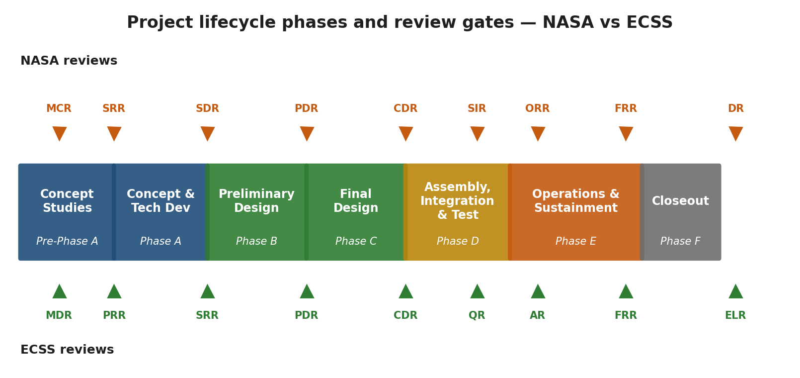
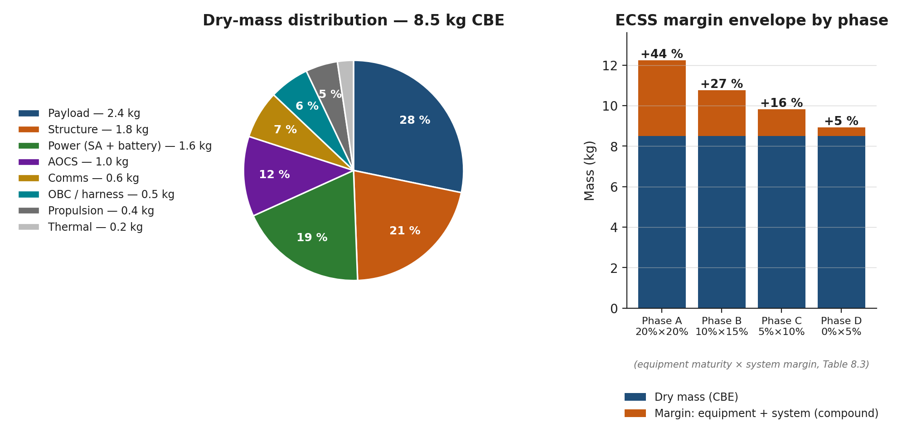
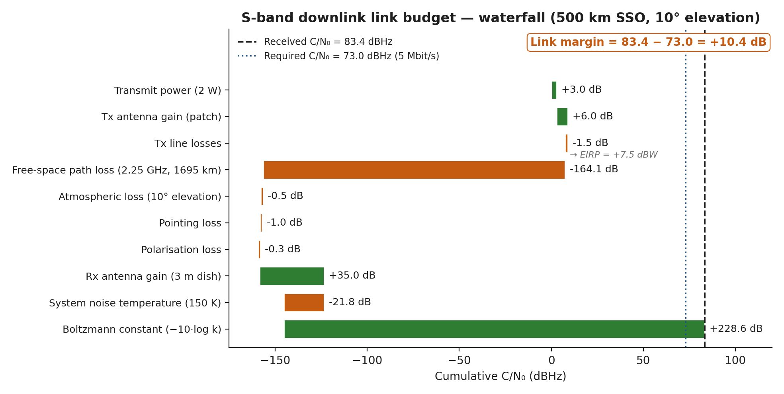
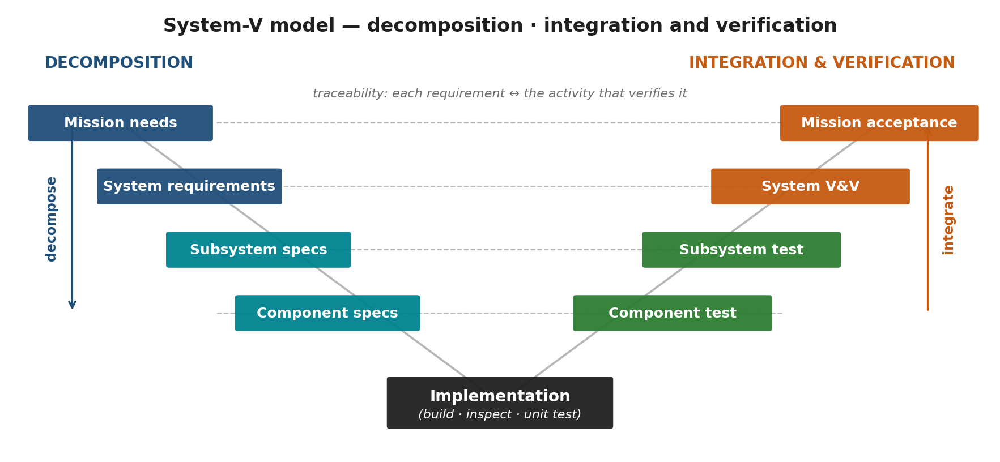

# Guide de l'utilisateur

## Ce qu'est SpaceCDF

**SpaceCDF** est un centre de conception concourante assisté par l'IA
pour la conception de missions spatiales. Il vous accompagne de la
définition du problème jusqu'à une conception préliminaire de CubeSat
complète et vérifiée, assortie d'une documentation conforme aux normes
ECSS. L'outil est au cœur du stage intensif en CDF décrit dans le
*Plan du cours* et le *Guide de l'animateur*.

La plateforme se compose d'un backend Python et d'une interface web.
Vous l'exécutez en local pour travailler seul, ou comme serveur partagé
pour des séances d'équipe en conception concourante, où chaque
utilisateur occupe un poste du CDF (puissance, AOCS, communications,
charge utile, etc.).

> **Lectures attendues.** Avant d'ouvrir l'outil pour la première fois,
> parcourez le *Programme sur 3 semaines* et le *Plan du cours* (le
> présent ensemble de PDF). Ils décrivent le déroulement que ce guide
> suppose connu.



*Figure 3.1 — SpaceCDF vous accompagne de la pré-phase A (besoin de
mission) jusqu'à la fin de la phase B (PDR). Les opérations (phase E)
sont couvertes séparément par le simulateur EOSAT-1 et les dossiers de
la semaine 3.*

---

## Prise en main

### Configuration requise

| Composant | Exigence |
|-----------|-------------|
| Système d'exploitation | macOS 13+, Ubuntu 22+, Windows 10/11 (WSL2 recommandé) |
| Python | 3.11 ou plus récent |
| Node.js | 18 LTS ou plus récent |
| Navigateur | Chrome 120+ / Safari 17+ / Firefox 120+ — Edge 120+ |
| Mémoire vive | 8 Go au minimum, 16 Go recommandés |
| Disque | 4 Go libres pour les sources et la base de données |

### Installation (en local)

```bash
git clone https://github.com/FNewland/SpaceCDF.git
cd SpaceCDF

# Backend
pip install -e packages/spacecdf-common
pip install -e packages/spacecdf-agents
pip install -e packages/spacecdf-kb
pip install -e packages/spacecdf-server
uvicorn spacecdf_server.app:app --reload --port 8000

# Frontend (separate terminal)
cd frontend && npm install && npm run dev
```

Ouvrez `http://localhost:5173` dans votre navigateur.

### Connexion à une instance distante

Modifiez `frontend/vite.config.ts` et changez la cible du proxy :

```javascript
proxy: { '/api': 'http://REMOTE_HOST:8000' }
```

Le trafic de l'API et du WebSocket est alors acheminé vers votre
serveur CDF partagé. Pour l'enseignement hébergé dans le Cyber Range,
le `REMOTE_HOST` est communiqué dans Brightspace au début de la
semaine 2.

---

## Le déroulement en un coup d'œil

Le déroulement en cinq étapes suit le cycle en V (voir la figure 2.2
du *Plan du cours*). Chaque étape dispose d'un écran dédié et d'un
jalon reconnaissable pour passer à la suivante :

| Étape | Écran | Jalon vers l'étape suivante | Séance du cours |
|------|--------|--------------|----------------|
| 1 — Besoin | Barre d'étapes · Step 1 (Need) | Carte des parties prenantes et objectifs rédigés | 1.2 |
| 2 — Concept | Barre d'étapes · Step 2 (Concept) | Solutions de mission comparées ; archétype choisi | 1.3 – 1.4 |
| 3 — Exigences | Barre d'étapes · Step 3 (Reqs) | Orbite et classe choisies, boucle de conception exécutée | 2.1 – 2.4 |
| 4 — Conception | Espace de travail à onglets (5 groupes) | Sous-systèmes convergés, interfaces sans conflit | 3.1 – 4.4 |
| 5 — Revue | Onglet Gate Review | Critères de sortie de la PDR satisfaits | 5.1 – 5.4 |

### Étape 1 — Besoin de mission

1. Cliquez sur **Step 1 (Need)** dans la barre d'étapes à gauche.
2. Saisissez votre **énoncé du problème**. *Le QUOI, pas le COMMENT* —
   voir le *Plan du cours*, §2.1.
3. Ajoutez les **parties prenantes** avec leur rôle et leur besoin.
4. Définissez des **objectifs** assortis de critères de réussite
   mesurables.
5. L'outil détecte automatiquement le type de mission à partir des
   mots-clés des objectifs.

### Étape 2 — Exploration de concepts

1. Cliquez sur **Step 2 (Concept)**.
2. Saisissez les paramètres du compromis : GSD, revisite, couverture,
   latence, budget.
3. Cliquez sur **Lancer l'analyse** (Run Analysis) pour évaluer les solutions
   spatiales et non spatiales.
4. Examinez les résultats notés — l'outil indique si une solution
   spatiale se justifie.

### Étape 3 — Exigences

1. Cliquez sur **Step 3 (Requirements)**.
2. **Orbit Advisor** (assistant orbite) : saisissez les objectifs,
   cliquez sur **Compute** (calculer) → orbites candidates notées.
   Cliquez sur **Use** (utiliser) pour appliquer.
3. **Class Advisor** (assistant de classe) : saisissez les paramètres
   connus (tous facultatifs). Cliquez sur **Compute** → recommandation
   de classe de satellite.
4. Renseignez dans le formulaire les paramètres d'orbite, de charge
   utile et de mission.
5. Cliquez sur **Run Design (solo)** (lancer la conception en solo)
   → 20 agents font converger la conception.

### Étape 4 — Phase de conception

Une fois la conception lancée, l'outil bascule vers un espace de
conception à onglets, organisé en cinq groupes :

| Groupe | Onglets |
|-------|------|
| Design (conception) | Dashboard · ConOps · Functions · Requirements · Interfaces |
| Analysis (analyse) | Link Budget · Trade Studies · Optimizer · Cost |
| Verify (vérifier) | Compliance · V&V Matrix · Gate Review |
| Team (équipe) | Positions · Q&A |
| Data (données) | Exports · Parametric · Changes · Help |

### Étape 5 — Revue

Utilisez l'onglet **Gate Review** (revue de jalon) pour passer en revue
les critères de sortie de la PDR. Soldez les actions directement dans
l'onglet. Générez l'ensemble des documents ECSS depuis l'onglet
**Exports**.

---

## Fonctionnalités principales

### Dashboard (tableau de bord)

La vue principale de conception affiche :

- **Cartes d'indicateurs clés (KPI) :** marge de masse, marge de
  puissance, marge de liaison, coût, durabilité, fiabilité, conflits.
- Les graphiques **cascade de masse** et **profil de puissance**.
- **Ventilation des bilans :** masse et puissance par sous-système,
  avec allocations modifiables.
- **Bilans d'ingénierie :** pointage (RSS), données (flux de la chaîne
  de traitement), temps (chronologie de l'orbite).
- **Sélecteur de spectre :** choix du type de licence et de la bande
  de fréquences.
- **Sélecteur de lancement :** choix d'un fournisseur avec mise à jour
  en direct de l'allocation de masse.
- **Application des marges ECSS :** vérification des marges de chaque
  domaine par rapport à la politique.



*Figure 3.2 — Répartition de la masse et politique de marges ECSS par
phase. La carte de masse du tableau de bord présente ces mêmes données
en direct.*

### Navigateur d'équipements

Cliquez sur **Équipements** (Equipment) dans la barre d'en-tête.

- **18 catégories** regroupées par domaine (puissance, AOCS,
  communications, propulsion, structure, données, thermique,
  intégration).
- **Annotations de besoin :** point bleu = requis, cercle = facultatif,
  grisé = inutile.
- **Sélection multiple :** sélection de plusieurs éléments par
  catégorie (p. ex. 4 roues de réaction).
- **Compatibilité RF :** avertissement en cas de sélection d'un
  transpondeur et d'une antenne de bandes incompatibles.
- **Barre de bilan en direct :** totaux cumulés de masse, de puissance
  et de coût.
- **Mode comparaison :** comparaison côte à côte de 3 composants au
  plus.

### Études de compromis

Deux modes :

- **Parametric Sweep** (balayage paramétrique) — faire varier un
  paramètre et observer son effet sur les indicateurs clés
  (graphique).
- **Tabular Trade** (compromis tabulaire) — définir des critères
  pondérés, ajouter des options, noter de façon quantitative ou
  qualitative (faible / moyen / élevé), consulter le classement
  obtenu.

### Outil de bilan de liaison

Cascade interactive complète — puissance d'émission → gain d'antenne
→ pertes → affaiblissement en espace libre → pertes atmosphériques, de
dépointage et de polarisation → gain en réception → G/T → C/N₀ → Eb/N₀
→ marge. Chaque terme est modifiable, et la marge est codée par
couleur.



*Figure 3.3 — Bilan de liaison en cascade type, tel que SpaceCDF
l'affiche. Le C/N₀ requis et la marge de liaison figurent en bas à
droite.*

### Optimiseur

- **Objectif unique :** minimiser la masse ou le coût, ou maximiser la
  marge de liaison.
- **Pareto (NSGA-II) :** multiobjectif, jusqu'à 10 objectifs.
- **Prise en compte du type de mission :** variables filtrées
  automatiquement (pas de variables de propulsion sans propulsion).
- **Sensibilité (Morris) :** classe les paramètres selon leur
  influence sur l'objectif.

### Exports

Génère plus de 18 types de documents :

- **ECSS :** MRD, TS, IRD, SEMP, RMP, ConOps, VP, plan d'essais.
- **Réglementaires :** API de l'UIT, coordination IARU, LSTS, contrôle
  des exportations, CUPEEA, rapport de fin de vie.
- **Données de conception :** données du modèle paramétrique, rapports
  cycliques, contrôle de cohérence, application des marges.

### Réactivité entre outils

- **Barre d'état de la conception :** signale que la conception est
  périmée après toute modification de paramètre.
- **Reconvergence automatique :** option facultative — relance
  automatiquement la conception après chaque modification.
- **Examen des conflits :** une fenêtre modale s'ouvre lorsque des
  conflits critiques sont détectés ; leur résolution est obligatoire.
- **Aperçu de l'impact :** montre quels agents et quels bilans une
  modification affectera, avant de l'accepter.
- **Journal des modifications :** historique complet avec possibilité
  d'annulation.

### Déblocage progressif des niveaux

L'outil suit le cycle en V (voir la figure 3.4), en 5 niveaux
progressifs :

- **Niveau 0** — Aide uniquement (définir d'abord le besoin de
  mission).
- **Niveau 1** — Architecture de la mission (une fois le besoin
  défini). ConOps, fonctions, exigences.
- **Niveau 2** — Architecture du système (après une exécution de la
  conception). Options d'architecture, interfaces, bilans, études de
  compromis, gestion de projet.
- **Niveau 3** — Conception des sous-systèmes (une fois l'architecture
  choisie). Bilan de liaison, optimiseur, coût, navigateur
  d'équipements.
- **Niveau 4** — Vérification (après la conception des
  sous-systèmes). Conformité, matrice V&V, revue de jalon.

La barre d'indication du niveau montre où vous en êtes et ce qu'il
reste à faire.



*Figure 3.4 — Cycle en V. Le déblocage des niveaux dans SpaceCDF suit
la branche descendante (décomposition) du V.*

### Éditeur interactif de l'architecture de mission

Dans l'onglet **ConOps**, un éditeur de diagrammes par
glisser-déposer vous permet de construire l'architecture de votre
mission :

- **6 types de nœuds** — satellite · station sol · traitement ·
  utilisateur · capteur · GNSS/externe.
- Faites glisser les nœuds pour les positionner et reliez-les par des
  lignes étiquetées.
- L'architecture détermine les systèmes à définir au niveau suivant.

### Choix de l'architecture du système

Dans l'onglet **Architecture** :

- **Moitié supérieure** — choix des options d'architecture pour chacun
  des 8 sous-systèmes (EPS, AOCS, TT&C, thermique, structure,
  propulsion, OBC, sol).
- **Moitié inférieure** — schéma fonctionnel généré automatiquement,
  montrant les sous-systèmes et leurs liaisons.
- Chaque choix fait dériver des exigences (étiquetées performance /
  interface / bilan / fonctionnelle).

### Bilans d'ingénierie (vue unifiée)

L'onglet **Eng. Budgets** (bilans d'ingénierie) présente les 8 bilans
au même endroit :

| Bilan | Source | Marge (phase A / B / C) |
|--------|--------|--------------------------|
| Masse | Équipements + modèle de structure | 20 % / 15 % / 10 % |
| Puissance | Équipements + modèle de rapports cycliques | 25 % / 20 % / 10 % |
| Liaison | Bilan de liaison en cascade | 6 dB / 3 dB / 3 dB |
| Pointage | Arbre d'erreurs de pointage (RSS) | 30 % / 20 % / 10 % |
| Δv | Modèle de propulsion | 25 % / 15 % / 10 % |
| Volume | Enveloppe CDS de Cal Poly | 10 % / 5 % / 2 % |
| Données | Modèle de flux de la chaîne de traitement | 30 % / 20 % / 10 % |
| Coût | CER paramétriques + COTS | 30 % / 20 % / 15 % |

La ventilation par sous-système indique l'origine de la marge (COTS ou
conception nouvelle) et se consolide à partir des choix d'équipements.

### Moteur de propagation des contraintes

187 interconnexions entre points de conception sont détectées
automatiquement :

- Lorsqu'un paramètre change, le moteur identifie TOUS les bilans
  concernés.
- Il propose des options de résolution des violations, avec une
  analyse des compromis entre bilans.
- Il détecte les dépendances circulaires (boucles de compromis qui
  exigent une décision de l'équipe).

### Gestion de projet

L'onglet **Project Mgmt** (gestion de projet) comprend :

- **Matrice des risques 5×5** — interactive, codée par couleur selon le
  score V × C (vraisemblance × conséquence). Voir la figure 2.11 du
  *Plan du cours*.
- **Planning** — 10 jalons, de la MCR jusqu'à la recette en orbite.
- **WBS** — 9 lots de travaux avec heures d'effort et suivi
  d'avancement.
- Poste **Project Manager** (chef de projet) inclus.

### Export au format Word

Les documents ECSS peuvent être exportés en fichiers `.docx`
modifiables :

- Cliquez sur le bouton **Word** à côté de MRD, ConOps ou VP dans
  l'onglet **Exports**.
- Les documents sont remplis à partir de l'état courant de la
  conception.
- Modifiables dans Microsoft Word ou LibreOffice.

### Persistance de la séance

L'état de la conception persiste après un rafraîchissement de la
page :

- Toutes les données sont enregistrées automatiquement dans le
  localStorage du navigateur.
- Inutile d'« enregistrer » : c'est toujours enregistré.
- Pour effacer : DevTools du navigateur → Application → Local Storage →
  supprimer `spacecdf-design-state`.

---

## Séances de conception concourante

1. Cliquez sur **Start Session** (démarrer une séance) dans l'en-tête.
2. Choisissez votre ou vos postes et saisissez un nom d'affichage.
3. Partagez l'URL avec les membres de l'équipe — ils rejoignent la
   même séance.
4. Les modifications se propagent en temps réel par WebSocket.
5. Chaque poste ne peut modifier que les paramètres dont il est
   propriétaire.
6. La convergence s'exécute automatiquement après chaque modification.

---

## Modification des données paramétriques

Les modèles de dimensionnement de l'outil reposent sur des données
étalonnées pour les CubeSats. Pour les consulter et les modifier :

1. Ouvrez l'onglet **Paramétrique** (Parametric).
2. Quatre sous-onglets : Mass Fractions (fractions de masse) · Cost
   Fractions (fractions de coût) · Power Duty Cycles (rapports
   cycliques de puissance) · SA Power (puissance du générateur
   solaire).
3. Les valeurs sont données par classe de satellite (nano, micro,
   petit, moyen, grand).
4. Les sources sont citées à côté de chaque tableau.

Pour modifier directement les données sources :
`packages/spacecdf-common/src/spacecdf_common/physics/heritage_mass.py`.

---

## Mise à jour de la base de données d'équipements

Les données des composants se trouvent dans des fichiers YAML :
`packages/spacecdf-kb/src/spacecdf_kb/data/components/`.

Pour ajouter un composant :

```yaml
- id: unique-id
  name: "Component Name"
  manufacturer: "Vendor"
  mass_kg: 0.15
  power_w: 8.0
  cost_keur: 30
  trl: 8
  frequency_band: S  # for RF components
```

L'API permet aussi l'import : `POST /api/lifecycle/equipment/import`.

---

## Inventaire des fonctionnalités, onglet par onglet

| Onglet | Groupe | Rôle |
|-----|-------|---------|
| Dashboard | Design | Vue d'ensemble des indicateurs clés en direct |
| ConOps | Design | Éditeur d'architecture de mission et chronologie |
| Functions | Design | Arbre fonctionnel, matrice d'allocation |
| Requirements | Design | Exigences SMART, liens parent/enfant |
| Interfaces | Design | Matrice N², résolution des conflits d'interface |
| Architecture | Design | Choix d'architecture, exigences dérivées |
| Eng. Budgets | Design | Les 8 bilans au même endroit |
| Link Budget | Analysis | Cascade interactive, marge codée par couleur |
| Trade Studies | Analysis | Balayage paramétrique + compromis tabulaire |
| Optimizer | Analysis | NSGA-II, sensibilité de Morris |
| Cost | Analysis | CER + consolidation selon le WBS |
| Compliance | Verify | Matrice de conformité aux exigences |
| V&V Matrix | Verify | Méthode de vérification (A/T/R/I) par exigence |
| Gate Review | Verify | Critères de sortie de la PDR, actions |
| Positions | Team | Affectation des postes + responsabilités |
| Q&A | Team | Questions de conception propres à chaque poste |
| Project Mgmt | Team | Risques · planning · WBS |
| Exports | Data | Exports ECSS, réglementaires et de données de conception |
| Parametric | Data | Coefficients ajustables des modèles de dimensionnement |
| Changes | Data | Journal d'audit + annulation |
| Help | Data | Index de l'aide intégrée |

---

## Légende de la barre d'état

La barre d'état inférieure utilise 4 bandes de couleur et 6 icônes :

| Couleur | Signification | Action |
|--------|---------|--------|
| Vert | Toutes les marges respectées, aucun conflit | Continuer |
| Orange | Marge à moins de 10 % de la politique | Resserrer, ou accepter et documenter |
| Rouge | Marge non respectée ou conflit critique | Résoudre avant le prochain jalon |
| Gris | Conception périmée — relancer | Cliquer sur « Run Design » |

Icônes :
🛰 conception active · 🟢 nominal · ⚠ avertissement · 🚨 critique · 🔄 reconvergence en cours · 📦 export prêt.

---

## Matrice des formats de fichiers pris en charge

| Format | Import | Export | Remarques |
|--------|:------:|:------:|-------|
| YAML (mission, équipements) | ✓ | ✓ | Format d'échange de référence |
| JSON (paramètres) | ✓ | ✓ | Format natif de l'API |
| CSV (nomenclature, exigences) | ✓ | ✓ | Compatible avec Excel |
| Word (.docx) | — | ✓ | Ensemble de documents ECSS |
| PDF | — | ✓ | Généré à partir du .docx |
| Markdown | — | ✓ | Dossier de conception en lecture seule |
| TLE | ✓ | ✓ | Échange de données d'orbite |
| KML | — | ✓ | Traces au sol pour examen visuel |

---

## Raccourcis clavier

| Raccourci | Action |
|----------|--------|
| Ctrl + Entrée | Lancer la conception |
| Ctrl + S | Forcer l'enregistrement (sans effet — toujours enregistré) |
| Échap | Fermer la fenêtre modale |
| ⌘/Ctrl + K | Recherche rapide d'un onglet |
| F2 | Afficher le tableau de bord |
| F3 | Afficher le navigateur d'équipements |
| F4 | Afficher l'optimiseur |
| ⌘/Ctrl + Z | Annuler (s'appuie sur le journal des modifications) |
| ⌘/Ctrl + Maj + Z | Rétablir |

---

## Dépannage

| Problème | Cause | Solution |
|-------|-------|----------|
| « Socket not connected » | Aucune séance active | Démarrer ou rejoindre d'abord une séance |
| La conception n'affiche aucun résultat | Conception non exécutée | Cliquer sur **Run Design** à l'étape 3 |
| Onglet Exigences (Requirements) vide | Aucun identifiant d'étude | Lancer la conception au moins une fois |
| L'optimiseur ne démarre pas | Aucune séance active | Démarrer une séance, ou utiliser le mode solo |
| Navigateur d'équipements grisé | Frontend ↔ backend désynchronisés | Recharger la page ; vérifier CORS |
| Échec de l'export ECSS | Conflits ouverts dans la conception | Les résoudre dans la fenêtre Conflict Review |
| Export Word incorrect | Particularités de LibreOffice | Ouvrir dans Word ; polices manquantes : installer Work Sans/Spectral |
| Import TLE rejeté | Mauvaise époque / longueur de ligne | Utiliser le format standard à 2 lignes |

---

## Référence des messages d'erreur

| Code | Message | Signification | Que faire |
|------|---------|---------------|------------|
| `E_NEED_001` | « Problem statement required » | Étape 1 incomplète | Rédiger le QUOI à l'étape 1 |
| `E_REQ_017` | « SMART check failed: vague verb » | Exigence non vérifiable | Employer *doit* + un verbe mesurable |
| `E_INT_004` | « Interface conflict — voltage mismatch » | Deux sous-systèmes divergent sur la tension du bus | Fixer la tension du bus au niveau de l'architecture |
| `E_BUD_022` | « Mass margin violated » | Total > politique | Arbitrer entre structure, charge utile et ergols |
| `E_OPT_011` | « Optimizer not converging » | Espace de recherche vide | Élargir les bornes des variables |
| `E_EXP_003` | « ECSS export blocked: open conflicts » | Conflits non résolus | Les résoudre dans Conflict Review |

---

## Glossaire

| Terme | Signification |
|------|---------|
| AOCS | Système de contrôle d'attitude et d'orbite (SCAO) |
| AOS | Acquisition du signal (début de passage) |
| BOM | Nomenclature |
| CDF | Centre de conception concourante |
| CER | Relation d'estimation de coût |
| ConOps | Concept d'opérations |
| CDS | *CubeSat Design Specification* (Cal Poly) |
| DoD | Profondeur de décharge (batterie) |
| ECSS | *European Cooperation for Space Standardization* (coopération européenne pour la normalisation spatiale) |
| EIRP | Puissance isotrope rayonnée équivalente (PIRE) |
| EPS | Sous-système d'alimentation électrique |
| FDIR | Détection, isolation et reprise des défaillances |
| FOV | Champ de vue |
| FSPL | Affaiblissement en espace libre |
| GSD | Distance d'échantillonnage au sol |
| ICD | Document de contrôle d'interface |
| IRD | Document d'exigences d'interface |
| ITU | Union internationale des télécommunications (UIT) |
| LEOP | Phase de lancement et de début d'orbite |
| LOS | Perte du signal (fin de passage) |
| MCR | Revue du concept de mission |
| MoE / MoP | Mesure d'efficacité / de performance |
| MRD | Document d'exigences de mission |
| OBDH | Gestion bord des données |
| OBC | Calculateur de bord |
| PCDU | Unité de conditionnement et de distribution de puissance |
| PDR | Revue de définition préliminaire |
| PUS | Norme d'utilisation des paquets (CCSDS) |
| RAAN | Ascension droite du nœud ascendant |
| RACI | Réalise / Approuve / Consulté / Informé |
| RSSSA | Loi sur les systèmes de télédétection spatiale (Canada) — LSTS |
| RW | Roue de réaction |
| SAR | Radar à synthèse d'ouverture |
| SME | *Space Mission Engineering: The New SMAD* (manuel) |
| SMAD | *Space Mission Analysis & Design* (manuel) |
| SMART | Spécifique · Mesurable · Atteignable · Pertinente · Traçable |
| SSO | Orbite héliosynchrone |
| TC | Télécommande |
| TCA | Instant de rapprochement maximal |
| TM | Télémesure |
| TPM | Indicateur de performance technique |
| TRL | Niveau de maturité technologique |
| TT&C | Télémesure, poursuite et télécommande |
| WBS | Organigramme des tâches |

---

## Liste de références

- **NASA SEH** — [https://www.nasa.gov/reference/systems-engineering-handbook/](https://www.nasa.gov/reference/systems-engineering-handbook/)
- **NASA CubeSat 101** — [https://www.nasa.gov/wp-content/uploads/2017/03/nasa_csli_cubesat_101_508.pdf](https://www.nasa.gov/wp-content/uploads/2017/03/nasa_csli_cubesat_101_508.pdf)
- **Normes ECSS** — [https://ecss.nl/](https://ecss.nl/)
- **Cal Poly CDS Rev 14** — [https://www.cubesat.org/cds-announcement](https://www.cubesat.org/cds-announcement)
- **CCSDS PUS** — [https://public.ccsds.org/Pubs/660x0g3.pdf](https://public.ccsds.org/Pubs/660x0g3.pdf)
- **Règlement des radiocommunications de l'UIT** — [https://www.itu.int/pub/R-REG-RR](https://www.itu.int/pub/R-REG-RR)
- **ISDE CPC-2-6-02** — [https://ised-isde.canada.ca/site/spectrum-management-telecommunications/en](https://ised-isde.canada.ca/site/spectrum-management-telecommunications/en)
- **Code source de SpaceCDF** — [https://github.com/FNewland/SpaceCDF](https://github.com/FNewland/SpaceCDF)
