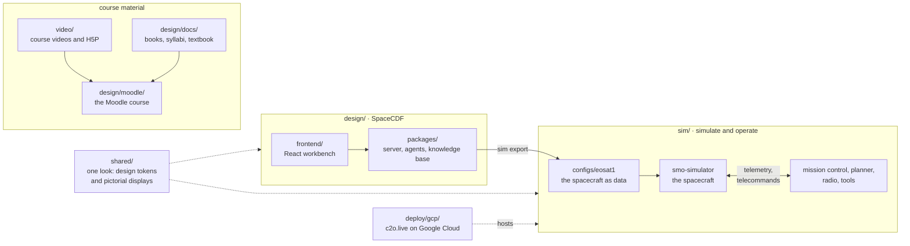
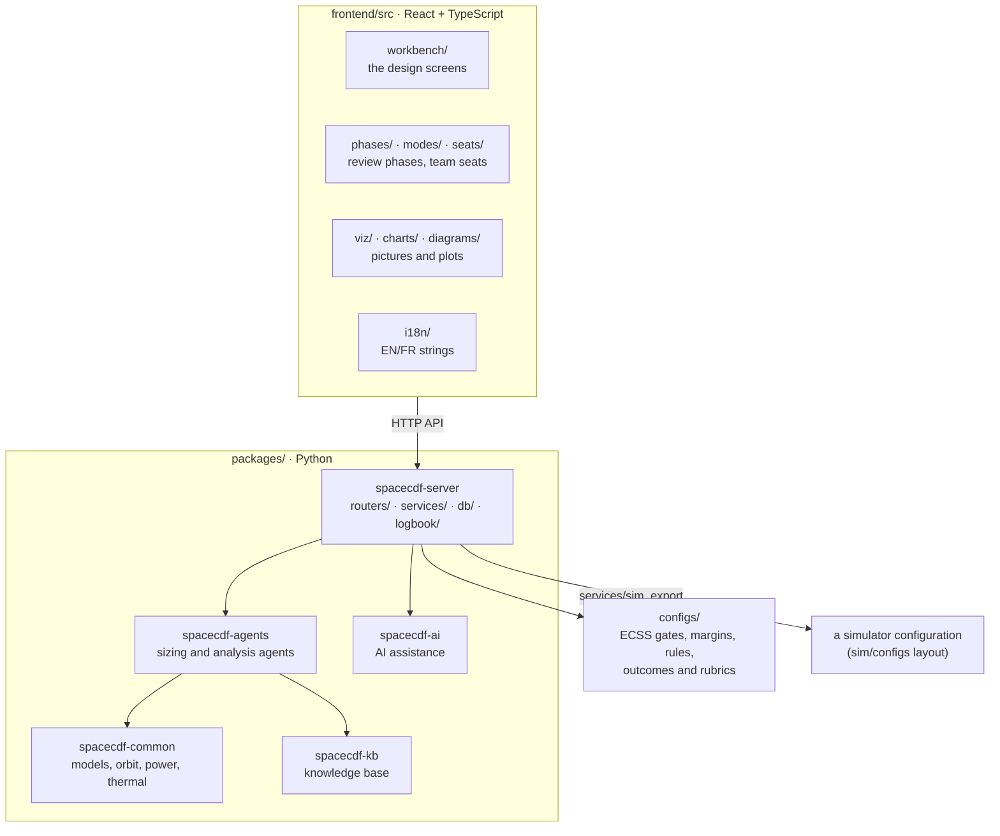
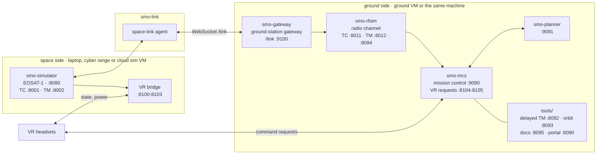
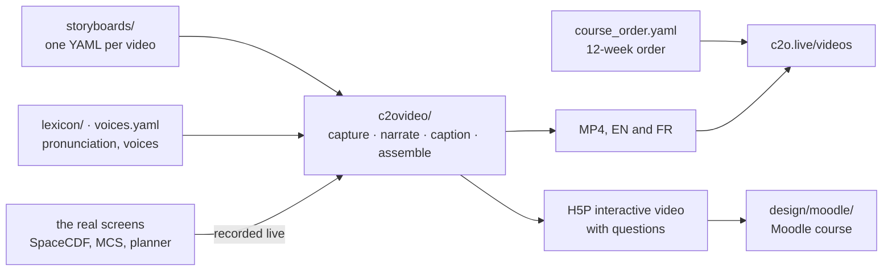
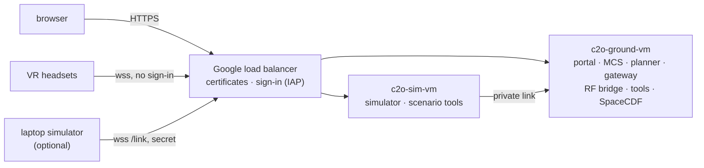

# What is where in C2O

*Version française : [REPO_MAP_fr.md](REPO_MAP_fr.md)*

C2O has two halves that meet in the middle: **design** a mission in SpaceCDF (`design/`), export it
as a spacecraft configuration, then **fly** it in the simulator and mission control (`sim/`). Around
them sit the course material (`video/`, `design/moodle/`, the books in `design/docs/`), the shared
look and pictures (`shared/`) and the cloud hosting at c2o.live (`deploy/`).

## The big picture

Solid arrows carry data: a SpaceCDF design is exported as a spacecraft configuration that the
simulator flies. Dotted arrows mean "is used by" or "hosts". The course videos are recorded from the
real SpaceCDF and mission control screens, and c2o.live hosts SpaceCDF as well as the simulator and
consoles (see [How c2o.live is put together](#how-c2olive-is-put-together)).

## Top-level folders

| Folder | What it is | Start here |
|---|---|---|
| [`design/`](../design/) | **SpaceCDF**, the concurrent design facility: requirements, budgets, design agents, trades, reviews (MCR to CDR), ECSS documents, export to the simulator. Also the course books, the open textbook *Concurrent Spacecraft Design* and the Moodle course builder. Python (FastAPI) + React. MIT. | [`design/README.md`](../design/README.md) |
| [`sim/`](../sim/) | **The simulator and the ground segment** for EOSAT-1: spacecraft simulator, mission control system (MCS), planner, radio-frequency bridge, space link and gateway, operations manual, procedures and failure scenarios. Python. GPL-3.0. | [`sim/README.md`](../sim/README.md) |
| [`video/`](../video/) | **Course videos**: storyboards, the pipeline that records the real screens and narrates them in English and French, the H5P interactive versions, the course order. | [`video/README.md`](../video/README.md) |
| [`shared/`](../shared/) | **One look for everything**: colour and type tokens, and the pictorial displays (attitude, ground track, power flow, sky plot) used by both the consoles and SpaceCDF. | [`shared/ui-viz/README.md`](../shared/ui-viz/README.md) |
| [`deploy/`](../deploy/) | **c2o.live on Google Cloud**: setup, start and stop, the `c2o` command, sign-in and the load balancer. | [`deploy/gcp/README.md`](../deploy/gcp/README.md) |
| [`docs/`](./) | **Cross-project plans and specifications**: the November 2026 plan, UI brief, testing notes, and this map. | [`docs/plan_2026-11/README.md`](plan_2026-11/README.md) |
| `data/` | Local analysis output (not in git). | |

## `design/`: SpaceCDF

| Path | Holds |
|---|---|
| `frontend/` | The React app (Vite). `src/workbench/` is the main design screen; `src/i18n/` holds the English and French strings. |
| `packages/spacecdf-server/` | The FastAPI backend: `routers/` (the API), `services/` (budgets, reviews, exports including `sim_export/` and `tmtc_export.py`), `db/`, `logbook/`, `seats/`. |
| `packages/spacecdf-agents/` | The design agents that size subsystems and run analyses. |
| `packages/spacecdf-common/` | Shared models and physics: orbit, power, thermal, debris, payload sizing. |
| `packages/spacecdf-kb/` | The knowledge base: component categories, COTS parts, launch providers, reference missions. |
| `packages/spacecdf-ai/` | AI assistance used by the agents and the workbench. |
| `configs/` | ECSS review gates and exit criteria, margin policy, rules, cost and reliability data, worksheets, and `outcomes/` (the MSE course-outcome rubrics). |
| `docs/course/`, `docs/orbit_north/` | ORBIT NORTH course plans, syllabi (3-week and 12-week), facilitator and learner books, outcomes map, recruitment poster. |
| `docs/oer/` | The open textbook *Concurrent Spacecraft Design* (CC BY 4.0): chapters, build, French edition. |
| `docs/pdf/` | Built PDFs of the books, syllabi and posters. |
| `docs/fr/`, `docs/i18n/` | French translations and how to build them. |
| `moodle/` | The Moodle course builder: `course/` (manifest and build script), `decks/` (lecture slides), `banners/`, `plugins/report_c2ostats` (anonymous course statistics). |
| `scripts/` | Validation harness and helpers. |
| `tests/` | The SpaceCDF test suite, including the Northern Fire and Ice example study in `tests/fixtures/nfi/`. |
| `exports_demo/` | Sample exported review documents (MRD, SRR, PDR, CDR, budget workbook). |

## `sim/`: simulator and ground segment

The simulator and the ground segment can run on one machine or apart: the space link carries
telemetry and telecommands between them, across a network or the internet.

| Path | Holds |
|---|---|
| `packages/smo-simulator/` | The spacecraft simulator: orbit, attitude (AOCS), power, thermal, communications, onboard computer, payload, propulsion, failure injection, the instructor station and the VR bridge. |
| `packages/smo-mcs/` | Mission control: telemetry displays, commanding (PUS-C), procedures, event log, the flight director's VR-request desk. Web consoles in `static/`. |
| `packages/smo-planner/` | Pass and activity planning. |
| `packages/smo-rfsim/` | The radio channel between ground and spacecraft: link budget, noise, impairments. |
| `packages/smo-link/` | The space link: lets the simulator run anywhere (behind a home router or in the cloud) and still reach the ground. |
| `packages/smo-gateway/` | The ground-station gateway the link connects to. |
| `packages/smo-common/` | Code shared by all the ground and space services: protocol and packets, telemetry, commanding, configuration loading, orbit and attitude maths, procedures, logbook, translations, web helpers. |
| `configs/eosat1/` | **The spacecraft as data**: subsystems, telemetry and telecommands (also as XTCE and SMDL), procedures, failure modes, scenarios, mission phases, orbit, the operations manual, French translations in `i18n/fr/`. A SpaceCDF export writes a folder in this same layout. |
| `docs/` | Operations guide, instructor guide, PUS service reference, link budget, the VR interface ICD (and `fr/`), architecture, defects and status. |
| `tools/` | Stand-alone tools: delayed-TM viewer, orbit tools, power budget, link-budget ladder, the welcome portal, the VR stub and test kit (`vr_stub/`), the i18n checker (`i18n/`). |
| `deploy/`, `docker/` | Installers and start scripts, the Docker image and `compose.yaml` profiles (ground, space, rf). |
| `tests/` | The simulator test suite. |
| `workspace/` | Runtime state: breakpoints (saved states), snapshots, audit logs. |
| `vendor/` | Bundled web libraries and fonts, so the consoles run offline. |
| `start.sh` | Starts everything on one machine. |

## `video/`: course videos

| Path | Holds |
|---|---|
| `storyboards/` | One YAML file per video (V-DES, V-SCDF, V-CON, V-PLN, V-OPS series): steps, narration EN/FR, questions. |
| `c2ovideo/` | The pipeline: `capture.py` drives the real apps, `assemble.py` builds the video, `h5p.py` the interactive version, `publish.py` the catalogue, `order.py` the course order. |
| `explainers/` | Short animated HTML explainers (orbit, power, thermal, packets…) recorded into the videos. |
| `course_order.yaml` | Which week each video belongs to. |
| `scripts/` | `render_all.sh` (render every video), voice set-up. |
| `out/` | Rendered videos and H5P packages (not in git; build with `render_all.sh`). |

## `shared/`, `deploy/` and `docs/`

| Path | Holds |
|---|---|
| `shared/ui-tokens/` | `c2o.tokens.json`: colour, type, spacing, dark (control room) and light (design) themes, for both projects. |
| `shared/ui-viz/` | The pictorial displays as plain JavaScript modules (attitude 2D/3D, ground track, sky plot, power flow, stack 3D); `sync.py` copies them into `sim/` and `design/`. |
| `deploy/gcp/` | `setup.sh` (create everything), `start.sh` / `stop.sh`, `teardown.sh`, `switch.sh` (gcloud profiles), the `c2o` command, VM start-up scripts, `c2o.env.example`. |
| `docs/plan_2026-11/` | The November 2026 plan: design reviews, instructor console, logbook, thermal model, external links, course videos. |
| `docs/ui/` | The C2O UI brief. |
| `docs/TESTING.md` | How to run the test suites. |

## How c2o.live is put together

`c2o up` and `c2o down` start and stop the VMs; `c2o update` pulls new code onto them. Details,
addresses and costs: [`deploy/gcp/README.md`](../deploy/gcp/README.md).

## Where to start, by role

| You want to… | Go to |
|---|---|
| Run the simulator and mission control on your machine | `cd sim && ./start.sh`, then [`sim/README.md`](../sim/README.md) |
| Run SpaceCDF | `cd design && ./install.sh`, then [`design/README.md`](../design/README.md) |
| Teach the course | [`sim/docs/INSTRUCTOR_GUIDE.md`](../sim/docs/INSTRUCTOR_GUIDE.md), [`design/docs/orbit_north/`](../design/docs/orbit_north/), [`design/moodle/README.md`](../design/moodle/README.md) |
| Operate the spacecraft | [`sim/docs/OPERATIONS_GUIDE.md`](../sim/docs/OPERATIONS_GUIDE.md) and the manual in `sim/configs/eosat1/manual/` |
| Build a VR headset client | [`sim/tools/vr_stub/README.md`](../sim/tools/vr_stub/README.md) and [`sim/docs/VR_INTERFACE_ICD.md`](../sim/docs/VR_INTERFACE_ICD.md) |
| Make or re-render a course video | [`video/README.md`](../video/README.md) |
| Put it on the web | [`deploy/gcp/README.md`](../deploy/gcp/README.md) |
| Translate or check French | `python3 -m tools.i18n status` in `sim/` or `design/`; rulings in [`sim/docs/i18n/RULINGS.md`](../sim/docs/i18n/RULINGS.md) |
