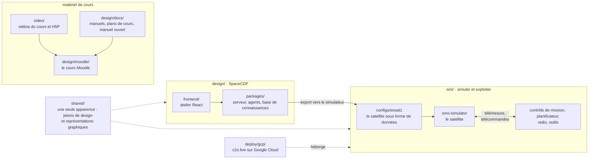
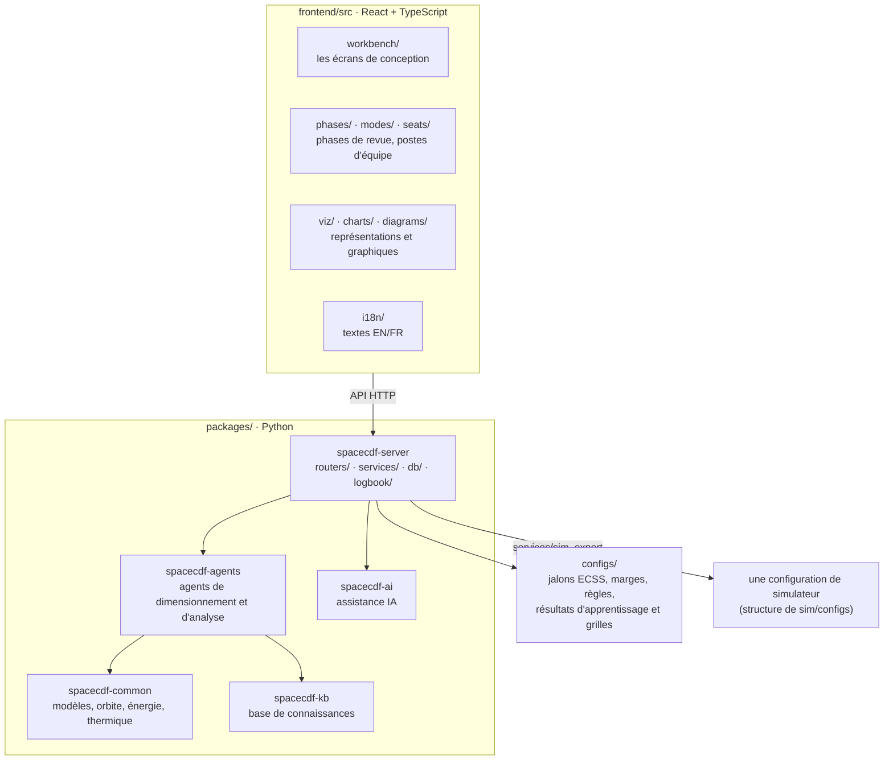
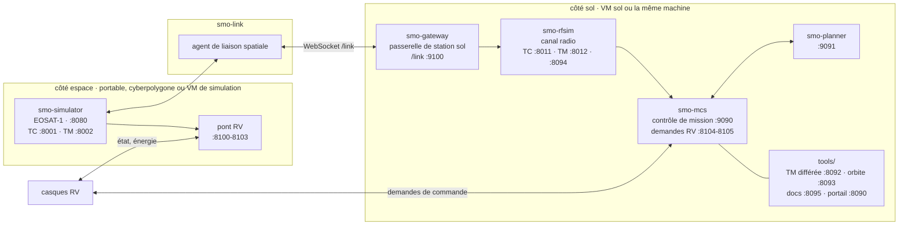
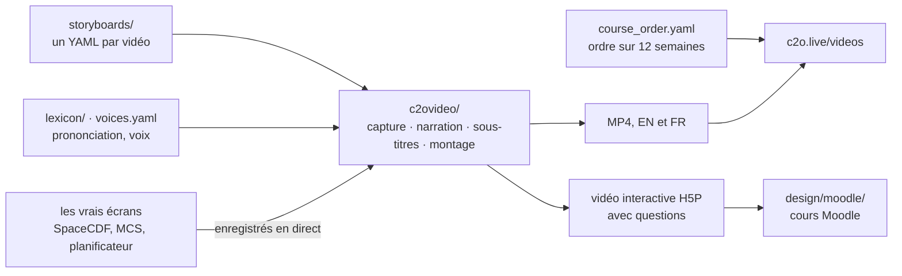
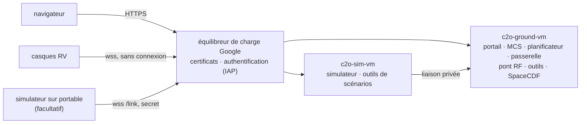

# Où trouver quoi dans C2O

*English version: [REPO_MAP.md](REPO_MAP.md)*

C2O a deux moitiés qui se rejoignent au milieu : on **conçoit** une mission dans SpaceCDF
(`design/`), on l'exporte sous forme de configuration de satellite, puis on la **pilote** dans le
simulateur et le centre de contrôle (`sim/`). Autour se trouvent le matériel de cours (`video/`,
`design/moodle/`, les manuels dans `design/docs/`), l'apparence et les représentations communes
(`shared/`) et l'hébergement infonuagique sur c2o.live (`deploy/`).

## Vue d'ensemble

Les flèches pleines transportent des données : une conception SpaceCDF est exportée sous forme de
configuration de satellite que le simulateur fait voler. Les flèches pointillées signifient « est
utilisé par » ou « héberge ». Les vidéos du cours sont enregistrées à partir des vrais écrans de
SpaceCDF et du contrôle de mission, et c2o.live héberge SpaceCDF ainsi que le simulateur et les
consoles (voir [Comment c2o.live est assemblé](#comment-c2olive-est-assemblé)).

## Dossiers de premier niveau

| Dossier | Ce que c'est | Commencer ici |
|---|---|---|
| [`design/`](../design/) | **SpaceCDF**, l'installation de conception simultanée : exigences, bilans, agents de conception, compromis, revues (MCR à CDR), documents ECSS, export vers le simulateur. Aussi les manuels du cours, le manuel ouvert *Concurrent Spacecraft Design* et le générateur du cours Moodle. Python (FastAPI) + React. MIT. | [`design/README.md`](../design/README.md) |
| [`sim/`](../sim/) | **Le simulateur et le segment sol** d'EOSAT-1 : simulateur du satellite, système de contrôle de mission (MCS), planificateur, pont radiofréquence, liaison spatiale et passerelle, manuel d'exploitation, procédures et scénarios de pannes. Python. GPL-3.0. | [`sim/README.md`](../sim/README.md) |
| [`video/`](../video/) | **Les vidéos du cours** : scénarimages, la chaîne qui enregistre les vrais écrans et les commente en anglais et en français, les versions interactives H5P, l'ordre du cours. | [`video/README.md`](../video/README.md) |
| [`shared/`](../shared/) | **Une seule apparence pour tout** : jetons de couleur et de typographie, et les représentations graphiques (attitude, trace au sol, flux d'énergie, carte du ciel) utilisées par les consoles et par SpaceCDF. | [`shared/ui-viz/README.md`](../shared/ui-viz/README.md) |
| [`deploy/`](../deploy/) | **c2o.live sur Google Cloud** : mise en place, démarrage et arrêt, la commande `c2o`, l'authentification et l'équilibreur de charge. | [`deploy/gcp/README.md`](../deploy/gcp/README.md) |
| [`docs/`](./) | **Plans et spécifications communs aux projets** : le plan de novembre 2026, le cahier de l'interface, les notes de test, et cette carte. | [`docs/plan_2026-11/README.md`](plan_2026-11/README.md) |
| `data/` | Résultats d'analyse locaux (hors de git). | |

## `design/` : SpaceCDF

| Chemin | Contenu |
|---|---|
| `frontend/` | L'application React (Vite). `src/workbench/` est l'écran de conception principal ; `src/i18n/` contient les textes anglais et français. |
| `packages/spacecdf-server/` | Le serveur FastAPI : `routers/` (l'API), `services/` (bilans, revues, exports dont `sim_export/` et `tmtc_export.py`), `db/`, `logbook/`, `seats/`. |
| `packages/spacecdf-agents/` | Les agents de conception qui dimensionnent les sous-systèmes et mènent les analyses. |
| `packages/spacecdf-common/` | Modèles et physique communs : orbite, énergie, thermique, débris, dimensionnement de la charge utile. |
| `packages/spacecdf-kb/` | La base de connaissances : catégories de composants, pièces COTS, lanceurs, missions de référence. |
| `packages/spacecdf-ai/` | L'assistance IA utilisée par les agents et l'atelier. |
| `configs/` | Jalons de revue ECSS et critères de sortie, politique de marges, règles, données de coût et de fiabilité, feuilles de travail, et `outcomes/` (les grilles des résultats d'apprentissage de la MSE). |
| `docs/course/`, `docs/orbit_north/` | Plans du cours ORBIT NORTH, plans de cours (3 semaines et 12 semaines), cahiers de l'animateur et de l'apprenant, carte des résultats d'apprentissage, affiche de recrutement. |
| `docs/oer/` | Le manuel ouvert *Concurrent Spacecraft Design* (CC BY 4.0) : chapitres, construction, édition française. |
| `docs/pdf/` | Les PDF construits des manuels, plans de cours et affiches. |
| `docs/fr/`, `docs/i18n/` | Les traductions françaises et la façon de les construire. |
| `moodle/` | Le générateur du cours Moodle : `course/` (manifeste et script de construction), `decks/` (diapositives), `banners/`, `plugins/report_c2ostats` (statistiques anonymes du cours). |
| `scripts/` | Banc de validation et utilitaires. |
| `tests/` | La suite de tests de SpaceCDF, y compris l'étude d'exemple Northern Fire and Ice dans `tests/fixtures/nfi/`. |
| `exports_demo/` | Exemples de documents de revue exportés (MRD, SRR, PDR, CDR, classeur des bilans). |

## `sim/` : simulateur et segment sol

Le simulateur et le segment sol peuvent tourner sur une même machine ou séparément : la liaison
spatiale transporte la télémesure et les télécommandes entre eux, par un réseau ou par Internet.

| Chemin | Contenu |
|---|---|
| `packages/smo-simulator/` | Le simulateur du satellite : orbite, attitude (SCAO), énergie, thermique, télécommunications, ordinateur de bord, charge utile, propulsion, injection de pannes, le poste instructeur et le pont RV. |
| `packages/smo-mcs/` | Le contrôle de mission : affichages de télémesure, commande (PUS-C), procédures, journal des événements, le bureau des demandes RV du directeur de vol. Consoles web dans `static/`. |
| `packages/smo-planner/` | La planification des passages et des activités. |
| `packages/smo-rfsim/` | Le canal radio entre le sol et le satellite : bilan de liaison, bruit, dégradations. |
| `packages/smo-link/` | La liaison spatiale : permet au simulateur de tourner n'importe où (derrière un routeur domestique ou dans le nuage) tout en joignant le sol. |
| `packages/smo-gateway/` | La passerelle de station sol à laquelle la liaison se connecte. |
| `packages/smo-common/` | Le code commun à tous les services sol et espace : protocole et paquets, télémesure, commande, chargement de la configuration, calculs d'orbite et d'attitude, procédures, journal de bord, traductions, utilitaires web. |
| `configs/eosat1/` | **Le satellite sous forme de données** : sous-systèmes, télémesure et télécommandes (aussi en XTCE et SMDL), procédures, modes de défaillance, scénarios, phases de mission, orbite, le manuel d'exploitation, traductions françaises dans `i18n/fr/`. Un export de SpaceCDF écrit un dossier selon cette même structure. |
| `docs/` | Guide d'exploitation, guide de l'instructeur, référence des services PUS, bilan de liaison, l'ICD de l'interface RV (et `fr/`), architecture, anomalies et état. |
| `tools/` | Outils autonomes : visionneuse de TM différée, outils d'orbite, bilan d'énergie, échelle de bilan de liaison, le portail d'accueil, le simulateur de remplacement et la trousse de test RV (`vr_stub/`), le vérificateur de traduction (`i18n/`). |
| `deploy/`, `docker/` | Installateurs et scripts de démarrage, l'image Docker et les profils de `compose.yaml` (ground, space, rf). |
| `tests/` | La suite de tests du simulateur. |
| `workspace/` | L'état à l'exécution : points de reprise (états sauvegardés), instantanés, journaux d'audit. |
| `vendor/` | Bibliothèques web et polices incluses, pour que les consoles fonctionnent hors ligne. |
| `start.sh` | Démarre tout sur une seule machine. |

## `video/` : vidéos du cours

| Chemin | Contenu |
|---|---|
| `storyboards/` | Un fichier YAML par vidéo (séries V-DES, V-SCDF, V-CON, V-PLN, V-OPS) : étapes, narration EN/FR, questions. |
| `c2ovideo/` | La chaîne : `capture.py` pilote les vraies applications, `assemble.py` monte la vidéo, `h5p.py` la version interactive, `publish.py` le catalogue, `order.py` l'ordre du cours. |
| `explainers/` | De courtes animations explicatives en HTML (orbite, énergie, thermique, paquets…) enregistrées dans les vidéos. |
| `course_order.yaml` | La semaine à laquelle appartient chaque vidéo. |
| `scripts/` | `render_all.sh` (produit toutes les vidéos), réglage des voix. |
| `out/` | Vidéos produites et paquets H5P (hors de git ; à produire avec `render_all.sh`). |

## `shared/`, `deploy/` et `docs/`

| Chemin | Contenu |
|---|---|
| `shared/ui-tokens/` | `c2o.tokens.json` : couleurs, typographie, espacements, thèmes sombre (salle de contrôle) et clair (conception), pour les deux projets. |
| `shared/ui-viz/` | Les représentations graphiques sous forme de modules JavaScript simples (attitude 2D/3D, trace au sol, carte du ciel, flux d'énergie, empilement 3D) ; `sync.py` les copie dans `sim/` et `design/`. |
| `deploy/gcp/` | `setup.sh` (tout créer), `start.sh` / `stop.sh`, `teardown.sh`, `switch.sh` (profils gcloud), la commande `c2o`, les scripts de démarrage des VM, `c2o.env.example`. |
| `docs/plan_2026-11/` | Le plan de novembre 2026 : revues de conception, console de l'instructeur, journal de bord, modèle thermique, liens externes, vidéos du cours. |
| `docs/ui/` | Le cahier de l'interface C2O. |
| `docs/TESTING.md` | Comment exécuter les suites de tests. |

## Comment c2o.live est assemblé

`c2o up` et `c2o down` démarrent et arrêtent les VM ; `c2o update` y installe le nouveau code.
Détails, adresses et coûts : [`deploy/gcp/README.md`](../deploy/gcp/README.md).

## Par où commencer, selon le rôle

| Vous voulez… | Allez à |
|---|---|
| Faire tourner le simulateur et le contrôle de mission sur votre machine | `cd sim && ./start.sh`, puis [`sim/README.md`](../sim/README.md) |
| Faire tourner SpaceCDF | `cd design && ./install.sh`, puis [`design/README.md`](../design/README.md) |
| Enseigner le cours | [`sim/docs/INSTRUCTOR_GUIDE.md`](../sim/docs/INSTRUCTOR_GUIDE.md), [`design/docs/orbit_north/`](../design/docs/orbit_north/), [`design/moodle/README.md`](../design/moodle/README.md) |
| Exploiter le satellite | [`sim/docs/OPERATIONS_GUIDE.md`](../sim/docs/OPERATIONS_GUIDE.md) et le manuel dans `sim/configs/eosat1/manual/` |
| Développer un client pour casque RV | [`sim/tools/vr_stub/README.md`](../sim/tools/vr_stub/README.md) et [`sim/docs/VR_INTERFACE_ICD.md`](../sim/docs/VR_INTERFACE_ICD.md) |
| Produire ou refaire une vidéo du cours | [`video/README.md`](../video/README.md) |
| Mettre en ligne | [`deploy/gcp/README.md`](../deploy/gcp/README.md) |
| Traduire ou vérifier le français | `python3 -m tools.i18n status` dans `sim/` ou `design/` ; décisions dans [`sim/docs/i18n/RULINGS.md`](../sim/docs/i18n/RULINGS.md) |
