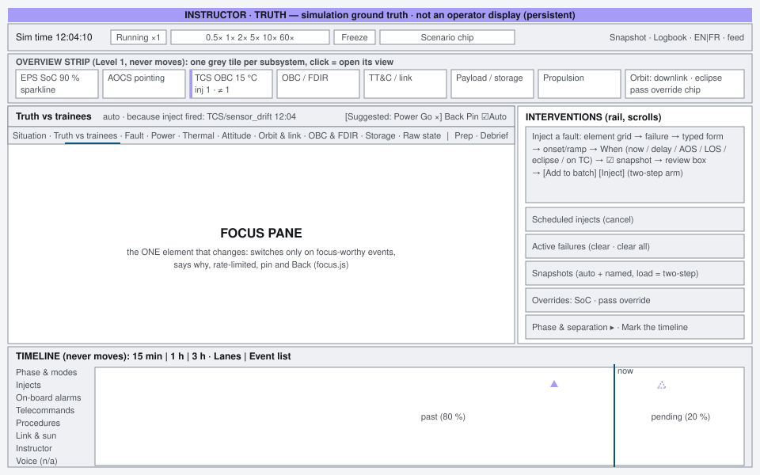
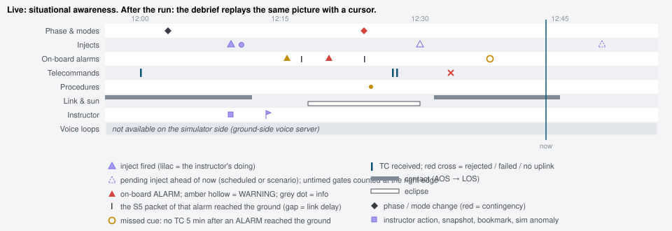
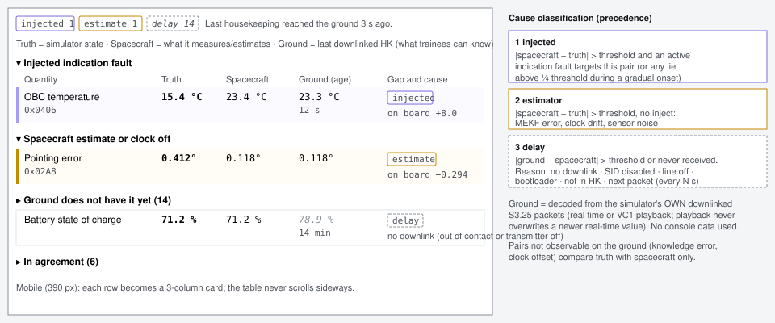
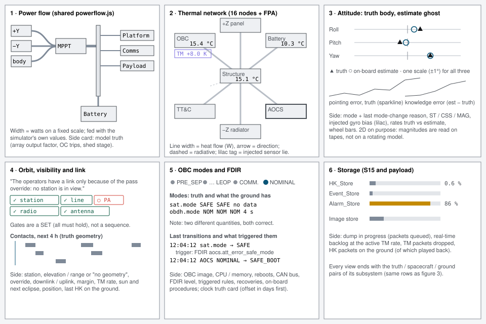
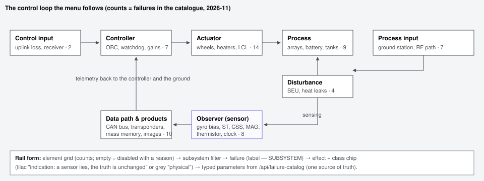
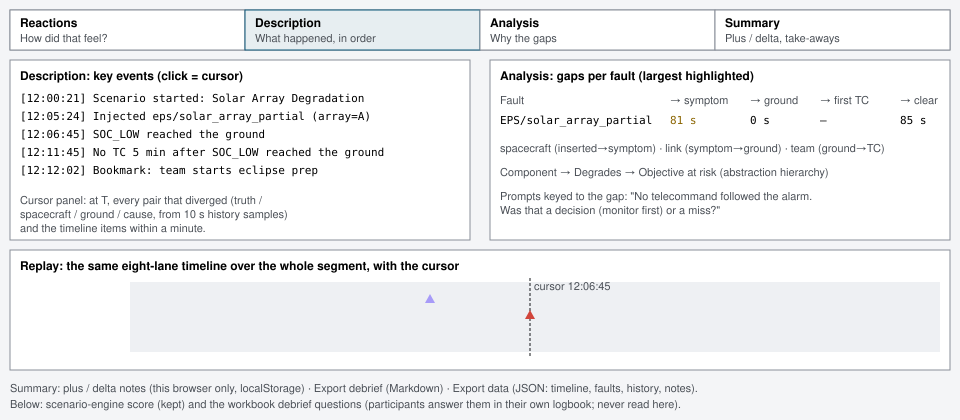

# Instructor console redesign: show the truth, the telemetry and the gap

**Date:** 2026-11-03. **Branch:** `instructor-redesign`.
**Asked for by:** Franz: "Can you improve the simulator view to provide the simulator operator easy views on the state of the simulation that are context-dependent?"
**Research basis:** `Simulator instructor station design.md` (this folder). **Review items:** `SCREEN_REVIEW.md` §8 ("→ instructor redesign"). **Brief:** `docs/ui/C2O_UI_BRIEF.md`.
**Code:** `sim/packages/smo-simulator/src/smo_simulator/instructor/` (`recorder.py`, `divergence.py`, `truth.py`, `taxonomy.py`, `app.py`, `static/modern/{index.html, instructor.js, focus.js, timeline.js, views.js, debrief.js}`).
**Figures:** `instructor_console/*.svg` (Mermaid sources `*.mmd`, rendered with `mmdc`).

---

## 1. The design in one paragraph

Three things stay on screen and never move, and one thing changes.

- The fixed elements are:
  - a persistent **INSTRUCTOR · TRUTH** band;
  - a grey **overview strip** with one tile per subsystem;
  - **one timeline** with eight lanes on a single sim-time axis.
- The changing element is the **focus pane** in the middle. It follows the simulation, but only on events the server marks as focus-worthy. Every switch says why, switches are rate-limited, and the instructor can pin the pane or go back with one click.
- Every intervention lives in a rail on the right. The fault menu is ordered by **control-loop element**. Faults can be batched and triggered on time, AOS, LOS, eclipse or a team telecommand, and the simulation is snapshotted automatically before each one fires.
- The central view is the **truth-versus-trainees** comparison. For each quantity it shows the truth, what the spacecraft measures or estimates, and what the ground last received with its age, with every gap classified by cause:
  - an injected indication fault;
  - an on-board estimate or clock error;
  - normal delay.
- After the run, the **debrief** replays the same timeline in the PEARLS phases, with each fault's gap measured.

*Figure 1. Layout at 1440 px. At 1280 px the rail narrows to 300 px and the views stack into one column. Below 980 px everything stacks: the tabs become a select, and the overview drops to four tiles per row, then two at 390 px. No page scrolls sideways at any width (checked at 1440, 1280 and 390).*

## 2. Users and tasks

| User | When | Task | Where in the console |
|---|---|---|---|
| Course instructor (Franz), TA, student acting as SimSup in practice mode | **Prep** | Pick a scenario, read the instructor briefing and prep worksheets, publish the session label, open the configuration, find course PDFs | Focus pane **Prep** view |
| | **Run** | Start, freeze, change speed, keep the class moving (pass override, SoC override, phase / separation) | App bar; rail **Overrides**, **Mission phase** |
| | **Monitor** | See at a glance whether anything is off, what the trainees can see, and what the team is doing | Overview strip, **Situation**, **Truth vs trainees**, subsystem views, timeline |
| | **Inject** | Choose a fault by where it sits in the loop; set severity, ramp and trigger; batch several; confirm; snapshot before it fires | Rail **Inject a fault**, **Scheduled injects** |
| | **Intervene** | Clear faults, cancel scheduled ones, rewind to a snapshot, mark a bookmark or declare a sim anomaly (ignore / restart / work as real) | Rail **Active failures**, **Snapshots**, **Mark the timeline** |
| | **Debrief** | Replay what happened, find the largest gap per fault, run the PEARLS conversation, export notes | Focus pane **Debrief** view |

**What the simulator can and cannot know.** In the split deployment no identity crosses the link (`LINK_DESIGN.md`).

- **Built from simulator-side data:** telecommands received, accepted, rejected and completed; on-board events and when their S5 packet reached the ground; the housekeeping the ground actually received; and the simulator's own truth and state changes.
- **Ground-side only:** alarm acknowledgements, procedure steps, voice loops and logbooks. The Voice lane is drawn and labelled "not available on the simulator side". The proxy for "not acted on" is a *missed cue*: no telecommand within 5 minutes after an ALARM reached the ground. The seat board (REDESIGN_DECISIONS #6) stays in the MCS.

## 3. Information architecture

The structure follows the high-performance HMI hierarchy:

- **Level 1 (always visible):** the band, the app bar (time control, scenario chip), the overview strip and the timeline.
- **Level 2 (focus pane, one at a time):**
  - **Situation**: active injects with their latest swimlane stage, what is coming up (your schedule and the scenario's timed events and gates), a divergence summary by cause, and team activity the simulator can see.
  - **Truth vs trainees**: the full comparison table (§6).
  - **Fault**: the causal chain and the swimlane of one inject.
  - **Power, Thermal, Attitude, Orbit & link, OBC & FDIR, Storage**: the subsystem truth views (§7).
  - **Raw state**: the generic snapshot browser, parameter search and raw JSON.
  - **Prep** and **Debrief**: modes separated by a rule in the tab bar.
- **Level 3:** the subsystem deep-dive pages (`?sub=…`, unchanged URLs) and the raw JSON.

The overview tiles open their view. They are grey at rest, and colour appears only for status:

- a left bar: caution (amber), alarm (red) or injected (lilac);
- a lilac `inj N` badge;
- a dashed `≠ N` badge when the spacecraft's own measurement is off the truth.

Lilac (`--shelf`, already the instructor colour) is reserved for **what the instructor did**: injects, injected sensor lies and instructor actions. It is never used for anything the spacecraft did.

## 4. The timeline

*Figure 2. Eight lanes on one sim-time axis: 80 % past, 20 % future. The window can be 15 min, 1 h or 3 h. Pending injects (yours and the scenario's) are drawn dashed ahead of "now". Untimed scenario gates are counted at the right edge. Clicking an item shows it in the header line. Clicking an inject opens its Fault view. "Event list" is the text alternative, with SIM-time stamps and the last 200 rows.*

Lanes and their sources (`recorder.py`):

| Lane | Items | Source |
|---|---|---|
| Phase & modes | scenario start/end, spacecraft phase, `sat.mode` with its **trigger** (new FDIR rule or "phase < NOMINAL"), OBC mode / image, AOCS mode with `mode_change_reason` | per-tick edge detection |
| Injects | scheduled, fired (`inject`), cleared, divergence onset (`diverge`), batch fired | FailureManager diff (catches scenario injects too), scheduler |
| On-board alarms | every S5 event, severity-coded; `ev_down` when its packet left the radio (real time or played back); `missed_cue` | TM generation tap (`_enqueue_tm`) and downlink tap (`_put_tm`, dump playback) |
| Telecommands | received (with catalogue name), refused for no uplink, S1 accepted / rejected / completed / failed | `_dispatch_tc`, `_drain_tc_queue`, S1 reports |
| Procedures | on-board procedures start/end, FDIR recovery start, FDIR level | procedure executor, fault propagator |
| Link & sun | AOS/LOS (contact span), eclipse entry/exit (eclipse span) | edge detection; the override is labelled |
| Instructor | speed, freeze, overrides, phase, snapshots (incl. auto), loads, session label, bookmarks, sim anomalies | `_handle_instructor_cmd` |
| Voice loops | not available on the simulator side | (ground-side) |

**Segments.** A snapshot load rewinds sim time, so it starts a new timeline **segment**. The live view, the swimlanes and the debrief show only the current segment, and the instructor lane records the load.

## 5. Context switching: the focus pane

*Figure 3. The focus-pane state machine (`focus.js`, node-tested).*

**Events that move the pane.** The server attaches `focus: {view, prio, reason}` to timeline items. The client offers only items newer than page load.

| Event | View | Priority |
|---|---|---|
| Inject fired | indication fault → **Truth vs trainees**; otherwise the subsystem's view | 3 |
| Spacecraft mode change into a contingency (SAFE/EMERGENCY in phase NOMINAL) | OBC & FDIR | 3 |
| Scenario ended | Debrief | 3 |
| Phase change, FDIR recovery started, scenario started | OBC & FDIR / Situation | 2 |
| A new truth-vs-telemetry divergence (injected or estimator) | Truth vs trainees | 2 |
| Alarm not acted on (missed cue) | subsystem view | 2 |
| AOS / LOS | Orbit & link | 1 |
| Eclipse entry | Power | 1 |
| On-board ALARM (sev ≥ 3) | subsystem view | 1 |

**Rules** (constants in `focus.js`):

1. Auto-follow is on by default.
2. Every switch shows its cause in the pane header: "auto · because inject fired: Injected tcs/sensor_drift (zone=obc) at 12:00:33".
3. **Rate limit.** After a switch the pane dwells for **15 s**. Events arriving in that window are queued, and the best one (highest priority, then newest) applies when the dwell ends, provided it is younger than **90 s**. A strictly higher-priority event may pre-empt after **5 s**.
4. **Pinned or auto-follow off.** Events become a **suggestion chip** ("Suggested: Power — inject fired [Go] [×]").
5. **Grace period.** A manual tab or tile choice, Back, or Go starts a **45 s** grace period during which events are only suggested, so the console never yanks the view from under the instructor.
6. **Back** restores the previous view (10-deep stack).
7. The overview strip and the timeline never move.

## 6. Truth versus trainees

*Figure 4. Paired values grouped by cause, with the classification rules.*

**Pairs** (`divergence.PAIRS`):

- pointing error (true attitude vs commanded, against `aocs.control_err` 0x02A8);
- attitude knowledge error (estimate vs truth);
- body rates (true ω vs the estimate);
- the ten published zone temperatures (node truth vs the thermistor);
- SoC, bus voltage, power generated;
- `sat.mode` and `obdh.mode`, which are **two different quantities, both correct**;
- the OBC clock offset (never downlinked);
- payload store fill.

Adding a pair is one entry.

**Ground column.** The ground value is decoded from the simulator's **own downlinked S3.25 packets** (`GroundView`), with the engine's HK structures. A played-back value never overwrites a newer real-time one. Quantities the ground cannot observe (knowledge error, clock offset) compare truth with spacecraft only and say so.

**Delay reasons** are structured and translated:

- no downlink (out of contact or transmitter off);
- SID n disabled;
- power line off (SIDs 2 and 5);
- OBC in the bootloader;
- not in any HK structure;
- waiting for the next packet (every N s).

**Cause precedence** is injected > estimator > delay, and all flags are kept. An injected lie below the threshold is still flagged during a gradual onset. This three-way split is a design hypothesis: the research found no study of divergence highlighting on instructor stations.

## 7. Per-subsystem truth views

*Figure 5. The six subsystem truth views. Each ends with its subsystem's truth / spacecraft / ground pairs.*

1. **Power.** The shared `powerflow.js` is fed with the simulator's own values (fixed watts scale). A side card shows model truth: array output factor A/B, overcurrent trips, load-shed stage and battery current.
2. **Thermal.** The 16-node network from `THERMAL_MODEL.md` plus the FPA:
   - node temperatures are truth, with the published parameter ID;
   - conductive links (solid) and radiative links (dashed) are drawn with heat flow as line width and direction as an arrow;
   - heaters show on, off, failed, stuck or open;
   - an injected sensor offset is a lilac "TM +8.0 K" tag under the node.
3. **Attitude.** "Orient in 3D, operate in 2D": roll, pitch and yaw against the commanded attitude on one shared scale, with the **truth as a solid marker and the on-board estimate as a hollow ghost**. Sparklines show the true pointing error and the knowledge error. A side panel shows mode and last mode-change reason, star trackers / sun sensors / magnetometer, any injected gyro bias, true vs estimated rates, and wheels. The 3D view stays on the MCS: magnitudes are read on tapes, not on a rotating model.
4. **Orbit & link.** One sentence explains *why the operators have, or do not have, a link*, for example "only because of the pass override: no station is in view". This answers the SCREEN_REVIEW finding where the review saw "Link Down · Range 500 km" while the operators were in contact. The downlink gates (station, ttc_tx line, PA, radio, antenna, radiating) are shown as a set of chips. A chart shows contacts over the next 4 h from truth geometry. Range and elevation read "no geometry" when no station is in view.
5. **OBC & FDIR.** A phase stepper, then the mode pairs with the explanation of `sat.mode` vs `obdh.mode`. These are the two quantities the review flagged as "SAFE vs NOMINAL"; both are correct and the view now says so. Below that: the **last transitions and what triggered them** (Sarter & Woods: indirect mode changes cause automation surprises), FDIR level, triggered rules, recoveries and on-board procedures. The clock truth card leads with days ("−9728 days (clock never set)"), with exact seconds underneath.
6. **Storage.** S15 store fill bars (caution at 80 %, alarm at 95 %), payload mass memory and bad segments, dump queue, real-time backlog at the active TM rate, dropped packets, and HK packets on the ground (of which played back).

The **Fault** view draws the abstraction-hierarchy chain **component → degraded function → mission objective at risk** (`taxonomy.FUNCTION_OF_*`), above the swimlane with its stages: inserted → first on-board symptom → alarm reached the ground → first telecommand after it → cleared. The gaps between stages are labelled.

## 8. Fault menu and injection flow

*Figure 6. The catalogue (60 failures) placed by control-loop element, following the Ames SimSup taxonomy. A test fails if a model adds a failure without a placement.*

*Figure 7. From the menu to the timeline. The review box is the confirm step: it shows target, severity, onset/ramp, when, and snapshot, live. The Inject button is the existing two-step arm (5 s).*

- **Element grid.** Each element shows its count and is disabled with a reason when empty. A subsystem filter and the failure list ("label — SUBSYSTEM") follow, then the effect text and a class chip: lilac *"indication: a sensor lies, the truth is unchanged"* or grey *physical*. The typed parameters are still generated from `/api/failure-catalog`.
- **When.** Now, after a delay (sim time), at the next AOS, at the next LOS, at eclipse entry, at eclipse exit, or when the team sends a given telecommand (`service.subtype[.func]`; a conditional inject in the LLEAP sense).
- **Batch.** Up to 8 faults fire together, because the F-14 console could not do this by hand.
- **Snapshot before.** On by default. It is kept in RAM (newest six), marked `auto` in the Snapshots list, and is the "return to interrupted scenario" slot.
- **Commands.**
  - A single fault that fires now uses the established `failure_inject` (plus `snapshot_before`), so the scenario generator and the tests are unaffected.
  - A batch or a trigger uses the new `failure_schedule {injects, trigger, snapshot_before}`.
  - `schedule_cancel {schedule_id}` and `timeline_mark {kind: bookmark|anomaly, text, disposition}` are also new.
  - These three run synchronously, so the refusal reason appears above the button.

## 9. Debrief

*Figure 8. The debrief view in the PEARLS phases.*

- **Reactions.** Opening prompts and notes.
- **Description.** Key events (injects, clears, divergence onsets, contingency mode changes, alarms that reached the ground, missed cues, rejected TCs, bookmarks and anomalies). Clicking an event places the cursor on the **replay**, which is the same eight-lane timeline over the whole segment. The cursor panel shows every pair that diverged at that moment (truth / spacecraft / ground / cause, from 10-second history samples) and the items within a minute.
- **Analysis.** A table of gaps per fault with the largest highlighted: inserted → symptom is the spacecraft, symptom → ground is the link, ground → first TC is the team. Below it, the causal chain and prompts keyed to each gap, for example "No telecommand followed the alarm. Was that a decision or a miss?".
- **Summary.** Plus / delta notes, stored in this browser only, and **Export** to Markdown and JSON (timeline, faults, history, notes).
- **Kept below the phases.** The scenario-engine score panel and the workbook debrief questions. Participants answer those in their own logbook, which is never read here (LOGBOOK_SPEC).

The view opens by itself when a scenario ends (priority 3).

## 10. Server APIs and the guard

*Figure 9. Where the data comes from.*

| Route | Content |
|---|---|
| `GET /api/instructor/views` | overview tiles; truth views (power, thermal, attitude, orbit, obc, storage); divergence rows and summary; pending schedule. Built on the tick thread at most once per second (`maybe_build_views`). `Cache-Control: no-store`. |
| `GET /api/instructor/timeline?since=<seq>` | new items, pending items, fault swimlanes with latencies, lanes, the unavailable lanes |
| `GET /api/instructor/fault-menu` | catalogue grouped by element, with class, function and objective |
| `GET /api/instructor/history[?seg=]` | truth / spacecraft / ground / cause samples every 10 sim-s (debrief cursor) |
| `GET /api/instructor/debrief` | scenario debrief, faults and items of the current segment (export) |
| `POST /api/command` | adds `failure_schedule`, `schedule_cancel`, `timeline_mark`; `failure_inject` accepts `snapshot_before` |

All existing routes and payloads still work (`/api/instructor/snapshot`, `/api/failures`, `/api/breakpoints` (now with an `auto` flag), …). The route snapshot in `test_modern_inventory.py` gained the five new paths and lost none.

**Instructor-only data is blocked on the server, not hidden in the client:**

1. The new routes exist only in the simulator's instructor app. The MCS and planner never mount them; a test checks this.
2. Nothing new goes into `_build_state_summary()` (it crosses the link as STATE, feeds `/api/state` and the `/ws` stream that rfsim and the planner read). A deny-list test checks the state document for timeline, divergence, truth and schedule keys. The page **polls** the truth feeds and never puts them on `/ws`.
3. The space-link proxy allowlist (`smo_link.httpproxy.READ_EXACT`, and LINK_DESIGN §3.7) lists the five routes individually as **read-only**. The commands still go only through `/api/command`.
4. In GCP the console is reached only at `sim.c2o.live`, behind IAP limited to the instructors group, through the GSG proxy with its Host check. The simulator's port 8080 is published on loopback only.
5. The persistent band ("INSTRUCTOR · TRUTH") makes a projected screen unmistakable.

## 11. Feature mapping (nothing lost)

| Old console (2026-08 modern page) | New place |
|---|---|
| Instructor strip | Persistent band, now "INSTRUCTOR · TRUTH" + the old sentence |
| Sim time, run chip, speed 0.5–60×, Freeze/Resume | App bar (unchanged; accelerated runs explain in a tooltip what acceleration does) |
| Scenario chip | App bar |
| Configuration link | Prep → "Configuration and documents" |
| Logbook, EN/FR, feed chip | App bar |
| Link banner, spacecraft-mode banner | Overview: Orbit ribbon tile (downlink / override / eclipse) and OBC/FDIR tile; full detail in Orbit & link and OBC & FDIR |
| Scenario list, briefing, prep worksheets, Start/Stop (two-step stop), progress bar | Prep view (names cleaned of editing leftovers; one difficulty scale, BEGINNER shows as BASIC) |
| Session label publish/clear | Prep view (unchanged behaviour) |
| Debrief panel (score, MTTD/MTTI/MTTR, responses) + debrief worksheets | Debrief view, "Scenario engine score" section |
| Breakpoints save / list / load (two-step) | Rail **Snapshots** (plus auto snapshots and an app-bar quick Snapshot) |
| Course PDFs (full list) | Prep → collapsed "Course PDFs (instructor list)" (review §8: library out of the run-time console) |
| Truth dashboard cards EPS/AOCS/TCS/OBDH/TT&C/Payload | Overview tiles + Power / Attitude / Thermal / OBC & FDIR / Orbit & link / Storage views |
| Onboard clock truth card (all fields) | OBC & FDIR view (same IDs; offset leads with days) |
| Orbit bar lat/lon/alt/eclipse | Orbit & link view; eclipse in the overview ribbon |
| VR badge | Removed from the main view (see removals) |
| Subsystem deep-dive launcher (`?sub=`, propagates `?ui=`/`?lang=`) | Raw state view (same links) |
| Parameter search, completeness counter, raw JSON | Raw state view |
| Full snapshot browser (generic, every parameter) | Raw state view; raw banks named and placed after their subsystem |
| Failure injection form (typed, generated) | Rail **Inject a fault** (by element; same generator; adds trigger, batch, snapshot) |
| Active failures, Clear, Clear all (two-step) | Rail **Active failures** |
| Mission phase select, Set phase, Start separation (two-step) | Rail disclosure **Mission phase and separation** |
| SoC override (two-step), pass override (one copy) | Rail **Overrides** |
| Event log (SIM time, 200 rows, clear, collapse) | Timeline panel → **Event list** (fed by the timeline; nothing stamped "--:--:--") |
| `?sub=` subpage mode | Unchanged; shows only the raw state browser |
| Classic page `/classic` | Untouched (byte-frozen) |

**Removals, with reasons:**

| Removed | Reason |
|---|---|
| Visible "Instructor console" title in the app bar | Duplicated the band and forced a second app-bar row in French; kept as a visually hidden `<h1>` |
| VR headset badge in the orbit bar | Not a simulation-state view; the bridge status stays at `GET /api/vr` |
| Truth card "Range 500.0 km / Elevation 45.0°" while out of view | Placeholder values (review §8); now "no geometry" and the link explanation |
| Raw-bank tab labels "0x00xx", "0x09xx", "0x0Axx" | Developer buckets; now SYS·raw, PROC·raw, OBDH·raw |
| "students see only theirs" note beside the PDFs | It described the portal, not this console |
| Generic "Interventions" column header with the strip | Replaced by the rail heading "Interventions — affect every student" |

## 12. Validation

- **Tests.**
  - `tests/test_simulator/test_instructor_console.py`, 38 tests: classification, taxonomy completeness, ground view decode, sensor drift classified injected, delay without downlink, clock not observable, truth view shapes, delay / AOS / TC triggers, batch, cancel, validation, marks, segment on load, swimlane latencies, scenario pending events, the five routes, HTTP validation of `failure_schedule`, the state-feed deny-list, the proxy allowlist, no WS send, and page structure.
  - `tests/test_simulator/js/test_instructor_focus.mjs`, 46 node assertions: auto-follow, the cause on every switch, dwell queue, pre-empt, stale drop, pin → suggestion → accept, auto-off, grace, Back, bounded stack, timeline spans, window and marks.
  - Existing instructor tests pass unchanged. The only test edit is the additive route snapshot.
- **i18n.** Every UI string is in the instructor catalog with French per STYLE_FR and the glossary (instantané, chronologie, débriefing, forçage de passage, HK; AOCS kept as the console ID). `tools.i18n check` reports 0 errors.
- **Browser.** Playwright against the real simulator (private ports, ticking) covered:
  - nominal running;
  - a thermistor drift fault, which auto-focused on Truth vs trainees;
  - a reaction-wheel seizure inside the grace period, which became a suggestion;
  - an eclipse at 60×, which auto-focused on Power;
  - LOS after the override was removed, which auto-focused on Orbit & link;
  - a scenario run to its end, which auto-focused on Debrief (Description, Analysis, Summary);
  - Prep, French, 1280 and 390 px.

## 13. Open items for Franz

1. **Thresholds** for divergence (for example 1 K, 0.1° pointing, 0.01 °/s) and the focus constants (15 s dwell, 5 s pre-empt, 45 s grace, 5 min missed cue) are first guesses. They should be tuned after a class, ideally by card-sorting and timed tasks with TAs, as the research recommends.
2. **The symptom heuristic** takes the first on-board WARNING/ALARM in the faulted subsystem, or any ALARM, after the inject. An unrelated warning can be counted. A per-failure "expected symptom" field in `FAILURE_SPECS` would make it exact.
3. **`ScenarioEngine.record_response` is never called**, so the scenario score is always 0 %. The timeline gaps replace it in the debrief. Should the score be retired or wired to TC/procedure evidence?
4. **Ground-side lanes** (alarm acks, procedure steps, voice) need a deliberate, identity-free summary from the GSG if you want them on the instructor timeline in a split deployment.
5. **Failure labels and effects** come from `FAILURE_SPECS` in English. A French overlay (`tdb`) would complete the bilingual rail.
6. **Auto snapshots live in RAM only** (newest six). Should they be persisted with the named ones?
7. **The fault menu taxonomy** (`taxonomy.ELEMENT_OF`) is my placement of the 60 failures. Please check the borderline ones: bus failure as data path, overvoltage threshold as controller, ground-station faults as process input.
