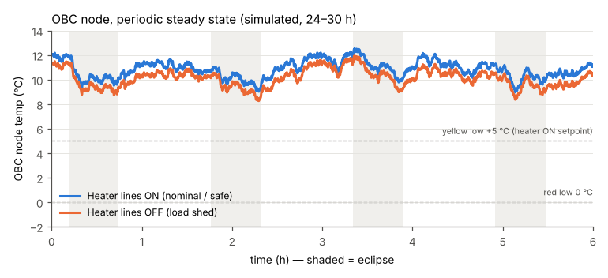
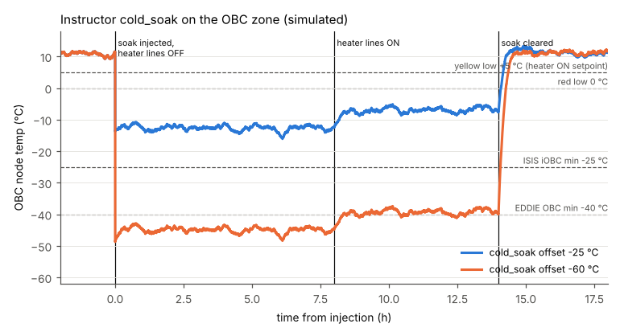
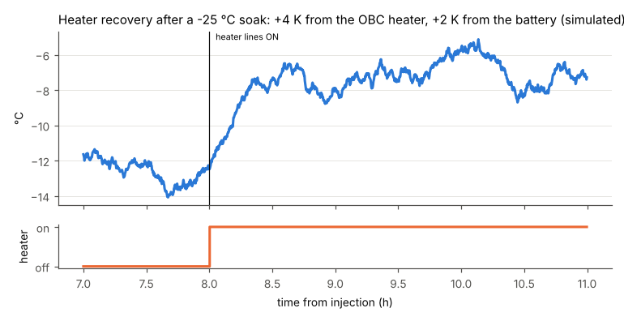

# OBC thermal analysis: how cold can the OBC get?

**Requested by:** Franz, 2026-11-02 ("do an analysis to see how cold it could get"), after the
walkthrough found that the OBC heater recovers only about 4.5 K, so a deep instructor cold soak
cannot be won back.
**Scope:** the EOSAT-1 simulator's own OBC thermal node (`sim/packages/smo-simulator/src/smo_simulator/models/tcs_basic.py`),
driven headless through the real `SimulationEngine`. No model parameters were changed.
**Reproduce:** `docs/plan_2026-11/obc_thermal/obc_thermal_runs.py` (instructions are in its docstring).
It writes `summary.json` and the three PNGs in `docs/plan_2026-11/obc_thermal/`.

Labels used for every number: **[Sim]** measured from the simulator run; **[Calc]** hand
calculation; **[Cfg]** read from configuration or code; **[Assumed]** an assumption made for
this analysis; **[Datasheet]** a published vendor value.

---

## 1. Headline

| Case | Coldest OBC node temp | Orbit-average | Heater |
|---|---|---|---|
| Nominal / safe mode, heater lines ON | **+9.0 °C** [Sim] | +11.0 °C | never fires (0 % duty) |
| Load shed / survival, heater lines OFF | **+8.2 °C** [Sim] | +10.2 °C | off |
| Instructor `cold_soak` −25 °C (default), heater OFF | **−16.1 °C** [Sim] | −12.8 °C | off |
| `cold_soak` −25 °C, heater ON (thermostat) | **−8.6 °C** [Sim] | −6.9 °C | 100 % duty, cannot reach the +10 °C OFF point |
| `cold_soak` −60 °C (deepest allowed), heater OFF | **−48.4 °C** [Sim] | −45.0 °C | off |
| `cold_soak` −60 °C, heater ON | **−41.2 °C** [Sim] | −39.2 °C | 100 % duty |

* **The heater is worth +4.0 K** at the OBC node [Calc] (4.5 K if the battery coupling is ignored).
  In the soak runs the node rose by 5.9 K once the lines came back, because the battery
  heater also warmed the battery, and the battery shares a 0.1 W/K path with the OBC [Sim].
* **Recovery time constant: 809 s (13.5 min)** [Calc]. 95 % of the heater's effect is reached in about
  40 min, which is less than half an orbit. Clearing the soak returns the node to nominal at the same rate.
* **In the model, the mode makes no difference.** The OBC sink is a fixed internal temperature
  (+10 °C in eclipse, +12 °C in sun) that does not depend on what is powered. Only the heater,
  the battery coupling and the instructor soak move the node.
* **Against limits:** in nominal operations the node stays 4 K above yellow-low (+5 °C) and 9 K above
  red-low (0 °C). Any `cold_soak` deeper than about **−9 K** cannot be brought back to green by
  the 4 W heater [Calc]. The default −25 °C soak leaves the node 12 K below red, even with the heater ON.
* **Against real hardware:** CubeSat OBCs are rated −25 °C to −40 °C at the cold end
  [Datasheet, §5]. The model's red-low of 0 °C is therefore 25–40 K more conservative than the
  hardware. Only the −60 °C soak reaches temperatures that would threaten a real OBC.

---

## 2. The model, as configured

| Quantity | Value | Source |
|---|---|---|
| OBC node capacitance C | 800 J/K | [Cfg] `TCSBasicModel._CAP["obc"]`. `obc` is not in `tcs.yaml zones`, so the class default applies. |
| OBC node time constant τ | 900 s | [Cfg] `_TAU["obc"]` |
| Conductance to the internal sink UA = C/τ | 0.889 W/K | [Calc] |
| OBC–battery conductance G | 0.1 W/K | [Cfg] `tcs.yaml thermal_coupling.zone_conductance.battery_obc` |
| Internal sink, eclipse / sun | +10 °C / +12 °C | [Cfg] `simulation.yaml tcs.environment` |
| OBC heater | 4.0 W, thermostat ON +5 °C / OFF +10 °C, PDM line 6 (`htr_obc`) | [Cfg] `tcs.yaml heaters` |
| Internal OBC dissipation in the TCS node | 0 W (only the `obc_thermal` failure adds heat) | [Cfg] `obc_internal_heat_w` |
| Process noise | gauss(0, 0.03)·√dt per step; stationary σ ≈ 0.03·√(τ_eff/2) = **0.60 K** | [Calc] |
| `cold_soak` | lowers the zone's sink by `offset_c` **and** steps the node by the same amount; range −60…0 °C, default −25 °C | [Cfg] `FailureSpec cold_soak` |
| OBC limits | yellow +5 / +60 °C, red 0 / +70 °C (`mcs/limits.yaml`); S12 0x0406 0 / +60 °C ALARM; TCS events warn +5 / +50, alarm −5 / +60 | [Cfg] |
| Manual 03 §4 | nominal 15–50 °C, yellow 5–60 °C, red 0–70 °C | [Cfg] |
| Orbit | 513 km SSO, LTAN ≈10:00; \|β\| 20.8–31.2° over the year; eclipse fraction 0.351–0.372 | [Cfg] `tools/power_budget.py` |
| Run conditions | β = −30.4°, eclipse fraction 0.363 (the simulated epoch), 10 s outer ticks with 1 s physics sub-steps | [Sim] |

The node equation is:

```
C·dT/dt = UA·(T_sink + soak − T) + G·(T_bat − T) + P_htr
τ_eff   = C / (UA + G) = 800 / 0.989 = 809 s
T_ss    = (UA·(T_sink + soak) + G·T_bat + P_htr) / (UA + G)
```

---

## 3. Simulated cases

### 3.1 Periodic steady state, 24–30 h after start



| Case | Mean | Min | Max | Battery mean | OBC heater duty |
|---|---|---|---|---|---|
| Heater lines ON (nominal; safe mode is identical in this model) | +10.96 °C | +8.97 °C | +12.55 °C | +7.45 °C | 0 % |
| Heater lines OFF (load shed / survival) | +10.25 °C | +8.22 °C | +11.96 °C | +0.37 °C | 0 % |

* **Safe mode** changes nothing about the OBC zone in the model. Payload, cooler and wheel loads
  do not reach the OBC sink, so safe mode was not run separately.
* **Lines OFF** costs only 0.7 K at the OBC, and all of it comes from the battery. Without its heater the battery falls
  towards its −8/0 °C sink, and the 0.1 W/K coupling carries 0.1·7.1/0.989 = 0.7 K of that to the OBC [Calc].
* **OBC off** is not a case the model or the spacecraft has: the `obc` line is non-switchable.
  Physically, an unpowered OBC would lose its own self-heating, about 3 W / 0.889 W/K = 3.4 K [Calc, using
  the 3 W OBC share of `eps.yaml obc_power_w`]. The model carries no OBC self-heating term,
  so there is nothing to remove.
* The swing is about 3.5 K. Of that, 1.8 K is the orbit (the 2 K sink step, attenuated by τ_eff [Calc]) and
  the rest is the ±1.5 K tail of the σ 0.6 K process noise. **The heater never fires in nominal
  operations**: the coldest sample is 4 K above its +5 °C ON point.

### 3.2 Instructor `cold_soak` on the OBC zone

The test sequence was: 6 h nominal; inject `cold_soak(zone=obc, offset_c)` with **both heater lines OFF**
(the worst case); after 8 h switch the lines back ON; at 14 h the instructor clears the soak.



| Offset | Heater OFF: mean / min | Heater ON: mean / min | Gain from lines ON | After clear |
|---|---|---|---|---|
| −25 °C (default) | −12.8 / −16.1 °C | −6.9 / −8.6 °C | +5.9 K (heater +4.0, battery +1.9) | +10.9 °C |
| −60 °C (deepest) | −45.0 / −48.4 °C | −39.2 / −41.2 °C | +5.8 K (heater +4.0, battery +1.8) | +11.2 °C |



* The soak steps the node immediately, so yellow-low and red-low are crossed on the first tick.
* With the heater ON the node never reaches the thermostat OFF point (+10 °C), so the heater
  runs at **100 % duty for as long as the soak lasts**. The thermostat cannot cycle,
  and the ground pays 4 W continuously for 4 K.
* Clearing the soak returns the node to nominal with τ_eff = 809 s. The node is back above +5 °C about
  35 min after the clear [Sim, figure].

### 3.3 Side effects seen in these runs (not changed; for Franz)

1. **S19 ea 3003 "TCS OBC Overtemp → OBC Safe Mode" also fires on under-temperature.** The S12
   monitor on 0x0406 has `low_limit 0.0`, and the rule triggers on any violation of that monitor. Every
   cold soak therefore puts the OBC into SAFE at t = 0 (OBDH mode 0 → 1) [Sim]. Safing on a cold OBC
   can be defended, but the rule's name and description say "overtemp".
2. **The FDIR battery-cold response latches the battery heater in MANUAL ON.** With the lines OFF the
   battery fell to about −5 °C. The `heater_on_battery` FDIR callback then sent the heater command, which sets
   `htr_battery_manual`. When the lines came back, the battery heater stayed ON with the thermostat
   bypassed, and the battery ran at +15 to +18 °C, above its +10 °C OFF point [Sim].
3. S19 ea 1004/1005 ("solar array degraded → payload off") fire at every eclipse entry, because
   the SA-current S12 low limit is hit by the eclipse itself [Sim]. This is unrelated to the OBC; it is noted here because it shows in the logs.

---

## 4. Sanity checks

### 4.1 Energy balance by hand vs the simulator

Orbit-average sink: T̄_sink = 0.363·10 + 0.637·12 = **11.27 °C** [Calc]. T_ss is computed with the measured battery mean:

| Case | Hand T_ss = (UA·(T̄_sink+soak) + G·T̄_bat + P)/(UA+G) | Simulated mean | Δ |
|---|---|---|---|
| Nominal | (0.889·11.27 + 0.1·7.45 + 0)/0.989 = **+10.89 °C** | +10.96 °C | 0.07 K |
| Lines OFF | (0.889·11.27 + 0.1·0.37)/0.989 = **+10.17 °C** | +10.25 °C | 0.08 K |
| −25, heater OFF | (0.889·(−13.73) + 0.1·(−5.44))/0.989 = **−12.89 °C** | −12.76 °C | 0.13 K |
| −25, heater ON | (0.889·(−13.73) + 0.1·16.69 + 4)/0.989 = **−6.61 °C** | −6.85 °C | 0.24 K |
| −60, heater OFF | (0.889·(−48.73) + 0.1·(−13.51))/0.989 = **−45.17 °C** | −45.03 °C | 0.14 K |
| −60, heater ON | (0.889·(−48.73) + 0.1·7.59 + 4)/0.989 = **−38.99 °C** | −39.23 °C | 0.24 K |

All six agree within 0.25 K, which is well inside the 0.6 K noise σ.

### 4.2 Full-trace replay

`replay_check()` integrates the node equation by hand over the whole 26 h soak run. It uses the exact exponential
update over each 10 s step and is driven by the **recorded** eclipse flag, battery temperature and heater state, with
no noise term. Simulator minus hand calculation: **RMS 0.57 K, mean +0.10 K** (both offsets) [Sim vs Calc]. The RMS is the
predicted stationary noise σ of 0.60 K. The model integrates exactly the equation in §2, with
τ_eff = 809 s.

### 4.3 Is the node physically plausible?

* **Capacitance.** 800 J/K is about 0.9 kg of aluminium (c ≈ 900 J/kg·K) [Calc]. Real CubeSat OBC boards
  weigh 24–100 g, about 20–90 J/K [Datasheet, §5]. The node therefore stands for the OBC **plus its
  enclosure and mounting deck**, not the board. That reading is acceptable for an avionics-stack node, but it makes the node about 10× more
  sluggish than a bare board.
* **Coupling.** 0.889 W/K to the internal sink is a well-bolted box. Internal radiation alone, for a 0.1 m²,
  ε 0.8 box at 283 K, is 4εσT³A ≈ 0.41 W/K [Calc], so the remaining ~0.5 W/K is conduction. That is plausible.
  A bare board on four standoffs would be closer to 0.1–0.3 W/K [Assumed].
* **Heater versus coupling.** Heater authority is P/UA. With 4 W across 0.9 W/K, a heater can only ever move this node by about
  4.5 K. That follows from the coupling, not from the heater power. On a board-like node (C ≈ 50 J/K,
  UA ≈ 0.2 W/K) the same 4 W would give about 20 K of authority with τ ≈ 250 s [Calc].
* **Heater versus spacecraft.** 4 W is 16 % of the 25 W nominal orbit-average load (`tools/power_budget.py`) [Cfg].
  A heater large enough to win back the default −25 °C soak to green would need about 18 W (§6, R2) [Calc]. That is
  implausible for a 6U.

### 4.4 What the real spacecraft would see: a mode-dependent sink [Calc]

The model fixes the internal sink. In reality the sink is the bus temperature, and the bus temperature depends on how much power is
dissipated inside. A single-node orbit-average radiative balance of the 6U body gives a first-order estimate
(A = 0.284 m², ε = 0.85 [Assumed]; cold case S = 1322 W/m², albedo 0.25, OLR 218 W/m²; Earth view factor of a
sphere at 513 km 0.311; sun on A/4 for 63.7 % of the orbit [Assumed]; bus C = 9.7 kJ/K [Assumed: 12 kg × 900 × 0.9]):

| α (body) | Nominal, 25 W internal | Safe, 20 W | Survival/load shed, 7.5 W |
|---|---|---|---|
| 0.3 | −13.6 °C (−15.9 … −11.5) | −19.0 °C | −34.3 °C (−36.5 … −32.1) |
| 0.6 | +5.7 °C (+1.2 … +9.9) | +1.4 °C | −10.3 °C (−14.8 … −6.1) |
| 0.9 | +21.8 °C (+14.9 … +27.9) | +18.1 °C | +8.4 °C (+1.6 … +14.6) |

*(Bus orbit-average, with the orbit min … max in brackets.)* The absolute level depends on the coatings, which
are unknown, so it is a design choice. **The step between modes is robust:** going from nominal to survival makes the bus
**13–20 K colder** whatever the α, and going to safe mode makes it about 4 K colder [Calc]. The model's +10/+12 °C sink matches
the α ≈ 0.7 row in nominal operations. Anchored there, a real EOSAT-1 in long load shed would put its OBC at roughly
**−5 °C orbit-average, with minima of −10 to −20 °C** in the cold season. That is below the model's red-low but still inside the
−25 to −40 °C rating of real OBCs.

---

## 5. Comparison with real CubeSat OBCs

| OBC | Operating range | Mass | Power | Source |
|---|---|---|---|---|
| GomSpace NanoMind A3200 | −30 °C to +85 °C (storage −30 to +85 °C) | 24 g | ~0.1–0.15 W | [Datasheet] [GomSpace NanoMind A3200 datasheet](https://gomspace.com/wp-content/uploads/2025/09/gs-ds-nanomind-a3200_1006901-2.0.pdf) |
| ISIS iOBC | −25 °C to +65 °C | 76 g (100 g with daughterboard) | 0.4 W average | [Datasheet] [ISIS iOBC brochure](https://www.isispace.nl/wp-content/uploads/2016/02/IOBC-Brochure-web-compressed.pdf) |
| Spacemanic EDDIE OBC | −40 °C to +85 °C | 25 g | 0.06 W average, 0.1 W peak | [Datasheet] [Spacemanic EDDIE data sheet](https://spacemanic.com/wp-content/uploads/2026/03/SM-EDI-DS-0002_3.1_Data-Sheet.pdf) |
| EOSAT-1 model | red 0 / +70 °C, yellow +5 / +60 °C, "nominal" 15–50 °C | (node 800 J/K) | 3 W billed (`eps.yaml`) | [Cfg] |

* The model's **cold red limit (0 °C) is 25–40 K inside the hardware's operating minimum**. Applying the
  usual ECSS-E-ST-31C practice of about 5 K acceptance and 10 K qualification margin on the predicted extremes [Assumed]
  to an iOBC-class part gives a predicted-cold design limit of about −15 °C and an operational red around −20 °C.
* **Manual 03 §4 calls the nominal range 15–50 °C, but the model's nominal OBC is +9 to +12.5 °C.** Every nominal
  orbit therefore sits below the manual's own nominal band, although still in green on the MCS. This disagreement exists today.
* The OBC heater ON point (+5 °C) equals the yellow-low. Any situation that makes the heater work
  is also, by construction, a yellow alarm.

---

## 6. Recommendations (Franz decides; nothing has been changed)

**R1. Size the OBC soak to the heater (recommended; this is a config/default change, not physics).** The instructor
soak is described as "the heater can recover it". For the OBC that is true only down to about **−9 K**:
recovering to green needs T_ss(heater ON) ≥ +5 °C + 1.5 K (ripple and noise margin), which gives
0.889·(11.27 + x) + 0.75 + 4 ≥ 0.989·6.5, so x ≥ −9.4 K [Calc]. Options:
* give `cold_soak` a per-zone default, with **OBC −8 °C**: heater OFF → +3.0 °C mean (yellow, dipping
  towards red); heater ON → +7.7 °C (green, heater on continuously) [Calc]. The battery (UA 0.30 W/K, 8 W → 27 K
  authority) and the thruster (288 K) can keep −25 °C;
* and/or cap the OBC offset in the instructor UI at about −30 °C, and label anything deeper "beyond heater
  authority — tests survival / limits, not recovery".

**R2. Do not fix it with heater power.** Winning the −25 °C soak back to +6.5 °C would need
P ≥ 0.989·6.5 − 0.889·(−13.73) − 0.1·7.5 ≈ **17.9 W** [Calc]. That is 70 % of the nominal load for a box
that real missions do not heat at all.

**R3. Re-base the OBC cold limits on qualification, or say why they are conservative.** Either:
* keep 0 / +5 °C as deliberately conservative training limits, and state that in manual 03 §4 (and also fix its
  "nominal 15–50 °C" to the model's +9 to +13 °C); or
* move to a hardware-based envelope, for example yellow-low −10 °C, red-low −20 °C (iOBC class with 5 K margin), with
  the heater as a survival heater at ON −10 °C / OFF −5 °C. With those limits the default −25 °C soak becomes a
  meaningful exercise: heater OFF gives −12.8 °C mean and −16 °C minimum (yellow, not red), and heater ON gives about
  −7 °C (back in green). This touches `mcs/limits.yaml`, `s12_definitions.yaml`
  0x0406, `tcs.yaml` heaters and event thresholds, manual 03/08, and the EN and FR cards.

**R4. (Optional, model fidelity) Make the OBC sink depend on internal dissipation.** About −0.9 K per watt of
internal load below nominal (from §4.4, 13–20 K for 17.5 W) would let safe mode (about −4 K) and
long load shed (about −16 K) cool the OBC as a real bus does. That would give the heater, and the heater-line steps in the load-shed cards, a real
job. With R3's limits this is consistent; with today's 0 °C red it would put every
long load shed into red.

**R5. Review the two side effects in §3.3:** ea 3003 firing on cold, and the FDIR battery heater left in
manual ON. These are behaviour questions, not thermal parameters, so they are left as found.

---

## 7. Assumptions and limits of this analysis

* Only one epoch was simulated (β −30.4°, eclipse 36.3 %). The OBC node sees only the internal sink, which
  does not depend on β in the model, so the simulated numbers hold for the whole year.
* The min/max values include the model's process noise (σ 0.6 K). The deterministic orbit swing is 1.8 K.
* §4.4 is a single-node radiative estimate with assumed coatings and an attitude-averaged geometry. It is
  indicative of the size of the mode effect, not a thermal model of EOSAT-1.
* The soak runs switched **both** heater lines (battery and OBC) together, as in a load shed. That is why
  the battery contributes about 2 K when the lines come back.
