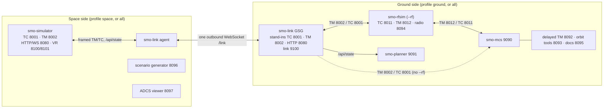

# Simulateur d'opérations de mission spatiale — Architecture logicielle {#space-mission-operations-simulator-software-architecture}

**Manual-Scope:** system — documentation du système de formation, ne fait pas partie du manuel d'opérations de vol.

**Révision :** 2026-10-30 (décision de l'auteur Q34), établie à partir du code : `start.sh`, le
`pyproject.toml` de chaque paquet, `configs/eosat1/mission.yaml` et
`configs/eosat1/rfsim.yaml`. La table des ports de `docs/DEPLOYMENT.md` §2 est la
référence d'exploitation ; ce chapitre explique comment les éléments s'articulent.

## 1. Synthèse {#summary}

SMO est le simulateur et le segment sol de la mission EOSAT-1 : un CubeSat 6U
de couleur de l'océan sur une orbite héliosynchrone d'environ 513 km (97,39°, LTAN ~10:00).
C'est un monodépôt Python de sept paquets. Le satellite, le système de contrôle de mission
(MCS) et le planificateur sont des processus distincts qui communiquent par sockets TCP
et par HTTP/WebSocket. Tout ce que le satellite *est* (télécommandes, télémesure,
structures de données de servitude, surveillance, FDIR, procédures et le présent manuel) se trouve dans
`configs/eosat1/` ; les paquets sont la machinerie qui lit ces fichiers.

Il n'y a pas de courtier de messages. Les processus échangent des paquets CCSDS/PUS par sockets
TCP avec un préfixe de longueur de 2 octets, et du JSON par HTTP et WebSocket. Aucune partie
du code n'utilise Redis ni aucun autre bus interprocessus.

## 2. Paquets {#packages}

| Paquet | Rôle | Scripts de console (`pyproject.toml`) |
|---|---|---|
| `smo-common` | Bibliothèque partagée : codec de paquets CCSDS/PUS et tramage TCP, chargement et schémas de configuration, propagation d'orbite SGP4, registre des modèles, rapports de TM différée, ressources web communes et catalogues FR/EN | aucun (bibliothèque) |
| `smo-simulator` | Le satellite : moteur de pas de temps, modèles de sous-systèmes (EPS, AOCS, TCS, OBDH, TTC, charge utile, propulsion), aiguillage des services PUS, FDIR, injection de pannes, scénarios, console instructeur et pont VR | `smo-simulator` |
| `smo-mcs` | Le système de contrôle de mission : postes opérateurs, traitement de la télémesure et contrôle des limites, commande, alarmes, tendances, procédures, archive de TM et accès à la TM différée | `smo-mcs` |
| `smo-planner` | Planification de mission : fenêtres de contact, trace au sol, opportunités d'imagerie, bilans de puissance et de données, vérification des contraintes | `smo-planner` |
| `smo-rfsim` | Pont RF facultatif entre simulateur et MCS : tramage de transfert CCSDS, Reed–Solomon, modulation, canal RF avec dégradations et page d'état radio | `smo-rfsim`, `smo-rfsim-record`, `smo-rfsim-blind` |
| `smo-link` | Liaison spatiale des déploiements répartis : l'agent de liaison spatiale (côté espace) et la passerelle du segment sol, GSG (côté sol), reliés par un unique WebSocket sortant | `smo-link-agent`, `smo-link-gateway`, `smo-link-token` |
| `smo-gateway` | **Obsolète**, remplacé par `smo-link`. Ancien relais TM/TC utilisé seulement par `deploy/start-gateway.sh` et `USE_GATEWAY=yes` | `smo-gateway` |

Les modèles de sous-systèmes du simulateur sont chargés par le groupe de points d'entrée
`smo.subsystem_models` (`eps_basic`, `aocs_basic`, `tcs_basic`, `obdh_basic`,
`ttc_basic`, `payload_basic`, `prop_basic`) : `subsystems/*.yaml` choisit donc un
modèle par son nom.

## 3. Processus et ports {#processes-and-ports}

`./start.sh` (profil `all`, par défaut) lance les éléments suivants sur une seule machine.

| Port | Protocole | Processus | Rôle |
|---|---|---|---|
| 8001 | TCP | `smo-simulator` | Liaison montante des télécommandes : paquets TC PUS tramés en entrée |
| 8002 | TCP | `smo-simulator` | Liaison descendante de la télémesure : paquets TM PUS tramés en sortie, jusqu'à 8 clients (`tm_max_clients`) |
| 8080 | HTTP/WS | `smo-simulator` | Console instructeur, `/api/state`, `/ws`, éditeur `/config`, `/reports` ; suit `SMO_SIM_HTTP_PORT` |
| 8100 / 8101 | TCP / WS | `smo-simulator` | Pont VR, `smo-vr/1` (`docs/VR_INTERFACE_ICD.md`) ; `--no-vr` ou `SMO_VR=0` le désactive |
| 9090 | HTTP/WS | `smo-mcs` | La console des opérateurs |
| 9091 | HTTP | `smo-planner` | Le planificateur (`/wide` pour les murs d'écrans) |
| 8092 | HTTP | `tools/delayed_tm_viewer.py` | Décodage et tracés de la TM différée |
| 8093 | HTTP | `tools/orbit_tools.py` | Conversion TLE / vecteur d'état en TC (lancé seulement si `sgp4`, `numpy` et `aiohttp` sont importables) |
| 8095 | HTTP | `tools/doc_viewer.py` | Sert les manuels de `configs/eosat1/` |
| 8096 | HTTP | `tools/scenario_generator.py` | Rédaction de scénarios (instructeur) |
| 8097 | HTTP | `tools/adcs_sim_viewer.py` | Visualiseur de scénarios de panne ADCS |

Avec `--rf` (ou `--rf=RF`), le pont RF s'ajoute et le MCS s'y connecte
au lieu du simulateur :

| Port | Protocole | Processus | Rôle |
|---|---|---|---|
| 8011 | TCP | `smo-rfsim` | TC en provenance du MCS (`mcs_tc_port`) |
| 8012 | TCP | `smo-rfsim` | TM vers le MCS (`mcs_tm_port`) |
| 8094 | HTTP | `smo-rfsim` | Page d'état radio : modulation, TEB, spectre, diagramme de l'œil (`radio_port`) |
| 5555 | TCP | `smo-rfsim` | Flux ZMQ d'échantillons en bande de base pour les outils SDR externes (`zmq_samples_port`) |

Dans les profils répartis, la GSG ajoute l'écoute de liaison :

| Port | Protocole | Processus | Rôle |
|---|---|---|---|
| 9100 | WS (`/link`) | GSG `smo-link` | Le seul port exposé au réseau ; accepte un unique agent de liaison spatiale authentifié |

`mission.yaml` déclare aussi `instr_port: 8003`, mais aucun processus n'écoute sur ce port.

## 4. Tramage des paquets {#packet-framing}

Tous les échanges de TM et de TC sur les ports TCP ci-dessus utilisent le même tramage
(`smo_common/protocol/framing.py`) :

```
+----------------+----------------------------------------------+
| length (2 B,   | CCSDS space packet                           |
| big-endian)    | primary header (6 B) | PUS-C secondary header |
|                | | application data | CRC-16 (2 B)             |
+----------------+----------------------------------------------+
```

- Les paquets de **TM** portent un en-tête secondaire PUS-C de 9 octets (3 octets d'en-tête plus une
  datation CUC de 6 octets : 4 octets de partie grossière, 2 octets de partie fine) ; les données
  d'application commencent donc à l'octet 15.
- Les paquets de **TC** portent un en-tête secondaire de 3 octets, sans champ de temps.
- Le préfixe de longueur ne compte que le paquet (65 535 octets au maximum).

Le pont RF dépaquette ces mêmes paquets et les encapsule dans des trames de transfert CCSDS
avant son modèle de canal ; le MCS reçoit sur 8012 les mêmes paquets tramés qu'il
recevrait sur 8002.

## 5. Topologie {#topology}



En profil `all`, il n'y a ni agent ni GSG : le MCS et le planificateur se connectent
directement aux ports 8001/8002/8080 du simulateur (ou au pont RF avec `--rf`),
et tous les processus du diagramme tournent sur une seule machine.

## 6. Profils de lancement {#launch-profiles}

`start.sh` prend le profil dans `SMO_PROFILE` ou `--profile=` :

| Profil | Lance | Contrôles de disponibilité |
|---|---|---|
| `all` (par défaut) | Le simulateur, puis le MCS, le planificateur et les outils sur 8092–8097 ; le pont RF avec `--rf` | `/api/state` et socket de TM du simulateur, puis `/api/state` du MCS, puis `/api/schedule` du planificateur |
| `space` | Le simulateur, puis l'agent de liaison spatiale dès que `/api/state` répond ; le générateur de scénarios 8096 et le visualiseur ADCS 8097 | `/api/state` du simulateur |
| `ground` | La GSG d'abord ; une fois son port de TM ouvert : pont RF (avec `--rf`), MCS 9090, planificateur 9091, visualiseur de TM différée 8092, outils d'orbite 8093, visualiseur de documentation 8095 | `/healthz` de la GSG, puis son port de TM |

- **Identifiants.** Les deux extrémités partagent un identifiant de session et un secret. Le profil sol
  crée `workspace/link/session.env` au premier lancement ; copier ce fichier sur la machine côté espace.
  `SMO_LINK_SESSION` et `SMO_LINK_SECRET` (ou `SMO_LINK_SECRET_FILE`) le remplacent,
  et `python -m smo_link.token new` génère une paire.
- **`--same-host`.** Les deux profils sur une même machine. Les ports de substitution de la GSG passent
  à 18001/18002/18080 pour que le simulateur conserve 8001/8002/8080, et l'agent
  appelle `ws://127.0.0.1:9100/link`.
- **Pont RF.** `--rf` relève uniquement du côté sol. Dans le profil sol, son amont
  est constitué des ports de substitution de la GSG, qui doivent rester à leurs valeurs par défaut sur 127.0.0.1,
  car `rfsim.yaml` fixe cet amont.
- **Adresses d'écoute.** `SMO_BIND` vaut 127.0.0.1 par défaut et 0.0.0.0 avec `--public` ;
  `--host=ADDR` le remplace. Les ports de substitution TM/TC/HTTP de la GSG restent sur
  `SMO_GSG_BIND` (127.0.0.1 par défaut) ; seule l'écoute de liaison est exposée au réseau.

L'agent de liaison spatiale est un simple client des sockets locales du simulateur : il
relaie la TM, délivre les TC (au plus une fois, jamais au-delà de leur durée de vie),
transmet l'état du simulateur à 1 Hz, expédie les vidages S15 et relaie une liste autorisée de
routes instructeur. La GSG se fait passer pour le simulateur sur la machine sol, de sorte que
le MCS, le planificateur, le pont RF et les outils fonctionnent sans modification. La liaison est authentifiée
par un en-tête HMAC de mise à niveau, puis par un défi-réponse mutuel, et chaque trame ultérieure
porte un MAC (`docs/web_2026-10/LINK_DESIGN.md`).

## 7. À l'intérieur du simulateur {#inside-the-simulator}

| Fil d'exécution | Possède |
|---|---|
| Fil du pas de temps | Tout l'état de simulation : propagateur d'orbite, magasin de paramètres, état de chaque modèle, ordonnanceur S11, FDIR |
| Fil aiohttp | Le serveur HTTP/WS sur 8080 (et le pont VR) |
| Fil de la socket TC | Accepte les TC tramées sur 8001 et les met en file pour le fil du pas de temps |
| Fil de la socket TM | Vide la file des paquets sortants vers 8002 |

Seul le fil du pas de temps écrit l'état de simulation ; tous les autres fils lisent un
instantané publié ou déposent une requête dans une file (`docs/THREADING_AND_STATE.md`).

À chaque pas (`network.sim_tick_hz`, 1 Hz par défaut ; `simulation.yaml` fixe la plage de
vitesses et le sous-échantillonnage du pas), le moteur traite les requêtes de l'instructeur, propage
l'orbite par SGP4 à partir du TLE de `orbit.yaml`, fait avancer l'automate des phases de mission,
fait évoluer chaque modèle de sous-système sur le magasin de paramètres partagé, exécute la surveillance S12
et le modèle FDIR, émet les événements et les paquets de servitude dus selon
`telemetry/hk_structures.yaml`, cadence un éventuel vidage S15 et, seulement ensuite, exécute les
télécommandes en file au moyen de l'aiguilleur des services PUS, afin que leurs
accusés de réception reflètent l'état courant de la liaison. Tant que l'OBC exécute le
chargeur d'amorçage (`sw_image` = 0, phase de mission ≤ 3), seul le SID 11, la balise, est
émis, depuis l'APID du chargeur d'amorçage.

## 8. MCS et planificateur {#mcs-and-planner}

Le **MCS** (`smo-mcs`) est un client TCP du port de TM (`--connect`, par défaut
`localhost:8002`) et du port de TC (`--tc-port`, par défaut 8001). Il décode les
paquets, applique les contrôles de limites et les paramètres dérivés, tient l'archive de TM et
sert l'interface opérateur en HTTP et WebSocket sur 9090. Son horloge suit le
`/api/state` du simulateur (`--time-source sim`, `SMO_SIM_STATE_URL`).

Le **planificateur** (`smo-planner`) sert le port 9091. Il propage le même TLE et la même
liste de stations sol (`orbit.yaml`) pour les fenêtres de contact et les opportunités
d'imagerie, et lit l'état du simulateur à l'adresse `SMO_SIM_STATE_URL`.

## 9. Configuration {#configuration}

Tous les services lisent `configs/eosat1/` :

| Chemin | Contenu |
|---|---|
| `mission.yaml` | Identité, APID, ports réseau, cadence du pas, pont VR |
| `orbit.yaml` | TLE, époque et liste de référence des stations sol |
| `simulation.yaml` | Cadence du pas, plage de vitesses, sous-échantillonnage, SID de servitude par défaut |
| `subsystems/*.yaml` | Choix du modèle et paramètres matériels de chaque sous-système |
| `commands/tc_catalog.yaml` | Le catalogue des télécommandes (source de `09_command_reference.md`) |
| `telemetry/` | Dictionnaire des paramètres et structures de données de servitude |
| `monitoring/`, `fdir/`, `events/` | Limites S12, règles FDIR, catalogue des événements |
| `procedures/`, `obcp/`, `scenarios/` | Procédures d'exploitation, procédures de contrôle bord, scénarios de formation |
| `planning/` | Configuration du planificateur et attributs RF des stations sol |
| `rfsim.yaml` | Ports, modulation et canal du pont RF |
| `manual/`, `i18n/fr/` | Le présent manuel et les traductions françaises |

## 10. Documents associés {#related-documents}

| Document | Contenu |
|---|---|
| `docs/DEPLOYMENT.md` | Table complète des ports, adresses d'écoute, liste de pare-feu, déploiement réparti |
| `docs/THREADING_AND_STATE.md` | Propriété des fils d'exécution, instantanés, points d'arrêt |
| `docs/PUS_SERVICE_REFERENCE.md` | Les services PUS mis en œuvre par le simulateur |
| `docs/VR_INTERFACE_ICD.md` | L'interface `smo-vr/1` |
| `docs/web_2026-10/LINK_DESIGN.md` | Le protocole filaire et la sécurité de smo-link |
| `installation_guide.md` | Installer et démarrer la suite |
