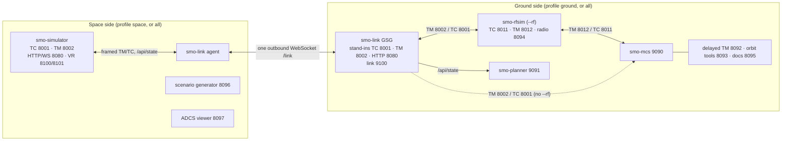

# Space Mission Operations Simulator — Software Architecture {#space-mission-operations-simulator-software-architecture}

**Manual-Scope:** system — training-system documentation, not part of the flight operations manual.

**Revised:** 2026-10-30 (author ruling Q34), from the code: `start.sh`, the
`pyproject.toml` of each package, `configs/eosat1/mission.yaml` and
`configs/eosat1/rfsim.yaml`. The port map in `docs/DEPLOYMENT.md` §2 is the
operational reference; this chapter explains how the pieces fit.

## 1. Summary {#summary}

SMO is the simulator and ground segment for the EOSAT-1 mission: a 6U
ocean-colour CubeSat in a ~513 km sun-synchronous orbit (97.39°, LTAN ~10:00).
It is a Python monorepo of seven packages. The spacecraft, the mission control
system (MCS) and the planner are separate processes that talk over TCP sockets
and HTTP/WebSocket. Everything the spacecraft *is* (telecommands, telemetry,
housekeeping structures, monitoring, FDIR, procedures and this manual) lives in
`configs/eosat1/`; the packages are the machinery that reads it.

There is no message broker. Processes exchange CCSDS/PUS packets over TCP
sockets with a 2-byte length prefix, and JSON over HTTP and WebSocket. Nothing
in the code uses Redis or any other inter-process bus.

## 2. Packages {#packages}

| Package | What it is | Console scripts (`pyproject.toml`) |
|---|---|---|
| `smo-common` | Shared library: CCSDS/PUS packet codec and TCP framing, configuration loading and schemas, SGP4 orbit propagation, the model registry, delayed-TM reporting, the shared web UI assets and FR/EN catalogs | none (library) |
| `smo-simulator` | The spacecraft: the tick engine, the subsystem models (EPS, AOCS, TCS, OBDH, TTC, payload, propulsion), PUS service dispatch, FDIR, failure injection, scenarios, the instructor console and the VR bridge | `smo-simulator` |
| `smo-mcs` | The mission control system: operator positions, telemetry processing and limit checking, commanding, alarms, trends, procedures, the TM archive and delayed-TM access | `smo-mcs` |
| `smo-planner` | Mission planning: contact windows, ground track, imaging opportunities, power and data budgets, constraint checking | `smo-planner` |
| `smo-rfsim` | Optional RF bridge between simulator and MCS: CCSDS transfer framing, Reed–Solomon, modulation, an RF channel with impairments, and a radio status page | `smo-rfsim`, `smo-rfsim-record`, `smo-rfsim-blind` |
| `smo-link` | Space link for split deployments: the space-link agent (space side) and the ground-segment gateway, GSG (ground side), joined by one outbound WebSocket | `smo-link-agent`, `smo-link-gateway`, `smo-link-token` |
| `smo-gateway` | **Deprecated**, replaced by `smo-link`. Legacy TM/TC relay used only by `deploy/start-gateway.sh` and `USE_GATEWAY=yes` | `smo-gateway` |

The simulator's subsystem models are loaded through the entry-point group
`smo.subsystem_models` (`eps_basic`, `aocs_basic`, `tcs_basic`, `obdh_basic`,
`ttc_basic`, `payload_basic`, `prop_basic`), so `subsystems/*.yaml` selects a
model by name.

## 3. Processes and Ports {#processes-and-ports}

`./start.sh` (profile `all`, the default) starts the following on one host.

| Port | Protocol | Process | Purpose |
|---|---|---|---|
| 8001 | TCP | `smo-simulator` | Telecommand uplink: framed PUS TC packets in |
| 8002 | TCP | `smo-simulator` | Telemetry downlink: framed PUS TM packets out, up to 8 clients (`tm_max_clients`) |
| 8080 | HTTP/WS | `smo-simulator` | Instructor console, `/api/state`, `/ws`, `/config` editor, `/reports`; moves with `SMO_SIM_HTTP_PORT` |
| 8100 / 8101 | TCP / WS | `smo-simulator` | VR bridge, `smo-vr/1` (`docs/VR_INTERFACE_ICD.md`); `--no-vr` or `SMO_VR=0` disables it |
| 9090 | HTTP/WS | `smo-mcs` | The operators' console |
| 9091 | HTTP | `smo-planner` | The planner (`/wide` for wall displays) |
| 8092 | HTTP | `tools/delayed_tm_viewer.py` | Delayed-TM decode and plots |
| 8093 | HTTP | `tools/orbit_tools.py` | TLE / state vector to TC converter (started only if `sgp4`, `numpy` and `aiohttp` import) |
| 8095 | HTTP | `tools/doc_viewer.py` | Serves the `configs/eosat1/` manuals |
| 8096 | HTTP | `tools/scenario_generator.py` | Scenario authoring (instructor) |
| 8097 | HTTP | `tools/adcs_sim_viewer.py` | ADCS failure-scenario viewer |

With `--rf` (or `--rf=RF`) the RF bridge is added and the MCS connects to it
instead of the simulator:

| Port | Protocol | Process | Purpose |
|---|---|---|---|
| 8011 | TCP | `smo-rfsim` | TC from the MCS (`mcs_tc_port`) |
| 8012 | TCP | `smo-rfsim` | TM to the MCS (`mcs_tm_port`) |
| 8094 | HTTP | `smo-rfsim` | Radio status page: modulation, BER, spectrum, eye (`radio_port`) |
| 5555 | TCP | `smo-rfsim` | ZMQ baseband sample stream for external SDR tools (`zmq_samples_port`) |

In the split profiles the GSG adds the link listener:

| Port | Protocol | Process | Purpose |
|---|---|---|---|
| 9100 | WS (`/link`) | `smo-link` GSG | The only port that faces the network; accepts one authenticated space-link agent |

`mission.yaml` also declares `instr_port: 8003`, but no process listens on it.

## 4. Packet Framing {#packet-framing}

Every TM and TC exchange on the TCP ports above uses the same framing
(`smo_common/protocol/framing.py`):

```
+----------------+----------------------------------------------+
| length (2 B,   | CCSDS space packet                           |
| big-endian)    | primary header (6 B) | PUS-C secondary header |
|                | | application data | CRC-16 (2 B)             |
+----------------+----------------------------------------------+
```

- **TM** packets carry a 9-octet PUS-C secondary header (3 header octets plus a
  6-octet CUC time stamp: 4 octets coarse, 2 octets fine), so application data
  starts at octet 15.
- **TC** packets carry a 3-octet secondary header with no time field.
- The length prefix counts the packet only (maximum 65 535 octets).

The RF bridge unpacks the same packets and wraps them in CCSDS transfer frames
before its channel model; the MCS sees the same framed packets on 8012 that it
would see on 8002.

## 5. Topology {#topology}



In profile `all` there is no agent and no GSG: the MCS and the planner connect
straight to the simulator's 8001/8002/8080 (or to the RF bridge with `--rf`),
and every process in the diagram runs on one host.

## 6. Launch Profiles {#launch-profiles}

`start.sh` takes the profile from `SMO_PROFILE` or `--profile=`:

| Profile | Starts | Readiness checks |
|---|---|---|
| `all` (default) | Simulator, then MCS, planner and the tools on 8092–8097; RF bridge with `--rf` | Simulator `/api/state` and TM socket, then MCS `/api/state`, then planner `/api/schedule` |
| `space` | Simulator, then the space-link agent once `/api/state` answers; scenario generator 8096 and ADCS viewer 8097 | Simulator `/api/state` |
| `ground` | GSG first; after its TM port opens: RF bridge (with `--rf`), MCS 9090, planner 9091, delayed-TM viewer 8092, orbit tools 8093, doc viewer 8095 | GSG `/healthz`, then its TM port |

- **Credentials.** Both ends share a session id and secret. The ground profile
  creates `workspace/link/session.env` on first run; copy it to the space host.
  `SMO_LINK_SESSION` and `SMO_LINK_SECRET` (or `SMO_LINK_SECRET_FILE`) override
  it, and `python -m smo_link.token new` issues a pair.
- **`--same-host`.** Both profiles on one machine. The GSG's stand-in ports move
  to 18001/18002/18080 so that the simulator keeps 8001/8002/8080, and the agent
  dials `ws://127.0.0.1:9100/link`.
- **RF bridge.** `--rf` is ground-side only. In the ground profile its upstream
  is the GSG's stand-in ports, which must stay on their defaults on 127.0.0.1
  because `rfsim.yaml` fixes the upstream.
- **Binding.** `SMO_BIND` is 127.0.0.1 by default and 0.0.0.0 with `--public`;
  `--host=ADDR` overrides it. The GSG's TM/TC/HTTP stand-ins stay on
  `SMO_GSG_BIND` (default 127.0.0.1); only the link listener faces the network.

The space-link agent is a pure client of the simulator's loopback sockets: it
forwards TM, delivers TC (at most once, never older than the TC time-to-live),
pushes the simulator state at 1 Hz, ships S15 dumps and proxies an allowlist of
instructor routes. The GSG impersonates the simulator on the ground host so that
the MCS, planner, RF bridge and tools run unchanged. The link is authenticated
by an HMAC upgrade header, then a mutual challenge-response, and every later
frame carries a MAC (`docs/web_2026-10/LINK_DESIGN.md`).

## 7. Inside the Simulator {#inside-the-simulator}

| Thread | Owns |
|---|---|
| Tick thread | All simulation state: orbit propagator, parameter store, every model's state, the S11 scheduler, FDIR |
| aiohttp thread | The HTTP/WS server on 8080 (and the VR bridge) |
| TC socket thread | Accepts framed TC on 8001 and queues it for the tick thread |
| TM socket thread | Drains the outbound packet queue to 8002 |

Only the tick thread writes simulation state; every other thread reads a
published snapshot or posts a request onto a queue (`docs/THREADING_AND_STATE.md`).

Each tick (`network.sim_tick_hz`, 1 Hz by default; `simulation.yaml` sets the
speed range and sub-stepping) the engine drains instructor requests, propagates
the orbit with SGP4 from the `orbit.yaml` TLE, advances the mission-phase state
machine, ticks each subsystem model against the shared parameter store, runs S12
monitoring and the FDIR model, emits events and the housekeeping packets due from
`telemetry/hk_structures.yaml`, paces any S15 dump, and only then executes the
queued telecommands through the PUS service dispatcher, so that their
acknowledgements see the current link state. While the OBC runs the
bootloader (`sw_image` = 0, mission phase ≤ 3) only SID 11, the beacon, is
emitted, from the bootloader APID.

## 8. MCS and Planner {#mcs-and-planner}

The **MCS** (`smo-mcs`) is a TCP client of the TM port (`--connect`, default
`localhost:8002`) and of the TC port (`--tc-port`, default 8001). It decodes the
packets, applies limit checks and derived parameters, keeps the TM archive, and
serves the operator UI over HTTP and WebSocket on 9090. Its clock follows the
simulator's `/api/state` (`--time-source sim`, `SMO_SIM_STATE_URL`).

The **planner** (`smo-planner`) serves 9091. It propagates the same TLE and
ground-station list (`orbit.yaml`) for contact windows and imaging
opportunities, and reads the simulator state from `SMO_SIM_STATE_URL`.

## 9. Configuration {#configuration}

All services read `configs/eosat1/`:

| Path | Contents |
|---|---|
| `mission.yaml` | Identity, APIDs, network ports, tick rate, VR bridge |
| `orbit.yaml` | TLE, epoch, and the canonical ground-station list |
| `simulation.yaml` | Tick rate override, speed range, sub-stepping, default HK SIDs |
| `subsystems/*.yaml` | Model selection and hardware parameters per subsystem |
| `commands/tc_catalog.yaml` | The telecommand catalogue (source of `09_command_reference.md`) |
| `telemetry/` | Parameter dictionary and housekeeping structures |
| `monitoring/`, `fdir/`, `events/` | S12 limits, FDIR rules, event catalogue |
| `procedures/`, `obcp/`, `scenarios/` | Operations procedures, on-board control procedures, training scenarios |
| `planning/` | Planner configuration and RF attributes of the ground stations |
| `rfsim.yaml` | RF bridge ports, modulation and channel |
| `manual/`, `i18n/fr/` | This manual and the French translations |

## 10. Related Documents {#related-documents}

| Document | Content |
|---|---|
| `docs/DEPLOYMENT.md` | Full port map, bind addresses, firewall list, split deployment |
| `docs/THREADING_AND_STATE.md` | Thread ownership, snapshots, breakpoints |
| `docs/PUS_SERVICE_REFERENCE.md` | The PUS services the simulator implements |
| `docs/VR_INTERFACE_ICD.md` | The `smo-vr/1` interface |
| `docs/web_2026-10/LINK_DESIGN.md` | The smo-link wire protocol and security |
| `installation_guide.md` | Installing and starting the suite |
