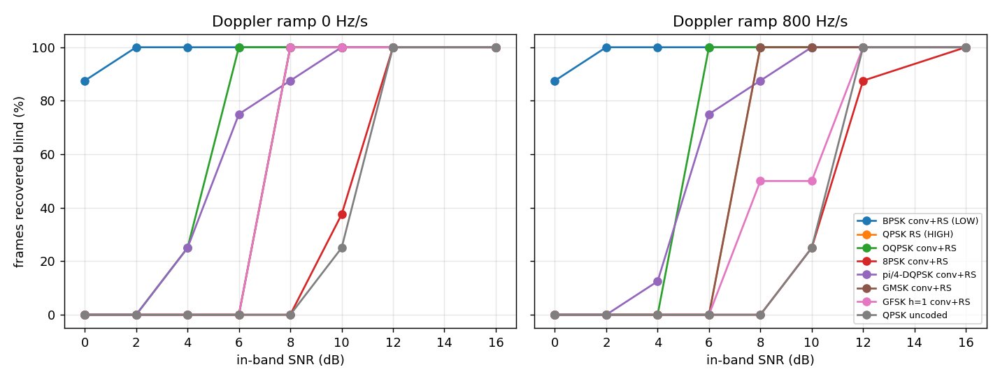

# Blind Receiver (v2) — Performance Sweep and Re-baseline

**Document ID:** EOSAT1-RF-BLIND-002
**Issue:** 1.0 — 2026-09-25
**Reproduce:** `python tools/blind_sweep.py matrix --out docs/sweeps -j 2` and
`python tools/blind_sweep.py captures --dir sim_captures --out docs/sweeps`
**Raw results:** `docs/sweeps/` (CSV, JSON, PNG)

Every run gives the receiver the samples and the sample rate, and nothing
else. Truth is read only afterwards, to score it.

---

## 1. The recorded passes (`sim_captures/`), before and after defect #135

The four recorded passes are GFSK, 9600 Bd, 250 kS/s, 30 s long. They carry
CCSDS frames of 223 bytes with **no FEC**, plus the recorder's impairments:
LEO Doppler, an elevation-envelope fade, phase noise, IQ imbalance, CW
interferers and 8-bit quantisation. Before the fix, the modulator
transmitted them at an effective index of h/8.

| Capture | In-band SNR | Doppler | Before fix | After fix (regenerated) |
|---|---|---|---|---|
| `EOSAT1-SIM_0_…401.4150MHz` | 10 dB | S-curve ±9.5 kHz (2.5 kHz/s at TCA) | not acquired | not acquired |
| `eosat1_best` | 12 dB | S-curve ±3 kHz | not acquired | **29 / 158 frames** |
| `eosat1_tuned2` | 18 dB | constant 9.5 kHz | not acquired | **146 / 157 frames** |
| `eosat1_tuned_bison` | 30 dB | S-curve ±9.5 kHz | not acquired | **154 / 158 frames** |

After the fix, every acquired pass was identified correctly: FSK family,
9600.0 Bd, uncoded, 223-byte frames, SCID 1. None of this came from the
sidecar.

Why the two weaker passes still struggle:

* They are **uncoded**. One bit error loses a 1816-bit frame, so frame
  success at a given bit error rate is (1 − BER)^1816.
* v2 detects FSK **noncoherently** (discriminator, integrate and dump). §2
  shows that this costs about 8 dB against the coherent BPSK path.
* The 10 dB pass also has a 12 dB envelope fade, so its edges sit near
  −2 dB, and a 2.5 kHz/s Doppler rate at TCA. v2 spent 17 minutes failing
  on it (proposal 3 in §4).

The captures were regenerated by `tools/regenerate_captures.py` from their
own sidecars (seed and all impairments). As a check, regenerating with the
**old** modulator reproduces the old file to correlation 1.0000 (rms
difference 2 × 10⁻⁵). Only the modulator changed.

## 2. Synthetic matrix: 8 families × 8 SNRs × 2 Doppler rates × 2 seeds

256 passes, each with 4 frames of 1115 bytes. Entries are **% of frames
recovered blind**. "—" means not acquired. \* means only one of the two
seeds acquired.

| Family | Doppler (Hz/s) | 0 dB | 2 dB | 4 dB | 6 dB | 8 dB | 10 dB | 12 dB | 16 dB |
|---|---|---|---|---|---|---|---|---|---|
| **BPSK conv+RS (LOW)** | 0 | 88 | 100 | 100 | 100 | 100 | 100 | 100 | 100 |
| **BPSK conv+RS (LOW)** | 800 | 88 | 100 | 100 | 100 | 100 | 100 | 100 | 100 |
| **QPSK RS (HIGH)** | 0 | — | — | — | — | 100 | 100 | 100 | 100 |
| **QPSK RS (HIGH)** | 800 | — | — | — | — | 100 | 100 | 100 | 100 |
| OQPSK conv+RS | 0 | — | — | 25\* | 100 | 100 | 100 | 100 | 100 |
| OQPSK conv+RS | 800 | — | — | — | 100 | 100 | 100 | 100 | 100 |
| 8PSK conv+RS | 0 | — | — | — | — | — | 38\* | 100 | 100 |
| 8PSK conv+RS | 800 | — | — | — | — | — | 25\* | 88 | 100 |
| π/4-DQPSK conv+RS | 0 | — | — | 25\* | 75 | 88 | 100 | 100 | 100 |
| π/4-DQPSK conv+RS | 800 | — | — | 12\* | 75 | 88 | 100 | 100 | 100 |
| GMSK conv+RS | 0 | — | — | — | — | 100 | 100 | 100 | 100 |
| GMSK conv+RS | 800 | — | — | — | — | 100 | 100 | 100 | 100 |
| GFSK h=1 conv+RS | 0 | — | — | — | — | 100 | 100 | 100 | 100 |
| GFSK h=1 conv+RS | 800 | — | — | — | — | 50\* | 50\* | 100 | 100 |
| QPSK uncoded | 0 | — | — | — | — | — | 25\* | 100 | 100 |
| QPSK uncoded | 800 | — | — | — | — | — | 25\* | 100 | 100 |

What the matrix shows:

* **No wrong answers.** Of the 141 passes acquired, all 141 were identified
  correctly (modulation, symbol rate, coding, frame length). Where v2 fails,
  it fails by saying "not acquired", never by giving a wrong answer.
* **The estimators earn their keep.** 99 of the 141 were confirmed on the
  **first** hypothesis, and the median number tried was 1. The median time
  to acquire was 3.6 s.
* **Doppler is free** up to 800 Hz/s (worst-case S-band LEO) for every
  family except integer-index FSK.
* **Implementation losses**, estimated against textbook thresholds. The
  recorder measures in-band SNR in 1.35 × Rs, so Es/N0 ≈ in-band + 1.3 dB,
  and Eb/N0 then allows for bits per symbol, the conv code (½) and RS
  (223/255).

| Family | Threshold (in-band) | ≈ Eb/N0 there | Textbook | Loss |
|---|---|---|---|---|
| BPSK conv+RS | 0 dB (88 %) | 4.9 dB | ~2.5 dB | ~2.5 dB |
| QPSK RS only | 8 dB | 6.9 dB | ~6.5–7 dB | ≈ 0 |
| OQPSK conv+RS | 6 dB | 7.9 dB | ~2.5 dB | ~5 dB |
| 8PSK conv+RS | 12 dB | 12.1 dB | ~6 dB | ~6 dB |
| GMSK conv+RS | 8 dB | 12.9 dB | ~3 dB coherent | ~10 dB |

The rungs EOSAT-1 flies (BPSK conv+RS, and QPSK with RS) are within about
2.5 dB of theory. The losses sit in the families the ladder does not fly, and they point
straight at what to build next (§4).

* **Failed acquisitions are expensive.** Passes that were not acquired took
  a median of 21 s each, and up to 103 s, against 3.6 s for a success. On a
  real recording that grows: the 30 s, 10 dB capture took 17 minutes to give
  up.

## 3. What changed in v2 during the sweep

The sweep found three weaknesses, and they were fixed before the final run
above:

1. **The "wide" cut was 8× the bandwidth.** On an h = 1 FSK with receiver IQ
   imbalance, it took in the IQ image, whose beats with the FSK tones threw
   false symbol-rate lines. It is now 4× (`receiver.WIDE_KEEP`), and the
   drift estimator's signal and noise regions were moved inside that cut.
2. **The Doppler fit was good to about 1 %.** Over a 2 s analysis window
   that still smears an M-th power line by tens of Hz, and OQPSK's weak twin
   lines vanished at 800 Hz/s. A second stage (`refine_drift_mth_power`) now
   measures the residual rate from the drift of the M-th power line itself.
   The window is narrow, so π/4-DQPSK's side-lines cannot pose as the
   carrier. OQPSK at 800 Hz/s went from an 8–10 dB threshold to 6 dB.
3. **Uncoded marginal links.** When the markers repeat but the first three
   frames all carry a bit error, framing now searches up to 48 frames along
   the lattice for one that checks. This is what acquires `eosat1_best`.
   Batch acquisition also no longer gives up when a growing window reaches
   the end of the recording: it slides on and starts small again.

## 4. Proposed next changes

In order of value:

1. **Coherent CPM receiver (GMSK/GFSK).** Detect GMSK by its Laurent
   decomposition: MSK is OQPSK with half-sine pulses. That reuses the OQPSK
   path already in v2, with a precoder. Expected gain is 3–6 dB over the
   discriminator. It also matters for the UHF beacon and for most real
   CubeSat UHF downlinks. On the regenerated `eosat1_best` it should take 29
   frames to well over 100.
2. **Close the OQPSK / 8PSK implementation loss (4–6 dB).** Add a
   decision-directed PLL after the Viterbi–Viterbi estimate. Use joint
   timing and phase for OQPSK instead of rail-by-rail. Make the V&V block
   length adapt to SNR. Feed soft decisions to Viterbi scaled by the
   measured EVM rather than a fixed scale.
3. **Bound the cost of failure.** Before a full demodulation, run a 0.5 s
   pre-check on each hypothesis (EVM plus ASM hits), give acquisition a
   total time budget, and spread hypotheses across CPU cores. The 17-minute
   give-up and the 21 s median failure are what a student will notice
   first.
4. **Hand v2's answer to v1.** When the live receiver loses lock, ask v2
   (one acquisition window) for a `SignalDescription` instead of stepping
   through modulations with fixed 1.5–2.5 s dwells. Separately, fix those
   dwells: they must scale with frame air time, since at the SAFE rung no
   dwell of that length can ever contain a sync marker.
5. **Fast Doppler.** For passes like the 10 dB capture (2.5 kHz/s at TCA),
   add a short chirp-rate search, or accept TLE-predicted Doppler when one
   exists (a "semi-blind" mode). This is what a real ground station does.
6. **Broaden what "framed" means.** Handle the CCSDS pseudo-randomiser, the
   LDPC and Proximity-1 sync markers, and AX.25/HDLC flags. That would let v2
   read real amateur CubeSat recordings, for example from SatNOGS, as well
   as the suite's own.
7. **Small fidelity fix in the modulator.** The CPM path Gaussian-filters
   each frame with `mode='same'`, so the filter tails are cut at every frame
   boundary. Carry the filter state across calls, as the OQPSK path already
   does.

## 5. Test status

* The full suite was run before and after the defect #135/#136 fixes:
  **7373 passed**, and no test changed from pass to fail.
* The same **57 failures + 35 e2e errors** exist in both runs and are
  unrelated to the RF chain. They sit in the S12/S19/S20 report paths, the
  modern MCS page tests, and the generated-content checks. The e2e errors
  need a browser stack.
* New tests: `tests/test_rfsim/test_blind_receiver.py` (30), plus
  `TestCPMPhasePerBit` and `TestCPMConfigReachesTheTransmitter` in
  `test_modulation_roundtrip.py` (9).
